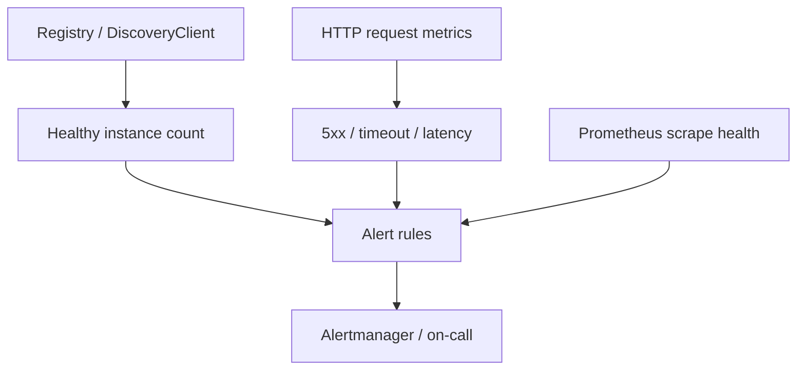

# Designing Alerts for Zero Healthy Instances and Widespread Errors

A service may be registered in Eureka or Consul yet have zero instances healthy enough to serve requests. In other cases, a few instances remain up while HTTP 5xx errors spike simultaneously across most replicas, leaving the service effectively unable to serve traffic. If you only monitor processes or running Pod counts, these situations can go undetected until too late.

Alert design for Spring Cloud Service Discovery must look across three layers simultaneously: **instance discoverability**, **instance health**, and **actual request outcomes**. This lesson builds a metric contract, PromQL queries, and alert rules for two core scenarios: zero healthy instances and widespread errors across multiple instances or an entire service. It also distinguishes application failures from registry/telemetry failures, reduces false positives, and provides operational runbooks.

## 1. Two Scenarios Requiring Alerts

### 1.1. Zero Healthy Instances

A consumer queries `order-service`, but the registry has no eligible instances left to receive traffic. Possible causes include:

- All instances genuinely stopped or crashed.
- Readiness/health checks failed across all replicas.
- The registry is unreachable or returning an empty list.
- The service registered under the wrong name or address, or was filtered out by `query-passing`/`OUT_OF_SERVICE` status.
- A network partition prevents consumers from fetching updated registry or health state.

This is typically a critical alert because consumers may have no endpoints left to call. However, distinguish **zero healthy instances** from **missing discovery telemetry**. If Prometheus or the discovery observer goes down, do not immediately conclude that the service lost all instances.

### 1.2. Widespread Errors

A service still has healthy instances according to the registry, yet many replicas return 5xx errors, timeouts, or dependency failures. For example, 6 out of 8 instances hit the same database failure, or every instance returns 5xx after a rollout. The registry may still report instances as `passing` if health checks only verify that the process or health endpoint responds.

Widespread errors must be detected through request metrics and the proportion of affected instances, not health checks alone. A single failing instance typically warrants a warning; errors affecting most replicas or pushing service-wide error rates past SLO warrant paging on-call.



## 2. Define Metrics Before Writing Alerts

Prometheus can only evaluate signals that have been exported. Never assume Eureka, Consul, or Spring Cloud LoadBalancer automatically exposes every healthy-instance gauge with identical names across all versions. Standardize metrics from a registry exporter, a discovery observer, or application instrumentation.

A useful metric contract:

| Metric | Type | Suggested Labels | Meaning |
| --- | --- | --- | --- |
| `service_discovery_registered_instances` | Gauge | `service`, `registry`, `cluster` | Number of registered instances, not necessarily healthy. |
| `service_discovery_healthy_instances` | Gauge | `service`, `registry`, `cluster` | Number of instances meeting health/readiness criteria that consumers are allowed to pick. |
| `service_discovery_min_healthy_instances` | Gauge | `service`, `registry`, `cluster` | Minimum healthy instances the service must maintain in the registry used by consumers. |
| `service_discovery_lookup_failures_total` | Counter | `service`, `registry`, `reason` | Number of discovery queries that failed or could not fetch a valid list. |
| `app_http_requests_total` | Counter | `service`, `instance`, `status` | Number of HTTP requests processed, split by status code. |
| `up` | Gauge generated by Prometheus | `job`, `instance`, `service` | Whether the scrape target is reachable. |

The `service_discovery_*` metrics above are **an illustrative metric contract provided by your observability system/exporter**, not built-in metric names guaranteed across all Spring Cloud versions. You can produce them via Micrometer, a registry exporter, or a discovery observer that periodically queries Consul/Eureka.

For `service_discovery_healthy_instances`, define "healthy" strictly from the consumer's perspective:

- Consul: number of entries where all relevant checks are `passing`, matching a Health API query with `?passing` if consumers also filter for passing instances.
- Eureka: number of instances in a consumer-acceptable status, excluding non-serving statuses such as `OUT_OF_SERVICE` per configuration.
- Kubernetes: number of `Ready` endpoints in `EndpointSlice`/`Service`, if Kubernetes is the discovery source.

Do not conflate Catalog instance counts with selectable instance counts. For example, Consul can keep `critical` registrations in the Catalog; healthy metrics must come from health state rather than counting Catalog entries alone.

### 2.1. Metrics Must Emit Zero

When zero healthy instances remain, the exporter should emit `service_discovery_healthy_instances = 0` for known services. If the metric disappears completely when the count reaches zero, PromQL may not be able to distinguish zero from missing data. Another design option is retaining `service_discovery_min_healthy_instances` or an expected-service inventory so missing healthy series can still be detected.

The exporter must continue emitting expected service series even when the registry returns no instances. If the exporter stops, Prometheus should fire a separate scrape/observer alert to distinguish collection failures from a service losing instances.

### 2.2. Counting Healthy Instances Should Not Rely on an Ageless Cache

The discovery observer should record the last successful fetch timestamp and observation lag. You can add:

| Metric | Purpose |
| --- | --- |
| `service_discovery_last_success_timestamp_seconds` | Timestamp of the observer's most recent successful registry query. |
| `service_discovery_observer_errors_total` | Errors encountered by the observer when connecting/reading the registry. |
| `service_discovery_registry_sync_lag_seconds` | Delay between source changes and what the observer sees, if measurable. |

Never keep publishing an old healthy count as if it were freshly verified. If the observer fails to read the registry for an extended period, mark data stale or stop updating alongside an observer-down alert.

### 2.3. Exporting Gauges with Micrometer

If an application or discovery observer aggregates instance counts itself, it can expose gauges through Micrometer. The example below illustrates a fixed service/registry/cluster; in multi-service systems, manage a bounded label set and update only after a successful registry read.

```java
import java.util.concurrent.atomic.AtomicInteger;

import io.micrometer.core.instrument.Gauge;
import io.micrometer.core.instrument.MeterRegistry;
import org.springframework.stereotype.Component;

@Component
public class DiscoveryCountMetrics {

    private final AtomicInteger registered = new AtomicInteger();
    private final AtomicInteger healthy = new AtomicInteger();
    private final AtomicInteger minimumHealthy = new AtomicInteger(2);

    public DiscoveryCountMetrics(MeterRegistry registry) {
        Gauge.builder(
                "service.discovery.registered.instances",
                registered,
                AtomicInteger::get)
            .tag("service", "order-service")
            .tag("registry", "consul")
            .tag("cluster", "prod-a")
            .register(registry);

        Gauge.builder(
                "service.discovery.healthy.instances",
                healthy,
                AtomicInteger::get)
            .tag("service", "order-service")
            .tag("registry", "consul")
            .tag("cluster", "prod-a")
            .register(registry);

        Gauge.builder(
                "service.discovery.min.healthy.instances",
                minimumHealthy,
                AtomicInteger::get)
            .tag("service", "order-service")
            .tag("registry", "consul")
            .tag("cluster", "prod-a")
            .register(registry);
    }

    public void update(int registeredCount, int healthyCount) {
        registered.set(registeredCount);
        healthy.set(healthyCount); // Emit 0 when there are no passing instances.
    }
}
```

Micrometer's Prometheus registry typically converts dots in meter names to underscores, producing metrics such as `service_discovery_healthy_instances`. In production implementations, `update` should only be called after the observer successfully reads the registry; if a read fails, record the error and preserve the last success timestamp rather than assuming healthy equals `0`. The minimum value can come from per-service configuration/SLOs. Never create labels from full URLs, unnecessary Pod UIDs, or user data, as cardinality will grow rapidly.

## 3. Standardizing Request Metrics from Spring Boot

Spring Boot Actuator combined with Micrometer exports HTTP server request metrics. With the Prometheus registry, the `http.server.requests` timer is typically exposed as `http_server_requests_seconds_count`, with tags such as `method`, `uri`, `status`, `outcome`, and `exception`. Exact names and tags depend on version, registry, and instrumentation settings.

If you need shared PromQL across diverse applications, you can standardize on a counter `app_http_requests_total` with labels:

- `service`: logical service name, such as `order-service`.
- `instance`: bounded replica identifier stable across a deployment lifecycle.
- `status`: HTTP status code, such as `200`, `404`, `500`.

Never put full URLs, query strings, user IDs, request IDs, trace IDs, or exception messages into metric labels. High-cardinality values inflate memory usage and Prometheus cost. Use route templates such as `/orders/{id}` when per-endpoint breakdowns are needed.

Example Actuator/Prometheus setup in a Spring Boot application:

```xml
<dependency>
    <groupId>org.springframework.boot</groupId>
    <artifactId>spring-boot-starter-actuator</artifactId>
</dependency>
<dependency>
    <groupId>io.micrometer</groupId>
    <artifactId>micrometer-registry-prometheus</artifactId>
</dependency>
```

```yaml
management:
  endpoints:
    web:
      exposure:
        include: health,prometheus
  endpoint:
    health:
      show-details: never
```

Prometheus can scrape `/actuator/prometheus` according to your environment's security configuration. Never expose metrics endpoints to the public Internet; restrict them with network policies, authentication, or internal scrape paths.

## 4. PromQL: Detecting Zero Healthy Instances

Assume the metric contract provides:

- `service_discovery_min_healthy_instances`: minimum greater than 0 for services that must always remain available.
- `service_discovery_healthy_instances`: current healthy instance count, emitted even when 0.

Both gauges must share the same identifying label set (`service`, `registry`, `cluster`). If a service registers with multiple registries simultaneously, evaluate each registry actually used by consumers; never mix healthy counts from one registry with minimums from another.

### 4.1. Alerting on Zero Healthy Instances

```promql
service_discovery_min_healthy_instances > 0
unless on (service, cluster, registry)
(service_discovery_healthy_instances > 0)
```

This expression retains services requiring more than 0 instances that have no healthy series greater than 0. It catches both a gauge equal to 0 and a missing healthy series, as long as the minimum metric is still scraped.

Example alert rule:

```yaml
groups:
  - name: service-discovery-availability
    rules:
      - alert: ServiceHasNoHealthyInstances
        expr: |
          service_discovery_min_healthy_instances > 0
          unless on (service, cluster, registry)
          (service_discovery_healthy_instances > 0)
        for: 2m
        labels:
          severity: critical
        annotations:
          summary: "No healthy instances remaining for {{ $labels.service }}"
          description: >-
            Service {{ $labels.service }} in cluster {{ $labels.cluster }}
            has had no instances eligible to receive traffic for at least 2 minutes.
          runbook_url: "https://runbooks.example/service-discovery/no-healthy-instances"
```

`for: 2m` filters out brief blips during rollouts or registry updates. Choose the actual window based on health-check intervals, scrape intervals, and service criticality. For essential services, use a shorter window while avoiding pages caused by a single failed scrape.

### 4.2. Alerting on Degraded Capacity Before Total Loss

A service may still have healthy instances, yet fall below its minimum threshold:

```promql
service_discovery_healthy_instances
  < on (service, cluster, registry)
service_discovery_min_healthy_instances
```

This is a degraded-capacity alert. For example, a service requires at least 3 instances but currently has only 1. Set severity to `warning` or `critical` depending on headroom and load.

If you want to alert on the ratio of healthy to registered instances:

```promql
service_discovery_registered_instances > 0
and on (service, cluster, registry)
(
  service_discovery_healthy_instances
  / clamp_min(service_discovery_registered_instances, 1) < 0.5
)
```

This expression detects when the healthy ratio drops below 50% while registrations still exist. Do not replace the zero-healthy alert with a ratio alert: a service with 0/0 registrations may produce no series, whereas 0/5 healthy is a far more severe condition.

### 4.3. Distinguishing Lost Observer/Registry Telemetry

If Prometheus fails to scrape the discovery observer, healthy counts may disappear. Create a separate alert:

```yaml
- alert: ServiceDiscoveryObserverDown
  expr: up{job="service-discovery-observer"} == 0
  for: 2m
  labels:
    severity: warning
  annotations:
    summary: "Cannot scrape discovery observer"
    description: "Unable to verify healthy instance counts from this observer."
```

If the target disappears from Prometheus service discovery altogether, `up == 0` may produce no series. In that case, use `absent(up{job="service-discovery-observer"})` or monitor target inventory/monitoring pipelines. Telemetry-loss alerts must remain independent from service-loss alerts.

## 5. PromQL: Detecting Widespread 5xx Errors

Assume the application exports the counter:

```text
app_http_requests_total{service="order-service",instance="order-a",status="500"}
```

`status=~"5.."` matches 5xx codes. Service-wide error ratio over 5 minutes:

```promql
sum by (service, cluster) (
  rate(app_http_requests_total{status=~"5.."}[5m])
)
/
clamp_min(
  sum by (service, cluster) (
    rate(app_http_requests_total[5m])
  ),
  0.001
)
```

This is the ratio of 5xx requests to total requests, not the ratio of failing instances. You can alert when the ratio exceeds 5% with sufficient traffic:

```yaml
- alert: ServiceHighHttp5xxRate
  expr: |
    (
      sum by (service, cluster) (
        rate(app_http_requests_total{status=~"5.."}[5m])
      )
      /
      clamp_min(
        sum by (service, cluster) (rate(app_http_requests_total[5m])),
        0.001
      )
    ) > 0.05
    and on (service, cluster)
    sum by (service, cluster) (rate(app_http_requests_total[5m])) > 1
  for: 10m
  labels:
    severity: critical
  annotations:
    summary: "High HTTP 5xx rate on {{ $labels.service }}"
    description: "5xx rate exceeded 5% for 10 minutes with sufficient traffic."
```

The `> 1` guard requires more than roughly one request per second over the window, preventing a 100% ratio from a single request from paging unnecessarily. Tune thresholds to actual traffic and SLOs.

### 5.1. Alerting When Multiple Instances Fail Simultaneously

A service-wide 5xx ratio can be skewed by a single high-traffic instance. To detect widespread failures, compute the 5xx ratio per instance and count how many instances exceed the threshold.

Recording rule:

```yaml
- record: service_instance:http_5xx_ratio:rate5m
  expr: |
    sum by (service, cluster, instance) (
      rate(app_http_requests_total{status=~"5.."}[5m])
    )
    /
    clamp_min(
      sum by (service, cluster, instance) (
        rate(app_http_requests_total[5m])
      ),
      0.001
    )
```

Alert rule counting the percentage of scraped instances whose 5xx ratio exceeds 5%:

```yaml
- alert: ServiceErrorsAcrossManyInstances
  expr: |
    (
      count by (service, cluster) (
        service_instance:http_5xx_ratio:rate5m > 0.05
      )
      /
      on (service, cluster)
      count by (service, cluster) (
        up{job="spring-services"} == 1
      )
    ) > 0.5
    and on (service, cluster)
    sum by (service, cluster) (
      rate(app_http_requests_total[5m])
    ) > 1
  for: 10m
  labels:
    severity: critical
  annotations:
    summary: "Widespread 5xx errors across {{ $labels.service }}"
    description: "More than half of scraped instances have a 5xx rate above 5%."
```

This expression assumes application Prometheus targets carry `service` and `cluster` labels, and each instance has a single matching `up` target. If an instance has multiple scrape targets, normalize/deduplicate the denominator first. Instances with zero requests during the window may not emit a ratio series; for very low-traffic services, use different signals or a longer window.

### 5.2. Detecting Dependency Failures via Client Metrics

A service may return 5xx because a downstream dependency is failing. In addition to server request metrics, collect client request metrics broken down by target service, status, and calling instance. Standardized metric example:

```text
app_http_client_requests_total{
  caller="order-service",
  dependency="payment-service",
  status="503"
}
```

Error ratio when calling `payment-service` from `order-service`:

```promql
sum by (caller, dependency) (
  rate(app_http_client_requests_total{status=~"5.."}[5m])
)
/
clamp_min(
  sum by (caller, dependency) (rate(app_http_client_requests_total[5m])),
  0.001
)
```

This metric helps distinguish internal service failures from downstream dependency failures. Standardize instrumentation across your actual HTTP clients (`RestClient`, `RestTemplate`, `WebClient`, or others); never assume every client automatically emits identical metric names or tags.

## 6. Distinguishing Instance Errors, Service Errors, and Monitoring Errors

A good alert should help the on-call engineer pinpoint the blast radius:

| Signal | Likely Cause | Next Check |
| --- | --- | --- |
| One instance unhealthy, others healthy | Localized fault: process, node, config, or local dependency | Logs/pod/host of that instance, readiness, and health checks. |
| Healthy count = 0, registry query failing | Registry, network, ACLs, or entire provider may be down | Query Eureka/Consul directly; inspect observer and registry health. |
| Healthy count = 0, registry query succeeds with no passing instances | All providers unhealthy, scaled to 0, or wrong service ID | Compare desired replicas, Catalog, health checks, and recent rollouts. |
| Many instances spiking 5xx simultaneously | Widespread fault from release, config, dependency, or shared infra | Correlate deploy timestamps, downstream metrics, database, and network. |
| Prometheus `up` drops while request error metrics stay flat | Scrape/network/metrics endpoint issue; not proof the service is down | Inspect target, Actuator endpoint, auth, and Prometheus. |
| Registry reports healthy while requests fail | Health check does not reflect true readiness, or stale cache/endpoint | Inspect health check logic, client timeouts, and real requests. |

Never use `up == 1` as the sole proof that a service is ready. `up` only proves Prometheus scraped the target successfully. Likewise, a passing health check does not guarantee every business flow or dependency is working.

## 7. Complete Alert Group Configuration

A concise example combining key alerts. Metrics in this example must be supplied and labeled consistently per the metric contract.

```yaml
groups:
  - name: service-discovery-and-availability
    rules:
      - alert: ServiceHasNoHealthyInstances
        expr: |
          service_discovery_min_healthy_instances > 0
          unless on (service, cluster, registry)
          (service_discovery_healthy_instances > 0)
        for: 2m
        labels:
          severity: critical
        annotations:
          summary: "No healthy instances remaining: {{ $labels.service }}"
          runbook_url: "https://runbooks.example/service-discovery/no-healthy-instances"

      - alert: ServiceBelowMinimumHealthyInstances
        expr: |
          service_discovery_healthy_instances
          < on (service, cluster, registry)
          service_discovery_min_healthy_instances
        for: 5m
        labels:
          severity: warning
        annotations:
          summary: "Below minimum healthy instances: {{ $labels.service }}"

      - alert: ServiceDiscoveryObserverDown
        expr: up{job="service-discovery-observer"} == 0
        for: 2m
        labels:
          severity: warning
        annotations:
          summary: "Discovery observer cannot be scraped"

      - alert: ServiceHighHttp5xxRate
        expr: |
          (
            sum by (service, cluster) (
              rate(app_http_requests_total{status=~"5.."}[5m])
            )
            /
            clamp_min(
              sum by (service, cluster) (rate(app_http_requests_total[5m])),
              0.001
            )
          ) > 0.05
          and on (service, cluster)
          sum by (service, cluster) (rate(app_http_requests_total[5m])) > 1
        for: 10m
        labels:
          severity: critical
        annotations:
          summary: "High HTTP 5xx rate: {{ $labels.service }}"

      - alert: ServiceErrorsAcrossManyInstances
        expr: |
          (
            count by (service, cluster) (
              service_instance:http_5xx_ratio:rate5m > 0.05
            )
            /
            on (service, cluster)
            count by (service, cluster) (
              up{job="spring-services"} == 1
            )
          ) > 0.5
          and on (service, cluster)
          sum by (service, cluster) (
            rate(app_http_requests_total[5m])
          ) > 1
        for: 10m
        labels:
          severity: critical
        annotations:
          summary: "Widespread 5xx errors: {{ $labels.service }}"
```

In an actual rules file, the recording rule `service_instance:http_5xx_ratio:rate5m` must be declared before rules referencing it. Place it earlier in the same group or in a group evaluated beforehand. Validate syntax with `promtool check rules` before loading into Prometheus.

## 8. Thresholds, Windows, and Severity

No single threshold fits every service. Choose thresholds based on SLOs, traffic volume, minimum replicas, health-check intervals, and recovery behavior.

| Alert | Example Initial Condition | Suggested Severity | Purpose |
| --- | --- | --- | --- |
| Zero healthy instances | Healthy = 0 for 1–2m when min healthy > 0 | Critical/page | Service has no eligible backends. |
| Below minimum instances | Healthy < minimum for 5m | Warning/page depending on service | Redundant capacity is degraded. |
| Service-wide 5xx | 5xx > 5% for 10m with sufficient traffic | Critical | Users are impacted on the service. |
| Multi-instance 5xx | > 50% of instances have 5xx > 5% for 10m | Critical | Widespread failure, likely shared cause. |
| Single instance error | 5xx/health check failure on one replica | Warning | Local investigation, unless service has only one replica. |
| Discovery observer down | Observer unscrapeable for 2m | Warning | Loss of registry visibility. |

These numbers are only starting points. For low-traffic services, percentages fluctuate wildly; combine minimum request rates, longer windows, or absolute error counts. For services with strict SLOs, consider multi-window/multi-burn-rate alerts instead of a fixed 5xx threshold.

### 8.1. Using `for` to Reduce Noise

`for` requires the expression to stay true continuously for a duration before firing. Choose a window long enough to ignore brief rollout or scrape jitter, yet shorter than how long users can tolerate an outage.

Do not set `for` too long on a zero-healthy alert if the service has no fallback path. Nor should you set `for: 0s` on every error-rate alert, since a tiny burst could trigger unnecessary pages.

### 8.2. Handling Maintenance and Scale-to-Zero

If a service intentionally scales to zero or enters scheduled maintenance, `service_discovery_min_healthy_instances` should reflect the expected state at that time. You can use time-bounded maintenance windows/silences in Alertmanager, provided they are audited and expire automatically. Never permanently disable zero-healthy alerts just to silence noise.

## 9. Alertmanager: Grouping, Deduplication, and Inhibition

When all instances lose health, several child alerts may fire simultaneously: per-instance down, critical health checks, HTTP 5xx, and zero healthy instances. Alertmanager should group by `service`, `registry`, `cluster`, and environment so on-call receives one contextual notification instead of one alert per Pod.

Conceptual configuration example:

```yaml
route:
  group_by: ["alertname", "service", "registry", "cluster"]
  group_wait: 30s
  group_interval: 5m
  repeat_interval: 2h
  receiver: on-call

inhibit_rules:
  - source_matchers:
      - alertname = "ServiceHasNoHealthyInstances"
    target_matchers:
      - alertname = "ServiceBelowMinimumHealthyInstances"
    equal: ["service", "registry", "cluster"]
```

When a service has zero healthy instances, the zero-healthy alert is the broader root symptom and can inhibit the below-minimum-capacity alert to avoid duplicate notifications. Do not inhibit observer-down or registry-cluster-down alerts when they supply independent root-cause information.

Alertmanager silences should include an owner, reason, ticket/change reference, and end time. Silences only suppress notifications; metrics and alerts should still evaluate so historical observability remains intact.

## 10. Runbook: Zero Healthy Instances

When `ServiceHasNoHealthyInstances` fires:

1. **Verify telemetry:** check Prometheus `up` for the discovery observer and application scrape targets. If the observer is down, fix monitoring first; never conclude the registry is empty from stale metrics.
2. **Inspect the registry directly:** for Consul, check `/v1/health/service/{service}` and `/v1/health/checks/{service}`; for Eureka, check application/instance status and peers; for Kubernetes, check `Service` and `EndpointSlice`.
3. **Compare registration and health:** distinguish no registrations from registrations present where all are `warning`/`critical`/`OUT_OF_SERVICE`.
4. **Inspect providers:** check whether Pods/processes are still running, readiness/liveness, startup logs, dependencies, and health endpoints.
5. **Inspect network and permissions:** check DNS, routing, firewalls, TLS, ACL tokens, Eureka authentication, and network partitions.
6. **Inspect recent changes:** check rollouts, config changes, scaling events, certificate/token rotations, or service name/instance ID changes.
7. **Remediate:** roll back faulty releases, restore dependencies, scale up instances, or fix registry connectivity per your platform runbook.
8. **Verify recovery:** confirm healthy counts rise, discovery queries return instances, consumers succeed, and error rates drop.

Never mass-delete registrations or disable Eureka self-preservation just to turn dashboards green. First determine whether instances actually died or heartbeat/registry communication was interrupted.

## 11. Runbook: Widespread Errors Across Multiple Instances

When `ServiceHighHttp5xxRate` or `ServiceErrorsAcrossManyInstances` fires:

1. Identify the service, cluster, 5xx rate, traffic volume, and number of affected instances.
2. Compare error onset with deployments, config changes, secret rotations, or infrastructure changes.
3. Break down errors by status code/route template; avoid URLs or labels containing sensitive data.
4. Check client request metrics to see if a dependency is returning 5xx or timing out.
5. Inspect databases, message brokers, DNS, network, connection pools, thread pools, GC, and resource saturation.
6. If errors began immediately after a rollout, consider pausing or rolling back per release procedures.
7. If a dependency is overloaded, reduce retries, rely on circuit breakers/bulkheads, and restore capacity; avoid retry storms.
8. After remediation, verify error rates drop across multiple evaluation windows and no unhealthy instances remain.

Errors appearing simultaneously across many instances usually point to a shared cause such as a release, config, secret, dependency, or infrastructure issue. Errors isolated to one instance usually suggest a local node/process/config problem. Treat this as a diagnostic guide, not an absolute rule.

## 12. Testing Alerts Before Production

Do not wait for a real outage to learn whether alerts work. Test them in staging:

- Stop or scale the provider to 0 to confirm the zero-healthy alert fires.
- Fail readiness/Consul health checks across all instances to confirm healthy metrics drop.
- Fail only one instance to verify partial degradation alerts are not mistaken for zero healthy.
- Induce controlled 5xx responses on one replica, then multiple replicas, to verify the widespread-error alert.
- Stop the discovery observer or block scraping to confirm the separate telemetry-down alert.
- Perform a normal rollout to verify `for`, Alertmanager grouping, and silences do not cause false pages.
- Restore the provider and verify alerts resolve once registry/metric data converges.

Every alert should have an owner, severity, dashboard link, and runbook. An alert without a clear action usually only creates noise for on-call.

## 13. Common Alert Design Mistakes

| Mistake | Consequence | Fix |
| --- | --- | --- |
| Alerting only on `up == 0` | Scrapeable processes with zero healthy service instances go undetected | Track healthy instance counts and request outcomes. |
| Counting Catalog instead of health state | Critical instances are still counted as available | Use Consul Health API `?passing`, Eureka status, or Kubernetes Ready endpoints. |
| Emitting no metric when healthy = 0 | PromQL has no series to compare against zero | Emit a zero gauge or use a minimum/expected baseline metric with `unless`. |
| Missing observer-down alert | Monitoring data loss is misread as a service losing instances | Create an independent scrape/observer alert. |
| Using error ratios without traffic guards | A single failed request yields a 100% ratio | Add a minimum request-rate guard or suitable window. |
| Using only service-wide ratios | One heavily failing replica can be masked or skewed by uneven traffic | Track both service-wide ratio and affected instance count. |
| Labeling with full URLs or exceptions | Cardinality explodes and exhausts Prometheus resources | Use bounded `service`, `instance`, `status`, and route templates. |
| Missing `for` or grouping | Flapping alerts and duplicate notifications for one incident | Use appropriate windows, group by service/cluster, and configure inhibition. |
| Indefinite silences | Real incidents are hidden | Require silences to have an owner, reason, and expiration time. |

## 14. Key Takeaways

- Zero healthy instances is a critical availability signal; count instances consumers can actually select, not just raw registrations.
- Widespread error alerts should combine service-wide HTTP 5xx rates with the proportion of affected instances.
- Your metric contract must clearly define data sources, labels, and zero representation; example metrics here represent standardized observability metrics.
- Separate alerts for a service losing instances from alerts for a discovery observer/Prometheus losing telemetry.
- Use `for`, traffic thresholds, severities, Alertmanager grouping, and inhibition to cut noise without hiding root incidents.
- Runbooks must inspect the registry, health checks, request metrics, dependencies, network, and recent deployment changes.
- Test alerts in staging with zero-instance, partial-failure, widespread-5xx, and monitoring-outage scenarios before production.

## References

- [Prometheus: Alerting Rules](https://prometheus.io/docs/prometheus/latest/configuration/alerting_rules/)
- [Prometheus: Querying Basics](https://prometheus.io/docs/prometheus/latest/querying/basics/)
- [Prometheus: Instrumentation Practices](https://prometheus.io/docs/practices/instrumentation/)
- [Spring Boot: Actuator Metrics](https://docs.spring.io/spring-boot/reference/actuator/metrics.html)
- [Micrometer: Prometheus Registry](https://docs.micrometer.io/micrometer/reference/implementations/prometheus.html)
