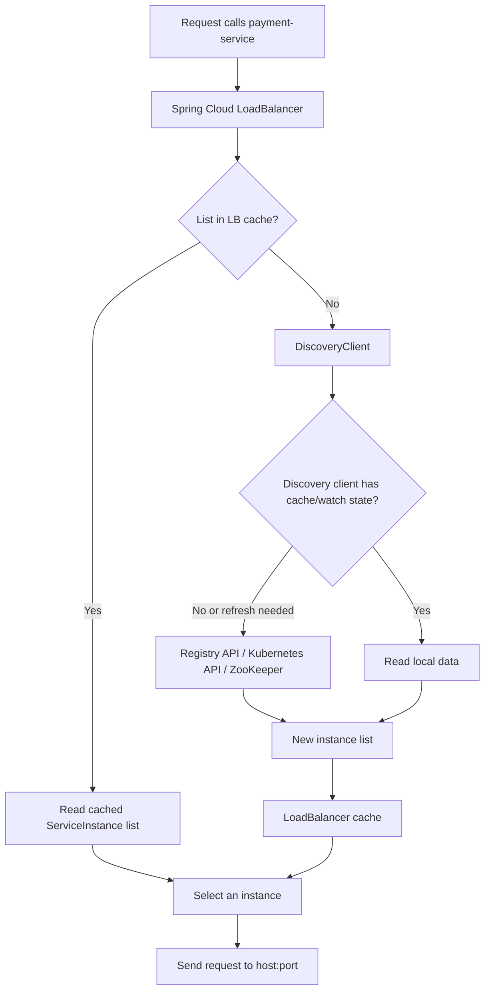

# Cache Optimization and Trade-offs with Propagation Latency

Service discovery is frequently called repeatedly by many consumers. If every business request directly queries Eureka, Consul, ZooKeeper, or the Kubernetes API to retrieve the instance list, the registry will bear heavy load and become a dependency on the hot path. Caching reduces lookup frequency, lowers latency, and allows applications to continue using recent data when the registry is temporarily slow.

In return, caches can retain stale hostnames, IPs, ports, metadata, or instance states. When a new instance registers, an old instance stops, or health changes, consumers may continue seeing outdated data until cache layers refresh. Optimizing discovery is therefore a balancing act between **registry load**, **change propagation latency**, and **availability when the registry encounters failures**.

In the `SPRING_CLOUD_SERVICE_DISCOVERY` module, `DiscoveryClient` provides the abstraction for looking up instances by service ID; the registry implementation and Spring Cloud LoadBalancer determine how instances are fetched, cached, and selected. This lesson analyzes the cache layers, how to configure TTL/refresh, how to handle stale data, and measurement methods for choosing appropriate settings.

## 1. Why Cache Discovery Results?

Suppose `order-service` sends thousands of requests per second to `payment-service`. The instance list for payment typically changes far more slowly than the business request rate. If every request calls the registry to retrieve the instance list, the number of discovery requests can scale with business request volume.

Caching allows consumers to temporarily store the instance list for a period of time. Subsequent requests use the existing list instead of re-querying the registry. This brings several benefits:

- Reduces registry read requests and lowers registry CPU, network, and connection load.
- Reduces service lookup time on the request processing path.
- Limits impact when the registry is temporarily slow or unreachable.
- Reduces repeated connection creation and metadata processing.
- Creates opportunities to coalesce multiple lookups for the same service into a single update.

However, caching does not make an instance healthier. If a dead address remains in the cache, the load balancer may continue selecting it. Therefore, caching must be designed alongside timeouts, bounded retries, health filtering, and registry update mechanisms.

## 2. Cache Layers in Service Discovery

In a Spring Cloud application, discovery data can be stored across multiple layers. Never look at a single TTL and conclude that the entire system will see changes after that exact duration.

| Layer | Data That May Be Retained | Example Mechanisms | Consequence When Stale |
|---|---|---|---|
| Registry/cluster | Catalog or registry state on server nodes. | Eureka peer registry, Consul catalog, Kubernetes API objects, ZooKeeper znodes. | Registry nodes may temporarily diverge or records may not yet be updated. |
| Discovery client | List of services/instances fetched to the application. | Eureka local registry cache, Consul query/watch state, ZooKeeper watcher state, Kubernetes discovery client. | Consumers may still read an outdated or incomplete list. |
| Spring Cloud LoadBalancer | List of `ServiceInstance` entries by service ID. | `LoadBalancerCacheManager`, `CachingServiceInstanceListSupplier`. | Instances already removed in the discovery client may still appear in the cached list. |
| DNS resolver | Hostname → IP records. | CoreDNS, OS resolver, JVM DNS cache, runtime DNS cache. | Hostnames may continue pointing to old IPs after DNS records change. |
| HTTP client/connection pool | Established TCP/TLS connections, DNS results, or related routes. | Keep-alive, connection pools, proxies, service meshes. | Requests may continue using connections to old instances even after the discovery list changes. |
| Custom business cache | URIs, `ServiceInstance` objects, or instance selection results. | `@Cacheable`, in-memory maps, Redis. | Can introduce an extra layer of stale data beyond framework caches. |

For example, the Eureka client has a local registry cache; Spring Cloud LoadBalancer can cache the instance list; the HTTP client can hold a connection pool. When an instance deregisters, each layer may receive the change at a different time.

### 2.1. Cache Is Not Synonymous with Registry Replication

Registry replication synchronizes state across registry nodes. The discovery client cache holds data on the application side. The LoadBalancer cache holds the list used for instance selection. These three mechanisms solve different problems and can coexist.

Lowering the LoadBalancer TTL does not make Eureka peer replication faster. Increasing Eureka's registry fetch frequency does not immediately clear DNS caches or connection pools either. When investigating propagation latency, you must identify which layer is holding stale data.

## 3. Data Flow When Looking Up Instances

A request using a service ID may traverse the following layers:



The diagram illustrates conceptual layers; concrete implementations may merge caches or use watches/events instead of polling. Some providers already return cached data from the client, after which LoadBalancer caches that list further.

## 4. TTL and Refresh Interval Are Two Different Concepts

**TTL (time to live)** is the duration a cache entry is considered valid before needing refresh or eviction. **Refresh interval** is the cadence at which a client proactively fetches or synchronizes new data. These two values can live at two different layers.

For example:

- The Eureka client fetches the registry on the `eureka.client.registry-fetch-interval-seconds` cadence.
- Spring Cloud LoadBalancer has its own TTL for the `ServiceInstance` list cache.
- DNS resolvers use record TTLs and the runtime's own cache policy.
- Consul can use blocking queries/watches to wait for index changes instead of only polling on a fixed interval.
- ZooKeeper clients can use watchers to receive change notifications and re-read data after events or reconnects.

Short TTLs refresh data more frequently but increase load and computation. Long TTLs reduce load but prolong how long stale data is held. Event-driven refreshes can reduce polling, yet still require handling reconnects, resyncs, and state when watchers are disrupted.

### 4.1. Example Eureka Registry Fetch Configuration

```yaml
eureka:
  client:
    registry-fetch-interval-seconds: 15
```

The value above illustrates a consumer refreshing the registry more frequently than the common default interval. It affects the Eureka client's local registry cache, not the Spring Cloud LoadBalancer cache TTL. When changing it, consider the number of clients and registry nodes because all consumers may increase fetch frequency simultaneously.

### 4.2. Example Spring Cloud LoadBalancer Cache Configuration

```yaml
spring:
  cloud:
    loadbalancer:
      cache:
        enabled: true
        ttl: 5s
        capacity: 256
```

`ttl` controls how long LoadBalancer cache entries are retained; `capacity` limits the number of cache entries. The example value `5s` is an illustrative choice, not a universal optimal configuration. Property names and cache implementations must be verified against the Spring Cloud release train in use.

Spring Cloud LoadBalancer can use the default cache implementation or Caffeine if the corresponding dependency is on the classpath. Verify the actual implementation and applied configuration in the application context; do not assume that merely adding a dependency gives every cache identical behavior.

### 4.3. TTL Is Not a Guaranteed Convergence Time

TTL only governs the validity of a single cache entry. Changes can still arrive late due to registry replication, refresh scheduling, request timeouts, retries, DNS caches, or connection pools. A 5-second TTL in LoadBalancer does not guarantee consumers stop calling an old instance after 5 seconds if the discovery client still returns the old list for 30 seconds.

## 5. Trade-offs Between Cache TTL and Propagation Latency

A cache with a short TTL typically reduces the time stale data is retained. However, each cache expiration can trigger a new query. When the number of services and consumers is large, lowering TTL across the board can cause registry load to surge.

| TTL | Lookup Load | Likelihood of Stale Data | Best Suited When |
|---|---|---|---|
| Very short | Higher | Lower if upstream layers also update quickly | Endpoints change frequently and fast convergence is required. |
| Medium | Balanced | Acceptable per SLA | Most microservice systems with moderate change frequency. |
| Long | Lower | Higher | Stable endpoints, load-constrained registry, or other failover mechanisms exist. |
| No cache | Potentially very high | Little staleness from this layer, but depends on upstream caches | Diagnostics or very small systems; not suitable for production by default. |

Do not choose a TTL solely based on wanting "as short as possible." Determine the maximum acceptable time for consumers to see a new instance and stop selecting a departed instance, then allocate a time budget across each layer.

## 6. Estimating Change Visibility Latency

For a registration change, the time until consumers see new data can be decomposed into segments:

\[
T_{visible} \approx T_{registry} + T_{client} + T_{loadbalancer} + T_{dns/connection}
\]

Where:

- (T_{registry}): time for the registry to accept and propagate the change to the node accessed by the consumer.
- (T_{client}): time for the discovery client to receive or re-fetch the data.
- (T_{loadbalancer}): time for the LoadBalancer cache to expire, refresh, or receive the new list.
- (T_{dns/connection}): time for DNS caches and connection reuse to stop using the old address, if those layers are on the request path.

This is an analytical model. Segments may run in parallel, overlap, or not apply; do not treat the sum as an exact SLA for every implementation.

With a polling interval (I), if change timestamps are randomly distributed across the cycle, the waiting delay for the next poll typically falls between near (0) and (I), with an average around (I/2), excluding request and processing time. If multiple polling layers are chained in series, worst-case latency can approach the sum of the respective intervals.

Illustrative example:

| Layer | Interval/TTL | Approximate Max Wait Latency |
|---|---:|---:|
| Registry replication | 2 seconds | 2 seconds |
| Eureka client fetch | 15 seconds | 15 seconds |
| LoadBalancer cache | 5 seconds | 5 seconds |

If layers are sequential without event invalidation, total waiting time can be roughly 22 seconds plus processing time. Actual latency may be lower due to overlapping cycles or higher due to retries, network errors, and scheduler delays.

## 7. Optimizing Cache by Discovery Provider

### 7.1. Eureka

Eureka clients typically keep a local registry cache and periodically fetch the registry. Points to consider:

- `registry-fetch-interval-seconds` affects how often the client fetches the registry.
- Peer replication affects when the node a client reads has updated data.
- Lease renewal and eviction affect when dead instances are removed from the server registry.
- Spring Cloud LoadBalancer has its own cache if enabled.
- Clients may retain stale data while the server is unreachable; verify behavior for your version and configuration.

Do not reduce the registry fetch interval too low when you have hundreds or thousands of clients without measuring server load. If you need to shorten change visibility time, inspect lease/eviction, peer replication, and LoadBalancer cache together rather than tweaking a single property.

### 7.2. Consul

Consul supports indexed queries and blocking queries so clients can wait for catalog changes. This reduces continuous short polling: the client sends the current index and waits until the index changes or times out. Spring Cloud Consul provides watch/catalog refresh mechanisms depending on version and configuration.

Points to consider:

- Watch delay/timeout determines detection cadence and query load.
- Agent/server and catalog consistency affect returned data.
- Health queries can retrieve only passing instances; this affects which instances appear in cache.
- The LoadBalancer cache may still retain an old list after a watch receives a change.
- On reconnect or watch error, the client needs a full data resync rather than relying solely on the last event.

Blocking queries do not eliminate latency completely. They cut unnecessary polling, yet still depend on catalog update time, query handling, reconnects, and downstream caches.

### 7.3. ZooKeeper

ZooKeeper watchers deliver notifications when relevant znodes change. Events are typically just signals for the client to re-read data; watchers are not a durable event log allowing consumers to skip synchronization.

When a session expires or a client reconnects, watchers must be re-established and current state re-read. If an application only handles events without resyncing after reconnects, caches can miss changes that occurred during the disconnect window.

A sound design typically combines watchers for fast detection with a full state re-read at startup/reconnect. If Spring Cloud Zookeeper or Curator maintains its own cache, measure latency from znode update through `DiscoveryClient` to LoadBalancer.

### 7.4. Kubernetes Discovery

Spring Cloud Kubernetes can watch or read Services, Endpoints/EndpointSlices via the Kubernetes API depending on version and configuration. Kubernetes also has DNS records with TTLs and resolver caches.

If using ClusterIP DNS, the DNS name is usually stable while the backend list changes in the Service dataplane. If using headless Services, DNS may return multiple Pod IPs and resolver/client caches can retain old IPs. If using `DiscoveryClient`, integration caches/watchers and the LoadBalancer cache can add extra latency.

Choose a clear request path: either call Service DNS so Kubernetes balances traffic, or fetch Pod endpoints via `DiscoveryClient` so Spring Cloud LoadBalancer selects them. If using both layers, lowering TTL on one side does not guarantee the final chosen endpoint has changed.

## 8. TTL, Health Checks, and Instance State

Cache freshness and health are two distinct properties. A fresh cache may contain an instance that just failed right after the data was fetched; a stale cache may contain an instance that is still healthy. You cannot use TTL as a substitute for health checks.

Several principles:

- Health checks should reflect readiness to serve requests, not merely process liveness.
- Discovery queries should filter out non-passing/unready instances if business requirements demand it.
- Caches should be refreshed when health status changes, though not all implementations support instant invalidation.
- Requests to failed instances still require timeouts and bounded retries.
- Circuit breakers can reduce repeated requests to failing instances/dependencies; they do not automatically remove records from the registry.

If an instance is killed abruptly, removal time may include failure detection/lease, registry update, discovery refresh, and LoadBalancer cache expiration. During a controlled shutdown, deregistration/readiness draining can shorten how long consumers continue selecting the instance.

## 9. Cache Stampede and Load Spikes

A cache stampede occurs when many requests simultaneously discover that a cache entry has expired and concurrently query the registry to refresh it. With many services and consumer replicas, this phenomenon can create a heavy load spike right when the registry is already under pressure.

Measures to mitigate stampedes:

1. **Single-flight/coalescing:** allow only one request to refresh a key; other requests wait for the shared result.
2. **TTL jitter:** add a small random offset so consumer instances do not expire at the exact same time.
3. **Early refresh:** refresh in the background before cache expiration if the library supports it.
4. **Stale-while-revalidate:** continue serving recent data while refreshing, if the staleness risk is acceptable.
5. **Backoff and concurrency limits:** avoid piling up retries when the registry is unresponsive.
6. **Bounded cache size:** avoid retaining unbounded service IDs or unused metadata.

Use stale-while-revalidate cautiously for endpoints revoked for security reasons or isolated instances. Do not keep serving stale data indefinitely just to boost availability.

## 10. Cache Keys and Data Scope

Cache keys must accurately represent the cached data. For instance lists, keys typically need to include the service ID and any context that changes the result, such as namespace, region, tenant, or query filters.

If two consumers in two zones have different instance selection policies yet share a cache key containing only the service ID, one consumer's filtered result could mistakenly be served to the other. Similarly, do not cache version-filtered lists under a shared key if callers have different API compatibility requirements.

Several principles:

- Cache the candidate list at the discovery/load balancer layer; perform per-request instance selection at the appropriate layer.
- Do not cache a single selected instance for too long if load balancing needs to distribute across multiple instances.
- Include namespace/zone/filter in the key if they affect the returned list.
- Evict or bound entries when a service ID no longer exists.
- Avoid using mutable objects as cache keys or holding references that can be mutated after caching.

## 11. Cache Configuration in Spring Cloud LoadBalancer

A reference configuration:

```yaml
spring:
  cloud:
    loadbalancer:
      cache:
        enabled: true
        ttl: 5s
        capacity: 512
```

In environments with many service IDs or infrequently changing discovery data, caching can reduce discovery client calls. When service instances change frequently, a shorter TTL may be more suitable, though registry load must be measured.

If you need to disable caching to inspect direct discovery behavior, you can set:

```yaml
spring:
  cloud:
    loadbalancer:
      cache:
        enabled: false
```

Disabling only the LoadBalancer cache does not mean the entire system is cache-free. Eureka local registry, Consul watch state, ZooKeeper watcher state, Kubernetes client cache, DNS resolvers, and connection pools may still hold data. This is a useful technique for isolating one cache layer, not a default production setting.

Property names, default values, cache implementations, and invalidation behavior depend on the Spring Cloud release train. Check the documentation for your exact version before deploying configuration to live environments.

## 12. Example of Choosing TTLs by Operational Target

Suppose the system requirement is that consumers stop selecting a deregistered instance within 10 seconds under normal conditions. There are three sequential polling/cache layers:

| Layer | Illustrative Target Config | Latency Budget |
|---|---:|---:|
| Registry/client update | 4 seconds | 4 seconds |
| LoadBalancer cache | 3 seconds | 3 seconds |
| Applicable DNS/connection reuse | 2 seconds | 2 seconds |
| Scheduler/network buffer | 1 second | 1 second |

The total illustrative budget is 10 seconds. This is not a guaranteed formula because layers may overlap or retries may occur. Measure p95/p99 from deregistration to the last request sent to that instance.

If you measure p99 at 18 seconds, do not just lower LoadBalancer TTL from 3 seconds to 1 second. Identify which segment takes the most time: registry lease/replication, client refresh, LoadBalancer cache, DNS TTL, or connection pool.

## 13. Measuring Cache Effectiveness

To optimize on an empirical basis, track the following metrics:

- Number of `DiscoveryClient.getInstances` calls per service ID.
- Cache hits/misses, evictions, and entry count in the LoadBalancer cache if the implementation exposes metrics.
- Number of requests to Eureka/Consul/Kubernetes API and latency of those requests.
- Time from register/deregister/status change until consumers see the change.
- Error rate due to connection refused, timeouts, or unresolvable hosts.
- Retry rate and circuit breaker open counts.
- Cache data age or timestamp of the most recent refresh if observable.
- Instance count in the registry versus instance count seen by consumers.

Measure separately by service, consumer, and zone. Some services change rarely yet carry high traffic; others change frequently with low request volume. Using one global TTL for every service may be suboptimal.

### 13.1. Measuring Propagation Latency with Timestamps

In staging, record these milestones:

1. Provider sends register/deregister or health status changes.
2. Registry accepts the change.
3. Peer registry (if any) reflects the change.
4. Consumer discovery client receives new data.
5. LoadBalancer cache updates its list.
6. First request uses the new list and last request still selects the old instance.

Repeat multiple times under different loads and compute p50/p95/p99. A single successful measurement is not enough to set an SLA, especially when the registry has multiple nodes or consumers are distributed across zones.

## 14. Testing Cache Scenarios and Registry Failures

A staging test suite should cover:

- **Adding an instance:** measure how long until consumers begin seeing the new instance.
- **Controlled deregistration:** measure how long until consumers stop selecting the instance.
- **Abrupt kill:** measure failure detection time, eviction, and refresh.
- **Metadata change:** verify new version/zone is seen by consumers.
- **Temporary registry disconnect:** determine how long caches continue serving and behavior upon TTL expiry.
- **Cache stampede:** expire caches simultaneously across many consumers and measure registry load.
- **DNS record change:** measure how long resolvers and clients stop using the old IP.
- **Consumer reconnect:** verify caches are resynced after losing connection/watch/session.
- **No healthy instances left:** verify applications return proper errors/fallbacks and do not retry infinitely.

Tests should be load-bounded and run in a test environment. Never restart registries or kill production instances en masse just to observe cache behavior.

## 15. Common Pitfalls When Optimizing Caches

| Symptom | Possible Cause | Remediation |
|---|---|---|
| Registry experiences high load after lowering TTL | Many consumers refresh simultaneously. | Increase TTL appropriately, add jitter/coalescing, and measure load. |
| Old instance still called after deregistration | LoadBalancer or discovery client cache has not expired. | Measure each layer, configure appropriate TTL/refresh and invalidation. |
| Short LoadBalancer TTL yet data stays stale | Upstream caches like Eureka registry or DNS have not updated. | Inspect caches and refreshes across all preceding layers. |
| Consumers keep calling old instance after DNS changes | DNS resolver/JVM cache or connection pool retains old address. | Check TTL, DNS cache policy, and connection lifecycle. |
| All consumers query registry at once | Cache stampede when TTLs are synchronized. | Jitter, single-flight, background refresh, and backoff. |
| Cache holds unhealthy instances | Discovery list does not filter health or health updates are slow. | Use health-aware discovery, readiness, and timeouts/retries. |
| Disabled LoadBalancer cache yet data stays stale | Another cache layer is still active. | Inspect Eureka, Consul, ZooKeeper, Kubernetes, DNS, and HTTP client. |
| Per-service-ID cache returns wrong zone | Key omits zone/filter or filtered cache is improperly shared. | Include filter context in the key or cache the unfiltered candidate list. |
| Retries amplify load during registry failure | Missing backoff/jitter or unbounded retries. | Bound retries, use exponential backoff and circuit breakers. |
| Increasing refresh frequency does not lower latency | Delay lies in replication, lease, DNS, or connection reuse. | Measure timestamps per stage rather than continuing to shrink intervals. |

## 16. Production Design Principles

- Define SLAs for time to see new instances and time to stop selecting departed instances.
- Enumerate all cache layers: registry, discovery client, LoadBalancer, DNS, HTTP client, and custom caches.
- Choose per-service TTLs based on service characteristics and stale-data tolerance.
- Avoid lowering polling intervals globally without first measuring registry load.
- Prefer watches/blocking queries when supported by the provider while still designing reconnect resyncs.
- Use jitter/coalescing to reduce cache stampedes.
- Do not cache a single chosen instance for too long if load needs to balance across multiple replicas.
- Combine health/readiness with caching; do not treat TTL as a health signal.
- Use timeouts, bounded retries, backoff, and circuit breakers to tolerate stale endpoints.
- Monitor cache hits/misses, registry request rate, stale endpoint errors, and p95/p99 propagation delay.
- Test instance add/remove, registry outages, reconnects, and DNS changes before rolling out new configurations.
- Verify property names and defaults against the exact version of Spring Cloud, Eureka, Consul, ZooKeeper, or Kubernetes integration.

## Conclusion

Caching reduces registry load and lookup latency, but introduces a window where consumers can see stale data. That delay comes not only from the Spring Cloud LoadBalancer TTL, but also from registry replication, discovery client caches, DNS resolvers, and connection pools. Therefore, optimization requires examining the entire data path rather than tweaking a single property.

Establish a convergence latency budget, measure each layer with timestamps and metrics, and then select TTL/refresh intervals aligned with change frequency and registry capacity. Combine caching with watches/resyncs, jitter, timeouts, bounded retries, health filtering, and circuit breakers to balance performance against data freshness and availability during registry failures.
