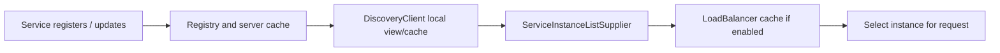
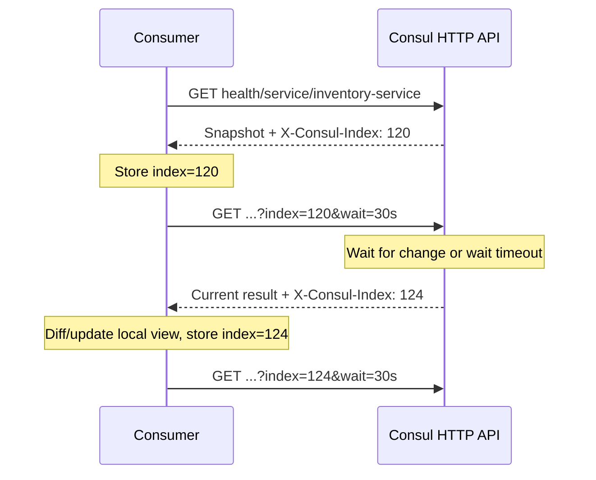

# Overhead of Full Fetch, Delta Updates, and Change Watching

Service discovery needs to distribute the list of service instances to consumers. When a registry has few instances, fetching the full list periodically is fairly simple. When there are hundreds or thousands of consumers and a large registry, re-fetching all data on every cycle consumes significant bandwidth, CPU, and memory. Delta update and watch mechanisms reduce overhead by processing only changes or waiting until state fluctuates.

In Spring Cloud, the synchronization strategy depends on the `DiscoveryClient` implementation. The Eureka client maintains a local registry cache and typically receives deltas between fetches. Consul supports blocking queries and streaming at the HTTP API layer; Spring Cloud Consul also includes Catalog Watch to monitor service list changes. Spring Cloud LoadBalancer can add another layer of instance list caching.

## 1. The Discovery Data Path

Consumers do not necessarily query the registry for every business request. Data typically flows through multiple layers:



A change such as adding an instance, updating metadata, or changing health status must propagate through these layers. Therefore, change visibility time depends on:

1. Time for the producer to send registration, heartbeat, or deregistration.
2. Time for the registry to record the change and refresh its response/cache.
3. How the consumer synchronizes: periodic snapshot fetch, delta retrieval, or watching via watch mechanisms.
4. The `DiscoveryClient` cache and LoadBalancer cache.
5. Instance, zone, and health filters plus the endpoint selection algorithm.

Distinguish three concepts:

- **Full snapshot:** fetching the entire list of services/instances at query time.
- **Delta update:** fetching only changes since a previous sync checkpoint, then applying them to the local copy.
- **Watch / blocking query:** holding a request open until data changes or a timeout expires; depending on the API, the response may be a new snapshot or an event stream.

A watch does not automatically mean the payload contains only deltas. You must inspect the specific endpoint's contract.

## 2. Overhead of Full Registry Fetch

Full fetch is logically simple: the client requests the registry to return all services and instances, then replaces or rebuilds its local view. This approach is useful on initial client startup, when resynchronizing after divergence, or when delta mechanisms are not used.

However, if all consumers fetch full snapshots periodically, the exact same unchanged data may be transmitted repeatedly. Cost scales with consumer count and registry size.

Main cost items:

| Resource | Cost Under Frequent Full Fetches |
|---|---|
| Bandwidth | Every consumer receives the full payload even if only one instance changed |
| Registry CPU | Building, filtering, serializing, and compressing large payloads; concurrent requests create load spikes |
| Consumer CPU | Parsing JSON/XML, allocating objects, and replacing the local registry view |
| Consumer memory | Retaining the instance list and metadata structures in every process |
| Latency | Large payloads and many clients fetching simultaneously can prolong response times |
| Scalability | Cost grows with consumer count, instance count, and fetch frequency |

### 2.1. Traffic Estimation

You can roughly estimate full fetch traffic using:

\[
R_{full} \approx \frac{C \times S}{T}
\]

Where:

- `C`: number of consumers fetching the registry.
- `S`: size of the serialized full snapshot payload, before or after compression depending on your measurement basis.
- `T`: fetch interval in seconds.
- `R_full`: approximate average traffic, excluding HTTP overhead, retries, replication, and request bursts.

For example, 300 consumers each downloading a 2 MB payload every 30 seconds:

\[
R_{full} \approx \frac{300 \times 2\ MB}{30\ s} = 20\ MB/s
\]

This is an ideal average; if clients start simultaneously or fetch schedules align in phase, peak load can be much higher. If the registry has 10,000 instances, the full snapshot can be substantially large even if each service has only a few metadata fields.

Full fetches are still necessary at certain times. The optimization goal is not to eliminate them completely, but to avoid re-fetching everything when a client only needs a few small changes.

## 3. Eureka: Initial Full Fetch, Delta for Subsequent Cycles

The Eureka client fetches the registry from the server and keeps a copy in local memory. Under the standard flow:

1. When the client initializes, it must fetch the full registry to establish a baseline state.
2. Subsequent syncs fetch deltas since the previous fetch.
3. The client applies the changes to its local registry cache.
4. The client verifies data consistency after applying the delta.
5. If divergence is detected or reconciliation fails, the client re-fetches the full registry to resynchronize.

Deltas can include new instances, removed instances, or attribute/status updates. Because the server retains deltas for a window of time, the same change may appear in multiple delta responses. The Eureka client handles duplicate deliveries so the local view does not duplicate entries.

### 3.1. Key Properties

Spring Cloud Netflix 5.1.0 documents the relevant defaults:

| Property | Default | Meaning |
|---|---:|---|
| `eureka.client.fetch-registry` | `true` | Whether the client fetches the registry from Eureka Server |
| `eureka.client.registry-fetch-interval-seconds` | `30` | Registry fetch interval |
| `eureka.client.disable-delta` | `false` | When `false`, client uses deltas; when `true`, client fetches full registry instead of deltas |
| `eureka.client.log-delta-diff` | `false` | Logs differences when reconciliation fails and the client must fetch the full registry |
| `eureka.client.g-zip-content` | `true` | Requests compressed payloads if the server supports it |
| `eureka.server.response-cache-update-interval-ms` | `30000` | Server-side response cache update interval |
| `eureka.server.use-read-only-response-cache` | `true` | Uses the read-only response cache |
| `eureka.server.retention-time-in-m-s-in-delta-queue` | `180000` | Retention duration for changes in the delta queue |

Example keeping the default delta mechanism and explicitly stating the fetch interval:

```yaml
eureka:
  client:
    fetch-registry: true
    registry-fetch-interval-seconds: 30
    disable-delta: false
    log-delta-diff: false
    g-zip-content: true

  server:
    response-cache-update-interval-ms: 30000
    use-read-only-response-cache: true
```

`log-delta-diff` is useful when investigating registry mismatches; it does not need to stay enabled permanently if diff logs are large and serve no operational purpose. `disable-delta: true` forces clients to download the full registry on every fetch cycle. Only use it for diagnostics or in special situations after measuring load, because it increases transferred data and parsing work across all consumers.

### 3.2. When Does Eureka Need to Fetch the Full Registry Again?

A client may need to fetch the full registry when:

- Starting up for the first time with no local registry view yet.
- A delta response cannot be applied or reconciliation detects client-server drift.
- `disable-delta` is enabled.
- Local state is lost or the client must rebuild its copy after a sync error.

Full resync is a correctness recovery mechanism. Do not disable reconciliation or ignore delta errors just to save bandwidth; an incorrect local cache can cause consumers to call removed instances or fail to see new instances.

### 3.3. How Much Smaller Are Deltas Than Full Snapshots?

Suppose a registry has 5,000 instances but only 12 changes occur in one interval. A full fetch must transmit data describing nearly all 5,000 instances; a delta only needs to represent 12 changes plus control/reconciliation metadata. When the change rate is much smaller than registry size, deltas dramatically reduce bandwidth and CPU.

Simple estimate:

\[
R_{delta} \approx \frac{C \times D}{T}
\]

Where `D` is the average delta size. If the full snapshot is 2 MB while the average delta is 40 KB, with the same 300 consumers and 30-second interval:

\[
R_{delta} \approx \frac{300 \times 40\ KB}{30\ s} = 0.4\ MB/s
\]

This is an illustrative example, not a Eureka benchmark. When changes happen continuously or many instances update simultaneously, deltas can grow close to the full snapshot size; clients still need full resync capability.

## 4. Consul: Blocking Queries and Catalog Watch

Consul provides Catalog and Health APIs to read services/nodes/checks. Many endpoints support blocking queries: the client sends the index of the previous result and asks Consul to wait until data changes or the `wait` duration expires.

Unlike continuous polling, blocking queries do not require the client to re-query every few hundred milliseconds when nothing has changed. Once the request returns, the client reads the new `X-Consul-Index` and passes it in the next query.

### 4.1. How Blocking Queries Work



Example querying instance list and health state:

```bash
curl -i \
  "http://localhost:8500/v1/health/service/inventory-service?index=120&wait=30s"
```

The response includes the `X-Consul-Index` header. The client saves that value and sends it back in the `index` parameter next time. When a change occurs, the request wakes up early; if nothing changes, it can wait until the timeout expires.

Blocking queries typically return the current state of the requested resource, not a Eureka-style delta list. If the client needs to compute diffs, it compares the old snapshot with the new snapshot or updates a materialized view per the API contract.

### 4.2. Cases Where Blocking Queries Return Without Changes

A blocking query response does not guarantee that data changed. The request can also complete due to `wait` expiration, idempotent write operations, or other implementation conditions. Therefore, clients must not treat every response as an event indicating the service changed.

HashiCorp notes several points when implementing a blocking query loop yourself:

- If the returned index is smaller than the previous index, reset the index to `0` and start over; snapshot restores or changes in how Consul generates indexes can cause the index to move backward.
- Verify the returned index is valid and greater than 0; invalid indexes can trap the client in a busy loop.
- Rate-limit if data changes continuously. The watch loop must not create a tight request storm when the system is unhealthy.
- Set the client HTTP timeout higher than `wait` with headroom for network latency.

Consul allows a maximum `wait` of 10 minutes; if omitted, the default is 5 minutes. Actual values should match update goals and HTTP client timeouts.

### 4.3. Consul Catalog Watch in Spring Cloud Consul

Spring Cloud Consul includes `Consul Catalog Watch`. This watch performs blocking HTTP calls to detect changes in the Catalog's service list. When new service data arrives, it publishes a `HeartbeatEvent` so interested components can react.

Current properties:

| Property | Default | Meaning |
|---|---:|---|
| `spring.cloud.consul.discovery.catalog-services-watch-delay` | `1000` ms | Delay between the previous watch call and the next |
| `spring.cloud.consul.discovery.catalog-services-watch-timeout` | `2` seconds | Maximum blocking duration for a single watch call |

Example:

```yaml
spring:
  cloud:
    consul:
      discovery:
        catalog-services-watch-delay: 1000
        catalog-services-watch-timeout: 2
```

Catalog Watch tracks the service list in the Catalog; do not mistake it for a full delta feed for every instance or every health check. If you need to track changes for a specific instance, Health endpoints such as `/v1/health/service/{service}` support blocking queries. Also distinguish `spring.cloud.consul.config.watch.*`: that watches Consul KV data changes for Config, not Catalog Watch for service discovery.

### 4.4. Consul Streaming

Consul has had a streaming backend since version 1.10 for supported endpoints. When querying with `index` or `cached` on compatible endpoints, Consul can use streaming instead of traditional long polling. The server emits change events; clients subscribe and build a local materialized view.

Streaming can reduce data exchanged compared to repeatedly receiving full snapshots via long polling, though not every endpoint or client integration uses streaming automatically. Check the `X-Consul-Query-Backend` response header when you need to determine the actual backend. Do not assume Spring Cloud Consul Catalog Watch receives a per-instance streaming feed.

## 5. Comparing Full Fetch, Delta, and Watch

| Criterion | Full Snapshot | Delta Update | Watch / Blocking Query |
|---|---|---|---|
| Returned data | Entire resource state | Only changes since previous checkpoint | Depends on API: new snapshot or change events |
| Cost when changes are infrequent | High if repeated often | Low | Lower than dense polling because requests wait |
| Initializing local view | Directly from snapshot | Needs baseline full snapshot first | Usually needs initial snapshot or materialized view |
| Recovery on drift | Re-fetch everything | Reconciliation then fallback to full | Fetch new snapshot or reset index/restart watch |
| Latency | Depends on fetch interval and cache | Depends on delta fetch interval and cache | Can react as changes are detected, plus processing latency |
| Client complexity | Low | Medium: apply in order and handle duplicates | Higher: maintain index, timeouts, retries, resets, and rate limits |
| Example | Eureka initial/full registry fetch | Eureka delta fetch | Consul blocking query / streaming |

No single mechanism is best for every situation. Full snapshots are easy to recover and simple; deltas save resources when changes are sparse; watches are efficient when tracking changes without dense polling. Systems often combine approaches: initial full snapshot, deltas or watches during operation, and full resync when drift is detected.

## 6. Multi-Layer Caching and Update Latency

Even after the registry updates, consumers may still use stale data due to caches at various layers:

| Layer | Example | Impact |
|---|---|---|
| Registry server | Eureka response cache; Consul agent/catalog cache | Server may not immediately serve newly written data |
| DiscoveryClient | Eureka local registry cache | In-process lookups read the local copy |
| LoadBalancer | `CachingServiceInstanceListSupplier` | Instance list can remain stale for an additional TTL |
| DNS / proxy / client connection | DNS TTL, connection pool, proxy cache | Old endpoints or connections may continue to be used |

Spring Cloud LoadBalancer has a default cache TTL of `35s`. Documentation recommends disabling the LoadBalancer cache if `DiscoveryClient` already caches data, such as `EurekaDiscoveryClient`, to avoid double caching:

```yaml
spring:
  cloud:
    loadbalancer:
      cache:
        enabled: false
```

Do not disable caching based purely on assumption. Confirm whether the `DiscoveryClient` in use performs caching. With Consul, `getInstances` and how the Health API is queried may differ from Eureka's local registry cache; the LoadBalancer cache can be helpful if `DiscoveryClient` does not cache.

End-to-end latency is not always equal to the sum of every layer's TTL because cycles may run concurrently and out of phase. Nevertheless, stacked caches can cause stale instances to persist longer than expected. When latency must be lowered, measure each layer before adjusting intervals across the board.

## 7. Monitoring Changes in the Application

To know whether discovery updates on time, observe both the data and synchronization timestamps.

### 7.1. Eureka Metrics

Collect or log the following information:

- Total applications and instances in the local registry.
- Counts of delta fetches and full fetches.
- Response size, request duration, and delta deserialization/application duration.
- Failed reconciliation counts and full resyncs after mismatches.
- Timestamp of the most recent successful fetch and age of the local registry cache.
- Server response cache refresh counts if metrics/logs are available.

`eureka.client.log-delta-diff=true` can be helpful during a diagnostic window to log diffs when delta reconciliation fails. Once the root cause is found, re-evaluate log levels to avoid excessive log volume.

### 7.2. Consul Metrics

Monitor:

- Blocking query duration, count of queries returning due to index change, and count returning due to timeout.
- Latest `X-Consul-Index` value; alert if index moves backward or is invalid.
- Count of `HeartbeatEvent` emissions by Catalog Watch.
- Number of services and instances in Catalog/Health APIs.
- Health of caches and the queried agent/server.
- ACL errors, timeouts, retries, or rate limits in the watch loop.

Do not treat a `HeartbeatEvent` as proof that every instance changed. Cross-check the service list or health results as needed.

### 7.3. LoadBalancer Metrics

At the LoadBalancer layer, track:

- Number of instances returned by `ServiceInstanceListSupplier` per service ID.
- Age of the cached list if the supplier uses caching.
- Number of instance selection failures due to zero instances.
- Request distribution across instances/zones and error rates per endpoint.

Avoid using instance IDs or request IDs as metric labels with unbounded cardinality. Use service IDs and bounded error groups; endpoint details can be recorded in controlled traces/logs.

## 8. Tuning Intervals and Data Size

Before making changes, measure registry size, consumer count, change frequency, and propagation targets. Principles:

1. Keep deltas enabled for Eureka in typical configurations; do not force full fetches on every cycle without reason.
2. Do not drop `registry-fetch-interval-seconds` too low just to make dashboards update faster; many consumers can generate heavy request load.
3. Keep payload compression enabled if server/client support it and the registry is large.
4. Only increase `response-cache-update-interval-ms` or alter delta retention after understanding impacts on data freshness and recovery.
5. With Consul, use blocking queries/watches instead of tight continuous polling loops when endpoints support them.
6. Set HTTP timeouts higher than blocking query `wait` durations and handle reconnects with backoff.
7. Rate-limit watch loops during continuous churn to prevent busy loops.
8. Minimize unnecessary metadata; repeated metadata across thousands of instances inflates snapshot and delta sizes.
9. Avoid duplicate caching between `DiscoveryClient` and LoadBalancer; assign clear caching responsibility.
10. Retain full resync/reconciliation as the recovery path when local state is no longer trustworthy.

### 8.1. Delta-Oriented Eureka Configuration Example

```yaml
eureka:
  client:
    fetch-registry: true
    registry-fetch-interval-seconds: 30
    disable-delta: false
    g-zip-content: true
    log-delta-diff: false

spring:
  cloud:
    loadbalancer:
      cache:
        enabled: false
```

This example assumes the Eureka client already caches the registry locally. If another `DiscoveryClient` does not cache, do not mechanically apply `cache.enabled: false` to the entire application.

### 8.2. Consul Catalog Watch Configuration Example

```yaml
spring:
  cloud:
    consul:
      discovery:
        catalog-services-watch-delay: 1000
        catalog-services-watch-timeout: 2
```

These are the defaults written out explicitly for clarity. There is no need to lower delay to a few milliseconds to feel real-time; blocking queries naturally wait for changes or timeout expiry. If using the Consul API directly, prefer preserving the index from responses and choosing a `wait` compatible with HTTP timeouts.

## 9. Testing Overhead and Latency

You can test with a registry and multiple consumers in a development/staging environment:

1. Populate a registry with service/instance counts representative of production.
2. Measure full snapshot and delta response sizes at varying change rates.
3. Start multiple consumers concurrently to observe burst load and initial sync time.
4. Add an instance, update metadata, change health state, and deregister an instance.
5. Record timestamps when the registry receives the change, when consumers see it, and when LoadBalancer stops/switches away from the old instance.
6. For Eureka, test normal deltas, `disable-delta=true` in a test environment, and reconciliation failure requiring full resync.
7. For Consul, test blocking queries with no changes, with changes, on wait timeout, and on index reset.
8. Simulate brief network loss and agent/server restarts, verifying that local caches self-recover.
9. Compare bandwidth, CPU, heap, request rate, and p95/p99 propagation time.

Do not benchmark with just a single instance addition. Run quiet-registry scenarios, normal churn, and mass deployment churn.

### 9.1. Timestamps to Record

| Milestone | Meaning |
|---|---|
| `T0` | Producer begins sending registration/update |
| `T1` | Registry commits the change |
| `T2` | Response cache or watch detects the change |
| `T3` | DiscoveryClient local view is updated |
| `T4` | LoadBalancer supplier/cache sees the new list |
| `T5` | First request uses the new endpoint or stops using the old endpoint |

Measure `T1-T0`, `T3-T1`, `T4-T3`, and `T5-T4` to identify which layer introduces latency. Synchronize clocks across machines or use trace/correlation timestamps from a shared clock source.

## 10. Common Issues

| Symptom | Cause | Remediation |
|---|---|---|
| Eureka client always fetches large payloads | `disable-delta=true` or delta reconciliation repeatedly failing | Check config, delta diff logs, connectivity, and local registry consistency |
| Eureka client misses instances after delta | Disconnection, delta queue window exceeded, or reconciliation mismatch | Let client full resync; investigate network and response cache |
| Delta response contains duplicate instances | Server retains deltas within the retention window | Let Eureka client handle idempotently; do not append manually without identity checks |
| Consumers see changes slowly | Registry cache, fetch interval, or LoadBalancer cache | Record timestamps per layer; tune the actual bottleneck layer |
| Consul watch repeatedly returns responses | `wait` too short, index not preserved, or data continuously churning | Use `X-Consul-Index` properly, increase `wait` appropriately, and rate-limit on churn |
| Consul watch sees no changes | Querying wrong endpoint/resource, invalid index, or ACL filtering | Check endpoint, header/index, ACLs, and datacenter/namespace |
| Consul Catalog Watch runs but instance list unchanged | Catalog service list differs from health service instance data | Compare `/v1/catalog/services` and `/v1/health/service/{name}` |
| CPU spikes in watch loop | Blocking query degenerated into tight polling or bad index reset | Avoid busy loops; inspect index handling and backoff/rate limits |
| LoadBalancer keeps picking old instance | Supplier cache TTL has not expired or duplicate caching exists | Check supplier chain, cache TTL, and DiscoveryClient cache |

## 11. Operations Checklist

- [ ] Identified the `DiscoveryClient` in use and that implementation's sync mechanism.
- [ ] Initial full snapshot exists to build a reliable local view.
- [ ] Eureka uses deltas in normal operation and has reconciliation/full resync enabled.
- [ ] Measured full snapshot size, delta size, and consumer count.
- [ ] Not forcing full fetches on every cycle if deltas are reliable.
- [ ] Understood that Consul Catalog Watch tracks the service catalog, while the Health API returns instance/health state.
- [ ] Blocking queries preserve and resend `X-Consul-Index`; backward index resets and timeouts are handled.
- [ ] Watch loops have appropriate timeouts, retry/backoff, and rate limits.
- [ ] Distinguished Consul Config Watch from Consul Catalog Watch.
- [ ] Audited `DiscoveryClient` and LoadBalancer caches to avoid double caching.
- [ ] Metrics/logs exist for full fetches, deltas, reconciliation, watches, cache age, and instance counts.
- [ ] Tested startup, small changes, mass churn, network outages, and full resync.
- [ ] End-to-end propagation metrics exist rather than looking solely at the registry dashboard.

## References

- [Spring Cloud Netflix 5.1.0 — Configuration Properties (`disable-delta`, `registry-fetch-interval-seconds`, response cache)](https://docs.spring.io/spring-cloud-netflix/reference/configprops.html)
- [Netflix Eureka — Understanding Client/Server Communication: Fetch Registry and Time Lag](https://github.com/Netflix/eureka/wiki/Understanding-eureka-client-server-communication)
- [Spring Cloud Consul 5.1.0 — Consul Catalog Watch](https://docs.spring.io/spring-cloud-consul/reference/discovery.html)
- [Spring Cloud Consul — Common Application Properties](https://docs.spring.io/spring-cloud-consul/docs/current/reference/html/appendix.html)
- [HashiCorp Consul — Blocking Queries](https://developer.hashicorp.com/consul/api-docs/features/blocking)
- [HashiCorp Consul — Health API](https://developer.hashicorp.com/consul/api-docs/health)
- [HashiCorp Consul — Catalog API](https://developer.hashicorp.com/consul/api-docs/catalog)
- [Spring Cloud Commons 5.1.0 — LoadBalancer Cache Configuration](https://docs.spring.io/spring-cloud-commons/reference/spring-cloud-commons/loadbalancer.html)
