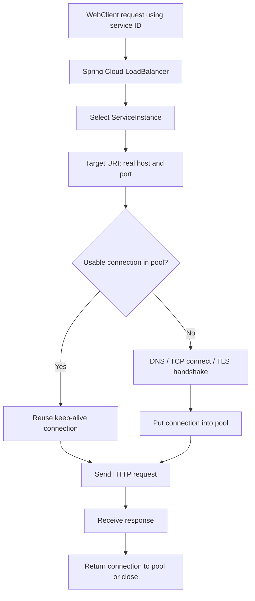

# Tuning HTTP Connections, Timeouts, and Client Resources

In service discovery, LoadBalancer selects an appropriate instance and the HTTP client sends the request to that instance's address. Call performance and stability depend not only on the load balancing algorithm, but also on connection pools, keep-alive, timeouts, concurrency limits, and the HTTP client's resource lifecycle.

If every request creates a new HTTP client, the application will continuously open sockets and perform TCP/TLS handshakes. If the pool is too small, requests have to wait for connections; if the pool or queue is too large, the application may hold too many sockets and pending requests when providers slow down. Misconfigured timeouts can tie up threads/reactive pipelines for too long or cause retries to pile extra load onto an already overloaded system.

This article focuses on configuring and measuring HTTP clients in Spring Cloud, especially with `WebClient` and Reactor Netty. Similar principles apply to `RestClient`, `RestTemplate`, and HTTP clients based on Apache HttpClient or JDK HttpClient, though property names and configuration APIs will differ.

## 1. HTTP Connection Flow After LoadBalancer Selects an Instance

Consumers typically call using a service ID:

```text
http://inventory-service/api/items/42
```

Spring Cloud LoadBalancer retrieves the instance list from the discovery provider, selects an instance, and replaces the target URI with the real host and port. The HTTP connector then finds an eligible connection in the pool or creates a new connection.



There are two independent caching mechanisms:

- **Discovery/LoadBalancer cache** stores the service's instance list.
- **HTTP connection pool** stores TCP/TLS connections to the selected instance addresses.

When the registry removes an instance, LoadBalancer can stop selecting that instance once discovery data updates. However, the connection pool may still hold idle connections to the old address until those connections are closed or expire. Therefore, you must configure both discovery freshness and connection lifecycle.

## 2. Why Reuse HTTP Clients and Connection Pools?

Establishing a new connection can involve multiple steps:

1. DNS resolution if the host is a hostname.
2. Establishing a TCP connection.
3. Performing a TLS handshake if using HTTPS.
4. Negotiating the HTTP protocol and sending the request.
5. Receiving the response and closing or keeping the connection for reuse.

Connection pools reduce the cost of repeating TCP/TLS steps. With HTTP/1.1, keep-alive allows multiple sequential requests to reuse the same connection. With HTTP/2, multiple streams can multiplex over a single connection, so connection count does not correspond one-to-one with concurrent requests.

Do not create a new `WebClient`, `HttpClient`, `RestClient`, or `RestTemplate` on every call. Manage them as singleton beans or shared resources with a clear lifecycle. Shared clients reuse pools, DNS resolvers, event loops, and TLS contexts.

## 3. Distinguishing Timeout Types

There is no single timeout covering every phase of an HTTP request. Distinguish at least the following types:

| Timeout | Bounded Phase | Typical Meaning on Expiration |
| --- | --- | --- |
| DNS resolution timeout | Resolving hostname to IP address | Address could not be resolved within the allotted time |
| Connection acquire timeout | Waiting to acquire a connection from the pool | Pool ran out of available connections or queue is congested |
| Connect timeout | Establishing TCP connection to host/port | Could not open connection within the allotted time |
| TLS handshake timeout | Negotiating TLS after TCP connects | Authentication/handshake did not finish on time |
| Response timeout | Waiting for response data per HTTP client semantics | Provider stopped sending data within the specified window |
| Read timeout | Waiting to read data from socket | No data read within the allowed interval |
| Write timeout | Sending data over socket | Write remained blocked longer than allowed |
| End-to-end deadline | Entire operation at the application layer | Total request duration exceeded the allocated budget |

Exact names and semantics depend on the HTTP client. For example, Reactor Netty's `HttpClient.responseTimeout` bounds the interval between network reads while receiving a response, which is not always equivalent to total time from subscription until body completion. Add a reactive-layer deadline if you need to bound the entire operation.

### Timeout Budget Along a Call Chain

Downstream timeouts must fit within the inbound request's deadline. For example, if the gateway allows 2 seconds and `checkout-service` calls inventory and then payment sequentially, each downstream cannot arbitrarily wait 2 seconds.

An illustrative budget:

| Phase | Example Budget |
| --- | ---: |
| Wait for connection pool | 100 ms |
| TCP connect | 300 ms |
| TLS handshake | 300 ms |
| Wait for response/body | 900 ms |
| Processing and headroom | 300 ms |
| Total outbound deadline | 1,900 ms |

These values are illustrative only. Measure actual latency, distinguish p50/p95/p99, and keep outbound deadlines smaller than inbound deadlines to leave time for error handling, response serialization, and returning results.

## 4. Configuring WebClient with Reactor Netty

For reactive applications, `WebClient` typically uses Reactor Netty as its connector. You can create a `ConnectionProvider` to manage the pool, an `HttpClient` to configure TCP/TLS/response timeouts, and attach it to a `ReactorClientHttpConnector`.

```java
import java.time.Duration;

import io.netty.channel.ChannelOption;
import org.springframework.cloud.client.loadbalancer.LoadBalanced;
import org.springframework.context.annotation.Bean;
import org.springframework.context.annotation.Configuration;
import org.springframework.http.client.reactive.ReactorClientHttpConnector;
import org.springframework.web.reactive.function.client.WebClient;
import reactor.netty.http.client.HttpClient;
import reactor.netty.resources.ConnectionProvider;

@Configuration
public class OutboundHttpConfiguration {

    @Bean(destroyMethod = "dispose")
    ConnectionProvider discoveryConnectionProvider() {
        return ConnectionProvider.builder("discovery-http")
                .maxConnections(200)
                .pendingAcquireMaxCount(400)
                .pendingAcquireTimeout(Duration.ofSeconds(2))
                .maxIdleTime(Duration.ofSeconds(25))
                .maxLifeTime(Duration.ofMinutes(5))
                .evictInBackground(Duration.ofSeconds(30))
                .metrics(true)
                .build();
    }

    @Bean
    HttpClient discoveryHttpClient(ConnectionProvider discoveryConnectionProvider) {
        return HttpClient.create(discoveryConnectionProvider)
                .option(ChannelOption.CONNECT_TIMEOUT_MILLIS, 2_000)
                .responseTimeout(Duration.ofSeconds(3));
    }

    @Bean
    @LoadBalanced
    WebClient.Builder loadBalancedWebClientBuilder(HttpClient discoveryHttpClient) {
        return WebClient.builder()
                .clientConnector(
                        new ReactorClientHttpConnector(discoveryHttpClient));
    }
}
```

In the example:

- `maxConnections` caps the number of connections in each connection pool.
- `pendingAcquireMaxCount` caps the number of requests waiting to acquire a connection.
- `pendingAcquireTimeout` caps how long a request waits for the pool to grant a connection.
- `maxIdleTime` caps how long an idle connection is retained in the pool.
- `maxLifeTime` caps the maximum lifetime of a connection.
- `evictInBackground` enables periodic cleanup of expired connections.
- `CONNECT_TIMEOUT_MILLIS` bounds TCP connect duration.
- `responseTimeout` bounds response wait intervals per Reactor Netty semantics.
- `metrics(true)` enables connection provider metrics when paired with an appropriate Micrometer integration.

`@LoadBalanced` is still required so service IDs in URIs are resolved by Spring Cloud LoadBalancer. Customizing the connector does not replace the discovery filter. Verify actual configuration against your exact Spring Boot/Spring Cloud/Reactor Netty versions because some APIs and properties can change between releases.

`ConnectionProvider` is a resource that must be disposed when the application stops. Do not dispose it after every request; the bean in the example is closed by Spring via `destroyMethod`. If using default global Reactor Netty resources, understand resource ownership before disposing manually because multiple clients may share them.

## 5. Configuring via Spring Boot Properties

Spring Boot exposes several properties for the Reactor Netty pool. For example:

```yaml
spring:
  reactor:
    netty:
      pool:
        max-connections: 200
        max-idle-time: 25s
        max-life-time: 5m
        max-pending-acquire: 400
        pending-acquire-timeout: 2s
        eviction-interval: 30s
        metrics: true
```

These properties apply to resources/pools managed by auto-configuration per the Spring Boot version. If you create a `ConnectionProvider` manually in code, auto-config properties do not necessarily apply automatically to your custom provider. Avoid configuring the same pool in both YAML and Java without knowing clearly which bean is actually used.

If different downstream groups need separate pools, you can create multiple `ConnectionProvider`/HTTP clients and attach the right client to each corresponding `WebClient`. This increases pool and socket counts, so only do it when justified by different SLAs, traffic profiles, or security requirements.

## 6. Sizing the Connection Pool

A pool that is too small makes requests wait; a pool that is too large can exhaust resources on the provider, consumer, or OS. Size pools based on concurrency and connection hold time rather than picking an arbitrary number.

An initial estimate can use Little's Law:

\[
L = \lambda \times W
\]

Where:

- \(L\): average number of concurrent requests in flight.
- \(\lambda\): throughput (requests/second).
- \(W\): average processing time (seconds).

For example, a downstream receives 300 requests/second with an average connection hold time of 200 ms:

\[
L = 300 \times 0.2 = 60
\]

Average demand is roughly 60 concurrent in-flight requests. You can test a pool larger than this for burst headroom, but you must load test with p95/p99, replica count, target service count, and file descriptor/socket limits.

Notes:

- With HTTP/1.1, pool size correlates more directly with concurrent requests waiting for responses.
- With HTTP/2, one connection can carry many streams; stream limits and server multiplexing capabilities also affect concurrency.
- A pool may group connections per remote address. In service discovery, each instance may create a distinct pool key.
- If there are many service IDs and many instances, total sockets across the entire application can exceed `maxConnections`.
- Factor in consumer replica count: 200 connections per Pod multiplied by 20 Pods can create thousands of connections to upstream.

Start with conservative limits, observe pool metrics, and increase gradually based on test results. Never enlarge the pool merely to mask a slow provider.

## 7. Connection Wait Queues and Backpressure

When every connection in the pool is busy, new requests may wait in the pending acquire queue. If the queue is unbounded, a slow upstream can cause the consumer to accumulate many queued requests, consuming memory and increasing latency.

Configure both limits:

- `pendingAcquireMaxCount`: maximum number of requests allowed to wait for a connection.
- `pendingAcquireTimeout`: how long a request is allowed to wait on the pool.

When limits are exceeded, requests should fail fast with an observable error rather than waiting indefinitely. At the Reactor layer, also limit concurrency when fanning out to multiple services:

```java
Flux<ItemResponse> responses = itemIds
        .flatMap(inventoryClient::getItem, 32);
```

The argument `32` limits the number of inner publishers subscribed concurrently in this example. Choose concurrency based on pool size, SLA, and provider capacity. Pool limits do not replace application-layer backpressure.

## 8. Tuning Keep-Alive and Connection Lifetime

HTTP keep-alive allows reusing a connection after a response completes. This eliminates TCP/TLS handshakes, though idle connections may be closed by servers, load balancers, or firewalls before the client knows.

Principles:

- Set the client's `maxIdleTime` less than or equal to the idle timeout of any upstream server/load balancer if that value is known.
- Use `maxLifeTime` to rotate long-lived connections, avoiding keeping one connection across many infrastructure changes.
- Enable background eviction so expired connections are cleaned up even when pool traffic is low.
- Monitor `connection reset`, `broken pipe`, or connection reuse errors after idle periods.
- Ensure providers/load balancers have idle timeouts compatible with the client.

For example, if an ingress closes idle connections after 60 seconds, the client might set `maxIdleTime` lower than this window, such as 25–30 seconds. Exact values must be based on real topology; never assume every proxy shares the same idle timeout.

`maxLifeTime` is not a per-request timeout. It caps connection lifetime in the pool; an in-flight request should not be severed merely because the connection reached max age if the client manages lifecycle properly.

## 9. Connect, TLS, and Response Timeouts

### Connect Timeout

Connect timeout protects the TCP setup phase. If the selected instance was removed from the registry or its advertised address is unreachable, connect timeout keeps the consumer from waiting too long.

```java
HttpClient httpClient = HttpClient.create(provider)
        .option(ChannelOption.CONNECT_TIMEOUT_MILLIS, 2_000);
```

Connect timeout does not replace DNS or TLS handshake timeouts. If the host is a DNS name, examine resolver timeouts/retries in the HTTP client and network environment.

### TLS Handshake Timeout

With HTTPS, configure a separate handshake timeout if needed:

```java
HttpClient secureClient = HttpClient.create(provider)
        .secure(ssl -> ssl.handshakeTimeout(Duration.ofSeconds(5)));
```

Do not disable certificate verification to work around slow handshakes or trust errors. Inspect the certificate chain, hostname/SNI, truststore, and system clock.

### Response Timeout and Whole-Request Deadline

```java
Mono<ItemResponse> response = webClient.get()
        .uri("http://inventory-service/api/items/{id}", itemId)
        .retrieve()
        .bodyToMono(ItemResponse.class)
        .timeout(Duration.ofSeconds(4));
```

`Mono.timeout` in the example bounds total wait time for the entire publisher from subscription to completion. Meanwhile, `HttpClient.responseTimeout` controls response wait intervals at the Reactor Netty layer. Both can be used together: response timeout to detect when upstream stops sending data, and a deadline to cap total operation duration.

If using Netty's `ReadTimeoutHandler`/`WriteTimeoutHandler`, understand that these operate at the socket/channel layer. Do not layer overlapping timeouts without knowing which error fires first; that makes logging and retry logic hard to predict.

## 10. Timeouts per Service and Request Type

Not every downstream shares the same SLA. For example:

| Downstream | Purpose | Illustrative Timeout |
| --- | --- | ---: |
| `inventory-service` | Read inventory info | 800 ms |
| `pricing-service` | Calculate pricing and promotions | 1,200 ms |
| `payment-service` | Create payment transaction | 2,000 ms |
| External tax API | Call external provider | 2,500 ms |

These figures are examples to illustrate SLA separation. Some applications may use a shared HTTP client with per-request timeouts; others create separate clients for service groups with distinct policies.

Example per-request timeout on a WebClient call:

```java
public Mono<ItemResponse> getItem(String itemId) {
    return webClient.get()
            .uri("http://inventory-service/api/items/{id}", itemId)
            .retrieve()
            .bodyToMono(ItemResponse.class)
            .timeout(Duration.ofMillis(800));
}
```

A per-request timeout does not necessarily alter the connection pool. It bounds operation time at the reactive layer; TCP/TLS/pool timeouts still must be configured separately.

## 11. Combining Timeouts with Retries and Circuit Breakers

Retries are not a substitute for timeouts. If each attempt has a long timeout and retry counts are high, total latency can exceed the inbound request's deadline.

Example of a safer policy:

- Per-attempt timeout: 500 ms.
- At most one retry for transient errors.
- Jittered backoff: 50–100 ms.
- Total outbound deadline: 1.2 seconds.
- Circuit breaker prevents continuous calls during prolonged provider failures.

Retry only when the operation is safe. `GET` is typically idempotent per HTTP semantics; payment or order-creation `POST` requests must not be retried without an idempotency key and duplicate-processing protection.

With Spring Cloud LoadBalancer, retries can select a different instance depending on configuration. Distinguish retries by the HTTP client, Reactor operators, Spring Cloud LoadBalancer, and the gateway. If multiple layers retry simultaneously, one request can amplify into many calls to the provider.

When receiving `Retry-After`, consider honoring the provider's header. Use jittered backoff so replicas do not all retry at the exact same instant.

## 12. Handling Replaced Instances in Discovery

Suppose LoadBalancer selects `inventory-service` instance A. Meanwhile, instance A deregisters or its Pod is replaced:

1. The discovery cache may still retain instance A until the next refresh.
2. The connection pool may still hold idle connections to A.
3. New requests may be routed to A and hit connection refused/reset.
4. The consumer must handle the error, refresh selection per policy, and optionally retry another instance if the request is safe.
5. Old pooled connections must be closed/evicted according to idle/lifetime policies.

This shows how three timeouts/caches must coordinate:

- Discovery cache refresh interval determines how long departed instances remain visible.
- HTTP pool idle/lifetime determines how long old connections remain open.
- Request timeout/retry determines blast radius when a request hits a freshly departed instance.

Do not set `maxIdleTime` very long if instances churn frequently and upstream can close connections without notifying the client. Nor should you set it so short that every request pays a TCP/TLS handshake.

## 13. Resource Limits Beyond the Connection Pool

HTTP clients consume many other resources as well:

| Resource | Risk When Unbounded | Tuning Direction |
| --- | --- | --- |
| File descriptors/sockets | Too many connections across many instances | Limit pool sizes, replicas, and upstreams |
| Pending request queue | Memory grows when providers slow down | Limit pending acquire and concurrency |
| Event loop threads | Blocking operations stall the event loop | Never call blocking APIs on event loops; offload blocking work to an appropriate scheduler |
| Direct/off-heap memory | Network buffers grow with requests/connections | Limit concurrency, response sizes, and monitor memory |
| DNS resolver | Frequent lookups or slow DNS | Reuse client/resolver, monitor DNS and cache policies |
| TLS CPU | Continuous handshakes burn CPU | Reuse connections, configure TLS properly, and monitor handshake rates |
| Response body | Large buffered responses pressure heap/direct memory | Stream bodies when appropriate, bound payloads, and release bodies properly |

With `WebClient`, avoid calling `.block()` on event-loop threads. If you must integrate a blocking library, shift to an appropriate scheduler and cap worker counts. Do not treat `boundedElastic` as an unbounded dumping ground; concurrency still needs control.

## 14. Using RestClient or RestTemplate

For imperative applications, you can use `RestClient` (Spring Framework 6.1+) or `RestTemplate` in existing projects. The same principles apply:

- Use a singleton builder/client rather than creating a new one per request.
- Configure pooling on the HTTP request factory/underlying client.
- Set connect, connection-request, response/read, and overall timeouts per supported APIs.
- Use Spring Cloud's `@LoadBalanced` builder/interceptor when calling service IDs.
- Close resources on application shutdown if required by the underlying client.

Illustrative setups with Apache HttpClient 5 and `RestClient` require configuring `PoolingHttpClientConnectionManager`, `RequestConfig`, and the request factory. Class/property names depend on Apache HttpClient and Spring Framework versions; do not mix HttpClient 4 APIs with HttpClient 5.

Do not switch to `RestTemplate` just to avoid configuring Reactor Netty if the application already uses the reactive stack. Choose the client based on the application's execution model and team operational capability.

## 15. Observing Connection Pools and HTTP Clients

Metrics to monitor:

| Metric/Quantity | What It Indicates |
| --- | --- |
| Active connections | Number of connections currently in use |
| Idle connections | Number of connections waiting for reuse |
| Pending connections/acquires | Number of requests waiting to acquire a connection |
| Max connections | Current pool limit |
| Pending acquire time | Time spent waiting for a connection |
| Connect duration | Time to open a TCP connection |
| TLS handshake duration | Cost of establishing TLS |
| Response time | Time waiting for/receiving response per instrumentation |
| Connection errors | Resets, refusals, timeouts, or reuse errors |
| Pool eviction | Number of connections evicted due to idle/lifetime limits |

Reactor Netty can export connection provider metrics when metrics are enabled and integrated with Micrometer. Exact metric names depend on version; check `/actuator/metrics` or your application telemetry system rather than hard-coding names from a different release.

Do not attach raw instance IDs or ephemeral addresses as metric tags if cardinality will blow up. You can use service ID/provider/environment as bounded tags, keeping specific addresses in logs/traces when investigation is needed.

## 16. Tuning Process via Load Testing

Never tune pools by guesswork. You can follow an iterative cycle:

1. Measure baseline: throughput, p50/p95/p99 latency, error rate, CPU, memory, and socket counts.
2. Observe the pool: active/idle/pending connections and acquire time.
3. If pending acquires are high while the provider still has capacity, try carefully increasing pool/concurrency.
4. If response latency is high and provider CPU/queues are saturated, enlarging the pool can worsen things; lower concurrency or optimize the provider instead.
5. If errors occur after idle periods, check keep-alive and `maxIdleTime` against proxy/server idle timeouts.
6. If requests hang for a long time, isolate acquire, connect, TLS, response, and overall deadline durations.
7. Test removing/restarting an instance to observe stale discovery and stale connections.
8. Re-run load across multiple consumer replicas to confirm total connections do not exceed upstream limits.

Testing should cover both steady load and bursts. With service discovery, test scale-out/scale-in to see how the pool creates and reclaims connections for new/old instances.

## 17. Common Pitfalls

| Symptom | Possible Cause | Remediation |
| --- | --- | --- |
| High latency despite fast provider responses | Requests waiting for a connection in the pool | Monitor pending acquires, pool size, and concurrency |
| `PoolAcquireTimeoutException` | Pool exhausted or pending queue overloaded | Check whether response bodies are consumed/released, cap concurrency, and size the pool |
| `ConnectTimeoutException` | Instance unreachable, route/firewall issue, or connect timeout too low | Check instance address, network, and connect timing |
| Errors after long idle connections | Proxy/server closed the keep-alive connection | Lower max idle time, enable eviction, and check upstream timeouts |
| Frequent TLS handshake errors | Certificate, truststore, SNI, or handshake timeout | Inspect TLS chain and hostname; do not disable verification |
| CPU spikes due to frequent handshakes | Creating new clients/connections too often | Reuse clients and connection pools |
| Memory grows when upstream is slow | Unbounded pending queue/concurrency or large bodies | Bound pending acquire, concurrency, and response size |
| One Pod opens too many sockets | Pool limit multiplied across many services/instances/replicas | Calculate total sockets across deployment and split pools deliberately |
| Requests exceed gateway deadline | Per-downstream timeouts and retries compounding | Design an end-to-end budget and limit retries |
| Repeated requests cause duplicate orders/payments | Retrying non-idempotent operations | Use idempotency keys and only retry per safe semantics |

## 18. Deployment Checklist

- [ ] HTTP client and connection pool are created once and reused across requests.
- [ ] `WebClient` calling service IDs uses a `@LoadBalanced` builder.
- [ ] Connection pool caps max connections and pending acquires.
- [ ] Separate acquire timeout, connect timeout, and response timeout are configured.
- [ ] An overall deadline exists for the entire outbound operation.
- [ ] TLS handshake and certificate validation are properly configured.
- [ ] `maxIdleTime` is compatible with upstream/proxy idle timeouts.
- [ ] `maxLifeTime` and background eviction are tuned for instance lifecycles.
- [ ] Pool sizing accounts for throughput, latency, HTTP version, and replica counts.
- [ ] Backpressure/concurrency limits exist during fan-out.
- [ ] Retries are bounded, use backoff/jitter, and apply only to safe operations.
- [ ] Discovery cache and connection pool are treated as two distinct mechanisms.
- [ ] Custom resources are disposed cleanly with lifecycle; shared global resources are not arbitrarily disposed.
- [ ] Metrics track active/idle/pending connections, acquire latency, connect errors, and response latency.
- [ ] Load tests cover bursts, slow providers, removed instances, and scale-out/scale-in.

A well-tuned HTTP client in a service discovery system must balance reuse with resource limits. Connection pools cut TCP/TLS overhead but require bounds on connections, pending queues, and lifetimes; timeouts must be separated per phase and fit inside the request deadline; retries must be bounded and respect idempotency. By tracking pool metrics alongside per-instance latency and errors, operators can distinguish issues in discovery, connection acquisition, networking, or the provider itself and address the true bottleneck.
