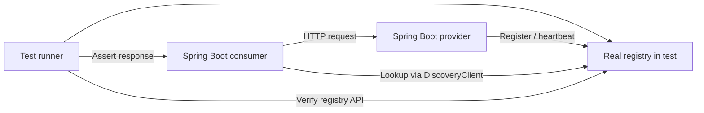

# Testing Real Registration with Eureka, Consul, or ZooKeeper

A service discovery test only has integration value when the application actually registers with a running registry, the registry persists the record, and the consumer can look up that instance. Mocking `DiscoveryClient` only tests the logic of code calling a mock; `SimpleDiscoveryClient` only reads static configuration. Neither approach proves that Eureka, Consul, or ZooKeeper accepts registrations, maintains state, and removes instances according to the expected lifecycle.

In the `SPRING_CLOUD_SERVICE_DISCOVERY` module, we need to verify the full flow from provider to registry and from consumer back to provider. This lesson shows how to set up an isolated registry for tests, verify via both the registry's native API and Spring Cloud `DiscoveryClient`, check requests reaching the real endpoint, and test deregistration, health, and common connection failures.

## 1. Distinguishing unit tests from integration tests

| Test type | Components used | Verifies real registration? | Purpose |
|---|---|---|---|
| Unit test | Mock `DiscoveryClient`, mock `ServiceRegistry`. | No. | Test logic for processing instance lists and error branches. |
| Configuration test | `ApplicationContextRunner`, property binding, auto-configuration. | Not necessarily. | Verify beans, properties, and auto-configuration conditions. |
| Integration test | Spring application + real Eureka/Consul/ZooKeeper. | Yes. | Test register, renew, lookup, and deregister through the registry. |
| End-to-end test | Provider, registry, consumer, and business requests running together. | Yes. | Verify both the control plane and the data plane. |

A test may use mocks at other layers, but the part proving registration must go through a real discovery implementation. Do not replace the registry with `@MockBean DiscoveryClient` or `SimpleDiscoveryClient` configuration and conclude that Eureka/Consul/ZooKeeper works.

## 2. Isolated test architecture

Each test run should have its own registry or isolated namespace, its own service ID, and a unique instance ID. Never use a production registry or a shared staging registry carrying other workloads.



The registry can run in Testcontainers or in a separate test process. Eureka Server can be started alongside tests via `@EnableEurekaServer`; Consul and ZooKeeper are usually convenient to run in containers. Test containers must be stopped after tests to clear registration state and prevent resource leaks.

### 2.1. Key principles

- Use compatible Spring Boot and Spring Cloud versions per the project's Spring Cloud release train/BOM.
- Include only the required discovery starter in each test application. Having multiple registry clients on the classpath simultaneously can enable composite discovery and cause tests to hit the wrong implementation.
- Use `server.port=0` or an exclusively allocated port to avoid port collisions between tests.
- Generate a unique service name and instance ID per test run.
- Wait for conditions with Awaitility or bounded polling; do not use fixed `Thread.sleep()` calls to assume registration has completed.
- Verify both the native registry API and the consumer's `DiscoveryClient`.
- If testing active health checks, ensure the health checker can actually reach the provider from its network namespace.
- Close the application context to trigger deregistration/session cleanup, then wait for the registry to reflect the new state.
- Tests must have an overall timeout and clear diagnostics when waiting for registration fails.

## 3. Test dependencies

Common dependencies below should have their versions managed by a BOM compatible with your project:

```xml
<dependencies>
    <dependency>
        <groupId>org.springframework.boot</groupId>
        <artifactId>spring-boot-starter-test</artifactId>
        <scope>test</scope>
    </dependency>
    <dependency>
        <groupId>org.awaitility</groupId>
        <artifactId>awaitility</artifactId>
        <scope>test</scope>
    </dependency>
    <dependency>
        <groupId>org.testcontainers</groupId>
        <artifactId>junit-jupiter</artifactId>
        <scope>test</scope>
    </dependency>
    <dependency>
        <groupId>org.testcontainers</groupId>
        <artifactId>testcontainers</artifactId>
        <scope>test</scope>
    </dependency>
</dependencies>
```

Add exactly one discovery starter per test suite, such as `spring-cloud-starter-netflix-eureka-client`, `spring-cloud-starter-consul-discovery`, or `spring-cloud-starter-zookeeper-discovery`. Eureka Server tests also need `spring-cloud-starter-netflix-eureka-server` in the test application. Do not pin standalone starter versions outside the Spring Cloud BOM.

Testcontainers requires Docker or a compatible container runtime. If CI lacks Docker, you can run the registry as a separate test service in the pipeline, while still verifying that tests connect to the real registry rather than falling back to a mock.

## 4. Common verification steps for any registry

A real registration integration test should verify steps in this order:

1. Start the registry and wait for its endpoint to be ready.
2. Start the Spring Boot provider with a unique service name, instance ID, and host/port.
3. Wait for the registry to accept the registration.
4. Query the registry with its native API or tooling to verify service name, instance ID, host, port, and status.
5. Start the consumer pointing to the same registry.
6. Call `DiscoveryClient.getInstances(serviceId)` and verify the consumer sees the instance.
7. Send a request to the provider endpoint via the `ServiceInstance` address or through Spring Cloud LoadBalancer.
8. Shut down the provider cleanly and wait for the registration to be removed or change state per the registry's mechanism.
9. Verify the consumer no longer selects the deregistered instance once discovery data and caches converge.

Do not verify solely via the registry's HTTP health status. A registry can return `200 OK` while the service is not yet registered. Likewise, do not check `DiscoveryClient` only on the provider itself, since a client's local state can differ from what the registry stores or what another consumer observes.

## 5. Real testing with Consul and Testcontainers

Consul is convenient for integration testing because its agent can run in dev mode inside an isolated container. Dev mode is only suitable for local/integration tests; never use it in production because security settings and data durability differ from real environments.

### 5.1. Starting the Consul container

Example using `GenericContainer`:

```java
import org.junit.jupiter.api.Test;
import org.springframework.boot.test.context.SpringBootTest;
import org.springframework.boot.test.web.server.LocalServerPort;
import org.springframework.cloud.client.ServiceInstance;
import org.springframework.web.client.RestTemplate;
import org.springframework.cloud.client.discovery.DiscoveryClient;
import org.springframework.test.context.DynamicPropertyRegistry;
import org.springframework.test.context.DynamicPropertySource;
import org.testcontainers.containers.GenericContainer;
import org.testcontainers.utility.DockerImageName;
import org.testcontainers.junit.jupiter.Container;
import org.testcontainers.junit.jupiter.Testcontainers;

import static org.assertj.core.api.Assertions.assertThat;
import static org.awaitility.Awaitility.await;
import static java.util.concurrent.TimeUnit.SECONDS;

@Testcontainers
@SpringBootTest(webEnvironment = SpringBootTest.WebEnvironment.RANDOM_PORT)
class ConsulRegistrationIT {

    private static final String SERVICE_ID = "payment-registration-it";
    private static final String INSTANCE_ID = "payment-registration-it-01";

    @Container
    static final GenericContainer<?> CONSUL =
            new GenericContainer<>(DockerImageName.parse("hashicorp/consul:1.18"))
                    .withCommand("agent", "-dev", "-client=0.0.0.0")
                    .withExposedPorts(8500);

    @DynamicPropertySource
    static void consulProperties(DynamicPropertyRegistry registry) {
        registry.add("spring.application.name", () -> SERVICE_ID);
        registry.add("spring.cloud.consul.host", CONSUL::getHost);
        registry.add("spring.cloud.consul.port", () -> CONSUL.getMappedPort(8500));
        registry.add("spring.cloud.consul.discovery.register", () -> true);
        registry.add("spring.cloud.consul.discovery.service-name", () -> SERVICE_ID);
        registry.add("spring.cloud.consul.discovery.instance-id", () -> INSTANCE_ID);
        registry.add("spring.cloud.consul.discovery.register-health-check", () -> false);
        registry.add("spring.cloud.consul.discovery.query-passing", () -> false);
    }

    @LocalServerPort
    int applicationPort;

    @org.springframework.beans.factory.annotation.Autowired
    DiscoveryClient discoveryClient;

    @Test
    void registersInConsulAndIsVisibleToDiscoveryClient() {
        await().atMost(30, SECONDS).untilAsserted(() -> {
            var instances = discoveryClient.getInstances(SERVICE_ID);
            assertThat(instances)
                    .anySatisfy(instance -> {
                        assertThat(instance.getInstanceId()).isEqualTo(INSTANCE_ID);
                        assertThat(instance.getPort()).isEqualTo(applicationPort);
                    });
        });

        ServiceInstance instance = discoveryClient.getInstances(SERVICE_ID).stream()
                .filter(candidate -> INSTANCE_ID.equals(candidate.getInstanceId()))
                .findFirst()
                .orElseThrow();

        assertThat(instance.getUri().getScheme()).isIn("http", "https");
        assertThat(instance.getHost()).isNotBlank();
    }
}
```

This is a skeleton for a provider test application with a web server and the Consul discovery starter. `register-health-check=false` separates the registration test from active health checks; `query-passing=false` lets the test read the catalog without requiring a passing check. Property names should be confirmed against your project's Spring Cloud Consul version.

### 5.2. Verifying with the Consul Catalog API

`DiscoveryClient` represents the consumer's view. To prove Consul actually persisted the registration, call its native API:

```java
import com.fasterxml.jackson.databind.JsonNode;
import org.springframework.web.client.RestTemplate;

String consulUrl = "http://" + CONSUL.getHost() + ":" + CONSUL.getMappedPort(8500);
JsonNode[] records = new RestTemplate().getForObject(
        consulUrl + "/v1/catalog/service/" + SERVICE_ID,
        JsonNode[].class);

assertThat(records).isNotNull().isNotEmpty();
assertThat(records[0].path("ServiceID").asText()).isEqualTo(INSTANCE_ID);
assertThat(records[0].path("ServicePort").asInt()).isEqualTo(applicationPort);
```

The Catalog API returns registration data, while `/v1/health/service/{service}` returns service info alongside health checks. If your test needs to prove the service is considered passing, configure an appropriate active health check and verify via the health API rather than using only the Catalog API.

### 5.3. Testing active health checks separately

When the Consul agent performs an HTTP check, the agent must be able to reach the provider. If Consul runs in a container and the provider runs on the host, `localhost` inside the container is not the provider's host. Use the host gateway supported by Testcontainers, or place both the provider and Consul on the same Docker network with network aliases.

A health test should:

1. Register the provider with a real health-check URL.
2. Verify the agent can reach the endpoint and the status transitions to passing.
3. Make the endpoint return an error status or stop the provider in the test environment.
4. Wait for the health API to transition to critical/non-passing.
5. Check whether the consumer filters out non-passing instances according to `query-passing`.

Do not conclude health checks work merely because the provider can call `localhost/actuator/health`; the probe must execute from the Consul agent itself.

## 6. Real testing with ZooKeeper

ZooKeeper Discovery uses znodes to store service registrations. Testcontainers can run an isolated ZooKeeper server per suite.

### 6.1. Starting ZooKeeper

```java
import org.testcontainers.containers.GenericContainer;
import org.testcontainers.utility.DockerImageName;
import org.testcontainers.junit.jupiter.Container;
import org.testcontainers.junit.jupiter.Testcontainers;
import org.testcontainers.containers.wait.strategy.Wait;

@Testcontainers
class ZookeeperRegistrationIT {

    @Container
    static final GenericContainer<?> ZOOKEEPER =
            new GenericContainer<>(DockerImageName.parse("zookeeper:3.9"))
                    .withExposedPorts(2181)
                    .waitingFor(Wait.forListeningPort());
}
```

The container exposes client port `2181`. In tests, obtain the host and mapped port from the container; do not hard-code a host port because Testcontainers typically maps to a random port.

### 6.2. Configuring provider registration

```java
private static final String SERVICE_ID = "payment-zk-it";
private static final String INSTANCE_ID = "payment-zk-it-01";
private static final String ROOT = "/integration-test/services";

@DynamicPropertySource
static void zookeeperProperties(DynamicPropertyRegistry registry) {
    registry.add("spring.application.name", () -> SERVICE_ID);
    registry.add("spring.cloud.zookeeper.connect-string",
            () -> ZOOKEEPER.getHost() + ":" + ZOOKEEPER.getMappedPort(2181));
    registry.add("spring.cloud.zookeeper.discovery.enabled", () -> true);
    registry.add("spring.cloud.zookeeper.discovery.register", () -> true);
    registry.add("spring.cloud.zookeeper.discovery.root", () -> ROOT);
    registry.add("spring.cloud.zookeeper.discovery.instance-id", () -> INSTANCE_ID);
    registry.add("spring.cloud.zookeeper.discovery.instance-host", () -> "127.0.0.1");
}
```

Provider and consumer must use the same `connect-string` and `root`. `instance-host` in the example is only suitable when the consumer runs in the same host/network namespace as the test provider. If the provider runs in a separate container, advertise a network alias or IP actually reachable by the consumer.

### 6.3. Verifying the znode and ServiceInstance

With root `/integration-test/services`, service ID `payment-zk-it`, and instance ID `payment-zk-it-01`, the registration path typically looks like:

```text
/integration-test/services/payment-zk-it/payment-zk-it-01
```

You can inspect it with the Curator client configured by Spring Cloud Zookeeper:

```java
import org.apache.curator.framework.CuratorFramework;
import org.apache.zookeeper.data.Stat;

@org.springframework.beans.factory.annotation.Autowired
CuratorFramework curatorFramework;

String path = ROOT + "/" + SERVICE_ID + "/" + INSTANCE_ID;
Stat stat = curatorFramework.checkExists().forPath(path);

assertThat(stat).isNotNull();
assertThat(stat.getEphemeralOwner()).isNotZero();
```

A non-zero `ephemeralOwner` confirms the node is an ephemeral znode bound to the session. Path structure and payload should be checked against your Spring Cloud Zookeeper version; if the implementation adds a custom namespace or encoding, read the actual path rather than assuming.

Next, verify from the Spring Cloud perspective:

```java
await().atMost(30, SECONDS).untilAsserted(() ->
        assertThat(discoveryClient.getInstances(SERVICE_ID))
                .anySatisfy(instance ->
                        assertThat(instance.getInstanceId()).isEqualTo(INSTANCE_ID))
);
```

To test deregistration, close the provider context/session and wait for the znode to disappear. Do not assert immediately right after `close()` because ZooKeeper session cleanup and watcher notifications can be asynchronous.

## 7. Real testing with Eureka

Eureka Server can be started in a dedicated test application using `@EnableEurekaServer`. Provider and consumer are two independent Spring application contexts both pointing to the server address assigned when the test starts.

### 7.1. Test Eureka Server

```java
import org.springframework.boot.autoconfigure.SpringBootApplication;
import org.springframework.cloud.netflix.eureka.server.EnableEurekaServer;

@SpringBootApplication
@EnableEurekaServer
class EurekaTestServerApplication {
}
```

Start the server with `@SpringBootTest`:

```java
import org.springframework.boot.test.context.SpringBootTest;
import org.springframework.boot.test.web.server.LocalServerPort;
import org.springframework.test.context.TestPropertySource;

@SpringBootTest(
    classes = EurekaTestServerApplication.class,
    webEnvironment = SpringBootTest.WebEnvironment.RANDOM_PORT,
    properties = {
        "spring.application.name=eureka-test-server",
        "eureka.client.register-with-eureka=false",
        "eureka.client.fetch-registry=false"
    }
)
class EurekaRegistrationIT {

    @LocalServerPort
    int eurekaPort;
}
```

The test server does not register itself and does not need to fetch a peer registry. In real tests, server and clients must share the same scheme, context path, and security configuration.

### 7.2. Starting a provider client pointing to the test server

You can use `SpringApplicationBuilder` to start the provider context once `eurekaPort` is known:

```java
import org.springframework.boot.WebApplicationType;
import org.springframework.boot.builder.SpringApplicationBuilder;
import org.springframework.context.ConfigurableApplicationContext;

ConfigurableApplicationContext providerContext =
        new SpringApplicationBuilder(PaymentTestApplication.class)
                .web(WebApplicationType.SERVLET)
                .properties(
                    "server.port=0",
                    "spring.application.name=payment-eureka-it",
                    "eureka.client.service-url.defaultZone=http://localhost:" + eurekaPort + "/eureka/",
                    "eureka.client.register-with-eureka=true",
                    "eureka.client.fetch-registry=true",
                    "eureka.instance.instance-id=payment-eureka-it-01"
                )
                .run();
```

`PaymentTestApplication` is a test application with a web server and the Eureka Client starter. `server.port=0` requests a dynamic port; verify that the instance record in Eureka contains the actual port after the web server starts. If the test app does not automatically propagate the assigned port, pass an explicit test port or configure `EurekaInstanceConfigBean` to match your startup setup.

Keep `providerContext` to close in `finally`, `@AfterEach`, or `try-with-resources`. Closing the context is part of testing deregistration; do not leave clients running in the background after tests finish.

### 7.3. Waiting for registration and querying the REST API

The Eureka REST API can be used to verify the server stored the instance. For example:

```java
import org.springframework.web.client.RestTemplate;

import static org.awaitility.Awaitility.await;
import static java.util.concurrent.TimeUnit.SECONDS;

String registryUrl = "http://localhost:" + eurekaPort;
RestTemplate restTemplate = new RestTemplate();

await().atMost(30, SECONDS).untilAsserted(() -> {
    String body = restTemplate.getForObject(
            registryUrl + "/eureka/apps/PAYMENT-EUREKA-IT",
            String.class);
    assertThat(body).contains("payment-eureka-it-01");
});
```

Response representation depends on the `Accept` header and Eureka version. You can request JSON and parse `instanceId`, `hostName`, `ipAddr`, `port`, and `status` instead of just substring matching. Tests should verify the exact instance ID and port to avoid matching stale records under the same service name from another test.

### 7.4. Verifying through the consumer DiscoveryClient

Start a separate consumer context with the same `defaultZone`, enable `fetch-registry`, and disable `register-with-eureka` if the consumer does not need to register itself. Then retrieve `DiscoveryClient` from the consumer context and wait:

```java
try (ConfigurableApplicationContext consumerContext =
        new SpringApplicationBuilder(ConsumerTestApplication.class)
                .web(WebApplicationType.NONE)
                .properties(
                    "spring.application.name=consumer-eureka-it",
                    "eureka.client.service-url.defaultZone=http://localhost:" + eurekaPort + "/eureka/",
                    "eureka.client.register-with-eureka=false",
                    "eureka.client.fetch-registry=true",
                    "eureka.client.registry-fetch-interval-seconds=1"
                )
                .run()) {

    DiscoveryClient consumerDiscoveryClient =
            consumerContext.getBean(DiscoveryClient.class);

    await().atMost(30, SECONDS).untilAsserted(() ->
            assertThat(consumerDiscoveryClient.getInstances("payment-eureka-it"))
                    .anySatisfy(instance ->
                            assertThat(instance.getInstanceId())
                                    .isEqualTo("payment-eureka-it-01"))
    );
}
```

This is a critical check: the server accepted the registration and the consumer fetched the registry. Do not read only the server API and assume the consumer cache has updated.

## 8. Testing business requests to a real instance

After the consumer obtains `ServiceInstance`, verify the actual endpoint can serve requests. With a test provider exposing `/test/ping`, you can call the URI returned by discovery directly:

```java
import org.springframework.cloud.client.ServiceInstance;
import org.springframework.web.client.RestTemplate;

ServiceInstance instance = consumerDiscoveryClient
        .getInstances("payment-service")
        .stream()
        .filter(candidate -> "payment-it-01".equals(candidate.getInstanceId()))
        .findFirst()
        .orElseThrow();

String response = new RestTemplate().getForObject(
        instance.getUri().resolve("/test/ping"),
        String.class);

assertThat(response).isEqualTo("payment-ok");
```

Or call the service ID through a `@LoadBalanced` client to verify the instance selection step as well. These two checks have distinct goals:

- Calling `instance.getUri()` directly verifies that the host/port returned by discovery is reachable.
- Calling the logical URI `http://payment-service/...` via LoadBalancer verifies that the service ID is resolved and an instance is selected.

If tests run across Docker networks or Kubernetes, the provider must advertise an address reachable by the consumer test. `localhost` only works when provider and consumer share the same network namespace.

## 9. Testing deregistration and instance lifecycle

An integration test should prove that the record is removed when the provider stops cleanly.

### 9.1. Eureka

When a Eureka Client shuts down gracefully, it can send a registration cancellation. Close the provider context, then wait until the Eureka API no longer lists that instance ID. If the client is killed forcibly, removal may rely on lease expiration and eviction; that is a separate failure-detection scenario, unlike graceful deregistration.

### 9.2. Consul

Spring Cloud Consul can deregister the service when the application context stops, or the agent handles registration lifecycle. Close the provider context and inspect the Catalog/Health API after waiting for convergence. If the service was registered with a TTL or active check, verify the check state and service record according to the configuration semantics.

### 9.3. ZooKeeper

Service registration typically uses an ephemeral znode. When the session ends or expires, the znode is deleted. Closing the context closes the client/session per lifecycle integration; wait for the znode to disappear and verify via Curator or `DiscoveryClient`.

Do not rely on a single read right after `close()` as the sole assertion. The registry, session, and consumer caches may update asynchronously.

## 10. Testing health and instance status

Health semantics differ across registries:

| Registry | Mechanism to test | Appropriate test |
|---|---|---|
| Eureka | Client heartbeat/lease and client-published status. | Verify register, renew, status update, and cancel; do not assume the server actively HTTP-probes each provider. |
| Consul | Agent health check, TTL check, or configured check type. | Test passing → critical when endpoint fails or TTL is not renewed; test query-passing. |
| ZooKeeper | Ephemeral node bound to session and connection/session state. | Drop session or close client, verify node persists while session is valid and vanishes after expiration. |

To test Consul active HTTP checks, the Consul agent must be able to reach the provider endpoint. In ZooKeeper, a transient TCP drop does not necessarily expire the session immediately. In Eureka, a delayed heartbeat or brief disconnect does not mean the instance is evicted instantly. Tests must wait according to configured timeouts/leases and confirm status from the registry.

## 11. Testing errors and boundary conditions

Beyond the happy path, add test cases for:

- **Wrong registry URL/port:** provider fails to register and logs indicate a connection error.
- **Registry stops after provider registration:** verify retry/renew behavior and consumer cache data.
- **Duplicate instance ID:** verify registry behavior and ensure tests do not let two providers overwrite the same record.
- **Wrong advertised host:** registry has the record but the consumer cannot connect; tests should catch this via a data-plane request.
- **Wrong port:** registry API might store an incorrect port; assertions on `ServiceInstance.getPort()` should catch it.
- **Consul health check critical:** service record exists but is not passing; verify whether consumer filters via `query-passing`.
- **ZooKeeper session expiration:** ephemeral node disappears and provider re-registers with a new session.
- **Eureka heartbeat/lease:** distinguish graceful cancel from abrupt provider disconnect.
- **No instances:** consumer handles an empty list without null errors or infinite retries.
- **Unconverged cache:** measure how long it takes for the consumer to stop seeing a stale instance after deregistration.
- **ACL/RBAC rejection:** verify provider/consumer receive clear authentication/authorization errors.

Tests that disrupt networking, stop registries, or expire sessions should run against isolated containers/namespaces. Never run them against shared or production registries.

## 12. Properly waiting for asynchronous registration

Registration and discovery caches are typically eventually consistent. Use Awaitility to wait for a meaningful condition:

```java
await()
    .atMost(30, SECONDS)
    .pollInterval(200, java.util.concurrent.TimeUnit.MILLISECONDS)
    .untilAsserted(() -> {
        assertThat(discoveryClient.getInstances("payment-service"))
                .anySatisfy(instance ->
                        assertThat(instance.getInstanceId())
                                .isEqualTo("payment-it-01"));
    });
```

Avoid:

```java
Thread.sleep(5000);
assertThat(discoveryClient.getInstances("payment-service")).isNotEmpty();
```

A fixed `Thread.sleep` can be too short on slow CI runners or waste time on fast machines. Awaitility stops as soon as the condition holds and produces diagnostic timeout errors if registration does not appear.

Timeouts must align with the registry's heartbeat, fetch interval, watch delay, and retry settings. If a test only waits 1 second while the Eureka fetch interval is 30 seconds, the test can fail even when the system works as configured.

## 13. Preventing flaky tests and leaked registrations

- Use unique service IDs and instance IDs per test class or test run.
- Do not run two tests in parallel that share IDs in the same registry.
- Disable or appropriately configure health checks when tests focus solely on registration.
- When testing health, ensure the agent can actually reach the endpoint and use realistic timeouts.
- Close every `ConfigurableApplicationContext`, client session, and container in `finally` or JUnit lifecycle hooks.
- Wait for deregistration or ephemeral node cleanup before reusing a service ID.
- Never share an external registry between developers and CI.
- Log the registry URL, service ID, instance ID, host/port, and status, but never log tokens/passwords.
- Pin container image tags for reproducibility; upgrade tags intentionally.
- Use Testcontainers wait strategies to confirm registry readiness before starting providers.
- Do not rely on `@DirtiesContext` as the sole way to remove records if client shutdown does not send deregistration; inspect the real registry.

## 14. Integration test completion checklist

- Real registry is started and readiness is verified.
- Provider uses a real discovery starter, not `SimpleDiscoveryClient` or a mock.
- Provider has a unique service name and instance ID.
- Registry-native API shows the expected instance ID, host, and port.
- Separate consumer context connects to the same registry.
- Consumer `DiscoveryClient` returns the registered instance.
- Requests to the provider succeed via physical URI or LoadBalancer.
- Health/status is verified according to the registry's mechanism.
- Graceful shutdown removes the registration or updates its state as expected.
- Failure-path tests cover wrong host/port, unavailable registry, or ACL/RBAC if required.
- Tests use Awaitility with deliberate timeouts, never arbitrary sleeps.
- Containers/contexts/sessions are cleaned up and tests leave no stale registrations.
- CI has a real registry runtime and does not silently fall back to mocks when Docker is unavailable.

## Conclusion

Testing real registration requires a real registry, a real provider, and a real consumer. Verify at three points: the registry-native API persisted the instance properly; the consumer's `DiscoveryClient` sees the instance; and data-plane requests to the advertised address succeed. Then test deregistration, health/session handling, and failure modes to validate the registration lifecycle.

Eureka can be tested with a dedicated test server and independent client contexts; Consul and ZooKeeper can run isolated via Testcontainers. Use unique service/instance IDs, wait asynchronously with Awaitility, verify both the control plane and data plane, and clean up after tests. Only then do your tests prove integration with a real registry rather than proving code works against a static list.

## References

- [Spring Cloud Netflix — Eureka Server and Client](https://docs.spring.io/spring-cloud-netflix/reference/spring-cloud-netflix.html)
- [Spring Cloud Consul — Service Discovery](https://docs.spring.io/spring-cloud-consul/reference/discovery.html)
- [Spring Cloud Zookeeper — Service Discovery](https://docs.spring.io/spring-cloud-zookeeper/reference/discovery.html)
- [Testcontainers for Java](https://java.testcontainers.org/)
- [Awaitility](https://github.com/awaitility/awaitility)
