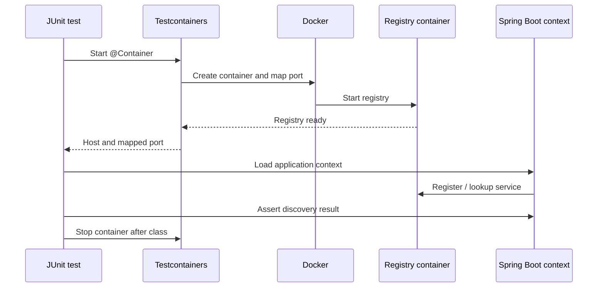

# Using Testcontainers and Dynamic Ports for Isolated Test Environments

Service discovery often depends on registries such as Eureka, Consul, or ZooKeeper. If integration tests connect to a shared registry on a developer's machine or in CI, results can depend on stale data, occupied ports, external service state, or test execution order.

Testcontainers lets you launch a real registry inside a container dedicated to tests. Instead of mocking the entire discovery protocol, tests can verify how the Spring Cloud client connects, registers, and looks up instances against a live registry. Container ports are dynamically mapped to free host ports; tests obtain the actual address from Testcontainers and feed it into Spring Boot using `@DynamicPropertySource`.

## 1. Why do we need an isolated test environment?

A discovery integration test needs to verify multiple components working together:

- The Spring Boot application starts its discovery client.
- The registry accepts service registrations or provides instance data.
- The client performs lookups by service ID.
- The advertised host and port can be read back accurately.
- The registration is removed when the application context closes.
- Tests do not interfere with each other's data.

Using a shared registry can lead to hard-to-reproduce failures:

| Risk | Consequence |
|---|---|
| Registry has stale registrations from a previous run | Test picks up the wrong old instance |
| Two tests share the same service ID | Results depend on execution order or parallel runs |
| Default port is already occupied | Test fails to start or connects to the wrong process |
| Registry is not running in CI | Test fails even though code did not change |
| Different registry versions across machines | Inconsistent results between developers and CI |
| Test fails to clean up registrations | Leftover data pollutes subsequent tests |

An isolated environment should have a dedicated test registry, a pinned image version, dynamic host ports, single-use data, and automatically managed lifecycle.

## 2. How does Testcontainers work?

Testcontainers controls Docker from the test JVM. When a test starts, the library pulls the image if needed, creates the container, exposes ports, and waits for the service inside the container to become ready. When the test ends, the container is stopped and removed per the declared lifecycle.

Basic flow:



Testcontainers does not replace JUnit or Spring Test. It provides real dependencies in container form so tests run more consistently across developer machines and CI environments with Docker.

## 3. Adding dependencies

The project needs the discovery starter matching the registry under test. For example, using Consul:

```xml
<dependency>
    <groupId>org.springframework.cloud</groupId>
    <artifactId>spring-cloud-starter-consul-discovery</artifactId>
</dependency>
```

Add Testcontainers JUnit Jupiter in test scope:

```xml
<dependency>
    <groupId>org.testcontainers</groupId>
    <artifactId>junit-jupiter</artifactId>
    <scope>test</scope>
</dependency>
```

Testcontainers versions should be managed via its BOM in dependency management:

```xml
<dependencyManagement>
    <dependencies>
        <dependency>
            <groupId>org.testcontainers</groupId>
            <artifactId>testcontainers-bom</artifactId>
            <version>${testcontainers.version}</version>
            <type>pom</type>
            <scope>import</scope>
        </dependency>
    </dependencies>
</dependencyManagement>
```

`testcontainers.version` should be set to your chosen version and kept consistent across the project. You also need `spring-boot-starter-test` for Spring Test, JUnit Jupiter, and AssertJ. The examples below use Awaitility to wait for registry convergence; declare the Awaitility dependency separately if your current test dependencies do not already include it.

## 4. Starting Consul with dynamic host ports

The following example creates a single-node Consul agent in dev mode. Dev mode is convenient for local tests because no cluster setup is needed; container data is discarded when the container stops.

```java
import org.testcontainers.containers.GenericContainer;
import org.testcontainers.containers.wait.strategy.Wait;
import org.testcontainers.junit.jupiter.Container;
import org.testcontainers.junit.jupiter.Testcontainers;
import org.testcontainers.utility.DockerImageName;

@Testcontainers
class ConsulContainerSupport {

    static final int CONSUL_HTTP_PORT = 8500;

    @Container
    static final GenericContainer<?> CONSUL =
        new GenericContainer<>(
            DockerImageName.parse("hashicorp/consul:1.20.1")
        )
        .withCommand("agent", "-dev", "-client=0.0.0.0")
        .withExposedPorts(CONSUL_HTTP_PORT)
        .waitingFor(
            Wait.forHttp("/v1/status/leader")
                .forPort(CONSUL_HTTP_PORT)
                .forStatusCode(200)
        );
}
```

Key points to understand:

- `withExposedPorts(8500)` instructs Docker to publish the container's HTTP port to the host.
- Testcontainers picks an available host port; never fix the host port to 8500.
- `getHost()` returns the host the test JVM uses to reach the container.
- `getMappedPort(8500)` returns the host port mapped to port 8500 inside the container.
- The wait strategy waits for the HTTP API to be ready before the Spring context connects.

Do not call `getMappedPort` before the container has started. Do not assume the host is always `localhost`; in remote Docker or CI setups, the host may differ. Pin images to specific versions to prevent tests from changing behavior when a new tag is published.

## 5. Passing dynamic addresses into Spring Boot

Use `@DynamicPropertySource` to register properties computed from the running container:

```java
import org.springframework.test.context.DynamicPropertyRegistry;
import org.springframework.test.context.DynamicPropertySource;

static final int CONSUL_HTTP_PORT = 8500;

@DynamicPropertySource
static void consulProperties(DynamicPropertyRegistry registry) {
    registry.add("spring.cloud.consul.host", CONSUL::getHost);
    registry.add(
        "spring.cloud.consul.port",
        () -> CONSUL.getMappedPort(CONSUL_HTTP_PORT)
    );
}
```

Suppliers are evaluated only when Spring resolves the properties. Therefore, the container must be started before the application context consumes these values. With JUnit Jupiter and a static `@Container`, Testcontainers manages the container at the class scope; follow the Spring Testcontainers integration pattern compatible with your project's library version.

You can add test-specific properties as well:

```java
@DynamicPropertySource
static void discoveryProperties(DynamicPropertyRegistry registry) {
    registry.add("spring.cloud.consul.host", CONSUL::getHost);
    registry.add(
        "spring.cloud.consul.port",
        () -> CONSUL.getMappedPort(8500)
    );
    registry.add(
        "spring.cloud.consul.discovery.register",
        () -> true
    );
    registry.add(
        "spring.cloud.consul.discovery.register-health-check",
        () -> false
    );
}
```

In this example, active health checks are disabled so the test focuses on registration and lookup without the Consul container failing to call the HTTP endpoint of the app running in the host test process. Verify this property name against your project's Spring Cloud Consul version. When testing health checks, configure an address actually reachable from the Consul container rather than using the container's localhost as the host application's address.

## 6. Integration test for service registration and instance lookup

Example testing a provider application named `inventory-service`. Spring Boot starts its web server on a random port; Consul runs in a container with a dynamic HTTP host port.

```java
import java.time.Duration;

import org.junit.jupiter.api.Test;
import org.springframework.beans.factory.annotation.Autowired;
import org.springframework.boot.test.context.SpringBootTest;
import org.springframework.boot.test.web.server.LocalServerPort;
import org.springframework.cloud.client.ServiceInstance;
import org.springframework.cloud.client.discovery.DiscoveryClient;
import org.springframework.test.annotation.DirtiesContext;
import org.springframework.test.context.DynamicPropertyRegistry;
import org.springframework.test.context.DynamicPropertySource;
import org.testcontainers.containers.GenericContainer;
import org.testcontainers.containers.wait.strategy.Wait;
import org.testcontainers.junit.jupiter.Container;
import org.testcontainers.junit.jupiter.Testcontainers;
import org.testcontainers.utility.DockerImageName;

import static org.assertj.core.api.Assertions.assertThat;
import static org.awaitility.Awaitility.await;

@Testcontainers
@DirtiesContext(classMode = DirtiesContext.ClassMode.AFTER_CLASS)
@SpringBootTest(
    webEnvironment = SpringBootTest.WebEnvironment.RANDOM_PORT,
    properties = {
        "spring.application.name=inventory-service",
        "spring.cloud.consul.discovery.register=true",
        "spring.cloud.consul.discovery.register-health-check=false"
    }
)
class ConsulDiscoveryIntegrationTest {

    private static final int CONSUL_HTTP_PORT = 8500;

    @Container
    static final GenericContainer<?> CONSUL =
        new GenericContainer<>(
            DockerImageName.parse("hashicorp/consul:1.20.1")
        )
        .withCommand("agent", "-dev", "-client=0.0.0.0")
        .withExposedPorts(CONSUL_HTTP_PORT)
        .waitingFor(
            Wait.forHttp("/v1/status/leader")
                .forPort(CONSUL_HTTP_PORT)
                .forStatusCode(200)
        );

    @DynamicPropertySource
    static void consulProperties(DynamicPropertyRegistry registry) {
        registry.add("spring.cloud.consul.host", CONSUL::getHost);
        registry.add(
            "spring.cloud.consul.port",
            () -> CONSUL.getMappedPort(CONSUL_HTTP_PORT)
        );
    }

    @Autowired
    DiscoveryClient discoveryClient;

    @LocalServerPort
    int applicationPort;

    @Test
    void registersInventoryInstance() {
        await()
            .atMost(Duration.ofSeconds(20))
            .untilAsserted(() -> {
                java.util.List<ServiceInstance> instances =
                    discoveryClient.getInstances("inventory-service");

                assertThat(instances).isNotEmpty();
                assertThat(instances)
                    .anyMatch(instance ->
                        instance.getPort() == applicationPort
                    );
            });
    }
}
```

The test verifies two things:

1. The registry returns at least one instance under service ID `inventory-service`.
2. The advertised port matches the random HTTP port that Spring Boot actually opened.

Importing `org.springframework.boot.test.web.server.LocalServerPort` applies to Spring Boot 3; in some Spring Boot 2 versions, this annotation lives in `org.springframework.boot.web.server`. If the application is outside the test's package scan, specify the configuration class using the `classes` attribute of `@SpringBootTest`.

The second check catches a common configuration bug: the application listens on one port while registration advertises the default or a stale port. If the Spring Cloud Consul version or server port configuration fails to propagate the random port, the test fails and surfaces the mismatch early.

`register-health-check=false` in the example is strictly for registration/lookup tests. A dedicated health check test should enable checks, configure an endpoint reachable from the Consul container, and assert the passing status.

## 7. Waiting for eventual consistency instead of Thread.sleep

Service registrations do not necessarily appear the instant the application context starts. The client may register asynchronously, the registry must process the request, and the discovery client may refresh its cache afterward.

Avoid writing:

```java
Thread.sleep(5000);
assertThat(discoveryClient.getInstances("inventory-service"))
    .isNotEmpty();
```

This waits a fixed duration even when the registry may be ready sooner or take longer. Use Awaitility to wait until the target condition holds:

```java
await()
    .atMost(Duration.ofSeconds(20))
    .pollInterval(Duration.ofMillis(250))
    .untilAsserted(() ->
        assertThat(
            discoveryClient.getInstances("inventory-service")
        ).isNotEmpty()
    );
```

Set a bounded timeout so tests never hang indefinitely. If the condition is not met, inspect provider logs, registry container logs, service ID, host/port, and registration permissions. When tests involve multiple cache layers, base the timeout on refresh intervals and the test environment's SLA.

## 8. Inspecting registration via the HTTP API

In addition to DiscoveryClient, you can query the registry's API to verify server-side data. With Consul:

```java
String consulUrl = "http://" + CONSUL.getHost()
    + ":" + CONSUL.getMappedPort(8500);

var response = java.net.http.HttpClient.newHttpClient()
    .send(
        java.net.http.HttpRequest.newBuilder(
            java.net.URI.create(
                consulUrl + "/v1/health/service/inventory-service"
            )
        ).GET().build(),
        java.net.http.HttpResponse.BodyHandlers.ofString()
    );

assertThat(response.statusCode()).isEqualTo(200);
assertThat(response.body()).contains("inventory-service");
```

This is a supplementary check at the registry API layer. Do not just assert that the JSON body contains the service name string and conclude the entire instance is valid; when needed, deserialize the response and inspect the exact service ID, address, port, tags, and health checks.

The two views answer two different questions:

- The HTTP API reveals what data the registry currently stores.
- DiscoveryClient reveals which instances the Spring Cloud consumer sees.

If the registry API lists the instance but DiscoveryClient returns empty, check discovery configuration, query-passing/filters, caching, and namespaces.

## 9. Testing deregistration and lifecycle

Another integration test can verify that the registration disappears after the provider context closes. You can use a separate application context created and closed inside the test, or inspect the registry API after the context shuts down.

Things to verify:

1. The provider registers the expected service ID and instance ID.
2. The registry sees the host/port advertised by the provider.
3. The consumer retrieves the instance via DiscoveryClient.
4. When the provider shuts down normally, the registration is deregistered if deregistration is enabled.
5. After caches/registry converge, the instance no longer appears in lookups.
6. Test cleanup does not delete registrations belonging to other tests.

Deregistration and cache refreshes can lag slightly. Use Awaitility to wait until the instance list no longer contains the target ID. Do not require the instance list to be completely empty if other tests or providers are concurrently registered under the same service ID.

With Eureka, distinguish clean client shutdown/deregistration from lease expiration. With ZooKeeper, distinguish normal session close from session expiration and ephemeral znode cleanup. With Kubernetes, Service/EndpointSlice lifecycles are managed by the control plane; tests should clarify whether they are testing DNS, the Kubernetes API, or Spring Cloud Kubernetes DiscoveryClient.

## 10. Test scope and avoiding cross-test pollution

Testcontainers isolates the registry process, yet tests can still pollute each other's data if multiple tests share one container or service ID.

Key principles:

- Use a dedicated service ID or instance ID per test when registering multiple services.
- Clean up registrations created by a test after verification.
- If a static container is shared across a class, remember registry state persists across test methods in that class.
- If a fresh container is needed per test method, use an instance-level `@Container`, keeping in mind runtime will increase.
- Do not run tests writing the same service ID in parallel unless instances are clearly differentiated.
- Do not rely on test execution order to create or remove registrations.
- Use `@DirtiesContext` when the Spring Test context cache could outlive a static container's lifecycle.
- Avoid enabling container reuse in CI if each run needs clean state.

A test should own the data it creates. If sharing a service ID, make instance IDs unique and ensure cleanup only deletes that test's registration.

## 11. Using Testcontainers with Eureka or ZooKeeper

The same pattern applies to other registries:

- Launch the registry container with a pinned image/version.
- Expose the registry's internal port via `withExposedPorts`.
- Wait for the registry's API or port to become ready.
- Retrieve the host with `getHost()` and host port with `getMappedPort(containerPort)`.
- Pass the dynamic address into Spring Cloud properties via `@DynamicPropertySource`.
- Verify registration/lookup via DiscoveryClient and provider APIs if present.

For example, with Eureka, build the endpoint property from the dynamic address:

```java
registry.add(
    "eureka.client.service-url.defaultZone",
    () -> "http://" + EUREKA.getHost()
        + ":" + EUREKA.getMappedPort(8761) + "/eureka/"
);
```

With ZooKeeper, build the connect string property using the host and mapped client port:

```java
registry.add(
    "spring.cloud.zookeeper.connect-string",
    () -> ZOOKEEPER.getHost()
        + ":" + ZOOKEEPER.getMappedPort(2181)
);
```

The snippets above illustrate passing dynamic endpoints; image, command, readiness checks, security, and container dependencies must match your registry packaging and library version. Never substitute the default host port for the mapped port.

## 12. Dynamic ports for both registry and application

There are two distinct ports to tell apart:

| Port | Assigned by | How to retrieve |
|---|---|---|
| Container port | Registry image listening inside the container | Known from image configuration, e.g., 8500 |
| Mapped host port | Docker/Testcontainers mapped onto the host | `container.getMappedPort(8500)` |
| Application random port | Spring Boot embedded server chosen when `server.port=0` or `RANDOM_PORT` | `@LocalServerPort` |

Never assume the container port and mapped host port are identical. For instance, Consul listens on 8500 inside the container but may map to host port 49172. The test JVM must connect to that host and port 49172; another container on the same Docker network can use the network alias and internal port 8500.

If the provider runs inside the test JVM, the registry typically records the host address advertised by the provider. If the registry needs to actively call a health endpoint on the host, configure host reachability from the container, such as Testcontainers' host-port exposure mechanism or a suitable test network. Never guess `localhost`, because localhost means different things in each network namespace.

## 13. Running in CI

Testcontainers requires a Docker-compatible runtime. CI must provide a Docker daemon or compatible environment and grant the test process access to it.

Before adding tests to a pipeline:

- Pin registry images by version or digest.
- Verify CI has a Docker socket/daemon and required permissions.
- Allow sufficient time for initial image pulls.
- Do not depend on fixed host ports.
- Collect container logs on test failure.
- Set explicit timeouts for readiness and eventual consistency.
- Limit parallelism if CI runners have constrained CPU/memory.
- Never use real registries or production credentials in tests.
- Clean up containers and networks after tests finish.
- Consider image caching in CI to reduce pull times while maintaining version control.

If Docker is unavailable, Testcontainers integration tests should fail clearly or be grouped under a dedicated test profile/tag. Never silently skip mandatory tests and treat the pipeline as having verified discovery.

## 14. Troubleshooting

| Symptom | Possible cause | Resolution |
|---|---|---|
| Container fails to start | Docker daemon unreachable or bad image | Check Docker runtime, image name, and container logs |
| Wait strategy times out | Registry not ready or wrong check endpoint | Check command, internal port, and readiness path |
| Spring Boot connects to wrong port | Used container port instead of mapped host port | Use `getHost()` and `getMappedPort()` |
| getMappedPort throws error | Called before container started | Read mapped port only after container starts |
| Host/port placeholder is empty | Dynamic property not registered properly | Ensure `@DynamicPropertySource` is static and context loads that class |
| Registry API shows service but DiscoveryClient returns empty | Wrong filter, namespace, cache, or service ID | Compare discovery config with API response |
| Registered port mismatch | App random port not advertised properly | Compare `@LocalServerPort` against `ServiceInstance.getPort()` |
| Flaky tests | Fixed sleep, unconverged registry, or shared IDs | Use Awaitility and unique IDs |
| Passes locally, fails in CI | Docker permissions, DNS, or image pull issues | Check CI runtime and container logs |
| Another test removes registration | Overly broad cleanup or shared service ID | Clean up exact instance IDs and isolate test data |
| Context hits a stopped container | Spring context cache outlived container lifecycle | Adjust container scope or add `@DirtiesContext` |

When a test fails, check in order: whether the container is running, whether readiness passed, whether host/mapped port values are right, whether Spring properties bound properly, whether the registry API holds the registration, and finally check DiscoveryClient and LoadBalancer.

## 15. Discovery integration test checklist

1. Registry runs in Testcontainers with a pinned image.
2. Tests do not depend on external registries or developer-local state.
3. Container exposes internal ports and host ports are mapped dynamically.
4. Tests call `getHost()` and `getMappedPort()` only after container startup.
5. Spring Boot receives endpoints via `@DynamicPropertySource`.
6. Registry readiness is verified before the Spring context connects.
7. Application uses a random port when tests need to verify provider port binding.
8. Tests assert service ID, host, port, and instance list.
9. Eventual consistency is handled with Awaitility and bounded timeouts.
10. Health checks are intentionally enabled or disabled per test goal.
11. Registrations are cleaned up within the proper scope.
12. Parallel tests do not overwrite or delete each other's data.
13. Spring context cache never holds references to stopped containers.
14. CI provides a Docker-compatible runtime and collects logs on failure.
15. No production secrets or registries are used in tests.

Testcontainers provides a real registry inside an environment dedicated to tests; dynamic ports prevent collisions and keep tests independent of host machine configuration. Combining `@DynamicPropertySource`, Spring Boot random ports, and Awaitility verifies registration and lookup in real time while catching host or port mismatches that plain mocks cannot detect.
