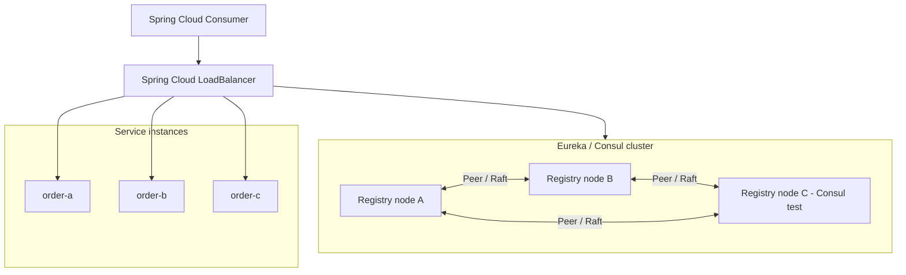

# Testing Registry Outages, Peer Loss, and Sudden Instance Crashes

Service discovery is only reliable when the system still behaves properly while the registry or part of the workload fails. A Eureka Server may go down, a peer may lose connectivity, a Consul cluster may lose quorum, or a service instance may be killed without having time to deregister. Each of these scenarios affects registrations, health state, consumer caches, and Spring Cloud LoadBalancer instance selection differently.

Fault-scenario testing must verify both the failure path and recovery. It is not enough to check whether the registry returns an error; you must verify that the consumer can still call healthy instances, stale data follows policy, alerts fire, and the registry converges once the failing component returns. This lesson builds a test matrix, fault-injection methods, and acceptance criteria for Eureka, Consul, and Spring Cloud applications.

## 1. Test objectives and scope

Three primary failure groups:

1. **Registry outage:** the consumer or provider cannot reach the registry service. Test lookup, registration, heartbeats, caching, and behavior when the registry recovers.
2. **Peer loss:** one node in a registry cluster cannot communicate with other peers. Test replication, quorum, read/write availability, and data convergence.
3. **Sudden instance crash:** a process or container is killed without running shutdown hooks or deregistration. Test health checks, lease expiration, eviction, and when the consumer stops selecting the dead endpoint.

Tests must answer:

- Does the consumer keep calling healthy instances when the registry is temporarily unreachable?
- Does the consumer distinguish an empty result from a registry query failure?
- Does the cache snapshot have an explicit max age and stale fallback policy?
- Is the dead instance removed from the candidate set within an acceptable timeframe?
- Does the recovered peer or registry re-sync registrations without creating duplicate records?
- Do metrics, logs, and alerts accurately describe the failure cause and scope?

## 2. Preparing the test environment

### 2.1. Minimum topology

For Eureka, run at least two server peers and two or three service instances. For Consul, use a three-server cluster so you can test both losing one server while keeping quorum and losing quorum altogether. Running a single server cannot realistically simulate peer/quorum behavior.



This illustrative topology can separate registry peers and providers into distinct containers or processes. In Consul, clients usually connect to a Consul Agent, and the Agent communicates with the server cluster. Run at least one Agent beside the provider and one beside the consumer if you want to test Agent failures separately from server failures.

### 2.2. Recording a baseline before injecting faults

Before every test, record:

- Desired replica count, registration count, and healthy instance count.
- Service ID, instance ID, host/port, and zone/cluster metadata.
- Registry leader/peer state or Consul Raft status.
- Heartbeat interval, lease expiration, health-check interval, and eviction interval.
- Discovery refresh interval, LoadBalancer cache TTL, DNS TTL, and request timeout.
- Request success rate, 5xx rate, timeout rate, and latency.
- Existing metrics/alerts so test-induced errors are distinguished from pre-existing alerts.

Never start fault injection while the baseline is unstable. If an instance is already unhealthy beforehand, test results will not isolate the impact of the injected fault.

### 2.3. Choosing where to run tests

Prioritize in this order:

- Unit tests with a fake `DiscoveryClient` to verify empty/error/stale logic.
- Integration tests with Testcontainers or Docker Compose to test a real registry.
- Fault injection via Toxiproxy, Docker networks, or chaos tools in a staging environment.
- Production game days only with operational approval, bounded blast radius, traffic guards, and a dedicated rollback plan.

Never run commands to stop registries, sever networks, or kill processes in production just to try the examples in this article. Use dedicated test container names, networks, and services, and double-check targets before injecting faults.

## 3. Test case structure and general criteria

Each test should follow this structure:

1. **Given:** initial topology and healthy baseline are verified.
2. **When:** inject a single fault, such as stopping a registry peer or killing a provider.
3. **Then:** inspect the registry, DiscoveryClient, LoadBalancer, request outcomes, and alerts.
4. **Recover:** restore the failed network, process, or node.
5. **Converge:** wait for the registry, caches, and consumer to update.
6. **Assert:** verify final state, no ghost registrations, and no duplicate instances.

| Group | Fault injection | Key assertions |
| --- | --- | --- |
| Registry outage | Stop entire registry or block consumer/provider paths to registry | In-flight requests and existing cache follow policy; new lookup failures are classified as unavailable. |
| One Eureka peer down | Stop one peer or block peer replication traffic | Remaining peer serves per topology; data converges after peer returns. |
| Consul loses one server | Stop one of three servers | Cluster retains quorum; reads/writes continue by design and leader re-elects if needed. |
| Consul loses quorum | Stop enough servers to lose majority | Do not assume writes succeed; clients see errors or stale reads per chosen consistency mode. |
| Instance crash | SIGKILL process/container | Health/lease detects dead instance; consumer stops picking endpoint within acceptable time. |
| Consumer loses registry access | Block only consumer-to-registry path | Distinguish local cache from successful refresh; do not wipe valid snapshot solely on refresh failure. |
| Provider loses registry access | Block only provider-to-registry path | Provider may keep running while registration/heartbeat goes stale; upon reconnect it re-registers/renews properly. |

## 4. Testing a full registry outage

### 4.1. Objective

Simulate a consumer unable to reach the registry while providers may still be running. Distinguish two communication paths:

- Consumer to registry to fetch the service list.
- Consumer to provider to send requests.

If you block only the consumer-to-registry path, requests to known instances may continue working thanks to cache. If you also block consumer-to-provider, requests fail due to networking rather than discovery. These two faults must be tested separately.

### 4.2. Execution steps

1. Start the registry, providers `order-a` and `order-b`, and the consumer.
2. Wait until both providers are registered and passing health checks.
3. Call the consumer continuously and log selected instances.
4. Block traffic from the consumer to the registry or stop the registry in the test environment.
5. Keep calling the consumer for a short defined window.
6. Inspect the local registry cache, snapshot age, refresh errors, and request outcomes.
7. Restart the registry or restore the network.
8. Verify registration/heartbeats and discovery caches converge.

Docker Compose example with uniquely named test containers:

```bash
# Stop registries in the test environment
docker compose stop eureka-a eureka-b

# Restore registries
docker compose start eureka-a eureka-b
```

To isolate only the consumer without stopping the server, place Toxiproxy between the consumer and registry or apply network rules on the test network. Toxiproxy lets you introduce controlled latency, timeouts, or connection cuts; reset the proxy after the test.

### 4.3. Assertions

- Failed registry refreshes are recorded as connection errors, not turned into an empty list.
- If the application has stale fallback, old snapshots are used only within the configured stale TTL.
- Snapshot age grows while refreshes fail; observer-down or registry-unavailable metrics/alerts fire.
- Requests to healthy providers continue succeeding if the provider network path remains open.
- When the registry recovers, lookup/refresh succeeds and a fresh snapshot replaces the stale one.
- Alerts clear after recovery and data convergence.

With Eureka, clients typically keep a local registry cache; therefore, `DiscoveryClient.getInstances()` may still return a list while Eureka Server is unreachable. That does not prove the server is healthy or the data was freshly updated. Tests must inspect the timestamp of the last successful registry fetch.

With Consul, distinguish losing the local HTTP API/Agent from losing the server cluster. If the consumer queries via a local Agent, the Agent may stay up while unable to reach the server cluster; query behavior depends on the endpoint and consistency mode.

## 5. Testing loss of a Eureka peer

### 5.1. Objective

Eureka Server peers exchange registry data so nodes maintain a close-to-current view of registrations. When one peer loses connectivity, verify that the surviving peer still serves clients as configured, how new registrations are handled, and that data converges when the peer returns.

### 5.2. Fault injection

You can stop one peer in Docker Compose:

```bash
docker compose stop eureka-b
```

Or block only traffic between the two peers using Toxiproxy/network rules to simulate one-way and two-way partitions. Stopping a container and partitioning the network are two distinct scenarios: stopping a container removes the node, whereas a partition leaves both sides running without being able to replicate.

While `eureka-b` is down:

1. Verify whether clients are configured with URLs for both Eureka Servers or only one.
2. Check which endpoint clients are sending heartbeats and fetches to.
3. Create a new registration or scale up a provider instance in the test.
4. Query the surviving peer's REST API/Dashboard and observe the registry.
5. Restart `eureka-b`, and check peer replication and duplicate records.

### 5.3. Assertions

- Clients can connect to the surviving peer if URLs/failover are configured properly.
- Do not assume new registrations appear simultaneously on every peer during a partition.
- Once the peer returns, the registry converges within the expected window and retains no duplicate registrations.
- Heartbeats/leases of healthy instances are processed accurately; dead instances are not retained indefinitely due to peer recovery.
- Peer-down or replication-anomaly alerts fire and resolve after recovery.

Eureka self-preservation can delay eviction when the renewal rate drops below threshold. Never disable self-preservation in production just to test peer loss. In an isolated test environment, you may tune lease/renewal intervals to shorten test duration, provided differences from production are clearly documented.

## 6. Testing Consul peer loss and quorum

### 6.1. Distinguishing single-server loss from quorum loss

Consul servers use Raft consensus to maintain state. The cluster needs a majority of servers (quorum) to commit changes. With three servers, quorum is two:

| Cluster | Active servers | Expected outcome |
| --- | ---: | --- |
| 3 servers, 1 lost | 2 | Quorum preserved; cluster can continue operating once leader stabilizes. |
| 3 servers, 2 lost | 1 | Quorum lost; cannot commit new changes until quorum returns. |
| 5 servers, 2 lost | 3 | Quorum preserved. |
| 5 servers, 3 lost | 2 | Quorum lost. |

These are baseline quorum numbers; exact behavior also depends on current membership, leader state, and when the fault occurs. Never use a two-server cluster for HA testing: losing one server immediately loses the majority.

### 6.2. Testing single-server loss

1. Start three Consul servers and verify an elected leader and stable peers.
2. Register several service instances and query the Health API.
3. Stop one server or partition it from the other two.
4. Verify leader election if the failed node was the leader.
5. Perform registration/update operations and health queries according to the client's consistency mode.
6. Restart the server and verify it catches up on Raft logs/state.

Example in a test cluster:

```bash
docker compose stop consul-3
docker compose start consul-3
```

### 6.3. Testing quorum loss

In a three-server test environment, stop two servers:

```bash
docker compose stop consul-2 consul-3
```

Verify that write/registration operations fail or do not commit while quorum is lost. Read queries can behave differently depending on the endpoint, leader/follower, and consistency mode; do not assert that every read fails. If using `stale` reads, verify data may be outdated and never treat it as proof of latest state.

Restore the servers:

```bash
docker compose start consul-2 consul-3
```

After recovery, inspect leader/quorum, Raft peer status, Catalog, and Health API. Ensure registrations from Agents sync or re-register cleanly.

### 6.4. Assertions

- Losing one server in a three-node cluster does not cause prolonged quorum loss.
- Losing quorum prevents writes from being treated as committed.
- Clients distinguish query errors from empty results.
- Once quorum returns, leader/peer state stabilizes and the service catalog converges.
- No duplicate service IDs/registrations arise from client registration retries.
- Agents and health checks are not confused with server consensus: an Agent may remain up while the server cluster lacks quorum.

## 7. Testing sudden instance crashes

### 7.1. Why use a sudden kill?

When an application stops gracefully, shutdown hooks can deregister from the registry before the process exits. That does not simulate crashes such as OOM kills, JVM crashes, container runtime kills, or sudden node power loss.

To test crash detection, create a situation where the process does not execute shutdown hooks. In a container test environment:

```bash
docker kill --signal=KILL order-service-a
```

`SIGKILL` gives the application no time to invoke deregistration or flush logs. In Kubernetes, you can delete a Pod with grace period 0 in a test namespace or kill the process inside the container. Run these commands only against test workloads.

### 7.2. Testing with Consul

If the Consul Agent runs HTTP/TCP health checks against the provider, after the process dies the check turns critical following failed probes. A consumer with `query-passing` or `spring.cloud.consul.discovery.query-passing=true` excludes the instance from passing results once status updates.

Verify:

1. Whether the instance remains in the Catalog or was deregistered.
2. How the unfiltered Health API differs from `?passing`.
3. Time from kill to critical status.
4. Time from critical status until DiscoveryClient/LoadBalancer stops picking the instance.
5. If `deregister_critical_service_after` is configured, whether deregistration occurs on schedule.

Note: a critical check does not mean the Catalog entry is deleted immediately. `query-passing` only filters results; deregistration policy is a separate mechanism.

### 7.3. Testing with Eureka

When a process dies without deregistering, Eureka Server keeps the registration until the lease expires and eviction runs. Timing depends on:

- `eureka.instance.lease-renewal-interval-in-seconds`.
- `eureka.instance.lease-expiration-duration-in-seconds`.
- `eureka.server.eviction-interval-timer-in-ms`.
- Renewal threshold and self-preservation mode.
- Eureka Client registry fetch/cache and LoadBalancer cache.

Therefore, do not assert that the instance must vanish at an exact fixed mark like 90 seconds. Self-preservation can pause eviction when renewal rates drop; that is expected behavior to observe in tests rather than a test failure.

Verify whether the consumer removes the non-serving instance from selection, and whether requests retry/fall back to another replica. Once the lease expires and eviction is permitted, confirm the stale registration is removed from the registry.

### 7.4. Testing on Kubernetes

Distinguish these cases:

- Container process crashes while Pod/Node stays healthy: kubelet may restart the container; readiness fails and EndpointSlices update per Pod lifecycle.
- Pod is deleted: Pod termination and EndpointSlices update per controller behavior; `preStop`/graceful shutdown depends on deletion method.
- Node loses network or shuts down abruptly: the control plane takes time to mark the node NotReady and process Pods/endpoints; behavior differs from normal Pod deletion.

Do not run a graceful `kubectl delete pod` test and conclude you have tested sudden process death. Test container crashes, Pod deletion, and node/network partitions separately if those scenarios are in your threat model.

## 8. Checking impact on consumers and LoadBalancer

The registry may have removed an instance while the consumer still holds a cache; or the registry may have failed while the consumer still holds a stale snapshot. Therefore, assertions must span all three layers:

1. **Registry:** actual service/instance status and health state.
2. **DiscoveryClient:** instance list seen by the consumer app and snapshot age.
3. **LoadBalancer/requests:** selected instance, request success/failure, and fallback behavior.

One way to verify request routing is having the provider return its instance ID in a header or response body:

```java
@RestController
public class InstanceController {

    @Value("${INSTANCE_ID:local-instance}")
    private String instanceId;

    @GetMapping("/whoami")
    public Map<String, String> whoami() {
        return Map.of("instanceId", instanceId);
    }
}
```

The consumer test calls the logical service name repeatedly and records returned instance IDs. After one instance is killed and discovery converges, the test should no longer see that ID in new requests, aside from in-flight requests or existing connections allowed within a defined drain window.

Do not assert a fixed round-robin order when the instance list changes or a different LoadBalancer algorithm is used. Check the set of valid instances and the error count within a window rather than assuming request N always lands on a specific replica.

## 9. Integration test example with Awaitility

The following example illustrates checking that an instance is removed from the list after its health state changes. The test requires starting a real registry and provider in the fixture; `markUnhealthy` is a test-specific action causing the health check to fail.

This assertion only holds when discovery queries apply the corresponding health filter: in Consul, enable `spring.cloud.consul.discovery.query-passing=true`; in Eureka, verify the client only returns instances in an acceptable status; in Kubernetes, use Ready Service endpoints. In Consul without `query-passing`, the registration may keep appearing even when the check is critical.

```java
import static org.assertj.core.api.Assertions.assertThat;

import java.time.Duration;

import org.awaitility.Awaitility;
import org.junit.jupiter.api.Test;
import org.springframework.beans.factory.annotation.Autowired;
import org.springframework.cloud.client.ServiceInstance;
import org.springframework.cloud.client.discovery.DiscoveryClient;

class DiscoveryFailureIntegrationTest {

    @Autowired
    DiscoveryClient discoveryClient;

    @Autowired
    TestServiceControl serviceControl;

    @Test
    void unhealthyInstanceIsEventuallyExcluded() {
        String serviceId = "order-service";
        String failedInstanceId = "order-a";

        assertThat(discoveryClient.getInstances(serviceId))
                .extracting(ServiceInstance::getInstanceId)
                .contains(failedInstanceId);

        serviceControl.markUnhealthy(failedInstanceId);

        Awaitility.await()
                .atMost(Duration.ofSeconds(45))
                .pollInterval(Duration.ofSeconds(1))
                .untilAsserted(() -> {
                    assertThat(discoveryClient.getInstances(serviceId))
                            .extracting(ServiceInstance::getInstanceId)
                            .doesNotContain(failedInstanceId);
                });
    }
}
```

This is an illustrative skeleton, not a runnable test as-is: `TestServiceControl`, container lifecycle, and `getInstanceId()` must be supplied according to your registry/client; not every `ServiceInstance` implementation returns instance IDs the same way. For Eureka, wait durations must reflect lease/eviction/cache intervals and self-preservation. For Consul, wait durations must reflect health check intervals and query/cache behavior. Derive timeouts from your real test configuration rather than copying 45 seconds mechanically.

When testing a registry outage, assert the expected exception/refresh error or snapshot policy. Do not assume `getInstances()` always throws an exception: some discovery clients read from a local cache and continue returning a list while background refreshes fail.

## 10. Detailed test matrix

| ID | Scenario | Fault injection | Expected outcome | Recovery to verify |
| --- | --- | --- | --- | --- |
| REG-01 | Full registry outage | Stop server cluster or block consumer-to-registry | New lookups report error/stale per policy; requests use valid snapshot if permitted | Registry comes back, refresh succeeds, fresh snapshot replaces stale one. |
| REG-02 | Provider cannot reach registry | Block provider-to-registry | Provider may keep running; heartbeat/registration stops updating | Provider reconnects and registration/heartbeat converges without duplicates. |
| EUR-01 | Eureka loses one peer | Stop peer B | Peer A keeps serving per config; replication may lag | Peer B returns and syncs registry. |
| EUR-02 | Eureka two-peer partition | Block bidirectional peer traffic | Observe registry and renewal divergence; do not assume strong consistency | Partition heals, peers converge, stale registrations are handled. |
| CON-01 | Consul loses one of three servers | Stop one server | Quorum maintained; leader/queries stabilize | Server returns and catches up on Raft state. |
| CON-02 | Consul loses quorum | Stop two of three servers | Writes not treated as committed; reads depend on consistency mode | Quorum returns, leader and catalog stabilize. |
| INS-01 | Provider SIGKILL | Kill process/container | Health/lease detects dead instance; consumer stops selecting after convergence | New instance registers; no ghost records remain. |
| INS-02 | Provider loses network | Block agent/registry or consumer/provider path per test | Distinguish health failure from network failure | Network restored, health passes, lookup recovers. |
| INS-03 | Kubernetes node disconnects | Partition test node | Node/Pod readiness and endpoints update per controller timeouts | Node returns or Pod is replaced; EndpointSlices converge. |
| CLI-01 | Consumer loses registry access | Block consumer-to-registry | Cache/freshness policy activates; telemetry logs refresh errors | Refresh succeeds and LoadBalancer uses updated list. |

## 11. Metrics, logs, and alerts to verify

In every fault scenario, collect at least:

| Signal | Question to answer |
| --- | --- |
| Healthy/registered instance count | Does the registry hold registrations with zero healthy instances, or no registrations at all? |
| Discovery lookup outcome | Was lookup non-empty success, empty, or error? |
| Snapshot age / last successful refresh | Is the consumer using fresh or stale data? |
| Registry peer/leader/quorum state | Is a single peer down or did the entire cluster lose quorum? |
| Health check/lease state | Has the dead instance been detected yet? |
| LoadBalancer selected instance | Is the consumer still selecting the dead instance? |
| Request 5xx/timeout and latency | Were users impacted during the fault window? |
| Recovery duration | How long from recovery until discovery and requests normalize? |

Logs should include service ID, non-sensitive instance ID, registry node, outcome, timestamp, and correlation ID. Never log tokens, URLs containing credentials, or full headers. Configure separate alerts for registry unavailable, peer/quorum degraded, zero healthy instances, stale snapshots, and instance crashes so on-call engineers immediately know the root cause.

## 12. Acceptance criteria and time budgets

There is no single detection time across all registries. Compute your budget from actual configuration:

```text
Detection time
  = health-check / lease detection
  + eviction or controller interval
  + registry propagation
  + client refresh / cache TTL
  + LoadBalancer or DNS cache
```

This is a budgeting model to identify components to measure, not an exact sum in every implementation; some stages run in parallel. Use timestamps in tests to measure actual elapsed time from fault injection until the consumer stops picking the failed endpoint.

Example criteria for staging:

- Loss of one Eureka peer: clients continue discovery via the surviving peer within the defined failover limit.
- Loss of one Consul server in a three-node cluster: quorum holds and registry operations recover after leader transition.
- Loss of Consul quorum: applications recognize write/query failures per consistency mode instead of reporting fake empty results.
- Instance crash: consumers stop selecting dead endpoints within the SLO-agreed maximum duration.
- Registry outage: requests to healthy providers proceed per stale policy; snapshots past stale TTL are rejected.
- Recovery: no duplicate registrations or ghost endpoints remain once intervals/caches converge.
- Monitoring: alerts match the fault type and resolve after registry, provider, and telemetry recover.

Put concrete thresholds into test configuration or your system's SLO documentation. Do not apply the same threshold to a 90-second Eureka lease, a 10-second Consul HTTP check, and Kubernetes node-failure detection.

## 13. Post-test recovery and cleanup workflow

After each fault injection:

1. Restore network rules, Toxiproxy settings, or stopped containers.
2. Verify registry servers/peers/leader return to a stable state.
3. Verify surviving providers resume heartbeats or re-register.
4. Check that health checks return to passing/Ready.
5. Verify Catalog, Eureka registry, or EndpointSlices contain no stale/duplicate instances.
6. Confirm consumers refresh snapshots and LoadBalancer no longer picks dead endpoints.
7. Confirm request error rates return to baseline.
8. Confirm alerts resolve and no leftover silences or test annotations remain.
9. Remove test containers, networks, and data per fixture teardown.

If a registry persists state, use a dedicated data volume for tests. Never delete shared volumes or volumes holding out-of-scope data. Tests must be idempotent so re-running them leaves no stale registrations or containers that taint future runs.

## 14. Common mistakes when testing faults

| Testing mistake | Why it is wrong | How to improve |
| --- | --- | --- |
| Stopping one Eureka Server and claiming full registry outage was tested | Surviving peer still serves; that is peer loss, not full outage | Separate peer-loss tests from full-registry-outage tests. |
| Using a single Consul server to test quorum | One node cannot simulate real majority/failover | Use three servers in the test cluster. |
| Using `docker stop` to simulate a sudden crash | Stop usually sends SIGTERM and permits graceful shutdown | Use SIGKILL in an isolated environment to simulate abrupt process death. |
| Checking only the registry API | Does not show whether consumer cache/LoadBalancer still picks old instances | Check registry, DiscoveryClient, and request routing. |
| Asserting every lookup throws when registry is down | Clients may serve from local cache | Assert refresh errors, snapshot age, and policy rather than assuming one API behavior. |
| Asserting dead instances disappear immediately | Health intervals, leases, eviction, and caches add lag | Measure convergence time based on real configuration. |
| Disabling self-preservation for fast tests and forgetting to re-enable | Changes production behavior and hides risk | Use a dedicated test profile; restore config after tests. |
| Failing to restore network faults after tests | Subsequent tests run on a broken topology | Use teardown/finally and verify proxy/network state. |
| Ignoring alerts and recovery | Only proves the system fails, not that operations detect and recover properly | Test metrics, alerts, resolved states, and runbooks. |

## 15. Checklist before promoting to CI/staging

- Test fixture has the right registry topology: two Eureka peers or three Consul servers when testing quorum.
- At least two provider instances and one consumer exist to observe selection.
- Baseline health/registration/requests are verified before injecting faults.
- Fault injection is scoped strictly to test containers/networks.
- Overall test timeout and stop conditions exist; faults never hang indefinitely.
- Full registry outage, peer loss, quorum loss, and provider crash are separated into distinct test cases.
- Assertions cover registry, DiscoveryClient, LoadBalancer, and request outcomes.
- Tests account for caches, leases, health-check intervals, eviction, and self-preservation.
- Recovery assertions, duplicate/ghost registration checks, and teardown are included.
- Metrics/alerts are verified, not just logs.
- No real secrets or production data are used in tests.

## 16. Takeaways

- Full registry outage, single-peer loss, and sudden instance crashes are three distinct faults that require separate tests.
- Eureka clients maintain a local registry cache; losing the server does not mean every lookup immediately throws or returns empty.
- Consul requires Raft quorum to commit changes; in a three-server cluster, losing one node preserves quorum while losing two breaks quorum.
- Suddenly killed instances do not run deregistration; Consul health checks or Eureka leases/eviction detect them according to configured intervals.
- Eureka self-preservation can delay eviction; never treat a single lease duration as a guaranteed disappearance time.
- Kubernetes container crashes, Pod deletions, and node partitions follow different lifecycles.
- Measure impact across the registry, DiscoveryClient, LoadBalancer, and live requests; also verify recovery and stale/duplicate cleanup.
- Fault injection must run only in isolated environments with clear baselines, rollbacks, and teardown.

## References

- [Spring Cloud Netflix: Eureka Client and Server](https://docs.spring.io/spring-cloud-netflix/reference/spring-cloud-netflix.html)
- [Consul: Consensus and Raft](https://developer.hashicorp.com/consul/docs/architecture/consensus)
- [Consul: Health API](https://developer.hashicorp.com/consul/api-docs/health)
- [Testcontainers for Java](https://java.testcontainers.org/)
- [Toxiproxy](https://github.com/Shopify/toxiproxy)
- [Kubernetes: Pod Lifecycle](https://kubernetes.io/docs/concepts/workloads/pods/pod-lifecycle/)
