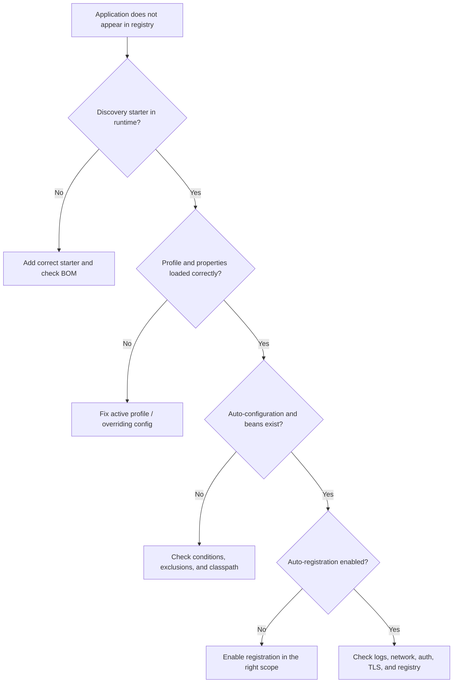

# Application Fails to Register: Checking Starters, Profiles, and Auto-Configuration

When a Spring Boot application starts up but does not appear in Eureka, Consul, or ZooKeeper, the root cause usually lies in one of four layers: the discovery dependency is missing from the runtime classpath; the active profile does not load the expected configuration; auto-configuration is conditionalized out or excluded; or the registration mechanism has been disabled. Only if all of these layers are correct should you move on to checking registry connectivity, authentication, and the advertised instance address.

It is important to distinguish **not having a discovery client** from **having a discovery client whose registration fails**. The first case usually lacks the corresponding beans or auto-configuration. The second case typically shows logs of outgoing requests, connection/401/403 errors, or a record appearing in an unhealthy state.

## Quick Diagnostic Workflow

Follow this order to isolate the issue without changing multiple configurations at once:

1. Confirm the right application and the right active profile are running.
2. Check whether the discovery starter is present in the runtime classpath and executable artifact.
3. Check `spring.application.name` and the properties enabling discovery/registration.
4. Review the Condition Evaluation Report to see which auto-configurations matched or were excluded.
5. Verify that `DiscoveryClient`, `ServiceRegistry`, and auto-registration beans were created.
6. Look for registration logs and connection, authentication, TLS, or ACL errors.
7. Inspect the instance record and address directly on the registry.



Do not modify multiple properties at once. Change only one suspected cause at a time, restart, and verify the change in the logs or registry.

## 1. Checking for the Right Discovery Starter

Spring Cloud does not automatically provide connectivity to every registry just because the application has the `spring-cloud-commons` dependency. You must add the starter for the provider the application uses. For example:

| Registry | Common Starter |
|---|---|
| Eureka | `spring-cloud-starter-netflix-eureka-client` |
| Consul | `spring-cloud-starter-consul-discovery` |
| ZooKeeper | `spring-cloud-starter-zookeeper-discovery` |

Maven dependency example for a Eureka client:

```xml
<dependency>
    <groupId>org.springframework.cloud</groupId>
    <artifactId>spring-cloud-starter-netflix-eureka-client</artifactId>
</dependency>
```

Maven dependency example for Consul:

```xml
<dependency>
    <groupId>org.springframework.cloud</groupId>
    <artifactId>spring-cloud-starter-consul-discovery</artifactId>
</dependency>
```

Maven dependency example for ZooKeeper:

```xml
<dependency>
    <groupId>org.springframework.cloud</groupId>
    <artifactId>spring-cloud-starter-zookeeper-discovery</artifactId>
</dependency>
```

Do not add all three starters just to try your luck. Choose the registry that the deployment environment actually uses. If multiple discovery implementations are present on the classpath at the same time, check which auto-configurations and clients are activated to avoid ambiguous configuration or connecting to the wrong system.

### Checking Dependencies in Maven

Run the dependency tree and look for the corresponding artifact:

```bash
./mvnw dependency:tree -Dincludes=org.springframework.cloud
```

On Windows, you can use:

```powershell
.\mvnw.cmd dependency:tree -Dincludes=org.springframework.cloud
```

Verify that the starter is not declared with `test` or `provided` scope, is not removed by an `exclusion`, and that the module running the application actually receives the dependency. A starter present only in another module of a multi-module build will not automatically appear in this service's runtime classpath.

### Checking Dependencies in Gradle

```bash
./gradlew dependencies --configuration runtimeClasspath
./gradlew dependencyInsight --dependency spring-cloud-starter-netflix-eureka-client --configuration runtimeClasspath
```

Replace the dependency name in `dependencyInsight` if the application uses Consul or ZooKeeper. Verify the dependency is in `runtimeClasspath`, not just `testRuntimeClasspath`.

### Checking the Executable JAR

A dependency may appear in the IDE yet not be packaged into the running artifact, especially when building the wrong module or using custom packaging configurations. For a Spring Boot executable JAR, inspect the libraries under `BOOT-INF/lib`:

```bash
jar tf target/inventory-service.jar | grep -i eureka
```

On Windows PowerShell:

```powershell
jar tf target\inventory-service.jar | Select-String -Pattern "eureka|consul|zookeeper"
```

If the artifact does not contain the starter/provider library, verify the build command, target module, build profile, and packaging plugin configuration.

## 2. Checking the Spring Cloud BOM and Versions

The starter may be declared properly, yet the Spring Boot and Spring Cloud versions may be incompatible. In that case, auto-configuration may fail at startup, lack classes/methods, or fail classpath conditions unexpectedly.

Manage Spring Cloud versions with a BOM compatible with the project's Spring Boot line instead of picking versions for each starter individually:

```xml
<dependencyManagement>
    <dependencies>
        <dependency>
            <groupId>org.springframework.cloud</groupId>
            <artifactId>spring-cloud-dependencies</artifactId>
            <version>${spring-cloud.version}</version>
            <type>pom</type>
            <scope>import</scope>
        </dependency>
    </dependencies>
</dependencyManagement>
```

Confirm that `spring-cloud.version` belongs to a release train supporting your Spring Boot version according to the official compatibility matrix. Do not try to fix errors by upgrading a single Netflix Eureka or Spring Cloud Commons library individually while bypassing the BOM; mixing versions can break auto-configuration conditions or API compatibility.

Signs to look for in logs/build:

- `NoSuchMethodError` or `ClassNotFoundException` in `org.springframework.cloud` or `com.netflix.discovery` packages.
- Spring Boot/Spring Cloud version incompatibility warnings.
- Multiple different versions of the same artifact in the dependency tree.
- The starter is present, but the provider library was excluded or replaced with an incompatible version.

## 3. Confirming Which Profile Is Actually Running

Spring Boot can load `application.yml`, `application-{profile}.yml`, and external configuration sources such as environment variables, command-line arguments, or a config server. A profile different from the expected one may override discovery configuration.

Default configuration example:

```yaml
spring:
  application:
    name: inventory-service
```

Profile-specific configuration example for `docker` in `application-docker.yml`:

```yaml
spring:
  cloud:
    discovery:
      enabled: true
    service-registry:
      auto-registration:
        enabled: true

eureka:
  client:
    register-with-eureka: true
    fetch-registry: true
    service-url:
      defaultZone: http://eureka-server:8761/eureka/
```

Activate the profile via an environment variable or startup argument:

```bash
java -jar inventory-service.jar --spring.profiles.active=docker
```

Or:

```text
SPRING_PROFILES_ACTIVE=docker
```

In Docker Compose/Kubernetes, inspect the actual environment values of the container/pod. Do not only look at YAML files in the repository: command-line arguments, environment variables, external configs, or profile groups can make runtime values differ from the file you are reading.

### Commonly Overlooked Override Sources

- `SPRING_PROFILES_ACTIVE` or `--spring.profiles.active` selecting a different profile.
- `SPRING_CLOUD_DISCOVERY_ENABLED=false` disabling discovery at the Spring Cloud level.
- `SPRING_CLOUD_SERVICE_REGISTRY_AUTO_REGISTRATION_ENABLED=false` disabling generic auto-registration.
- `EUREKA_CLIENT_REGISTER_WITH_EUREKA=false` disabling Eureka registration while possibly still fetching the registry.
- `EUREKA_CLIENT_ENABLED=false` potentially disabling Eureka client auto-configuration in versions supporting this property.
- Configuration `spring.cloud.consul.discovery.register=false` or `spring.cloud.zookeeper.discovery.register=false` disabling registration for the respective provider.
- A Config Server, Kubernetes ConfigMap/Secret, or command-line argument overriding values in `application.yml`.

Check active profiles in startup logs or Actuator `env`/`configprops` if safely exposed. These endpoints can contain sensitive information; only enable them on a management network and mask credentials before sharing output.

## 4. Checking Application Name and Registration Flags

`spring.application.name` is the logical name commonly used as the default service ID. If missing, the registry may display a default name like `application`, causing operators to look for the wrong service.

```yaml
spring:
  application:
    name: inventory-service
```

Verify the exact name in the registry, including case differences or provider naming normalization rules. With Eureka, the application name is typically displayed in uppercase on the dashboard; this does not necessarily mean registration failed.

### Flags That Can Disable Registration

| Property | Scope | Impact |
|---|---|---|
| `spring.cloud.discovery.enabled=false` | Spring Cloud discovery in general | Disables related discovery client auto-configurations depending on version |
| `spring.cloud.service-registry.auto-registration.enabled=false` | Generic service auto-registration | Prevents lifecycle auto-registration; the discovery client may still exist |
| `eureka.client.register-with-eureka=false` | Eureka | Does not register this instance; can still fetch the registry if `fetch-registry=true` |
| `spring.cloud.consul.discovery.register=false` | Consul | Does not auto-register the service with Consul |
| `spring.cloud.zookeeper.discovery.register=false` | ZooKeeper | Does not auto-register the service with ZooKeeper |

Do not confuse `register-with-eureka=false` with `fetch-registry=false`: the first disables registering the local instance, while the second disables fetching the service list from Eureka. A consumer application may need to fetch the registry without registering itself.

### Minimal Eureka Client Configuration

```yaml
spring:
  application:
    name: inventory-service
  cloud:
    discovery:
      enabled: true
    service-registry:
      auto-registration:
        enabled: true

eureka:
  client:
    register-with-eureka: true
    fetch-registry: true
    service-url:
      defaultZone: http://eureka-server:8761/eureka/
```

### Minimal Consul Discovery Configuration

```yaml
spring:
  application:
    name: inventory-service
  cloud:
    consul:
      host: consul-agent
      port: 8500
      discovery:
        enabled: true
        register: true
```

### Minimal ZooKeeper Discovery Configuration

```yaml
spring:
  application:
    name: inventory-service
  cloud:
    zookeeper:
      connect-string: zk-1:2181,zk-2:2181,zk-3:2181
      discovery:
        enabled: true
        register: true
```

The examples above use common Spring Cloud properties. Property names and defaults may vary by release train; verify against `spring-configuration-metadata.json`, `configprops`, or the reference documentation for the actual starter version.

## 5. Checking Whether Auto-Configuration Is Activated

Spring Boot creates beans from auto-configuration when classpath, property, existing bean, and environment conditions are all satisfied. Having the starter in the dependency tree is not enough to conclude that auto-configuration ran.

### Enabling the Condition Evaluation Report

Start the application with `--debug` to print the auto-configuration conditions report:

```bash
java -jar inventory-service.jar --debug
```

In the logs, search for entries related to `EurekaClientAutoConfiguration`, Consul discovery, ZooKeeper discovery, `DiscoveryClient`, and service registry. The report shows which auto-configurations matched, which did not match, and which conditions were missing.

You can enable more detailed logging in a local environment:

```yaml
logging:
  level:
    org.springframework.boot.autoconfigure: DEBUG
    org.springframework.cloud.client: DEBUG
    org.springframework.cloud.netflix.eureka: DEBUG
    org.springframework.cloud.consul: DEBUG
    org.springframework.cloud.zookeeper: DEBUG
```

Do not leave full DEBUG logging enabled in production for extended periods. Excessive logs can increase storage usage, impact performance, or expose sensitive URLs/metadata.

### Using Actuator `conditions` and `beans`

When Spring Boot Actuator is present, the `conditions` endpoint lets you inspect auto-configuration conditions and the `beans` endpoint shows which beans were created. Example exposure configuration in a diagnostic environment:

```yaml
management:
  endpoints:
    web:
      exposure:
        include: health,info,conditions,beans,configprops
```

Only expose diagnostic endpoints on a protected management network. `env`, `configprops`, and `beans` can reveal configuration, class names, URLs, and metadata; do not expose them publicly or share unreviewed output.

In `/actuator/conditions`, find the provider auto-configuration and read the `negativeMatches`/message section to identify missing conditions. Common examples include a missing provider class on the classpath, a property set to `false`, or another bean causing the default configuration to back off.

## 6. Confirming Discovery Beans and Auto-Registration Beans

If auto-configuration matched, check whether the Spring context created the required discovery beans. You can use Actuator `beans` or startup logs to confirm.

Commonly useful bean types:

| Bean/type | Role |
|---|---|
| `DiscoveryClient` | Looks up instance lists by service ID |
| `ServiceRegistry` | Registers, deregisters, or updates instance status |
| `AutoServiceRegistration` | Integrates with the lifecycle to auto-register the service at startup |
| `EurekaClient` | Eureka-specific client API, when using Eureka |

You can add a temporary check in an `ApplicationRunner` in a local environment:

```java
import org.springframework.boot.ApplicationRunner;
import org.springframework.context.ApplicationContext;
import org.springframework.context.annotation.Bean;
import org.springframework.context.annotation.Configuration;
import org.springframework.cloud.client.discovery.DiscoveryClient;
import org.springframework.cloud.client.serviceregistry.AutoServiceRegistration;
import org.springframework.cloud.client.serviceregistry.ServiceRegistry;

@Configuration
class DiscoveryDiagnosticsConfiguration {
    @Bean
    ApplicationRunner reportDiscoveryBeans(ApplicationContext context) {
        return args -> {
            System.out.println("DiscoveryClient beans: " +
                context.getBeansOfType(DiscoveryClient.class).keySet());
            System.out.println("ServiceRegistry beans: " +
                context.getBeansOfType(ServiceRegistry.class).keySet());
            System.out.println("AutoServiceRegistration beans: " +
                context.getBeansOfType(AutoServiceRegistration.class).keySet());
        };
    }
}
```

This is a temporary diagnostic tool; not every provider/version necessarily creates the exact same set of beans. Remove or restrict this configuration after investigation. Having `DiscoveryClient` does not guarantee `AutoServiceRegistration` exists: an application may only look up services without registering itself.

### Is `@EnableDiscoveryClient` Required?

In modern Spring Cloud versions, the discovery client is typically auto-configured whenever a provider starter is present; `@EnableDiscoveryClient` is usually no longer mandatory. This annotation cannot replace a missing starter or fix an excluded auto-configuration. For older codebases, check the documentation for the release train in use before removing or adding the annotation.

## 7. Finding Properties or Code That Disabled Auto-Configuration

Auto-configuration can be disabled by properties, exclusions, or custom configurations:

- `spring.cloud.discovery.enabled=false` in a profile file or environment variable.
- `spring.cloud.service-registry.auto-registration.enabled=false` preventing generic auto-registration.
- Provider properties such as `eureka.client.register-with-eureka=false`, `spring.cloud.consul.discovery.register=false`, or `spring.cloud.zookeeper.discovery.register=false`.
- `spring.autoconfigure.exclude` excluding auto-configuration from the context.
- `exclude` in `@SpringBootApplication` or `@EnableAutoConfiguration`.
- `@Profile` causing custom discovery configuration not to load under the current profile.
- `@ConditionalOnProperty` in internal configuration evaluating to false.

Exclusion example in YAML:

```yaml
spring:
  autoconfigure:
    exclude:
      - org.springframework.cloud.netflix.eureka.EurekaClientAutoConfiguration
```

This is only an illustrative example of the exclusion mechanism; the exact class name depends on the version and you should not add this exclusion if your goal is to enable Eureka. If you see a discovery class listed under excluded auto-configurations, remove the corresponding exclusion or adjust the configuration as intended.

Check annotations and configurations in the application module, internal libraries, and profile-specific files. An indirectly imported Java configuration class may set properties or define replacement beans even when `application.yml` looks correct.

## 8. Systematically Checking Runtime Profiles and Properties

Once you have identified the active profile, compare the effective properties with the intended ones. You can use `/actuator/env/{property}` or `/actuator/configprops` in a secured environment; sensitive values are usually masked, though you should still review the output.

Properties to check:

| Property | What to Verify |
|---|---|
| `spring.application.name` | Non-empty and matches the desired service ID |
| `spring.cloud.discovery.enabled` | Not disabled at the global scope |
| `spring.cloud.service-registry.auto-registration.enabled` | Not disabled if auto-registration is required |
| `eureka.client.register-with-eureka` | `true` if the application needs to register with Eureka |
| `eureka.client.enabled` | Not set to `false` if Eureka client auto-configuration needs to run |
| `spring.cloud.consul.discovery.register` | `true` if the application needs to register with Consul |
| `spring.cloud.zookeeper.discovery.register` | `true` if the application needs to register with ZooKeeper |
| Provider endpoint/connect string | Hostname, port, scheme, and context path are valid from the runtime network |

Do not draw conclusions based on a single line in `application.yml`. Property sources have different precedence levels; command-line arguments and environment variables can often override configuration files. Check the origin/property source in Actuator or print non-sensitive configuration at startup.

## 9. If Beans Exist but Registration Still Fails

Once `DiscoveryClient` and `AutoServiceRegistration` have been created, the issue usually shifts from auto-configuration to the registration lifecycle or communication with the registry.

### Checking Registration Logs

Look for messages about:

- Service registration starting and completing.
- The registry URL the client is calling.
- Retries, timeouts, connection refused, or DNS resolution failures.
- HTTP `401`/`403` due to credentials, roles, or ACLs.
- TLS handshake/certificate validation failures.
- Invalid instance address/port.

Not every provider registers at the exact same point during startup. Some integrations register via a lifecycle event after the application context or web server is ready. Do not assume failure just because the dashboard does not show the service within the first few milliseconds; wait according to the client's timeout/retry settings and verify the final logs.

### Checking the Advertised Instance Address

The registry may receive the registration, yet consumers cannot reach the instance if the advertised address is wrong. Check the host, port, scheme, and metadata stored in the registry:

- In Docker Compose, do not advertise `localhost` if the consumer is in another container.
- In Kubernetes, check the pod IP, service DNS, or hostname that consumers can actually reach.
- If running behind NAT or with multiple network interfaces, configure an appropriate advertised address.
- Check `server.port` and the registered instance port; do not confuse the host port with the container port.

This is a different error from having no registration at all. If the registry has a record but requests cannot reach the provider, focus on the advertised address and network path.

### Distinguishing Non-Registration from Failing Health Checks

A service may already be registered while its health check is `critical` or `OUT_OF_SERVICE`, causing it not to appear in queries that only return healthy instances. Check both the catalog/registry record and the health status before concluding registration failed.

## 10. Inspecting the Registry Directly

### Eureka

Check the application list from an environment that can reach the Eureka Server:

```bash
curl -H "Accept: application/json" http://eureka-server:8761/eureka/apps
```

If Eureka is protected with Basic Auth, use an appropriate secure credential mechanism and avoid saving passwords into shell history. Check the application name, instance ID, host, port, and instance status.

### Consul

Check services registered on the Consul Agent:

```bash
curl http://consul-agent:8500/v1/agent/services
```

Check the health state of the service:

```bash
curl "http://consul-agent:8500/v1/health/service/inventory-service"
```

If Consul ACLs are enabled, pass the token in a header following your environment's secret policy. Do not embed tokens in commands saved to history or shared output.

### ZooKeeper

With Spring Cloud Zookeeper, services are typically represented as znodes under the configured discovery root. You can use the ZooKeeper CLI to inspect the corresponding path, for example:

```text
ls /services
ls /services/inventory-service
```

The root path can change depending on `spring.cloud.zookeeper.discovery.root` or the ensemble's namespace/chroot. Check the exact configured path; do not assume every application uses `/services`.

## 11. Symptom and Root Cause Table

| Symptom | Common Cause | First Action |
|---|---|---|
| No `DiscoveryClient` bean | Missing starter, auto-config did not match, or excluded | Check runtime dependencies and `/actuator/conditions` |
| `DiscoveryClient` exists but no `AutoServiceRegistration` | Registration disabled or provider used for discovery only | Check global auto-registration and provider properties |
| Registry shows name `APPLICATION` | Missing `spring.application.name` | Set an explicit service ID and verify the new registration |
| Registers only under local profile | Deployment profile does not load properties or has overrides | Check `SPRING_PROFILES_ACTIVE` and property origin |
| Eureka Client sends no requests | `register-with-eureka=false` or Eureka client disabled | Check effective properties and conditions |
| Consul/ZooKeeper has no service | `discovery.register=false` or client integration not enabled | Check provider properties and auto-registration logs |
| Logs show connection refused/timeout | Wrong hostname/port, registry not ready, or network policy blocking | Check DNS and connectivity from the application runtime |
| Logs show 401/403 | Wrong credentials, ACL, or role | Verify token/user and registration permissions |
| Registry has record but consumers cannot reach it | Wrong advertised address/port or critical health | Check instance metadata, health check, and network |
| Service appears then disappears | Heartbeat, lease, TTL, or deregistration/health lifecycle error | Check heartbeats, agent logs, and health status |

## 12. Environment-Specific Checklist

**Local IDE**

1. Select the correct Run Configuration and active profile.
2. Check the runtime classpath of the module being run.
3. Enable `--debug` and read the Condition Evaluation Report.
4. Confirm `spring.application.name` and registration properties.
5. Check whether the local registry receives the registration.

**Docker Compose**

1. Verify the container includes the starter in the executable JAR.
2. Check the actual environment variables and profiles inside the container.
3. Use the Compose service name for the registry hostname, not `localhost`.
4. Check registry health and startup order; the application still needs retries.
5. Verify the advertised address is reachable from consumer containers.

**Kubernetes**

1. Check that the image was built from the right module and profile.
2. Check the Deployment's ConfigMap, Secret, env, and args.
3. Confirm NetworkPolicy, DNS, and Service/Pod addresses.
4. Check registry credentials and TLS truststore.
5. Correlate registration with Pod lifecycle and readiness.

## Conclusion

When an application fails to register with Eureka, Consul, or ZooKeeper, check from dependencies down to runtime in order: the right starter in the runtime classpath, the right Spring Cloud BOM, the right active profile and effective properties, matched auto-configuration, created discovery/registration beans, and enabled registration flags. If all of those are valid, move on to registration logs, networking, authentication, TLS, advertised address, and health status on the registry. This layered approach pinpoints whether the application never initialized the discovery client, disabled auto-registration, or sent requests that the registry rejected.
