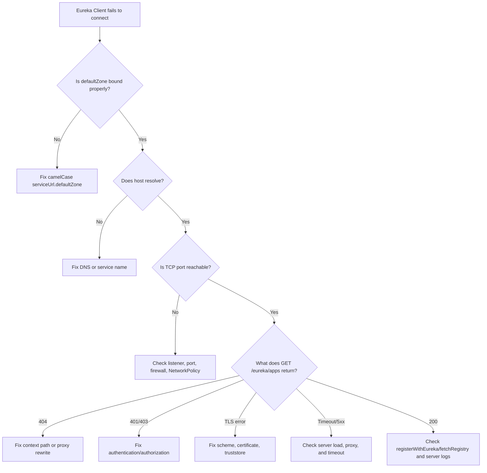

# Eureka Fails to Connect Due to Wrong `defaultZone` or `/eureka/` Path

## 1. Symptoms and Incident Scope

When a Spring Cloud Eureka Client fails to connect to the Eureka Server, the application may start up yet repeatedly log registration, heartbeat, or registry fetch errors. The Eureka Dashboard shows no new instance, `DiscoveryClient` returns an empty list, or consumers cannot locate the service.

Two common configuration causes are:

1. `eureka.client.serviceUrl.defaultZone` is not bound properly, especially due to misspelling the `defaultZone` key or misplacing the YAML structure.
2. The URL points to the wrong host, port, scheme, or context path. With default settings, Eureka REST endpoints live under `/eureka/`; the client needs the right base URL to call APIs such as `/eureka/apps`.

Do not immediately conclude that the Eureka Server is broken. Inspect the effective configuration loaded by the client first, then check DNS, TCP connectivity, HTTP/HTTPS protocol, and the REST endpoint directly from the client's runtime environment.

## 2. Proper `defaultZone` Configuration

### 2.1. Standard YAML Configuration

Example of a Eureka Client running in the same Docker/Kubernetes network as the Eureka Server:

```yaml
spring:
  application:
    name: order-service

eureka:
  client:
    serviceUrl:
      defaultZone: http://eureka-server:8761/eureka/
    registerWithEureka: true
    fetchRegistry: true
```

Where:

- `spring.application.name` is the application's default service ID.
- `serviceUrl` is the map of URLs per Eureka availability zone.
- `defaultZone` is the fallback key the client uses when no matching zone preference exists.
- `registerWithEureka` enables registering this application's instance.
- `fetchRegistry` enables fetching the registry to look up other services.

With default settings, the URL should take the form `http://<host>:<port>/eureka/`, where `host` and `port` are reachable from the client. If the Eureka Server uses a custom context path or reverse proxy path, the URL must reflect the external path the client actually accesses.

### 2.2. Configuration in `application.properties`

```properties
spring.application.name=order-service
eureka.client.serviceUrl.defaultZone=http://eureka-server:8761/eureka/
eureka.client.registerWithEureka=true
eureka.client.fetchRegistry=true
```

Use consistent property naming across the project for easier inspection. Spring Boot supports relaxed binding for bean property names like `serviceUrl`/`service-url`, but the `defaultZone` key is a special case because it is a map key.

## 3. A Very Common Pitfall: Wrong Casing in `defaultZone`

`serviceUrl` has type `Map<String, String>`. Therefore, `defaultZone` is a **case-sensitive map key**. Spring Cloud Netflix requires preserving camelCase `defaultZone`; keys like `default-zone` or `defaultzone` are not equivalent.

| Configuration | Result |
|---|---|
| `serviceUrl.defaultZone` | Correct default key |
| `serviceUrl.default-zone` | Wrong: this is not the `defaultZone` key |
| `serviceUrl.defaultzone` | Wrong: the capital `Z` is lost |
| `serviceUrl.DEFAULTZONE` | Wrong: map key has different casing |

Common incorrect example:

```yaml
eureka:
  client:
    serviceUrl:
      default-zone: http://eureka-server:8761/eureka/
```

Fix it to:

```yaml
eureka:
  client:
    serviceUrl:
      defaultZone: http://eureka-server:8761/eureka/
```

Do not apply Spring Boot's usual kebab-case convention to this map key. Spring Cloud Netflix documentation explicitly states that `defaultZone` must remain camelCase because `serviceUrl` is a `Map<String, String>`.

## 4. Pitfalls When Configuring via Environment Variables

This is a subtle cause in Docker/Kubernetes. Spring Boot lowercases map key names when binding values from environment variables. Therefore, the variable:

```text
EUREKA_CLIENT_SERVICEURL_DEFAULTZONE=http://eureka-server:8761/eureka/
```

can create the map key `defaultzone`, whereas Eureka expects `defaultZone`. The URL value looks right, yet the client still fails to use it as intended.

### 4.1. Recommended Approach: Use a Mounted Configuration File

Place the exact configuration in `application.yml` or a profile file mounted into the container:

```yaml
eureka:
  client:
    serviceUrl:
      defaultZone: ${EUREKA_SERVER_URL:http://eureka-server:8761/eureka/}
```

Here, the environment variable only provides the **URL value**; the `defaultZone` key remains preserved in YAML. Example declaration:

```text
EUREKA_SERVER_URL=http://eureka-server:8761/eureka/
```

### 4.2. Using `SPRING_APPLICATION_JSON`

If you need to pass the entire structure via an environment variable, you can use JSON to preserve the exact casing of the map key:

```bash
SPRING_APPLICATION_JSON='{"eureka":{"client":{"serviceUrl":{"defaultZone":"http://eureka-server:8761/eureka/"}}}}' \
  java -jar order-service.jar
```

In a Kubernetes Deployment:

```yaml
env:
  - name: SPRING_APPLICATION_JSON
    value: '{"eureka":{"client":{"serviceUrl":{"defaultZone":"http://eureka-server:8761/eureka/"}}}}'
```

Do not put real credentials in JSON or manifests committed to the repository. Use Secrets or an appropriate secret management system.

### 4.3. Inspecting Map Keys After Binding

If you suspect an environment variable created the wrong key, inspect the application's effective configuration:

- Use Actuator `env` to see which property source supplies the value.
- Use Actuator `configprops` to inspect which URL map `EurekaClientConfigBean` received.
- If needed, log the URL list from `EurekaClientConfig` at startup; mask usernames/passwords if URLs contain credentials.

Only expose `/actuator/env` and `/actuator/configprops` in a secured administrative environment. These endpoints can reveal sensitive configuration details.

## 5. The `/eureka/` Path and REST API vs. the Dashboard

With a default Eureka Server:

| URL | Role |
|---|---|
| `http://eureka-server:8761/` | Dashboard/web UI page |
| `http://eureka-server:8761/eureka/` | Base URL configured by Eureka Client in `defaultZone` |
| `http://eureka-server:8761/eureka/apps` | REST API for reading registered applications |
| `http://eureka-server:8761/eureka/apps/ORDER-SERVICE` | REST API for reading a single application |

Do not configure the dashboard URL `/` as `defaultZone`. The client requires the REST endpoint, typically `/eureka/`.

### 5.1. Right Host, Port, Scheme, and Path

Valid example:

```text
http://eureka-server:8761/eureka/
```

Common mistakes:

```text
http://eureka-server:8761/             # Missing /eureka/
http://eureka-server:8080/eureka/      # Wrong port if server is not running on 8080
https://eureka-server:8761/eureka/     # Wrong scheme if server only enables HTTP
http://localhost:8761/eureka/         # Wrong when localhost refers to the client container/pod
http://eureka-server:8761/eureka       # Prefer the standard URL with a trailing /
```

A URL with a trailing `/` is the standard form in Spring Cloud Netflix documentation. Without the trailing `/`, HTTP client/proxy path joining may produce an unintended URL; use the standard form and verify actual outgoing requests.

### 5.2. Distinguishing the Dashboard from the REST API

Being able to open the dashboard at `/` does not prove the REST API at `/eureka/apps` is reachable. Conversely, the dashboard might be blocked by proxy/auth while the REST API is permitted for clients. Always test the actual API path.

If using a reverse proxy or Ingress:

- Verify the proxy forwards the `/eureka/` prefix to the Eureka Server.
- Check whether rewrite rules accidentally strip or add path segments.
- Ensure the proxy does not alter Eureka's `POST`/`PUT`/`DELETE` methods into another method.
- Check HTTP-to-HTTPS redirects and the `Location` header.
- Check authentication/authorization for the REST API, not just the dashboard page.

If the server uses a custom context path, determine the external URL seen by clients. For example, if a proxy exposes the API under `/registry/eureka/`, `defaultZone` must point to that prefix according to the rewrite rules.

## 6. Classifying Errors by Message and HTTP Status

| Sign in logs / response | Common Cause | Where to Check |
|---|---|---|
| `UnknownHostException` | Eureka hostname cannot be resolved | DNS/service name, namespace, search domain |
| `ConnectException: Connection refused` | No process listening on host/port or wrong port mapping | Server status, Service port, firewall |
| `No route to host` | Routing/network policy/firewall blocking path | Network route, NetworkPolicy, security group |
| `SocketTimeoutException: connect timed out` | TCP handshake did not complete | Firewall, server overload, wrong address |
| Read/socket timeout | Server/proxy did not respond in time or connection hung | Server logs, proxy, registry load, read timeout |
| HTTP `404` | Wrong context path, missing `/eureka/`, or wrong proxy rewrite | Check `/eureka/apps` and route mapping |
| HTTP `401` | Missing or invalid authentication credentials | Basic auth, credential source, Secret |
| HTTP `403` | Authenticated but not authorized to access | Security filters/authorization rules |
| HTTP `301`/`302` | Redirect, often due to HTTP/HTTPS or proxy path | `Location` header, scheme, and forwarded headers |
| `SSLHandshakeException` | Mismatched truststore/certificate/hostname or TLS protocol | Certificate chain, SAN, truststore, and URL scheme |
| Client keeps retrying another server URL | One or more URLs in `defaultZone` are unreachable | Test each URL in the list individually |
| Dashboard shows server only, no clients | Client failed to register, wrong URL, or registration rejected | Client logs, server logs, and REST API |

Do not use retries to mask `404`, `401`, `403`, wrong DNS, or invalid certificate errors. Fix the configuration or permissions before retrying.

## 7. Testing Directly from the Client Runtime Environment

A URL may be reachable from your laptop yet unreachable from inside a container/pod. Diagnostic commands must be executed in the same network namespace or an equivalent environment as the client.

### 7.1. Checking DNS

Inside a Linux container:

```bash
getent hosts eureka-server
```

If `getent` is unavailable, use `nslookup` or an available DNS tool. In Kubernetes, inspect the Service and namespace:

```bash
kubectl get svc -n platform eureka-server
kubectl get endpoints -n platform eureka-server
```

If the client is in another namespace, use the full DNS name, for example:

```text
eureka-server.platform.svc.cluster.local
```

The exact DNS name depends on the Service name, namespace, and cluster domain.

### 7.2. Checking the TCP Port

```bash
nc -vz eureka-server 8761
```

If DNS resolves but TCP fails, check the server listener, Service `port`/`targetPort`, container port, firewall, and NetworkPolicy. Do not move on to tweaking `/eureka/` before TCP connectivity succeeds.

### 7.3. Checking the REST Endpoint Directly

```bash
curl -i \
  -H 'Accept: application/json' \
  http://eureka-server:8761/eureka/apps
```

When the server requires Basic authentication, supply credentials from a secret/runtime environment rather than putting real passwords into files or shell history:

```bash
curl -i \
  -u "$EUREKA_USERNAME:$EUREKA_PASSWORD" \
  -H 'Accept: application/json' \
  http://eureka-server:8761/eureka/apps
```

A `200` response indicates the REST API is readable from that test location. If you get `401`/`403`, fix authentication/permissions; if `404`, check path/proxy; if timeout, revisit network and server load.

In Kubernetes, you can run commands inside the client Pod if the image includes those tools:

```bash
kubectl exec -n payments deploy/order-service -- \
  curl -i -H 'Accept: application/json' \
  http://eureka-server.platform.svc.cluster.local:8761/eureka/apps
```

If the application image lacks `curl`, use an ephemeral debug container or a test Pod in the same namespace/network policy. Do not draw conclusions from another machine on a different network.

## 8. Checking Server and Client Configuration

### 8.1. Eureka Server

A standalone Eureka Server typically uses:

```yaml
server:
  port: 8761

eureka:
  client:
    registerWithEureka: false
    fetchRegistry: false
```

A standalone server usually does not need to register itself or fetch its own registry. If running a peer-aware cluster, configure peer URLs according to topology instead of blindly applying these two flags to every node.

Ensure the application has `@EnableEurekaServer` and the `spring-cloud-starter-netflix-eureka-server` dependency matching your release train. Check server logs to confirm the application started and REST endpoints mapped properly.

### 8.2. Eureka Client

A regular client needs:

```yaml
eureka:
  client:
    registerWithEureka: true
    fetchRegistry: true
    serviceUrl:
      defaultZone: http://eureka-server:8761/eureka/
```

Do not copy a standalone server configuration (`registerWithEureka: false`, `fetchRegistry: false`) into a business service client if it needs to register itself and discover other services.

### 8.3. Checking Dependencies and Discovery Disable Flags

Verify the client has the `spring-cloud-starter-netflix-eureka-client` dependency and has not accidentally disabled discovery with:

```yaml
eureka:
  client:
    enabled: false

spring:
  cloud:
    discovery:
      enabled: false
```

These properties might be set in a profile or config server other than the file you are viewing. Check the final effective property source, not just `application.yml` in source code.

## 9. Environment-Specific Configuration

### 9.1. Local Development

If Eureka Server runs directly on the same machine:

```yaml
eureka:
  client:
    serviceUrl:
      defaultZone: http://localhost:8761/eureka/
```

### 9.2. Docker Compose

If client and server run in two separate containers on the same Docker network, use the service name:

```yaml
eureka:
  client:
    serviceUrl:
      defaultZone: http://eureka-server:8761/eureka/
```

`localhost` inside the client container refers to the client container itself, not the Eureka Server container.

### 9.3. Kubernetes

If Eureka Server is exposed via Kubernetes Service `eureka-server` in namespace `platform`:

```yaml
eureka:
  client:
    serviceUrl:
      defaultZone: http://eureka-server.platform.svc.cluster.local:8761/eureka/
```

Check the Service port and targetPort, Service endpoints, cluster DNS, and NetworkPolicy. If using an Ingress/Gateway, use a hostname/path reachable by the client Pod; do not assume a public URL is reachable from inside the cluster.

## 10. Step-by-Step Troubleshooting Workflow

Proceed in order to isolate the issue accurately:

1. **Confirm the client is enabled:** check the starter, `eureka.client.enabled`, and `spring.cloud.discovery.enabled`.
2. **Confirm `defaultZone`:** preserve camelCase in the `serviceUrl` map; check profiles, config server, environment variables, and command-line overrides.
3. **Confirm the final URL:** scheme, host, port, `/eureka/` path, and trailing `/`.
4. **Test DNS from the client:** does the hostname resolve to the intended IP?
5. **Test TCP:** can the client open a connection to the right port?
6. **Test the REST API:** call `GET /eureka/apps` from the client's container/pod itself.
7. **Classify HTTP/TLS errors:** 404 is path/proxy; 401/403 is auth; SSL exceptions are TLS; timeouts are network/server load.
8. **Check server logs:** does Eureka Server receive the request, reject it, or error while handling it?
9. **Check registration:** does the client log successful registration and does the server dashboard/API show the application?
10. **Check registry fetch:** does the consumer fetch the registry and does `DiscoveryClient.getInstances()` return instances?

Do not change multiple variables at once. After each change, restart or refresh the relevant component, and record logs and responses so you know which change resolved the problem.

## 11. Sample Logs and How to Read Them

| Log / Sign | Interpretation | Action |
|---|---|---|
| `Cannot execute request on any known server` | None of the configured server URLs are usable | Check the `defaultZone` map and each endpoint |
| `UnknownHostException: eureka-server` | DNS name does not resolve | Check service name, namespace, and DNS |
| `Connection refused` | Host is reachable, but nothing is listening on the port or connection was rejected | Check server port, Service targetPort, and listener |
| `404` from `/eureka/apps` | Wrong REST context path or bad proxy rewrite | Check the `/eureka/` base path |
| `401 Unauthorized` | Server requires authentication | Configure valid credentials and store them in a Secret |
| `SSLHandshakeException` | TLS handshake/trust failure | Check scheme, certificate SAN, CA, and truststore |
| Client can register but cannot fetch registry | Permissions/endpoints may be separated or `fetchRegistry` is disabled | Check fetch configuration and REST read API |

Log messages vary by Eureka client/HTTP transport. Read the root cause exception and the actual URL requested; do not rely solely on a generic summary line at the end of the stack trace.

## 12. Quick Decision Flowchart



## 13. Verification Checklist

- [ ] Client uses `spring-cloud-starter-netflix-eureka-client` and discovery is not disabled.
- [ ] `serviceUrl.defaultZone` preserves the uppercase `Z`.
- [ ] Environment variables do not turn the map key into `defaultzone`; use YAML/profile or `SPRING_APPLICATION_JSON` when needed.
- [ ] The URL has the scheme, hostname, port, and `/eureka/` matching the actual endpoint.
- [ ] The hostname resolves from the client container/pod.
- [ ] The TCP port is reachable from the client.
- [ ] `GET /eureka/apps` returns the expected response.
- [ ] HTTP/HTTPS, Basic auth, certificates, and truststore are configured accurately.
- [ ] Proxy/Ingress preserves paths and HTTP methods.
- [ ] Eureka Server logs show incoming requests and no rejected registrations.
- [ ] Client logs show successful registration/fetch.
- [ ] The instance appears in the Eureka dashboard/API and consumers see it via DiscoveryClient.

## 14. Conclusion

When a Eureka Client fails to connect, check `eureka.client.serviceUrl.defaultZone` first. The `defaultZone` key must keep exact camelCase because it is a map key; environment variables can lowercase it into `defaultzone`. Next, verify that the base URL points to the Eureka REST endpoint `/eureka/`, not the `/` dashboard, and that the host/port/scheme are reachable from the client's own runtime environment.

Diagnose in the order: effective configuration → DNS → TCP → `GET /eureka/apps` → authentication/TLS/proxy → registration/fetch. This separates property-binding errors, wrong paths, and network failures instead of blindly increasing retries or timeouts.

## References

- [Spring Cloud Netflix – Service Discovery: Eureka Clients](https://docs.spring.io/spring-cloud-netflix/reference/spring-cloud-netflix.html)
- [Spring Cloud Netflix – Configuration Properties](https://docs.spring.io/spring-cloud-netflix/reference/configprops.html)
- [Spring Boot – Externalized Configuration](https://docs.spring.io/spring-boot/reference/features/external-config.html)
- [Netflix Eureka – REST Operations](https://github.com/Netflix/eureka/wiki/Eureka-REST-operations)
