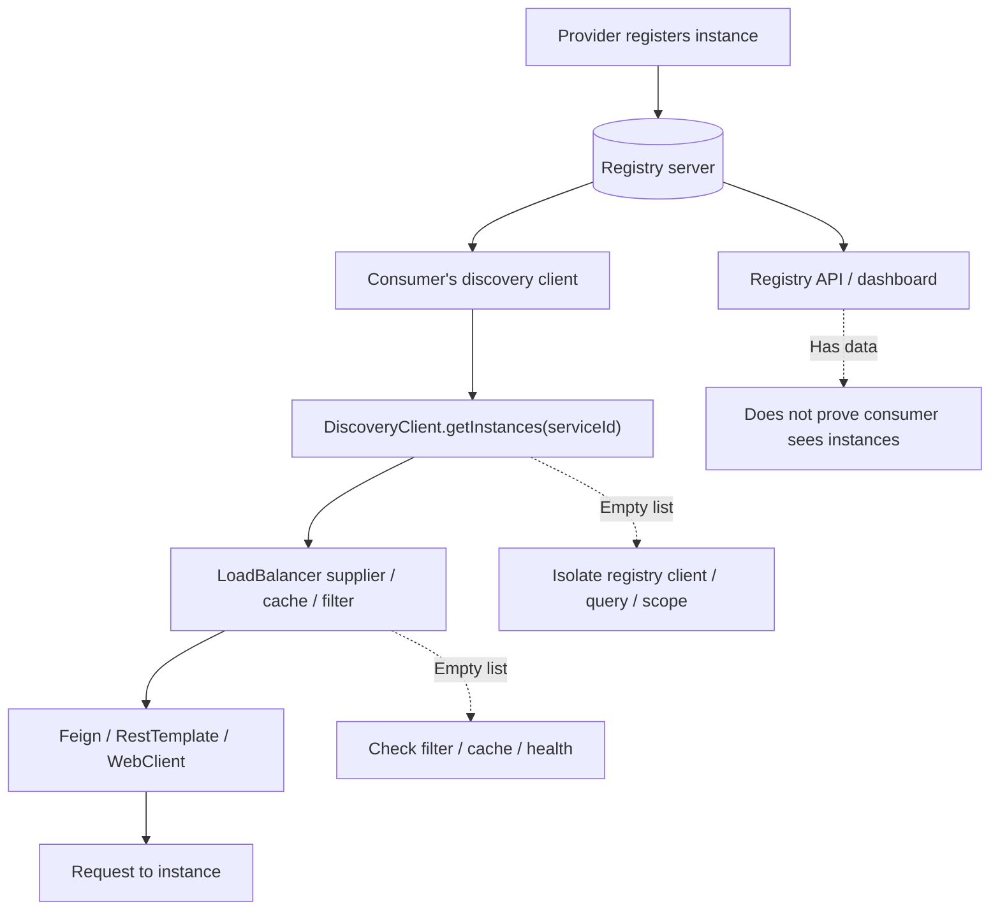

# Empty Instance List Even Though Registry Still Has Data

A service may still appear in the registry's admin UI or API, yet when a consumer calls `DiscoveryClient.getInstances(serviceId)`, it receives an empty list. This does not necessarily mean the provider failed to register. The data may reside in a different registry, a different namespace, a different root path, in a health state excluded by the query, or the consumer may not have synced/cached the right data yet. Another layer might also filter out instances after DiscoveryClient returns them.

An effective diagnostic approach is to compare data across each layer: the registry server, the consumer's discovery client, the instance list used by LoadBalancer, and actual outgoing requests. Do not delete registrations or restart the entire system before identifying which layer is dropping the instances.

## 1. Understanding Which Layer Has the Error

In Spring Cloud, there are at least four views to distinguish:

1. **Registry server:** registration data stored in Eureka, Consul, ZooKeeper, or the Kubernetes API.
2. **DiscoveryClient:** the consumer queries a service ID and receives a list of `ServiceInstance`.
3. **Spring Cloud LoadBalancer:** may take the list from DiscoveryClient and further apply caches, health checks, zones, or custom filters.
4. **HTTP client:** Feign, RestTemplate, or WebClient executes the request to the selected instance.

Flow diagram:



The Registry UI still displays `inventory-service` while the consumer finds no instances. Perhaps the Consul catalog still holds the registration while the health query returns only passing instances; or the consumer is connecting to a different Consul cluster/namespace.

Record the exact symptoms:

- Does `getServices()` contain the service ID?
- Is `getInstances(serviceId)` empty?
- Which services and instances does the registry API return?
- Does LoadBalancer still have instances after applying filters?
- Does the error occur in only one consumer or all consumers?

## 2. First Step: Verify the Service ID

The service ID is the logical key the consumer uses for lookup. A slight mismatch in the name can cause the lookup to miss.

Example where the provider registers:

```yaml
spring:
  application:
    name: inventory-service
```

The consumer calls:

```java
discoveryClient.getInstances("inventory-service");
```

Common mistakes:

- Consumer uses `inventory`, provider registers `inventory-service`.
- One environment uses `inventory-service`, another uses `inventory-service-v2`.
- There is a provider-side service name override configuration.
- Consumer passes a name from a property in the wrong profile or wrong configuration source.
- The service name has whitespace, extra characters, or differs from the registry's normalization.
- A Feign client uses a different service ID from the actual service name.

Do not assume every registry normalizes letter casing the same way. Eureka typically displays application names in uppercase in its UI/API, while the consumer may use a different service ID casing. Compare the logical name used by the Spring Cloud client with the actual application/service name in the provider's API.

Quick check example:

```java
String serviceId = "inventory-service";

log.info("Lookup serviceId='{}'", serviceId);
log.info("Discovered services={}", discoveryClient.getServices());

List<ServiceInstance> instances =
    discoveryClient.getInstances(serviceId);

log.info("Instance count for {}: {}", serviceId, instances.size());
```

In diagnostic logs, record the service ID and instance count; avoid logging tokens, passwords, or sensitive metadata details.

## 3. Verify the Consumer Connects to the Right Registry

Having data on a registry dashboard does not prove the consumer is querying the right server. An environment may have multiple registry endpoints:

- Dev, test, staging, and production.
- Multiple Eureka clusters or Consul datacenters.
- Multiple Consul namespaces/partitions.
- Multiple ZooKeeper ensembles or root paths.
- Multiple Kubernetes clusters/contexts.

Inspect the actual runtime configuration, not just YAML files in the repository. Spring profiles, environment variables, Config Server, command-line arguments, and secret injection can override values in `application.yml`.

Eureka example:

```yaml
eureka:
  client:
    service-url:
      defaultZone: http://eureka.internal:8761/eureka/
    fetch-registry: true
```

Consul example:

```yaml
spring:
  cloud:
    consul:
      host: consul.internal
      port: 8500
      discovery:
        enabled: true
```

ZooKeeper example:

```yaml
spring:
  cloud:
    zookeeper:
      connect-string: zk-1.internal:2181,zk-2.internal:2181,zk-3.internal:2181
      discovery:
        enabled: true
        root: /services
```

If the registry UI is open at `eureka-a.internal` while the consumer is configured for `eureka-b.internal`, the data in the two places may differ. Check DNS, port, TLS, authentication, namespace, datacenter, and root path of the failing consumer itself.

## 4. Check Which DiscoveryClient Spring Injects

The application might be using a different implementation than expected. For instance, the provider discovery dependency is missing, discovery is disabled under a profile, or the app is using `SimpleDiscoveryClient` instead of a Eureka/Consul/ZooKeeper client.

You can log the injected implementation:

```java
import org.slf4j.Logger;
import org.slf4j.LoggerFactory;
import org.springframework.cloud.client.discovery.DiscoveryClient;
import org.springframework.stereotype.Component;

@Component
public class DiscoveryDiagnostics {

    private static final Logger log =
        LoggerFactory.getLogger(DiscoveryDiagnostics.class);

    private final DiscoveryClient discoveryClient;

    public DiscoveryDiagnostics(DiscoveryClient discoveryClient) {
        this.discoveryClient = discoveryClient;
    }

    public void inspect(String serviceId) {
        log.info(
            "DiscoveryClient implementation: {}",
            discoveryClient.getClass().getName()
        );

        log.info(
            "DiscoveryClient description: {}",
            discoveryClient.description()
        );

        log.info(
            "Known service IDs: {}",
            discoveryClient.getServices()
        );

        var instances = discoveryClient.getInstances(serviceId);
        log.info(
            "Instances for serviceId '{}': {}",
            serviceId,
            instances.size()
        );

        instances.forEach(instance -> log.info(
            "Instance serviceId={}, host={}, port={}, secure={}, uri={}",
            instance.getServiceId(),
            instance.getHost(),
            instance.getPort(),
            instance.isSecure(),
            instance.getUri()
        ));
    }
}
```

If the application has `CompositeDiscoveryClient`, the outermost implementation will be the composite. In that case, inspect its delegates and the precedence order of each discovery client. Do not conclude based solely on the wrapper class name.

Points to verify:

- The provider discovery starter dependency in use is present on the runtime classpath.
- Discovery integration is enabled.
- The consumer is not accidentally running a profile configured for local/simple discovery.
- Multiple DiscoveryClients are not active simultaneously in an unintended order.
- The service ID is looked up through the right client and provider.

In some Spring Cloud versions, discovery integration can be turned off via global configuration. If `spring.cloud.discovery.enabled` or the provider's enable property is set to `false`, the registry has data yet the client does not perform lookups as expected. Inspect the process's effective configuration.

## 5. Distinguishing `getServices()` and `getInstances()`

The two methods serve different purposes:

| API | Meaning | How to interpret the result |
|---|---|---|
| `getServices()` | List of service IDs visible to the client | Use to diagnose discovery scope |
| `getInstances(serviceId)` | Instances belonging to a specific service ID | Use to identify call targets |

A few scenarios:

- `getServices()` is empty and `getInstances()` is empty: suspect the client is not connected, discovery is disabled, the registry cache has not loaded yet, or the scope is wrong.
- `getServices()` contains the service ID but `getInstances()` is empty: check the service ID, query filters, health state, namespace, and instance data.
- `getInstances()` has data but Feign reports no instances: check the LoadBalancer supplier, cache, and filters downstream of DiscoveryClient.

Do not call `getServices()` repeatedly during business requests just to find a service ID. Use the known service ID and call `getInstances(serviceId)` directly or use a Feign client by service name.

## 6. Check Registered Host, Port, and Endpoint

The registry may display a service record whose endpoint contains an invalid host or port. Some admin UIs display the service name even when there are no valid instances.

For each instance, check:

- Service ID and instance ID.
- Advertised host/IP.
- Port and protocol.
- HTTP/HTTPS scheme.
- Metadata and zone.
- Health/status.
- Registration, heartbeat, or last update timestamp.
- Whether the instance is marked draining, terminating, or out of service.

Example of an instance that should be advertised:

```text
serviceId: inventory-service
instanceId: inventory-node-a
host: 10.10.2.15
port: 8081
scheme: http
status: UP
```

Host and port are not the only reason `getInstances()` is empty. Some DiscoveryClients still return instances with unreachable addresses; the connection error then appears at the HTTP call step. However, missing host/port or invalid registration data can prevent the provider from creating the instance as expected.

## 7. Check Health Filters and Instance Status

The registry may still hold registration data while queries only return instances passing health conditions.

Distinguish:

- **Registered:** the record exists in the registry.
- **Healthy/Passing:** the health check currently evaluates as passing.
- **Discoverable:** the consumer's query allows returning that instance.
- **Reachable:** the consumer can connect to the endpoint.
- **Ready:** the application is ready to process business requests.

An existing instance is not automatically passing or eligible for lookup results.

### Consul: query-passing

Consul has both a catalog API and a health API. The catalog may display a service registration while a health query with `passing=true` filters out instances with warning/critical checks.

Check both endpoints:

```bash
curl "http://consul.internal:8500/v1/catalog/service/inventory-service"
curl "http://consul.internal:8500/v1/health/service/inventory-service"
curl "http://consul.internal:8500/v1/health/service/inventory-service?passing=true"
```

If ACLs are not enabled on the API, you can call directly as in the example. When ACLs are enabled, pass the token via the `X-Consul-Token` header from a secret store; never put real tokens in shell history or logs.

If the `passing=true` query returns an empty array while the unfiltered health API still has instances, inspect the health check, check output, check address, and last update time. In Spring Cloud Consul, `spring.cloud.consul.discovery.query-passing` can cause discovery to return only passing instances; check the effective value and the default for your version.

### Eureka: Status and Fetch Registry

Eureka typically stores instance statuses such as `UP`, `DOWN`, `STARTING`, or `OUT_OF_SERVICE`. The dashboard may show the application while consumers do not receive the expected instance if it is not in a usable status or the client cache has not updated.

Check:

- Did the provider actually register an instance under the expected application name?
- Is the instance status `UP`?
- Does the Eureka client fetch the registry?
- Which cache is the consumer reading and when was its last fetch?
- Is any filter configuration or custom EurekaClient altering the result?

Basic properties:

```yaml
eureka:
  client:
    register-with-eureka: true
    fetch-registry: true
    registry-fetch-interval-seconds: 30
```

`register-with-eureka` controls whether the client registers itself; `fetch-registry` controls fetching the registry for lookups. A consumer-only application still needs to fetch the registry. Do not confuse `register-with-eureka: false` with disabling discovery completely.

### ZooKeeper: Root Path and Session

Spring Cloud Zookeeper Discovery typically organizes registrations under a root path, such as `/services`. If the provider writes to one root path while the consumer reads another root path, ZooKeeper still holds data yet the consumer sees no service.

Check:

- `spring.cloud.zookeeper.connect-string`.
- `spring.cloud.zookeeper.discovery.enabled`.
- `spring.cloud.zookeeper.discovery.root`.
- The service name and corresponding znode branch.
- Read ACLs on the root and child nodes.
- Client session, reconnects, and ephemeral node lifecycle.

Example inspection with ZooKeeper CLI:

```text
ls /services
ls /services/inventory-service
```

The actual path depends on the configured root. A surviving session does not prove registration went to the right root or that the consumer has read permission.

### Kubernetes: Service and EndpointSlice

A Kubernetes Service can exist and DNS can still resolve its ClusterIP while its EndpointSlice has no Ready endpoints. A Kubernetes-API-based discovery client may filter out unready endpoints or only scan configured namespaces.

Check:

```bash
kubectl get svc inventory-service -n shop
kubectl get pods -n shop -l app=inventory -o wide
kubectl get endpointslices -n shop \
  -l kubernetes.io/service-name=inventory-service
kubectl describe svc inventory-service -n shop
```

If the EndpointSlice has no addresses or endpoints show `ready: false`, inspect the Service selector, Pod labels, readiness probe, and targetPort. If using Spring Cloud Kubernetes, check namespace discovery, RBAC, and whether unready endpoints are included according to your version.

## 8. Check Namespace, Partition, Datacenter, and Root Path

Registries can partition data by scope. A consumer reading the right registry server still will not see the service if the scope differs.

| Provider | Scope to cross-check |
|---|---|
| Eureka | Cluster/region/zone, service URL, application name |
| Consul | Datacenter, namespace, partition, ACL token, and service name |
| ZooKeeper | Ensemble, chroot/root path, service znode, and ACLs |
| Kubernetes | Cluster context, namespace, Service, EndpointSlice, and RBAC |

Consul example: the service is registered in namespace `payments`, while the consumer queries the default namespace. An operator's catalog view can show the service when selecting the right namespace, while the consumer lacks permission or does not query that namespace.

Kubernetes example: the provider Service resides in namespace `shop`, while consumer discovery only scans namespace `fulfillment`. If the consumer calls using full DNS, it may still connect; meanwhile DiscoveryClient only sees services within its configured scope.

Do not use UI data from one namespace/partition to infer that the consumer shares the same scope. Always record the actual scope of both provider and consumer.

## 9. Check Read Permissions and Errors Masked by Abstractions

The registry API might grant an operator read access to the entire catalog while the consumer uses a restricted token. The operator UI displays the service, whereas the consumer receives 403 or sees only partial data.

Check:

- The consumer's runtime token/credentials.
- ACL policies, namespace policies, or RBAC.
- Does the consumer have permission to read the specific service/instance?
- Do client logs show 401/403, `NOAUTH`, `Forbidden`, or deserialization errors?
- Is a proxy/gateway between the client and registry filtering responses?

Some integrations may log an error and return an empty list along one code path while another throws an exception. Therefore, do not inspect only the returned list; check registry client logs and HTTP status codes.

Permission principles:

- Providers need permission to register services within their owned scope.
- Consumers need permission to read the right service and namespace.
- Operators may require broader permissions, yet operator credentials must never be used at runtime.
- ZooKeeper consumers need `READ` ACL on the appropriate path; providers need write permissions matching their lifecycle.
- Kubernetes consumers need `get/list/watch` on the right resources and namespaces.

## 10. Check Caches and Synchronization Timing

The registry server may already be updated while the consumer still holds a stale cache. This often happens right after an instance registers, deregisters, or changes health state.

Possible cache layers:

- Eureka client registry snapshot.
- Discovery provider cache or watch state.
- Spring Cloud LoadBalancer `ServiceInstanceListSupplier` cache.
- Health check supplier cache.
- DNS cache if calling via hostname.
- Custom application-level caches.

Identify which caches are active and the refresh interval/TTL of each layer. Do not flush caches arbitrarily before collecting data, as doing so erases evidence of sync lag.

For Eureka, inspect `registry-fetch-interval-seconds` and fetch logs. For Consul, check blocking queries/watches and query caching if enabled. For ZooKeeper, inspect watchers/sessions and how the integration refreshes child nodes. For Kubernetes, check watch/list API calls, informer state, and resourceVersion via client logs/metrics if available.

## 11. DiscoveryClient Has Instances, but LoadBalancer Is Empty

If direct code returns instances:

```java
List<ServiceInstance> instances =
    discoveryClient.getInstances("inventory-service");
```

yet Feign or `@LoadBalanced RestTemplate` reports no instances, the fault lies downstream of DiscoveryClient or in client configuration.

Check:

- Does the Feign `name`/service ID match?
- Is a hardcoded `url` attribute causing Feign to bypass discovery?
- Are LoadBalancer dependencies and auto-configuration active?
- Is `ServiceInstanceListSupplier` filtering by health/zone/hint?
- Is LoadBalancer's cache holding an empty list from when the registry was not yet ready?
- Is a custom supplier or filter dropping all instances?
- Is a per-client configuration modifying the list?

Comparison table:

| DiscoveryClient | LoadBalancer | Investigation direction |
|---|---|---|
| Empty | Empty | Registry client, scope, query, health, cache |
| Has instances | Empty | Supplier, health filter, zone/hint, cache |
| Has instances | Has instances | Check endpoint, network, and HTTP client |
| DiscoveryClient not called | Empty | Fixed URL, client config, or LoadBalancer setup |

Do not change registries or re-register the provider if `DiscoveryClient` already returns accurate instances. Focus on the supplier/filters and the client making the request.

## 12. Ordered Diagnostic Checklist

Proceed step by step to avoid changing multiple factors at once:

1. Record the service ID the consumer is looking up.
2. Record the consumer's active profile and effective registry endpoint.
3. Check the actual `DiscoveryClient` implementation.
4. Compare `getServices()` and `getInstances(serviceId)`.
5. Query the registry API using the exact same endpoint, namespace, and credentials as the consumer.
6. Check registration, instance ID, host, port, and health/status.
7. Check query filters such as Consul `passing=true`.
8. Cross-check namespace, partition, datacenter, or ZooKeeper root path.
9. Check ACL/RBAC and logs for 401/403/NOAUTH.
10. Check caches, refresh intervals, watches, and registration timestamps.
11. If DiscoveryClient has instances, check LoadBalancer suppliers/caches/filters.
12. Only at the end, test connectivity to the chosen host/port.

Record results by layer:

| Layer | Evidence to preserve |
|---|---|
| Registry API | Service ID, instance ID, status, namespace, and response |
| DiscoveryClient | Implementation, `getServices()`, `getInstances()` |
| LoadBalancer | Supplier, filters, instance list, and cache |
| Network | DNS, routes, ports, TLS, and connection results |
| Application | Feign/HTTP client config, errors, and request timestamps |

## 13. Symptom and Root Cause Matrix

| Symptom | Possible cause | Priority check |
|---|---|---|
| Registry UI shows service, `getServices()` empty | Consumer reads wrong registry, client disabled, or fetch incomplete | Effective endpoint, DiscoveryClient implementation, fetch logs |
| `getServices()` has name, `getInstances()` empty | Wrong service ID or query filter excludes instances | Service name, health/status, query parameters |
| Consul catalog has data, health query empty | Health check critical/warning and `passing=true` | Consul health API, check output, query-passing |
| Eureka dashboard has app, consumer gets no instances | Status not eligible, fetch registry disabled, or stale cache | Instance status, fetch-registry, fetch interval |
| ZooKeeper has znode, client is empty | Different root path, ensemble, or ACL | connect-string, root, `ls` path, and ACLs |
| Kubernetes Service exists, no instances | EndpointSlice empty/not ready, wrong selector or namespace | Pod labels, readiness, EndpointSlice, RBAC |
| DiscoveryClient has instances, Feign reports no instances | LoadBalancer supplier/filter/cache or client name | Supplier chain, service ID, Feign URL |
| Only one consumer fails | Consumer-specific config/profile/credential/cache | Compare effective config and identity with healthy consumer |
| Errors appear right after a new rollout | Service name, health, port, or cache not converged yet | New registration, readiness, and refresh lag |
| Intermittent failures | Instance flapping, network partition, cache, or health checks | Timestamps, heartbeat/session, health events, and request traces |

## 14. Actions Not to Take Before Isolating the Cause

- Do not wipe the entire catalog or root znode.
- Do not delete registrations for all replicas when only one consumer is failing.
- Do not disable health filters to force instances to appear without understanding why checks fail.
- Do not grant full admin tokens to consumers for a "quick test."
- Do not disable TLS or ACLs to rule out authentication errors.
- Do not set infinite timeouts or endless retries.
- Do not restart the registry and all providers simultaneously before collecting logs/API responses.
- Do not arbitrarily rename the service ID on one side without cross-checking the actual registered name.

If you need to test a change, change one variable at a time, record before/after results, and keep a rollback plan ready.

## 15. Prevention Checklist

1. Standardize service IDs and verify effective configuration per profile.
2. Use consistent registry endpoints, namespaces/partitions/root paths as designed.
3. Enable discovery and registry fetching appropriately for consumer roles.
4. Ensure providers advertise valid instance IDs, hosts, and ports.
5. Make health checks accurately reflect readiness and query them intentionally.
6. Configure ACL/RBAC to allow consumers to read their required scope.
7. Monitor registry API errors, client fetches, cache refreshes, and instance counts.
8. Set bounded timeouts/retries; account for eventual consistency.
9. Verify DiscoveryClient directly before debugging LoadBalancer.
10. Inspect LoadBalancer suppliers/filters if DiscoveryClient has data.
11. Maintain a runbook comparing registry API responses against consumer results.
12. Safely log service ID, instance count, and status without leaking secrets.

An empty instance list even when the registry still holds data usually stems from a mismatch between the registry's view and the consumer's view: differing service IDs, endpoints, namespaces/roots, credentials, health filters, or caches. By inspecting the registry API, DiscoveryClient, LoadBalancer, and network in turn, you can locate the layer dropping instances without destroying valid registration data.
