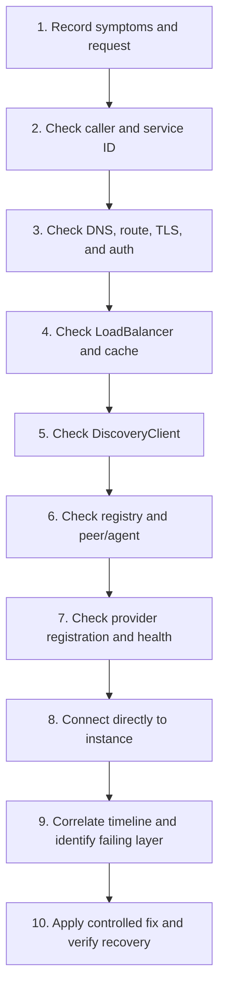

# Evidence Collection and Stage-by-Stage Isolation Workflow

When a service call fails, the root cause may lie in the caller, service name configuration, DNS/networking, Spring Cloud LoadBalancer, `DiscoveryClient`, the registry, health checks, or the provider itself. Changing configurations the moment an error appears can erase evidence and modify the wrong layer. A solid troubleshooting process gathers evidence first, pinpoints the first stage showing bad output, and only then adjusts the right component.

In Spring Cloud Service Discovery, distinguish the **control plane** (registration, heartbeats, health checks, registry queries, and instance list updates) from the **data plane** (actual HTTP/gRPC connections from consumer to provider). The registry can be healthy while the provider is unreachable; conversely, the registry may be temporarily unreachable while the consumer still calls cached instances. This lesson establishes a stage-by-stage investigation process, evidence capture format, safe verification commands, and evidence-backed conclusions for Eureka, Consul, and Kubernetes.

## 1. Investigation Principles

Before isolating, agree on a few principles:

- **Start from one concrete request:** record service ID, timestamp, caller, environment, logical endpoint, HTTP method, status/exception, and trace ID.
- **Follow the request path:** caller → LoadBalancer → DiscoveryClient → registry/cache → selected instance → network → provider.
- **Separate control plane and data plane:** test registry queries separately from connecting to the provider's host/port.
- **Compare aligned timestamps:** logs, metrics, registry state, and deployment events must share consistent timestamps and timezones.
- **Preserve raw evidence:** save response statuses, relevant headers, related logs, and secret-redacted configs; do not record only conclusions.
- **Change one factor at a time:** after each change, repeat the exact same test to know which change made a difference.
- **Do not mask failures with arbitrary fallbacks:** empty results, stale snapshots, connection errors, 401/403, and provider timeouts are distinct states.

Never include tokens, passwords, private keys, cookies, or URLs with userinfo in logs/tickets. Redact before sharing evidence; keep originals only inside an appropriately access-controlled incident system.

## 2. Stage-by-Stage Isolation Diagram



Each stage must answer one verifiable question:

| Stage | Question | Decisive evidence |
| --- | --- | --- |
| Caller | Which request failed, from where, and when? | Trace ID, caller logs, route, and timestamp. |
| Service ID | Is the caller looking up the right logical service? | `spring.application.name`, logical URL, service ID in logs. |
| DNS/network/TLS/auth | Can the caller reach the registry and provider? | DNS result, TCP/TLS handshake, HTTP status. |
| LoadBalancer | Which list does the supplier return and which instance is chosen? | Instance selection logs, supplier/cache config, actual host/port. |
| DiscoveryClient | Which instances does the client see? | `getServices()`, `getInstances()`, refresh status, and snapshot age. |
| Registry | What registration/health state does the registry hold? | Eureka app/instance or Consul Catalog/Health API. |
| Provider | Did the instance register accurately and is it healthy? | Startup logs, instance ID, readiness/health checks. |
| Data plane | Can the consumer connect to and call the selected instance? | Direct connection, response/status, server access logs. |
| Recovery | After the fix, have data and requests converged? | Fresh snapshot, updated instance selection, error rate back to baseline. |

## 3. Stage 1 — Record Symptoms and Frame the Scope

First, capture minimum details for one failure occurrence:

| Field | Example | Why needed |
| --- | --- | --- |
| Timestamp | `2026-11-24T10:15:32Z` | Correlate logs and events across multiple nodes. |
| Caller | `order-api`, namespace `shop` | Identify configuration and network namespace to inspect. |
| Service ID | `payment-service` | Compare against registration name in the registry. |
| Operation | `POST /payments` | Separate business endpoints from health/discovery endpoints. |
| Outcome | HTTP 503, timeout, empty list, or exception | Pick the right investigation branch. |
| Selected instance | `payment-b`, `10.0.4.12:8080` | Know which endpoint LoadBalancer selected. |
| Trace/correlation ID | `trace-...` | Link caller, provider, and gateway logs. |
| Blast radius | One caller, one zone, or all callers | Separate local issues from systemic issues. |

### 3.1. Determining Scope

Ask these questions before making changes:

1. Does only one request fail or do all requests to the service fail?
2. Does only one consumer hit the error or do all consumers?
3. Does only one instance/zone fail or do all instances fail?
4. Did the error begin after a deploy, scale event, config change, certificate/token rotation, or network change?
5. Does the failure occur during discovery lookup, instance selection, or after connecting to the provider?

If one consumer fails while another consumer calling the same service succeeds, prioritize inspecting the failing consumer's config/cache/network. If all consumers see an empty registry, inspect registration/health/provider and the registry. If discovery returns instances yet only one endpoint times out, investigate that instance and the network path to it.

### 3.2. Building a Timeline

Maintain a single timeline in UTC or an agreed timezone:

```text
10:12:00  Provider payment-b begins rollout
10:12:08  payment-b readiness transitions to NotReady
10:12:15  Consul check for payment-b turns critical
10:12:21  Consumer order-api still selects payment-b
10:12:22  Request hits connect timeout
10:12:35  Discovery cache refresh succeeds
10:12:37  Consumer begins selecting payment-a
10:13:10  Error rate returns to baseline
```

The milestones above are illustrative. A timeline reveals lag across readiness, registry, caches, and LoadBalancer; never conclude a component is broken from a single isolated log line.

## 4. Stage 2 — Verify Caller and Service ID

Check whether the caller invokes a logical name or a hardcoded URL.

Example URL routed through Spring Cloud LoadBalancer:

```java
restTemplate.getForObject(
        "http://payment-service/api/payments",
        PaymentResponse.class
);
```

Here `payment-service` is the service ID. If the caller calls a hardcoded URL like `http://10.0.4.12:8080/...`, discovery and LoadBalancer may not be involved at all.

Check the caller's configuration:

```yaml
spring:
  application:
    name: order-api
```

This YAML snippet merely illustrates the application name. Record the active profile, config sources, and environment variables that may override `application.yml`; do not tweak retry policies just to investigate naming.

Compare:

- The provider's `spring.application.name`.
- The service name registered by the provider in Eureka/Consul/Kubernetes.
- The service ID passed by the consumer to `DiscoveryClient` or logical URLs.
- Namespace, region, zone, datacenter, and label filters if any.
- Registry name normalization rules; avoid assuming names with hyphens, dots, or uppercase letters map identically.

If the service ID is wrong, fix the name or registration config. Do not tweak timeouts, cache TTLs, or network rules to cure a naming mistake.

## 5. Stage 3 — Check DNS, Network, TLS, and Access Control

Registry queries and provider requests may use different hostnames, ports, and network paths. Run tests from the caller's actual environment — the same Pod/container/VM and network namespace — instead of an admin laptop.

### 5.1. DNS

Inside a Linux container:

```bash
getent ahosts consul.internal.example
nslookup eureka.internal.example
```

In Kubernetes, test service and namespace DNS:

```bash
kubectl exec -n shop deploy/order-api -- \
  nslookup payment-service.shop.svc.cluster.local
```

If DNS returns an unexpected IP, inspect records, search domains, CoreDNS, resolver caches, and TTLs. `localhost` inside a container refers to that container itself, not the host machine or another registry container.

### 5.2. TCP and Routing

```bash
nc -vz consul.internal.example 8500
nc -vz eureka.internal.example 8761
nc -vz 10.0.4.12 8080
```

A `succeeded` result confirms only the TCP handshake, not that APIs, TLS, authentication, or provider business logic work. On timeout, inspect routes, firewalls, NetworkPolicy, security groups, and listeners. On connection refused, verify the right host/port and that the process is listening.

### 5.3. TLS and Certificates

```bash
openssl s_client \
  -connect eureka.internal.example:8761 \
  -servername eureka.internal.example \
  -brief
```

Inspect certificate chain, SAN/hostname, expiration, truststore, and mTLS client certificates if required. Never disable certificate validation just to "make it work"; doing so destroys evidence and weakens security.

### 5.4. HTTP Status and Authentication

Send a request with no secrets in the URL:

```bash
curl -sS -D - -o /dev/null \
  "https://consul.internal.example/v1/status/leader"
```

If the endpoint requires ACLs, pass the token via a header from a secret source and avoid enabling `-v`/`--trace` when capturing logs. Classify results:

| Result | Meaning to investigate |
| --- | --- |
| `200` | API responded; continue inspecting payload and freshness. |
| `401` | Missing or invalid authentication. |
| `403` | Identity reached endpoint yet lacks permissions. |
| `404` | Wrong path/context path/API version or resource does not exist. |
| `429` | Rate limited; inspect `Retry-After` and query frequency. |
| `5xx` | Registry/proxy error; inspect server logs and peer/quorum state. |
| Timeout/reset | DNS, routing, firewall, overload, or connection pool issue. |

An HTTP 200 from a registry's health endpoint does not prove service instances are healthy. Query the purpose-built API and check statuses inside the payload.

## 6. Stage 4 — Check Spring Cloud LoadBalancer

Once you know the caller uses a logical service ID, verify whether LoadBalancer is actually invoked.

Check:

- Does the HTTP client have a `@LoadBalanced` bean or corresponding LoadBalancer integration?
- Are `spring-cloud-starter-loadbalancer` and the release train compatible?
- Is there a custom `ServiceInstanceListSupplier`, zone preference, health filter, or retry supplier?
- Is LoadBalancer caching enabled, what is its TTL, and does it stack on top of DiscoveryClient caching?
- Does any per-service configuration via `@LoadBalancerClient` give one service different behavior from others?
- Is the request using a logical URI or a fixed URL?

### 6.1. Enabling Selective Logging

In a test environment or a controlled investigation window, raise log levels for the relevant packages:

```yaml
logging:
  level:
    org.springframework.cloud.loadbalancer: DEBUG
    org.springframework.cloud.client.discovery: DEBUG
```

Logger names and verbosity can vary by version. Enable DEBUG temporarily, timebox it, and review output before sharing; do not turn on full header/body wire logging without redaction.

### 6.2. Comparing Lists and Selected Instances

Record three values:

1. The `ServiceInstance` list from DiscoveryClient.
2. The list after LoadBalancer's supplier/filters.
3. The final instance selected for the request.

If DiscoveryClient returns `payment-a` and `payment-b` yet the supplier keeps only `payment-b`, inspect zone/health filters. If the supplier returns both instances yet requests always hit `payment-b`, check the selection algorithm, retries, and connection pooling. If the chosen instance is right yet connecting times out, move to the network/provider stage.

Do not assume round-robin alternates strictly per request when retries, caching, concurrency, or another algorithm are involved. Evidence must be the actual instance ID/host and selection rationale if logged.

## 7. Stage 5 — Check `DiscoveryClient`

Call the `DiscoveryClient` abstraction directly to separate LoadBalancer issues from registry lookups:

```java
import org.springframework.cloud.client.discovery.DiscoveryClient;
import org.springframework.stereotype.Component;

@Component
public class DiscoveryDiagnostics {

    private final DiscoveryClient discoveryClient;

    public DiscoveryDiagnostics(DiscoveryClient discoveryClient) {
        this.discoveryClient = discoveryClient;
    }

    public void inspect(String serviceId) {
        System.out.println("services=" + discoveryClient.getServices());
        discoveryClient.getInstances(serviceId).forEach(instance ->
                System.out.printf(
                        "service=%s host=%s port=%d secure=%s metadata=%s%n",
                        instance.getServiceId(),
                        instance.getHost(),
                        instance.getPort(),
                        instance.isSecure(),
                        sanitizeMetadata(instance.getMetadata())
                )
        );
    }

    private Map<String, String> sanitizeMetadata(Map<String, String> metadata) {
        // Return only a non-sensitive allowlist of keys; never dump raw metadata.
        return Map.of(
                "zone", metadata.getOrDefault("zone", "unknown"),
                "version", metadata.getOrDefault("version", "unknown")
        );
    }
}
```

This is illustrative diagnostic code; add `import java.util.Map;` and ensure any endpoint/feature invoking `inspect` is restricted to internal operations. Never expose sensitive hosts, metadata, or topology to public users.

Interpreting results:

- `getServices()` lacks the service ID: client does not see that service; inspect discovery source, namespace, and registration.
- `getServices()` has the service yet `getInstances()` is empty: service exists yet has no eligible instances or filters drop them all.
- List contains instances with wrong addresses: check provider registration, advertised address, NAT/container networking, and metadata.
- Method throws an exception: capture exception type/status; investigate registry endpoint, TLS, ACL/RBAC, and client implementation.
- List looks valid yet stale: inspect last successful refresh time, caches, and registry peer state.

Note: some DiscoveryClients read from a local cache. A completed local call does not prove the registry was just queried successfully. Use dedicated metrics/logs for last refresh time and snapshot age.

## 8. Stage 6 — Check the Registry by Implementation

### 8.1. Eureka

Inspect client configuration:

```yaml
eureka:
  client:
    service-url:
      defaultZone: ${EUREKA_SERVER_URL}
    register-with-eureka: true
    fetch-registry: true
```

Check these points:

1. Does `defaultZone` have the right URL, scheme, port, and `/eureka/` context path?
2. Did the provider register the right `spring.application.name` and instance ID?
3. Does the Eureka Dashboard or REST API show that application/instance?
4. Is the instance status `UP`, `OUT_OF_SERVICE`, or something else?
5. Are heartbeats/leases being renewed?
6. If multiple peers exist, are peer connections and replication healthy?
7. Is self-preservation delaying eviction?
8. Is the consumer fetching the updated registry or still using a local cache?

The REST API typically exposes endpoints like:

```text
GET https://eureka.internal.example/eureka/apps
GET https://eureka.internal.example/eureka/apps/PAYMENT-SERVICE
```

Exact paths depend on context path and server configuration. Send requests with the right `Accept` header and environment authentication. Never paste responses containing internal details/credentials into public tickets.

### 8.2. Consul

Consul provides the Catalog API for registrations and the Health API for check states. Call the appropriate endpoints:

```bash
# Service registrations in the Catalog
curl -sS "http://consul.internal.example:8500/v1/catalog/service/payment-service"

# Service instances with health checks
curl -sS "http://consul.internal.example:8500/v1/health/service/payment-service"

# Return only instances with all relevant checks passing
curl -sS "http://consul.internal.example:8500/v1/health/service/payment-service?passing"

# Leader and peer status of the Consul server cluster
curl -sS "http://consul.internal.example:8500/v1/status/leader"
curl -sS "http://consul.internal.example:8500/v1/status/peers"
```

If ACLs are enabled, pass `X-Consul-Token` from a secret source; never put tokens in query strings or logs. Questions to answer:

- Does the Catalog contain the right service ID and instances?
- Does the Health API show any `warning`/`critical` checks?
- Does `?passing` return empty due to health filtering?
- Is a node check affecting all services on that node?
- Did the Consul Agent register/check the right address and port?
- Does the server cluster have a stable leader/quorum?
- Does the consumer query an Agent, server, or proxy; which consistency/cache mode is active?

An entry remaining in the Catalog does not mean the instance is healthy. A critical check also does not necessarily delete the Catalog entry right away; distinguish health filters from deregistration policies.

### 8.3. Kubernetes

Inspect Service, Pods, and EndpointSlice:

```bash
kubectl get service payment-service -n shop
kubectl get pods -n shop -l app=payment-service -o wide
kubectl get endpointslice -n shop \
  -l kubernetes.io/service-name=payment-service
kubectl describe service payment-service -n shop
```

Inspect Pod state and readiness:

```bash
kubectl describe pod <pod-name> -n shop
kubectl logs <pod-name> -n shop --since=15m
```

Interpretation:

- Service does not exist: wrong name/namespace or deployment manifest not applied.
- Service exists yet EndpointSlice is empty: selector/labels mismatch or no Pod is Ready.
- EndpointSlice has endpoints yet requests time out: check port, targetPort, NetworkPolicy, CNI, node routes, and app listener.
- Pod is Running yet Ready is false: read readiness probe and container logs.
- Spring Cloud Kubernetes DiscoveryClient cannot read Services/EndpointSlices: inspect ServiceAccount, Role/ClusterRole, and `get/list/watch` permissions.

Test RBAC from the workload's identity:

```bash
kubectl auth can-i list services \
  --as=system:serviceaccount:shop:order-api -n shop

kubectl auth can-i list endpointslices \
  --as=system:serviceaccount:shop:order-api -n shop
```

Do not grant `cluster-admin` to fix discovery when only read permission in a single namespace is missing.

## 9. Stage 7 — Check Provider Registration and Health

When the registry lacks the instance or returns the wrong address, pivot to the provider.

Check in order:

1. Is the process/container running and listening on the right port?
2. Do startup logs show registration succeeding or failing?
3. Are service ID, instance ID, host, port, scheme, and metadata accurate?
4. Is the advertised address routable from consumers?
5. Do health checks hit the right path, port, protocol, and use reasonable timeouts?
6. Does readiness reflect actual traffic readiness or merely that the JVM is up?
7. Are there duplicate registrations with the same instance ID or ghost registrations from an old deployment?

With Spring Boot Actuator, test the readiness endpoint from the exact network the health checker uses:

```bash
curl -i http://payment-a:8080/actuator/health/readiness
```

The endpoint may be unexposed or use a different path depending on config. Never publicly expose health details containing database URLs, credentials, or infrastructure info. A passing health check only proves the checked conditions passed, not that all business flows work.

### 9.1. Wrong Advertised Address

Common mistakes:

- Provider registers `localhost` while consumers live in other containers.
- Provider registers a container IP reachable only inside a single Docker network.
- Pod IPs are pushed into an external registry while VMs have no route to the Pod CIDR.
- NAT/load balancers make the external host/port differ from the internal host/port.
- Instance metadata declares the wrong zone or cluster, causing suppliers to filter it out.

Compare `host:port` in the registry against the actual address from the consumer's viewpoint. Do not test only from the provider itself, because self-calls can succeed while consumers have no route.

## 10. Stage 8 — Check the Data Plane to the Selected Instance

Once you know the host/port chosen by LoadBalancer, call the instance directly from the consumer network:

```bash
curl -sS -o /dev/null -w \
  "http_code=%{http_code} connect=%{time_connect}s total=%{time_total}s\n" \
  "http://10.0.4.12:8080/actuator/health"
```

This command measures connection and HTTP response times. Pick an authorized health endpoint; never use a business endpoint with side effects for connectivity probing.

If direct connections succeed yet calls via logical service name fail, prioritize checking LoadBalancer, caches, retries, URL rewrites, and client configuration. If direct connections also fail, investigate provider listeners, firewalls, NetworkPolicy, routing, TLS, and readiness.

If only one instance fails, drain it temporarily using an approved operational procedure before investigating it. Never delete registrations manually before recording the instance ID, health state, and timestamp; manual deletion can destroy evidence or be immediately re-registered by the provider.

## 11. Stage 9 — Correlate Logs, Metrics, and Traces

### 11.1. Logs to Collect

Collect a time window spanning before, during, and after the failure:

- Caller: logical URL, service ID, trace ID, exception class, status, and duration.
- LoadBalancer: list/supplier output, chosen instance, and retry decisions if any.
- DiscoveryClient: lookup outcome, registry endpoint, refresh successes/failures, and cache age if instrumented.
- Registry: registrations, heartbeats/leases, health transitions, peer/leader/quorum state, and authentication failures.
- Provider: startup, registration, readiness, request access logs, and shutdown/crash events.
- Infrastructure: DNS, ingress/gateway, firewalls/network policies, container restarts, and deployment events.

Do not enable full header/body logging by default. Mask `Authorization`, `X-Consul-Token`, cookies, passwords, and query tokens before exporting logs.

### 11.2. Metrics to Cross-Check

| Metric / signal | Used to determine |
| --- | --- |
| Registered instance count | Whether providers are registering. |
| Healthy/Ready instance count | How many instances are eligible to receive traffic. |
| Discovery lookup outcome (non-empty/empty/error) | Whether lookups succeed, return empty, or error. |
| Last successful refresh / snapshot age | Whether consumers use fresh or stale data. |
| LoadBalancer selected instance | Which instance was actually chosen. |
| Request 5xx, timeouts, latency | Impact on the data plane and users. |
| Eureka renewal/eviction or Consul check state | How the registry receives heartbeats and health updates. |
| Kubernetes Pod Ready/EndpointSlice | Whether the control plane has ready endpoints. |

Exact metric names depend on implementation, Spring Boot/Micrometer version, and exporter. Standardize your organization's metric contracts rather than assuming every release uses identical metric names.

### 11.3. Traces and Correlation

Use the same trace/correlation ID to link caller and provider. Background registry queries may not appear inside a request trace; in that case, correlate timestamps, service IDs, and instance IDs across traces and discovery observer logs. Never add tokens, raw credentialed URLs, or personal data into span tags/baggage.

## 12. Quick Isolation Matrix

| First bad evidence | Likely cause group | Next stage |
| --- | --- | --- |
| Caller uses wrong service ID or fixed URL | Naming/caller configuration | Stage 2 and client configuration. |
| Cannot resolve registry hostname | DNS/network | Stage 3; inspect resolvers and routes. |
| Registry returns 401/403 | Authentication/ACL/RBAC | Stage 3 and security policies. |
| DiscoveryClient returns empty, registry query also empty | Registration/health filter/namespace | Stages 6 and 7. |
| Registry has healthy instances, DiscoveryClient is empty | Client config, namespace filter, cache, or implementation | Stages 5 and 6. |
| DiscoveryClient has instances, LoadBalancer supplier is empty | Supplier/zone/health filter | Stage 4. |
| LoadBalancer selects wrong or stale host | Stale cache, metadata, registration, or supplier | Stages 4, 6, and 7. |
| Host/port valid yet TCP times out | Data-plane network/provider | Stages 3 and 8. |
| TCP succeeds yet HTTP 5xx | Provider/dependencies/business path | Stages 7, 8, and provider logs. |
| Registry peer/leader/quorum abnormal | Registry control plane | Stage 6 and registry recovery. |
| Only one consumer fails, others normal | Consumer-specific config/cache/network | Compare Stages 2–5 between two consumers. |

Isolation rule: find the **first stage where evidence diverges from expectation**. For example, if the registry returns two healthy instances yet DiscoveryClient sees only one, the fault lies between the registry and client/filters; there is no need to start by restarting providers.

## 13. Sample Incident Evidence Package

You can use the following template in internal tickets:

```text
Incident ID:
Service ID:
Environment / cluster / namespace / zone:
Caller:
First observed at (UTC):
Last observed at (UTC):
Trace / correlation ID:
Expected healthy instances:
Observed registered / healthy instances:
Discovery outcome: NON_EMPTY / EMPTY / ERROR / STALE
Registry type and endpoint name (no credentials):
Last successful registry refresh:
Snapshot age:
LoadBalancer selected host:port / instance ID:
Direct provider connectivity result:
HTTP status / exception class:
Relevant deployment/config/network changes:
Evidence links (restricted access):
Current hypothesis:
Evidence supporting the hypothesis:
Evidence contradicting the hypothesis:
Next controlled check:
Recovery verification:
```

Separate **observations** from **hypotheses**. For example, "Consul Health API `?passing` returned 0 entries at 10:15 UTC" is an observation; "database made all providers unhealthy" is a hypothesis needing check states and provider logs to verify.

## 14. Changing and Verifying After Isolation

Once you have identified the failing layer, follow this sequence:

1. Record pre-change configurations/metrics/logs.
2. Pick the smallest verifiable change, such as fixing a service ID, ACL policy, advertised address, or health-check path.
3. Apply to a single instance/canary or staging environment if possible.
4. Repeat the exact request and check that produced the initial evidence.
5. Confirm lookup, supplier, instance selection, and data-plane requests all succeed.
6. Monitor error rate, latency, healthy count, and registry state over a sufficient window.
7. If outcomes worsen, roll back the change and document results.

Do not restart consumer, provider, and registry simultaneously before forming a hypothesis. Restarting multiple components at once may temporarily make the error vanish while erasing root-cause evidence and causing further outage.

### 14.1. Investigation Closure Criteria

Close the incident only with evidence that:

- Root cause is identified or cleanly bounded to the responsible component.
- Registration and health states match the provider's actual state.
- Consumers fetch the updated instance list and LoadBalancer chooses valid endpoints.
- Data-plane requests succeed from the consumer network.
- Stale caches/snapshots have refreshed or expired per policy.
- Alerts resolved; metrics and error rates returned to baseline.
- No ghost registrations, duplicate instances, or unaddressed temporary credential/network workarounds remain.
- Follow-up action items and owners exist if permanent remediation is needed post-incident.

## 15. Common Mistakes

| Mistake | Why it hinders investigation | Better practice |
| --- | --- | --- |
| Restarting all components as soon as an error appears | Destroys initial state and timeline | Capture snapshots, logs, and metrics first; restart only the targeted layer after forming a hypothesis. |
| Treating an empty list as a registry outage | Confuses registration/health filters with connectivity | Inspect HTTP status, payload, and registry state directly. |
| Assuming local cache is fresh data | DiscoveryClient may return stale snapshots when refreshes fail | Record last-success timestamp and snapshot age. |
| Checking only the Eureka/Consul Dashboard | Does not tell if consumer caches and LoadBalancer updated | Check both DiscoveryClient and the selected instance. |
| Only pinging the host | ICMP does not verify TCP ports, TLS, or HTTP APIs | Test DNS, TCP, TLS, and the exact endpoint. |
| Testing from a laptop instead of consumer network | DNS/routing results differ from actual Pods/containers | Run checks from the caller's exact network namespace. |
| Enabling full wire logging | Can expose tokens, cookies, and payloads | Use selective logging, allowlists, and redaction. |
| Editing multiple configs at once | Cannot tell which change fixed or worsened the error | Change one factor and repeat the check. |
| Deleting registrations manually before recording | Destroys evidence and provider may re-register | Save instance ID, health state, and timeline prior to acting. |

## 16. Practical Checklist

- [ ] Record UTC timestamp, caller, service ID, trace ID, and exact symptoms.
- [ ] Determine blast radius: single request, single consumer, single instance, single zone, or whole service.
- [ ] Confirm caller uses a logical service name and the exact service ID.
- [ ] Test DNS, TCP, TLS, and authentication from the caller's actual network.
- [ ] Verify whether requests pass through Spring Cloud LoadBalancer.
- [ ] Record the DiscoveryClient list and the post-supplier/filter list.
- [ ] Inspect registry Catalog/Health API or Eureka app/instance status.
- [ ] Inspect provider registration, advertised address, readiness, and health checks.
- [ ] Connect directly to the selected host/port from the consumer network.
- [ ] Correlate logs, metrics, traces, and deployment/network timelines.
- [ ] Explicitly separate observations, hypotheses, supporting evidence, and contradicting evidence.
- [ ] Apply a single controlled change and verify recovery across all stages.
- [ ] Redact credentials and restrict access to the evidence package.

## 17. Key Takeaways

- Investigate along the real request path: caller → LoadBalancer → DiscoveryClient → registry/cache → provider → network/data plane.
- Separate control plane from data plane; a successful registry query does not prove the provider is callable.
- Empty results, stale snapshots, connection failures, and 401/403 are distinct outcomes.
- Evidence must include timestamps, service ID, instance ID, trace/correlation ID, and observation source.
- Run DNS/TCP/TLS/HTTP checks from the consumer's exact network namespace.
- Compare registry, DiscoveryClient, post-filter supplier list, and the final instance chosen by LoadBalancer.
- Find the first stage with bad evidence; change only one factor and repeat the test.
- Never log credentials or dump sensitive metadata/headers while collecting evidence.

## References

- [Spring Cloud Commons: DiscoveryClient and ServiceRegistry](https://docs.spring.io/spring-cloud-commons/reference/spring-cloud-commons/common-abstractions.html)
- [Spring Cloud LoadBalancer](https://docs.spring.io/spring-cloud-commons/reference/spring-cloud-commons/loadbalancer.html)
- [Spring Cloud Netflix: Eureka](https://docs.spring.io/spring-cloud-netflix/reference/spring-cloud-netflix.html)
- [Spring Cloud Consul: Discovery](https://docs.spring.io/spring-cloud-consul/reference/discovery.html)
- [Consul HTTP API: Health](https://developer.hashicorp.com/consul/api-docs/health)
- [Kubernetes: Services and EndpointSlices](https://kubernetes.io/docs/concepts/services-networking/service/)
