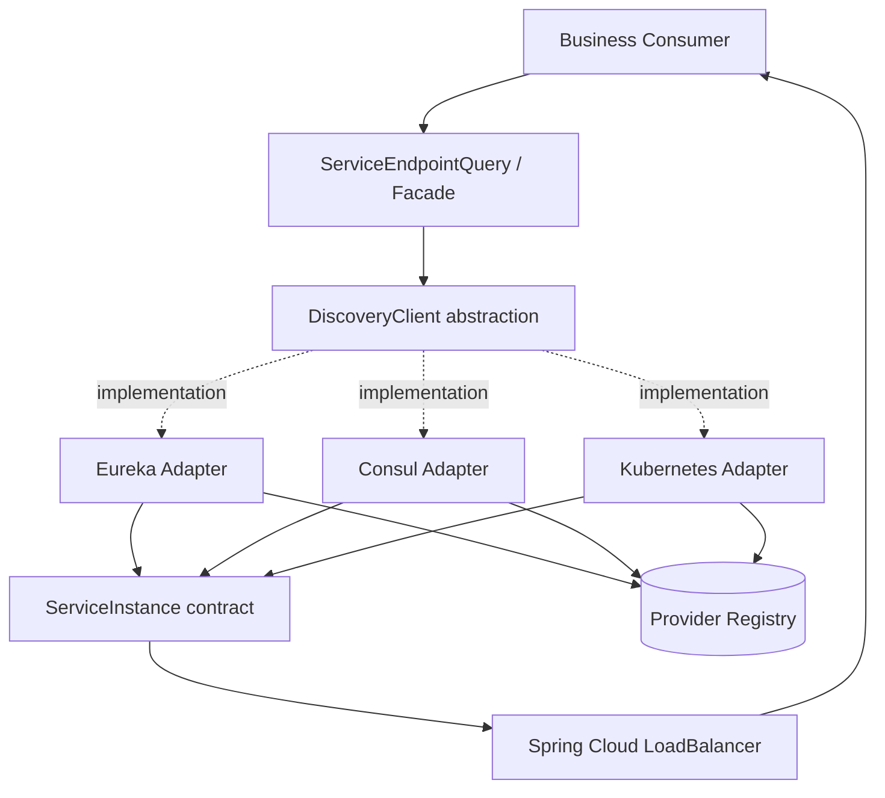

# Implementing the Query Contract and Mapping `ServiceInstance`

## 1. Why Do You Need a Common Query Contract?

An application may migrate from Eureka to Consul, ZooKeeper, or Kubernetes without wanting to rewrite all its service-calling code. If business code directly reads `EurekaClient`, `ConsulClient`, Curator objects, or Kubernetes API models, every registry change triggers modifications across multiple layers.

Spring Cloud Commons provides an abstraction layer to decouple consumers from specific registries:

- `DiscoveryClient` defines how to read the list of services and instances.
- `ServiceInstance` standardizes an instance's endpoint information.
- `ServiceRegistry` defines instance registration/deregistration operations.
- `Registration` represents provider-specific registration data.
- Spring Cloud LoadBalancer uses the instance list to pick a target for requests.

This contract allows consumers to use a unified query pattern, though it does not make every registry hold identical data. Host, port, metadata, health, zone, and instance identifiers can still be represented differently by each provider. Therefore, data mapping rules and contract boundaries must be clearly specified before switching registries.

## 2. Distinguishing Read Contracts from Write Contracts

`DiscoveryClient` and `ServiceRegistry` serve two different directions:

| Abstraction | Role | Typical Operations |
|---|---|---|
| `DiscoveryClient` | Consumer reads the service registry | `getServices()`, `getInstances(serviceId)`, `probe()` |
| `ServiceInstance` | Endpoint representation returned to the consumer | Service ID, instance ID, host, port, URI, secure flag, metadata |
| `ServiceRegistry` | Provider/application registers or deregisters | `register(registration)`, `deregister(registration)` |
| `Registration` | Provider-specific registration data | `EurekaRegistration`, `ConsulRegistration`, `ZookeeperRegistration` |
| `LoadBalancer` | Selects an instance for a request | Chooses an endpoint from a `ServiceInstance` list |

`DiscoveryClient` is a query contract, not a registration API. `ServiceRegistry` is a registration contract, though the `Registration` object remains provider-dependent. Do not force business code to construct `EurekaRegistration` or `ConsulRegistration` if the application only needs to discover endpoints.

When the corresponding discovery starter is on the classpath, Spring Cloud usually auto-configures `DiscoveryClient` and auto-registration. In current versions, `@EnableDiscoveryClient` is no longer mandatory in many cases. Only disable auto-registration or call `ServiceRegistry` manually when the application's lifecycle genuinely requires custom control.

## 3. The `DiscoveryClient` Contract

Spring Cloud Commons' blocking `DiscoveryClient` has the following primary read methods:

```java
package org.springframework.cloud.client.discovery;

import java.util.List;

import org.springframework.cloud.client.ServiceInstance;
import org.springframework.core.Ordered;

public interface DiscoveryClient extends Ordered {

    String description();

    List<ServiceInstance> getInstances(String serviceId);

    List<String> getServices();

    default void probe() {
        getServices();
    }
}
```

Meaning:

- `getServices()` returns the service IDs known to the current implementation.
- `getInstances(serviceId)` returns the list of registered instances for that service ID.
- `description()` describes the implementation, typically used in the health indicator.
- `probe()` checks the discovery client's ability to execute queries; by default it calls `getServices()`, though implementations can override it with a lighter operation.
- `getOrder()` comes from `Ordered`, used when multiple discovery clients exist.

This is a blocking contract. If a WebFlux application needs reactive discovery, use `ReactiveDiscoveryClient` instead of calling a blocking client on an event-loop thread. Do not wrap a blocking call with `Mono.just(discoveryClient.getInstances(...))` and assume the operation has become non-blocking; the call still executes immediately on the current thread.

### 3.1. Input Conventions

The application's query contract should specify:

1. `serviceId` must not be null, empty, or whitespace-only.
2. Service names must follow the system's canonical convention, for example `payment-service`.
3. Do not pass a host, IP, or instance URL into the `serviceId` parameter.
4. If namespace, region, or tenant distinction is needed, establish a separate convention; `DiscoveryClient.getInstances(serviceId)` only accepts a single service ID with no standard filter parameter.
5. Do not arbitrarily change letter casing unless aligned with how the provider registers service IDs.

A service ID is a logical name used to find a group of instances. It is neither an instance ID nor a network address.

### 3.2. Output Conventions

For a single call to `getInstances(serviceId)`:

- An empty list means the client currently knows of no instances for that service ID.
- Connection errors or registry query failures should be represented via appropriate exceptions/health states, never silently converted into an empty list.
- The contract returns a `List`; the application should expect a non-null list. If a custom implementation returns null, treat it as a contract violation and log/report an error.
- Do not assume a stable element ordering or that the first element is the best instance.
- The result is a point-in-time snapshot; the registry/cache may lag behind actual network state.
- Do not assume every provider supports pagination, metadata filtering, or returning health status in the same API.

Distinguish two important situations:

| Result | Meaning | Consumer Behavior |
|---|---|---|
| Empty list | No known instances at query time | Return service unavailable or wait according to business policy |
| Exception on query | Registry/client could not complete the operation | Record discovery failure, apply controlled timeout/retry/fallback |

If an adapter catches all exceptions and returns `List.of()`, the system cannot distinguish "service not registered" from "registry is failing." This skews health checks, alerting, and incident investigation.

### 3.3. `SimpleDiscoveryClient` for Static Environments

If no registry-backed `DiscoveryClient` is on the classpath, Spring Cloud can use `SimpleDiscoveryClient`, which reads instance lists from configuration. This is useful for local development, integration tests, or systems with static endpoints:

```yaml
spring:
  cloud:
    discovery:
      client:
        simple:
          instances:
            payment-service:
              - uri: http://localhost:8081
              - uri: http://localhost:8082
            inventory-service:
              - uri: http://localhost:8091
```

`SimpleDiscoveryClient` still returns `ServiceInstance`, so consumers and LoadBalancer can use the same contract. However, this list does not auto-update when instances scale, restart, or change IPs; only use it when static endpoints fit the environment.

## 4. The `ServiceInstance` Contract

`org.springframework.cloud.client.ServiceInstance` is the common endpoint model. Key getters:

| Method | Meaning | Mapping Notes |
|---|---|---|
| `getServiceId()` | Logical service ID | Use the same convention as `getServices()` |
| `getInstanceId()` | Unique instance ID if provided by the provider | May be null; check uniqueness per service |
| `getHost()` | Hostname or IP to connect to | Must be reachable from the consumer's network |
| `getPort()` | Instance port | For HTTP/TCP, validate within range 1–65535 |
| `isSecure()` | Whether the endpoint uses HTTPS | Must be consistent with the chosen scheme and port |
| `getUri()` | Endpoint URI | Prefer using the URI provided by the implementation |
| `getScheme()` | Scheme if provided by the implementation | Default method may return null |
| `getMetadata()` | Metadata key/value map | May be null or missing keys; must not contain secrets |

In the current API, `getInstanceId()` and `getScheme()` are default methods that may return null. Do not write code assuming these two values are always present. `getMetadata()` must also be treated as optional data.

`ServiceInstance` does not standardize all registry information. For example, the interface has no standard getters for:

- Health statuses such as `UP`, `OUT_OF_SERVICE`, `passing`, `critical`, or Kubernetes readiness.
- Lease expiration, heartbeat timestamp, or registry resource version.
- Dedicated region/zone fields.
- Namespace, Pod UID, node name, or provider-specific tags.
- Service API version/capabilities.

Additional data is typically placed in `metadata` or kept in a separate application domain model.

## 5. Rules for Constructing URIs and Choosing Schemes

For HTTP endpoints, consumers need a URI with the right scheme, host, and port. `ServiceInstance.getUri()` is the standard entry point; do not arbitrarily concatenate URL strings from host and port if the implementation has specific rules.

`DefaultServiceInstance` is a utility implementation from Spring Cloud Commons. `getUri()` builds the URI based on `isSecure()`, host, and port. When the port is invalid or 0, the helper may fall back to default ports 80/443; this does not mean every service missing a port is actually reachable. The adapter should validate data before creating instances.

Example HTTP endpoint validator:

```java
import java.net.URI;
import java.util.Locale;
import java.util.Set;

import org.springframework.cloud.client.ServiceInstance;

public final class HttpEndpointValidator {

    private static final Set<String> ALLOWED_SCHEMES = Set.of("http", "https");

    private HttpEndpointValidator() {
    }

    public static URI validate(ServiceInstance instance) {
        if (instance == null) {
            throw new IllegalArgumentException("ServiceInstance must not be null");
        }

        if (instance.getPort() < 1 || instance.getPort() > 65535) {
            throw new IllegalArgumentException("Invalid port: " + instance.getPort());
        }

        URI uri = instance.getUri();
        if (uri == null || uri.getHost() == null || uri.getScheme() == null) {
            throw new IllegalArgumentException("ServiceInstance does not have a valid URI");
        }

        String scheme = uri.getScheme().toLowerCase(Locale.ROOT);
        if (!ALLOWED_SCHEMES.contains(scheme)) {
            throw new IllegalArgumentException("Unsupported HTTP scheme: " + scheme);
        }

        if (instance.isSecure() != "https".equals(scheme)) {
            throw new IllegalArgumentException("isSecure and URI scheme are inconsistent");
        }

        return uri;
    }
}
```

The validator above is for HTTP/HTTPS services. If the system uses gRPC, TCP, or another scheme, build a validator for that protocol instead of applying this scheme allowlist to every service type.

Do not append a context path to the URI if the registry does not advertise a path. Business paths normally belong to HTTP requests. If a service uses a dedicated base path, agree on metadata such as `context-path` or client configuration; do not assume `ServiceInstance` always includes a path.

## 6. Standardizing Metadata

`getMetadata()` is a `Map<String, String>` allowing providers to publish extra information. A metadata schema should have stable key naming conventions and semantics:

| Suggested Key | Meaning | Example |
|---|---|---|
| `zone` | Availability zone | `ap-southeast-1a` |
| `region` | Deployment region | `ap-southeast-1` |
| `environment` | Environment | `production` |
| `api-version` | API version | `v2` |
| `protocol` | Business protocol | `http`, `https`, `grpc` |
| `contract-version` | Platform metadata schema version | `1` |
| `capability` | Capabilities offered by the instance | `refund`, `capture` |
| `namespace` | Namespace or logical scope | `payments` |

Rules:

- Use stable keys consistent between producer and consumer.
- Values are strings; parse numeric/boolean types in the adapter with validation.
- Keys are not guaranteed to exist across every provider; consumers must handle missing keys with fallbacks.
- Do not put passwords, tokens, private keys, or confidential data in metadata.
- Do not assume LoadBalancer automatically understands custom metadata. If metadata influences instance selection, configure a supplier/policy that reads it.
- Avoid changing the meaning of a key currently used by consumers; add a new key or version the schema.

### 6.1. Metadata Does Not Replace Standard Fields

If data already has a standard field, use the standard field:

- Use `getHost()` instead of metadata `host`.
- Use `getPort()` instead of metadata `port`.
- Use `isSecure()`/`getUri()` instead of reading only metadata `secure`.
- Use `getInstanceId()` instead of metadata `instance-id` if the provider already maps the ID to the getter.

Metadata is strictly for extended information or attributes without a standard field. Avoid maintaining two potentially diverging sources for the same attribute.

## 7. Mapping Eureka to `ServiceInstance`

Eureka stores applications and `InstanceInfo` objects. An instance can contain:

- App name/service ID.
- Instance ID.
- Hostname and IP address.
- Non-secure port and secure port.
- Status, home/status/health URLs.
- Metadata map.

When mapping to `ServiceInstance`:

| Eureka `InstanceInfo` | Spring `ServiceInstance` |
|---|---|
| App name | `getServiceId()` |
| Instance ID | `getInstanceId()` |
| Hostname or IP per configuration | `getHost()` |
| Port matching the chosen scheme | `getPort()` |
| Configured secure port/status | `isSecure()` |
| Metadata map | `getMetadata()` |
| Host + port + secure flag | `getUri()` |

`prefer-ip-address`, hostname, port, and secure port must be configured for the consumer's network. An address resolvable from Eureka Server is not guaranteed to be resolvable from every consumer.

Eureka statuses such as `UP`, `DOWN`, and `OUT_OF_SERVICE` are not standard `ServiceInstance` getters. Filtering out unhealthy instances depends on the discovery client, health integration, or `ServiceInstanceListSupplier`/LoadBalancer policies. Do not infer that an instance is healthy solely because a `ServiceInstance` was returned.

Example metadata registration:

```yaml
spring:
  application:
    name: payment-service

eureka:
  instance:
    instance-id: ${spring.application.name}:${HOSTNAME:${server.port}}
    metadata-map:
      region: ap-southeast-1
      zone: ap-southeast-1a
      api-version: v2
      contract-version: "1"
```

Metadata is published in the registry and readable by consumers. Custom metadata does not automatically alter Eureka Client behavior unless a consumer component understands the meaning of that key.

## 8. Mapping Consul to `ServiceInstance`

Consul registers service instances with service name, service ID, address, port, tags, metadata, and health checks. Spring Cloud Consul uses the Consul HTTP API for registration and querying.

| Consul/Spring Cloud Consul | Spring `ServiceInstance` |
|---|---|
| Service name | `getServiceId()` |
| Service ID | `getInstanceId()` |
| Registered address/hostname | `getHost()` |
| Port | `getPort()` |
| Scheme/secure metadata | `isSecure()` and URI |
| Consul `meta` | `getMetadata()` |
| Address + port + scheme | `getUri()` |

Spring Cloud Consul can generate metadata such as `secure`, `group`, and zone based on configuration. In current versions, the metadata map is configured via `spring.cloud.consul.discovery.metadata`; do not rely on how older versions converted tags into metadata.

Consul health checks can mark a service as `passing`, `warning`, or `critical`. Standard `ServiceInstance` has no status field; use appropriate health queries/filters before including instances in traffic lists, or use a supplier with a health-check policy.

Example:

```yaml
spring:
  application:
    name: payment-service
  cloud:
    consul:
      discovery:
        instance-id: ${spring.application.name}:${HOSTNAME:${server.port}}
        scheme: https
        instance-zone: ap-southeast-1a
        metadata:
          region: ap-southeast-1
          api-version: v2
          contract-version: "1"
```

When registering via a Consul Agent, the host/address must be reachable from consumers. Do not assume `localhost` or a container IP is always a valid address for other nodes.

## 9. Mapping Kubernetes to `ServiceInstance`

Spring Cloud Kubernetes DiscoveryClient queries Kubernetes Services and endpoints. `getServices()` returns Service names from `metadata.name`; `getInstances(serviceId)` returns the list of `ServiceInstance` objects corresponding to discoverable endpoints.

| Kubernetes | Spring `ServiceInstance` |
|---|---|
| Service `metadata.name` | `getServiceId()` |
| Endpoint/Pod identity | `getInstanceId()` |
| Endpoint IP or ExternalName host | `getHost()` |
| Port selected from Service/Endpoint | `getPort()` |
| `secured`, port name, or secure port rules | `isSecure()` |
| Endpoint URI | `getUri()` |
| Namespace, labels, annotations, port metadata | `getMetadata()` |

Kubernetes has several specifics:

- A service ID can appear in multiple namespaces; `getServices()` returns unique service names, which is insufficient to distinguish namespaces.
- Host is usually the endpoint/pod IP; `ExternalName` may use a hostname.
- If a Service has multiple ports, the primary port is selected by the `primary-port-name` label, `spring.cloud.kubernetes.discovery.primary-port-name` configuration, the name `https`/`http`, and then falling back to the first port. The final fallback may be unstable if the manifest changes port order.
- Namespace/Pod labels/annotations metadata must be enabled through the appropriate configuration.
- Not-ready endpoints are normally excluded; `include-not-ready-addresses` should only be enabled for special observability purposes, not as a default traffic source.

Example Service publishing metadata:

```yaml
apiVersion: v1
kind: Service
metadata:
  name: payment-service
  namespace: payments
  labels:
    primary-port-name: http
    secured: "false"
    app.kubernetes.io/name: payment-service
spec:
  selector:
    app.kubernetes.io/name: payment-service
  ports:
    - name: http
      port: 80
      targetPort: 8080
```

Example metadata configuration:

```yaml
spring:
  cloud:
    kubernetes:
      discovery:
        metadata:
          add-labels: true
          add-annotations: true
          add-ports: true
          add-pod-labels: true
```

Kubernetes Services and EndpointSlices are the data sources; Spring Cloud Kubernetes maps them to `ServiceInstance`. Do not use `Pod` directly as the service ID if the application's contract identifies services by Kubernetes Service name.

## 10. Creating a Provider Model Mapping Adapter

If implementing a custom `DiscoveryClient` or needing to convert an internal registry record to the Spring abstraction, place the mapping in a dedicated adapter. Do not expose `InstanceInfo`, Consul `HealthService`, or Kubernetes `EndpointAddress` structures to business services.

A minimal internal model might look like:

```java
import java.util.Map;

public record RegistryEndpoint(
        String serviceId,
        String instanceId,
        String host,
        int port,
        boolean secure,
        Map<String, String> metadata) {
}
```

Mapper to Spring `ServiceInstance`:

```java
import java.util.LinkedHashMap;
import java.util.Map;

import org.springframework.cloud.client.DefaultServiceInstance;
import org.springframework.cloud.client.ServiceInstance;

public final class ServiceInstanceMapper {

    public ServiceInstance toSpringInstance(RegistryEndpoint source) {
        if (source == null) {
            throw new IllegalArgumentException("RegistryEndpoint must not be null");
        }
        if (source.serviceId() == null || source.serviceId().isBlank()) {
            throw new IllegalArgumentException("serviceId must not be blank");
        }
        if (source.host() == null || source.host().isBlank()) {
            throw new IllegalArgumentException("host must not be blank");
        }
        if (source.port() < 1 || source.port() > 65535) {
            throw new IllegalArgumentException("Invalid port");
        }

        Map<String, String> metadata = source.metadata() == null
                ? new LinkedHashMap<>()
                : new LinkedHashMap<>(source.metadata());

        return new DefaultServiceInstance(
                source.instanceId(),
                source.serviceId(),
                source.host(),
                source.port(),
                source.secure(),
                metadata
        );
    }
}
```

`RegistryEndpoint` is an example internal domain model, not a Spring Cloud class. In a real adapter, each provider needs a mapper from its source model to `RegistryEndpoint`, which is then converted to `DefaultServiceInstance`. This prevents the business layer from depending on registry libraries.

If an intermediate domain model is not needed, you can map the provider model directly to `DefaultServiceInstance`. Only add an intermediate layer when it helps enforce schema, simplify testing, or support multiple providers.

## 11. Building a Query Facade for Business Code

Business code generally does not need to know the specific provider. You can wrap `DiscoveryClient` in a facade to standardize inputs, outputs, and errors:

```java
import java.util.List;

import org.springframework.cloud.client.ServiceInstance;
import org.springframework.cloud.client.discovery.DiscoveryClient;
import org.springframework.stereotype.Component;

@Component
public class ServiceInstanceCatalog {

    private final DiscoveryClient discoveryClient;

    public ServiceInstanceCatalog(DiscoveryClient discoveryClient) {
        this.discoveryClient = discoveryClient;
    }

    public List<ServiceInstance> findInstances(String serviceId) {
        if (serviceId == null || serviceId.isBlank()) {
            throw new IllegalArgumentException("serviceId must not be blank");
        }

        List<ServiceInstance> instances = discoveryClient.getInstances(serviceId);
        if (instances == null) {
            throw new IllegalStateException("DiscoveryClient contract violation: returned null");
        }

        return List.copyOf(instances);
    }

    public List<String> findServiceIds() {
        List<String> serviceIds = discoveryClient.getServices();
        if (serviceIds == null) {
            throw new IllegalStateException("DiscoveryClient contract violation: returned null");
        }

        return List.copyOf(serviceIds);
    }
}
```

The facade does not swallow registry exceptions. If no instances exist, the method returns an empty list. If the registry is unreachable, the exception propagates so the calling layer can decide on fallback, retry, or appropriate error responses.

Do not add a `getFirstInstance()` method that always grabs element `[0]`. Instance ordering is not a load-selection contract. When sending requests, use Spring Cloud LoadBalancer.

## 12. Letting LoadBalancer Select Instances

`DiscoveryClient` returns a list of instances; it is not a load-balancing algorithm. Spring Cloud LoadBalancer uses `ServiceInstanceListSupplier` and `ReactorLoadBalancer`/blocking load balancers to select instances according to configuration.

Example with `RestTemplate`:

```java
import org.springframework.cloud.client.loadbalancer.LoadBalanced;
import org.springframework.context.annotation.Bean;
import org.springframework.context.annotation.Configuration;
import org.springframework.web.client.RestTemplate;

@Configuration
public class HttpClientConfiguration {

    @Bean
    @LoadBalanced
    RestTemplate loadBalancedRestTemplate() {
        return new RestTemplate();
    }
}
```

Consumer calls the service using the logical service ID:

```java
import org.springframework.stereotype.Service;
import org.springframework.web.client.RestTemplate;

@Service
public class PaymentClient {

    private final RestTemplate restTemplate;

    public PaymentClient(RestTemplate restTemplate) {
        this.restTemplate = restTemplate;
    }

    public PaymentResponse getPayment(String paymentId) {
        return restTemplate.getForObject(
                "http://payment-service/api/payments/{id}",
                PaymentResponse.class,
                paymentId
        );
    }
}
```

The application needs the corresponding Spring Cloud LoadBalancer dependency and version management via a Spring Cloud BOM compatible with Spring Boot. When using `@LoadBalanced`, do not pre-resolve `payment-service` into an IP before calling; LoadBalancer needs the logical service ID to select an instance.

If you need strategies by zone, metadata, weight, or API version, configure the corresponding `ServiceInstanceListSupplier`/LoadBalancer policy. Metadata only takes effect when a supplier/strategy reads and applies it.

## 13. Designing an Extended Query Contract

`DiscoveryClient.getInstances(serviceId)` only takes a single service ID parameter. It does not standardize filters, pagination, namespace, zone, or health criteria. If the product needs advanced querying, create an application-specific interface instead of expecting every provider to support the same capabilities.

Example extended contract:

```java
import java.util.List;
import java.util.Map;

public interface ServiceEndpointQuery {

    List<ServiceEndpoint> find(ServiceQuery query);
}

public record ServiceQuery(
        String serviceId,
        String region,
        String zone,
        Map<String, String> requiredMetadata) {
}

public record ServiceEndpoint(
        String serviceId,
        String instanceId,
        String host,
        int port,
        String scheme,
        Map<String, String> metadata) {
}
```

This interface is an application contract, not a built-in Spring Cloud API. An adapter can use `DiscoveryClient` to fetch a snapshot and apply local filtering, or use provider-specific APIs when server-side filtering is needed. Clearly document the difference because local filtering after loading the full registry can consume memory and lacks pagination.

### 13.1. Rules When Adding Filters

- `serviceId` is a mandatory criterion.
- `region`/`zone` are optional criteria; instances missing that metadata are not automatically considered in the same zone.
- `requiredMetadata` matches only when the key exists and the value matches per convention.
- Health criteria must be handled separately since `ServiceInstance` has no standard status.
- If a provider does not support a filter, return results according to documented semantics or report unsupported capability; never silently drop the condition.
- If filters are applied locally, record instance counts before and after filtering for observability.

## 14. Compatibility When Switching Registries

Switching providers is not just swapping dependencies. Verify the data contract before shifting traffic:

| Item | Question to Answer |
|---|---|
| Service ID | Does the new provider keep the exact logical name consumers call? |
| Instance ID | Is it unique across replicas and stable on registration retries? |
| Host | Can consumers reach the advertised address? |
| Port | Is the port the business port, management port, or Service/proxy port? |
| Scheme | Is HTTPS properly mapped into `isSecure()`/URI? |
| Metadata | Do keys/values have the same names and meanings? |
| Health | Are unhealthy instances excluded from the traffic selection list? |
| Namespace/zone | Are scope and topology preferences preserved? |
| Freshness | Do cache/refresh intervals and propagation delay meet SLOs? |
| Error semantics | Are empty lists and unavailable registries distinguished? |

A migration workflow can include:

1. Define the provider-independent schema for service ID, instance ID, URI, and metadata.
2. Write mappers/adapters for both the current and new providers.
3. Run the same contract tests against both adapters.
4. Dual-register in a test environment or shadow phase, using distinct instance IDs/namespaces to avoid conflicts.
5. Compare instance counts, hosts, ports, schemes, metadata, and health filtering.
6. Switch a subset of consumers/canary to the new provider.
7. Monitor lookup errors, request errors, propagation delay, and stale instances.
8. Shift all traffic once results meet criteria; only then decommission registration on the old provider as planned.

Do not merge two instance lists from two registries simply by comparing host/port. One instance might be registered in both registries with different IDs; use a well-defined deduplication key, typically service ID + instance ID within the same provider scope.

## 15. Contract Testing Per Provider

Contract tests ensure every implementation maps data by the same rules. The test suite should run against fixtures from Eureka, Consul, Kubernetes, or custom registry adapters.

| Test Group | Condition to Verify |
|---|---|
| Service identity | `getServiceId()` matches canonical service ID |
| Instance identity | Unique ID; nulls handled per policy |
| Endpoint | Valid host and port, reachable from consumer network |
| Scheme | `isSecure()` and URI scheme do not conflict |
| URI | Host, port, scheme preserved accurately; no unadvertised path injected |
| Metadata | Missing map/keys do not cause errors; custom keys follow a consistent schema |
| Empty result | Service with no instances returns an empty list |
| Backend failure | Registry error stays an error, not turned into an empty result |
| Health | Instances failing health policy are excluded from traffic selection |
| Ordering | Tests do not depend on returned list order |
| Freshness | Register/deregister changes are visible within propagation SLO |
| Compatibility | Consumers do not need to import provider-specific models |

Example mapper test:

```java
import static org.junit.jupiter.api.Assertions.assertEquals;
import static org.junit.jupiter.api.Assertions.assertFalse;

import java.util.Map;

import org.junit.jupiter.api.Test;
import org.springframework.cloud.client.ServiceInstance;

class ServiceInstanceMapperTest {

    private final ServiceInstanceMapper mapper = new ServiceInstanceMapper();

    @Test
    void mapsRegistryEndpointToCommonContract() {
        RegistryEndpoint source = new RegistryEndpoint(
                "payment-service",
                "payment-pod-a",
                "10.0.1.21",
                8080,
                false,
                Map.of("zone", "zone-a", "api-version", "v2")
        );

        ServiceInstance actual = mapper.toSpringInstance(source);

        assertEquals("payment-service", actual.getServiceId());
        assertEquals("payment-pod-a", actual.getInstanceId());
        assertEquals("10.0.1.21", actual.getHost());
        assertEquals(8080, actual.getPort());
        assertFalse(actual.isSecure());
        assertEquals("http://10.0.1.21:8080", actual.getUri().toString());
        assertEquals("zone-a", actual.getMetadata().get("zone"));
    }
}
```

The test above verifies the illustrative mapper; in a real project, run the same suite of contract assertions for each provider adapter and add cases for HTTPS, empty metadata, invalid port, missing ID, not-ready endpoints, and registry exceptions. The example uses `record`, `Map.of`, and `List.copyOf`, suitable for Java 16+; for older Java baselines, replace records with immutable classes and use corresponding collection builders.

## 16. Common Design Pitfalls

| Mistake | Consequence | Proper Design |
|---|---|---|
| Business code injects `EurekaClient` directly | Hard to switch providers | Use `DiscoveryClient` for generic queries |
| Using `ServiceRegistry` for querying | Confuses write and read contracts | Use `DiscoveryClient` to find instances |
| Always taking `instances.get(0)` | Relies on unguaranteed ordering | Use LoadBalancer to select instances |
| Assuming `instanceId` is always populated | Nulls or duplicate IDs break correlation | Check for nulls and enforce uniqueness |
| Using metadata instead of standard host/port | Data can diverge | Use standard getters, metadata for extensions |
| Assuming `ServiceInstance` means healthy instance | May send requests to failing instances | Separate health filter/supplier |
| Turning exceptions into an empty list | Hides registry failures | Keep empty results and backend failures separate |
| Assuming identical metadata across providers | Consumers break during migration | Define a shared schema and mapper |
| Manually building URIs without checking scheme | Sends HTTP to HTTPS endpoints or vice versa | Use `getUri()` and validate |
| Caching instances/URIs forever | Calls old endpoints after scaling/rollout | Refresh per policy or use LoadBalancer |
| Treating discovery API like a query database | Expecting pagination/filters/transactions missing from the contract | Create an application-specific query abstraction if needed |

## 17. Contract Architecture Diagram



Adapters convert provider models into `ServiceInstance`. Consumers use the common contract to read endpoints; LoadBalancer decides the instance for each request. If the application needs richer querying than `DiscoveryClient`, define a separate interface at the application layer and implement adapters per provider.

## 18. Implementation Checklist

- [ ] Distinguish the `DiscoveryClient` read contract from the `ServiceRegistry` write contract.
- [ ] Standardize service IDs and case-sensitivity rules.
- [ ] Define uniqueness and nullability rules for instance IDs.
- [ ] Consistently map host, port, URI, and secure flag.
- [ ] Define metadata schema, optional keys, and versioning.
- [ ] Do not store secrets in metadata.
- [ ] Distinguish empty lists from registry query errors.
- [ ] Do not assume instance ordering or manually pick the first element.
- [ ] Let LoadBalancer choose the instance for requests.
- [ ] Handle health status separately since `ServiceInstance` does not standardize health states.
- [ ] Write shared contract tests across Eureka, Consul, Kubernetes, and custom adapters.
- [ ] Measure freshness/propagation delay and handle stale instances.
- [ ] During migration, compare endpoints/metadata/health before shifting traffic.
- [ ] Use Spring Cloud BOM to keep Spring Boot/Spring Cloud versions compatible.

## 19. Conclusion

`DiscoveryClient` and `ServiceInstance` establish a common query contract so consumers can discover endpoints without directly depending on Eureka, Consul, or Kubernetes. `ServiceRegistry` serves registration/deregistration, while `LoadBalancer` picks an instance per request. These three roles must remain clearly separated in the architecture.

When implementing or switching providers, standardize service ID, instance ID, host, port, URI, secure flag, and metadata; clearly define empty results, backend failures, health filtering, and freshness. Adapters handle mapping provider data into `ServiceInstance`, while business code only interacts with the shared contract. Contract tests across all providers help detect discrepancies before shifting traffic.

## References

- [Spring Cloud Commons – Common Abstractions](https://docs.spring.io/spring-cloud-commons/reference/spring-cloud-commons/common-abstractions.html)
- [Spring Cloud Commons – `DiscoveryClient` source](https://github.com/spring-cloud/spring-cloud-commons/blob/main/spring-cloud-commons/src/main/java/org/springframework/cloud/client/discovery/DiscoveryClient.java)
- [Spring Cloud Commons – `ServiceInstance` source](https://github.com/spring-cloud/spring-cloud-commons/blob/main/spring-cloud-commons/src/main/java/org/springframework/cloud/client/ServiceInstance.java)
- [Spring Cloud Netflix – Eureka Clients and Metadata](https://docs.spring.io/spring-cloud-netflix/reference/spring-cloud-netflix.html)
- [Spring Cloud Consul – Service Discovery and Metadata](https://docs.spring.io/spring-cloud-consul/reference/discovery.html)
- [Spring Cloud Kubernetes – DiscoveryClient](https://docs.spring.io/spring-cloud-kubernetes/reference/discovery-client.html)
