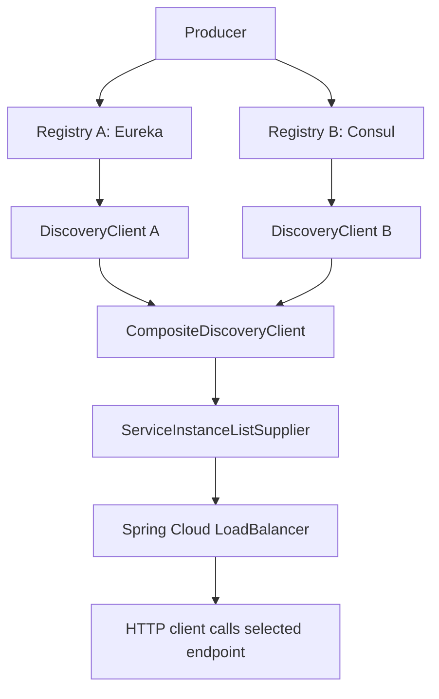

# Designing Ordering and Combining with Existing Clients

When a system already uses Eureka and needs to migrate to Consul, or needs to add an internal discovery source, rewriting all service-calling code is not always necessary. Spring Cloud Commons standardizes implementations via `DiscoveryClient` and can combine multiple clients into a composite. However, adding a client to the classpath only solves reading data; the architecture still needs to decide which registry has priority, when instances should be combined, where producers register, and how to roll back when data across sources is not yet consistent.

Good design starts with the goal of the expansion process. If a service is owned by only one registry at a time, priority ordering is usually enough. If the same service has different instances across multiple registries and all of them must receive traffic, a controlled union strategy is needed. If migrating registries, perform parallel reads for comparison before shifting traffic and maintain a rollback path throughout the transition.

## 1. Define Goals Before Adding a Client

Suppose the system is using Eureka and wants to gradually introduce Consul. Different scenarios may exist:

| Scenario | Goal | Appropriate Combination Approach |
|---|---|---|
| Eureka is primary, Consul is fallback only | Choose Consul when Eureka has no suitable instances | Set priority order and test fallback |
| Consul is the new source, Eureka still serves unmigrated services | Prefer Consul, keep Eureka as fallback for remaining services | Set order by migration phase; keep the same service ID if falling back under one name |
| One group of instances is only in Eureka, another group is only in Consul | Consumers need to see both groups | Combine instances via reactive composite or a deduplicating adapter/supplier union |
| The same instance is registered in both registries | Two registries hold copies of the same workload | Shadow-read/compare or union with deduplication; avoid sending double traffic to the same endpoint |
| New registry is not yet trusted | Measure completeness and latency of new data | Shadow-read; do not route production traffic using the new results |

Do not rely on a single `order` configuration to solve every scenario. Priority ordering, instance combination, dual registration, and shadow-reading are separate decisions.

## 2. Layers to Distinguish

Spring Cloud has two key abstractions:

- `DiscoveryClient` reads service IDs and `ServiceInstance` objects from a source.
- `ServiceRegistry` registers, deregisters, or updates the registration status of a source.

`CompositeDiscoveryClient` combines `DiscoveryClient` beans so consumers have a single read abstraction. It does not automatically ensure producers are registered into every registry. Similarly, having two `ServiceRegistry` beans on the classpath does not automatically create an atomic dual-write transaction across both systems.

The path of a request can be visualized as follows:



Registration and lookup have separate lifecycles. A consumer can read from both Eureka and Consul while a producer only registers in one place. Or a producer can dual-register while consumers still use only one registry to prevent duplicated traffic.

## 3. How Spring Cloud Creates a Composite from Existing Clients

Spring Cloud Commons' `DiscoveryClient` extends `Ordered`. Composite auto-configuration collects the list of `DiscoveryClient` beans and creates `CompositeDiscoveryClient` as a `@Primary` bean. Therefore, when an application injects `DiscoveryClient` by type normally, the bean injected is usually the composite; the component clients still exist for the composite to delegate to.

Example implementations that may coexist on the classpath:

- `EurekaDiscoveryClient` from `spring-cloud-starter-netflix-eureka-client`.
- `ConsulDiscoveryClient` from `spring-cloud-starter-consul-discovery`.
- `ZookeeperDiscoveryClient` from the ZooKeeper starter.
- `SimpleDiscoveryClient` or a custom `DiscoveryClient`.

You do not need to build a custom composite just to use two Spring Cloud-supported starters concurrently. Before adding a wrapper, inspect the actual beans in the application context to avoid creating a nested composite or a `@Primary` bean competing with the default composite.

### 3.1. Service Enumeration Does Not Imply Instance Union

`getServices()` lists the service IDs known across discovery sources. A service ID may appear in the list even when registries hold different instance sets.

`getInstances(serviceId)` is the data LoadBalancer actually uses. Clearly identify whether blocking or reactive APIs are in use and the corresponding composite combination policy. Do not infer that because `getServices()` aggregates service names from multiple clients, `getInstances()` always concatenates all instances.

### 3.2. Composite Health Indicator Is a Separate Feature

`DiscoveryCompositeHealthContributor` aggregates `DiscoveryHealthIndicator` beans to report integration status. It does not determine which registry takes priority and does not alter LoadBalancer's instance list.

If the old registry is shut down during migration, composite health may report one integration failure even though the new registry is still serving requests. Define application readiness based on the discovery source actually needed for the workload, and monitor each registry's status individually. You can disable the composite health contributor with `spring.cloud.discovery.client.composite-indicator.enabled=false` if your application replaces it with a more suitable health indicator.

## 4. Designing Priority Ordering

`DiscoveryClient` uses `Ordered`; smaller numbers take priority first. The interface default value is `0`. If all clients keep the default, do not rely on bean creation order to decide which source wins. Assign distinct order values to sources with clear roles.

Commonly used properties:

| Client | Property |
|---|---|
| Eureka | `eureka.client.order` |
| Consul | `spring.cloud.consul.discovery.order` |
| ZooKeeper | `spring.cloud.zookeeper.discovery.order` |
| Simple | `spring.cloud.discovery.client.simple.order` |

Example when Consul is the target registry and Eureka remains as fallback:

```yaml
spring:
  cloud:
    consul:
      discovery:
        enabled: true
        order: -10

eureka:
  client:
    enabled: true
    order: 0
```

With this ordering, Consul has higher precedence than Eureka. In the blocking composite, client order affects which source is queried first; for the reactive composite, pay close attention to the `order-enforced` property covered later, because by default reactive picks whichever source returns a non-empty result fastest.

Do not assign the same order to registries where precedence affects traffic. If two clients share the same order, treat the ordering between them as unguaranteed and design so results do not depend on that order.

## 5. Same Service ID Across Multiple Registries

Ordering only has clear semantics when registries use compatible service IDs. For example, a consumer looks up `inventory-service`; both Eureka and Consul must recognize that service name or an alias-mapping adapter is required.

If the old registry uses `inventory-service` while the new registry uses `inventory`, the composite will not automatically deduce that both names refer to the same service. You can:

- Standardize service names during registration.
- Keep compatibility aliases on consumers during the transition phase.
- Write a service ID mapping adapter if the two systems strictly require different naming conventions.

Do not change service IDs all at once while old consumers are still querying the old name. Keep the service naming contract stable across the migration period or roll out aliases per consumer group.

## 6. Blocking and Reactive Require Separate Configuration

Spring Cloud Commons provides both blocking `DiscoveryClient` and `ReactiveDiscoveryClient`. The two composites do not share the same default instance selection behavior.

### 6.1. Blocking Lookup

For blocking applications, `CompositeDiscoveryClient` uses the ordered list of clients to coordinate lookups. The priority model works well when each service ID has a primary source registry and subsequent registries act as fallbacks when the primary source has no instances.

Do not treat a registry connection error as an empty result. A client may throw an exception on query; priority order by itself is not a circuit breaker and does not guarantee all errors turn into fallbacks. Check how the implementation surfaces errors and test timeout/exception scenarios separately from empty-list scenarios.

### 6.2. Reactive Lookup

By default, the reactive composite returns instances from the fastest client that yields a non-empty result. Therefore, `order` does not guarantee a higher-priority registry wins if another client responds faster.

To enforce ordering in reactive lookups:

```yaml
spring:
  cloud:
    discovery:
      reactive:
        order-enforced: true
        combine-instances: false
```

When `order-enforced: true`, lower-priority clients are only subscribed to after higher-priority clients return no instances. A slow or non-completing high-priority client can delay results. Spring Cloud Commons documentation also notes that errors from the currently queried client may propagate instead of automatically falling back.

To combine instances from all reactive clients:

```yaml
spring:
  cloud:
    discovery:
      reactive:
        order-enforced: false
        combine-instances: true
```

`combine-instances: true` merges instances from reactive discovery clients; an error from one client is logged without preventing results from other clients from being returned. If `order-enforced: true` is also enabled, clients are queried in the configured order and results are still combined. Test latency and error behavior with your deployed Spring Cloud version.

### 6.3. Mode Selection Matrix

| Goal | `order-enforced` | `combine-instances` |
|---|---:|---:|
| Reactive prefers fastest responding source | `false` | `false` |
| Reactive fallback in order | `true` | `false` |
| Reactive union of sources | `false` | `true` |
| Reactive union but subscribed in order | `true` | `true` |

These two properties apply to the reactive composite. Do not use them to infer that blocking `CompositeDiscoveryClient` will also union instances.

## 7. Configuring Consumers to Read Two Registries During Migration

Example where `order-service` only reads from both Consul and Eureka without registering itself into either. Consul is prioritized; Eureka is the fallback source for unmigrated services:

```yaml
spring:
  application:
    name: order-service
  cloud:
    consul:
      host: ${CONSUL_HOST:localhost}
      port: ${CONSUL_PORT:8500}
      discovery:
        enabled: true
        register: false
        order: -10
    discovery:
      reactive:
        order-enforced: true
        combine-instances: false

eureka:
  client:
    enabled: true
    register-with-eureka: false
    fetch-registry: true
    order: 0
    service-url:
      defaultZone: ${EUREKA_URL:http://localhost:8761/eureka/}
```

In this example:

- `spring.cloud.consul.discovery.register: false` disables producer registration into Consul while keeping Consul Discovery active for lookups.
- `eureka.client.register-with-eureka: false` disables self-registration into Eureka.
- `eureka.client.fetch-registry: true` keeps registry fetching enabled for the consumer.
- `enabled` keeps the integration active; do not disable discovery entirely.
- `order` places Consul ahead of Eureka.
- Reactive mode enforces ordering and disables instance unioning.

If the application only uses a blocking client, reactive properties do not alter blocking lookup behavior. Configuration must reflect the HTTP client type and discovery API the application actually uses.

Do not set `spring.cloud.discovery.enabled=false` if the goal is only to disable one provider; that property applies globally to all discovery. Use the provider-specific enable property or the appropriate register/fetch flags.

## 8. Registering into Multiple Registries Is a Separate Decision

During transition, a producer may need to register the same service into both Eureka and Consul so consumers in both groups can discover instances. This is dual registration / dual write. Consumer-side composite discovery does not perform this automatically.

Example producer configuration for a dual-registration phase:

```yaml
spring:
  application:
    name: inventory-service
  cloud:
    consul:
      discovery:
        enabled: true
        register: true
        deregister: true

eureka:
  client:
    enabled: true
    register-with-eureka: true
    fetch-registry: true
    should-unregister-on-shutdown: true
```

This configuration expresses the intent to register with both integrations. Before rollout, verify that both auto-registration lifecycles are actually created in the application context of your Spring Cloud version and check each registry after startup. Do not assume the two registration operations form an atomic transaction.

Spring Cloud Commons has a global property `spring.cloud.service-registry.auto-registration.enabled`. Setting it to `false` disables auto-registration across integrations; only use this when actively managing registration via code or deployment scripts. For controlled dual registration, you can use each provider's `ServiceRegistry`, though each implementation requires its corresponding `Registration` type. Never pass a `EurekaRegistration` to `ConsulServiceRegistry` or vice versa.

### 8.1. Handling Partial Registration Success

Suppose Consul accepts the registration but Eureka times out. The application is now only half-advertised. Your workflow must decide how to:

- Retry registration to the missing registry with bounded backoff.
- Keep deployment status incomplete until required registration conditions are met.
- If registering with one source is optional, record a degraded status and alert.
- If the rollout fails, deregister the succeeded source or retain it per the rollback plan.

Registration must be idempotent by instance identity. On shutdown, deregister from every registry where the producer successfully registered. Provide cleanup mechanisms for cases where the process crashes before deregistering.

### 8.2. Distinguishing Register from Fetch

| Provider | Register Self | Query Registry |
|---|---|---|
| Eureka | `eureka.client.register-with-eureka` | `eureka.client.fetch-registry` |
| Consul | `spring.cloud.consul.discovery.register` | Consul Discovery Client is enabled via `spring.cloud.consul.discovery.enabled` |

Do not disable `fetch-registry` just because a consumer does not want to register itself. Conversely, a producer can register itself without fetching the entire registry if it does not call other services.

## 9. Standardizing Identity and Metadata Before Combining

When a service is registered in multiple registries, names and metadata can differ. Before combining instances into a single list, standardize these fields:

| Field | Recommended Convention |
|---|---|
| Service ID | A stable logical name for consumers |
| Logical instance ID | An ID representing the same workload across registries |
| Registry-native instance ID | Native ID required by each registry, if needed |
| Address/port | Endpoint reachable by consumers from their network |
| Scheme | HTTP/HTTPS consistent with security policy |
| Zone/region | Metadata with identical key names and meanings for locality filtering |
| Version | Standardized values, e.g., `v1`, `v2` |
| Health | Rules mapping statuses into a set understood by consumers |
| Tags/metadata | Versioned schema, avoiding synonymous duplicate keys |

Example logical metadata published in both registries:

```yaml
spring:
  cloud:
    consul:
      discovery:
        metadata:
          logical-instance-id: ${HOSTNAME}
          service-version: v2
          zone: ap-southeast-1a
```

For Eureka, place matching metadata under `eureka.instance.metadata-map`. Do not assume Eureka's and Consul's `instance-id` values automatically match; use a dedicated logical ID if correlating two records.

## 10. Combining Instances and Deduplication

A union is only valid when every instance in the list represents an independent endpoint that should receive traffic. During migration, the same process may be registered in two registries. If a composite union returns both records, LoadBalancer may treat them as two separate instances even though host and port are identical.

Consequences:

- One endpoint receives a higher traffic probability than other endpoints.
- Instance count metrics are inflated.
- Retries may re-select the exact same process via the other registry's record.
- Differing health statuses or metadata create unpredictable instance selection results.

Define a deduplication key before unioning:

1. Prefer `logical-instance-id` metadata derived from a stable workload identity.
2. If no logical ID exists yet, compare service ID, scheme, host, and port; this is only a fallback because NAT/proxies can make two distinct endpoints look identical.
3. Do not rely solely on registry-native instance IDs because the same process may have different IDs in Eureka and Consul.
4. When two records share a logical ID but differ in health or address, treat it as data drift requiring an alert rather than arbitrarily picking one record.

Reactive `combine-instances` should not be assumed to unify records by logical identity. If deduplication is required, place that logic in an application-controlled union layer or in `ServiceInstanceListSupplier` before LoadBalancer selects an instance.

## 11. Combining Per Service Rather Than Globally

The `order` property applies to an entire `DiscoveryClient`, not to an individual service ID. If you want `inventory-service` fetched from Consul while `payment-service` still comes from Eureka, a single global order may be insufficient.

Options:

- Standardize service IDs and partition services across registries so each service only exists in its preferred source.
- Create service ID aliases in consumers to separate the two groups during migration.
- Use a custom `ServiceInstanceListSupplier` per LoadBalancer client name to filter or pick the source for each service.
- Build an application-layer discovery facade if complex service ID mapping or source policies are required.

Do not create a `DiscoveryClient` wrapper and inject the `@Primary` `DiscoveryClient` bean into that wrapper to obtain the source list. Because the composite collects all `DiscoveryClient` beans, the wrapper could get pulled back into the composite or invoke itself recursively. If writing an adapter, inject concrete component clients explicitly via qualifiers or use a separate abstraction not registered as a `DiscoveryClient` bean.

## 12. Writing a Custom DiscoveryClient to Add an Existing Source

If the organization has an internal registry or catalog API without a Spring Cloud integration, you can write a `DiscoveryClient` adapter. The adapter must return standard `ServiceInstance` objects and declare an appropriate order.

Example skeleton:

```java
import java.util.List;

import org.springframework.cloud.client.ServiceInstance;
import org.springframework.cloud.client.discovery.DiscoveryClient;
import org.springframework.stereotype.Component;

@Component
class InternalCatalogDiscoveryClient implements DiscoveryClient {

    private final InternalCatalogGateway catalogGateway;

    InternalCatalogDiscoveryClient(InternalCatalogGateway catalogGateway) {
        this.catalogGateway = catalogGateway;
    }

    @Override
    public String description() {
        return "Internal service catalog";
    }

    @Override
    public List<ServiceInstance> getInstances(String serviceId) {
        return catalogGateway.findInstances(serviceId);
    }

    @Override
    public List<String> getServices() {
        return catalogGateway.findServiceIds();
    }

    @Override
    public int getOrder() {
        return 20;
    }
}
```

Here, `InternalCatalogGateway` is the application's adapter responsible for transforming source data into `ServiceInstance`. The value `20` places this client after clients with order `0` or `-10`. Choose order based on the source's real role, not its implementation name.

For custom clients, handle timeouts, exceptions, empty results, service ID normalization, metadata, and health semantics consistently. Do not convert catalog query failures into an empty list if doing so masks a data-source outage.

## 13. Shadow-Reading to Validate the New Registry

Shadow-reading is a phase where consumers query both the old and new registries for comparison, while only using results from the active traffic-serving source. It is a low-risk way to catch missing data or incorrect metadata before changing order.

Compare per service ID:

| Field to Compare | Question |
|---|---|
| Service count | Does any service exist only in the old or new registry? |
| Instance count | Do instance counts for the same service match? |
| Logical instance ID | Is any workload missing or duplicated? |
| Address/port/scheme | Are endpoints identical and reachable from the consumer? |
| Health | Are `UP`, `passing`, and `critical` statuses mapped accurately? |
| Zone/version | Is metadata sufficient for LoadBalancer filtering to work properly? |
| Freshness | How much does the new registry lag behind the old registry? |

An example verification component can inject two concrete clients via qualifiers of the actual beans:

```java
import java.util.List;

import org.springframework.cloud.client.ServiceInstance;
import org.springframework.cloud.client.discovery.DiscoveryClient;
import org.springframework.beans.factory.annotation.Qualifier;
import org.springframework.stereotype.Component;

@Component
class RegistryShadowReader {

    private final DiscoveryClient legacyRegistry;
    private final DiscoveryClient targetRegistry;

    RegistryShadowReader(
            @Qualifier("legacyDiscoveryClient") DiscoveryClient legacyRegistry,
            @Qualifier("targetDiscoveryClient") DiscoveryClient targetRegistry) {
        this.legacyRegistry = legacyRegistry;
        this.targetRegistry = targetRegistry;
    }

    void compare(String serviceId) {
        List<ServiceInstance> oldInstances =
                legacyRegistry.getInstances(serviceId);
        List<ServiceInstance> newInstances =
                targetRegistry.getInstances(serviceId);

        // Emit counts and logical IDs to controlled metrics/logs.
        // Do not send business requests to both instance sets.
    }
}
```

`legacyDiscoveryClient` and `targetDiscoveryClient` are illustrative qualifier names assigned by the application to two specific adapters/beans; they are not default bean names guaranteed by every starter. Determine the actual bean names or create explicitly named wrappers. Do not inject the `@Primary` composite into both fields and assume you are comparing two independent registries.

Shadow-reads should be sampled or rate-limited. Do not call `getServices()` in full on every request; some registries must load a large catalog list. Comparisons can run in batches, for critical services, or via a dedicated scheduled job.

## 14. Per-Service Cutover and Preserving Rollback

A controlled migration roadmap:

1. **Inventory:** list service IDs, instance counts, metadata, health, and consumers depending on the old registry.
2. **Standardize:** unify service names, logical instance IDs, zones, versions, schemes, and ports.
3. **Add the new registry:** deploy Consul or the new source while keeping the old registry serving traffic.
4. **Controlled dual-register:** register producers into both new and old registries if consumers in both groups need them; monitor partial registrations.
5. **Shadow-read:** compare both sources without shifting traffic.
6. **Canary consumers:** select a group of consumers or service IDs to prioritize the new registry.
7. **Monitor:** compare instance counts, no-instance rates, connection errors, latency, health, and traffic by source.
8. **Expand cutover:** switch additional consumers once metrics meet criteria.
9. **Maintain rollback window:** continue maintaining registrations and access to the old registry.
10. **Stop writing to old source:** only after no production consumers remain dependent on it.
11. **Deregister and decommission:** clean up old registrations, revoke credentials, and remove dependencies after verifying no callers remain.

Do not switch all services simply by changing global `order` if some services are not yet present in the new registry. Split the rollout by consumer group, profile, or service ID alias.

## 15. LoadBalancer and Instance Selection Policies

`DiscoveryClient` returns an instance list; Spring Cloud LoadBalancer picks an instance from the list supplied by `ServiceInstanceListSupplier`. Discovery ordering is neither a round-robin algorithm nor an instance weight.

If the composite returns a list from one registry, LoadBalancer only sees that list. If a union returns multiple sources, LoadBalancer sees all merged instances. Therefore, decide where to apply:

- Health status and zone filtering.
- Version or canary selection.
- Duplicate removal.
- Locality or registry-source preference.
- Recording source metadata to observe which endpoint was selected.

For per-service rules, use `@LoadBalancerClient(name = "inventory-service", configuration = ...)` to provide a dedicated `ServiceInstanceListSupplier`. Isolate that custom configuration from general component scanning per Spring Cloud LoadBalancer guidance to avoid accidentally applying the same supplier to every service.

Do not feed instances from two registries into LoadBalancer without aligning health semantics. For example, Eureka filters for `UP` instances by default, whereas Consul can be configured to query `passing`; if two sources return instance sets under different criteria, a union can place non-equivalent instances into the same pool.

## 16. Monitoring Each Source's Status

While multiple registries operate concurrently, monitor each integration separately:

- `DiscoveryClient.description()` and the order of each client.
- Number of service IDs and instance counts per service in each source.
- Query duration, timeout/ACL/DNS errors, and empty-list response counts.
- Rate of duplicate logical IDs or conflicting addresses/ports.
- Registry source chosen by LoadBalancer if source metadata is present.
- Timestamps of producer registration, deregistration, and health transitions.
- Auto-registration health and partial-registration failure counts.

The default health indicator can aggregate multiple `DiscoveryHealthIndicator` instances; if the old registry is kept solely for rollback, a failure in that registry could cause composite health to report `DOWN`. Create separate dashboards per backend and define readiness based on the sources required to serve current traffic.

## 17. Common Pitfalls When Combining Clients

| Symptom | Cause | Resolution |
|---|---|---|
| New client is not prioritized | Two clients share the same order or use the wrong prefix | Assign distinct orders; check `eureka.client.order` and `spring.cloud.consul.discovery.order` |
| Reactive request picks faster registry despite lower order | `order-enforced` defaults to `false` | Enable `spring.cloud.discovery.reactive.order-enforced=true` if ordered priority is needed |
| Consumer misses service despite new registry having records | Service IDs differ across sources or consumer queries another name | Standardize service IDs or add an alias adapter |
| Service list shows name but instance list comes from wrong source | `getServices()` and `getInstances()` have different semantics | Inspect each client's instance list and the active composite |
| Traffic doubles after enabling combine | Same workload is registered in both registries | Shadow-read or deduplicate by logical instance ID before LoadBalancer receives the list |
| Producer only registers in one registry | One dual-register call fails, missing credentials, or registration lifecycle is inactive | Monitor each ServiceRegistry, retry with control, and clean up partial successes |
| Old registry failure makes app readiness `DOWN` | Composite health indicator aggregates the old source too | Separate per-backend health and define readiness by traffic dependencies |
| Custom DiscoveryClient enters infinite recursion | Adapter injects `@Primary` composite while composite includes adapter | Inject concrete clients explicitly or use a facade not registered as a DiscoveryClient bean |
| Disabling Eureka breaks Consul lookups too | Using global `spring.cloud.discovery.enabled=false` | Disable only the individual provider via its own enable property |
| Rollback finds no old instances | Dual-registration stopped or old source deregistered too early | Keep old registry active during rollback window and verify old consumers have migrated |

## 18. Design Checklist

- [ ] Identified whether priority/fallback, union, per-service routing, or shadow-read is required.
- [ ] Inspected all `DiscoveryClient` beans and the `@Primary` composite in the application context.
- [ ] Assigned distinct orders to clients with priority roles.
- [ ] Determined whether the application uses blocking or reactive discovery.
- [ ] Explicitly configured `order-enforced` and `combine-instances` for reactive lookups.
- [ ] Aligned service IDs between old and new registries or provided aliases.
- [ ] Distinguished `getServices()` from `getInstances(serviceId)`.
- [ ] Separated dual-read from dual-registration.
- [ ] Producer has strategies for partial registration failures and deregistration across all involved registries.
- [ ] Standardized logical instance ID, address, port, scheme, zone, version, and health.
- [ ] If unioning, implemented deduplication rules before LoadBalancer picks instances.
- [ ] Determined whether per-service routing requires a dedicated `ServiceInstanceListSupplier`.
- [ ] Verified health contributors do not conflate an old-registry failure with service unreadiness.
- [ ] Have shadow-read and metrics to compare the new registry against the old registry.
- [ ] Have incremental canary/cutover and a rollback window.
- [ ] Decommission the old registry only after confirming no dependent consumers remain.

## References

- [Spring Cloud Commons 5.1.0 — Common Abstractions: DiscoveryClient ordering, reactive composite, ServiceRegistry](https://docs.spring.io/spring-cloud-commons/reference/spring-cloud-commons/common-abstractions.html)
- [Spring Cloud Commons 5.1.0 — Configuration Properties: reactive order and combine options](https://docs.spring.io/spring-cloud-commons/reference/configprops.html)
- [Spring Cloud Commons — CompositeDiscoveryClient auto-configuration source](https://github.com/spring-cloud/spring-cloud-commons/blob/main/spring-cloud-commons/src/main/java/org/springframework/cloud/client/discovery/composite/CompositeDiscoveryClientAutoConfiguration.java)
- [Spring Cloud Netflix 5.1.0 — Eureka Client and Registration](https://docs.spring.io/spring-cloud-netflix/reference/spring-cloud-netflix.html)
- [Spring Cloud Netflix 5.1.0 — Configuration Properties (`eureka.client.order`)](https://docs.spring.io/spring-cloud-netflix/reference/configprops.html)
- [Spring Cloud Consul 5.1.0 — Service Discovery](https://docs.spring.io/spring-cloud-consul/reference/discovery.html)
- [Spring Cloud Consul 5.1.0 — Common Application Properties (`discovery.order`, `register`)](https://docs.spring.io/spring-cloud-consul/reference/appendix.html)
- [Spring Cloud LoadBalancer — ServiceInstanceListSupplier and per-client configuration](https://docs.spring.io/spring-cloud-commons/reference/spring-cloud-commons/loadbalancer.html)
