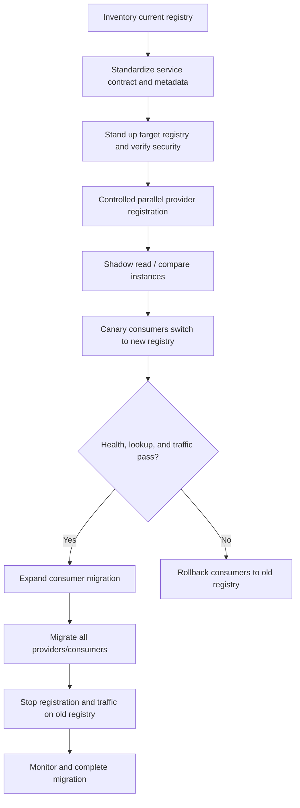

# Migrating Between Eureka, Consul, and ZooKeeper Through the Common Abstraction Layer

Spring Cloud provides abstractions such as `DiscoveryClient`, `ServiceRegistry`, and `ServiceInstance` so applications do not have to call Eureka-, Consul-, or ZooKeeper-specific APIs across every piece of business code. This allows consumers to look up instances by service ID and providers to register instances through a shared contract.

However, using a common abstraction does not mean the three registries share identical semantics or can be swapped simply by changing one dependency. Each provider differs in health checks, leases/TTLs, metadata, ACLs, data synchronization mechanisms, caching, service naming, and lifecycle. Safe migration requires separating portable code from provider-specific configuration and operations, then shifting traffic in stages with verification and rollback.

## 1. Spring Cloud's Common Abstraction Layer

Spring Cloud Commons defines the core contracts:

| Abstraction | Role | Common APIs |
| --- | --- | --- |
| `DiscoveryClient` | Consumer looks up services and instances | `getServices()`, `getInstances(serviceId)` |
| `ReactiveDiscoveryClient` | Reactive discovery lookup | `getServices()`, `getInstances(serviceId)` returning publishers |
| `ServiceRegistry` | Provider registers, deregisters, and updates status | `register(registration)`, `deregister(registration)`, `setStatus(...)`, `getStatus(...)` |
| `Registration` | Describes an instance being registered | `getServiceId()`, `getHost()`, `getPort()`, `getUri()`, metadata |
| `ServiceInstance` | Describes an instance returned to consumers | `getServiceId()`, `getHost()`, `getPort()`, `isSecure()`, `getMetadata()`, `getUri()` |
| `LoadBalancerClient` / Spring Cloud LoadBalancer | Selects an instance from the discovery list | Picks a `ServiceInstance` by service ID |

Consumers typically only need `DiscoveryClient` or call services with a `@LoadBalanced` WebClient/RestClient. Providers can use starter-integrated auto-registration or invoke `ServiceRegistry` when manual registration control is needed.

Example consumer using the common abstraction:

```java
import java.util.List;

import org.springframework.cloud.client.ServiceInstance;
import org.springframework.cloud.client.discovery.DiscoveryClient;
import org.springframework.stereotype.Component;

@Component
public class InventoryLookup {

    private final DiscoveryClient discoveryClient;

    public InventoryLookup(DiscoveryClient discoveryClient) {
        this.discoveryClient = discoveryClient;
    }

    public List<ServiceInstance> findInventoryInstances() {
        return discoveryClient.getInstances("inventory-service");
    }
}
```

This code does not depend on Eureka, Consul, or ZooKeeper. Spring Boot supplies the concrete implementation into the context via starter and auto-configuration.

## 2. Which Parts Are Portable, and Which Depend on the Provider?

You can keep most consumer code portable when only service ID, host, port, secure flag, and standard metadata are needed. Concerns such as health checks, TTLs, ACLs, and watches usually require provider-specific configuration or adapters.

| Capability | Via Common Abstraction? | Parts Needing Specific Handling |
| --- | --- | --- |
| Find instances by service ID | Yes, via `DiscoveryClient` | Service ID naming conventions and instance filtering rules |
| Read host/port/metadata | Yes, via `ServiceInstance` | How the provider maps tags, metadata, and advertised addresses |
| Register/deregister | Yes, via `ServiceRegistry` or auto-registration | Registration payload, ID, lifecycle, and error states |
| Select an instance | Yes, via Spring Cloud LoadBalancer | Supplier, health filters, zone preference, and retry policies |
| Health checks | No completely unified semantics | Eureka status/lease, Consul checks, ZooKeeper sessions, Kubernetes readiness |
| TTL/lease | No complete common contract | Lease/heartbeat, session timeout, or health-check interval |
| ACL/TLS | Not portable | Tokens, policies, certificates, and auth mechanisms per registry |
| Watch/cache/reconnect | Not fully portable | Polling/fetch, Curator watch/session, Kubernetes informer/resourceVersion |
| Namespace/datacenter/zone | Partially mappable into metadata | How providers organize namespaces, datacenters, regions, and zones |
| Config store | Outside DiscoveryClient | Consul KV, Config Server, or dedicated configuration sources |

The abstraction layer lets code depend on a stable contract; it does not eliminate the need to redesign policies that old and new providers implement differently.

## 3. Define an Internal Service Contract Before Migration

Before switching registries, agree on a service schema that every provider can represent:

```json
{
  "serviceId": "inventory-service",
  "instanceId": "inventory-10-20-1-15-8081",
  "host": "10.20.1.15",
  "port": 8081,
  "secure": false,
  "metadata": {
    "environment": "production",
    "region": "ap-southeast-1",
    "zone": "ap-southeast-1a",
    "version": "2.4.1",
    "protocol": "http"
  }
}
```

This contract is the organization's logical model, not a mandatory JSON payload for every provider. On registration, adapters/providers map fields into their respective native structures.

Conventions to align on:

- Service IDs use lowercase, hyphens, and stable names.
- Instance IDs are unique across active replicas.
- Hosts are reachable from the consumer's network.
- Ports are actual advertised ports, not mixing up container ports and host ports.
- Metadata has clear schemas, data types, and versioning rules.
- Secrets are never placed in metadata.
- `environment`, `region`, `zone`, and `version` share consistent semantics across providers.

If Eureka currently uses uppercase application names, Consul uses lowercase service names, and ZooKeeper uses custom paths, standardize during migration and update consumers according to plan. Do not let each provider keep advertising a different service ID without mapping.

## 4. Structure Code to Minimize Provider Coupling

Business code should depend on the common abstraction:

```text
Business service
      |
      v
DiscoveryClient / LoadBalancer
      |
      v
Spring Cloud provider integration
      |
      +---- Eureka
      +---- Consul
      +---- ZooKeeper
```

Avoid calling Eureka REST APIs, Consul HTTP APIs, or raw znode operations directly inside business services unless specialized features are required. When provider-specific behavior is needed, isolate it behind an internal interface or scoped adapter.

Example of an interface for operations the application needs that the common abstraction does not fully capture:

```java
public interface RegistryOperations {
    void register(InstanceDescriptor instance);
    void deregister(String serviceId, String instanceId);
    RegistryHealth getHealth(String serviceId, String instanceId);
}
```

`InstanceDescriptor` and `RegistryHealth` are application-defined internal models. You can implement `EurekaRegistryOperations`, `ConsulRegistryOperations`, or `ZookeeperRegistryOperations`, but only create adapters when custom semantics such as health, leases, or metadata control are required.

Do not build a framework abstraction larger than Spring Cloud just to wrap `getInstances()`. Keep internal contracts small and tailored to actual application use cases; trying to model every provider-specific feature into one generic interface makes the contract vague.

## 5. Selecting Providers via Dependencies and Profiles

Provider integrations are normally chosen via the starter on the runtime classpath and provider configuration. The cleanest approach is building provider-specific artifacts or using deployment profiles with tightly controlled dependencies.

Example consumer config using Eureka:

```yaml
spring:
  application:
    name: checkout-service

eureka:
  client:
    enabled: true
    register-with-eureka: true
    fetch-registry: true
    service-url:
      defaultZone: ${EUREKA_URL:http://eureka:8761/eureka/}
```

Example consumer config using Consul:

```yaml
spring:
  application:
    name: checkout-service
  cloud:
    consul:
      host: ${CONSUL_HOST:consul-agent}
      port: ${CONSUL_PORT:8500}
      discovery:
        enabled: true
        register: true
        service-name: checkout-service
```

Example ZooKeeper Discovery config:

```yaml
spring:
  application:
    name: checkout-service
  cloud:
    zookeeper:
      connect-string: ${ZOOKEEPER_CONNECT:zk-1:2181,zk-2:2181,zk-3:2181}
      discovery:
        enabled: true
        register: true
        root: /services
```

Exact property names and starters must match your Spring Cloud release train. Do not enable all three providers simply by adding all three starters and hoping the common abstraction picks the right registry automatically.

During migration, maintain separate configurations for the old registry, new registry, and dual-registration phase. Profiles should not store tokens or passwords; inject credentials via a secret manager or secure environment variables.

## 6. Compatible Dependency and BOM Configuration

Spring Boot and Spring Cloud provider starters must belong to the same compatibility matrix. Import the Spring Cloud BOM so Commons, LoadBalancer, and provider modules use aligned versions:

```xml
<dependencyManagement>
    <dependencies>
        <dependency>
            <groupId>org.springframework.cloud</groupId>
            <artifactId>spring-cloud-dependencies</artifactId>
            <version>${spring-cloud.version}</version>
            <type>pom</type>
            <scope>import</scope>
        </dependency>
    </dependencies>
</dependencyManagement>
```

When switching providers, swap the starter in your dependency set and inspect the dependency tree. Never upgrade one starter independently while `spring-cloud-commons` or `spring-cloud-loadbalancer` remains on an older release train.

If you need to support multiple providers in a migration artifact, carefully verify auto-configuration and registration conditions. Separating build artifacts or profiles is often easier to control when having providers enabled simultaneously might create unintended registrars or `DiscoveryClient` beans.

## 7. Key Differences Between Eureka, Consul, and ZooKeeper

### Eureka

Eureka organizes its registry by application name and instance ID. Clients register instances, send heartbeats to renew leases, and fetch the registry into a local cache.

Points to adapt:

- `spring.application.name` is normally the application/service ID.
- `eureka.instance.instance-id` must be unique per replica.
- Heartbeats/leases and eviction determine when an instance is no longer considered alive.
- Application health status is a separate signal; successful heartbeats do not prove the provider is Ready.
- Eureka metadata is typically a key/value map; standardize data types and keys.
- Client local cache and fetch intervals affect instance change propagation latency.

### Consul

Consul provides a service catalog, agent registration, and health checks. Services register with an agent; the agent executes checks and updates service status.

Points to adapt:

- Service name, service ID, and node/address can be distinct fields.
- Health checks can be HTTP, TCP, TTL, or script-based depending on config.
- Consumers can query the health API with `passing=true` to receive only passing instances.
- Tags and metadata have different representations than Eureka.
- ACL tokens, policies, and TLS are critical operational configs.
- Consul KV/Consul Config is a separate feature and not synonymous with Consul Discovery.

### ZooKeeper

ZooKeeper typically stores the registry in a znode tree; Curator Service Discovery provides recipes for registering and looking up instances. Dynamic registrations are usually bound to ephemeral nodes and sessions.

Points to adapt:

- Base path/root is part of the registry structure.
- Instance IDs map to znode names.
- Ephemeral nodes are deleted when sessions expire; providers must re-register after `LOST`.
- Watches/caches and reconnects have different semantics from Eureka polling/fetching.
- ZooKeeper session state is not equivalent to Consul HTTP health checks.
- ZooKeeper ACLs and path permissions must be configured separately.

You cannot directly translate a Eureka TTL into a Consul health interval or ZooKeeper session timeout. Those parameters govern different mechanisms.

## 8. Mapping Table When Switching Providers

| Logical Concept | Eureka | Consul | ZooKeeper/Curator |
| --- | --- | --- | --- |
| Service ID | Application name | Service name | Service name in payload/path |
| Instance ID | Eureka instance ID | Consul service ID | Instance znode name/ID |
| Address | Hostname/IP + port | Address + port | Address + port in payload |
| Metadata | Instance metadata map | Tags and service metadata | Service instance payload |
| Liveness/registration | Heartbeat and lease | Agent registration + check | Session and ephemeral node |
| Health | Instance status/health handler | HTTP/TCP/TTL check status | No default HTTP health semantics; can be added separately |
| Consumer sync | Fetch registry/local cache | Catalog/Health query and cache if configured | Watch/ServiceCache/CuratorCache |
| Access control | Network/TLS depending on deployment | ACL token/policy and TLS | ZooKeeper ACLs and authentication |
| Instance removal | Deregister/lease eviction | Agent deregister/check policy | Node deletion or session expiration |

This mapping table is a starting point for adapter design. Do not equate statuses just because their names look similar; for example, Eureka `UP`, Consul `passing`, and ZooKeeper session `CONNECTED` do not carry identical meanings.

## 9. Migration Is More Than Swapping `DiscoveryClient`

A complete migration must transition at least four streams:

1. **Provider registration:** new instances register into the target registry with accurate ID, address, metadata, and health.
2. **Consumer lookup:** consumers fetch instances from the target registry and select the right providers.
3. **Lifecycle:** heartbeats/leases/checks/watches, deregistration, and graceful shutdown behave properly.
4. **Operations:** ACLs, TLS, dashboards, alerts, logs, backup/restore, and runbooks are updated.

If you only swap dependencies without migrating health checks, services may appear in the catalog without being selected by consumers; or consumers may see instances but fail to connect due to incorrect advertised addresses.

## 10. Phased Migration Roadmap

A safe approach is migrating service by service and consumer group by consumer group, preserving rollback at every step.



### Phase 1: Inventory

Collect lists of services, instance IDs, metadata, health checks, consumer dependencies, service names, and churn rates. Identify services whose consumers call DNS or IP directly instead of using the discovery abstraction.

### Phase 2: Standardize the Contract

Standardize service ID, instance ID, host/port, metadata, environment, zone, and version. Specify which fields are mandatory versus optional and how they map to the target provider.

### Phase 3: Stand Up the New Registry

Set up the cluster, networking, TLS, ACLs, health checks, retention, backups, and monitoring. Test registration, lookup, deregistration, failover, and recovery before shifting traffic.

### Phase 4: Controlled Dual Registration

Providers can register in both old and new registries for a short period so new consumers have data. Record outcomes per registry, handle partial failures, and avoid duplicate registrations. If two different application/service IDs are used, maintain clear mappings so consumers never call the wrong service.

### Phase 5: Shadow Read and Compare

Read lists from both registries while using only the old registry to route traffic. Compare instance counts, hosts/ports, zones, versions, health, and metadata. Never invoke providers twice just to shadow a business request; shadow at the lookup layer or via safe connectivity checks.

### Phase 6: Canary Consumers

Switch one consumer group or a small percentage of traffic to the new registry. Monitor no-instance errors, connection refused errors, timeouts, 5xx responses, latency, and selected instance distribution.

### Phase 7: Cutover and Retirement

Once the canary meets criteria, gradually migrate remaining consumers. After verifying no consumers remain dependent on the old registry, stop old registrations, deregister the right instances, and finally decommission the old cluster.

## 11. Dual Registration: Avoiding Half-Succeeded States

Registering an instance into two registries is not an atomic transaction. For example:

```text
register(Eureka) -> success
register(Consul) -> timeout
```

The application must know the instance is in a partial registration state. A coordinator can be used:

```java
import java.util.Map;

public record RegistrationResult(
        Map<String, Boolean> registeredByProvider,
        String operationId
) {
    public RegistrationResult {
        registeredByProvider = Map.copyOf(registeredByProvider);
    }
}

public interface RegistryAdapter {
    String provider();
    void register(InstanceDescriptor instance);
    void deregister(String serviceId, String instanceId);
}
```

The coordinator must:

- Record status per provider.
- Retry failed providers without inadvertently duplicating succeeded registrations.
- Track an operation ID for reconciliation.
- On shutdown, deregister from the registries where the instance actually registered.
- Handle cases where one registry is unreachable during cleanup.
- Provide periodic reconciliation for partial states if migration spans a long period.

If dual registration only serves migration, set a deadline and exit criteria. Do not let dual-write mode persist indefinitely without an owner.

## 12. Choosing Which Registry Consumers Read

Do not let a consumer arbitrarily receive instances from Eureka, Consul, and ZooKeeper in the same list without a clear policy. Decide:

- Which consumer groups read the old registry?
- Which consumer groups read the new registry?
- If the new registry returns an empty list, should it fall back to the old registry?
- If the new registry times out, should it use a stale cache or the old registry?
- If the same instance appears in both registries, what is the deduplication rule?
- When health statuses differ, which provider takes precedence?

During migration, explicit selection by profile/config is usually easier to control than an implicit `CompositeDiscoveryClient`. Composite is not a synchronization or cutover mechanism; it merely coordinates lookups according to implementation semantics.

## 13. Cutover Criteria and Rollback

Define measurable criteria before shifting traffic. Example:

| Criterion | Illustrative Condition |
| --- | --- |
| Registration coverage | 100% of serving instances have valid registrations in the new registry |
| Metadata parity | Service ID, host, port, zone, and version match the agreed mapping |
| Health parity | No critical/not-Ready instances are admitted into traffic |
| Lookup success | Canary consumers resolve instances for all required services |
| Connectivity | Consumers connect successfully to selected instances |
| Error rate | No significant increase compared to baseline |
| Latency | p95/p99 within defined SLOs |
| Recovery | Reconnection, deregistration, and instance replacement have been tested |

Rollback must be ready before cutover:

1. Keep the old registry running and do not delete registration data before the canary stabilizes.
2. Keep old consumer configuration ready for rapid re-activation.
3. If errors exceed thresholds, switch consumers back to the old registry first.
4. Then halt dual registration or fix provider mappings depending on root cause.
5. Reconcile instances across both registries before retrying.

Do not roll back by wiping the entire service catalog or deleting all znodes. Only stop or deregister instances owned by the migration coordinator.

## 14. Health Checks Must Be Re-Mapped

Health semantics are among the easiest parts to overlook:

- A Eureka heartbeat indicates the client is renewing its lease; application health status may be published separately.
- A Consul health check can actively probe an HTTP/TCP endpoint or use a TTL check.
- A ZooKeeper ephemeral node reflects that a session is alive, not by itself that an HTTP endpoint is healthy.

When switching providers, pick a signal equivalent to your business goal. If consumers previously accepted only `UP` Eureka instances, when moving to Consul clearly specify `passing=true` health queries and which endpoint the agent checks. Moving to ZooKeeper, add a health mechanism if unhealthy instances must be excluded, since a live session alone is insufficient.

Do not map mechanically:

```text
Eureka UP == Consul passing == ZooKeeper CONNECTED
```

These are different states with different meanings. Define an internal contract such as `SERVING`, `NOT_SERVING`, `UNKNOWN`, then map each provider from real signals and accept that some providers need external health checks.

## 15. Metadata, Tags, and Zone Preference

Metadata is commonly used to filter by version, environment, zone, or capability. Mapping across providers must preserve meaning:

| Logical Metadata | Eureka | Consul | ZooKeeper |
| --- | --- | --- | --- |
| `version` | Instance metadata | Service metadata/tag | Payload field |
| `zone` | Metadata or instance zone property | Node/service metadata or tag | Payload field |
| `environment` | Metadata map | Metadata/tag | Payload field/path convention |
| `protocol` | Metadata map | Metadata/tag | Payload field |

Avoid ambiguous unkeyed tags such as `v2` or `prod`. Use explicit key/value metadata and a versioned schema. If consumers require zone-aware load balancing, verify metadata reaches `ServiceInstance.getMetadata()` after switching providers.

## 16. Security and Access Control During Migration

The new registry may require a different security model from the old registry:

- Eureka may rely on network isolation, TLS, or deployment security integration.
- Consul normally uses ACL tokens and policies for service registration, catalog reads, health reads, and KV access.
- ZooKeeper uses per-znode ACLs, authentication schemes, and optional TLS.

Separate provider registration permissions from consumer read permissions. Do not share a single admin credential across all services. Tokens/certificates must be provisioned via secret management, never committed into YAML or logs.

Migration testing must verify both read and write permissions. A consumer might succeed at lookups in dev yet hit `403` in production due to differing prefix/service ACLs.

## 17. Version Compatibility and Dependency Migration

When replacing providers, keep Spring Boot and Spring Cloud release trains compatible. Import the Spring Cloud BOM and swap provider starters within the same upgrade plan.

Inspect the dependency tree to catch legacy starters pulled in transitively. If the application supports multiple providers during migration, test context startup under each profile and verify the actual `DiscoveryClient`, `ServiceRegistry`, and auto-registration beans.

Do not assume every provider starter shares identical properties or APIs. Settings like `eureka.client.fetch-registry`, `spring.cloud.consul.discovery.register`, and `spring.cloud.zookeeper.discovery.root` cannot be renamed mechanically across providers.

## 18. Testing Before, During, and After Cutover

A migration test suite should cover:

1. **Contract tests:** the same service instance maps to equivalent `ServiceInstance` objects across old and new providers.
2. **Registration tests:** service name, instance ID, host, port, and metadata are published accurately.
3. **Lookup tests:** consumers fetch the right instances through the common abstraction.
4. **Health tests:** unhealthy/not-ready providers are excluded per policy.
5. **Deregistration tests:** stopped instances are removed from new and old registries per ownership.
6. **Reconnect tests:** registry outages, stale caches, and reconciliation work properly.
7. **Dual-write tests:** partial registration failures are detected and recovered.
8. **Load-balancing tests:** traffic distributes according to policy without hitting wrong endpoints.
9. **Security tests:** ACLs/TLS permit authorized operations and reject unauthorized ones.
10. **Rollback tests:** consumers revert to the old registry without modifying business code.

Run integration tests against real registries using Testcontainers or ephemeral environments. Mocking abstractions only verifies consumer logic; it does not prove provider health checks, ACLs, leases, or session behavior.

## 19. Common Migration Pitfalls

| Symptom | Possible Cause | Resolution |
| --- | --- | --- |
| Consumer cannot find service after provider switch | Service ID differs or new provider lacks registration | Verify service ID mapping and registration coverage |
| Instance exists in registry but is never selected | Different health semantics or query filters only passing/UP | Align health checks and consumer filters |
| Consumer receives unreachable host/port | Advertised address works for registry node but not consumer network | Configure advertised address and test from consumer network |
| Instance registers in new registry but is not removed on shutdown | Auto-registration/lifecycle disabled or coordinator lacks ownership tracking | Inspect deregistration path and cleanup |
| Dual registration succeeds on only one side | Missing coordinator/partial-state handling | Retry and reconcile per provider |
| Composite returns unexpected instances | Ordering/delegation semantics do not match migration policy | Select provider explicitly via profile/adapter |
| Zone-aware load balancing stops working | Metadata was not mapped to the new provider | Standardize metadata and inspect `ServiceInstance` |
| ZooKeeper instance disappears after reconnect | Session `LOST`, ephemeral node deleted | Re-register under new session and await cache sync |
| Consul instance stays critical | Agent check cannot reach endpoint or health mapping is wrong | Check path, advertised address, ACLs, and health semantics |
| Eureka registry serves stale data | Client/server caches or lease propagation delay | Check fetch/eviction intervals and allow convergence per policy |
| `NoSuchMethodError` after swapping starters | Spring Cloud modules span mismatched release trains | Use compatible BOM and inspect dependency tree |
| Rollback deletes services from old registry | Cleanup deleted shared IDs or whole applications | Only deregister registrations owned by the migration |

## 20. Migration Checklist

- [ ] Business code uses `DiscoveryClient`, `ServiceInstance`, or LoadBalancer instead of direct provider APIs.
- [ ] Portable features and provider-specific parts are clearly separated.
- [ ] Service ID, instance ID, host/port, and metadata follow a unified schema.
- [ ] Health, lease/session, TTL, and deregistration semantics have been mapped.
- [ ] Dependencies and Spring Cloud BOM compatibility have been verified.
- [ ] New registry has proper networking, TLS, ACLs, monitoring, and backups.
- [ ] Provider registration is tested before consumer cutover.
- [ ] Dual registration has an owner, partial failure handling, and an end date.
- [ ] Shadow read compares data without causing business side effects.
- [ ] Canary consumers have clear error-rate/latency/health criteria.
- [ ] Rollback keeps the old registry operational until cutover stabilizes.
- [ ] Consumers do not rely on `CompositeDiscoveryClient` as a registry synchronization mechanism.
- [ ] Integration tests cover register, lookup, health, reconnect, deregister, and security.
- [ ] Old registry is retired only after confirming zero remaining consumer/provider dependencies.

Spring Cloud abstractions reduce code coupling to Eureka, Consul, or ZooKeeper, particularly in lookup flows and the instance model. Yet migration still requires addressing differences in registration, health, leases/sessions, metadata, caching, security, and operations. Standardize the service contract, isolate adapters for provider-specific capabilities, migrate providers in phases, compare data before cutover, and keep rollback ready. Done this way, replacing a registry becomes a measurable, controlled process rather than a risky one-shot starter swap.
