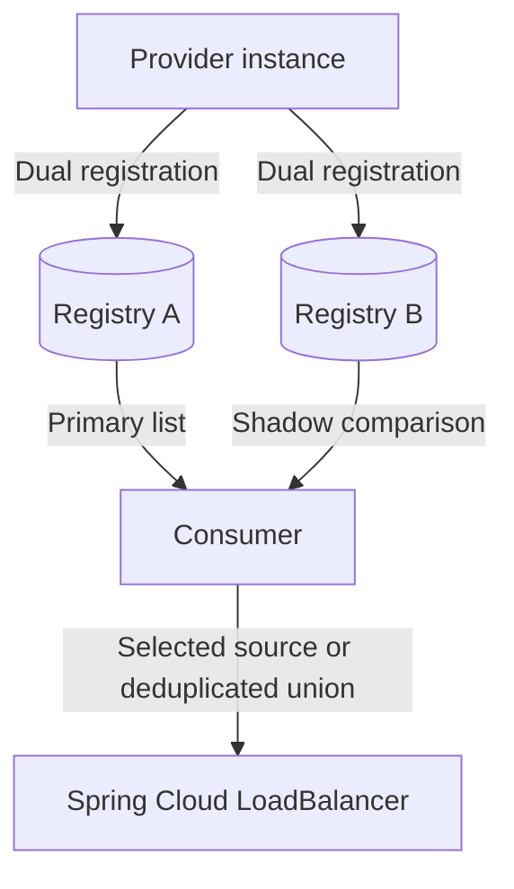
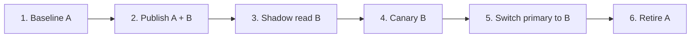

# Running Two Discovery Sources in Parallel and Controlling Duplicates

When migrating service discovery from Eureka to Consul, from Consul to Kubernetes, or when a compatibility period between two platforms is needed, a system may have to maintain two discovery sources simultaneously. Providers may register into both registries; consumers may read both the old and new sources; some consumers may also need to compare both lists to verify data synchronization.

Running in parallel reduces migration risk, yet two registries do not automatically become one unified registry. The same process can appear twice in the candidate list, health states can differ, advertised addresses might only be reachable from one network, and one registration can succeed while the other fails. If lists are merged without shared identities and precedence rules, LoadBalancer may send doubled traffic weight to the same process or select a stale endpoint.

This lesson distinguishes dual registration, dual read, shadow comparison, and union; explains how to choose an authoritative source, establish a shared identity, deduplicate before LoadBalancer, and roll out migration in phases.

## 1. Distinguishing Four Parallel Patterns

Two discovery sources can coexist in several ways. Choose the right goal before configuring.

| Pattern | Provider Registration | Consumer Data Usage | Goal |
| --- | --- | --- | --- |
| Dual registration | Writes instances to both registries A and B | May still read only A | Maintain two catalogs during transition. |
| Priority/fallback read | May register in both | Reads A first, uses B when fallback conditions are met | Fallback when the primary source is unavailable. |
| Shadow read / comparison | May register in both | Uses A to serve requests; reads B in background to compare | Verify parity before shifting traffic. |
| Union / merge read | Registers in both | Merges instances from A and B into one candidate set | Serve workloads genuinely split across two catalogs. |

These patterns solve different problems. Dual registration does not mean consumers must union the two lists. Shadow reads must not influence instance selection decisions. Fallback also differs from union: fallback picks one source in order, whereas union places candidates from multiple sources into a single set.



## 2. Why Must Duplicates Be Controlled?

Suppose a process `payment-7` registers into both Eureka and Consul. Both registries return an entry for the same process:

| Source | Service ID | Instance ID | URI | Health |
| --- | --- | --- | --- | --- |
| Eureka | `payment-service` | `payment-7` | `http://10.0.2.17:8080` | UP |
| Consul | `payment-service` | `payment-7` | `http://10.0.2.17:8080` | passing |

If both lists are concatenated directly, LoadBalancer receives two entries pointing to the exact same endpoint. Under round-robin, that process can be selected with double the probability of an instance appearing in only one registry. If all three replicas exist in both registries, the list has six entries for only three actual processes.

Duplicates can also create subtler issues:

- Two registrations for the same process have different URIs because one registry stores an internal IP while the other stores an advertised IP.
- One source reports healthy while the other marks the instance unhealthy or `OUT_OF_SERVICE`.
- One source retains a stale registration after a process restart while the other holds the new instance.
- Two registries use different conventions for service ID, namespace, or instance ID.
- A consumer picks an instance from a registry whose network address is unreachable from that consumer's network.
- On shutdown, the application deregisters cleanly from one registry but fails on the other.

Therefore, deduplication must occur before the list enters the instance selection algorithm; at the same time, provenance must be preserved so conflicts can be investigated.

## 3. How Does Spring Cloud Support Multiple DiscoveryClients?

Spring Cloud Commons defines `DiscoveryClient` as the common abstraction across registries. This interface extends `Ordered`, allowing implementations to be ordered. Spring Cloud can construct a composite client from the discovery clients present in the `ApplicationContext`.

### 3.1. Blocking DiscoveryClient and Priority Ordering

For blocking `DiscoveryClient`, Spring Cloud Commons provides `CompositeDiscoveryClient` to coordinate implementations in order. Clients can be ordered via their respective properties or by overriding `getOrder()` in a custom implementation.

Example order configuration:

```yaml
spring:
  cloud:
    consul:
      discovery:
        order: 0

eureka:
  client:
    order: 10
```

This example places Consul at higher priority than Eureka. Property names and binding behavior can vary by release train and starter; confirm against your version's documentation and inspect the actual bean order at startup.

An ordered composite must not be mistaken for a union operation. In a priority/fallback model, consumers receive results from prioritized sources per the semantics of the version in use; verify behavior when the first source returns empty or throws an exception. If the goal is merging instances from two registries, verify whether the composite supports those exact semantics or implement an explicit aggregator.

### 3.2. Reactive Composite DiscoveryClient

For reactive discovery, current Spring Cloud Commons documentation clearly describes the modes:

- By default, `ReactiveCompositeDiscoveryClient` returns instances from the client yielding the fastest non-empty result.
- `spring.cloud.discovery.reactive.order-enforced=true` requires querying in configured order; lower-priority clients are subscribed to only when higher-priority clients return no instances. Slow or non-completing clients can delay results; errors propagate without automatic fallback.
- `spring.cloud.discovery.reactive.combine-instances=true` combines instances from all reactive discovery clients. Errors from one client are logged without blocking results from remaining clients.
- When both `order-enforced` and `combine-instances` are enabled, clients are queried in configured order while results are still combined.

Example enabling union for reactive discovery:

```yaml
spring:
  cloud:
    discovery:
      reactive:
        combine-instances: true
```

This property applies to the reactive composite; do not use it to infer that blocking `DiscoveryClient` automatically merges two lists. Check your release train because properties and semantics can differ across versions.

### 3.3. Separating Discovery Lookup from Registration

`DiscoveryClient` primarily reads services/instances. `ServiceRegistry` provides registration and deregistration operations via `register(Registration)` and `deregister(Registration)`. Each registry has its own `Registration` type, such as `EurekaRegistration` and `ConsulRegistration`.

Thus, adding two `DiscoveryClient` beans does not guarantee a provider registers properly into both registries. Conversely, dual registration does not guarantee consumers read from both sources. Design the registration write path and discovery read path separately.

## 4. Designing a Shared Identity Before Dual Registration

Deduplication is reliable only when the same process can be identified consistently across registries.

### 4.1. Creating a Canonical Instance ID

Each replica needs a unique identifier within the scope of its service and environment. For example:

```text
service:       payment-service
environment:   production
cluster:       cluster-a
instance-id:   payment-7f8c9d-2
```

`DISCOVERY_INSTANCE_ID` can be derived from Pod UID, StatefulSet hostname/ordinal, or a platform-assigned ID. The value must be:

- Unique across concurrently running replicas.
- Stable for the lifetime of a process/replica.
- Sent to both Eureka and Consul registrations.
- Not reused prematurely before an old process is deregistered or its lease expires.
- Free of secrets or personal data.

Example sharing an environment variable across two registrations:

```yaml
eureka:
  instance:
    instance-id: ${DISCOVERY_INSTANCE_ID}

spring:
  cloud:
    consul:
      discovery:
        instance-id: ${DISCOVERY_INSTANCE_ID}
```

These properties illustrate two starters sharing a single identity. Verify property names and registration construction in your specific release train before applying.

### 4.2. Canonical Key for Deduplication

Do not use hostname or IP alone as an identity. One host can run multiple services/ports; the same process can also advertise different addresses depending on network view.

Suggested logical key:

```text
canonical-key = environment + namespace + canonical-service-id + canonical-instance-id
```

Example:

```text
production|shop|payment-service|payment-7f8c9d-2
```

If a shared instance ID cannot yet be propagated, a temporary key can be built from `serviceId + scheme + normalized host + port + contextPath`. This is strictly a fallback: IP changes, NAT, or multiple network interfaces can cause one process to look like two instances or two processes to be mistakenly merged.

### 4.3. Standardizing Service IDs and Scopes

Both registries need mapping conventions for:

- Service ID / canonical service name.
- Environment, namespace, cluster, region, and datacenter.
- Instance ID.
- Scheme, host, port, and base path.
- Metadata such as zone, version, and protocol.

Do not merge two services merely because their names look similar. `payment-service` in staging and production belong to different scopes; `payment-service` across two clusters may share a logical service name without sharing the same endpoint set.

## 5. Deduplication and Conflict Resolution

### 5.1. Basic Merge Rules

For every result from a registry, retain source metadata:

```text
Candidate {
  sourceRegistry
  canonicalServiceId
  canonicalInstanceId
  uri
  healthState
  observedAt
  metadata
}
```

Then group by `canonicalServiceId + canonicalInstanceId`. Never discard provenance before checking for duplicates.

Pseudocode:

```java
Map<InstanceKey, List<Candidate>> grouped = candidates.stream()
        .collect(Collectors.groupingBy(Candidate::canonicalKey));

List<ResolvedInstance> resolved = grouped.entrySet().stream()
        .map(entry -> resolveDuplicate(entry.getKey(), entry.getValue()))
        .filter(ResolvedInstance::eligibleForTraffic)
        .toList();
```

`resolveDuplicate` must apply endpoint, health, and source precedence rules; never just grab the first item in the list.

### 5.2. Duplicate Resolution Matrix

| Scenario | Recommended Handling |
| --- | --- |
| Same canonical ID, same URI, same health | Keep one instance; record both sources in provenance. |
| Same canonical ID, different URI within same network view | Inspect registrations and choose URI per consumer policy. |
| Same canonical ID, different URI due to internal/external addresses | Preserve endpoints by network view or pick the routable endpoint for the consumer; do not collapse away network context. |
| Same canonical ID, one source healthy and one unhealthy | Use health from the authoritative source or fail closed when indeterminate; emit a mismatch alert. |
| Same canonical ID but different service ID/namespace | Check mapping; merge only if canonical scope proves they are the same service. |
| Different canonical IDs but identical URI | Do not merge automatically; may be two processes/services sharing host/port via proxy or distinct mappings. |
| One source has instance, other source lacks it | Record parity mismatch; decide traffic by source policy without assuming the instance is dead. |

### 5.3. Health Rules Must Be Explicit

Health states cannot be merged by taking the "best" status. For instance, Eureka reports `UP` while Consul checks have gone `critical`; if the union picks `UP`, consumers may call an instance the other source already evicted.

Pick one of these policies:

1. **Authoritative health:** only the health state from the registry currently authorized to govern traffic is used.
2. **Independent health gate:** after deduplication, an independent health-check supplier probes the endpoint from the consumer's network.
3. **Fail closed on conflict:** when two sources report conflicting states or one snapshot is too stale, temporarily exclude the candidate from the union and emit an alert.

During migration, authoritative health is usually easiest to control: the new registry is compared in shadow mode without yet having authority to admit endpoints into traffic. When transferring ownership, switch the authoritative source in an explicit change.

### 5.4. Selecting Endpoints by Network View

Two registries may return two URIs for the same process:

```text
Eureka: http://10.20.1.17:8080   (private cluster network)
Consul: http://172.20.1.17:8080  (datacenter network)
```

These may be two valid access paths rather than duplicates to discard arbitrarily. Consumers inside Kubernetes may select the private address; consumers outside the cluster may need an address routable through a gateway/mesh. Put `network-view`, `cluster`, or `zone` into non-sensitive metadata and apply a policy to choose the right network's endpoint.

## 6. Controlled Dual Registration

### 6.1. Each Registry Has Its Own Registration

Spring Cloud Commons `ServiceRegistry` abstracts `register` and `deregister`, but each implementation requires its corresponding `Registration`. Do not create one generic `Registration` object assuming Eureka and Consul understand the same structure.

If the application manages dual registration itself, you can disable default auto-registration to prevent the same service from being registered twice unexpectedly:

```yaml
spring:
  cloud:
    service-registry:
      auto-registration:
        enabled: false
```

Or use `@EnableDiscoveryClient(autoRegister = false)` in configuration matching your version. When auto-registration is disabled, the application takes full responsibility for invoking both registries and managing their lifecycles.

### 6.2. Using Separate Adapters Per Registry

Define a standard application command, then have each adapter translate that command into its native `Registration`:

```java
public record RegistrationCommand(
        String serviceId,
        String instanceId,
        URI uri,
        Map<String, String> metadata) {
}

public interface RegistryPublisher {
    String registryName();

    void register(RegistrationCommand command);

    void deregister(RegistrationCommand command);
}
```

`EurekaPublisher` uses `EurekaRegistration`/`EurekaServiceRegistry`; `ConsulPublisher` uses `ConsulRegistration`/`ConsulServiceRegistry`. Each adapter maps service ID, instance ID, address, port, tags/metadata, and health checks according to that registry's semantics.

### 6.3. Do Not Assume Two Register Calls Form a Transaction

Two registries are independent systems; there is no shared ACID transaction. The following can happen:

```text
Register Eureka  -> success
Register Consul  -> timeout
```

The outcome is partial registration. The coordinator must track state separately per target:

```text
instance payment-7
  eureka: REGISTERED
  consul: RETRY_PENDING
```

Coordination pseudocode:

```java
for (RegistryPublisher publisher : publishers) {
    try {
        publisher.register(command);
        registrationState.markRegistered(
                command.instanceId(), publisher.registryName());
    } catch (TransientRegistryException ex) {
        registrationState.markRetryPending(
                command.instanceId(), publisher.registryName());
        retryQueue.enqueue(command, publisher.registryName());
    } catch (RuntimeException ex) {
        registrationState.markFailed(
                command.instanceId(), publisher.registryName(), classify(ex));
    }
}
```

This is coordinator pseudocode, not a complete Spring implementation. `registrationState` and `retryQueue` should be backed by a durable mechanism such as an outbox or reconciliation job.

Operational principles:

- Every register/deregister call must be idempotent on `serviceId + instanceId`.
- Failure in one registry must not discard the success recorded in the other.
- Retry with bounded backoff and jitter; authentication/configuration errors must be surfaced clearly instead of retrying forever.
- Run a periodic reconciler comparing desired state against actual state in each registry.
- On process shutdown, attempt to deregister from both sources; TTLs/leases/health checks serve as fallback cleanup if the process crashes abruptly.
- Never generate a new registration with a different ID on each retry; that leaves duplicate records behind.

### 6.4. Handling Partial Registration by Traffic Policy

When one registry succeeds and the other fails, the response depends on which source currently serves traffic:

| State | Suggested Policy |
| --- | --- |
| Registry A is primary; A succeeds, B fails | Allow instance to serve via A if A's health passes; retry B and alert on parity mismatch. |
| Registry B is primary; B fails, A succeeds | Do not treat A's success as sufficient if consumers already moved to B; apply configured fallback and alert. |
| Both registries serve traffic in a union | Admit candidates into union only when identity/health policies allow; avoid letting a failing source introduce duplicates or stale endpoints. |
| Both registries fail | Do not advertise instance as registered; report registration failure and follow readiness policy. |

Do not automatically deregister from the succeeded registry just because the other timed out. Compensating deregistration can take down a live serving endpoint. Only roll back a succeeded registration when migration policy explicitly requires it and traffic impact has been assessed.

## 7. Choosing a Dual-Read Strategy

### 7.1. Priority/Fallback

One source is designated primary. The second source is used only when defined fallback conditions occur.

Pros:

- Produces no duplicates in the candidate list.
- Easy to control which source governs health and endpoints.
- Fits migrations where only one registry should serve traffic at a time.

Risks:

- If primary returns a valid empty list, fallback can mask registration drift if policy fails to distinguish empty from error.
- If primary is slow or hangs, fallback can be delayed during sequential queries.
- If both sources hold divergent data, consumers may flap between two snapshots.

Define explicit fallback triggers. For example: fall back when primary is unreachable within deadline; successful empty results are logged as mismatches and trigger fallback only if service policy permits. Never automatically fall back on `401`/`403`, TLS errors, or misconfiguration.

### 7.2. Shadow Read / Parity Check

Consumers use registry A to select instances. A background task queries registry B, normalizes the list, and compares:

- Instance counts and canonical IDs.
- URIs / network views.
- Health states.
- Metadata needed for routing.
- Snapshot age and last successful refresh timestamp.

Shadow reads never send business requests to instances from source B. They solely measure catalog parity. When data diverges, emit metrics and log bounded mismatch samples; never log sensitive metadata in full.

### 7.3. Union/Merge

Union fits when two registries genuinely manage disjoint sets of instances, such as part of a workload on Kubernetes and the rest on VMs. Before feeding a union into LoadBalancer:

1. Standardize service ID and scope.
2. Merge by canonical instance ID.
3. Resolve URI / network view.
4. Apply health policy.
5. Exclude overly stale snapshots or unroutable instances.
6. Preserve provenance for debugging and auditing.

Do not use union merely "just in case" two registries hold the same service. When both registries mirror the same replicas, priority or shadow read is usually far easier to control.

## 8. Deduplication Example Using Canonical ID

The snippet below illustrates the candidate grouping step. `Candidate` and `ResolvedInstance` are application data types; add mappers from each registry's `ServiceInstance`.

```java
public record InstanceKey(
        String environment,
        String namespace,
        String serviceId,
        String canonicalInstanceId) {
}

public record Candidate(
        InstanceKey key,
        URI uri,
        String source,
        String health,
        Instant observedAt,
        Map<String, String> metadata) {
}

public List<ResolvedInstance> deduplicate(List<Candidate> candidates) {
    Map<InstanceKey, List<Candidate>> grouped = candidates.stream()
            .collect(Collectors.groupingBy(Candidate::key));

    return grouped.entrySet().stream()
            .map(entry -> resolve(entry.getKey(), entry.getValue()))
            .filter(ResolvedInstance::eligibleForTraffic)
            .toList();
}
```

`resolve(...)` must clarify at least four decisions:

1. Which source has authority over health?
2. When URIs differ, which network view is the consumer in?
3. Is the snapshot still within freshness TTL?
4. When identity or health conflicts occur, is the candidate excluded or flagged for inspection?

Never implement `resolve` by returning `list.get(0)` because registry return order is not a business policy.

## 9. Phased Migration Process

### Phase 1 — Baseline the Old Registry

- Keep registry A as the sole traffic source.
- Measure registration counts, healthy counts, lookup latency, request error rate, and cache age.
- Define canonical service ID/instance ID to preserve across migration.
- Document service/namespace/zone mappings and network reachability.

### Phase 2 — Dual Registration

- Enable registration to A and B via a stateful coordinator/adapter.
- Keep A as the traffic source.
- Confirm each process has exactly one canonical ID in each registry.
- Test partial registration, retries, and deregistration.

### Phase 3 — Shadow Read

- Consumers continue selecting from A.
- Read B in the background and compare canonical IDs, health, URIs, and metadata.
- Measure parity mismatches and convergence time after scaling/rollouts.
- Fix mappings and networking before shifting traffic.

### Phase 4 — Canary Traffic from New Source

- Select a low-risk consumer group or service.
- Switch discovery primary for that group to B.
- Monitor selected instances, 5xx errors, timeouts, latency, and health.
- Keep rollback to A available within an agreed window.

### Phase 5 — Switch Primary

- Migrate consumer groups in waves.
- Confirm B has full registration and health before each wave.
- Do not union both lists if they reflect the same replicas.
- Maintain dual registration throughout the required rollback window.

### Phase 6 — Retire the Old Source

- Stop consumer reads from A.
- Stop registrations to A after zero dependent consumers remain.
- Deregister leftover records and verify TTL/lease cleanup.
- Remove old dependencies/configs once zero traffic is confirmed.
- Monitor for ghost registrations and parity metrics post-cutover.



## 10. Failure Handling and Consistency

### 10.1. Distinguishing Empty, Unavailable, and Stale

| Result from Source | Meaning | Recommended Action |
| --- | --- | --- |
| Non-empty, fresh | Instances available from a recent snapshot | Use according to health/network policy. |
| Empty, successful query | Source has no matching instances | Record parity mismatch; do not treat as connection error. |
| Timeout/5xx | Source is unreachable | Retry within deadline; use fallback if policy allows. |
| 401/403 or TLS error | Authentication/authorization/trust failure | Fix credentials/certificates; do not retry blindly. |
| Non-empty but stale | Old snapshot present | Use only within defined stale TTL, health guard, and alert. |

If primary returns a successful empty response while secondary returns non-empty, that is data divergence requiring investigation. Automatic fallback can aid availability in some systems, yet it can also cause consumers to call an endpoint the authoritative source intentionally removed. Define rules per service criticality and health semantics.

### 10.2. Retries and Idempotency

Registration and deregistration must be idempotent. Use the same `serviceId + instanceId` as the idempotency key in the coordinator. Retry with backoff/jitter; persist per-registry state so a succeeded source is not re-registered just because the other source failed.

Do not retry indefinitely on the startup thread if the service can serve traffic through the primary source. You can mark the instance ready per the active registry's policy while flagging the secondary registration `PENDING` and raising an alert. If organizational policy requires both registries to hold a registration before serving traffic, readiness must reflect that requirement explicitly.

### 10.3. Deregistration and Cleanup

On shutdown, invoke deregister for each registry. One failure must not drop status logging for the other operation. If a process dies abruptly, rely on TTLs/leases/health checks and a reconciler to clear stale records.

The reconciler should cross-check:

- Desired running instances.
- Actual registrations in A.
- Actual registrations in B.
- Health states and last-seen/lease times.
- Canonical identities and URIs/network views.

Do not delete registrations solely because an instance was missing in one brief snapshot; verify data age and source health before cleaning up.

## 11. Observability for Dual Discovery

During parallel operation, dashboards must show the state of each source and parity levels.

Suggested metrics (application/observer-defined metric contract, not guaranteed built-in names):

| Metric | Meaning |
| --- | --- |
| `discovery_registration_attempts_total{registry,outcome}` | Register/deregister attempt counts by registry and outcome. |
| `discovery_registration_pending{registry}` | Registrations not yet synchronized to the corresponding source. |
| `discovery_instances{registry,state}` | Count of registered/healthy/unhealthy instances per source. |
| `discovery_duplicate_candidates_total{service}` | Candidates identified as duplicates before deduplication. |
| `discovery_identity_conflicts_total{service}` | Cases where canonical IDs match but endpoints/metadata conflict. |
| `discovery_source_parity_ratio{service}` | Ratio of matching canonical instance IDs across both sources. |
| `discovery_shadow_mismatch_total{service,reason}` | Shadow comparison mismatch counts by reason. |
| `discovery_selected_source_total{service,registry}` | Requests served via each selected source. |
| `discovery_snapshot_age_seconds{registry}` | Age of the latest snapshot for each source. |

Labels must have bounded cardinality. Never put raw URIs, ephemeral Pod UIDs, tokens, or exception messages into metric labels. Log instance IDs in controlled logs instead of metric labels when instance counts are large.

### 11.1. Required Alerts

- Secondary registration pending for too long.
- Canonical identity conflicts or identical IDs with unexplained differing URIs.
- Persistent health mismatches between A and B.
- Parity ratio dropping below threshold during shadow mode.
- One source failing to refresh or snapshot exceeding freshness TTL.
- Consumers still selecting the old source past switch time.
- Ghost registrations persisting past deregistration/lease timeout.

Do not page on every brief mismatch during normal rollouts. Tune `for` durations, severities, and thresholds to real convergence times.

## 12. Testing Before Shifting Traffic

Minimum test coverage should include:

| Test | Setup | Assertion |
| --- | --- | --- |
| Same instance in A and B | Identical canonical ID, URI, and health | Union returns exactly one candidate. |
| Same ID, different URI | A and B advertise two network views | Picks consumer-appropriate URI or flags conflict; never picks randomly. |
| Health mismatch | A healthy, B critical | Authoritative/fail-closed policy applied; mismatch recorded. |
| Partial registration | Register A succeeds, B times out | Per-source state saved; retries only B without duplicating A. |
| Partial deregistration | Deregister A succeeds, B fails | B retried/reconciled; A's outcome preserved. |
| Primary empty, secondary non-empty | Divergent source data | Fallback follows policy; parity alert emitted. |
| Primary unavailable | Timeout/5xx from primary source | Retry/fallback within deadline; not confused with empty. |
| Authentication failure | 401/403 or TLS error | No infinite retries; config/permission alert fired. |
| Stale registration | One source keeps old record | Health/TTL/reconciler removes per policy, no duplicate traffic. |
| Rollback | Revert canary back to A | Consumers return to A without unintended split traffic. |

Test both blocking and reactive paths if the application uses both. Verify the actual injected composite, client ordering, and empty/error/merge semantics in your exact release train.

## 13. Common Pitfalls

| Pitfall | Consequence | Fix |
| --- | --- | --- |
| Assuming two DiscoveryClients automatically create a union | Consumers only see the highest-priority or fastest source | Check composite behavior; enable reactive combine if suitable or write an explicit aggregator. |
| Dual registration while configuring only one ServiceRegistry | Instances appear in only one source | Use separate adapters/registrations per registry and track partial state. |
| Using IP as the sole dedupe key | Merges wrong processes or misses same process after IP change | Use canonical instance ID plus service/environment scope. |
| Deduplicating after LoadBalancer | One process appears multiple times with inflated weight | Deduplicate inside supplier/aggregator before returning candidates. |
| Taking the best health across two registries | Instances excluded by one source still receive traffic | Use authoritative health, independent checks, or fail closed. |
| Falling back when primary returns empty without policy | Masks registration drift or hits stale endpoints | Separate successful empty from unavailable; define explicit fallback triggers. |
| Two registries advertise different-network URIs that collapse together | Consumers receive unroutable addresses | Preserve network view and select endpoints by consumer location. |
| Register retries generate a new ID every attempt | Multiple registrations for one process | Use stable IDs and idempotent operations. |
| Disabling auto-registration without a coordinator | Service registers in no registry at all | Add a coordinator and explicit readiness/registration lifecycle. |
| Retiring the old registry too early | Unmigrated consumers lose discovery | Use migration phases, canaries, and a rollback window. |

## 14. Implementation Checklist

- [ ] Clearly choose dual-publish, fallback, shadow-read, or union.
- [ ] Identify which registry governs traffic in each phase.
- [ ] Standardize service ID, namespace, environment, and canonical instance ID.
- [ ] Verify blocking and reactive composite order/semantics for your release train.
- [ ] If unioning, deduplicate before LoadBalancer and preserve provenance.
- [ ] Define handling for URI/network-view and health mismatches.
- [ ] Build separate `Registration` adapters per registry.
- [ ] Handle partial register/deregister via idempotency and reconciliation.
- [ ] Define distinct fallback triggers for empty, timeout, 5xx, 401/403, and stale snapshots.
- [ ] Have dashboards for parity, duplicates, identity conflicts, and pending registrations.
- [ ] Test source outages, partial failures, health mismatches, and rollback.
- [ ] Retire the old source only after consumers have migrated and cleanup is verified.

## 15. Key Takeaways

- Dual registration, dual read, shadow comparison, and union are four distinct patterns.
- Spring Cloud `DiscoveryClient` is ordered; composite does not default to union.
- Reactive composite currently supports `combine-instances` to merge results; this property does not apply to blocking clients.
- Each registry has its own `Registration` type and semantics; two register calls do not share a single transaction.
- Use canonical instance IDs across registries and deduplicate before LoadBalancer.
- When URIs or health states conflict, apply explicit network/health policies; never pick arbitrarily.
- During migration, shadow-reading and parity checks catch drift before traffic shifts.
- Maintain partial registration state, idempotent retries, a reconciler, and a rollback window until the old source is safely retired.

## References

- [Spring Cloud Commons: Ordering DiscoveryClient instances and Reactive Composite](https://docs.spring.io/spring-cloud-commons/reference/spring-cloud-commons/common-abstractions.html)
- [Spring Cloud Commons: ServiceRegistry and auto-registration](https://docs.spring.io/spring-cloud-commons/reference/spring-cloud-commons/common-abstractions.html#serviceregistry-auto-registration)
- [Spring Cloud LoadBalancer](https://docs.spring.io/spring-cloud-commons/reference/spring-cloud-commons/loadbalancer.html)
- [Spring Cloud Netflix: Eureka](https://docs.spring.io/spring-cloud-netflix/reference/spring-cloud-netflix.html)
- [Spring Cloud Consul: Service Discovery](https://docs.spring.io/spring-cloud-consul/reference/discovery.html)
