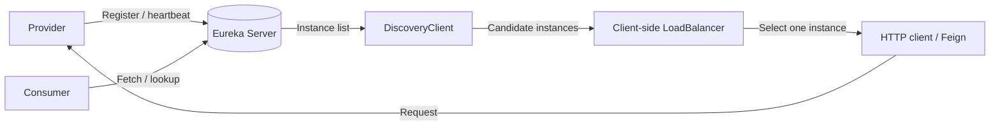

# Recognizing Ribbon, @EnableEurekaClient, and Legacy Guides

Many Spring Cloud Service Discovery projects were initialized from tutorials using Netflix Ribbon and the `@EnableEurekaClient` annotation. Those examples may have been valid for older release trains, but they should not be copied verbatim into modern Spring Boot/Spring Cloud projects.

Separate three responsibilities: Eureka registers and supplies the instance list; the client-side load balancer selects one instance per call; the HTTP client executes connections and manages timeouts. Ribbon used to handle the instance selection portion in the Spring Cloud Netflix ecosystem. Spring Cloud LoadBalancer is the replacement maintained by Spring Cloud for modern release trains. The `@EnableEurekaClient` annotation is also no longer a mandatory step in current configurations using starters and auto-configuration.

This guide helps you identify traces of legacy tutorials, understand why they no longer fit, and migrate piece by piece to current configuration while keeping the application's service IDs and discovery mechanism intact.

## 1. Distinguishing Service Discovery from Client-Side Load Balancing

These two capabilities are commonly used together but serve different duties:

- **Service discovery:** finds the list of instances published by the registry for a service ID.
- **Client-side load balancing:** selects one instance from that list for each call.
- **HTTP client:** builds and sends requests to the chosen host/port; manages connections, TLS, and timeouts at the transport layer.

Typical flow:



Eureka does not perform round-robin on business requests itself. Eureka stores registrations and provides the registry to clients. Previously, Ribbon typically read the instance list from Eureka and chose a server. In modern configurations, Spring Cloud LoadBalancer handles instance selection.

Therefore, replacing Ribbon does not mean replacing Eureka. A project can keep using Eureka as its registry while replacing only Ribbon with Spring Cloud LoadBalancer.

## 2. What Is Ribbon and Why Does It Appear in Old Guides?

Netflix Ribbon is a client-side load balancing library. In older Spring Cloud Netflix generations, Ribbon integrated with Eureka to pull server lists and pick one server per request.

Ribbon has its own concepts:

| Ribbon Component | Role |
|---|---|
| **IRule** | Server selection policy, such as round-robin or zone-aware |
| **ILoadBalancer** | Manages server lists and server selection |
| **ServerList** | Source supplying the server list |
| **ServerListFilter** | Filters the server list before selection |
| **IPing** | Checks availability using Ribbon's mechanism |
| **IClientConfig** | Ribbon client configuration |
| **@RibbonClient** | Declares per-client Ribbon configuration |

Common class names found in legacy code:

```java
import com.netflix.loadbalancer.IRule;
import com.netflix.loadbalancer.RoundRobinRule;
import com.netflix.loadbalancer.ZoneAvoidanceRule;
import com.netflix.loadbalancer.ILoadBalancer;
```

If you see these imports, the project uses Ribbon APIs or retains leftover code from an old Ribbon integration.

Ribbon was common in examples such as:

```java
@Configuration
@RibbonClient(name = "inventory-service")
public class InventoryRibbonConfiguration {

    @Bean
    public IRule ribbonRule() {
        return new RoundRobinRule();
    }
}
```

This configuration attaches a Ribbon rule to the client named `inventory-service`. It is not a Spring Cloud LoadBalancer configuration.

Ribbon moved into maintenance mode and Ribbon integration in Spring Cloud Netflix was removed from modern release trains (starting with the Spring Cloud 2020.0 / Spring Cloud Netflix 3.x generation). Thus, new code should use Spring Cloud LoadBalancer. Older projects running on compatible release trains may still compile Ribbon, but it is a legacy choice that needs a migration plan.

## 3. Identifying Ribbon Dependencies in a Project

Inspect Maven/Gradle dependencies and the dependency tree to locate legacy artifacts.

Common signs:

```xml
<dependency>
    <groupId>org.springframework.cloud</groupId>
    <artifactId>spring-cloud-starter-netflix-ribbon</artifactId>
</dependency>
```

Or Ribbon artifacts declared directly:

```xml
<dependency>
    <groupId>com.netflix.ribbon</groupId>
    <artifactId>ribbon-loadbalancer</artifactId>
</dependency>
```

Some projects do not declare Ribbon directly, instead pulling it transitively from an older starter or library. Searching `pom.xml` alone is insufficient; inspect the dependency tree.

Maven:

```bash
mvn dependency:tree -Dincludes=com.netflix.ribbon,org.springframework.cloud:spring-cloud-starter-netflix-ribbon
```

Gradle:

```bash
./gradlew dependencies --configuration runtimeClasspath
```

In the output, look for modules with group `com.netflix.ribbon` or the Ribbon starter. If pulled transitively, identify which library brings it in before removing it. Never blanket-exclude a dependency without verifying whether dependent modules actually require it.

## 4. Identifying Ribbon APIs and Configuration

Search source code for signs:

| Indicator | Meaning |
|---|---|
| **@RibbonClient**, **@RibbonClients** | Per-client Ribbon configuration |
| **IRule**, **RoundRobinRule**, **ZoneAvoidanceRule** | Server selection rules |
| **ILoadBalancer** | Ribbon load balancer API |
| **ServerList**, **ServerListFilter** | Server source and filter |
| **ribbon.ConnectTimeout** | Ribbon connection timeout |
| **ribbon.ReadTimeout** | Ribbon response read timeout |
| **MaxAutoRetries**, **MaxAutoRetriesNextServer** | Ribbon retry policy |
| **NFLoadBalancerRuleClassName** | Ribbon rule class name |
| **listOfServers** | Ribbon static server list |

Example legacy configuration:

```yaml
inventory-service:
  ribbon:
    NFLoadBalancerRuleClassName: com.netflix.loadbalancer.RoundRobinRule
    ConnectTimeout: 1000
    ReadTimeout: 3000
    MaxAutoRetries: 0
    MaxAutoRetriesNextServer: 1
```

Or:

```yaml
ribbon:
  eureka:
    enabled: true
```

These properties belong to Ribbon configuration. Merely renaming the prefix to `spring.cloud.loadbalancer` does not guarantee equivalent behavior. Timeouts, retries, health filters, zones, and caching can be managed at different layers in the new architecture.

## 5. @EnableEurekaClient and Related Annotations

Old tutorials typically instruct adding:

```java
@SpringBootApplication
@EnableEurekaClient
public class InventoryApplication {

    public static void main(String[] args) {
        SpringApplication.run(InventoryApplication.class, args);
    }
}
```

`@EnableEurekaClient` is an annotation specific to Spring Cloud Netflix Eureka client. It appears in legacy projects and guides as a marker enabling the Eureka client.

In modern Spring Cloud generations, when `spring-cloud-starter-netflix-eureka-client` is on the classpath, auto-configuration sets up the Eureka client; adding `@EnableEurekaClient` is normally unnecessary. Depending on the release train, the annotation may be unnecessary, deprecated, or removed. Do not rely on this annotation as a mandatory condition to enable Eureka.

Example modern application:

```java
@SpringBootApplication
public class InventoryApplication {

    public static void main(String[] args) {
        SpringApplication.run(InventoryApplication.class, args);
    }
}
```

Eureka client dependency:

```xml
<dependency>
    <groupId>org.springframework.cloud</groupId>
    <artifactId>spring-cloud-starter-netflix-eureka-client</artifactId>
</dependency>
```

When running with valid Eureka configuration, the starter and auto-configuration handle client registration/fetching via properties. Providers can register and consumers can fetch the registry without the legacy annotation.

### Distinguishing Three Commonly Confused Annotations

| Annotation | Purpose | Needed for Modern Clients? |
|---|---|---|
| **@EnableEurekaClient** | Eureka-client-specific annotation from old guides | Usually unnecessary when using starter and auto-configuration |
| **@EnableDiscoveryClient** | Spring Cloud's generic discovery abstraction annotation | Usually optional if a discovery implementation auto-configures from classpath |
| **@EnableEurekaServer** | Enables Eureka Server functionality | Still used for applications acting as Eureka Server per respective guides |

Do not mistakenly delete `@EnableEurekaServer` during client migration. That is a server annotation, not a replacement for the Eureka client annotation.

If the codebase contains legacy annotations, verify actual imports and your release train before deleting them. Some older applications might still rely on specific auto-registration behavior or custom setup; verify with integration tests after migrating.

## 6. Spring Cloud LoadBalancer Replaces Ribbon

Spring Cloud LoadBalancer is the client-side load balancer integrated with Spring Cloud Commons. It works with the discovery abstraction to obtain the instance list and then selects a suitable instance.

Key concepts:

| Legacy Ribbon | Spring Cloud LoadBalancer |
|---|---|
| **IRule** | **ReactorServiceInstanceLoadBalancer** or corresponding strategy |
| **ServerList** | **ServiceInstanceListSupplier** pulling instances from discovery |
| **ServerListFilter** | Supplier decorator/filter or instance filtering mechanism |
| **ILoadBalancer** | New LoadBalancer client/factory and implementation |
| Ribbon per-client config | **@LoadBalancerClient** and configuration per service ID |
| Ribbon cache | LoadBalancer cache/supplier cache per new configuration |

There is no strict one-to-one mapping for every Ribbon class. If a project has a custom `IRule`, re-express the selection goal (round-robin, zone preference, canary, weights, etc.) and choose the matching Spring Cloud LoadBalancer extension point.

Add the dependency:

```xml
<dependency>
    <groupId>org.springframework.cloud</groupId>
    <artifactId>spring-cloud-starter-loadbalancer</artifactId>
</dependency>
```

When using Eureka, keep the discovery dependency:

```xml
<dependency>
    <groupId>org.springframework.cloud</groupId>
    <artifactId>spring-cloud-starter-netflix-eureka-client</artifactId>
</dependency>
```

Eureka supplies the instance list; Spring Cloud LoadBalancer picks an instance. The two dependencies have complementary responsibilities.

## 7. Modern Dependency and Release Train Configuration

Spring Boot and Spring Cloud must use compatible versions. Manage Spring Cloud with a BOM instead of picking individual starter versions manually.

Maven example:

```xml
<properties>
    <java.version>17</java.version>
    <spring-cloud.version>YOUR_COMPATIBLE_RELEASE_TRAIN</spring-cloud.version>
</properties>

<dependencyManagement>
    <dependencies>
        <dependency>
            <groupId>org.springframework.cloud</groupId>
            <artifactId>spring-cloud-dependencies</artifactId>
            <version>${spring-cloud.version}</version>
            <type>pom</type>
            <scope>import</scope>
        </dependency>
    </dependencies>
</dependencyManagement>

<dependencies>
    <dependency>
        <groupId>org.springframework.cloud</groupId>
        <artifactId>spring-cloud-starter-netflix-eureka-client</artifactId>
    </dependency>
    <dependency>
        <groupId>org.springframework.cloud</groupId>
        <artifactId>spring-cloud-starter-loadbalancer</artifactId>
    </dependency>
    <dependency>
        <groupId>org.springframework.cloud</groupId>
        <artifactId>spring-cloud-starter-openfeign</artifactId>
    </dependency>
</dependencies>
```

`YOUR_COMPATIBLE_RELEASE_TRAIN` is a placeholder that must be replaced with the release train compatible with your project's Spring Boot version per the official compatibility matrix. The version element inside `dependencyManagement` references the `spring-cloud.version` property. Never copy a random version from an old blog post. Do not override LoadBalancer/Eureka/OpenFeign versions individually when the BOM already manages them, unless there is a verified compatibility reason.

With OpenFeign, the LoadBalancer dependency may be marked optional in certain starter generations; explicitly declaring the LoadBalancer starter documents the dependency the application requires and avoids relying on a specific version's transitive dependency behavior.

## 8. Migrating Feign Clients from Ribbon to LoadBalancer

A Feign client uses the service name when no fixed URL is declared:

```java
@FeignClient(name = "inventory-service")
public interface InventoryClient {

    @GetMapping("/api/items/{id}")
    ItemResponse getItem(@PathVariable("id") String id);
}
```

With appropriate OpenFeign and Spring Cloud LoadBalancer present, Feign uses the service ID to look up instances. There is no need to write manual `DiscoveryClient.getInstances()` calls in every API.

The configuration below is a legacy sign to review:

```yaml
inventory-service:
  ribbon:
    ConnectTimeout: 1000
    ReadTimeout: 3000
```

With modern OpenFeign, timeouts are configured on the HTTP/Feign client using release-train properties:

```yaml
spring:
  cloud:
    openfeign:
      client:
        config:
          inventory-service:
            connectTimeout: 1000
            readTimeout: 3000
```

OpenFeign property prefixes and names depend on the Spring Cloud OpenFeign generation; check documentation for your exact version. Connect/read timeouts are transport-client responsibilities and should not be treated as direct Ribbon property equivalents.

If a URL is declared in the annotation or properties:

```java
@FeignClient(
    name = "inventory-service",
    url = "http://inventory.internal:8080"
)
```

Feign will call the fixed URL; service discovery and client-side load balancing are no longer used to select endpoints for that client. When discovery is desired, remove the fixed URL and keep only the service name, unless intentionally targeting a static endpoint.

## 9. Migrating RestTemplate to Spring Cloud LoadBalancer

A `RestTemplate` annotated with `@LoadBalanced` can call services by logical name:

```java
@Configuration
public class HttpClientConfiguration {

    @Bean
    @LoadBalanced
    RestTemplate restTemplate(RestTemplateBuilder builder) {
        return builder.build();
    }
}
```

Calling the service:

```java
@Service
public class InventoryGateway {

    private final RestTemplate restTemplate;

    public InventoryGateway(RestTemplate restTemplate) {
        this.restTemplate = restTemplate;
    }

    public ItemResponse getItem(String id) {
        return restTemplate.getForObject(
            "http://inventory-service/api/items/{id}",
            ItemResponse.class,
            id
        );
    }
}
```

With the LoadBalancer dependency present, an interceptor translates the service ID into the selected instance. If `@LoadBalanced` or the LoadBalancer dependency is missing, the `inventory-service` hostname may be treated as a regular DNS hostname and fail to resolve.

Do not place `@LoadBalanced` on every `RestTemplate`. Only clients using service IDs need load balancing; a standard `RestTemplate` remains appropriate for fixed URLs or external APIs.

## 10. Migrating Ribbon Rules and Custom Routing

A project may use `IRule` to choose instances by round-robin, zone, response time, or custom logic. When migrating to Spring Cloud LoadBalancer, first describe the desired behavior:

- Distribute evenly across instances.
- Prefer the same zone/region.
- Exclude unhealthy instances.
- Filter by metadata or version.
- Perform canary/blue-green routing.
- Apply weights or sticky behavior.

Spring Cloud LoadBalancer offers different strategies and extension points, including `ReactorServiceInstanceLoadBalancer` and `ServiceInstanceListSupplier`. For per-service configuration, use `@LoadBalancerClient`:

```java
@Configuration
@LoadBalancerClient(
    name = "inventory-service",
    configuration = InventoryLoadBalancerConfiguration.class
)
public class LoadBalancerClientsConfiguration {
}
```

`InventoryLoadBalancerConfiguration` must declare beans according to the API of your exact Spring Cloud LoadBalancer version. Do not place this configuration class inside general component scanning if its beans are meant solely for one client; if scanned globally, the rule could affect other services.

Do not port an `IRule` straight into a new class and assume identical behavior. Verify selection ordering, zone metadata, health, caching, and empty-list behavior with tests.

## 11. Retries, Timeouts, and Caches Lack a One-to-One Mapping

Common Ribbon properties:

```yaml
inventory-service:
  ribbon:
    ConnectTimeout: 1000
    ReadTimeout: 3000
    MaxAutoRetries: 0
    MaxAutoRetriesNextServer: 1
```

When migrating, split them by responsibility:

| Legacy Need | Where to Check in New Config |
|---|---|
| Connect/read timeout | HTTP client or Feign client configuration |
| Retry same instance / next instance | Spring Cloud LoadBalancer retry and HTTP client retry |
| Instance selection rule | LoadBalancer strategy |
| Server filtering | `ServiceInstanceListSupplier` / health / zone |
| Server list cache | LoadBalancer cache and discovery provider cache |
| Health ping | Registry-appropriate health checks or LoadBalancer supplier |

Retries can cause a business request to be sent multiple times. Enable retries only for safe operations or with appropriate idempotency keys. For a `POST` creating a payment or order, automatic timeout retries can cause duplicate processing if the server already executed the request before the response was lost.

Do not copy Ribbon retry counts directly into LoadBalancer. Some retries happen at the LoadBalancer layer while others happen in Feign/HTTP transport. If both layers retry, total requests can multiply exponentially.

## 12. Controlled Migration Steps

A sensible migration workflow:

1. **Inventory:** locate Ribbon dependencies, `@RibbonClient`, `IRule`, `ILoadBalancer`, `ribbon.*`, and custom server lists.
2. **Identify versions:** record current Spring Boot, Spring Cloud release train, and Eureka client versions.
3. **Inspect dependency tree:** determine whether Ribbon is pulled directly or transitively.
4. **Pick compatible release train:** use the BOM matching the compatibility matrix.
5. **Add LoadBalancer:** declare the required starter and keep the Eureka client if the registry remains Eureka.
6. **Migrate clients:** Feign uses service name without URL; `RestTemplate` uses `@LoadBalanced` when calling service IDs.
7. **Migrate policies:** replace rules/filters using LoadBalancer APIs; never copy Ribbon properties verbatim.
8. **Migrate timeouts/retries:** configure the right HTTP client and LoadBalancer layers, verifying idempotency.
9. **Remove legacy annotations:** verify starter auto-configuration before removing `@EnableEurekaClient`.
10. **Remove legacy dependencies:** drop Ribbon once no code or transitive dependencies need it.
11. **Test:** registration, lookup, instance selection, timeouts, retries, health, and behavior when the registry is unavailable.
12. **Roll out incrementally:** monitor latency, no-instance errors, request distribution, and rollback path.

Do not change dependencies, annotations, timeouts, and retries all at once without checkpoints. When errors occur, layering changes makes root-cause identification faster.

## 13. Checking Dependencies and Leftover Traces After Migration

After making changes, run the dependency tree and search for remaining traces:

```bash
mvn dependency:tree
```

Search in source/config:

```text
@RibbonClient
@RibbonClients
IRule
ILoadBalancer
ServerList
ServerListFilter
ribbon.
spring-cloud-starter-netflix-ribbon
com.netflix.ribbon
@EnableEurekaClient
```

Not every match is an error. Migration docs or legacy modules might intentionally mention Ribbon. Inspect production code, test sources, dependencies, and runtime config to ensure Ribbon is no longer activated unexpectedly.

If both Ribbon and Spring Cloud LoadBalancer are present, verify which client is actually used. Avoid maintaining two instance-selection mechanisms simultaneously as it causes confusing configuration, dependency conflicts, or divergent behavior between Feign and `RestTemplate`.

## 14. Common Errors After Migrating

| Symptom | Possible Cause | Resolution |
|---|---|---|
| Missing Ribbon bean or class | Code still imports old APIs after dependency was removed | Migrate rule/filter to LoadBalancer or delete unused code |
| Feign reports no instances | Missing LoadBalancer, wrong service name, or fixed URL | Check starter, `@FeignClient(name=...)`, and supplier |
| RestTemplate fails to resolve service hostname | Missing `@LoadBalanced` or dependency | Use annotated bean and LoadBalancer starter |
| Eureka dashboard shows instances but consumer gets empty | Fetch registry disabled, stale client cache, or incompatible status | Check `fetch-registry`, status, and registry fetch |
| Timeouts differ from before migration | Old timeouts belonged to Ribbon, new timeouts belong to HTTP transport | Configure connect/read timeouts on the right client |
| Requests sent multiple times | Retries active across multiple layers or unsafe retries | Audit retry budgets, idempotency, and retry layers |
| Custom rule stopped taking effect | `IRule` is ignored by LoadBalancer | Implement strategy/supplier using the new API |
| All services unexpectedly share one rule | Per-client LoadBalancer config was globally component-scanned | Isolate the configuration class per service ID |
| `@EnableEurekaClient` fails to compile | Annotation was removed in current version | Use Eureka starter and proper auto-configuration |
| Ribbon still present at runtime | Transitive dependency or old module pulled it in | Use dependency tree to trace the source |

## 15. Checklist for Reading an Older Spring Cloud Tutorial

When encountering an article or sample repository, ask yourself:

1. Which Spring Boot and Spring Cloud release train does the article use?
2. Does it declare `spring-cloud-starter-netflix-ribbon`?
3. Does it use `@RibbonClient`, `IRule`, or `ILoadBalancer`?
4. Does it use `ribbon.*` properties?
5. Does it treat `@EnableEurekaClient` as mandatory?
6. Is Eureka acting as the registry, or does the article confuse Eureka with a load balancer?
7. Does it mistakenly put `@EnableEurekaServer` in a client application?
8. Is there a fixed URL in `@FeignClient` causing discovery to be bypassed?
9. Are timeouts/retries configured in Ribbon or the HTTP client?
10. Are dependency versions managed by a compatible BOM?
11. Does the tutorial test with a real registry and multiple instances?
12. Do the APIs or properties still exist in your project's release train?

Do not dismiss an article as wrong merely because it uses Ribbon. It may be accurate documentation for an older release train. What matters is evaluating whether that version fits your current application and falls within your project's supported scope.

## 16. Distinguishing Legacy Guides from Modern Practices

| Topic | Legacy Guides | Modern Practices |
|---|---|---|
| Registry | Eureka Client | Eureka Client can still continue |
| Client-side load balancing | Netflix Ribbon | Spring Cloud LoadBalancer |
| Client rule | `IRule` | LoadBalancer strategy/supplier |
| Client-specific config | `@RibbonClient` | `@LoadBalancerClient` |
| Discovery activation | `@EnableEurekaClient` commonly required | Eureka starter and auto-configuration |
| Feign lookup | Feign + Ribbon | OpenFeign + Spring Cloud LoadBalancer |
| RestTemplate lookup | Ribbon integration | `@LoadBalanced` + LoadBalancer |
| Timeout | `ribbon.ConnectTimeout`, `ReadTimeout` | HTTP client/Feign timeouts |
| Retry | Ribbon retry properties | Layered LoadBalancer/HTTP client retries |
| Dependencies | Netflix Ribbon starter | LoadBalancer starter and registry starter |

Spring Cloud LoadBalancer does not make Eureka redundant. The registry and load balancer remain two distinct components: Eureka supplies instances, while LoadBalancer picks an instance for each request.

## 17. Migration Completion Checklist

- [ ] Identified Spring Boot/Spring Cloud versions and compatibility matrix.
- [ ] Inventoried direct and transitive Ribbon dependencies.
- [ ] Located `@RibbonClient`, `IRule`, `ILoadBalancer`, and `ribbon.*`.
- [ ] Verified what existing `@EnableEurekaClient` annotations actually do.
- [ ] Kept Eureka client starter if continuing to use Eureka.
- [ ] Declared Spring Cloud LoadBalancer starter appropriately.
- [ ] Verified Feign service IDs are accurate with no unintended fixed URLs.
- [ ] Applied `@LoadBalanced` to `RestTemplate` only when service-name lookup is needed.
- [ ] Migrated rules/filters to matching strategies/suppliers.
- [ ] Configured timeouts and retries at the proper layers.
- [ ] Verified zero unexpected Ribbon dependencies remain.
- [ ] Tested instance selection, health, timeouts, retries, and no-instance behavior.
- [ ] Measured request distribution and latency post-migration.
- [ ] Prepared a rollback plan in case the new release introduces failures.

When reading older Spring Cloud documentation, recognize the era of Ribbon and Eureka annotations before applying them. In modern systems, keep a registry like Eureka if appropriate, use Spring Cloud LoadBalancer for instance selection, let the HTTP client manage timeouts at the right layer, and rely on starters/auto-configuration rather than adding legacy annotations out of habit.
