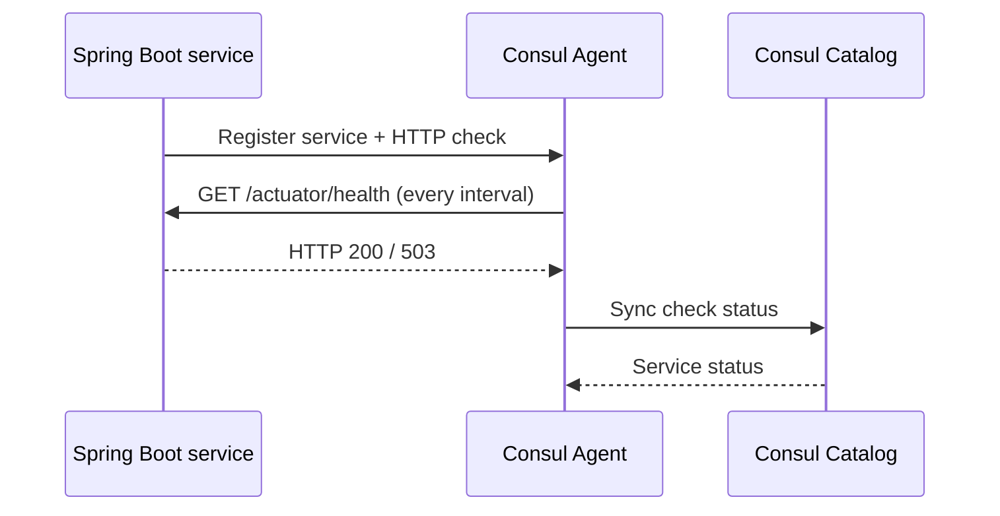
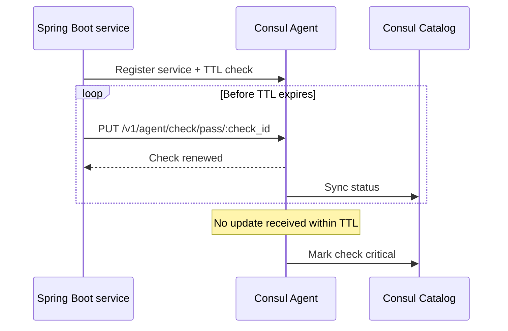

# Setting Up Consul to Compare HTTP Checks with TTL Heartbeats

## 1. Practice Objectives

In this practice, you will set up a Consul agent running in development mode, register two Spring Boot instances, and observe two health checking approaches:

- **HTTP check:** Consul Agent actively sends periodic HTTP requests to the service's endpoint.
- **TTL heartbeat:** the application actively sends a signal to Consul Agent to renew the health check's time-to-live.

Both approaches allow Consul to mark instances `passing`, `warning`, or `critical`, yet they verify different communication directions and can detect different types of failures.

After this lesson, you will be able to:

1. Start local Consul using Docker Compose.
2. Register a Spring Boot service using an HTTP health check.
3. Register a Spring Boot service using a TTL heartbeat.
4. View services/checks in the Consul UI and Agent HTTP API.
5. Intentionally break the HTTP endpoint and Actuator health to observe differing states.
6. Stop processes, measure failure detection time, and verify the recovery process.

## 2. How Do HTTP Checks and TTL Heartbeats Differ?

### 2.1. HTTP Check: Consul Actively Calls the Service

When a service is registered with an HTTP check, Consul Agent sends a request to the registered address and port, typically:

```text
GET http://<service-address>:<service-port>/actuator/health
```

Consul executes the request according to `interval`. If the endpoint returns a success status per HTTP check rules, the check transitions to or remains `passing`. If the endpoint is unreachable, times out, or returns an error code, the check can transition to `critical`.

Communication flow:



An HTTP check tests the path from Consul Agent to the actual endpoint. It can detect wrong registered addresses, wrong ports, inbound firewalls/NetworkPolicies blocking traffic, web servers refusing requests, or failing health endpoints.

With Spring Cloud Consul, HTTP checks are enabled by default when registering a service. The default health path is `/actuator/health` and the default interval is `10s`. Path, interval, timeout, and headers can be changed via discovery properties.

### 2.2. TTL Heartbeat: The Application Proactively Reports Status

A TTL check does not require Consul Agent to call the application's HTTP endpoint. Instead, the application sends heartbeats to Consul Agent to update the check status and reset the TTL timer.



If Consul does not receive an update before the TTL expires, the check turns `critical`. Common Agent API endpoints used to update TTLs are:

| Endpoint | Effect |
|---|---|
| `PUT /v1/agent/check/pass/:check_id` | Set status `passing` and reset TTL |
| `PUT /v1/agent/check/warn/:check_id` | Set status `warning` and reset TTL |
| `PUT /v1/agent/check/fail/:check_id` | Set status `critical` and reset TTL |
| `PUT /v1/agent/check/update/:check_id` | Update status and output via payload |

Spring Cloud Consul has built-in TTL heartbeat support. Simply enable `spring.cloud.consul.discovery.heartbeat.enabled`; the starter manages sending heartbeats and registering the TTL check automatically.

### 2.3. Spring Cloud Consul's TTL Can Use Actuator Health

A common misconception: a TTL heartbeat does not necessarily mean only "the JVM is alive." With Spring Boot Actuator, Spring Cloud Consul defaults to reading status from the health endpoint to decide the heartbeat status. If Actuator health reports `DOWN`, the TTL check can be updated to `critical` even while the process is still running.

Two related properties:

- `spring.cloud.consul.discovery.heartbeat.use-actuator-health`: defaults to `true`; uses Actuator status when sending heartbeats.
- `spring.cloud.consul.discovery.heartbeat.actuator-health-group`: selects the health group; defaults to the root health group.

If no health endpoint exists or the application does not use Actuator, Spring Cloud Consul assumes the application is healthy. In that case, the heartbeat only proves the heartbeat sender is still running and can reach Consul Agent.

You can disable using Actuator health via `use-actuator-health: false`, though TTL heartbeat then becomes a simpler liveness signal. An application still sending heartbeats could be marked `passing` even while business HTTP endpoints are failing.

## 3. Comparing the Two Mechanisms

| Criterion | HTTP Check | TTL Heartbeat |
|---|---|---|
| Who initiates the check? | Consul Agent | The application |
| Network direction required | Agent → service | Application → Agent |
| What is checked? | Configured HTTP endpoint | Heartbeat from process; optionally combined with Actuator health |
| Spring Cloud Consul default | Enabled, path `/actuator/health`, interval `10s` | Disabled, default TTL `30s` |
| Detects endpoint unreachable from Agent | Yes | Not directly |
| Detects stopped process | Yes, on next probe | Yes, when TTL expires |
| Depends on HTTP server | Yes | Not strictly required for heartbeat alone; Actuator health can still be read internally |
| Depends on connection to Agent | Agent needs to sync check | Yes, application must send heartbeats to Agent |
| Interval tuning | `health-check-interval` | `heartbeat.ttl` and starter scheduler/interval |
| Typical risk | Agent cannot route to registered address | Scheduler keeps running while external endpoint is unreachable; or heartbeat lost due to Agent/network |

Neither mechanism is universally superior. HTTP checks fit when you want to verify the endpoint from Consul Agent's perspective. TTL fits when the application needs to report status itself, the endpoint cannot be called directly by Agent, or you want to incorporate an internal health decision.

## 4. Environment Preparation

### 4.1. Prerequisites

- Docker Desktop or Docker Engine with Docker Compose.
- JDK and Maven/Gradle to run Spring Boot.
- A Spring Boot application with Web, Actuator, and Spring Cloud Consul Discovery.
- Ports `8500`, `8081`, `8082` not occupied by other applications.

Use a Spring Cloud BOM compatible with your project's Spring Boot version. Do not pick a Spring Cloud version at random just because an online example uses it.

Minimal Maven dependencies:

```xml
<dependencies>
    <dependency>
        <groupId>org.springframework.boot</groupId>
        <artifactId>spring-boot-starter-web</artifactId>
    </dependency>
    <dependency>
        <groupId>org.springframework.boot</groupId>
        <artifactId>spring-boot-starter-actuator</artifactId>
    </dependency>
    <dependency>
        <groupId>org.springframework.cloud</groupId>
        <artifactId>spring-cloud-starter-consul-discovery</artifactId>
    </dependency>
</dependencies>
```

In `dependencyManagement`, import `org.springframework.cloud:spring-cloud-dependencies` with the version compatible with your current Spring Boot version.

### 4.2. Starting Consul Agent with Docker Compose

Create a `compose.yml` file in the lab directory:

```yaml
services:
  consul:
    image: hashicorp/consul:1.22
    command:
      - agent
      - -dev
      - -ui
      - -client=0.0.0.0
    ports:
      - "8500:8500"
    extra_hosts:
      - "host.docker.internal:host-gateway"
```

Start it:

```powershell
docker compose up -d
docker compose ps
docker compose logs -f consul
```

Open Consul UI:

```text
http://localhost:8500/ui
```

Check the Agent API:

```powershell
curl.exe -i http://localhost:8500/v1/status/leader
curl.exe -i http://localhost:8500/v1/agent/self
```

`-dev` creates a single agent with ephemeral test data and no production security configuration. Use it strictly for local labs. Never use dev mode as a production Consul architecture.

`host.docker.internal` enables the Consul container to call applications running on the host machine. `host-gateway` is an alias for modern Docker Engine on Linux; Docker Desktop also supports the `host.docker.internal` name. If your environment does not support this alias, replace it with a host address reachable from the container.

## 5. Configuring the Spring Boot Application

In this lab, run the same JAR twice:

- Profile `http`: service `consul-http-demo`, port `8081`, using HTTP check.
- Profile `ttl`: service `consul-ttl-demo`, port `8082`, using TTL heartbeat.

Both services have distinct names and instance IDs so they can be observed simultaneously in the Consul UI.

### 5.1. Common Configuration `application.yml`

```yaml
server:
  address: 0.0.0.0

management:
  endpoints:
    web:
      exposure:
        include: health,info

spring:
  cloud:
    consul:
      host: localhost
      port: 8500
      discovery:
        enabled: true
        register: true
        deregister: true
        hostname: host.docker.internal
        prefer-ip-address: false
        query-passing: true
```

The two addresses serve different purposes:

- `spring.cloud.consul.host: localhost` is the address the application uses to call Consul Agent published on port `8500` on the host machine.
- `spring.cloud.consul.discovery.hostname: host.docker.internal` is the hostname the application advertises in its service registration. The Consul container uses this hostname to make HTTP check calls to the application.

`query-passing: true` instructs Spring Cloud Consul to include a filter requesting only instances with `passing` checks when querying service health. If disabled, an instance with a `critical` check may still appear in results depending on query policy. Check status and whether the consumer filters instances out are two separate things to verify.

### 5.2. HTTP Check Profile: `application-http.yml`

```yaml
spring:
  application:
    name: consul-http-demo
  cloud:
    consul:
      discovery:
        instance-id: consul-http-demo-${server.port}
        register-health-check: true
        health-check-path: /lab/check
        health-check-interval: 5s
        health-check-timeout: 2s
        heartbeat:
          enabled: false
```

In the lab, `health-check-path` uses `/lab/check` so we can intentionally return `503` without breaking root Actuator health. In real environments, a readiness endpoint like `/actuator/health/readiness` is typically used if it accurately reflects traffic readiness.

`health-check-interval: 5s` and `health-check-timeout: 2s` are test settings to observe state transitions quickly. By default, Spring Cloud Consul uses `/actuator/health` and an interval of `10s` if not overridden.

### 5.3. TTL Heartbeat Profile: `application-ttl.yml`

```yaml
spring:
  application:
    name: consul-ttl-demo
  cloud:
    consul:
      discovery:
        instance-id: consul-ttl-demo-${server.port}
        heartbeat:
          enabled: true
          ttl: 30s
          use-actuator-health: true
```

TTL heartbeat is explicitly enabled; `30s` is also the default TTL documented in the current property reference. Spring Cloud Consul sends heartbeats automatically via an internal scheduler. Do not write your own scheduler calling the Agent API when using built-in heartbeats.

`use-actuator-health: true` makes the starter read Actuator's root health group to determine heartbeat status. Keep the Actuator dependency and health endpoint active in this lab. If you disable this property, you are testing a simple liveness heartbeat model and no longer comparing the same health signal.

When `heartbeat.enabled` is true, a TTL check replaces the default HTTP check. Inspect the checks list in the Agent API to confirm the actual check type rather than relying solely on config files.

## 6. Creating Endpoints to Simulate Different States

To see the difference between the two mechanisms, create two independent signals:

- `/lab/check` serves only the HTTP check; it can return `200` or `503`.
- Actuator root health has a separate `HealthIndicator`; it can return `UP` or `DOWN` for the TTL heartbeat to read.

### 6.1. Shared Lab State

```java
import java.util.concurrent.atomic.AtomicBoolean;

import org.springframework.stereotype.Component;

@Component
public class LabHealthState {

    private final AtomicBoolean httpCheckHealthy = new AtomicBoolean(true);
    private final AtomicBoolean actuatorHealthy = new AtomicBoolean(true);

    public boolean isHttpCheckHealthy() {
        return httpCheckHealthy.get();
    }

    public void setHttpCheckHealthy(boolean healthy) {
        httpCheckHealthy.set(healthy);
    }

    public boolean isActuatorHealthy() {
        return actuatorHealthy.get();
    }

    public void setActuatorHealthy(boolean healthy) {
        actuatorHealthy.set(healthy);
    }
}
```

### 6.2. Health Indicator for Actuator

```java
import org.springframework.boot.actuate.health.Health;
import org.springframework.boot.actuate.health.HealthIndicator;
import org.springframework.stereotype.Component;

@Component
public class LabActuatorHealthIndicator implements HealthIndicator {

    private final LabHealthState state;

    public LabActuatorHealthIndicator(LabHealthState state) {
        this.state = state;
    }

    @Override
    public Health health() {
        if (state.isActuatorHealthy()) {
            return Health.up().withDetail("lab", "healthy").build();
        }

        return Health.down().withDetail("lab", "forced-down").build();
    }
}
```

### 6.3. Controller Controlling Both Signals

```java
import org.springframework.http.HttpStatus;
import org.springframework.http.ResponseEntity;
import org.springframework.web.bind.annotation.GetMapping;
import org.springframework.web.bind.annotation.PathVariable;
import org.springframework.web.bind.annotation.PostMapping;
import org.springframework.web.bind.annotation.RequestMapping;
import org.springframework.web.bind.annotation.RestController;
import org.springframework.web.server.ResponseStatusException;

@RestController
@RequestMapping("/lab")
public class LabCheckController {

    private final LabHealthState state;

    public LabCheckController(LabHealthState state) {
        this.state = state;
    }

    @GetMapping("/check")
    public ResponseEntity<String> httpCheck() {
        if (state.isHttpCheckHealthy()) {
            return ResponseEntity.ok("passing");
        }
        return ResponseEntity.status(HttpStatus.SERVICE_UNAVAILABLE)
                .body("critical");
    }

    @PostMapping("/http-check/{value}")
    public String setHttpCheck(@PathVariable String value) {
        state.setHttpCheckHealthy(parseState(value));
        return "HTTP check state updated";
    }

    @PostMapping("/actuator-health/{value}")
    public String setActuatorHealth(@PathVariable String value) {
        state.setActuatorHealthy(parseState(value));
        return "Actuator health state updated";
    }

    private boolean parseState(String value) {
        if ("up".equalsIgnoreCase(value)) {
            return true;
        }
        if ("down".equalsIgnoreCase(value)) {
            return false;
        }
        throw new ResponseStatusException(
                HttpStatus.BAD_REQUEST,
                "State must be up or down"
        );
    }
}
```

The `/lab/*` endpoints are strictly for local lab use. Never include this health-toggling controller in production.

## 7. Building and Running Both Instances

Build the application once:

```powershell
mvnw.cmd clean package
```

Assuming the built artifact is `target/consul-lab.jar`, open two PowerShell terminals.

Terminal 1 — HTTP check:

```powershell
java -jar target/consul-lab.jar --spring.profiles.active=http --server.port=8081
```

Terminal 2 — TTL heartbeat:

```powershell
java -jar target/consul-lab.jar --spring.profiles.active=ttl --server.port=8082
```

Verify the applications:

```powershell
curl.exe -i http://localhost:8081/lab/check
curl.exe -i http://localhost:8081/actuator/health
curl.exe -i http://localhost:8082/actuator/health
```

Initially both health endpoints should return healthy status. If a service does not register, check Spring Cloud Consul logs and verify the application can connect to `localhost:8500`.

## 8. Observing Registrations and Health Checks

### 8.1. Consul UI

Open:

```text
http://localhost:8500/ui
```

Under Services, find:

- `consul-http-demo`
- `consul-ttl-demo`

Open each service to view its instance and corresponding check. Both instances should initially be `passing`.

### 8.2. Agent API

List services registered on the local agent:

```powershell
curl.exe -s http://localhost:8500/v1/agent/services
```

List checks managed by the Agent:

```powershell
curl.exe -s http://localhost:8500/v1/agent/checks
```

List the health of each service in the catalog:

```powershell
curl.exe -s http://localhost:8500/v1/health/service/consul-http-demo
curl.exe -s http://localhost:8500/v1/health/service/consul-ttl-demo
```

Retrieve only instances with `passing` checks:

```powershell
curl.exe -s "http://localhost:8500/v1/health/service/consul-http-demo?passing"
curl.exe -s "http://localhost:8500/v1/health/service/consul-ttl-demo?passing"
```

`/v1/agent/checks` shows checks held by the local agent; `/v1/health/service/...` shows service/check status from the catalog perspective. The two views may briefly diverge while Agent is syncing state up to the catalog.

## 9. Experiment 1: Failing the HTTP Check While Keeping TTL Heartbeat Healthy

Ensure both applications are running and both checks are `passing`.

Put the dedicated HTTP check endpoint into an error state:

```powershell
curl.exe -X POST http://localhost:8081/lab/http-check/down
```

Verify endpoints:

```powershell
curl.exe -i http://localhost:8081/lab/check
curl.exe -i http://localhost:8081/actuator/health
```

Expected results:

- `/lab/check` returns HTTP `503`.
- `/actuator/health` of the HTTP instance remains `UP`.
- Consul Agent periodically calls `/lab/check` and transitions the HTTP check to `critical`.
- The TTL instance remains `passing`, because the TTL process is still sending heartbeats and its Actuator root health is still `UP`.

This illustrates the difference between remote endpoint probing and proactive heartbeats. A TTL check does not prove every HTTP path from Consul Agent to the application is open.

Restore the HTTP check:

```powershell
curl.exe -X POST http://localhost:8081/lab/http-check/up
```

Wait for the next probe and check Consul UI/API again. The HTTP check will return to `passing` after a successful request.

## 10. Experiment 2: Actuator Health Goes Down While TTL Process Keeps Running

Bring Actuator root health of the TTL instance to `DOWN`:

```powershell
curl.exe -X POST http://localhost:8082/lab/actuator-health/down
```

Verify:

```powershell
curl.exe -i http://localhost:8082/actuator/health
```

Expected results:

- The process and web server keep running.
- Actuator root health returns `DOWN` (HTTP status typically `503`).
- Spring Cloud Consul TTL heartbeat reads the Actuator status and updates the check to `critical`.
- The HTTP check instance remains `passing` as long as its `/lab/check` returns `200`.

This demonstrates that Spring Cloud Consul's built-in TTL heartbeat can carry health status semantics rather than being a mere liveness ping. Restore it:

```powershell
curl.exe -X POST http://localhost:8082/lab/actuator-health/up
```

Wait for the next heartbeat and verify the TTL check returns to `passing`.

If `heartbeat.use-actuator-health: false` is configured, forcing Actuator `DOWN` will no longer affect TTL status; heartbeats can keep reporting `passing` as long as the scheduler sends updates successfully. This behavior should be chosen intentionally.

## 11. Experiment 3: Stopping Processes and Measuring Detection Time

### 11.1. Stopping the HTTP Instance

Press `Ctrl+C` in the terminal running port `8081`. Consul Agent keeps sending HTTP checks. When the next check fails to connect, the HTTP check transitions to `critical`.

With an interval of `5s` and timeout of `2s`, detection time typically falls within one probe period plus timeout and processing latency. Actual duration depends on when the process stopped relative to the most recent probe and failure threshold policies.

### 11.2. Stopping the TTL Instance

Press `Ctrl+C` in the terminal running port `8082`. The application stops sending heartbeats. When no update arrives within the `30s` TTL, Consul Agent transitions the TTL check to `critical`.

TTL detection is anchored to the last successful heartbeat, not the exact moment the process stopped. Therefore, detection delay can approach the TTL plus processing/sync overhead.

### 11.3. Results Table

| Measurement | HTTP Check | TTL Heartbeat |
|---|---|---|
| Configured interval/TTL | 5 seconds | 30-second TTL |
| Process stop timestamp | Record timestamp | Record timestamp |
| Timestamp check becomes `critical` | Record timestamp | Record timestamp |
| Detection delay | `criticalAt - stoppedAt` | `criticalAt - stoppedAt` |
| Recovery | Restart app, wait for successful probe | Restart app, re-register/resume heartbeats |

Run multiple trials and record p50/p95 if you want quantitative comparison. Do not draw conclusions from a single process stop.

## 12. TTL Checks at the Consul Agent API Level

Spring Cloud Consul automatically registers the TTL check and sends heartbeats. To understand the underlying protocol, you can create a standalone TTL check using an HCL service definition:

```hcl
service {
  name    = "manual-ttl-demo"
  id      = "manual-ttl-demo-1"
  address = "host.docker.internal"
  port    = 8090

  check {
    id     = "manual-ttl-check"
    name   = "Manual TTL heartbeat"
    ttl    = "30s"
    status = "critical"
  }
}
```

Save the content above as `manual-ttl.hcl`, then copy it into the container and register via Consul CLI:

```powershell
docker compose cp manual-ttl.hcl consul:/tmp/manual-ttl.hcl
docker compose exec consul consul services register /tmp/manual-ttl.hcl
```

The CLI command registers the service and check with the local agent. In this lab, CLI is used to preserve HCL formatting; if integrating from an application, you can send equivalent JSON to `PUT /v1/agent/service/register`.

Renew the check manually:

```powershell
curl.exe -i -X PUT http://localhost:8500/v1/agent/check/pass/manual-ttl-check
```

Set warning or critical status:

```powershell
curl.exe -i -X PUT http://localhost:8500/v1/agent/check/warn/manual-ttl-check
curl.exe -i -X PUT http://localhost:8500/v1/agent/check/fail/manual-ttl-check
```

Each TTL pass/warn/fail command updates the check status and resets the TTL clock. If no update is sent before TTL expires, Consul automatically transitions the check to `critical`.

This is a manual API example for learning the protocol; do not run it concurrently with Spring Cloud Consul heartbeat on the same check ID. In production with ACLs enabled, check write operations require appropriate permissions (such as `node:write` and `service:write` depending on endpoint); use a Secret token and never expose the Agent API to untrusted networks.

## 13. Does a Critical Health Check Automatically Delete the Service?

Do not equate `critical` with deregistration. A check turning `critical` normally stops the service from being `passing`, yet the registration can remain in the catalog. A service is automatically deregistered only if settings such as `deregister_critical_service_after`/`health-check-critical-timeout` are configured and enough time elapses.

In Spring Cloud Consul, `spring.cloud.consul.discovery.query-passing` defaults to `false`. If consumers need to receive only instances with `passing` checks, enable:

```yaml
spring:
  cloud:
    consul:
      discovery:
        query-passing: true
```

This matters when using `DiscoveryClient` or Spring Cloud LoadBalancer. Inspect the actual query and returned instance list after a check turns `critical`; do not just look at status colors in the UI.

## 14. Which Mechanism Should You Choose for Real Systems?

### 14.1. Choose HTTP Check When

- Consul Agent can route to the service's address/port.
- You want to verify the live endpoint from the Agent's network.
- You want to catch wrong service addresses, ports, firewalls, proxies, or HTTP listeners.
- You have a lightweight, stable readiness endpoint that requires no complex secrets.

Pick an endpoint reflecting actual traffic readiness. If `/actuator/health` reports `UP` before the application finishes warming up, consider a readiness group or a more suitable endpoint. Set `health-check-timeout` large enough for the endpoint's p99 and balance `health-check-interval` between detection speed and check request volume.

### 14.2. Choose TTL Heartbeat When

- Agent cannot actively call the service address due to NAT, firewalls, or topology.
- The application must actively determine its health status and report it to Agent.
- You want to combine Actuator health or a custom `ApplicationStatusProvider`.
- Outbound connectivity exists from the application to Agent, without inbound connectivity from Agent to the application.

TTL must be long enough to absorb jitter, GC pauses, CPU throttling, and brief Agent connectivity blips. Too short a TTL causes false critical flaps; too long a TTL slows down dead-process detection.

### 14.3. Can Both Check Types Be Combined?

Consul supports multiple checks on a single service. Multiple checks can be used if each protects a distinct condition, such as HTTP readiness plus an auxiliary TCP check. However, Spring Cloud Consul treats TTL heartbeat as an alternative to the default HTTP check. If you want multiple checks simultaneously, configure services/checks explicitly via the Agent API or service definition to avoid creating two redundant checks accidentally.

When multiple checks exist, an instance should only be considered eligible for traffic when all required checks are `passing` under the consumer's query policy.

## 15. Common Issues and How to Fix Them

| Symptom | Common Cause | How to Check/Fix |
|---|---|---|
| HTTP check always critical | Consul Agent cannot reach hostname/port | Check `hostname`, port, firewall, and curl URL from the Consul container |
| HTTP check returns 404 | Wrong `health-check-path` or context path | Call the exact path from host/container; check management context path |
| HTTP check times out | Slow endpoint or `health-check-timeout` too low | Measure endpoint latency, reduce work in health check, or increase timeout reasonably |
| HTTP check turns critical while app still serves | Check path tests unrelated dependency or Agent route is blocked | View check output and verify network Agent → app |
| TTL check turns critical even though app runs | Heartbeat scheduler delayed, Agent missed update, or TTL too short | Check heartbeat logs, Agent API, TTL, and JVM/network load |
| TTL stays passing while HTTP listener is down | Heartbeat still sent and Actuator health does not reflect listener failure | Use an appropriate health indicator/readiness check or add an HTTP check |
| TTL does not turn critical when Actuator is DOWN | `use-actuator-health` disabled, different health group chosen, or health endpoint unread | Check `heartbeat.*` and the actual health group |
| TTL check does not appear | `heartbeat.enabled` not set or registration disabled | Check active profile/config and `/v1/agent/checks` |
| Two unexpected checks appear | Overlapping HTTP and TTL configs or leftover registration | Inspect check IDs; deregister old checks in lab environment |
| UI shows critical but DiscoveryClient still returns instance | Consumer is not querying `passing` | Enable `query-passing` or add a health-aware supplier |
| App runs in Docker but HTTP check cannot reach it | Registered `localhost` or container IP unroutable from Agent | Use an address reachable from Agent, check network aliases |
| Agent API returns 403 | Missing ACL policy/token | Grant minimal check/service write permissions to workload |

## 16. Security and Operations

- Dev agent has ACLs/TLS disabled by default; use strictly in local labs.
- Production should enable ACLs, TLS, and restrict the Agent HTTP API via network policies/firewalls.
- TTL heartbeats require permission for the application to update checks; do not grant cluster-wide write permissions if only node checks/services are needed.
- If HTTP checks need headers, use `spring.cloud.consul.discovery.health-check-headers` and store sensitive values in Secrets/secure config.
- Never put tokens in URLs or commit them to source control.
- Health endpoints should return minimal data; never expose database details, secrets, or stack traces.
- Align readiness/health policies with traffic routing. Liveness, readiness, and heartbeat are not always the same signal.
- Set TTL/intervals based on p99, GC pauses, and network jitter; alert when checks flap repeatedly.
- Track the time from failure onset until the check turns critical, and from recovery until the check turns passing.

## 17. Lab Completion Checklist

- [ ] Consul agent running at `localhost:8500` and UI accessible.
- [ ] Application includes `spring-cloud-starter-consul-discovery` and Actuator.
- [ ] Consul Agent can resolve `host.docker.internal` and reach the application port.
- [ ] `consul-http-demo` registers an HTTP check with path `/lab/check`.
- [ ] `consul-ttl-demo` registers a TTL check with `heartbeat.enabled=true`.
- [ ] `/v1/agent/checks` shows the right check type for each instance.
- [ ] Making `/lab/check` return 503 causes the HTTP check to turn critical.
- [ ] During the test above, the TTL instance stays passing while Actuator root remains UP.
- [ ] Setting Actuator root DOWN causes the TTL check to turn critical when `use-actuator-health=true`.
- [ ] Stopped each process and recorded detection delay.
- [ ] Restarted processes and verified checks returned to passing.
- [ ] Enabled `query-passing` if consumers must exclude critical instances.
- [ ] Documented interval/TTL settings, detection times, and lab environment limits.

## 18. Conclusion

An HTTP check is a pull model: Consul Agent calls the service's endpoint and verifies reachability from the Agent side. A TTL heartbeat is a push model: the application sends status to the Agent before the TTL expires. HTTP checks fit when confirming the endpoint is genuinely callable; TTL fits when the application needs to proactively report status or the Agent cannot initiate inbound calls to the service.

With Spring Cloud Consul, HTTP checks are enabled by default, whereas TTL heartbeats require explicit activation. Built-in TTL can read Actuator health; if no health endpoint exists, the starter assumes the app is healthy. Pick a signal that accurately reflects traffic readiness, verify `query-passing`, measure detection delay, and validate both check status and discovery results before deploying to real environments.

## References

- [Spring Cloud Consul – Service Discovery](https://docs.spring.io/spring-cloud-consul/reference/discovery.html)
- [Spring Cloud Consul – Common Application Properties](https://docs.spring.io/spring-cloud-consul/reference/appendix.html)
- [Consul – Check Agent HTTP API](https://developer.hashicorp.com/consul/api-docs/agent/check)
- [Consul – Health Check Configuration Reference](https://developer.hashicorp.com/consul/docs/reference/service/health-check)
- [Consul – Agent Service Registration API](https://developer.hashicorp.com/consul/api-docs/agent/service)
