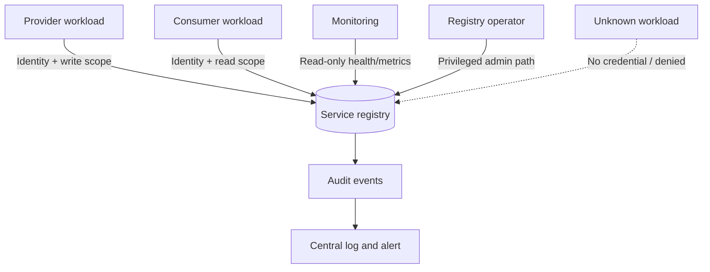

# Securing the Service Registry and Testing Unauthorized Registrations

The service registry is part of the microservices control plane. If an unauthorized party can register fake instances, tamper with metadata, read topology, or delete valid registrations, consumers can be routed to untrusted endpoints or lose the ability to locate services. Therefore, the registry must be protected as infrastructure with identity, authentication, authorization, encrypted transport, and auditing.

This practice focuses on Spring Cloud Service Discovery with Eureka, Consul, and ZooKeeper. We will define a threat model, separate provider/consumer/operator permissions, configure appropriate protection layers for each registry, validate registration data, and write negative tests proving unauthorized requests are rejected. All experiments must run against dedicated test registries/containers—never send fake registrations to shared or production environments.

## 1. Why Must the Registry Be Protected?

The registry holds the information consumers use to find call targets. An unauthorized registration creates several risks:

- **Service spoofing:** registering a fake instance under a valid service ID so consumers pick a rogue host/port.
- **Metadata poisoning:** altering zone, version, protocol, or capabilities so LoadBalancer chooses the wrong instance.
- **Unauthorized deregistration:** deleting real instances, causing traffic disruption.
- **Topology disclosure:** reading service lists, internal addresses, ports, and system metadata.
- **Endpoint abuse:** advertising disallowed addresses or arbitrary health check endpoints to turn the registry into a redirector toward unintended systems.
- **Credential compromise:** using shared tokens or passwords to write/delete across multiple services.
- **Control-plane denial of service:** flooding registrations, creating excessive znodes, or sending overloading requests.

An internal network should never be treated as an authentication mechanism. A workload inside the same VPC, cluster, or subnet can still be compromised. The registry must verify the client's identity and strictly limit which operations that client is permitted to perform.

## 2. Threat Model and Trust Boundaries

Before configuring, determine who needs registry access and why:

| Actor | Legitimate Need | Suggested Least Privilege |
| --- | --- | --- |
| Provider application | Register, update health/metadata, and deregister its own instances | Write scoped by service identity or path |
| Consumer application | Look up required services/instances and health | Read on permitted services |
| Registry operator | Administer nodes, policies, ACLs, backups, and recovery | Separate admin privileges, used via operational procedures |
| Monitoring agent | Read health/metrics | Read-only on necessary endpoints |
| CI test identity | Create and delete data in test namespace/service prefix | Permissions restricted to the test area |
| Unknown workload | No access needed | Disallowed from connecting or rejected |



Separating permissions by actor prevents a single leaked credential from reading topology, registering services, and deleting instances simultaneously. Administrative credentials must never be embedded in every Spring Boot application.

## 3. Required Layers of Protection

A secure design typically combines multiple complementary layers:

1. **Network segmentation:** only authorized workloads and operators can reach registry ports; never expose the registry API to the public Internet.
2. **TLS:** encrypt traffic and verify server identity; use mTLS when client certificate verification is also required.
3. **Authentication:** accurately identify the connecting workload or operator.
4. **Authorization:** restrict allowed services, namespaces, paths, and operations.
5. **Registration validation:** validate service ID, instance ID, host, port, metadata, and health endpoint before accepting.
6. **Secret management:** issue, rotate, and revoke credentials; never commit tokens/passwords to repositories.
7. **Audit and monitoring:** record registrations, deregistrations, ACL denials, and policy changes.
8. **Rate/resource limits:** cap requests, registration counts, connections, and payload sizes.

TLS does not replace authorization. A client holding a valid certificate still must not freely register arbitrary services. Conversely, ACLs do not encrypt traffic; tokens sent over unencrypted HTTP can be stolen in transit.

## 4. Standardizing Service Identity and Registration Data

A registration requires a clear identity and scope:

```json
{
  "serviceId": "inventory-service",
  "instanceId": "inventory-prod-zone-a-01",
  "host": "10.20.1.15",
  "port": 8081,
  "metadata": {
    "environment": "production",
    "zone": "zone-a",
    "version": "2.4.1"
  }
}
```

This is an illustrative logical model, not a mandatory payload for every provider. Before accepting a registration, policy should verify:

- Does the service ID belong to the list of services owned by that workload?
- Is the instance ID unique within the service scope?
- Does the host belong to an allowed subnet, DNS suffix, or network zone?
- Is the port within the range declared for that workload?
- Does the metadata match schema and size limits?
- Are environment/version/zone sourced from a trusted authority?
- Is the health check path/URL on the allowlist?

Do not trust metadata fields simply because the client sent them. If `environment=production` or `zone=trusted` affects routing, derive those values from workload identity, deployment platform, or a policy server rather than letting clients declare them arbitrarily.

In particular, do not let clients register arbitrary health check URLs if an agent will actively call them. An arbitrary URL can trick the agent into probing unintended internal endpoints. Use standardized paths/ports constrained by service policy.

## 5. Separating Permissions for Provider, Consumer, and Operator

Create distinct identities for each role:

| Identity | Permitted | Not Permitted |
| --- | --- | --- |
| `inventory-provider` | Register/update/deregister instances belonging to `inventory-service` | Write `payment-service`, edit ACLs, or read admin secrets |
| `checkout-consumer` | Read lists of services it needs to call | Register or deregister instances |
| `registry-monitor` | Read necessary health/status/metrics | Write registrations or modify policies |
| `registry-operator` | Administer registry per operational workflow | Used as default credential inside applications |
| `ci-discovery-test` | Write/delete resources in dedicated test scope | Touch production namespaces/services |

In practice, issue separate tokens per service or per workload instance depending on the platform's identity mechanism. Never share one `admin` token across all providers. If one workload is compromised, blast radius must remain confined to the services that workload owns.

## 6. Securing Eureka Server

Eureka must not be treated as self-protecting just because it runs on an internal network. Place the server on a private network, restrict ingress, enable HTTPS, and enforce authentication/authorization on the server or an appropriate gateway/service mesh layer.

Example basic Spring Security configuration for Eureka Server using HTTP Basic in a test or controlled internal network:

```java
import org.springframework.context.annotation.Bean;
import org.springframework.context.annotation.Configuration;
import org.springframework.security.config.Customizer;
import org.springframework.security.config.annotation.web.builders.HttpSecurity;
import org.springframework.security.web.SecurityFilterChain;

@Configuration
class EurekaSecurityConfiguration {

    @Bean
    SecurityFilterChain registrySecurity(HttpSecurity http) throws Exception {
        http
            .authorizeHttpRequests(auth -> auth
                .requestMatchers("/actuator/health").permitAll()
                .requestMatchers("/eureka/**").authenticated()
                .anyRequest().authenticated())
            .httpBasic(Customizer.withDefaults())
            // Eureka clients use machine-to-machine requests; scope CSRF
            // exemption to the registry API and keep authentication enabled.
            .csrf(csrf -> csrf.ignoringRequestMatchers("/eureka/**"));

        return http.build();
    }
}
```

This is an illustrative skeleton. Adjust paths to match your actual servlet context/server path, decide which endpoints may be public, and configure a `UserDetailsService`, password encoder, or appropriate identity mechanism. If the app uses sessions/cookies for a browser admin UI, evaluate CSRF separately; never disable CSRF application-wide just so Eureka clients can register.

Eureka clients must send appropriate credentials to the server. If your client mechanism supports Basic authentication via URL or HTTP client configuration, fetch secrets from a secret manager/environment injection and avoid logging resolved URLs since they may contain user-info. For stronger requirements, terminate TLS/mTLS at an ingress or service mesh with policies verifying client identity.

Points to check:

- Server accepts traffic only from permitted subnets/workloads.
- Client and server verify certificates/hostnames; never disable trust validation.
- Registration endpoints are not anonymous.
- Read and write permissions are separated if deployment supports policies at gateway/security layers.
- Actuator endpoints do not inadvertently expose registry reads or configuration.
- When Spring Security is enabled, test real POST registrations; CSRF may return `403` if machine-to-machine endpoints are misconfigured.

Eureka OSS does not offer a rich service-identity ACL model like Consul ACLs. If per-service write authorization is needed, enforce policies at a gateway/proxy or add a security layer; verify through testing that a client can register only its assigned service.

## 7. Securing Consul with ACL Tokens

Consul provides ACL policies and tokens. This is where service registration, catalog/health reads, and administration should be separated. When ACLs are enabled, create distinct tokens per workload and grant only the required policies.

Example writer policy allowed to manage only one service:

```hcl
service "inventory-service" {
  policy = "write"
}

node_prefix "" {
  policy = "read"
}
```

Example consumer policy restricted to reading service catalog/health and node metadata:

```hcl
service "inventory-service" {
  policy = "read"
}

node_prefix "" {
  policy = "read"
}
```

Specific policies must be reviewed against your Consul version, namespace/partition, and APIs used by the application. If a writer also needs read access or a consumer may read only certain services, narrow rules by service/namespace accordingly. Never grant `operator` or bootstrap tokens to applications.

Spring Cloud Consul provides properties for supplying tokens; example injecting a token via environment variable:

```yaml
spring:
  cloud:
    consul:
      host: ${CONSUL_HOST:consul-agent}
      port: ${CONSUL_PORT:8500}
      token: ${CONSUL_HTTP_TOKEN}
      scheme: https
      discovery:
        enabled: true
        register: true
        service-name: inventory-service
```

Properties and TLS options must match the Spring Cloud Consul version in use. Tokens must be injected from a secret store, never hardcoded in `application.yml`, Docker images, CI logs, or shell history. With agent-based registration, clarify whether the token is used by the application or the agent and avoid unintentionally granting overly broad permissions at both layers.

Test scenarios:

- Writer token can register `inventory-service`.
- Writer token cannot register `payment-service`.
- Reader token can look up permitted services but cannot register.
- Without a token, protected APIs return an authorization error.
- Revoked tokens can no longer perform new operations.
- Agent health checks work with configured permissions and endpoints.

## 8. Securing ZooKeeper and Curator with ACLs

ZooKeeper stores the registry in a znode tree. If ACLs are misconfigured, a client can read or alter nodes it does not own. Define ACLs for root paths, service paths, and instance nodes, while separating writer credentials from readers.

Common ZooKeeper permissions:

| Permission | Meaning |
| --- | --- |
| `READ` | Read node data and list children |
| `WRITE` | Update node data |
| `CREATE` | Create child nodes |
| `DELETE` | Delete child nodes |
| `ADMIN` | Modify a node's ACL |

Consumers typically need only `READ` on service paths. Providers need `CREATE`/`WRITE`/`DELETE` within their assigned registration subtree and should not have `ADMIN` across the entire tree. Only operators manage ACLs and root paths.

With Curator, authentication and an ACL provider can be configured when building the client. Illustrative example creating a digest identity and path ACLs:

```java
import java.nio.charset.StandardCharsets;
import java.util.List;

import org.apache.zookeeper.ZooDefs;
import org.apache.zookeeper.data.ACL;
import org.apache.zookeeper.data.Id;
import org.apache.zookeeper.server.auth.DigestAuthenticationProvider;
import org.apache.curator.framework.CuratorFramework;
import org.apache.curator.framework.CuratorFrameworkFactory;
import org.apache.curator.framework.api.ACLProvider;
import org.apache.curator.retry.ExponentialBackoffRetry;

String writerCredential = readSecret("ZK_REGISTRY_WRITER");
String writerDigestId = DigestAuthenticationProvider.generateDigest(writerCredential);

ACL writerAcl = new ACL(
        ZooDefs.Perms.READ | ZooDefs.Perms.CREATE |
        ZooDefs.Perms.WRITE | ZooDefs.Perms.DELETE,
        new Id("digest", writerDigestId));

ACL readerAcl = new ACL(
        ZooDefs.Perms.READ,
        new Id("digest", DigestAuthenticationProvider.generateDigest(
                readSecret("ZK_REGISTRY_READER"))));

CuratorFramework client = CuratorFrameworkFactory.builder()
        .connectString(System.getenv("ZOOKEEPER_CONNECT"))
        .retryPolicy(new ExponentialBackoffRetry(500, 5))
        .authorization("digest", writerCredential.getBytes(StandardCharsets.UTF_8))
        .aclProvider(new ACLProvider() {
            @Override
            public List<ACL> getDefaultAcl() {
                return List.of(writerAcl, readerAcl);
            }

            @Override
            public List<ACL> getAclForPath(String path) {
                return getDefaultAcl();
            }
        })
        .build();
```

This is an illustrative example for Curator, not automatic configuration applied to every Spring Cloud Zookeeper starter. `readSecret(...)` represents a helper fetching secrets from an application-supplied secret manager. With digest ACLs, verify scheme, identity format, and permissions on parent paths too; validate with integration tests on your exact ZooKeeper/Curator versions. In real systems, use identities and authentication mechanisms supported by your organization, such as SASL/Kerberos where appropriate.

Important notes:

- Configure ACLs on the root znode before providers create child nodes.
- Never use `OPEN_ACL_UNSAFE` for registries holding production data.
- Never grant `ADMIN` or `CREATE/DELETE` across the entire root to consumers.
- Close Curator clients cleanly per lifecycle and never log credentials.
- Inspect ACLs of existing nodes; changing `ACLProvider` does not retroactively update ACLs on older znodes.

## 9. TLS, mTLS, and Endpoint Verification

TLS protects data in transit and verifies server certificates. mTLS adds client certificates so the server verifies workloads. Whether using tokens or Basic auth, use HTTPS/TLS so credentials never traverse the network in readable form.

TLS Checklist:

- Certificates are valid and SANs match the hostname used by clients.
- Truststore contains only trusted CAs.
- Clients never use trust-all or bypass hostname verification.
- Private keys are stored in a secret store or protected keystore.
- Certificate rotation includes an overlap window to avoid outages.
- Unencrypted HTTP endpoints are blocked or restricted to loopback/test networks.
- Alerts fire before certificates expire.

If TLS terminates at a reverse proxy, the proxy must authenticate the client and pass trusted identity to the registry using a mechanism clients cannot spoof externally. Never trust an arbitrary `X-Client-Identity` header unless the proxy strips caller-supplied headers and sets it itself.

## 10. Validating Registrations at the Application or Gateway Layer

Authentication proves who the client is; authorization defines what the client may do; validation checks whether the registration data itself is valid. All three are required.

Internal policy example:

```java
import java.util.List;
import java.util.Set;

import org.springframework.security.access.AccessDeniedException;

public record RegistrationPolicy(
        String allowedServiceId,
        List<String> allowedHostSuffixes,
        int minPort,
        int maxPort,
        Set<String> allowedMetadataKeys
) {}

public void validateRegistration(
        RegistrationRequest request,
        WorkloadIdentity identity,
        RegistrationPolicy policy) {

    if (!policy.allowedServiceId().equals(request.serviceId())) {
        throw new AccessDeniedException("Service identity is not allowed");
    }

    if (!identity.ownsService(request.serviceId())) {
        throw new AccessDeniedException("Workload does not own this service");
    }

    if (!isAllowedHost(request.host(), policy.allowedHostSuffixes())) {
        throw new AccessDeniedException("Advertised host is outside the allowed scope");
    }

    if (request.port() < policy.minPort() || request.port() > policy.maxPort()) {
        throw new IllegalArgumentException("Port is outside the allowed range");
    }

    if (!policy.allowedMetadataKeys().containsAll(request.metadata().keySet())) {
        throw new IllegalArgumentException("Registration contains unsupported metadata");
    }
}

// Implement with parsed hostnames and exact DNS-label boundaries, or CIDR checks for IPs.
private boolean isAllowedHost(String host, List<String> allowedSuffixes) {
    return hostMatchesAnAllowedSuffixOrNetwork(host, allowedSuffixes);
}
```

This is policy-adapter pseudocode; `RegistrationRequest`, `WorkloadIdentity`, and `AccessDeniedException` are internal models/exceptions. Checking host suffixes must parse hostnames and compare exact DNS-label boundaries—never use a naive `endsWith()` that could accept `trusted.example.attacker.invalid`. For IPs, validate CIDR ranges and matching network policies.

Never accept a service ID, instance ID, or metadata that can override workload identity without verifying ownership. A workload should only register service IDs assigned to it.

## 11. Auditing Registrations and Policy Changes

Every critical write operation should emit a traceable audit event:

| Event | Required Fields |
| --- | --- |
| `registry.registration.accepted` | actor identity, service ID, instance ID, provider, timestamp, request ID |
| `registry.registration.denied` | actor identity, requested service ID, reason code, source network |
| `registry.registration.updated` | actor, service/instance ID, changed fields, old/new revision |
| `registry.registration.deregistered` | actor, service/instance ID, reason |
| `registry.acl.denied` | actor, resource path/service, operation, provider |
| `registry.credential.rotated` | identity/token ID, timestamp, operator/change ticket |
| `registry.policy.changed` | policy ID, actor, revision, approved change reference |

Never log tokens, passwords, private keys, Authorization headers, or full request bodies if metadata might contain secrets. You can log non-sensitive fingerprints/token IDs to trace which credential was used.

Alerts should detect:

- An identity registering an out-of-scope service ID.
- A workload spawning an abnormal spike in instance counts.
- Repeated `401`/`403` errors from a single source.
- Registrations from unexpected subnets or certificates.
- Changes to critical metadata such as version, zone, or advertised address.
- Credentials still used after rotation/revocation.

## 12. Hands-On Lab: Creating Identities and Verifying Permissions

Run the lab on a dedicated Consul, Eureka, or ZooKeeper container. Use test service names and test credentials; never use production tokens or shared registries.

### Step 1: Prepare an Isolated Registry

Start a test registry that can be deleted afterward. Record its endpoint, version, and how to inspect the catalog/registrations. Set a unique `runId` so all test service IDs and resources are clearly identifiable.

### Step 2: Create Three Roles

- `provider-writer`: allowed only to register `inventory-test-<runId>`.
- `consumer-reader`: allowed only to read test services.
- `registry-operator`: creates policies and revokes credentials, used only in admin steps.

Do not grant operator credentials to application processes.

### Step 3: Test the Happy Path

1. Provider uses the writer identity to register a valid instance.
2. Consumer uses the reader identity to look up the service.
3. Confirm `ServiceInstance` has the expected host/port/metadata.
4. Provider updates health or metadata within permitted bounds.
5. Provider deregisters the instance it created.

### Step 4: Test Unauthorized Registrations

Run the following cases against the test registry:

| Test Case | Identity Used | Expected Outcome |
| --- | --- | --- |
| Register without credentials | Anonymous | Rejected (`401`/`403` or `NoAuth`) |
| Consumer reader attempts registration | Read-only | Rejected |
| Provider A registers Provider B's service | Wrong-scope writer | Rejected |
| Provider alters forbidden metadata | Writer lacking permission for that field | Rejected or validation failure |
| Consumer attempts to deregister instance | Read-only | Rejected |
| Client presents untrusted certificate | Invalid TLS identity | Handshake rejected |
| Revoked token attempts write again | Revoked identity | Rejected |

### Step 5: Verify Zero Side Effects

After each negative test, inspect the catalog/tree to ensure no unauthorized instance exists. Do not assert only HTTP status; a proxy might return `2xx` for a queued request or an API might return a different status while still persisting data. Always inspect registry state after the operation.

### Step 6: Cleanup

Deregister the test service/instance, revoke test tokens if needed, and stop the container. Confirm no registrations or znodes belonging to `runId` remain.

## 13. Negative Testing with Consul HTTP API

Consul ACLs can be tested directly against the agent API in integration tests. The following shell example illustrates calling the registration API without a token; run it against a Consul test endpoint started by your test suite:

```bash
curl -i -X PUT \
  "http://127.0.0.1:8500/v1/agent/service/register" \
  -H "Content-Type: application/json" \
  --data '{"Name":"inventory-test-negative","ID":"negative-01","Address":"127.0.0.1","Port":8081}'
```

When ACLs are enabled and the endpoint requires write permission, an anonymous request must be rejected. Exact status codes depend on ACL config/API version; assert the unauthorized/forbidden response class per your test environment's contract.

With a read-only token, repeat the request passing the `X-Consul-Token` header containing the test reader token. It must still be rejected because the reader lacks `service:write`. Never embed literal tokens in commands or print commands containing tokens into CI logs.

After the negative test, call the health/catalog API with the reader identity to confirm `inventory-test-negative` does not appear. If the service appears, your policy or registration path is overly permissive.

## 14. Negative Testing for Eureka

With Spring Security enabled on Eureka Server:

- Send a registration request to `/eureka/apps/{APP}` without credentials; verify the server rejects it.
- Send a request with invalid credentials; verify no instance is created.
- Send a request with valid credentials; verify registration is accepted.
- If a gateway/service-identity policy is deployed, attempt to register an out-of-scope application name and verify it is blocked.
- Use an authorized read API to confirm no instance exists from rejected requests.

Eureka OSS lacks default service-level ACLs like Consul. Thus, if the server uses a single shared Basic Auth user for all clients, testing verifies authentication but does not prove Provider A cannot register Provider B's application. To test per-service authorization, enforce policies at a gateway/proxy or an extra security layer that identifies workloads and validates service IDs.

When testing with Spring Security, distinguish `401` (authentication) from `403` (authorization/CSRF) and validation errors. A `403` caused by CSRF does not prove per-service ACLs are working.

## 15. Negative Testing for ZooKeeper/Curator

Create a dedicated root path in test ZooKeeper, e.g., `/tests/<runId>/services`. Assign writer ACLs to the test provider and read-only ACLs to the consumer.

Cases to test:

1. Unauthenticated client tries `create` child node; must receive `NoAuth`.
2. Reader identity tries `create`, `setData`, or `delete`; must receive `NoAuth`.
3. Writer creates a node inside its assigned root; operation succeeds.
4. Writer tries creating a node outside its assigned root; must be rejected.
5. Reader reads a permitted node; succeeds.
6. Reader tries altering ACLs with `setACL`; must be rejected.

JUnit example illustrating a permission denial assertion:

```java
assertThatThrownBy(() -> readerClient.create()
        .creatingParentsIfNeeded()
        .forPath(testRoot + "/unauthorized-instance", new byte[0]))
    .hasRootCauseInstanceOf(KeeperException.NoAuthException.class);
```

Client names and test roots must be created in a dedicated fixture. When testing ACLs, do not let `creatingParentsIfNeeded()` accidentally create parents with an overly privileged client; provision the root using an operator fixture first, then run negative tests with the reader client.

## 16. Writing Repeatable Integration Tests

A test should generate a unique service ID instead of sharing `inventory-service` with other tests:

```java
@Test
void readOnlyIdentityCannotRegisterService() {
    String serviceId = "inventory-test-" + UUID.randomUUID();

    assertThatThrownBy(() -> registryClientForReader.register(
            serviceId,
            "instance-" + UUID.randomUUID(),
            "127.0.0.1",
            8081))
        .isInstanceOf(RegistryAccessDeniedException.class);

    await().atMost(Duration.ofSeconds(3)).untilAsserted(() ->
            assertThat(registryReader.findInstances(serviceId)).isEmpty());
}
```

`registryClientForReader`, `RegistryAccessDeniedException`, and `registryReader` are test-suite abstractions/helpers. Specific providers may throw different exceptions; adapters should normalize authorization errors while preserving the underlying cause for investigation.

Tests must clean up in `finally` or an `AutoCloseable` fixture, even when assertions fail. Test data should carry `runId` so cleanup stays scoped without deleting registrations from parallel test runs.

## 17. Credential Rotation and Revocation

Long-lived shared credentials increase impact when leaked. Instead:

- Issue distinct tokens/certificates per workload or service.
- Set TTL/expiration where supported by the provider.
- Rotate with overlap: issue new credentials, update workloads, verify operation, then revoke old credentials.
- Immediately revoke compromised credentials and identify any registrations/operations performed during the exposure window.
- Verify old tokens can no longer read/write after revocation.
- Never write secrets into logs or tickets; record only credential IDs/fingerprints.

With Consul, you can create a new token attached to the same policy and switch workloads before revoking the old token. With ZooKeeper, existing znode ACLs/identities may need updating; changing client config does not automatically rewrite old znode ACLs. With Eureka, changing Basic Auth/certificate credentials must be coordinated across server and clients to avoid cutting off all providers from renewing or fetching.

## 18. Monitoring and Detecting Abnormal Registrations

Monitor these metrics and events:

| Signal | What to Detect |
| --- | --- |
| Registration success/failure by actor | Identity failing to register or rising auth errors |
| Instance count per service | Abnormal spike or quota breach |
| ACL denied/401/403/NoAuth | Invalid credentials or out-of-bounds behavior |
| Non-allowlisted Service ID | Attempts to register out-of-scope services |
| Metadata changes | Version/zone/address modified outside release process |
| Registration source network | Requests from unfamiliar subnets or workloads |
| Token/certificate expiry | Approaching expiration or old credentials still in use |
| Deregistration events | Instances removed outside normal lifecycle |

Audit logs should include actor, service ID, instance ID, provider, operation, result, reason code, and correlation ID. Never log credentials or full Authorization headers.

Alerts should reduce false positives by separating normal retries from repeated anomalous behavior. For example, a single `403` during token rotation may be a config slip; hundreds of attempts to register out-of-scope services from one workload warrants investigation.

## 19. Responding to Unauthorized Registrations

When detecting an instance not belonging to a legitimate workload:

1. Record service ID, instance ID, provider, timestamp, actor identity, and request source.
2. Block or revoke the associated credential/identity per incident response procedures.
3. Verify whether the registration was picked by consumers or received traffic.
4. Deregister only the unauthorized instance; do not delete the whole service or namespace before confirming ownership.
5. Check whether metadata/health endpoints were altered and whether any consumer called that endpoint.
6. Rotate affected credentials and audit permissions of peer workloads.
7. Review audit logs to determine onset time and blast radius.
8. Re-run negative tests after fixing policies.

If you suspect a rogue endpoint received traffic, treat it as a routing/security incident: inspect network flows, request logs, and any sensitive data that may have been sent there. Do not just delete the registration and consider the incident closed.

## 20. Common Misconfigurations

| Practice | Risk | Fix |
| --- | --- | --- |
| Relying solely on a private network | Compromised workload can still write to registry | Authenticate and authorize every workload |
| Using one admin token for all services | One leaked token can modify/delete entire catalog | Separate tokens/policies by service and role |
| Enabling TLS without ACLs | Any client with a valid cert can over-write | Enforce authorization by service identity |
| Consul token with `operator`/broad privileges | Provider can administer the cluster | Service-scoped policies and read-only consumers |
| ZooKeeper using `OPEN_ACL_UNSAFE` | Unauthenticated clients can read/write znodes | Path-specific ACLs and authentication |
| Anonymous Eureka endpoints | Any reachable client can register | Security layer, network policy, and TLS |
| Disabling CSRF app-wide so Eureka registers | Expands attack surface for other endpoints | Scope CSRF exemption strictly to machine-to-machine APIs |
| Trusting client-sent metadata | Poisoning of zone/version/environment | Validate and derive identity from trusted sources |
| Allowing arbitrary health URLs | Registry agent can be tricked into probing unintended endpoints | Allowlist health paths/hosts/ports |
| Logging tokens for debugging | Credentials leaked via logging platform | Log identity/token IDs, redact secrets |
| Negative tests asserting only HTTP status | Requests might still cause side effects | Inspect catalog/tree after the operation |
| Testing on shared registries | Can create or delete real data | Isolated test registries/containers and unique run IDs |

## 21. Practice Completion Checklist

- [ ] Registry opens network paths only to required workloads/operators.
- [ ] TLS is enabled and certificates/hostnames are verified.
- [ ] Provider, consumer, monitor, and operator use separate identities.
- [ ] Provider has write permission only for its assigned service identity.
- [ ] Consumer has read permission only for needed services.
- [ ] Credentials do not appear in source code, images, or logs.
- [ ] Registrations validate service ID, instance ID, host, port, and metadata.
- [ ] Eureka endpoints are protected by a security layer; authentication and authorization are tested separately.
- [ ] Consul ACL tokens/policies are scoped by service and role.
- [ ] ZooKeeper root/paths enforce ACLs; `OPEN_ACL_UNSAFE` is never used in production.
- [ ] Audit events exist for registration, update, deregistration, and ACL denial.
- [ ] Negative tests cover anonymous access, read-only write attempts, and wrong service scope.
- [ ] After negative tests, confirmed the registry holds no unauthorized registrations.
- [ ] Tested invalid TLS certificates and revoked tokens/certificates.
- [ ] Credential rotation and incident response have been rehearsed.
- [ ] All tests run against isolated registries and clean up test-created resources properly.

A secure registry must verify both identity and permissions for every operation. Separate provider writers, consumer readers, and operators; use TLS to protect transit; use ACLs or a security layer to constrain service identities; validate registration payloads before acceptance; and audit every change. Negative tests are meaningful only when both the request is rejected and the catalog/tree state is verified unchanged. Executing these steps against an isolated test registry proves legitimate clients can do their jobs while unauthorized clients cannot register, modify, or delete services outside their granted scope.
