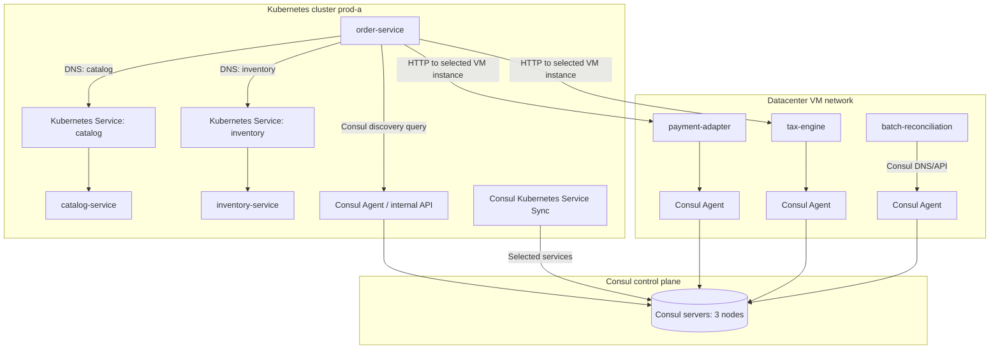
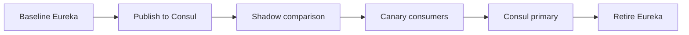

# Designing a Discovery Solution for a Hypothetical System and Explaining Trade-Offs

Service discovery design does not begin by picking Eureka or Consul. First you must determine where workloads run, which providers consumers need to find, what the network boundaries look like, who manages instance lifecycles, and how much registry update latency the system tolerates. A good solution usually applies the simplest mechanism for each scope while adding a centralized registry only when discovery needs cross that boundary.

This practice designs a solution for a hypothetical e-commerce platform with workloads running on Kubernetes alongside legacy systems running on VMs. We will choose discovery mechanisms per communication flow, describe registration/health/lookup, handle errors and migration, and explain the architectural trade-offs.

## 1. Problem Statement: The ShopNow Platform

ShopNow is an online retail platform with the following components:

| Component | Where It Runs | Role |
| --- | --- | --- |
| `order-service` | Kubernetes cluster `prod-a` | Receives and manages orders. |
| `catalog-service` | Kubernetes cluster `prod-a` | Returns product information. |
| `inventory-service` | Kubernetes cluster `prod-a` | Checks and updates stock levels. |
| `payment-adapter` | VM in datacenter | Adapter connecting to a legacy payment system. |
| `tax-engine` | VM in datacenter | Calculates taxes via a legacy application. |
| `batch-reconciliation` | VM in datacenter | Payment reconciliation, needs to call several services in Kubernetes. |

Operational constraints:

- Most synchronous requests among `order`, `catalog`, and `inventory` run within the same Kubernetes cluster.
- `order-service` needs to call `payment-adapter` and `tax-engine` on VMs.
- `batch-reconciliation` on a VM needs to call a controlled exposed endpoint from Kubernetes.
- Pod IPs change; VMs have more stable addresses yet can still change during maintenance.
- Services require health checks, load balancing, TLS, authentication, and auditing.
- The registry must not become a mandatory dependency for every intra-cluster request when Kubernetes Service/DNS already suffices.
- Operations wants a shared catalog for workloads outside Kubernetes and cross-runtime connections.

The design goal is finding the right instance by service ID, excluding unhealthy instances from the candidate set, avoiding advertising non-routable addresses, and enabling gradual migration from legacy systems.

## 2. Requirements Analysis Before Choosing Technology

### 2.1. Provider and Consumer Matrix

| Provider | Consumer | Network Scope | Recommended Discovery Mechanism |
| --- | --- | --- | --- |
| `catalog-service` in Kubernetes | `order-service` in same cluster | Intra-cluster | Kubernetes Service + DNS. |
| `inventory-service` in Kubernetes | `order-service` in same cluster | Intra-cluster | Kubernetes Service + DNS. |
| `payment-adapter` on VM | `order-service` in Kubernetes | Cross-runtime | Consul Catalog/Health via Spring Cloud Consul DiscoveryClient. |
| `tax-engine` on VM | `order-service` in Kubernetes | Cross-runtime | Consul Catalog/Health via Spring Cloud Consul DiscoveryClient. |
| Kubernetes endpoint | `batch-reconciliation` on VM | Cross-runtime | Consul catalog via an advertised routable gateway/endpoint address. |

### 2.2. Non-Functional Requirements

| Requirement | Necessary Design Decisions |
| --- | --- |
| Availability | Multi-server registry cluster; bounded consumer timeouts and retries; applications do not depend on an external registry for requests with stable intra-cluster routes. |
| Freshness | Defined health check/registration intervals; appropriate cache TTLs; measured convergence times. |
| Scalability | Discovery queries do not trigger polling storms; cap synced service/metadata counts. |
| Security | TLS, Consul ACLs, Kubernetes RBAC, secret manager, and network segmentation. |
| Operability | Metrics for registered/healthy counts, lookup outcomes, snapshot age, health checks, and alerts. |
| Migration | Parallel operation allowed during transition, but only one source has authority over traffic at a time. |

## 3. Comparing Options

Before finalizing the architecture, compare four common options.

| Option | Strengths | Limitations in the ShopNow Problem |
| --- | --- | --- |
| Kubernetes Service + DNS | Built into the cluster, integrates selectors, EndpointSlices, and readiness, minimal extra components to operate. | Does not automatically provide a shared catalog for VMs and external runtimes. |
| Spring Cloud Kubernetes | Preserves `DiscoveryClient` abstraction, reads Kubernetes Services/endpoints via Kubernetes API. | Requires ServiceAccount/RBAC and API access; does not solve discovery of VMs outside the cluster. |
| Eureka | Integrates well with Spring Cloud apps already using Eureka; includes client cache, heartbeats, and peer registry. | Adds a separate registry when Kubernetes already has Service/DNS; managing VMs and K8s together requires extra integration/sync. |
| Consul | Catalog and health checks can span VMs and Kubernetes via agents/service sync; supports ACLs and multi-datacenter architectures. | Adds control plane, quorum, ACLs, TLS, agents, service sync, and operational cost. |

### 3.1. Chosen Solution

Choose the **Kubernetes-native for intra-cluster traffic, Consul for cross-runtime catalog** model:

1. `order-service` calls `catalog-service` and `inventory-service` using Kubernetes Service DNS.
2. `payment-adapter` and `tax-engine` on VMs register into Consul with health checks.
3. `order-service` uses Spring Cloud Consul `DiscoveryClient` and Spring Cloud LoadBalancer when calling VM service IDs.
4. Consul Kubernetes Service Sync exports only selected Kubernetes Services to Consul when external workloads need to find them.
5. Addresses advertised to out-of-cluster consumers must be routable, such as a private gateway or mesh gateway endpoint; never push ClusterIPs/Pod IPs unreachable from VMs into the catalog expecting VMs to call them.

Do not add Eureka into the new architecture because it introduces a second registry without solving any requirement left unmet by Consul/Kubernetes. If the existing system already runs Eureka, keep it during a controlled migration, shadow-read, and migrate consumers in waves; never union both lists by default.

## 4. Overall Architecture



The diagram shows two distinct paths:

- Intra-cluster traffic traverses Kubernetes Services and DNS.
- Cross-runtime traffic uses Consul to discover VM addresses or safely exposed endpoints.

Consul servers do not sit in the data path of every request. Consumers can cache the instance list and call providers directly; the registry primarily serves registration, health, and discovery refresh.

## 5. Designing the Consul Control Plane

### 5.1. Server Cluster

Deploy three Consul servers across three distinct failure domains/AZs within the same logical datacenter. With three servers, Raft quorum is two; losing one server leaves a majority intact. Never place all three servers on the same host or failure domain.

Consul client Agents run on VMs and integrate with Kubernetes service sync/controllers per deployment topology. Agents handle local service/check registration and communicate with the server cluster. Never use a single Consul server for production HA.

### 5.2. Catalog Scope

Place only services needing cross-runtime communication into Consul:

- `payment-adapter`.
- `tax-engine`.
- Selected Kubernetes endpoints meant to be called by VM consumers.

Do not sync every Kubernetes Service by default. Use namespace/label allowlists, naming conventions, and ownership rules to govern which services are exported. Intra-cluster services like `catalog-service` can stay solely on Kubernetes DNS if they have no external consumers.

### 5.3. Service and Instance Identification

Canonical service ID convention:

```text
<environment>-<domain>-<service>

production-commerce-payment-adapter
production-commerce-tax-engine
production-commerce-order-public-api
```

Each instance has a unique ID:

```text
payment-adapter-vm-07
tax-engine-vm-02
```

Metadata carries only non-sensitive routing/operational attributes:

```yaml
meta:
  environment: production
  region: hcm-dc1
  network-view: datacenter-private
  version: v3
```

Never place passwords, tokens, connection strings, or personal data in service names, tags, or metadata. If the same service exists in staging and production, isolate scopes so consumers cannot mix environments.

## 6. Configuring Providers Running on VMs

Example `tax-engine` using Spring Cloud Consul Discovery. The application connects to its nearby Consul Agent; the Agent registers the instance and executes health checks.

```yaml
spring:
  application:
    name: tax-engine
  cloud:
    consul:
      host: ${CONSUL_AGENT_HOST:127.0.0.1}
      port: ${CONSUL_AGENT_PORT:8500}
      discovery:
        register: true
        service-name: production-commerce-tax-engine
        instance-id: ${DISCOVERY_INSTANCE_ID}
        prefer-ip-address: true
        health-check-path: /actuator/health/readiness
        health-check-interval: 10s

management:
  endpoints:
    web:
      exposure:
        include: health
  endpoint:
    health:
      probes:
        enabled: true
      show-details: never
```

Operational details accompanying this configuration:

- `DISCOVERY_INSTANCE_ID` must be unique and stable for the instance's lifetime.
- The readiness endpoint must be exposed on the network used by Consul Agent.
- Consul Agent and the provider must have mutual routing; if the Agent runs on another VM, verify firewalls and advertised addresses.
- Configure ACL tokens and TLS via a secret source/Consul Agent appropriately; never commit tokens to YAML.
- Health check intervals, timeouts, and deregistration policies must align with SLOs and failure detection targets.

If a service is not Spring Boot, register it via a Consul Agent service definition or API using an appropriate HTTP/TCP/script/TTL check. The principle is that health checks must reflect genuine serving ability, not merely process existence.

## 7. Configuring Consumers Running in Kubernetes

`order-service` uses Kubernetes DNS for `catalog-service`/`inventory-service`, yet needs Consul DiscoveryClient for VM services.

Maven dependencies must include Spring Cloud Consul Discovery and LoadBalancer, with versions managed by a Spring Cloud BOM compatible with Spring Boot:

```xml
<dependency>
    <groupId>org.springframework.cloud</groupId>
    <artifactId>spring-cloud-starter-consul-discovery</artifactId>
</dependency>
<dependency>
    <groupId>org.springframework.cloud</groupId>
    <artifactId>spring-cloud-starter-loadbalancer</artifactId>
</dependency>
```

The consumer does not need to register itself in Consul when Kubernetes Service/DNS serves intra-cluster workloads:

```yaml
spring:
  application:
    name: order-service
  cloud:
    consul:
      host: ${CONSUL_AGENT_HOST}
      port: ${CONSUL_AGENT_PORT:8500}
      discovery:
        register: false
        query-passing: true
```

`CONSUL_AGENT_HOST` must resolve and be reachable from the Pod. You can use a platform-supported internal Consul Agent/endpoint; secure the API with TLS and ACLs. Never let Pods reach an unauthenticated Consul endpoint over public networks.

`query-passing: true` instructs Spring Cloud Consul to return only instances with passing health checks to the consumer. This is a discovery-client setting; health check registration remains configured on the provider/Consul Agent.

### 7.1. Calling Services by Logical Name

Example `RestTemplate` with LoadBalancer:

```java
import org.springframework.cloud.client.loadbalancer.LoadBalanced;
import org.springframework.context.annotation.Bean;
import org.springframework.context.annotation.Configuration;
import org.springframework.web.client.RestTemplate;

@Configuration
public class HttpClientConfiguration {

    @Bean("consulRestTemplate")
    @LoadBalanced
    RestTemplate consulRestTemplate() {
        return new RestTemplate();
    }

    @Bean("clusterDnsRestTemplate")
    RestTemplate clusterDnsRestTemplate() {
        return new RestTemplate();
    }
}
```

Calling `tax-engine` by its service ID in Consul:

```java
TaxQuote quote = consulRestTemplate.getForObject(
        "http://production-commerce-tax-engine/api/quote?orderId={id}",
        TaxQuote.class,
        orderId
);
```

Spring Cloud LoadBalancer retrieves the instance list via DiscoveryClient, picks an instance, and replaces the logical host with the real address. If a service only has a single fixed endpoint or runs strictly inside Kubernetes, use appropriate client/DNS mechanics rather than adding unnecessary Consul lookups.

### 7.2. Intra-Cluster Call Path

For `catalog-service`, keep the call path simple:

```java
CatalogItem item = clusterDnsRestTemplate.getForObject(
        "http://catalog-service/api/items/{id}",
        CatalogItem.class,
        itemId
);
```

The two beans are explicitly separated: `consulRestTemplate` carries `@LoadBalanced` for cross-runtime service ID resolution via Consul; `clusterDnsRestTemplate` omits `@LoadBalanced` so the hostname `catalog-service` resolves directly via Kubernetes DNS. If you wish to use Spring Cloud LoadBalancer for intra-cluster traffic too, configure Kubernetes DiscoveryClient as the source and verify which implementation gets injected; avoid accidentally querying both Consul and Kubernetes for the same logical service.

## 8. Syncing Kubernetes Services to Consul

If `batch-reconciliation` on a VM needs to locate a Kubernetes endpoint, Consul Kubernetes Service Sync can publish a curated set of Services into the Consul Catalog.

Conceptual chart/controller configuration example:

```yaml
syncCatalog:
  enabled: true
  toConsul: true
  toK8S: false
```

Exact value names and allowlist/denylist options depend on your `consul-k8s` Helm chart version. Check the deployed chart schema before applying; never copy this snippet blindly without verifying versions.

More importantly, Service Sync only synchronizes service metadata. It does not automatically create network routes from VMs to ClusterIPs or Pod CIDRs. For services accessed from VMs:

1. Expose via a private LoadBalancer, ingress/gateway, or Consul service mesh/mesh gateway matching your network architecture.
2. Register the corresponding routable address into the catalog.
3. Restrict which consumers and ports may connect.
4. Test from the actual VM network, not solely from provider Pods.

Do not sync the same service into Consul through two mechanisms simultaneously (e.g., app self-registration plus service sync controller) without clear ownership/deduplication. That can produce duplicate registrations.

## 9. Health Checks and Readiness

Health checks must align with how traffic reaches the provider.

| Provider | Health Source | Condition for Candidate Inclusion |
| --- | --- | --- |
| `catalog-service` in Kubernetes | Pod readiness + EndpointSlice | Endpoint Ready via Kubernetes Service. |
| `inventory-service` in Kubernetes | Pod readiness + EndpointSlice | Endpoint Ready; readiness must reflect ability to serve requests. |
| `payment-adapter` on VM | Consul HTTP/TCP check | Check passing; consumer queries with health filter. |
| `tax-engine` on VM | Consul HTTP readiness check | Check passing and endpoint reachable from relevant networks. |
| Synced Kubernetes endpoint | Kubernetes Service/EndpointSlice plus service sync state | Check sync controller, routable address, and integration health semantics. |

Do not equate `Running` with `Ready`, or `Catalog registered` with `passing`. A VM service can remain registered with a critical check; a Pod can be Running while failing readiness.

Health checks must also reflect the proper network vantage point. If Consul Agent probes from the VM datacenter, the endpoint must be reachable from that Agent. If consumers sit on another network, add connectivity checks at the gateway or service mesh; a passing check does not prove every consumer has a route.

## 10. Security and Access Control

### 10.1. Consul

- Enable TLS for client-agent-server communication according to your topology.
- Use separate ACL tokens for service sync, provider registration, and consumer reads.
- Consumer policies need only read access to required catalog/health data; never grant write or admin rights.
- Providers may register only services/nodes within their permitted scope.
- Store tokens in a secret manager or protected Kubernetes Secrets; never put tokens in URLs, metadata, or logs.
- Protect Gossip encryption keys and restrict agent/server ports via network policies/firewalls.

### 10.2. Kubernetes

- Service Sync controller uses a dedicated ServiceAccount.
- RBAC grants read access strictly to Services/EndpointSlices and resources genuinely needing synchronization.
- Export only approved namespaces/labels.
- Never grant `cluster-admin` solely for discovery.
- Keep the API server private and never expose Consul admin endpoints to the Internet.

### 10.3. Service-to-Service

Discovery only supplies addresses. It does not replace authentication/authorization between `order-service` and `payment-adapter`. Use TLS/mTLS, workload identities, or OAuth2 client credentials appropriately; enforce business authorization at the provider. Never place bearer tokens into service metadata or query strings.

## 11. Error Handling and Recovery Strategies

### 11.1. Consul Temporarily Unreachable

Consumers must distinguish:

- Query succeeded with zero passing instances: empty result.
- Query timeout/5xx: registry path unavailable.
- Query returns old snapshot: stale data.
- 401/403/TLS error: identity, permission, or certificate issue.

Retry only transient errors with deadlines, exponential backoff, and jitter. If using stale snapshots, enforce short TTLs, health guards, and dedicated metrics; never use expired snapshots. For payment services, prefer failing fast / circuit breaking over calling an uncertain stale endpoint.

### 11.2. A VM Provider Crashes Abruptly

Consul health checks detect the non-passing check; consumers enabling `query-passing` drop the instance from the candidate set after the health check period plus refresh/cache delay. The catalog record may linger until deregistration policies clean it up. Measure the time from crash until consumers stop selecting the endpoint rather than assuming instantaneous removal.

### 11.3. Consul Loses One Server

With three servers, losing one leaves quorum intact. Monitor leader election, peer health, and query/registration errors. If quorum is lost, never treat writes as committed; consumers can use cached snapshots within policy bounds while alerting the control plane.

### 11.4. Kubernetes Service Has No Ready Endpoints

Check selectors/labels, readiness probes, EndpointSlices, and Pod events. Do not add a second registry to work around a broken selector. Fix the Kubernetes source first, then verify service sync reflects the updated state.

## 12. Rollout and Migration if Eureka Already Exists

If ShopNow currently runs Eureka, do not cut over all traffic and shut down Eureka in one shot. Execute in phases:

### Phase 1 — Baseline

- Keep Eureka as the active source of traffic.
- Measure registrations, health, lookup latency, request error rates, and snapshot age.
- Standardize service IDs, instance IDs, and metadata.

### Phase 2 — Controlled Dual Registration

- Select providers that need to appear in Consul.
- Register them in Consul via appropriate adapters or service sync.
- Keep Eureka as the traffic source; do not union the two lists.
- Monitor partial registrations and duplicates.

### Phase 3 — Shadow Read

- Consumers keep picking instances from Eureka.
- Observers read Consul in the background and compare canonical instance IDs, URIs, health, and metadata.
- Proceed only after parity stays above target thresholds over a sufficient window.

### Phase 4 — Canary

- Switch a low-risk consumer group to Consul.
- Monitor 5xx errors, timeouts, latency, selected instances, and health mismatches.
- Retain rollback capability to Eureka within an agreed window.

### Phase 5 — Primary Cutover and Retirement

- Migrate consumers in waves.
- Stop Eureka registrations once no dependent consumers remain.
- Deregister old records and check for leftover leases/ghost registrations.
- Remove Eureka dependencies/configs after confirming traffic and dashboards no longer use them.



## 13. Trade-Offs of the Chosen Design

No option is optimal for every system. Key trade-offs:

| Decision | Benefits | Costs / Risks | When Acceptable |
| --- | --- | --- | --- |
| Kubernetes DNS for intra-cluster | Simple, native, integrated readiness/EndpointSlices, minimal external control-plane dependencies | Not a multi-runtime catalog; DNS does not expose full metadata through `DiscoveryClient` | Workload and consumer reside in the same cluster. |
| Consul for VMs and cross-runtime | Single catalog for VMs and exported Kubernetes services; unified health/ACLs/metadata | Operating Consul cluster, Agents, ACLs, TLS, and sync controller | Genuine need exists across Kubernetes boundaries. |
| Omitting Eureka in the new architecture | One fewer registry and cache/peer/heartbeat layer to operate | Legacy apps tied to Eureka require migration | System lacks a Eureka ecosystem or has a migration roadmap. |
| No default union of two sources | Prevents duplicate candidates and health conflicts | During migration, consumers use one primary at a time | Shadow-read and canary work instead of needing a merged list. |
| `passing` health filter | Excludes instances failing checks | Periodic health checks may remove slowly or produce false negatives | Health endpoints are reliable and intervals fit SLOs. |
| Selective Consul service sync | VM consumers can locate specific K8s services | Must govern addresses, ownership, and network reachability | Export only services with external consumers. |

### 13.1. Why Not Use Eureka for Everything?

Eureka fits Spring Cloud ecosystems that already run Eureka clients/servers and rely on that registry model. Here, however, Kubernetes already manages intra-cluster Pods/Services, while Consul solves the VM catalog and service sync integration. Adding Eureka introduces extra registrations, heartbeats, peers, caches, and sync workflows without commensurate value.

If an organization has broadly standardized on Eureka, it can keep Eureka as primary initially and migrate gradually to Consul. What matters is not maintaining two authoritative sources indefinitely for the same traffic without clear identity, health precedence, and deduplication mechanisms.

### 13.2. Why Not Use Consul for Every Intra-Cluster Request?

Kubernetes Service/DNS already solves finding same-cluster Pods and tracking Ready endpoints. Putting Consul into every intra-cluster request increases dependencies, lookup/cache hops, and blast radius during registry incidents. Restricting Consul to cross-runtime catalog needs bounds blast radius and operational overhead.

### 13.3. Cost of Dual Mechanisms

Because the architecture uses two discovery paths, clearly document which services use DNS, which use Consul, who owns registrations, and who owns health. Otherwise, operations teams easily spot the same service in two dashboards without knowing which one governs traffic. Naming conventions, labels, runbooks, and dashboards must clearly reflect the source of truth.

## 14. Design Acceptance Testing

Before production, run the following tests:

| Test | How to Verify | Expected Result |
| --- | --- | --- |
| Intra-cluster discovery | `order-service` calls `catalog-service` via Service DNS | Request succeeds; no Consul dependency on this path. |
| VM discovery | `order-service` calls `tax-engine` via Consul DiscoveryClient + LoadBalancer | Selects valid VM instance and receives response. |
| Health filtering | Make one VM instance's health check critical | Instance excluded from passing queries after convergence window. |
| Provider crash | Kill VM process in test | Consumer stops selecting dead endpoint within defined limit. |
| Consul server loss | Stop one server in three-node cluster | Quorum holds; queries/registrations stabilize after leader transition. |
| Consul quorum loss | Stop two servers in test cluster | Writes not treated as committed; control-plane alert fires. |
| ACL/TLS | Use wrong token or wrong certificate in test | 401/403/TLS errors classified cleanly without infinite retries. |
| Service Sync | Export an allowlisted service | Catalog contains service with an address reachable by out-of-cluster consumers. |
| Duplicate registration | Deliberately enable two mechanisms registering the same service | Dashboards/tests catch duplicates; ownership policy prevents feeding two candidates to LoadBalancer. |
| Stale cache | Block registry refreshes after obtaining a snapshot | Snapshot age climbs; stale fallback works only within configured TTL. |
| Recovery | Restore server/network/provider | Registrations, health, and consumer lookups converge; zero ghost instances remain. |

Network and fault injection tests must run strictly in scoped staging/test topologies. Never stop Consul servers, kill providers, or block production networks to run this checklist.

## 15. Dashboards and Operational Metrics

Dashboards should cover these groups:

- **Kubernetes:** desired/ready replicas, Pod restarts, EndpointSlice endpoint counts, readiness failures.
- **Consul:** server leader/quorum/peer health, agent health, catalog registered counts, passing counts, and ACL/TLS errors.
- **Discovery client:** lookup non-empty/empty/error counts, refresh successes, snapshot age, LoadBalancer selected instances.
- **Requests:** success/5xx counts, timeouts, p95/p99 latency, and downstream dependency errors.
- **Migration (if applicable):** pending registrations, shadow parity, duplicate candidates, identity conflicts, and selected source.

Metric names depend on exporters and instrumentation. Custom metrics need a consistent contract with bounded label cardinality; never use raw URLs, tokens, exception messages, or unbounded dynamic IDs as labels.

Critical alerts:

1. Zero healthy instances remaining for a cross-runtime service.
2. Consul quorum lost or no leader beyond threshold.
3. Provider registration pending or health critical for an extended period.
4. Discovery snapshot too stale or refreshes failing continuously.
5. Request 5xx/timeouts exceeding SLO.
6. Service Sync lag or parity mismatch exceeding convergence window.

## 16. Design Conclusion

For ShopNow, the right approach is using Kubernetes Service/DNS for intra-cluster calls and Consul as the service catalog for connections crossing Kubernetes boundaries. Spring Cloud Consul DiscoveryClient paired with LoadBalancer lets `order-service` invoke VM services by logical service ID; Kubernetes Service Sync exports only necessary endpoints and must ensure advertised addresses are reachable by external consumers.

This design accepts the operational cost of Consul to gain a multi-runtime catalog, while sparing intra-cluster requests from depending on an external registry. It also avoids adding Eureka unless a specific compatibility requirement demands it. When migrating from a legacy registry, dual registration and shadow comparison are used temporarily; only a single authoritative source serves traffic at each stage, backed by canonical identities, health policies, deduplication, and clear rollback plans.

## References

- [Kubernetes: Service and Service Discovery](https://kubernetes.io/docs/concepts/services-networking/service/)
- [Kubernetes: EndpointSlices](https://kubernetes.io/docs/concepts/services-networking/endpoint-slices/)
- [Spring Cloud Kubernetes: DiscoveryClient](https://docs.spring.io/spring-cloud-kubernetes/reference/discovery-client.html)
- [Spring Cloud Consul: Service Discovery](https://docs.spring.io/spring-cloud-consul/reference/discovery.html)
- [Consul: Kubernetes Service Sync](https://developer.hashicorp.com/consul/docs/register/service/k8s/service-sync)
- [Consul: Consensus and Raft](https://developer.hashicorp.com/consul/docs/architecture/consensus)
- [Spring Cloud LoadBalancer](https://docs.spring.io/spring-cloud-commons/reference/spring-cloud-commons/loadbalancer.html)
