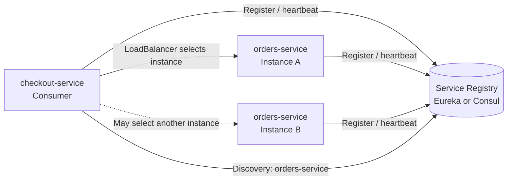

# Setting Up Service Provider and Service Consumer Applications

In a microservice architecture, one application typically exposes an API to other applications, while another application discovers and calls that API via service discovery. To practice Spring Cloud Service Discovery, you need at least two applications: a **service provider** that registers one or more instances with the registry, and a **service consumer** that looks up the provider by service name and sends requests to a suitable instance.

Both applications must have clear service names, network addresses that the registry can advertise, listening ports, compatible Spring Cloud dependencies, and configurations pointing to the same registry. This lesson builds an example with `orders-service` providing an API and `checkout-service` calling that API. Eureka is used as the primary example; the final section shows how to switch to Consul.

## 1. Objectives and Lab Architecture

We prepare three components:

1. **Discovery server:** Eureka Server or Consul Server/agent, storing service instance information.
2. **Provider:** the `orders-service` application, exposing an order-reading API and registering its instance with the registry.
3. **Consumer:** the `checkout-service` application, looking up `orders-service` by service ID and calling the API through Spring Cloud LoadBalancer.



The registry holds information such as service ID, instance ID, hostname or IP, port, metadata, and health status. The consumer retrieves the list of instances by service ID. LoadBalancer selects an instance from that list; the HTTP client sends the request to the selected address.

## 2. Environment Setup and Project Structure

Before creating the applications, you need:

- A JDK compatible with the Spring Boot version chosen by the project.
- Maven or Gradle to manage dependencies and build the applications.
- A Java IDE or editor.
- A Eureka Server or Consul reachable from both provider and consumer.
- Network ports reserved for the registry and applications opened within the lab environment.

You should create independent applications so each service can be started, stopped, or scaled individually:

```text
service-discovery-lab/
├── discovery-server/
├── orders-service/
└── checkout-service/
```

`discovery-server` is solely responsible for the registry. `orders-service` and `checkout-service` can share configuration conventions, but each application must have its own `spring.application.name`. In larger environments, these projects may live in separate repositories or as modules in a multi-module build.

### Choosing Spring Boot and Spring Cloud Versions

The Spring Cloud release train has a compatibility matrix with Spring Boot lines. Choose a version pair supported by Spring, then import the Spring Cloud BOM so starters use synchronized versions. Do not pick individual versions for each starter or copy configurations from tutorials belonging to a different release train.

Example Maven dependency management section for each application using Spring Cloud:

```xml
<properties>
    <java.version>21</java.version>
    <spring-cloud.version>YOUR_COMPATIBLE_RELEASE_TRAIN</spring-cloud.version>
</properties>

<dependencyManagement>
    <dependencies>
        <dependency>
            <groupId>org.springframework.cloud</groupId>
            <artifactId>spring-cloud-dependencies</artifactId>
            <version>${spring-cloud.version}</version>
            <type>pom</type>
            <scope>import</scope>
        </dependency>
    </dependencies>
</dependencyManagement>
```

`YOUR_COMPATIBLE_RELEASE_TRAIN` is a placeholder that must be replaced with a release train compatible with the Spring Boot version in the project. If the project uses the Spring Boot parent, declare the parent and Boot version according to the same compatibility matrix. With Gradle, apply the Spring dependency management plugin or the corresponding BOM platform mechanism.

## 3. Declaring Dependencies for Each Application

In the Eureka example, both provider and consumer need the Eureka client to register or query the registry. The consumer additionally needs Spring Cloud LoadBalancer if calling services by logical name via a `@LoadBalanced` client.

### Provider Dependencies

```xml
<dependencies>
    <dependency>
        <groupId>org.springframework.boot</groupId>
        <artifactId>spring-boot-starter-web</artifactId>
    </dependency>
    <dependency>
        <groupId>org.springframework.cloud</groupId>
        <artifactId>spring-cloud-starter-netflix-eureka-client</artifactId>
    </dependency>
    <dependency>
        <groupId>org.springframework.boot</groupId>
        <artifactId>spring-boot-starter-actuator</artifactId>
    </dependency>
</dependencies>
```

`spring-boot-starter-web` builds the REST API; Eureka client integrates the application with the registry; Actuator provides health endpoints to inspect application status. If not using Actuator in the lab, you can omit this dependency, though you will need to choose an appropriate health check.

### Consumer Dependencies

```xml
<dependencies>
    <dependency>
        <groupId>org.springframework.boot</groupId>
        <artifactId>spring-boot-starter-web</artifactId>
    </dependency>
    <dependency>
        <groupId>org.springframework.cloud</groupId>
        <artifactId>spring-cloud-starter-netflix-eureka-client</artifactId>
    </dependency>
    <dependency>
        <groupId>org.springframework.cloud</groupId>
        <artifactId>spring-cloud-starter-loadbalancer</artifactId>
    </dependency>
    <dependency>
        <groupId>org.springframework.boot</groupId>
        <artifactId>spring-boot-starter-actuator</artifactId>
    </dependency>
</dependencies>
```

The consumer needs the Eureka client to fetch the instance list. Spring Cloud LoadBalancer selects an instance when the HTTP client is annotated with `@LoadBalanced`. If you only want to read the instance list with `DiscoveryClient` and handle selection manually, you may not need LoadBalancer; in real-world applications, you should use the built-in, tested load-balancing mechanism.

### Discovery Server Dependencies

The `discovery-server` project uses the `spring-cloud-starter-netflix-eureka-server` starter. This is a separate application with `@EnableEurekaServer`; the provider and consumer do not need the server dependency.

## 4. Creating the Provider Application: orders-service

The provider is a standard Spring Boot application with a REST controller. The Spring Cloud Eureka client automatically registers the application based on configuration when the context starts up.

### Main Application Class

```java
package com.example.orders;

import org.springframework.boot.SpringApplication;
import org.springframework.boot.autoconfigure.SpringBootApplication;

@SpringBootApplication
public class OrdersApplication {

    public static void main(String[] args) {
        SpringApplication.run(OrdersApplication.class, args);
    }
}
```

With modern Spring Cloud versions, the Eureka client dependency enables the discovery client via auto-configuration. `@EnableDiscoveryClient` is generally unnecessary, though it may appear in older code or examples using multiple implementations.

### Creating the REST API

```java
package com.example.orders.api;

import org.springframework.web.bind.annotation.GetMapping;
import org.springframework.web.bind.annotation.PathVariable;
import org.springframework.web.bind.annotation.RequestMapping;
import org.springframework.web.bind.annotation.RestController;

@RestController
@RequestMapping("/api/orders")
public class OrderController {

    @GetMapping("/{orderId}")
    public String getOrder(@PathVariable String orderId) {
        return "Order " + orderId + " is ready";
    }
}
```

The `GET /api/orders/{orderId}` endpoint is the resource the consumer will call. In this lab, the response is a simple string to keep the focus on discovery. In a production application, the controller should call a service layer, validate input, and return a DTO with an appropriate HTTP status.

### Configuring the Provider

Create `src/main/resources/application.yml`:

```yaml
spring:
  application:
    name: orders-service

server:
  port: 8081

eureka:
  client:
    register-with-eureka: true
    fetch-registry: true
    service-url:
      defaultZone: ${EUREKA_SERVER_URL:http://localhost:8761/eureka/}
  instance:
    prefer-ip-address: true
    instance-id: ${spring.application.name}:${spring.cloud.client.ip-address}:${server.port}

management:
  endpoints:
    web:
      exposure:
        include: health,info
```

Key properties:

- `spring.application.name` sets the default service ID to `orders-service`. Consumers use this name during discovery or when calling via LoadBalancer.
- `server.port` is the provider's HTTP port in this example.
- `register-with-eureka` enables instance registration and heartbeats.
- `fetch-registry` allows the provider to also fetch the registry; this is useful if the provider itself calls other services.
- `defaultZone` is the Eureka Server URL that the client connects to.
- `prefer-ip-address` tells the instance to advertise its IP address instead of its hostname.
- `instance-id` creates a unique identifier for each registration. Combining service name, IP, and port helps distinguish multiple instances.

`spring.cloud.client.ip-address` is supplied by Spring Cloud Commons when the environment can determine an appropriate IP address. If the application runs inside a container or on a host with multiple network interfaces, verify that the advertised address is actually reachable from the consumer. You can configure the address/hostname explicitly per environment rather than relying on automatic selection.

## 5. Creating the Consumer Application: checkout-service

The consumer is another Spring Boot application. It can register itself with the registry if other services need to call it back, while also fetching the registry to locate `orders-service`.

### Main Application Class

```java
package com.example.checkout;

import org.springframework.boot.SpringApplication;
import org.springframework.boot.autoconfigure.SpringBootApplication;

@SpringBootApplication
public class CheckoutApplication {

    public static void main(String[] args) {
        SpringApplication.run(CheckoutApplication.class, args);
    }
}
```

### Configuring the Consumer

Create `src/main/resources/application.yml`:

```yaml
spring:
  application:
    name: checkout-service

server:
  port: 8082

eureka:
  client:
    register-with-eureka: true
    fetch-registry: true
    service-url:
      defaultZone: ${EUREKA_SERVER_URL:http://localhost:8761/eureka/}

management:
  endpoints:
    web:
      exposure:
        include: health,info
```

`checkout-service` is the consumer's service ID. If it is only an internal client process and does not need to be discovered by other services, you can consider setting `register-with-eureka: false`; if the consumer also exposes an API, keep registration enabled so other applications can call it.

### Declaring an HTTP Client with LoadBalancer

```java
package com.example.checkout.config;

import org.springframework.cloud.client.loadbalancer.LoadBalanced;
import org.springframework.context.annotation.Bean;
import org.springframework.context.annotation.Configuration;
import org.springframework.web.client.RestTemplate;

@Configuration
public class HttpClientConfig {

    @Bean
    @LoadBalanced
    RestTemplate restTemplate() {
        return new RestTemplate();
    }
}
```

`@LoadBalanced` attaches Spring Cloud LoadBalancer's interceptor to `RestTemplate`. When a URL has a service ID as its host, such as `http://orders-service`, LoadBalancer looks up that service's instances and picks one before sending the request.

### Calling the Provider by Service ID

```java
package com.example.checkout.api;

import org.springframework.web.bind.annotation.GetMapping;
import org.springframework.web.bind.annotation.PathVariable;
import org.springframework.web.bind.annotation.RequestMapping;
import org.springframework.web.bind.annotation.RestController;
import org.springframework.web.client.RestTemplate;

@RestController
@RequestMapping("/api/checkout")
public class CheckoutController {

    private final RestTemplate restTemplate;

    public CheckoutController(RestTemplate restTemplate) {
        this.restTemplate = restTemplate;
    }

    @GetMapping("/orders/{orderId}")
    public String getOrder(@PathVariable String orderId) {
        return restTemplate.getForObject(
                "http://orders-service/api/orders/{orderId}",
                String.class,
                orderId
        );
    }
}
```

The consumer only needs to know the service ID `orders-service` and the API path. It does not need to hardcode each instance's IP or port. When multiple instances exist, LoadBalancer picks an address from the registry; when the list changes, the client can continue using updated discovery data.

## 6. Understanding Service ID and Instance ID

These two identifiers serve two different purposes:

| Property | Meaning | Example |
| --- | --- | --- |
| Service ID | Logical name representing a type of service; consumers look up by this name | `orders-service` |
| Instance ID | Identifies a specific process/instance providing the service | `orders-service:10.0.1.20:8081` |
| Hostname/IP | Network address the consumer uses to connect to the instance | `10.0.1.20` |
| Port | Port the application is listening on | `8081` |

A single service ID can map to multiple instances. For example, three `orders-service` processes can register under the same service ID with different instance IDs, hostnames/IPs, or ports. The registry uses this information to return the list of instances to the consumer.

In Spring Cloud, `spring.application.name` is usually the default service name used by the discovery implementation. With Eureka, the application name displayed in the dashboard is typically normalized to uppercase; names referenced in client configurations can still use kebab-case. With Consul, `spring.cloud.consul.discovery.service-name` can override the default service name.

The Instance ID must be unique within the registry according to how the implementation manages it. If two instances share the same service ID and the same instance ID, one registration may overwrite the other or make displayed status confusing. When running multiple replicas, build the ID from hostname/IP, port, or a unique value supplied by the platform.

### Hostname, IP, and Advertised Address

The registered address must be reachable by the calling component. A few points to note:

- `localhost` is only suitable when consumer and provider share the same network namespace. In separate containers, the consumer's `localhost` does not point to the provider.
- The hostname must be resolvable by registry peers and consumers.
- An automatically selected IP can be wrong when a machine has multiple network interfaces, a VPN, or container networks.
- The advertised port must be the port the provider actually listens on and firewall rules allow access to.
- If using a reverse proxy or container port mapping, distinguish the port inside the container from the port reachable from external networks.

`server.port` is the application's HTTP port. If Actuator runs on a separate port via `management.server.port`, configure health checks and management access paths appropriately; do not confuse the management port with the business API port.

## 7. Using Consul Instead of Eureka

The provider and consumer remain Spring Boot applications as above. What changes are the dependencies and registry connection properties. With Consul, each application typically talks to a Consul agent (usually a client agent on the same node) to register or look up services.

### Dependencies

Replace the Eureka client starter with:

```xml
<dependency>
    <groupId>org.springframework.cloud</groupId>
    <artifactId>spring-cloud-starter-consul-discovery</artifactId>
</dependency>
```

If the consumer uses `@LoadBalanced RestTemplate`, keep the `spring-cloud-starter-loadbalancer` dependency.

### Consul Configuration for the Provider

```yaml
spring:
  application:
    name: orders-service
  cloud:
    consul:
      host: ${CONSUL_HOST:localhost}
      port: ${CONSUL_PORT:8500}
      discovery:
        register: true
        service-name: orders-service
        instance-id: ${spring.application.name}:${spring.cloud.client.hostname}:${server.port}
        prefer-ip-address: true
        health-check-path: /actuator/health
        health-check-interval: 15s

server:
  port: 8081
```

The Consul client registers the service as `orders-service`, builds the instance ID from application name, hostname, and port, and configures an HTTP health check. The agent must be able to reach the provider's health endpoint. If the application runs in a container on a different network from the agent, configure a routable address and test the health endpoint from the agent's side.

The consumer uses a similar Consul configuration with `spring.application.name: checkout-service` and its own port. `service-name` can be omitted if you want to use the default from `spring.application.name`. Both applications must point to the same datacenter/Consul cluster and have an appropriate ACL token when ACLs are enabled.

Do not arbitrarily configure both Eureka and Consul in the same application. Choose the discovery implementation based on your architecture and active dependencies, avoiding unintended duplicate registrations across multiple registries.

## 8. Verifying the Applications After Startup

Start in order:

1. Start Eureka Server or Consul and confirm the registry is ready.
2. Start `orders-service`.
3. Test the provider directly over HTTP.
4. Start `checkout-service`.
5. Call the consumer endpoint to verify requests are routed via service ID.

For the local Eureka example, you can use these commands:

```bash
# Test the provider directly
curl http://localhost:8081/api/orders/1001

# Check the provider's health
curl http://localhost:8081/actuator/health

# Call the provider via the consumer and LoadBalancer
curl http://localhost:8082/api/checkout/orders/1001
```

Open the Eureka dashboard at `http://localhost:8761/` and confirm both `ORDERS-SERVICE` and `CHECKOUT-SERVICE` appear. If using Consul, inspect the service catalog via the Consul UI or the `/v1/catalog/services` and `/v1/health/service/orders-service` APIs.

To see LoadBalancer distribute requests, run a second `orders-service` instance on a different port with a distinct ID. Once the registry receives the second instance, call the consumer endpoint multiple times and observe provider logs or responses including instance details. Do not draw conclusions from a single request, as the instance selection algorithm may not strictly alternate in every scenario.

## 9. Inspecting the Instance List with DiscoveryClient

When you need to observe discovery data in code, you can inject `DiscoveryClient`:

```java
package com.example.checkout.debug;

import java.util.List;

import org.springframework.cloud.client.ServiceInstance;
import org.springframework.cloud.client.discovery.DiscoveryClient;
import org.springframework.web.bind.annotation.GetMapping;
import org.springframework.web.bind.annotation.RestController;

@RestController
public class DiscoveryDebugController {

    private final DiscoveryClient discoveryClient;

    public DiscoveryDebugController(DiscoveryClient discoveryClient) {
        this.discoveryClient = discoveryClient;
    }

    @GetMapping("/internal/discovery/orders")
    public List<String> ordersInstances() {
        return discoveryClient.getInstances("orders-service")
                .stream()
                .map(ServiceInstance::getUri)
                .map(Object::toString)
                .toList();
    }
}
```

`getInstances("orders-service")` returns the list of instances provided by the active discovery implementation. This debug endpoint is useful for learning or diagnostics; do not expose internal topology information through public APIs in production.

## 10. Common Issues When Setting Up Provider and Consumer

| Symptom | Common Cause | How to Check |
| --- | --- | --- |
| Consumer cannot find the service | Wrong `spring.application.name`, wrong registry URL, or provider has not registered | Check dashboard/catalog and provider startup logs |
| Registry has the instance, but requests time out | Advertised host/IP or port is unreachable | Try calling the instance URI directly from the consumer's network |
| Consumer calls `http://orders-service` and DNS fails to resolve | Missing `@LoadBalanced` or missing LoadBalancer dependency | Check the HTTP client bean and dependencies |
| Only one instance appears despite running multiple processes | Duplicate instance ID or processes share the same identity configuration | Check hostname, port, and instance ID in the registry |
| Health check always fails | Agent/registry cannot reach endpoint, wrong path or port | Call the health endpoint from the agent's own node/network |
| Registration succeeds, but consumer receives stale list | Registry fetch/refresh not yet updated or peer sync lag | Check registry status, client logs, and refresh intervals |
| Works locally, fails in containers | Wrong `localhost`, port mapping, or container DNS config | Use service/hostname inside the network and test from the calling container |
| Fails to start after adding dependencies | Incompatible Spring Boot and Spring Cloud, or wrong BOM | Cross-check release train and inspect the dependency tree |

When investigating, verify each hop: the provider works directly, the provider has registered, the registry returns the right instance address, the consumer fetches the list, and finally LoadBalancer sends the request to that address. Hop-by-hop verification helps isolate faults in the application, registry, or network.

## 11. Security and Configuration for Real Environments

The registry holds internal details such as service names, hostnames, IPs, ports, and metadata. Provider and consumer should be configured following least-privilege principles:

- Expose registry and service API ports only to components that need access.
- Use TLS/HTTPS when connecting over untrusted networks; authenticate clients if required by the platform.
- With Consul, enable ACLs and issue least-privilege tokens to each application.
- Never commit passwords, tokens, private keys, or private certificates to the repository.
- Do not advertise loopback addresses or network addresses that only exist inside a single container.
- Protect Actuator; expose only necessary health/info endpoints and restrict administrative endpoints.
- Configure appropriate timeouts, retries, and circuit breakers for inter-service calls; do not treat discovery as a guarantee that a request will succeed.
- Monitor registrations, heartbeats, health checks, instance counts, and inter-service call errors.

In production, host, port, registry URL, and secret settings should be injected per deployment environment via environment variables, a config server, or a secret manager. YAML files in the repository should only contain safe defaults for local development.

## 12. Lab Completion Checklist

- [ ] Discovery server is running and reachable by both provider and consumer.
- [ ] Provider has a clear `spring.application.name` and its API returns results when called directly.
- [ ] Provider registers the correct service ID, instance ID, host/IP, and port.
- [ ] Health endpoint accurately reflects the provider's status.
- [ ] Consumer has its own name and fetches the registry.
- [ ] Consumer calls the provider by service ID through LoadBalancer.
- [ ] Tested running two provider instances with distinct identifiers.
- [ ] Tested scenarios where the provider stops or its health check fails.
- [ ] Advertised hostname/IP is reachable from the consumer.
- [ ] Registry and Actuator configurations are properly secured.

Once the provider and consumer are properly set up, service discovery can replace hardcoded addresses with stable service names. The provider is responsible for registering and maintaining instance status; the consumer looks up by service ID and uses LoadBalancer to select an instance. This forms the foundation for studying registration lifecycles, health checks, asynchronous registry behavior, and fault tolerance in Spring Cloud.
