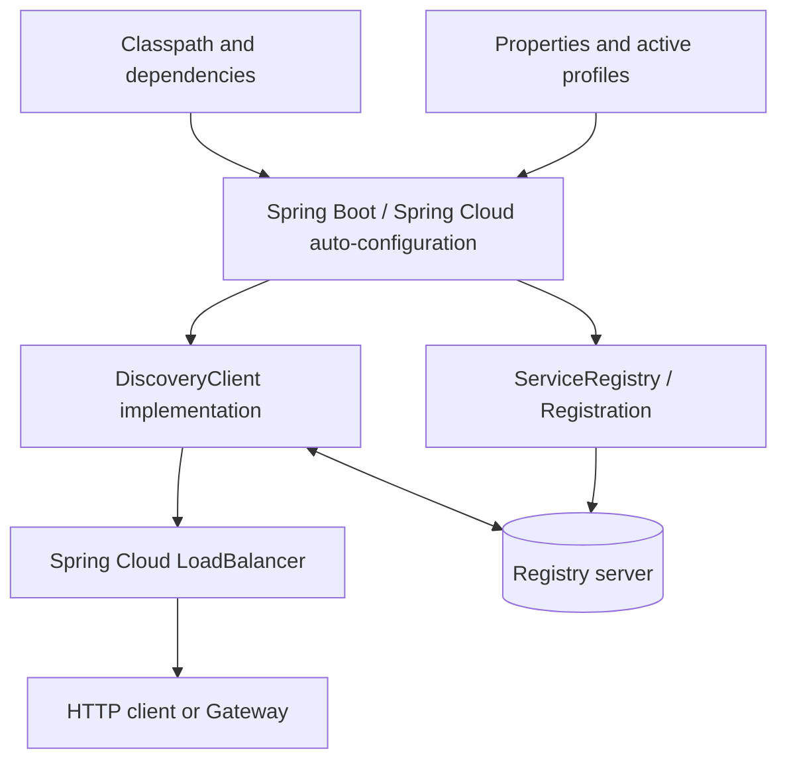

# Inspecting Auto-Configuration and Isolating Discovery Providers

Spring Cloud provides shared abstractions for applications to look up and register services, while concrete implementations are brought into the application via dependencies and auto-configuration. When you add a Eureka, Consul, or ZooKeeper starter, Spring Boot can automatically create the corresponding discovery beans based on the classpath and configuration properties. If multiple starters are included in the same application without control, the application may initialize multiple integrations simultaneously, connect to multiple registries, or exhibit unpredictable behavior.

This lesson explains how to inspect auto-configuration and isolate individual discovery providers in the `SPRING_CLOUD_SERVICE_DISCOVERY` module. The goal is to know which integration is active, understand how profiles affect configuration, separate dependencies when independent testing is needed, and verify that the application uses only the intended registry.

## How Does Auto-Configuration Form DiscoveryClient?

Spring Boot auto-configuration inspects what is on the classpath, which beans already exist, and configuration properties. Spring Cloud starters bring provider integration libraries onto the classpath; the corresponding auto-configuration can create clients, registry adapters, health contributors, and related beans.

For example:

- When `spring-cloud-starter-netflix-eureka-client` is on the classpath and Eureka client is enabled, the application can be configured to register and look up via Eureka.
- When `spring-cloud-starter-consul-discovery` is present along with Consul configuration, the application can create an integration to register and look up via Consul.
- When `spring-cloud-starter-zookeeper-discovery` is present along with ZooKeeper configuration, the application can use ZooKeeper as its registry.
- When no dedicated registry client is present, `SimpleDiscoveryClient` can provide a static list of instances from configuration, depending on the Spring Cloud version and auto-configuration conditions.

`DiscoveryClient` is the consumer-side abstraction. Concrete implementations supply lists of `ServiceInstance` by service ID. On the provider side, `ServiceRegistry` and `Registration` are the abstractions related to registration. Spring Cloud LoadBalancer can use discovery to obtain instance lists before choosing a target for a request.



Auto-configuration does not mean every provider is always activated. Each integration also has its own conditions such as present dependencies, `enabled` properties, connection details, and user-declared beans. Because conditions can change across release trains, check the documentation and condition report for the exact version in use.

In modern Spring Cloud lines, adding a discovery starter is usually sufficient to activate the integration; `@EnableDiscoveryClient` is generally no longer a required annotation. Nor does this annotation choose Eureka, Consul, or ZooKeeper in place of dependencies and configuration. Check the documentation for your project's release train before adding the annotation to examples.

## Distinguishing Dependencies, Profiles, and Enable/Disable Flags

These three mechanisms address different layers:

| Mechanism | Effect | Example |
|---|---|---|
| Dependency / classpath | Determines which integrations can be auto-configured | Adding or removing the Eureka Client starter |
| Spring profile | Selects a runtime configuration group by environment or run purpose | `eureka`, `consul`, `zookeeper`, `test` |
| `enabled` / `register` property | Enables/disables features of an integration already on the classpath | `spring.cloud.zookeeper.discovery.enabled=false` |

**A profile does not remove dependencies from the classpath.** If Eureka, Consul, and ZooKeeper starters are all declared in the build, simply switching `spring.profiles.active=consul` does not guarantee the other two integrations are not initialized. You must use appropriate disable properties or separate dependencies by build profile for clean isolation.

Conversely, removing a starter from the classpath prevents that integration from being auto-configured, though it does not replace profile configuration. Leftover properties can confuse operators, so dependencies and profiles should be managed consistently.

## Abstractions Used for Inspection

| Abstraction | What to Verify? |
|---|---|
| `DiscoveryClient` | Which implementation is created? What do `getServices()` and `getInstances(serviceId)` return? |
| `ServiceInstance` | Do host, port, URI, and metadata point to an address reachable by the consumer? |
| `ServiceRegistry` | Which registry is the provider registering with? Does it auto-register on startup? |
| `Registration` | Are service ID and instance ID accurate and unique? |
| `ServiceInstanceListSupplier` | Which discovery source is LoadBalancer pulling from, and does it cache or filter by health? |

You can inspect service and instance lists using `DiscoveryClient`:

```java
import java.util.List;

import org.springframework.cloud.client.ServiceInstance;
import org.springframework.cloud.client.discovery.DiscoveryClient;
import org.springframework.stereotype.Component;

@Component
public class DiscoveryInspector {
    private final DiscoveryClient discoveryClient;

    public DiscoveryInspector(DiscoveryClient discoveryClient) {
        this.discoveryClient = discoveryClient;
    }

    public void inspect(String serviceId) {
        List<String> services = discoveryClient.getServices();
        List<ServiceInstance> instances = discoveryClient.getInstances(serviceId);

        System.out.println("Services: " + services);
        for (ServiceInstance instance : instances) {
            System.out.printf(
                "%s -> %s:%d (%s)%n",
                instance.getServiceId(),
                instance.getHost(),
                instance.getPort(),
                instance.getUri()
            );
        }
    }
}
```

Never log tokens, passwords, or sensitive metadata. The returned list may be empty; this can mean the provider has not registered yet, the service ID does not match, caches have not refreshed, or the registry is unreachable.

## Detecting Which Implementations Are Initialized

When an application has multiple starters, verify actual beans rather than inferring solely from YAML files. In development environments, you can list beans of type `DiscoveryClient`:

```java
import java.util.Map;

import org.springframework.boot.ApplicationRunner;
import org.springframework.context.ApplicationContext;
import org.springframework.context.annotation.Bean;
import org.springframework.context.annotation.Configuration;
import org.springframework.cloud.client.discovery.DiscoveryClient;

@Configuration
public class DiscoveryDiagnosticsConfiguration {
    @Bean
    ApplicationRunner reportDiscoveryClients(ApplicationContext context) {
        return args -> {
            Map<String, DiscoveryClient> clients =
                context.getBeansOfType(DiscoveryClient.class);
            clients.forEach((name, client) ->
                System.out.println(
                    "DiscoveryClient bean: " + name + " -> "
                        + client.getClass().getName()
                )
            );
        };
    }
}
```

This is temporary diagnostic code for local or test environments. Do not leave overly verbose diagnostic logging in production if it exposes internal topology or details.

You can enable the auto-configuration condition evaluation report by running the application with `--debug`. Spring Boot logs matched and unmatched conditions, helping determine why a configuration was activated. Actuator also provides `conditions` and `beans` endpoints to inspect context state; expose these endpoints only on a controlled administrative network.

Example Actuator configuration in a local environment:

```yaml
management:
  endpoints:
    web:
      exposure:
        include: health,info,conditions,beans
```

Do not publicly expose `beans`, `conditions`, or health details in production. These endpoints can reveal bean names, configuration, and internal application structure.

## Isolating Providers with Spring Profiles

When the same codebase needs to be tested against multiple registries, you can separate configuration by profile. For example, using these files:

```text
src/main/resources/
  application.yml
  application-eureka.yml
  application-consul.yml
  application-zookeeper.yml
  application-test.yml
```

The shared file contains only configuration common to all profiles:

```yaml
spring:
  application:
    name: inventory-service
```

### Eureka Profile

```yaml
spring:
  config:
    activate:
      on-profile: eureka
  cloud:
    discovery:
      enabled: true
    service-registry:
      auto-registration:
        enabled: true
eureka:
  client:
    enabled: true
    register-with-eureka: true
    fetch-registry: true
    service-url:
      defaultZone: http://localhost:8761/eureka/
```

`register-with-eureka` controls whether the client registers the application with Eureka; `fetch-registry` controls fetching the registry for lookups. A consumer that only performs lookups can disable registration while keeping fetch enabled. To completely disable Eureka integration, set `eureka.client.enabled=false` or remove the starter from the classpath.

### Consul Profile

```yaml
spring:
  config:
    activate:
      on-profile: consul
  cloud:
    consul:
      enabled: true
      host: localhost
      port: 8500
      discovery:
        enabled: true
        register: true
        service-name: inventory-service
```

`spring.cloud.consul.discovery.register=false` keeps the discovery integration without auto-registering the application's own instance. This configuration can be used for a lookup-only consumer. To disable Consul integration, set `spring.cloud.consul.enabled=false` and/or `spring.cloud.consul.discovery.enabled=false` depending on your version, or remove the starter from the classpath.

### ZooKeeper Profile

```yaml
spring:
  config:
    activate:
      on-profile: zookeeper
  cloud:
    zookeeper:
      enabled: true
      connect-string: localhost:2181
      discovery:
        enabled: true
        register: true
        root: /services
```

`spring.cloud.zookeeper.discovery.register=false` retains lookup capability without registering the current instance. To disable the integration, you can set `spring.cloud.zookeeper.enabled=false` or `spring.cloud.zookeeper.discovery.enabled=false` depending on the release train, or remove the starter from the classpath.

Activate one profile at a time:

```bash
java -jar app.jar --spring.profiles.active=eureka
java -jar app.jar --spring.profiles.active=consul
java -jar app.jar --spring.profiles.active=zookeeper
```

Profile files separate configuration, but they do not remove other providers from the classpath. If dependencies for multiple registries coexist, set explicit disable flags for unselected providers or use build profiles to include only one integration in the application.

## Distinguishing Disabling Discovery from Disabling Auto-Registration

These are two distinct requirements:

- **Disabling discovery:** the consumer does not use service instance lookup. The shared property `spring.cloud.discovery.enabled=false` can disable Spring Cloud discovery client auto-configurations.
- **Disabling auto-registration:** the application does not publish its own instance to the registry, while still being able to look up other services. You can use `spring.cloud.service-registry.auto-registration.enabled=false` or provider-specific flags.
- **Disabling one provider:** disables a specific integration such as Eureka, Consul, or ZooKeeper; this does not necessarily disable other discovery clients remaining on the classpath.

Example of a consumer-only application that needs to look up Eureka without registering itself:

```yaml
eureka:
  client:
    register-with-eureka: false
    fetch-registry: true
```

Example of disabling auto-registration at the Spring Cloud Commons level:

```yaml
spring:
  cloud:
    service-registry:
      auto-registration:
        enabled: false
```

Shared properties and provider-specific properties can coexist; the final outcome depends on auto-configuration conditions and integration versions. After making changes, verify beans, logs, and the registry to confirm the application no longer registers unintentionally.

## Isolating Dependencies with Maven Profiles

For a sample application that needs to be tested across multiple providers, Maven profiles can restrict which starter is included in the build. First, declare the Spring Cloud BOM compatible with Spring Boot in `dependencyManagement`; then place each provider's dependency in a separate profile.

Condensed example:

```xml
<profiles>
    <profile>
        <id>discovery-eureka</id>
        <dependencies>
            <dependency>
                <groupId>org.springframework.cloud</groupId>
                <artifactId>spring-cloud-starter-netflix-eureka-client</artifactId>
            </dependency>
        </dependencies>
    </profile>

    <profile>
        <id>discovery-consul</id>
        <dependencies>
            <dependency>
                <groupId>org.springframework.cloud</groupId>
                <artifactId>spring-cloud-starter-consul-discovery</artifactId>
            </dependency>
        </dependencies>
    </profile>

    <profile>
        <id>discovery-zookeeper</id>
        <dependencies>
            <dependency>
                <groupId>org.springframework.cloud</groupId>
                <artifactId>spring-cloud-starter-zookeeper-discovery</artifactId>
            </dependency>
        </dependencies>
    </profile>
</profiles>
```

To run each configuration, activate the corresponding Maven profile and Spring profile:

```bash
./mvnw -Pdiscovery-eureka spring-boot:run -Dspring-boot.run.profiles=eureka
./mvnw -Pdiscovery-consul spring-boot:run -Dspring-boot.run.profiles=consul
./mvnw -Pdiscovery-zookeeper spring-boot:run -Dspring-boot.run.profiles=zookeeper
```

The Maven profile determines which dependencies are in the build; the Spring profile determines which runtime configuration is loaded. These two profiles are independent and must be enabled in matching pairs. In Gradle projects, the same goal can be achieved with dependency configurations or separate application modules for each provider.

For production systems, it is usually best to choose one registry integration per service process unless there is an explicit multi-registry requirement. Separating applications or deployment modules by provider makes the dependency graph and runtime behavior easier to control.

## SimpleDiscoveryClient for Local Testing

`SimpleDiscoveryClient` is useful when you want to test consumers and load balancing without running a registry server yet. The instance list is declared in configuration:

```yaml
spring:
  cloud:
    discovery:
      client:
        simple:
          instances:
            inventory-service:
              - uri: http://localhost:8081
              - uri: http://localhost:8082
```

The consumer can look up `inventory-service` and receive these two static addresses. This approach fits tests, demos, or simple environments; it does not provide dynamic registration lifecycles, heartbeats, or health checks equivalent to Eureka/Consul/ZooKeeper. Confirm that `SimpleDiscoveryClient` is the selected implementation in the actual context, because another integration on the classpath may alter discovery behavior.

## Verifying Providers in Each Profile

For each profile, verify all three layers: dependencies, Spring context, and registry state.

| Verification Layer | How to Verify | Expected Result |
|---|---|---|
| Dependency | Inspect Maven/Gradle dependency tree | Only the intended provider starter is present, if using build isolation |
| Auto-configuration | Run with `--debug` or view Actuator `conditions` | Selected provider's auto-configuration matches; other providers are not unintentionally initialized |
| Bean | List `DiscoveryClient` and `ServiceRegistry` beans in context | Clearly identify implementations and composite beans, if any |
| Registry | Inspect Eureka, Consul, or ZooKeeper UI/API/CLI | Only intended registrations appear; service ID and instance addresses are accurate |
| Consumer | Call `getInstances(serviceId)` | List is accurate, without mixing addresses from other environments |
| LoadBalancer | Call endpoint multiple times and observe target instances | Requests are selected from the intended set of instances |

You can run the application with the following commands to collect the auto-configuration report:

```bash
java -jar app.jar --spring.profiles.active=eureka --debug
java -jar app.jar --spring.profiles.active=consul --debug
java -jar app.jar --spring.profiles.active=zookeeper --debug
```

When using Actuator, expose diagnostic endpoints only on a protected internal network. Never expose `beans` or `conditions` endpoints to the public Internet.

## Isolated Testing in Spring Boot Tests

You can use a test profile and `SimpleDiscoveryClient` to test consumer logic without needing a real registry server. Example test configuration:

```yaml
spring:
  cloud:
    discovery:
      client:
        simple:
          instances:
            inventory-service:
              - uri: http://localhost:18081
              - uri: http://localhost:18082
```

In the test, you can verify lookup results:

```java
import static org.assertj.core.api.Assertions.assertThat;

import org.junit.jupiter.api.Test;
import org.springframework.beans.factory.annotation.Autowired;
import org.springframework.boot.test.context.SpringBootTest;
import org.springframework.cloud.client.discovery.DiscoveryClient;
import org.springframework.test.context.ActiveProfiles;

@SpringBootTest
@ActiveProfiles("test")
class DiscoveryConfigurationTest {
    @Autowired
    DiscoveryClient discoveryClient;

    @Test
    void loadsConfiguredInventoryInstances() {
        assertThat(discoveryClient.getInstances("inventory-service"))
            .hasSize(2);
    }
}
```

This tests static configuration and lookup logic. It does not replace integration tests against a real registry. For Eureka, Consul, or ZooKeeper, write separate tests that spin up an appropriate server/agent, register an instance, look it up from the consumer, and verify deregistration or health transitions.

Do not let tests depend on a registry running on a developer's machine without explicit declaration. Use containers or isolated test environments to prevent results from depending on external state.

## When Multiple Registries Are Needed in One Application

Spring Cloud Commons can combine multiple discovery clients via `CompositeDiscoveryClient` in configurations supporting composites. Typically, `getServices()` aggregates service names across clients, whereas `getInstances(serviceId)` iterates in priority order and returns the first non-empty list. Therefore, do not assume instances from every registry will be merged into a single list. Check `Ordered`/ordering of clients and exact behavior in the release train in use.

Multi-registry should only be enabled for specific architectural goals, such as phased migration or reading directories across multiple domains. Clearly determine:

- Can the consumer tolerate duplicate instances or the same service ID across multiple registries?
- Do both registries follow the same conventions for service ID, metadata, and reachable addresses?
- Could LoadBalancer mistakenly select an instance belonging to another environment or network domain?
- Does the provider register with one registry or multiple registries? How are `ServiceRegistry`/auto-registration behaving?
- When one registry fails, should the application continue using the remaining registry or fail entirely?
- Who is responsible for synchronization, cleaning up stale records, and managing migration?

Do not assume that aggregating `DiscoveryClient` automatically means the provider registers simultaneously with every registry. Lookup and registration are two separate abstraction flows; check `ServiceRegistry` beans, auto-registration, and the status of each registry individually.

## Common Errors and Diagnostics

| Symptom | Possible Cause | Resolution |
|---|---|---|
| Application connects to multiple registries unexpectedly | Multiple starters are on the classpath and integrations are enabled | Check dependency tree, conditions report, and `enabled` flags |
| Switching profiles still initializes the old provider | Profiles only switch config, not classpath dependencies | Disable remaining integrations via properties or isolate dependencies with build profiles |
| Consumer finds instances, but provider does not appear in registry | Auto-registration is disabled or `register=false` | Check shared flags and provider-specific flags |
| Provider is in registry, but consumer cannot look it up | `fetch-registry` disabled, wrong service ID, cache, or access permissions | Check consumer config, registry status, and logs |
| `DiscoveryClient` returns an empty list | Provider not registered, registry unavailable, or reading wrong implementation | List beans, check active profile, and query registry directly |
| Local tests depend on an external machine registry | Tests are loading production starters/config | Use a test profile, SimpleDiscoveryClient, or dedicated test containers |
| Requests go to the wrong instance | Multiple registries return duplicate or wrong-network instances | Inspect metadata, advertised addresses, composite order, and supplier |
| Health indicator fails while application is running | Registry unreachable or health contributor checks registry | Distinguish app health from dependency health; inspect endpoints and logs |

When investigating, follow this sequence: verify dependencies, verify loaded profiles/properties, inspect auto-configuration conditions, list actual beans, check registry status, and finally check consumer/load balancer results. This sequence helps locate the exact layer causing the issue.

## Pre-Handoff Environment Checklist

1. Finalize the registry each service process needs to use.
2. Inspect the dependency tree and remove unnecessary starters if isolating at build time.
3. Create separate profiles for providers and keep shared configuration in the base file.
4. Set `enabled`, `register`, `register-with-eureka`, or `fetch-registry` according to provider/consumer roles.
5. Verify advertised addresses are reachable from consumers.
6. Verify `DiscoveryClient`, `ServiceRegistry` beans, and auto-configuration outcomes.
7. Verify service ID, instance ID, metadata, and registration status in the registry.
8. Test empty lists, registry disconnection, stale caches, and shutdown.
9. Secure Actuator endpoints and registry connection details.
10. Document Spring Boot version, Spring Cloud release train, and registry server/client versions in deployment instructions.

## Conclusion

Spring Cloud auto-configuration relies on dependencies, configuration conditions, and existing beans to build discovery integrations. To isolate individual discovery providers, distinguish between having a starter on the classpath, configuration profiles, and runtime enable/disable flags. Inspect actual beans alongside auto-configuration conditions, verify registry status and lookup results, and use build profiles when strict dependency isolation is needed. Use multi-registry only after clearly defining instance aggregation, registration, and error handling.
