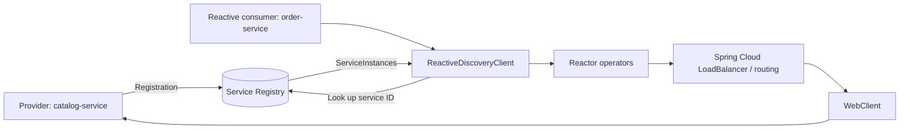
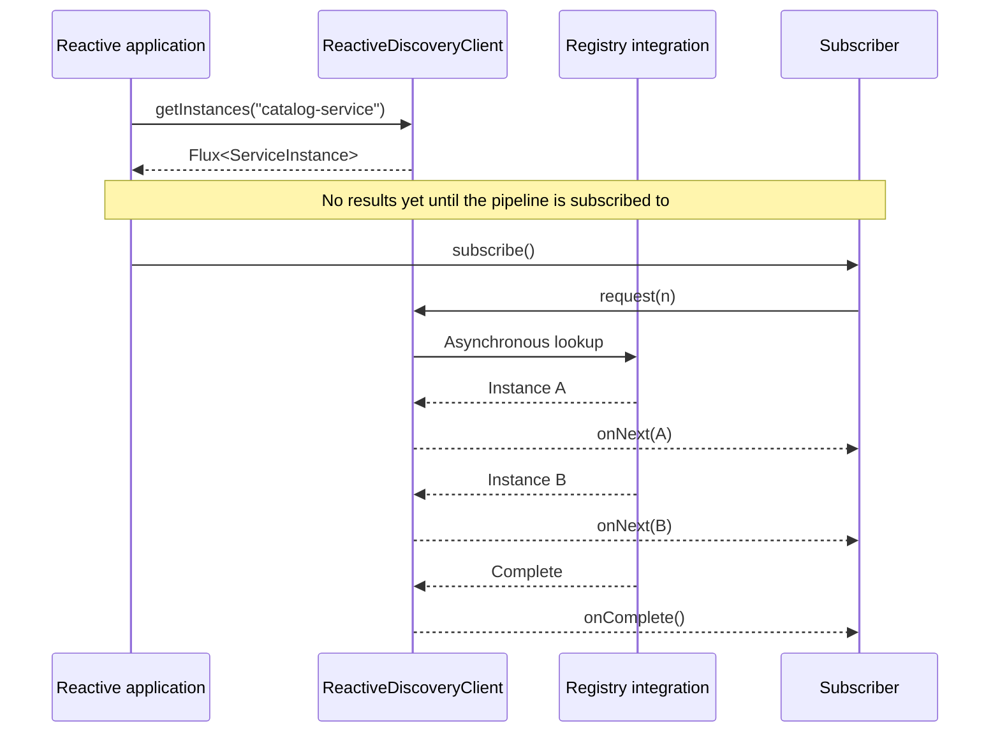

# ReactiveDiscoveryClient and How to Handle Asynchronous Results

In a microservice application, a consumer needs to find the instances of a service by logical name. For Spring MVC applications or synchronous processing flows, `DiscoveryClient` provides a `List<ServiceInstance>` directly. For applications using Spring WebFlux and Reactor, lookups can be represented as a publisher to compose with other asynchronous operations without blocking threads while waiting for results.

Spring Cloud Commons defines `ReactiveDiscoveryClient` for that purpose. Instead of returning `List<ServiceInstance>`, the reactive API returns `Flux<ServiceInstance>`. A consumer can filter, transform, collect, handle empty-instance cases, or map errors within the same Reactor pipeline.

This lesson belongs to the `SPRING_CLOUD_SERVICE_DISCOVERY` module, focusing on instance discovery through `DiscoveryClient`, `ServiceRegistry`, Eureka, or Consul and the associated operational concerns. The content below dives into reading the `ReactiveDiscoveryClient` publisher, understanding the subscription lifecycle, and handling asynchronous results safely in a reactive application.

## 1. ReactiveDiscoveryClient in the Service Discovery architecture

`ReactiveDiscoveryClient` belongs to the `org.springframework.cloud.client.discovery` package. It is a consumer-side abstraction that allows looking up services by service ID and receiving instance information as a reactive stream.

A simple flow:

1. The provider registers its instance with the registry according to the mechanism of the active integration.
2. The consumer requests instances for a service ID, for example `catalog-service`.
3. `ReactiveDiscoveryClient` emits `ServiceInstance` items through a `Flux`.
4. The consumer can filter or pass the data to a routing component.
5. Spring Cloud LoadBalancer or appropriate routing logic selects an instance to send the request to.



`ReactiveDiscoveryClient` is responsible for discovery. It is not the registry and does not decide on its own which instance receives a specific request. Discovery and load balancing are two distinct responsibilities.

## 2. API contract and return types

The reactive API in Spring Cloud Commons has the following core shape:

```java
package org.springframework.cloud.client.discovery;

import reactor.core.publisher.Flux;
import org.springframework.cloud.client.ServiceInstance;

public interface ReactiveDiscoveryClient {

    String description();

    Flux<ServiceInstance> getInstances(String serviceId);

    Flux<String> getServices();
}
```

The two main lookup methods are:

| Method | Return type | Meaning |
|---|---|---|
| `getInstances(String serviceId)` | `Flux<ServiceInstance>` | Emits the discovered instances for the service ID. |
| `getServices()` | `Flux<String>` | Emits the service IDs discoverable by the implementation. |
| `description()` | `String` | Description of the discovery implementation. |

`Flux<T>` is a `Publisher` that can emit from zero to many elements. Therefore, `getInstances("catalog-service")` can emit multiple `ServiceInstance` items, complete without emitting any elements, or terminate with an error.

Each `ServiceInstance` provides information such as service ID, host, port, URI, secure flag, and metadata. The consumer can use these properties for observation or filtering rules. Metadata, how the instance ID is represented, and health filtering still depend on the registry integration.

### 2.1. Distinguishing DiscoveryClient and ReactiveDiscoveryClient

| Criterion | `DiscoveryClient` | `ReactiveDiscoveryClient` |
|---|---|---|
| Result type | `List<ServiceInstance>` | `Flux<ServiceInstance>` |
| How it is consumed | Call the method and process the list immediately on the current thread. | Compose the publisher with Reactor operators and consume upon subscription. |
| Natural fit | Synchronous applications, Spring MVC, or blocking APIs. | Reactive pipelines, such as Spring WebFlux applications. |
| Empty result | Empty list. | Publisher completes without emitting any elements. |
| Errors | Typically thrown when calling or processing the API. | Can be emitted as an `onError` signal during subscription. |

Do not judge solely by the return type to conclude that everything underneath is non-blocking. The `ReactiveDiscoveryClient` implementation must actually use asynchronous I/O or an appropriate mechanism. If it merely wraps a blocking API, returning a `Flux` does not automatically turn a blocking network operation into a non-blocking one.

## 3. Understanding Flux and the asynchronous lifecycle

Reactor models data streams using `Publisher`, `Subscriber`, and signals. For `Flux<ServiceInstance>`, the key signals include:

- `onNext(instance)`: emits an instance.
- `onComplete()`: completes the stream; may occur immediately with no `onNext`.
- `onError(error)`: terminates the stream with an error.
- `request(n)`: the subscriber requests the publisher to emit up to a given number of items based on demand.
- `cancel()`: the subscriber cancels consumption; the publisher can stop remaining work if the implementation supports cancellation.



In many Reactor pipelines, publishers are lazy: declaring a chain of operators only describes the work; work executes when a subscriber subscribes. Do not assume every implementation has the same caching strategy or performs I/O at the same point, but consumers should write code following publisher-consumption rules and avoid expecting a synchronous value right on the line calling `getInstances`.

For example, the snippet below only creates a pipeline:

```java
Flux<ServiceInstance> instances =
        reactiveDiscoveryClient.getInstances("catalog-service");
```

To receive data, integrate the pipeline into a reactive flow subscribed to by the framework, or explicitly subscribe in a component that truly owns the subscription lifecycle. In a WebFlux controller, you usually return `Mono` or `Flux` so the framework manages the subscription.

## 4. Looking up and processing the instance list

A service can have multiple instances. Consumers often want to inspect or filter them before use. The following example injects `ReactiveDiscoveryClient` and provides methods returning reactive types:

```java
package com.example.order.discovery;

import java.util.List;

import org.springframework.cloud.client.ServiceInstance;
import org.springframework.cloud.client.discovery.ReactiveDiscoveryClient;
import org.springframework.stereotype.Service;

import reactor.core.publisher.Flux;
import reactor.core.publisher.Mono;

@Service
public class CatalogDiscoveryService {

    private final ReactiveDiscoveryClient discoveryClient;

    public CatalogDiscoveryService(ReactiveDiscoveryClient discoveryClient) {
        this.discoveryClient = discoveryClient;
    }

    public Flux<ServiceInstance> findInstances(String serviceId) {
        return discoveryClient.getInstances(serviceId);
    }

    public Mono<List<ServiceInstance>> requireInstances(String serviceId) {
        return findInstances(serviceId)
                .collectList()
                .flatMap(instances -> {
                    if (instances.isEmpty()) {
                        return Mono.error(new IllegalStateException(
                                "No instances found for service: " + serviceId));
                    }
                    return Mono.just(instances);
                });
    }
}
```

`findInstances` keeps the result as a `Flux` so callers can continue processing each element. `requireInstances` uses `collectList()` to gather all results into a `Mono<List<ServiceInstance>>`, then turns an empty list into a business error if the application requires at least one instance.

`collectList()` is useful when you need to inspect the whole list, but it waits for the publisher to complete and holds elements in memory. If you only need to filter or transform each instance, keep the `Flux` and use operators like `filter`, `map`, or `flatMap` instead of collecting into a list unnecessarily.

### 4.1. Filtering instances by metadata

Suppose the provider publishes `zone` metadata, and the consumer wants to see instances in `zone-a`:

```java
public Flux<ServiceInstance> findInZone(String serviceId, String zone) {
    return discoveryClient.getInstances(serviceId)
            .filter(instance -> zone.equals(
                    instance.getMetadata().get("zone")));
}
```

If no instance matches the zone, the result is an empty `Flux`. The application must explicitly decide whether to fall back to another zone or report that the dependency is unavailable:

```java
public Flux<ServiceInstance> findInPreferredZone(String serviceId, String zone) {
    Flux<ServiceInstance> preferred = findInZone(serviceId, zone);

    return preferred.switchIfEmpty(
            discoveryClient.getInstances(serviceId));
}
```

This example uses the full instance list as a fallback when the preferred zone has no results. For systems with strict locality requirements or regional data regulations, do not automatically fall back if doing so violates policy. Metadata can be missing or malformed; standardize the schema and validate values before using them in routing decisions.

## 5. Handling empty publishers and errors

One of the most important points is distinguishing three outcomes:

1. **Instances present:** the publisher emits one or more `ServiceInstance` items, then completes.
2. **No instances:** the publisher completes without emitting any elements.
3. **Lookup failed:** the publisher emits an `onError` signal, for example due to a timeout, connection error, or implementation error.

An empty publisher is not synonymous with a registry connection error. The service ID might not exist yet, the provider might not have registered, instances might be filtered out by health checks, or the consumer might be querying the wrong namespace. Conversely, registry errors should not be masked as empty results.

### 5.1. switchIfEmpty

If the business flow requires finding at least one instance, you can turn the empty state into an error:

```java
public Flux<ServiceInstance> requireAtLeastOne(String serviceId) {
    return discoveryClient.getInstances(serviceId)
            .switchIfEmpty(Flux.error(
                    new IllegalStateException(
                            "No available instance for " + serviceId)));
}
```

`switchIfEmpty` only triggers when the publisher completes without emitting elements. It does not handle `onError`. Lookup errors must be handled with dedicated error operators.

### 5.2. onErrorMap and onErrorResume

`onErrorMap` translates a technical error into an error type appropriate for the application layer:

```java
public Flux<ServiceInstance> discover(String serviceId) {
    return discoveryClient.getInstances(serviceId)
            .onErrorMap(error -> new IllegalStateException(
                    "Discovery lookup failed for " + serviceId, error));
}
```

`onErrorResume` replaces a failing pipeline with another publisher. For example, the system can use a recent cached snapshot briefly if the business logic tolerates stale data:

```java
public Flux<ServiceInstance> discoverWithFallback(String serviceId) {
    return discoveryClient.getInstances(serviceId)
            .onErrorResume(error -> cachedInstances(serviceId));
}
```

`cachedInstances` here is an illustrative function returning `Flux<ServiceInstance>` from an application-managed cache. If using a fallback, limit data age, clearly mark data as stale, and record the registry error. Avoid silently returning an old list indefinitely, because cached instances may have stopped or changed addresses.

Avoid using `onErrorResume(error -> Flux.empty())` for all errors if the application needs to distinguish "no instances" from "cannot reach the registry." That loses important signals for operations and monitoring.

### 5.3. Timeouts and bounded retries

You can set a timeout for the entire lookup operation:

```java
public Mono<List<ServiceInstance>> discoverWithTimeout(String serviceId) {
    return discoveryClient.getInstances(serviceId)
            .collectList()
            .timeout(Duration.ofSeconds(2));
}
```

When retrying, only retry transient failures that can recover. Retrying does not help a wrong service ID or a service that genuinely has no instances. Bound the retry count, use backoff, and avoid synchronized retries across a large number of consumers:

```java
public Flux<ServiceInstance> discoverWithRetry(String serviceId) {
    return discoveryClient.getInstances(serviceId)
            .retryWhen(Retry.backoff(2, Duration.ofMillis(200))
                    .filter(this::isTransientRegistryFailure));
}
```

`isTransientRegistryFailure` is the application's error-classification policy; do not blindly retry every exception. For some discovery operations, retries may already be configured in the integration or underlying HTTP layer, so avoid multiplying attempts through nested retries.

## 6. Do not block threads in a reactive pipeline

The benefits of WebFlux and Reactor depend on operations in the pipeline not blocking event-loop threads for long durations. Avoid calling `block()`, `blockFirst()`, `blockLast()`, or converting publishers to blocking APIs inside reactive controllers and handlers.

Example of what not to do in WebFlux:

```java
// Avoid: blocking the event-loop to wait for discovery to complete.
List<ServiceInstance> instances =
        discoveryClient.getInstances("catalog-service").collectList().block();
```

Instead, return the publisher so the framework continues orchestrating it:

```java
@RestController
@RequestMapping("/internal/discovery")
public class DiscoveryController {

    private final CatalogDiscoveryService discoveryService;

    public DiscoveryController(CatalogDiscoveryService discoveryService) {
        this.discoveryService = discoveryService;
    }

    @GetMapping("/{serviceId}")
    public Flux<ServiceInstance> instances(@PathVariable String serviceId) {
        return discoveryService.findInstances(serviceId);
    }
}
```

The controller returns `Flux` so WebFlux manages the subscription and writes results to the response. In public APIs, do not let this administrative endpoint expose internal hosts, ports, and metadata; restrict access and use it only for appropriate operational purposes.

### 6.1. When the underlying implementation is blocking

An integration may expose a reactive API by wrapping a blocking operation. If no reactive-native option exists, you can isolate the blocking call on an appropriate scheduler, such as `Schedulers.boundedElastic()`:

```java
Mono<List<ServiceInstance>> instances = Mono.fromCallable(
        () -> blockingDiscoveryClient.getInstances("catalog-service"))
        .subscribeOn(Schedulers.boundedElastic());
```

This is only an illustration of isolating a blocking call; it does not turn the underlying I/O into non-blocking I/O. Use a bounded scheduler, monitor queues and latency, and check whether the registry integration offers an official reactive implementation. Do not move the entire pipeline onto `boundedElastic` when only one small operation is blocking.

## 7. Combining ReactiveDiscoveryClient with WebClient and LoadBalancer

In a WebFlux application, `WebClient` is the reactive HTTP client. For service-to-service requests by service ID, you can use a `WebClient.Builder` annotated with `@LoadBalanced`:

```java
import org.springframework.cloud.client.loadbalancer.LoadBalanced;
import org.springframework.context.annotation.Bean;
import org.springframework.context.annotation.Configuration;
import org.springframework.web.reactive.function.client.WebClient;

@Configuration
public class ReactiveHttpConfiguration {

    @Bean
    @LoadBalanced
    WebClient.Builder loadBalancedWebClientBuilder() {
        return WebClient.builder();
    }
}
```

The consumer uses the service ID in the URL:

```java
@Service
public class CatalogClient {

    private final WebClient webClient;

    public CatalogClient(@LoadBalanced WebClient.Builder builder) {
        this.webClient = builder
                .baseUrl("http://catalog-service")
                .build();
    }

    public Mono<Product> findProduct(String productId) {
        return webClient.get()
                .uri("/api/products/{id}", productId)
                .retrieve()
                .bodyToMono(Product.class);
    }
}
```

With the corresponding Spring Cloud LoadBalancer dependency and configuration, the `catalog-service` service ID is resolved to a suitable instance before the request is sent. LoadBalancer uses the integrated discovery mechanism; applications usually do not need to call `ReactiveDiscoveryClient` themselves and pick the first element to make HTTP calls.

`ReactiveDiscoveryClient` is useful when you need to inspect the instance list, filter metadata with custom rules, or build administrative tools. For normal business requests, let LoadBalancer handle instance selection. Calling `getInstances(...).next()` only takes the first element emitted by the publisher; it does not form a load-balancing policy and does not guarantee even request distribution.

Dependencies and reactive integration capabilities depend on the Spring Cloud release train, Spring Boot version, and registry starter. When configuration does not work, check the `ReactiveDiscoveryClient` bean, the created implementation, the corresponding starter, and the active LoadBalancer configuration.

## 8. Reactive does not automatically mean non-blocking

A `Flux` return type only indicates that the API is modeled according to Reactive Streams. Non-blocking effectiveness also depends on how the implementation performs I/O and which operators the application uses.

| Case | Characteristics |
|---|---|
| Reactive-native client | Uses asynchronous or event-driven I/O; fits reactive pipelines as long as no other blocking segments exist. |
| Wrapping a blocking API | May return `Flux`, yet threads still block if the call is not isolated. |
| Using `block()` | Turns a reactive stream into a synchronous wait at the call site; can stall the event-loop. |
| Using `subscribeOn` appropriately | Moves blocking work to a dedicated scheduler, though it still consumes threads and resources. |
| Using `publishOn` | Moves processing of subsequent signals to the specified scheduler; does not turn blocking I/O into non-blocking I/O. |

Do not add `subscribeOn` or `publishOn` out of habit. First identify which operation actually blocks, which thread is running, and which scheduler fits. Using BlockHound or profiling tools in test environments can help detect blocking calls on the event-loop.

## 9. Caching, data freshness, and consistency

The instance list can change as providers scale, restart, deregister, or are marked unhealthy. `ReactiveDiscoveryClient` does not guarantee that every subscription always reads the latest state directly from the registry server. Implementations may use caches, client-side registry snapshots, or their own synchronization mechanisms.

Spring Cloud LoadBalancer may also have caches or a supplier chain depending on version and configuration. If the application adds an external cache, clearly define the maximum data age and invalidation strategy. Multiple stacked cache layers can cause old instances to linger longer than expected.

Some scenarios:

- An instance just registered, but the consumer does not see it yet because replication or refresh has not completed.
- An instance has stopped, yet is still emitted from a cache.
- Two consumers receive different lists because they queried at different times or against different nodes.
- The registry loses connectivity, yet the consumer still holds a stale snapshot.

Therefore, discovery does not replace health checks or HTTP-layer timeouts. Consumers must handle connection failures to an instance even if that instance just appeared in discovery results.

## 10. Security when discovering services

Discovery results contain internal infrastructure information. Consumers also use this data to decide where to send requests. Apply the following principles:

1. Only look up service IDs that the component is allowed to call; do not use arbitrary strings from external requests as a service ID.
2. Protect connections to the registry with authentication, authorization, and TLS according to environment requirements.
3. Do not write tokens, passwords, private keys, or sensitive data into metadata.
4. Validate metadata before using it in filters or routing policies.
5. Do not expose internal hosts, ports, and metadata to end users through public APIs.
6. Protect administrative or debug endpoints that display instance lists.

Service Discovery only provides location information. It does not replace service-to-service authentication, business authorization, or access control at the target endpoint.

## 11. Observing the pipeline and troubleshooting

When asynchronous lookups have issues, distinguish among an empty publisher, an error-emitting publisher, a timed-out publisher, and a publisher emitting stale data. You can use Reactor observation hooks at an appropriate level:

```java
public Flux<ServiceInstance> observedInstances(String serviceId) {
    return discoveryClient.getInstances(serviceId)
            .doOnSubscribe(subscription ->
                    log.debug("Starting discovery for {}", serviceId))
            .doOnNext(instance ->
                    log.debug("Discovered instance {}:{} for {}",
                            instance.getHost(), instance.getPort(), serviceId))
            .doOnError(error ->
                    log.warn("Discovery failed for {}", serviceId, error))
            .doFinally(signal ->
                    log.debug("Discovery finished for {} with {}",
                            serviceId, signal));
}
```

The `doOn...` hooks are for side effects such as logging or metrics; do not use them to mutate data or perform blocking calls. In production, consider the log level and avoid logging full metadata or sensitive information.

| Symptom | Possible cause | What to check |
|---|---|---|
| Flux completes empty | Wrong service ID, provider not registered, health filter, or wrong namespace. | Check service ID, service list, and registry. |
| Flux emits `onError` | Registry timeout, network error, authentication error, or adapter error. | Inspect root cause, timeouts, TLS, and implementation logs. |
| WebFlux request hangs or slows down | Blocking segment, slow registry response, or unsubscribed pipeline. | Check threads, subscription, timeouts, and profiling. |
| Consumer receives stale instances | Cache, replication lag, or unrefreshed TTL/health check. | Check each cache layer and convergence time. |
| Many requests retry simultaneously | Unbounded retries or nested retries. | Bound retries, use backoff and appropriate jitter. |
| Only one instance is used | Code takes the first element or LoadBalancer supplier/policy is misconfigured. | Check instance selection logic and LoadBalancer configuration. |

Track lookup counts, completion latency, emitted instance counts, empty-publisher rates, error rates, timeouts, and data age if the implementation provides it. Tag logs/metrics with the service ID to identify which service is experiencing problems.

## 12. Testing with StepVerifier

`StepVerifier` belongs to the `reactor-test` library and lets you verify publisher signals without blocking to obtain results. Example of testing a pipeline that emits two instances:

```java
StepVerifier.create(discoveryService.findInstances("catalog-service"))
        .expectNextCount(2)
        .verifyComplete();
```

Testing an empty publisher:

```java
StepVerifier.create(discoveryClient.getInstances("unknown-service"))
        .verifyComplete();
```

Testing an error:

```java
StepVerifier.create(discoveryClient.getInstances("catalog-service"))
        .expectErrorMatches(error ->
                error instanceof RuntimeException)
        .verify();
```

In unit tests, you can mock `ReactiveDiscoveryClient` to return `Flux.just(...)`, `Flux.empty()`, or `Flux.error(...)`, testing all three branches: data present, no data, and error. Also test timeouts, cancellation, and fallbacks if those behaviors matter to the application.

## 13. Best practices

1. Keep `Flux` or `Mono` throughout the reactive pipeline; only convert to a collection when you truly need to gather results.
2. Distinguish an empty publisher from `onError`; do not turn every error into an empty list.
3. Set reasonable timeouts and bounded retries, only for appropriate transient errors.
4. Do not call `block()` on the event-loop or inside WebFlux controllers.
5. Verify whether the discovery implementation is truly non-blocking; isolate blocking APIs if no reactive-native client is available.
6. Use Spring Cloud LoadBalancer for calls by service ID rather than manually picking the first element.
7. Understand the cache and sync latency of the registry integration before adding your own cache.
8. Do not put secrets into metadata and protect endpoints that display instance details.
9. Use StepVerifier to verify complete, empty, and error signals.
10. Monitor latency, instance counts, lookup errors, and data age in production.

## Conclusion

`ReactiveDiscoveryClient` provides a service discovery API following the Reactor model. `getInstances(serviceId)` returns `Flux<ServiceInstance>`, while `getServices()` returns `Flux<String>`. Consumers handle `onNext`, `onComplete`, and `onError` signals using operators such as `filter`, `collectList`, `switchIfEmpty`, `onErrorResume`, `timeout`, and `retryWhen`.

To leverage reactive properly, keep the pipeline asynchronous, avoid blocking the event-loop, and verify whether the underlying I/O is truly non-blocking. For normal service-to-service requests, Spring Cloud LoadBalancer combined with `WebClient` can handle instance selection; calling `ReactiveDiscoveryClient` directly fits cases where you need custom lookup, inspection, or filtering. Whether using the synchronous or reactive API, consumers still have to handle empty lists, stale registry data, network errors, security, and instance lifecycles.
