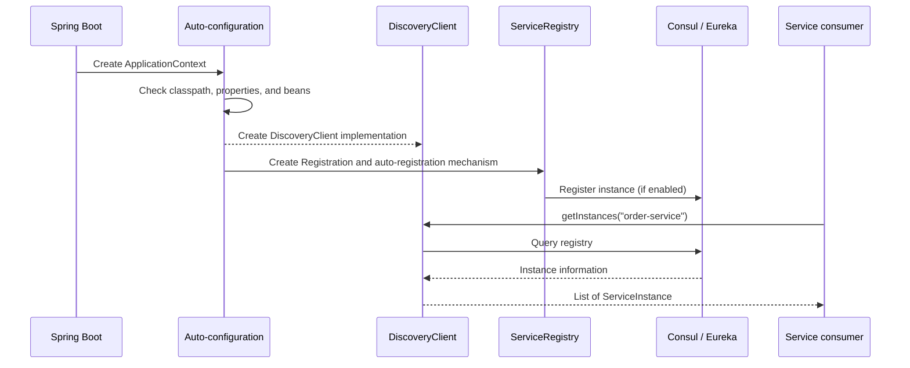

# Role of @EnableDiscoveryClient and Auto-Configuration Conditions

Spring Cloud provides `DiscoveryClient` as a common API for an application to find instances by service name. The application can use that same calling pattern regardless of whether the backing registry is Consul, Eureka, Zookeeper, or another implementation. Spring Boot and Spring Cloud automatically create the required beans via auto-configuration when dependencies and configuration conditions match.

`@EnableDiscoveryClient` is the annotation associated with Spring Cloud's discovery mechanism. In modern Spring Cloud versions, this annotation is often no longer mandatory to activate discovery: having the starter on the classpath along with auto-configuration is enough to register the implementation. Understanding the role of the annotation and the auto-configuration conditions helps you know why `DiscoveryClient` appears, why a service gets registered, and how to disable individual parts when needed.

## 1. Where does DiscoveryClient sit in the application?

`DiscoveryClient` belongs to Spring Cloud Commons. It is the abstraction for finding instances by service ID, for example `order-service`. The concrete implementation comes from the registry integration library.

```mermaid
flowchart TD
    APP[Spring Boot application]
    AUTO[@SpringBootApplication / EnableAutoConfiguration]
    CONDITIONS[Auto-configuration conditions]
    COMMONS[Spring Cloud Commons]
    DC[DiscoveryClient API]
    IMPL[Registry implementation]
    REG[ServiceRegistry / Registration]
    BACKEND[(Consul / Eureka / other registry)]
    CALLER[Application code]

    APP --> AUTO --> CONDITIONS
    CONDITIONS --> COMMONS --> DC
    CONDITIONS --> IMPL --> DC
    IMPL --> REG --> BACKEND
    CALLER --> DC
```

Each component has a distinct responsibility:

- **`DiscoveryClient`** provides the API to retrieve a list of `ServiceInstance` objects by service name.
- **Implementations** such as Consul Discovery or Eureka Client connect to the corresponding registry and translate registry data into `ServiceInstance` objects.
- **`ServiceRegistry`** provides operations to register, deregister, or query registrations depending on the implementation.
- **`Registration`** describes the instance information to be registered, such as service ID, host, port, and metadata.
- **Auto-configuration** creates the beans above when the appropriate conditions are satisfied.

`DiscoveryClient` does not create a registry server on its own. Adding the Consul Discovery dependency does not mean Consul Server is installed or running; the application still needs a reachable registry and valid connection address configuration.

## 2. Role of @EnableDiscoveryClient

The `@EnableDiscoveryClient` annotation belongs to Spring Cloud Commons and can be placed on a configuration class or the main application class:

```java
import org.springframework.boot.SpringApplication;
import org.springframework.boot.autoconfigure.SpringBootApplication;
import org.springframework.cloud.client.discovery.EnableDiscoveryClient;

@SpringBootApplication
@EnableDiscoveryClient
public class OrderApplication {

    public static void main(String[] args) {
        SpringApplication.run(OrderApplication.class, args);
    }
}
```

This annotation expresses intent to enable discovery capabilities and in some versions/integrations also controls auto-registration behavior. However, in modern Spring Cloud, `@EnableDiscoveryClient` is usually optional: if the application already has `@SpringBootApplication`, an appropriate discovery dependency, and the auto-configuration conditions are met, the implementation can be configured without adding this annotation.

Therefore, the following two styles typically produce the same result in a Spring Boot application using a modern discovery starter:

```java
// Common approach: auto-configuration detects the implementation on the classpath.
@SpringBootApplication
public class OrderApplication {
    public static void main(String[] args) {
        SpringApplication.run(OrderApplication.class, args);
    }
}
```

```java
// You can keep the annotation to explicitly express intent to use discovery.
@SpringBootApplication
@EnableDiscoveryClient
public class OrderApplication {
    public static void main(String[] args) {
        SpringApplication.run(OrderApplication.class, args);
    }
}
```

This depends on the Spring Cloud version and starter in use. For older projects, the annotation may be a required part of the configuration. When upgrading, consult the documentation for the corresponding release train before removing the annotation or changing registration behavior.

### 2.1. The autoRegister attribute

`@EnableDiscoveryClient` has an `autoRegister` attribute in versions that provide this attribute. For example:

```java
@SpringBootApplication
@EnableDiscoveryClient(autoRegister = false)
public class OrderApplication {
    public static void main(String[] args) {
        SpringApplication.run(OrderApplication.class, args);
    }
}
```

This setting indicates that the application should not automatically register its instance on startup via the mechanism tied to the annotation. It is useful when the application only needs to query services or when registration is managed in another deployment step. Exact behavior should be verified against the Spring Cloud version in use; in modern configurations, you can use a general property or a registry-specific property to control auto-registration.

Do not confuse `autoRegister = false` with disabling discovery entirely. The application may still need `DiscoveryClient` to find instances of other services.

## 3. Conditions for auto-configuration to create DiscoveryClient

Auto-configuration does not create every bean in all situations. Spring Boot evaluates conditions before loading configurations. For discovery, common conditions include:

### 3.1. Implementation dependency on the classpath

Spring Cloud Commons provides the abstraction, while a specific starter brings the implementation and corresponding auto-configuration metadata. Maven dependency example:

```xml
<dependencies>
    <!-- Consul integration -->
    <dependency>
        <groupId>org.springframework.cloud</groupId>
        <artifactId>spring-cloud-starter-consul-discovery</artifactId>
    </dependency>

    <!-- Spring Boot Actuator to provide operational/health endpoints -->
    <dependency>
        <groupId>org.springframework.boot</groupId>
        <artifactId>spring-boot-starter-actuator</artifactId>
    </dependency>
</dependencies>
```

If you want to use Eureka, the application needs the corresponding Eureka Client starter instead of the Consul starter. Do not add multiple registry starters arbitrarily: if multiple implementations coexist, you need to understand the composite mechanism, precedence order, and configuration of each implementation.

The Spring Boot and Spring Cloud versions must be compatible according to the release train. Typically, manage versions using the Spring Cloud BOM rather than assigning individual versions to each starter.

### 3.2. Application enables auto-configuration

`@SpringBootApplication` includes `@EnableAutoConfiguration`, so Spring Boot can discover and evaluate the auto-configurations provided by starters.

If the application does not use `@SpringBootApplication`, ensure there is a mechanism enabling the corresponding auto-configuration. Simply importing the `DiscoveryClient` interface or adding `@EnableDiscoveryClient` cannot replace Spring Boot's full auto-configuration loading process.

### 3.3. Classpath, property, and bean conditions

Auto-configuration typically uses conditional annotations:

| Condition | Meaning in auto-configuration |
| --- | --- |
| `@ConditionalOnClass` | Applies configuration only when the required class is on the classpath. |
| `@ConditionalOnProperty` | Applies only when a property has a matching value; can use `matchIfMissing` to define the default. |
| `@ConditionalOnMissingBean` | Creates a default bean only if the application has not already provided one. |
| `@ConditionalOnBean` | Applies only when a dependent bean already exists. |

Conceptual example of a conditional configuration:

```java
@Configuration(proxyBeanMethods = false)
@ConditionalOnClass(ConsulClient.class)
@ConditionalOnProperty(
    name = "spring.cloud.consul.enabled",
    havingValue = "true",
    matchIfMissing = true
)
class ExampleConsulConfiguration {
    // Consul integration beans are declared here.
}
```

This is an example illustrating how conditions work, not the verbatim internal configuration of every Spring Cloud Consul version. Actual property names and conditions are determined by the specific starter.

### 3.4. Discovery and auto-registration can be controlled separately

Several properties are commonly used to control these two different behaviors:

```yaml
spring:
  cloud:
    discovery:
      enabled: true
    service-registry:
      auto-registration:
        enabled: true
    consul:
      discovery:
        register: true
```

- `spring.cloud.discovery.enabled` controls enabling discovery at the Spring Cloud level. When set to `false`, related discovery configurations may be disabled.
- `spring.cloud.service-registry.auto-registration.enabled` controls the general automatic service registration mechanism when the implementation supports auto-registration.
- `spring.cloud.consul.discovery.register` controls service registration for Consul Discovery.

General properties and implementation-specific properties do not completely replace one another. For example, disabling Consul registration does not necessarily mean disabling the ability to query Consul. Check version-specific documentation to confirm supported properties and which conditions are affected.

## 4. DiscoveryClient and service registration in the application lifecycle

When the application starts, Spring Boot creates the application context and evaluates auto-configurations. If dependencies and properties are valid, the discovery implementation is created. If auto-registration is enabled and both `ServiceRegistry` and `Registration` exist, the registration mechanism can send instance information to the registry.



Example using `DiscoveryClient` via constructor injection:

```java
import java.util.List;

import org.springframework.cloud.client.ServiceInstance;
import org.springframework.cloud.client.discovery.DiscoveryClient;
import org.springframework.web.bind.annotation.GetMapping;
import org.springframework.web.bind.annotation.RestController;

@RestController
public class DiscoveryController {

    private final DiscoveryClient discoveryClient;

    public DiscoveryController(DiscoveryClient discoveryClient) {
        this.discoveryClient = discoveryClient;
    }

    @GetMapping("/discovery/orders")
    public List<ServiceInstance> findOrders() {
        return discoveryClient.getInstances("order-service");
    }
}
```

`getInstances("order-service")` returns the list of instances found by the implementation. An empty list may mean the service has not registered, health checks filtered the instance out, the consumer is not connected to the right registry, or the service name does not match. The API does not pick a single instance on its own and does not make an HTTP call to that instance.

If you need to select an instance to call a service, you can combine it with Spring Cloud LoadBalancer. `DiscoveryClient` provides instance information; LoadBalancer decides which instance is selected according to configuration and load-balancing policies.

## 5. When multiple DiscoveryClient implementations exist

An application usually only needs one primary registry. However, there are cases where the classpath contains multiple implementations, such as having both Consul Discovery and Eureka Client. Spring Cloud can provide a composite mechanism to aggregate multiple `DiscoveryClient` beans; the order of implementations affects the search order or aggregated results.

In this situation:

- Inspect the dependency tree to see which starters are pulled in directly or transitively.
- Clearly identify which registry is responsible for service registration.
- Check `DiscoveryClient` ordering and `CompositeDiscoveryClient` behavior for the release train in use.
- Avoid accidentally registering the same instance into multiple registries.
- If you only want to use one implementation, remove the extra starter or disable its auto-configuration per that library's guide.

When no specific registry client is present, Spring Cloud can use `SimpleDiscoveryClient` as an option based on static configuration in supported scenarios. This is not a distributed registry capable of dynamically discovering instances; the instance list must be declared in configuration.

## 6. Checking why auto-configuration was enabled or skipped

When the application lacks a `DiscoveryClient` bean, do not start by adding annotations randomly. Check in order:

1. Is the starter dependency on the runtime classpath?
2. Are Spring Boot and Spring Cloud using a compatible release train?
3. Does the application enable `@EnableAutoConfiguration` via `@SpringBootApplication`?
4. Is the discovery property set to `false` in a file, profile, or environment variable?
5. Are the registry host, port, credentials, and network route valid?
6. Is there an auto-configuration exclusion or custom bean altering the conditions?

Run the application with debug enabled to view the Condition Evaluation Report:

```bash
java -jar target/order-service.jar --debug
```

The report shows which auto-configurations were applied and why another configuration was skipped, such as a missing class on the classpath or a non-matching property.

If using Actuator, the `conditions` endpoint can also help inspect the condition report. Only expose and protect this endpoint in an appropriate administrative environment; do not open it publicly because the details can reveal internal application structure and configuration.

## 7. Common issues

| Symptom | Causes to check | Resolution |
| --- | --- | --- |
| Cannot inject `DiscoveryClient` | Missing Spring Cloud Commons/appropriate implementation or auto-configuration is disabled | Check the dependency tree, `@SpringBootApplication`, and discovery properties. |
| `DiscoveryClient` exists but no instances are found | Service not registered yet, wrong service ID, registry not synced, or instances filtered by health checks | Check service ID, registry UI/API, and health check status. |
| Application starts but does not auto-register | Auto-registration is disabled or appropriate `ServiceRegistry`/`Registration` is missing | Check general properties and registry-specific properties. |
| Adding `@EnableDiscoveryClient` still leaves the error | The real error is in dependencies, conditions, registry address, or network | Read the Condition Evaluation Report and registry client logs. |
| Two registries are activated simultaneously | Multiple starters on the classpath or pulled in via transitive dependencies | Review the dependency tree, explicitly configure the used registry and order if composite is needed. |
| Works locally but fails discovery in Docker | Host configuration uses `localhost` inside the container or networks cannot reach each other | Use the hostname/DNS of the service registry within the Docker network and check ports. |

## 8. Project usage principles

- Keep `@SpringBootApplication` as the entry point so Spring Boot performs component scanning and auto-configuration.
- Add the exact registry starter the application needs; manage versions with a compatible BOM.
- Only add `@EnableDiscoveryClient` when required by the version or project conventions, or when you want to explicitly state intent in source code.
- Distinguish discovery lookup from auto-registration; disabling one behavior does not necessarily disable the other.
- Use `DiscoveryClient` to obtain the instance list; use LoadBalancer when you need to select an instance for service calls.
- When auto-configuration does not work, inspect the condition report and property sources before writing manual configuration.
- Do not treat annotations as a substitute for the registry server, network, health checks, or security configuration.

## 9. Key takeaways

- `DiscoveryClient` is the abstraction from Spring Cloud Commons; a specific starter provides the implementation for Consul, Eureka, or another registry.
- `@EnableDiscoveryClient` can be used to indicate/enable discovery, but in modern Spring Cloud versions it is usually optional if auto-configuration is enabled.
- Auto-configuration depends on the classpath, properties, beans, and Spring Boot's `@EnableAutoConfiguration`.
- Discovery lookup and service auto-registration are two different behaviors that can be controlled by their corresponding properties.
- Use `--debug` to read the Condition Evaluation Report when you need to know why a bean was created or skipped.

Once you understand the auto-configuration conditions, you can keep discovery configuration clean, pinpoint the right cause when a bean fails to appear, and avoid adding unnecessary annotations or dependencies to your Spring Cloud application.
