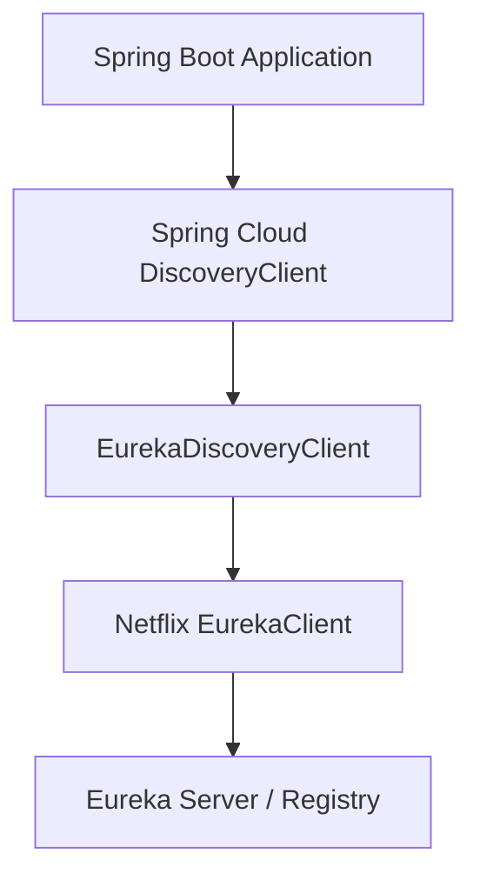

# Distinguishing Spring Cloud's `DiscoveryClient` and Netflix's `EurekaClient`

## 1. Two APIs solving the same need at two different layers

In microservices, a service consumer needs to find instances providing a service by logical name, such as `inventory-service`. Spring Cloud and Netflix Eureka both have APIs to perform this lookup, but the two APIs belong to two different layers:

- **Spring Cloud's `DiscoveryClient`** is an abstraction defined by Spring Cloud Commons. Applications use this interface to query service instances without directly depending on Eureka, Consul, or a specific registry.
- **Netflix's `EurekaClient`** is an API belonging to the Eureka Client library. It works directly with Eureka's model and data types, such as `Application`, `InstanceInfo`, VIP address, and region.

When an application uses Eureka through Spring Cloud, an adapter named **`EurekaDiscoveryClient`** connects the two layers: it implements the `DiscoveryClient` interface and delegates discovery operations to the underlying Eureka Client. Therefore, `DiscoveryClient` and `EurekaClient` are not two different names for the same interface.

## 2. Position in the architecture and packages

Important commonly encountered types:

| Type | Package | Role |
|---|---|---|
| `DiscoveryClient` | `org.springframework.cloud.client.discovery` | Common Spring Cloud discovery interface |
| `ServiceInstance` | `org.springframework.cloud.client` | Instance description in Spring Cloud's abstraction |
| `EurekaClient` | `com.netflix.discovery` | Dedicated Netflix Eureka client API |
| `Application` | `com.netflix.discovery.shared` | Group of instances of an application in the Eureka registry |
| `InstanceInfo` | `com.netflix.appinfo` | Eureka-specific instance record |
| `EurekaDiscoveryClient` | `org.springframework.cloud.netflix.eureka` | Adapter implementing Spring Cloud `DiscoveryClient` on top of Eureka |

The dependency flow can be visualized as follows:



The application calls the Spring Cloud interface. Spring Cloud's adapter translates the request into operations on Eureka Client; Eureka Client communicates with Eureka Server and returns data for the adapter to convert into `ServiceInstance` objects.

## 3. Spring Cloud's `DiscoveryClient`

### 3.1. Purpose and main operations

`DiscoveryClient` belongs to Spring Cloud Commons and is the common contract for querying the service list and the instances of a service. Commonly used synchronous operations include:

| Method | Meaning |
|---|---|
| `getServices()` | Retrieve the list of service IDs currently known to the registry |
| `getInstances(serviceId)` | Retrieve the instances belonging to the requested service ID |
| `description()` | Return a description of the discovery implementation |

The result of `getInstances` is a list of `ServiceInstance`, not a Eureka-specific type. A `ServiceInstance` typically provides service ID, instance ID, host, port, URI, secure flag, and metadata. This information is enough for many use cases such as displaying instance lists, inspecting endpoints, or integrating with a load balancer.

### 3.2. Usage example

```java
import java.util.List;

import org.springframework.cloud.client.ServiceInstance;
import org.springframework.cloud.client.discovery.DiscoveryClient;
import org.springframework.stereotype.Service;

@Service
public class InventoryLookup {

    private final DiscoveryClient discoveryClient;

    public InventoryLookup(DiscoveryClient discoveryClient) {
        this.discoveryClient = discoveryClient;
    }

    public List<ServiceInstance> findInventoryInstances() {
        return discoveryClient.getInstances("inventory-service");
    }
}
```

This snippet only depends on Spring Cloud Commons. If the project replaces Eureka with Consul and configures the corresponding starter, the code calling `DiscoveryClient` can remain unchanged. Spring Cloud will supply the implementation matching the configured registry.

Example listing known services:

```java
List<String> serviceIds = discoveryClient.getServices();

for (String serviceId : serviceIds) {
    List<ServiceInstance> instances = discoveryClient.getInstances(serviceId);
    System.out.printf("%s: %d instance(s)%n", serviceId, instances.size());
}
```

The returned list reflects the data provided by the discovery implementation at query time. It does not guarantee that every instance is healthy or that requests to an instance will succeed; the application still needs timeouts, retries, health/readiness policies, and proper error handling.

### 3.3. When a reactive API is needed

For reactive applications, Spring Cloud Commons also provides the `ReactiveDiscoveryClient` abstraction in the `org.springframework.cloud.client.discovery` package. This is a separate reactive API, typically returning `Flux` instead of `List`. Do not confuse this reactive interface with the synchronous `DiscoveryClient`; choose the API matching your application's processing model and configured implementation.

## 4. Netflix's `EurekaClient`

### 4.1. Purpose and Eureka-specific data

`com.netflix.discovery.EurekaClient` belongs to the Netflix Eureka Client library. This API understands directly how Eureka organizes its registry:

- `Application` represents a group of instances of an application.
- `InstanceInfo` represents an instance, including app name, instance ID, address, port, status, metadata, and related URLs.
- VIP address and secure VIP address are identifiers used by Eureka in certain lookup operations.
- Region and availability zone are Eureka configuration concepts in multi-zone deployments.

`EurekaClient` provides lookup operations such as fetching an `Application`, fetching the list of `Application` objects, finding an instance by ID or VIP address, and getting the next server by VIP. It also participates in the client lifecycle and Eureka-specific operations. API details can vary across library versions, so check the Javadoc for the exact version in use.

### 4.2. Direct lookup example

When an application genuinely needs Eureka-specific information, it can inject `EurekaClient`:

```java
import java.util.List;

import com.netflix.appinfo.InstanceInfo;
import com.netflix.discovery.EurekaClient;
import com.netflix.discovery.shared.Application;
import org.springframework.stereotype.Service;

@Service
public class EurekaInventoryLookup {

    private final EurekaClient eurekaClient;

    public EurekaInventoryLookup(EurekaClient eurekaClient) {
        this.eurekaClient = eurekaClient;
    }

    public List<InstanceInfo> findInventoryInstances() {
        Application application = eurekaClient.getApplication("INVENTORY-SERVICE");
        if (application == null) {
            return List.of();
        }
        return application.getInstances();
    }
}
```

The example uses the application name in the form Eureka stores in its registry, typically normalized to uppercase. Verify the actual app name and API against your project's Eureka Client version. `InstanceInfo` is a Netflix type, so code calling this API directly depends on Eureka.

Some applications also need specific operations such as lookups by VIP address or reading metadata/instance status from `InstanceInfo`. These are scenarios where the Netflix API can provide information more directly than the common abstraction.

## 5. `EurekaDiscoveryClient` is the bridge, not `EurekaClient`

When adding the Spring Cloud Netflix Eureka Client starter, Spring Cloud configures the Eureka client and the discovery adapter. `EurekaDiscoveryClient` implements the `DiscoveryClient` interface; it maps Eureka data such as `InstanceInfo` to Spring Cloud's `ServiceInstance` type.

Example of conceptual mapping:

| Eureka data | Spring Cloud data |
|---|---|
| App name | `ServiceInstance.getServiceId()` |
| Instance ID | `ServiceInstance.getInstanceId()` |
| Host/IP and port | `getHost()` and `getPort()` |
| Secure flag / URI | `isSecure()` and `getUri()` |
| Metadata | `getMetadata()` |

Thanks to the adapter, a service can call `DiscoveryClient` without knowing the underlying registry is Eureka. If switching to Consul, the underlying implementation changes; code depending on the abstraction has a good chance of staying intact.

This does not mean registries have completely identical semantics. Metadata, health status, update latency, consistency, and behavior when the registry loses connectivity still depend on the implementation. The abstraction reduces API-level coupling; it does not eliminate all operational differences.

## 6. Direct comparison

| Criterion | Spring Cloud `DiscoveryClient` | Netflix `EurekaClient` |
|---|---|---|
| Abstraction layer | Common Spring Cloud Commons API | Eureka-specific API |
| Package | `org.springframework.cloud.client.discovery` | `com.netflix.discovery` |
| Instance data type | `ServiceInstance` | `InstanceInfo` |
| Lookup style | By service ID via `getInstances` | By Application, instance ID, VIP address, or corresponding Eureka API |
| Registry dependency | Usable with multiple discovery implementations | Only usable with Eureka |
| Code coupling | Lower coupling to the registry vendor | Higher coupling due to direct use of Eureka's model and semantics |
| Use case | Looking up instances for ordinary application logic | Features requiring Eureka-specific APIs, metadata, or status |
| Registry replaceability | Easier, though semantics and configuration still need verification | Usually requires code changes when migrating to another registry |

An important point: `DiscoveryClient` primarily serves **reading discovery information**. Registration/deregistration at the Spring level usually involves `ServiceRegistry` and the starter's auto-configuration lifecycle. Do not assume that injecting `DiscoveryClient` means the application is automatically registering its own instance.

## 7. Combining with Spring Cloud LoadBalancer

Looking up the instance list and picking an instance to send a request to are two separate steps. `DiscoveryClient` can return multiple `ServiceInstance` objects; applications should usually not take the first element and call it directly, because that approach lacks load-balancing strategy, retries, or full failed-instance handling.

With Spring Cloud, you can use a `@LoadBalanced` `RestClient.Builder`, `RestTemplate`, or `WebClient.Builder` appropriate to your application's version and stack. Example with `RestClient`:

```java
@Configuration
public class HttpClientConfiguration {

    @Bean
    @LoadBalanced
    RestClient.Builder loadBalancedRestClientBuilder() {
        return RestClient.builder();
    }
}
```

Then call using the service ID:

```java
@Service
public class InventoryServiceClient {

    private final RestClient restClient;

    public InventoryServiceClient(RestClient.Builder loadBalancedRestClientBuilder) {
        this.restClient = loadBalancedRestClientBuilder.build();
    }

    public String getStock(String sku) {
        return restClient.get()
                .uri("http://inventory-service/api/stock/{sku}", sku)
                .retrieve()
                .body(String.class);
    }
}
```

`@LoadBalanced` marks the builder so Spring Cloud LoadBalancer resolves the `inventory-service` host via discovery and selects an instance. Bean configuration and builder APIs must match the Spring Boot/Spring Framework version used by the project; older applications may be using `RestTemplate` or `WebClient`.

When using a load balancer, the application does not need to inject `EurekaClient` to select a server. The discovery implementation supplies the instance list, while Spring Cloud LoadBalancer decides which instance is used for the request according to the configured strategy.

## 8. Which API should you choose in your application?

**Prefer `DiscoveryClient` when:**

- Business code only needs to look up services by name and obtain host, port, URI, or basic metadata.
- You want to keep code loosely coupled to the registry so replacing Eureka with Consul or another implementation is easier.
- You are building shared libraries or modules used across multiple Spring Cloud applications.
- You want to combine discovery with Spring Cloud LoadBalancer.

**Use `EurekaClient` directly when:**

- You need to access data or operations available only in the Eureka API, such as `Application`, `InstanceInfo`, VIP address, region, or specific event APIs.
- You are writing a component deeply integrated with Eureka or registry operational tooling.
- You accept a direct dependency on Netflix Eureka and plan to test compatibility during upgrades.

Do not use `EurekaClient` merely because the project currently runs Eureka. If the need is just obtaining instances, the Spring Cloud abstraction is usually sufficient and keeps the code easier to evolve.

## 9. Basic dependencies and configuration

To use `DiscoveryClient` with Eureka in Spring Cloud, a project typically adds the following starter and manages versions with a Spring Cloud BOM compatible with Spring Boot:

```xml
<dependency>
    <groupId>org.springframework.cloud</groupId>
    <artifactId>spring-cloud-starter-netflix-eureka-client</artifactId>
</dependency>
```

Minimal client-side configuration:

```yaml
spring:
  application:
    name: checkout-service

eureka:
  client:
    service-url:
      defaultZone: http://localhost:8761/eureka/
    register-with-eureka: true
    fetch-registry: true
```

The Eureka Client starter provides the implementation for Spring to inject `DiscoveryClient`, while also configuring the Netflix Eureka Client. In a typical setup, the client registers the application and fetches the registry; if only one of the two functions is needed, the two corresponding flags can be adjusted.

If switching to Consul, the Consul discovery starter and configuration provide a different implementation for the Spring abstraction. Code using `org.springframework.cloud.client.discovery.DiscoveryClient` remains unchanged if it only uses the common operations.

## 10. Common misconceptions

| Misconception | Correct understanding |
|---|---|
| `DiscoveryClient` is the same as `EurekaClient` | One is a Spring Cloud abstraction, the other is Netflix Eureka's dedicated API |
| `EurekaDiscoveryClient` and `EurekaClient` are the same class | `EurekaDiscoveryClient` is a Spring adapter implementing `DiscoveryClient` using Eureka underneath |
| Having `DiscoveryClient` means the instance registers itself | `DiscoveryClient` is for querying; registration is handled by `ServiceRegistry`/the client implementation's lifecycle |
| `getInstances()` returns a list of guaranteed healthy instances | Results depend on the registry, cache, and health policies; real call failures still need handling |
| `DiscoveryClient` load-balances requests by itself | It supplies instances; Spring Cloud LoadBalancer or an equivalent component selects an instance per request |
| Using `DiscoveryClient` means switching registries requires no changes | Code calling the common API is easy to keep unchanged, but dependencies, config, and semantics still need evaluation |

## 11. Conclusion

`DiscoveryClient` is the right choice for most Spring Cloud code that needs service lookup because it decouples application logic from the registry vendor. `EurekaClient` is appropriate when you need deep access to Netflix Eureka-specific concepts and APIs. `EurekaDiscoveryClient` is the adapter that lets Spring Cloud implement its common abstraction on top of Eureka.

When designing applications, use the abstraction at business boundaries and drop down to the `EurekaClient` API only in integration layers that genuinely require Eureka-specific features. This layering keeps code testable, reduces coupling, and makes switching discovery technologies far more contained.
