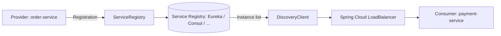
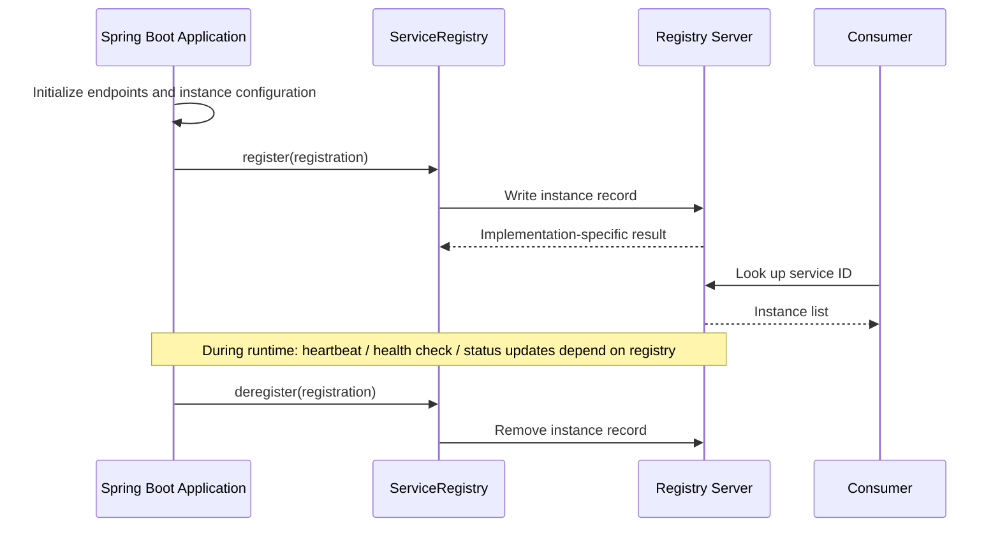

# The ServiceRegistry Contract and the Registration Object

In Spring Cloud Service Discovery, an application needs to publish its running instances so that other applications can find them by service name. For example, `order-service` might run across multiple machines or multiple containers; `payment-service` needs to obtain the list of `order-service` instances instead of knowing the IP address and port of each instance in advance.

Spring Cloud provides an abstraction layer for both sides of this process: the side that writes instance information into the registry via `ServiceRegistry`, and the side that reads instance information via `DiscoveryClient`. This lesson focuses on the `ServiceRegistry` contract and the `Registration` object: how they represent registration, deregistration, status changes, and describe a service instance.

## 1. Where ServiceRegistry Fits in Service Discovery

A registry stores information about the instances of services participating in the system. This information typically includes service name, host address, port, protocol, and metadata. For example, the registry might store three instances of `order-service`:

| Service ID | Host | Port | Illustrative Metadata |
|---|---|---:|---|
| `order-service` | `10.0.1.21` | 8080 | `zone=zone-a` |
| `order-service` | `10.0.1.22` | 8080 | `zone=zone-a` |
| `order-service` | `10.0.2.15` | 8080 | `zone=zone-b` |

When `order-service` starts up, the application or Spring Cloud's auto-registration mechanism publishes the instance information to the registry. When the application shuts down, it needs to deregister so consumers do not continue receiving an address that is no longer serving traffic. While running, the registry or its client can use heartbeats, health checks, or a lease/TTL mechanism to detect instances that are no longer available. The exact mechanism depends on the registry provider.

Service Discovery can be viewed as two flows:



- **Registration flow:** the application provides a `Registration` object; the `ServiceRegistry` implementation translates that object into a record suitable for the registry in use.
- **Discovery flow:** `DiscoveryClient` queries the registry and returns `ServiceInstance` objects for the consumer or load balancer to use.
- **Service invocation flow:** LoadBalancer selects an instance from the discovered list. `ServiceRegistry` itself does not select an instance for each request.

Therefore, `ServiceRegistry` is the contract on the record-management side, whereas `DiscoveryClient` is the contract on the lookup side. The two APIs are related, yet serve two distinct responsibilities.

## 2. The Registration Contract

`Registration` resides in the `org.springframework.cloud.client.serviceregistry` package. It is an interface extending `ServiceInstance`:

```java
package org.springframework.cloud.client.serviceregistry;

import org.springframework.cloud.client.ServiceInstance;

public interface Registration extends ServiceInstance {
}
```

`Registration` does not add a new set of mandatory properties. Its role is to mark a `ServiceInstance` that is being used as registration data for a registry. By extending `ServiceInstance`, a registration provides the foundational information needed to describe a service address.

| Information | Meaning in Service Discovery |
|---|---|
| `getServiceId()` | Logical name of the service, for example `order-service`; consumers use this name for lookup. |
| `getHost()` | Host that consumers can connect to, such as a hostname or an IP address routable within the deployment network. |
| `getPort()` | Port on which the instance accepts connections. |
| `isSecure()` | Indicates whether the instance uses a secure connection; this information affects the scheme when constructing URIs. |
| `getUri()` | Access URI for the instance, typically combining scheme, host, and port. |
| `getMetadata()` | Additional key-value pairs, such as zone, API version, or deployment group. |

The methods above belong to the `ServiceInstance` contract. `Registration` inherits them so it can be used in registration operations. Concrete implementations may add provider-specific data, such as an instance ID, tags, health check configuration, or zone information. These extensions are not general requirements of `Registration`.

### 2.1. Service ID and Instance ID

These two concepts solve two different problems:

- **Service ID** identifies a logical service group. Multiple instances serving the same function typically share the same service ID, such as `order-service`.
- **Instance ID** identifies a specific running instance within that group. How the instance ID is represented and where it is supplied depend on the specific registry or registration class.

Consumers usually look up by service ID and receive multiple instances in return. The registry needs to distinguish each individual instance record in order to update, health-check, or deregister the right record. Therefore, instances sharing the same service ID still need distinct identities according to the provider's mechanism.

### 2.2. Purposeful Metadata

Metadata adds context to an instance without changing the service name. For example:

```text
serviceId = order-service
host      = order-7.internal
port      = 8080
secure    = false
metadata  = {
  zone: "zone-b",
  version: "v2",
  team: "commerce"
}
```

Consumers, LoadBalancer, or custom filters can use metadata to apply routing rules. For example, a consumer might prefer instances in the same zone or only call instances with a compatible version.

Metadata should be small, stable, and meaningful to consumers. Do not put passwords, tokens, private keys, or sensitive data into metadata because the registry can be accessed by many components in the system. Key names and value formats should also be consistent across services; if one side writes `zone` while the other reads `availability-zone`, filtering rules will not work as intended.

## 3. The ServiceRegistry Contract

`ServiceRegistry` is the interface that generalizes writing and managing registrations. The Spring Cloud Commons contract has the form:

```java
package org.springframework.cloud.client.serviceregistry;

public interface ServiceRegistry<R extends Registration> {

    void register(R registration);

    void deregister(R registration);

    void setStatus(R registration, Object status);

    Object getStatus(R registration);
}
```

The type parameter `R extends Registration` constrains the input object to be a registration. Each provider can use its own registration class, while callers can still recognize the common operations through this interface.

| Method | Responsibility | Operational question to answer |
|---|---|---|
| `register(R registration)` | Registers the instance with the registry. | Is the instance discoverable and reachable by consumers yet? |
| `deregister(R registration)` | Deregisters the instance. | Has the instance stopped receiving traffic and been removed from the registry? |
| `setStatus(R registration, Object status)` | Updates the status according to the registry's model. | Which status makes the instance considered eligible to receive traffic? |
| `getStatus(R registration)` | Reads the current status according to the registry's model. | What status does the registry currently record for the instance? |

### 3.1. register

`register` publishes an instance to the registry. After registration succeeds, consumers can receive that instance when querying the corresponding service ID, depending on synchronization timing and the registry's filtering policies.

The registration object must describe an address that consumers can actually reach. If the application runs inside a container but registers a hostname that only resolves inside the container, consumers on other networks may receive a useless address. Similarly, registering an internal port by mistake instead of the exposed port causes discovery to succeed while calls still fail.

The interface returns `void`, so the common contract does not define a registration result object or a universal instance ID shared across all registries. Error reporting, retries, and record confirmation depend on the concrete implementation. Applications need to observe logs, metrics, and registry state rather than assuming that calling the method means all consumers immediately see the instance.

### 3.2. deregister

`deregister` asks the registry to remove the corresponding registration. This operation is typically tied to shutting down an application or replacing an instance.

A controlled shutdown process usually consists of these steps:

1. Stop accepting new requests or transition the instance to a state that does not receive traffic.
2. Wait for in-flight requests to complete within an appropriate graceful shutdown period.
3. Deregister the instance from the registry.
4. Close application resources.

The exact order depends on the deployment platform and lifecycle integration. If deregistration happens too late, consumers may continue picking a stopped instance. If it happens too early, in-flight requests may be disrupted. In orchestrator-based environments, coordinate readiness probes, termination grace periods, and Spring Cloud's deregistration mechanism.

### 3.3. setStatus and getStatus

The two status methods allow interacting with the registration status supported by the registry. Both the parameter and return value are `Object`, so the common API does not impose a uniform status enum across all providers.

For example, a registry may represent status using a string or its own enum. Statuses such as `UP`, `DOWN`, `OUT_OF_SERVICE`, or `UNKNOWN` may appear in some integrations, but their semantics, names, and impact on discoverability are not guaranteed to be identical across every registry.

Therefore, when using statuses:

- Check the data type and valid values accepted by the concrete implementation.
- Verify which statuses cause an instance to be excluded from discovery results or skipped by the load balancer.
- Do not treat `getStatus` as a direct process health check. It is the status reported by the registry according to its own mechanism.
- Distinguish between status explicitly set by the application and health check or heartbeat results managed by the registry/client.

## 4. Relationship Between Registration, ServiceInstance, and DiscoveryClient

These data types and APIs often appear together, but they are not interchangeable:

| Component | Role | Primary usage direction |
|---|---|---|
| `Registration` | Describes an instance passed into the registration workflow; extends `ServiceInstance`. | Provider side registering or updating an instance. |
| `ServiceInstance` | Describes an accessible instance. | Common data type for instance information. |
| `DiscoveryClient` | Looks up instances by service ID and retrieves known service names. | Consumer side discovering services. |
| `ServiceRegistry` | Performs registration management operations. | Provider side writing to and updating the registry. |

For example, `payment-service` calls `DiscoveryClient` to retrieve the instance list of `order-service`. The result consists of `ServiceInstance` objects containing the URI and metadata of each address. Spring Cloud LoadBalancer can then select an instance. Meanwhile, each running instance of `order-service` uses its corresponding registration to publish itself through `ServiceRegistry`.

This also explains why merely adding `DiscoveryClient` on the consumer does not automatically register the provider. For an application to appear in the registry, it needs a registration and the appropriate mechanism to perform the registration operation.

## 5. Example of Using the Contract Generically

The code below illustrates how a component depends on the `ServiceRegistry` contract. The concrete class `R` is provided by the registry integration in use:

```java
import org.springframework.cloud.client.serviceregistry.Registration;
import org.springframework.cloud.client.serviceregistry.ServiceRegistry;

public class RegistryPublisher<R extends Registration> {

    private final ServiceRegistry<R> serviceRegistry;

    public RegistryPublisher(ServiceRegistry<R> serviceRegistry) {
        this.serviceRegistry = serviceRegistry;
    }

    public void publish(R registration) {
        serviceRegistry.register(registration);
    }

    public void withdraw(R registration) {
        serviceRegistry.deregister(registration);
    }

    public Object currentStatus(R registration) {
        return serviceRegistry.getStatus(registration);
    }
}
```

This is an example of depending on an abstraction, not a complete configuration for a specific provider. A real application needs a `ServiceRegistry` bean and a compatible registration object supplied by the starter or integration configuration. You cannot substitute `R` with an arbitrary registration if the implementation in use requires a specific registration type.

In a Spring Boot application, registration is typically integrated into Spring Cloud's automatic lifecycle when the corresponding dependencies and configuration are enabled. Depending on the starter and version, the application may need to enable or disable auto-registration through dedicated properties. Therefore, when debugging an instance that does not appear in the registry, check the dependencies, registration beans, auto-registration flags, and startup logs.

## 6. Registration Lifecycle in a Microservice Application

A typical lifecycle can be described as follows:



Key milestones in the lifecycle:

**Initialization:** the application determines the service ID, host address, port, protocol, and metadata. The published address must match the network used by consumers.

**Registration:** the auto-registration mechanism or integration code calls `ServiceRegistry.register`. The registry creates or updates the record according to the provider's rules.

**Maintenance:** the registry may require heartbeats, TTLs, health checks, or lease renewals. Do not infer that `ServiceRegistry` has a universal heartbeat method; this contract defines no such method. Maintenance is typically handled by the client, an agent, or the registry's own mechanism.

**Discovery and routing:** consumers retrieve the instance list through DiscoveryClient. LoadBalancer selects an appropriate instance based on the configured policy.

**Shutdown:** the application transitions to a state that stops accepting traffic, finishes in-flight requests, and deregisters. If the process crashes abruptly, the provider's TTL or health check mechanism helps remove stale records after a period of time.

## 7. Differences Across Registry Implementations

Spring Cloud Commons defines the abstraction; it does not force every registry to use the same protocol or data model. For example, Eureka and Consul integrations can provide different registration classes, instance ID conventions, health checks, and statuses.

| Aspect | Common contract | Provider-dependent part |
|---|---|---|
| Instance description | `Registration` extends `ServiceInstance`. | Additional properties such as instance ID, tags, zone, or custom settings. |
| Registration | `register(registration)`. | Write protocol, authentication, retries, and duplicate record handling. |
| Deregistration | `deregister(registration)`. | How the record is identified and when it is removed. |
| Status | `setStatus` and `getStatus`. | Status type, valid value set, and effect on discovery. |
| Health checks | No single common health-check API in `ServiceRegistry`. | HTTP health check, heartbeat, TTL, agent, or provider-specific mechanism. |

When migrating from one registry to another, code calling the abstraction can stay the same, while configuration and operational behavior still need to be verified. In particular, do not assume that metadata, status, or health checks map identically on their own.

## 8. Common Issues and How to Handle Them

### Instance is registered but consumers cannot call it

Discovery may return the right record, yet the host or port is unreachable from the consumer's network. Inspect the URI constructed from registration, DNS, network policies, container ports, reverse proxies, and HTTP/HTTPS protocols. A record existing in the registry only proves that the registry holds that information; it does not prove that the endpoint can serve requests.

### Instance has stopped but still appears in the list

The application may have failed to deregister on shutdown, the process may have been killed abruptly, or the TTL/health check may not have expired yet. Inspect lifecycle logs, graceful shutdown settings, and the registry's instance eviction mechanism. For crash scenarios, understand the detection and stale-record removal window so timeouts can be configured appropriately.

### Multiple instances overwrite or collide with each other

Instances need distinct identities according to the registry's rules. If instance IDs collide or are generated inconsistently, the registry may update the wrong record or leave stale data behind. Check how the implementation generates instance IDs and ensure every running instance has an identifier suitable for the deployment environment.

### Registry status differs from application status

An application may be running while marked unhealthy; conversely, the registry may still retain a healthy status after the application has encountered a failure. Compare the status published by the application, health check results, heartbeats, and the data returned by DiscoveryClient. Do not rely on `getStatus` alone to conclude that a process is healthy.

### Metadata does not trigger routing rules

Verify the exact key names, casing, data types, and metadata values on both the provider and consumer sides. Also confirm that LoadBalancer or the filter actually reads that metadata; writing metadata into the registry does not create a routing policy on its own.

## 9. Best Practices for Designing Registration

1. **Use stable service IDs:** service names should reflect their logical role and remain consistent between providers and consumers.
2. **Publish reachable addresses:** host, port, and scheme must be accurate from the consumer's network perspective.
3. **Ensure proper instance identifiers:** each running instance must be distinguishable by the registry according to the provider's mechanism.
4. **Keep metadata minimal:** publish only data needed for discovery or routing; strictly avoid secrets and credentials.
5. **Coordinate readiness with registration:** only bring an instance into service once endpoints are ready; on shutdown, stop accepting traffic and withdraw the registration through a controlled lifecycle.
6. **Understand status and health-check semantics:** read the documentation for the implementation in use and verify behavior with integration tests.
7. **Monitor the registry as infrastructure:** observe registration failures, heartbeat failures, instance counts, stale records, and update latency.
8. **Test both write and read paths:** confirm that the provider can register, the consumer can discover, and the consumer can connect to the address received.

## 10. Checklist When a Service Does Not Appear in the Registry

| Question | Where to check |
|---|---|
| Are the right starter and registry implementation present? | Spring Boot dependencies and configuration. |
| Is the registration created with a valid service ID? | Application name configuration and registration bean. |
| Is auto-registration enabled? | Spring Cloud configuration and startup logs. |
| Is the registry receiving registration requests? | Network connectivity, authentication, TLS, and registry logs. |
| Are host/port valid for the consumer? | Registration, DNS, container ports, and network routes. |
| Is a health check or TTL excluding the instance? | Health check, heartbeat, and status configuration. |
| Is the consumer looking up the right service ID? | DiscoveryClient calls and discovery configuration. |
| Are there stale records or duplicate instance IDs? | Registry data and instance ID generation logic. |

## Conclusion

`Registration` describes an instance that can be published into a Service Discovery system by extending `ServiceInstance`. `ServiceRegistry<R extends Registration>` provides four common management operations: register, deregister, set status, and get status. These interfaces allow Spring Cloud applications to depend on an abstraction rather than tying directly to a specific registry's API.

When deploying microservices, it is important to understand what is guaranteed by the common contract and what is determined by Eureka, Consul, or another implementation. The quality of Service Discovery depends simultaneously on accurate registration, reachable addresses, shutdown lifecycle, health checks, and registry observability. Only after the provider publishes its instances can consumers discover them via `DiscoveryClient` and let LoadBalancer pick an appropriate address.
