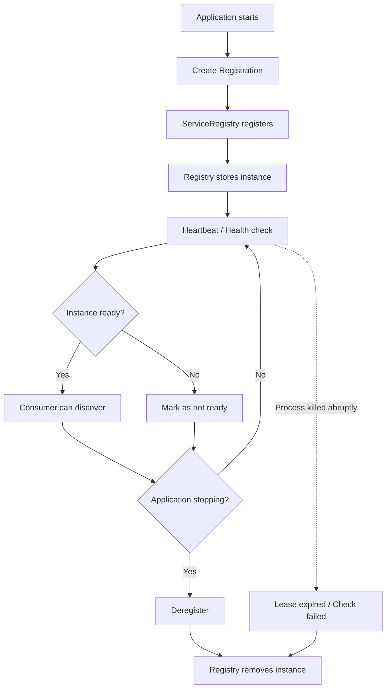

# Registering, Deregistering, Reading, and Updating Status

In Spring Cloud Service Discovery, an instance needs to be registered with a registry so other services can find it. Throughout its runtime, the registration information can be maintained via heartbeats or health checks; its status can change when the instance becomes ready, temporarily stops accepting requests, or encounters an error. When the application shuts down normally, the instance needs to be deregistered so consumers do not continue sending requests to that address.

Spring Cloud provides the `ServiceRegistry` abstraction to work with the registration lifecycle. This abstraction allows application code to interact with a common interface while the concrete implementation may come from Eureka, Consul, or another provider.

## 1. Participating Components

It is important to distinguish the components that commonly appear in a service discovery flow:

| Component | Primary Responsibility |
|---|---|
| `Registration` | Describes an instance to be registered, including service ID, instance ID, host, port, and metadata |
| `ServiceRegistry` | Registers, deregisters, and reads or updates the status of a registration |
| `DiscoveryClient` | Looks up services and the list of instances published by the registry |
| Health check / heartbeat | Provides signals about the instance's operational readiness and liveness |
| Spring Cloud LoadBalancer | Selects an instance from the discovered list to send a request to |

`ServiceRegistry` is an abstraction oriented toward write operations and registration management. `DiscoveryClient` serves to read the list of services and instances for consumers to use. The fact that a consumer can call `DiscoveryClient` does not mean that consumer has permission to register or change the status of an instance.

A registration typically carries the following information:

- **Service ID:** the logical name of the service, for example `order-service`.
- **Instance ID:** a unique identifier for a specific running instance, for example `order-service:pod-7c9d`.
- **Host and port:** the network address where the instance accepts connections.
- **Metadata:** additional information such as zone, version, or deployment group.
- **Status:** a signal indicating whether the instance should be considered ready to serve traffic; its representation depends on the registry.

Multiple instances can register under the same service ID. The registry uses the instance ID and address to distinguish each running replica.

## 2. Registration Lifecycle of an Instance

A common lifecycle can be divided into the following stages:

1. **Startup:** the application loads configurations such as `spring.application.name`, server port, and discovery client settings.
2. **Registration creation:** the discovery client gathers the service ID, instance ID, address, metadata, and other required details.
3. **Registration:** the client sends the registration to the registry. The registry stores the instance under the corresponding service ID.
4. **Maintenance:** the client sends heartbeats or the registry performs health checks according to the provider's mechanism.
5. **Status changes:** the instance may be marked ready, not ready, or temporarily paused from receiving traffic.
6. **Deregistration:** when the application stops normally, the client sends a request to remove the registration.
7. **Failure cleanup:** if the process dies abruptly and cannot deregister, heartbeat expiration or failed health checks allow the registry to remove the instance from the list of serviceable targets.



Successful registration only indicates that the registry has received the instance information. It does not by itself prove that the application is ready to handle business requests. Appropriate health checks or readiness signals should be combined to avoid routing traffic to the instance too early.

## 3. Auto-Registration and Explicit Registration

In a Spring Boot application integrated with a Spring Cloud discovery client, registration is usually automated. When the application starts, the discovery client's auto-configuration creates a registration and registers it with the registry. When the application context closes, the client executes the deregistration workflow according to the provider's integration.

This approach fits most microservices because the registry lifecycle is tied to the application lifecycle. Development teams typically only need to configure the service ID, registry address, health checks, and necessary metadata.

Auto-registration can be disabled if the application has special operational requirements. A common property used to control auto-registration is:

```yaml
spring:
  cloud:
    service-registry:
      auto-registration:
        enabled: false
```

Exact property names and detailed behavior should be verified against the Spring Cloud version in use. In addition to the shared configuration, each discovery client has its own options, such as registration settings for Eureka or Consul. If auto-registration is disabled, the application must implement an alternative registration workflow and take responsibility for handling both registration failures and deregistration.

### The ServiceRegistry API

Spring Cloud Commons defines the generic interface in the following form:

```java
public interface ServiceRegistry<R extends Registration> {

    void register(R registration);

    void deregister(R registration);

    void close();

    void setStatus(R registration, Object status);

    Object getStatus(R registration);
}
```

The methods have the following meanings:

- `register(registration)`: sends the instance information to the registry.
- `deregister(registration)`: requests the registry to remove the registration.
- `getStatus(registration)`: reads the current status provided by the implementation for that registration.
- `setStatus(registration, status)`: updates the status according to the implementation's convention.
- `close()`: closes service registry resources when required by the integration.

`R` is the provider-specific registration type. Therefore, the interface snippet above describes the common contract; an application needs a registration compatible with Eureka, Consul, or whichever registry is integrated. You cannot construct an arbitrary `Registration` object and assume every implementation will understand it.

Example of the operation sequence at the API level:

```java
// Pseudocode: registration and status must be compatible
// with the ServiceRegistry implementation in use.

serviceRegistry.register(registration);

Object currentStatus = serviceRegistry.getStatus(registration);

serviceRegistry.setStatus(registration, providerSpecificStatus);

serviceRegistry.deregister(registration);
```

This is an example illustrating the API call sequence, not a complete configuration for manually creating a registration. In a typical Spring Cloud application, the discovery client already manages registration automatically; you should not invoke manual registration a second time for the same instance without clearly understanding how the integration manages its lifecycle.

## 4. Reading the Instance List and Status

Consumers typically use `DiscoveryClient` to retrieve instances by service ID:

```java
import java.util.List;

import org.springframework.cloud.client.ServiceInstance;
import org.springframework.cloud.client.discovery.DiscoveryClient;
import org.springframework.stereotype.Component;

@Component
public class OrderServiceLookup {

    private final DiscoveryClient discoveryClient;

    public OrderServiceLookup(DiscoveryClient discoveryClient) {
        this.discoveryClient = discoveryClient;
    }

    public List<ServiceInstance> findInstances() {
        return discoveryClient.getInstances("payment-service");
    }
}
```

Each `ServiceInstance` provides information such as service ID, instance ID (if supplied by the implementation), host, port, URI, and metadata. The returned list reflects the discovery client's view at the time of the query. An empty list can occur when the service has not registered yet, the service name does not match, the instance is not yet considered healthy, or registry data has not synchronized to the client.

To observe the registry, you can use the provider's management UI, discovery client logs, secured management endpoints, or the registry's API. You should distinguish between:

- **Instance list:** which instances the consumer sees via the discovery client.
- **Registration status:** what status the registry or service registry adapter reports for a registration.
- **Application health:** whether the application is satisfying health/readiness criteria.

These three pieces of information are related, but they do not necessarily update simultaneously. An instance may have just entered an error state while consumers still see a stale record for a period of time due to heartbeat intervals, health checks, caches, or registry synchronization latency.

Do not pick the first element of `getInstances()` and reuse it statically for all requests. Let Spring Cloud LoadBalancer select an instance per request or per selection cycle according to the configured load-balancing policy.

## 5. Updating Instance Status

Status tells the registry and consumers whether an instance should receive requests. Common operational scenarios include:

- The instance is starting up and is not ready yet.
- The instance is operating normally.
- The instance needs to temporarily stop receiving traffic for maintenance.
- The instance has encountered an error and should not be selected.
- The instance has stopped and needs to be removed from the registry.

`ServiceRegistry.setStatus(registration, status)` provides a way to update status through the common abstraction. The `status` parameter has type `Object` because each registry has its own status model. Do not assume that every registry accepts the same string or the same enum.

### Example with Eureka

Eureka defines instance statuses such as `UP`, `DOWN`, `STARTING`, `OUT_OF_SERVICE`, and `UNKNOWN`. Specifically:

- `UP`: the instance is considered ready.
- `DOWN`: the instance is not operating normally.
- `STARTING`: the instance is starting up.
- `OUT_OF_SERVICE`: the instance should temporarily not receive traffic.
- `UNKNOWN`: the status has not been determined.

A Eureka client typically sends heartbeats to renew its lease. If heartbeats stop for the configured duration, the Eureka server can remove the instance from the registry via its lease expiration and eviction mechanism. Heartbeats reflect that the client is still maintaining a connection to the server; to accurately reflect application health, configure the appropriate health check integration.

### Example with Consul

Consul combines service registration with health checks. The agent can execute HTTP checks, TCP checks, or other suitable check types. Check results are typically represented by statuses such as `passing`, `warning`, and `critical`.

- `passing`: the check succeeded.
- `warning`: the check produced a warning, though not necessarily a critical failure.
- `critical`: the check failed and the service is unhealthy according to the declared criteria.

In this model, health status is usually updated from health check results. How a `setStatus` call maps to Consul depends on the implementation and registration type; you should not pass a Eureka status string and expect Consul to interpret the same meaning.

### Status Changes Do Not Replace Health Checks

Updating status through the registry is a registration-management operation. It does not fix the underlying cause of an application failure, nor does it replace the application's health endpoint.

For example, if an instance is marked `OUT_OF_SERVICE` while the health check still reports ready, the system may end up with inconsistent state or the status may be overwritten by a subsequent check. When bringing an instance back into service, synchronize administrative status, application readiness, and health check rules together.

Metadata is also separate. `setStatus` is not a general metadata update API. If the zone, version, or registration attributes change, updates must follow what the provider supports or a re-registration workflow documented by the integration.

## 6. Deregistering and Cleaning Up Instances

When an application stops normally, the discovery client should send a deregistration request so the registry removes the instance from the discoverable list. This allows consumers to stop sending requests to the stopped address without waiting for a lease to expire or multiple health checks to fail.

Situations that commonly trigger deregistration include:

- The application is shut down gracefully.
- An instance is replaced during a rollout.
- An instance is taken out of the cluster for maintenance.
- The service changes deployment configuration and no longer uses the old registration.

Deregistration must target the exact registration of the stopping instance. Do not delete indiscriminately by service ID, because that service ID may represent multiple healthy replicas.

If a process is killed abruptly, a machine fails, or network connectivity is lost, the application cannot send a deregistration request. In that case, the registry relies on fallback cleanup mechanisms:

- Eureka relies on heartbeats and lease expiration to detect clients that stop renewing.
- Consul relies on health checks and service/agent deregistration rules.
- Other registries may use corresponding TTLs, sessions, or periodic check mechanisms.

Expiration times should not be set too long, as failed instances could linger in the registry. Nor should they be set too short, as a brief network hiccup could cause healthy instances to be mistakenly evicted. You must balance failure-detection speed against tolerance for transient network fluctuations.

## 7. Health Checks, Readiness, and Consistency

Health checks help the registry evaluate an instance based on verifiable signals. However, you must choose the right signal:

- **Liveness:** whether the process is still alive and not severely hung.
- **Readiness:** whether the instance is ready to accept business requests.
- **Dependency health:** whether downstream systems such as databases or message brokers are working.

If the goal is deciding whether to place an instance in the traffic-serving pool, readiness is usually a better signal than liveness. An application that is alive but has not finished initializing should not be treated as ready. Conversely, an outage in an auxiliary dependency does not always mean the entire instance must be excluded from all request types; design health groups based on actual functionality.

When using Spring Boot Actuator, you can configure health endpoints and health probes for the application. For example:

```yaml
management:
  endpoint:
    health:
      probes:
        enabled: true
```

The registry's health check path and connection settings must be configured separately for the specific discovery client. Enabling Actuator alone does not make Eureka or Consul automatically use the exact readiness endpoint the system expects.

Synchronization latency must also be accounted for. After a status change, the registry server, client-side caches, and LoadBalancer may not all observe the update immediately. Therefore, maintenance operations should follow a clear sequence: stop accepting new requests, wait for in-flight requests to complete within an acceptable timeout, update status or deregister, and only then stop the process.

## 8. Common Issues and How to Handle Them

| Symptom | Possible Cause | Where to Check |
|---|---|---|
| Instance does not appear in registry | Discovery client disabled, wrong endpoint, missing permissions, or registration failed | Check configuration, startup logs, and connectivity to the registry |
| Instance appears but consumer cannot call it | Wrong host/port, firewall, or container address unreachable from consumer | Compare registration address against the actual network |
| Stopped instance still remains in registry | Deregistration did not run or lease/check has not expired yet | Check shutdown logs, heartbeats, TTL, and health checks |
| Healthy instance marked as failed | Timeout too short, unstable health endpoint, or check hitting wrong path | Check timeout duration, endpoint, and readiness conditions |
| Recently updated status gets reverted | Health check or heartbeat integration keeps writing status from old signals | Align status management rules with health checks |
| Consumer still sees stale data | Cache or registry synchronization delay | Check caches, refresh intervals, and convergence time |
| Deregistering one replica affects others | Incorrectly acting on service ID instead of a specific registration | Check instance ID and provider's deregister API |

When investigating, match the exact same instance ID across application logs, the registry, and what the consumer sees. Comparing only the service ID may not be enough because multiple replicas share the same logical name.

## 9. Securing Registry Operations

Registering and updating status directly affect traffic routing across microservices. An untrusted client could register a forged address, alter instance status, or disrupt service discovery.

Apply the following principles:

- Protect registry endpoints and credentials; grant write permissions only to components that need to register or administer the registry.
- Scope status update and deregistration permissions to the appropriate service or operational boundary.
- Encrypt connections to the registry when the environment requires protecting data in transit.
- Never place passwords, tokens, or secret keys inside service IDs or metadata, as this information can be read by many clients.
- If using administrative endpoints such as Actuator to alter status, expose only necessary endpoints and enforce proper authentication, authorization, and network restrictions.
- Log registration, status update, and deregistration operations for incident traceability.

## 10. Maintenance Operation Walkthrough

Suppose `payment-service` has three instances serving traffic. One instance needs to be upgraded:

1. The orchestrator or operational procedure selects the exact instance ID scheduled for maintenance.
2. The instance is marked not to receive new requests using the mechanism supported by the registry and the application.
3. LoadBalancer and consumers update their instance lists after receiving the change; account for cache latency.
4. The instance finishes in-flight requests within the allowed time window.
5. The application shuts down cleanly and the discovery client cancels its registration.
6. The new version starts up, passes health/readiness checks, and registers under the service ID `payment-service`.
7. Consumers continue calling `payment-service`; LoadBalancer picks from the currently discovered instances.

The service ID does not need to change just because a replica is upgraded. The registry continues grouping compatible instances under the same logical name, while the instance ID and network address identify each running replica.

## 11. Deployment Checklist

Before bringing service discovery into production, verify:

1. The discovery client registers the correct service ID and instance ID.
2. Auto-registration is enabled, or a clear explicit registration workflow is in place.
3. Health checks accurately reflect instance readiness.
4. Administratively updated status does not conflict with automated health checks.
5. Consumers only receive instances reachable on the actual network.
6. Normal application shutdown deregisters the correct instance.
7. A mechanism exists to detect abruptly terminated instances via heartbeats, TTL, or health checks.
8. Timeouts, check intervals, and cache durations match failure-detection requirements.
9. Permissions to register, update status, and deregister are properly restricted.
10. Logs and observability tools are sufficient to correlate registrations across the application, registry, and consumers.

By understanding the respective responsibilities of `ServiceRegistry`, `DiscoveryClient`, and health checks, you can manage the full instance lifecycle: registering for discovery, maintaining status for accurate routing, and deregistering or cleaning up when an instance stops serving traffic.
