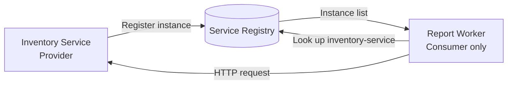

# Disabling Auto-Registration While Keeping Discovery Enabled

In a microservice system, not every process needs to advertise itself as a service. A batch processing application, a background worker, or a service that only calls internal APIs may need to find `inventory-service`, `pricing-service`, or `payment-service`, yet expose no endpoints for other services to call directly. In that case, the application can **disable auto-registration of its own instance while retaining the ability to query the registry**.

In Spring Cloud, two flows should be separated: provider registration and consumer-side discovery. `ServiceRegistry` along with the auto-registration mechanism manages publishing the instance; `DiscoveryClient` looks up the instance list by service ID. Disabling auto-registration does not mean disabling discovery.

## Distinguishing Registration and Discovery

Suppose `report-worker` needs to call `inventory-service`. `inventory-service` has already registered two instances in Eureka or Consul. `report-worker` only needs to read the instance list and call an appropriate instance. Because `report-worker` does not provide an API to other services, registering itself may be unnecessary.

| Capability | Participating Side | Purpose |
|---|---|---|
| Service registration | Provider | Publishes service ID, instance ID, host, port, and metadata to the registry |
| Auto-registration | Spring application lifecycle | Automatically registers the instance on application startup and deregisters on shutdown |
| Service discovery | Consumer | Looks up registered instances by service ID |
| Load balancing | Consumer or Gateway | Picks an instance from the discovered list for a request |



In the diagram, `report-worker` does not create a record for itself, yet still reads the records of `inventory-service`. It needs permission to connect to and read from the registry; it does not necessarily need permission to create, modify, or delete registrations.

## Shared Spring Cloud Configuration Flags

Spring Cloud Commons provides a property to disable the automatic registration mechanism:

```yaml
spring:
  cloud:
    discovery:
      enabled: true
    service-registry:
      auto-registration:
        enabled: false
```

Meaning:

- `spring.cloud.discovery.enabled=true` keeps discovery client auto-configuration active.
- `spring.cloud.service-registry.auto-registration.enabled=false` prevents Spring Cloud from automatically registering the application via the auto-registration lifecycle.
- Consumers can still inject `DiscoveryClient` and call `getServices()` or `getInstances(serviceId)` if the corresponding discovery provider is configured and can reach the registry.

Do not use `spring.cloud.discovery.enabled=false` for this goal. That flag can disable discovery client auto-configuration, making the application unable to look up instances. Nor should you disable the entire starter or the provider's own `enabled` flag if the application still needs to query the registry.

The shared flag only controls Spring Cloud's auto-registration flow. If application code directly calls `ServiceRegistry.register(...)`, invokes a provider-specific registration API, or creates records using another SDK, those manual calls can still register the instance. Find and remove or conditionally guard manual registration calls if you want to ensure the process does not advertise itself.

## Configuration per Registry

In addition to the shared flag, each integration has its own properties. Set the flags explicitly to express the consumer-only role and avoid relying on version-specific defaults.

### Eureka: Do Not Register, Still Fetch the Registry

```yaml
spring:
  application:
    name: report-worker
  cloud:
    discovery:
      enabled: true
    service-registry:
      auto-registration:
        enabled: false

eureka:
  client:
    enabled: true
    register-with-eureka: false
    fetch-registry: true
    service-url:
      defaultZone: http://eureka-server:8761/eureka/
```

Key properties:

- `eureka.client.register-with-eureka=false`: Eureka Client does not register the current application's instance with Eureka Server.
- `eureka.client.fetch-registry=true`: the client still downloads the registry to look up other services.
- `eureka.client.enabled=true`: keeps the Eureka client integration active.
- `spring.cloud.service-registry.auto-registration.enabled=false`: additionally disables Spring Cloud's shared auto-registration lifecycle.

`register-with-eureka` and `fetch-registry` are two independent options. Consumer-only applications typically disable registration while keeping fetch enabled. Do not set `eureka.client.enabled=false`, as that disables the Eureka client and removes Eureka discovery capability.

### Consul: Keep Discovery, Disable Service Registration

```yaml
spring:
  application:
    name: report-worker
  cloud:
    discovery:
      enabled: true
    service-registry:
      auto-registration:
        enabled: false
    consul:
      enabled: true
      host: consul-server
      port: 8500
      discovery:
        enabled: true
        register: false
```

`spring.cloud.consul.discovery.register=false` prevents the application from registering its own service. `spring.cloud.consul.discovery.enabled=true` keeps the discovery integration active; consumers can still query the Consul catalog. `spring.cloud.consul.enabled` must also remain enabled so the Consul client integration is created.

The consumer must have permission to read the catalog and the services it needs to look up. If Consul has ACLs enabled, the worker's token should only have the necessary read permissions; do not grant write or deregister permissions if the worker does not manage registrations.

### ZooKeeper: Keep Discovery, Do Not Create a Registration Node

```yaml
spring:
  application:
    name: report-worker
  cloud:
    discovery:
      enabled: true
    service-registry:
      auto-registration:
        enabled: false
    zookeeper:
      enabled: true
      connect-string: zk-1:2181,zk-2:2181,zk-3:2181
      discovery:
        enabled: true
        register: false
        root: /services
```

`spring.cloud.zookeeper.discovery.register=false` keeps the ability to read service records while preventing the integration from registering the application's instance. `spring.cloud.zookeeper.discovery.enabled=true` and `spring.cloud.zookeeper.enabled=true` must remain enabled. The consumer needs permission to read znodes under the configured root path; it does not need permission to create or delete registration nodes.

Property names and auto-configuration conditions can change across release trains. When upgrading Spring Cloud, check the documentation for the exact version and verify using auto-configuration condition reports and registry state.

## Using DiscoveryClient After Disabling Auto-Registration

When the discovery client remains active, consumers can continue looking up services via the common `DiscoveryClient` abstraction:

```java
import java.util.List;

import org.springframework.cloud.client.ServiceInstance;
import org.springframework.cloud.client.discovery.DiscoveryClient;
import org.springframework.stereotype.Service;

@Service
public class InventoryLookup {
    private final DiscoveryClient discoveryClient;

    public InventoryLookup(DiscoveryClient discoveryClient) {
        this.discoveryClient = discoveryClient;
    }

    public List<ServiceInstance> findInventoryInstances() {
        return discoveryClient.getInstances("inventory-service");
    }
}
```

Disabling auto-registration does not change how `getInstances` is called. Results still depend on the registry holding data, network connectivity, read permissions, and the discovery client's cache. The list can be empty; the consumer must handle the case where no instances are available instead of assuming the registry always returns at least one result.

You can inspect the list of service IDs for diagnostics:

```java
List<String> serviceIds = discoveryClient.getServices();
System.out.println("Registered services: " + serviceIds);
```

In consumer-only mode, `report-worker` typically does not appear as a service registered by this process. This does not prevent it from seeing other services. If an application has multiple `DiscoveryClient` beans or a `CompositeDiscoveryClient`, results also depend on the implementation and precedence order.

## Calling Services by Service ID and LoadBalancer

Manual instance lookup is useful when you need to inspect metadata or build custom logic. For ordinary HTTP requests, you can use Spring Cloud LoadBalancer to select an instance automatically.

```java
import org.springframework.boot.web.client.RestTemplateBuilder;
import org.springframework.cloud.client.loadbalancer.LoadBalanced;
import org.springframework.context.annotation.Bean;
import org.springframework.context.annotation.Configuration;
import org.springframework.web.client.RestTemplate;

@Configuration
public class HttpClientConfiguration {
    @Bean
    @LoadBalanced
    RestTemplate serviceRestTemplate(RestTemplateBuilder builder) {
        return builder.build();
    }
}
```

A consumer injects the bean annotated with `@LoadBalanced` and makes calls using the service ID:

```java
import org.springframework.beans.factory.annotation.Qualifier;
import org.springframework.stereotype.Service;
import org.springframework.web.client.RestTemplate;

@Service
public class InventoryClient {
    private final RestTemplate serviceRestTemplate;

    public InventoryClient(
            @Qualifier("serviceRestTemplate") RestTemplate serviceRestTemplate) {
        this.serviceRestTemplate = serviceRestTemplate;
    }

    public InventoryItem getItem(long id) {
        return serviceRestTemplate.getForObject(
            "http://inventory-service/api/items/{id}",
            InventoryItem.class,
            id
        );
    }
}
```

LoadBalancer retrieves the instance list via the discovery integration and picks an instance for the request. Both the Spring Cloud LoadBalancer dependency and the corresponding registry starter are required. Disabling auto-registration on `report-worker` does not affect its ability to select an instance of `inventory-service`.

## Choosing the Right Way to Disable Registration

| Goal | Configuration to Consider | Discovery Still Active? |
|---|---|---|
| Application does not register itself but still performs lookups | `spring.cloud.service-registry.auto-registration.enabled=false` | Yes, if discovery provider remains enabled |
| Eureka consumer does not register but still fetches registry | `register-with-eureka=false`, `fetch-registry=true` | Yes |
| Consul consumer does not register but still reads catalog | `spring.cloud.consul.discovery.register=false` | Yes |
| ZooKeeper consumer does not create registration node | `spring.cloud.zookeeper.discovery.register=false` | Yes |
| Disable the discovery client completely | `spring.cloud.discovery.enabled=false` | No |
| Completely disable a provider integration | Provider-specific `...enabled=false` flag or remove starter from classpath | Not through that provider |

For consumer-only applications, the clearest approach is to keep the discovery client enabled, disable shared auto-registration, and set the provider's own registration flag to `false`. This makes configuration intent explicit and reduces the risk of another integration still registering automatically.

## Situations to Watch Out For

### Applications needing lookup without serving endpoints

Workers, schedulers, or batch jobs are often consumer-only. Not registering them reduces clutter in the registry and prevents other services from attempting to call a process that has no API server. You still need to configure the registry address, read permissions, and sensible timeouts.

### Applications that both call other services and need to be called

A service like `order-service` is both a consumer of `inventory-service` and a provider for other clients. Do not disable auto-registration globally in this case if other services need to discover `order-service`. Keep registration enabled or disable registration only in appropriate profiles/tests.

### Registries requiring separate write permissions

When registration is disabled, a worker may only need read access. With Consul, issue a token with read permission on the service catalog. With ZooKeeper, configure ACLs to allow reading the required service subtree. With Eureka, secure registry endpoints and network access per system policy. Do not grant deregister or write permissions if the process does not need them.

### Programmatic self-registration in code

`spring.cloud.service-registry.auto-registration.enabled=false` controls Spring Cloud-managed auto-registration. If the application contains code calling `ServiceRegistry.register`, Curator's `ServiceDiscovery.registerService`, or the Consul API directly, those calls can still create registrations. Locate these call sites and run them only when required by the active profile/provider.

### Health indicators and application status

Disabling registration does not mean the registry disappears from the application's dependencies. A provider's health indicator may still check registry connectivity; overall health status can reflect a connection failure if a health group includes that component. Distinguish application readiness from registry reachability, then decide whether the registry is a mandatory dependency for serving requests.

## Verifying Consumer-Only Configuration

Do not rely solely on YAML to conclude it works. Verify dependencies, the Spring context, the registry, and runtime behavior.

| Step | How to Check | Expected Result |
|---|---|---|
| 1. Configuration | Confirm discovery enabled and auto-registration disabled | Consumer keeps discovery enabled |
| 2. Beans | Check that `DiscoveryClient` and provider integration are created | Discovery client for the chosen registry exists |
| 3. Registration | Start the application and inspect the registry | No new instance of the consumer is created by this process |
| 4. Lookup | Call `getInstances("inventory-service")` | Returns registered provider instances |
| 5. Service call | Send a request using an `@LoadBalanced` HTTP client | Request reaches a valid provider instance |
| 6. Shutdown | Shut down the consumer and inspect the registry | No consumer record left to clean up; other providers remain intact |

For example, you can inspect via Actuator in a local environment:

```yaml
management:
  endpoints:
    web:
      exposure:
        include: health,info,beans,conditions
```

Only expose diagnostic endpoints on a protected management network. The `beans` and `conditions` endpoints can reveal internal structure; do not expose them publicly in production.

With Eureka, inspect the application/instance list on the Eureka Server dashboard or API. With Consul, check the service catalog and health status. With ZooKeeper, confirm there is no ephemeral registration node bearing the consumer's instance ID under the root path. At the same time, verify the consumer can still read the provider's nodes or service records.

## Automated Testing

You can use `SimpleDiscoveryClient` to test a consumer without a real registry server. Example test configuration:

```yaml
spring:
  cloud:
    discovery:
      enabled: true
      client:
        simple:
          instances:
            inventory-service:
              - uri: http://localhost:18081
              - uri: http://localhost:18082
    service-registry:
      auto-registration:
        enabled: false
```

Lookup test:

```java
import static org.assertj.core.api.Assertions.assertThat;

import org.junit.jupiter.api.Test;
import org.springframework.beans.factory.annotation.Autowired;
import org.springframework.boot.test.context.SpringBootTest;
import org.springframework.cloud.client.discovery.DiscoveryClient;
import org.springframework.test.context.ActiveProfiles;

@SpringBootTest
@ActiveProfiles("test")
class ConsumerOnlyDiscoveryTest {
    @Autowired
    DiscoveryClient discoveryClient;

    @Test
    void canDiscoverInventoryWithoutRegisteringThisApplication() {
        assertThat(discoveryClient.getInstances("inventory-service"))
            .hasSize(2);
    }
}
```

This test verifies that the consumer can look up static instances and that auto-registration configuration is disabled. It does not replace integration tests against a real Eureka, Consul, or ZooKeeper instance. For each provider, also verify that the application's own instance does not appear in the registry after startup while lookups for other services succeed.

## Common Errors

| Symptom | Possible Cause | How to Fix |
|---|---|---|
| Cannot find services after disabling registration | Accidentally set `spring.cloud.discovery.enabled=false` or disabled provider integration | Enable discovery and the provider client; only disable auto-registration |
| Application still appears in registry | Provider flag not disabled, property not loaded, or code registers manually | Check active profiles, conditions report, and manual registration calls |
| Consumer lookup returns empty list | Registry unreachable, fetch/catalog query disabled, ACL lacks read permission, or wrong service ID | Check connectivity, `fetch-registry`, token/ACL, and service ID |
| Eureka does not download service list | `fetch-registry=false` or Eureka client disabled | Keep `fetch-registry=true` and `eureka.client.enabled=true` |
| Consul does not return service catalog | Consul discovery disabled or token lacks read permission | Keep discovery enabled and grant catalog read permission |
| ZooKeeper cannot see service records | Discovery integration disabled, wrong connect string/root path, or ACL lacks READ | Check ensemble connectivity, root path, and ACLs |
| Other services cannot call this application | Registration was disabled even though the application still acts as a provider | Re-enable auto-registration for profiles serving APIs |

When troubleshooting, clarify whether the application acts as a consumer, a provider, or both. Then verify each flow independently: whether the discovery client can read the registry, whether auto-registration creates a record, and whether business code explicitly calls any registration API.

## Conclusion

Disabling auto-registration while keeping discovery active is the right configuration for processes that only need to call other services. In Spring Cloud, keep the discovery client and registry integration enabled, disable auto-registration via the shared property or the provider-specific flag, and maintain read access to the registry. For Eureka, the key pair is `register-with-eureka=false` and `fetch-registry=true`; for Consul and ZooKeeper, use `discovery.register=false` while keeping `discovery.enabled=true`. Finally, verify both outcomes: the application creates no record for itself and can still discover and call the required providers.
