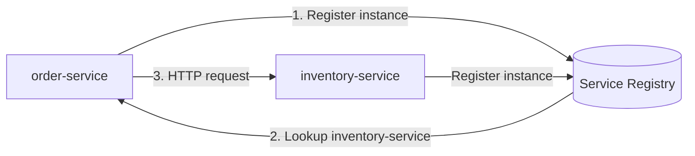

# Distinguishing Between Disabling Registration, Disabling Lookup, and Disabling Discovery Entirely

In Spring Cloud Service Discovery, an application can both provide services to other applications and call other services. These two roles share discovery infrastructure yet execute two independent flows:

- **Registration:** the application publishes its own instance information to the registry so other callers can find it.
- **Discovery lookup:** the application reads the registry to find instances of the service it wants to call.

Therefore, disabling registration does not mean disabling lookup. An application can stop appearing in the registry while still finding and calling other services. Conversely, an application can continue registering so other callers can reach it while not downloading the service list from the registry.

You must also distinguish **disabling discovery entirely**: in that mode, the application no longer uses the discovery client under its configured mechanism and also needs auto-registration controlled. Understanding these three modes properly prevents accidentally losing serving capacity or outbound service-call capability when changing configuration.

## 1. Two Independent Flows in Service Discovery

Suppose the system has two applications:

- `order-service` exposes an API to create and view orders.
- `inventory-service` exposes an API to check inventory.

`order-service` can both register its own instance and look up `inventory-service` to check stock. These two activities can be illustrated as follows:



The **registration flow** typically runs when the application starts:

1. The discovery client gathers the application's service ID, instance ID, host, port, and metadata.
2. The client sends the registration to Eureka, Consul, or the corresponding registry.
3. The registry stores the instance and maintains its state via heartbeats, leases, or health checks.
4. When the application stops normally, the client deregisters; if the process dies abruptly, the registry cleans up via expiration or health check mechanisms.

The **lookup flow** runs when the application needs to find a provider:

1. The consumer requests the instance list by service ID.
2. The discovery client reads data from the registry or a local cache.
3. Spring Cloud LoadBalancer may select an instance.
4. The HTTP client sends the request to the selected instance's host and port.

Disabling one flow does not automatically disable the other. This is the foundation for understanding the configuration properties in the sections that follow.

## 2. Disabling Registration: The Application Does Not Publish Its Own Instance

Disabling registration fits when an application still needs to call other services but should not advertise itself as a provider in the registry. For example:

- A batch worker that only calls other microservices and accepts no requests from microservices.
- An administrative application that needs to look up services without exposing business endpoints to other services.
- A Eureka client that needs to read the registry without registering itself.

### Shared Spring Cloud Configuration

Spring Cloud Commons provides a property to control auto-registration:

```yaml
spring:
  cloud:
    service-registry:
      auto-registration:
        enabled: false
```

This property disables the Spring Cloud-managed **auto-registration** mechanism. The discovery client can still be used to query the registry if the provider's integration remains enabled and configured accordingly.

Distinguish auto-registration from the registration API. If the application explicitly calls `ServiceRegistry.register(registration)` in code, disabling auto-registration does not necessarily stop that manual call. When custom registration logic exists, disable or alter that logic intentionally.

### Eureka-Specific Configuration

Eureka provides the `eureka.client.register-with-eureka` property:

```yaml
eureka:
  client:
    register-with-eureka: false
    fetch-registry: true
```

In this example:

- `register-with-eureka: false`: the Eureka client does not register the current instance with the Eureka server.
- `fetch-registry: true`: the client still fetches the registry to look up other services.

The application can still use `DiscoveryClient.getInstances("inventory-service")` or an `@LoadBalanced` HTTP client, provided discovery and LoadBalancer remain configured.

With Eureka, `register-with-eureka` is the explicit provider-specific switch for registration behavior. You can combine it with the shared auto-registration property so configuration clearly communicates the application's intent.

### Consul-Specific Configuration

Spring Cloud Consul provides the `spring.cloud.consul.discovery.register` property to control service registration:

```yaml
spring:
  cloud:
    consul:
      discovery:
        register: false
        enabled: true
```

In this configuration, `register: false` disables registering the application's service with Consul, while the discovery integration stays enabled so the application can use lookup capabilities according to the version in use.

Provider-specific properties may differ across Spring Cloud versions. When using Consul, check the exact dependency version and actual configuration to confirm registration and lookup behavior.

## 3. Disabling Lookup: The Application Does Not Fetch the Registry List

Disabling lookup fits when an application still needs to be discovered by other services, yet does not itself need to discover providers through the registry. For example:

- An HTTP API that only receives requests from other consumers.
- A provider that calls dependencies using fixed addresses or through another gateway.
- A Eureka client that only registers its instance without needing to download the registry.

### Eureka-Specific Configuration

Eureka provides the `eureka.client.fetch-registry` property:

```yaml
eureka:
  client:
    register-with-eureka: true
    fetch-registry: false
```

In this example:

- `register-with-eureka: true`: the application still registers its own instance.
- `fetch-registry: false`: the Eureka client does not download the registry from the server to look up other services.

Thus, the application can still appear on the Eureka dashboard or registry API, yet it has no updated remote instance list for normal discovery operations. Calls using a service ID via Spring Cloud LoadBalancer will not find providers from a registry whose fetch is disabled.

This is a classic example showing that disabling lookup is not synonymous with disabling registration.

### Spring Cloud Commons Has No Single Fetch Switch for Every Provider

`DiscoveryClient` is the common abstraction, yet registry-fetching mechanisms vary across Eureka, Consul, Kubernetes, and other providers. Do not take the `eureka.client.fetch-registry` property name and assume it applies to every discovery client.

If an application only wants to stop a specific business lookup, modify the code or configuration of the component calling that service. That differs from disabling the entire discovery client.

With Consul, lookups may rely on Consul client APIs and caches. Do not assume a universal property equivalent to `fetch-registry` exists across all versions. The `spring.cloud.consul.discovery.enabled` property controls Consul's discovery integration and has broader scope than a single fetch operation; consult version documentation before using it as a lookup-only switch.

## 4. Disabling Discovery Entirely: Stopping Both Roles

When an application neither needs to register itself nor needs to look up instances via Spring Cloud Discovery, you can disable discovery globally and disable auto-registration.

Commonly used Spring Cloud Commons configuration:

```yaml
spring:
  cloud:
    discovery:
      enabled: false
    service-registry:
      auto-registration:
        enabled: false
```

Meaning:

- `spring.cloud.discovery.enabled: false` disables Spring Cloud's shared discovery client auto-configuration.
- `spring.cloud.service-registry.auto-registration.enabled: false` disables the service auto-registration mechanism.

If the provider has its own enable switch, inspect and disable that integration when the goal is to stop the provider client completely. For example, with Eureka:

```yaml
eureka:
  client:
    enabled: false
```

With Consul, you can disable the discovery integration via its corresponding property:

```yaml
spring:
  cloud:
    consul:
      discovery:
        enabled: false
```

The exact scope of impact depends on the Spring Cloud version and provider. Some integrations also have separate configuration for Consul agent, config, health checks, or other features; disabling discovery does not necessarily disable all Consul connectivity used for other purposes.

When disabling discovery entirely, check whether code still requires `DiscoveryClient`, `ServiceRegistry`, `LoadBalancerClient`, or HTTP clients tied to service IDs. If those beans are not created or no longer have an instance source, the application can fail on startup or when sending requests. Components that depend on discovery should be made conditional by profile or corresponding properties.

## 5. Configuration and Behavior Matrix

| Goal | Auto-registration | Eureka register | Eureka fetch | Discovery client |
|---|---:|---:|---:|---|
| Normal provider and consumer | Enabled | Enabled | Enabled | Enabled |
| Disable registration only | Disabled | Disabled | Enabled | Enabled |
| Disable lookup only | Enabled | Enabled | Disabled | Client exists, does not fetch registry |
| Disable both Eureka register and fetch | Disabled | Disabled | Disabled | Integration may still exist, performs neither flow |
| Disable discovery globally | Disabled | Per provider config | Per provider config | Shared auto-configuration disabled |

The matrix above uses Eureka as an example for independent register and fetch switches. For other providers, map to each integration's own properties; do not mechanically apply the Eureka columns to Consul or Kubernetes.

Keep three takeaways in mind:

- **Disable registration:** the application does not advertise its own instance; it can still look up providers.
- **Disable lookup:** the application does not pull instance lists from the registry; it can still register to be called.
- **Disable discovery entirely:** the application neither uses a discovery client nor auto-registers; calls based on service IDs require an alternative mechanism.

## 6. Practical Usage Scenarios

### Batch worker that only calls other services

A scheduled batch worker receives no HTTP requests from microservices. It needs to call `inventory-service` and `payment-service`.

The goal is disabling registration while keeping lookup:

```yaml
spring:
  application:
    name: settlement-worker
  cloud:
    service-registry:
      auto-registration:
        enabled: false

eureka:
  client:
    register-with-eureka: false
    fetch-registry: true
```

The worker does not appear as a provider in Eureka, yet can still look up the two services it needs to call.

### Provider that only receives requests and does not call services via registry

Suppose `public-catalog-service` receives requests from a gateway and calls backend systems via platform-provided endpoints. The application still needs to register so the gateway or other discovery consumers can find it, yet does not need to download the registry.

The goal is keeping registration while disabling fetch:

```yaml
spring:
  application:
    name: public-catalog-service

eureka:
  client:
    register-with-eureka: true
    fetch-registry: false
```

The gateway can still find instances from Eureka. `public-catalog-service` itself holds no registry cache for looking up other service IDs.

### Standalone application in a test environment

An application runs standalone to test internal logic and does not need to register or discover services via a registry. Discovery can be disabled in the test profile:

```yaml
# application-test.yml
spring:
  cloud:
    discovery:
      enabled: false
    service-registry:
      auto-registration:
        enabled: false

eureka:
  client:
    enabled: false
```

If code still calls a service ID such as `http://inventory-service`, that request will not resolve to an instance on its own. In the test profile, mock the client, use a fixed endpoint, or supply a discovery implementation suited to the test.

## 7. Consequences for DiscoveryClient and LoadBalancer

`DiscoveryClient` is the lookup point for service IDs. When discovery is disabled or a provider does not fetch the registry, operations such as `getServices()` and `getInstances(serviceId)` may not return data as they do during normal operation. Concrete behavior may be an empty list, a missing bean, or a configuration error depending on the integration and version.

`Spring Cloud LoadBalancer` typically obtains instance lists via the discovery integration or `ServiceInstanceListSupplier`. If no suitable instance is available, a call by service ID can fail with an error like "No instances available". Disabling registry fetch while keeping code that calls service IDs is functionally inconsistent.

When disabling discovery globally:

- Discovery-dependent beans may not be created.
- Discovery-based client-side load balancing has no data.
- URLs using service IDs cannot be resolved via discovery.
- Registry-based management or health check components may stop working.

If you need to call a service while discovery is disabled, switch to a DNS hostname, fixed URL, API gateway, or another managed locator mechanism. Never assume an HTTP client automatically turns a service ID into a DNS name in every configuration; behavior depends on the client and LoadBalancer setup.

## 8. Caution with Profiles and Environment Variables

Discovery switches are often set differently across environments:

- Development may use a local registry for convenient testing.
- Test may disable registration and replace discovery with mocks or a static instance list.
- Production typically enables the capabilities required for each provider/consumer role.

For example, you can use a dedicated profile:

```yaml
# application-worker.yml
spring:
  cloud:
    service-registry:
      auto-registration:
        enabled: false

eureka:
  client:
    register-with-eureka: false
    fetch-registry: true
```

When configuring via environment variables, use exact property names following Spring Boot's relaxed binding rules and inspect the effective values after profiles load. Multiple configuration sources can override one another; an unexpectedly activated profile can disable fetch or registration.

Do not judge discovery to be working solely because the application started up cleanly. Verify the registry and actual lookup behavior.

## 9. How to Verify Each Mode

After changing configuration, check both the provider and consumer sides:

| Check | Disable registration only | Disable lookup only | Disable everything |
|---|---|---|---|
| Application instance appears in registry | No | Yes | No |
| Application can retrieve instances of other services | Yes | Not via registry fetch | No |
| HTTP call by service ID via LoadBalancer | Yes, if instances exist | Usually fails due to missing registry data | Does not work via discovery |
| Discovery client auto-configuration | Enabled | Enabled | Disabled per shared config |
| Auto-registration | Disabled | Enabled | Disabled |

You can verify using these steps:

1. Check startup logs to confirm whether the discovery client and auto-registration were enabled.
2. Open the Eureka dashboard or Consul UI/API to inspect the application's instance.
3. Call `DiscoveryClient.getInstances("inventory-service")` to inspect the instance list seen by the consumer.
4. Attempt an HTTP call via service ID to verify whether LoadBalancer can pick an instance.
5. Check error logs when the registry is not fetched or the discovery client is not created.
6. Verify which profiles and environment variables are actually active.

The outcome should match your intent. For example, in registration-disabled-only mode, the application does not appear in the registry yet can still look up providers. If both fail, the configuration may have disabled discovery more broadly than intended, or the registry may have an error.

## 10. Common Errors

| Symptom | Possible Cause | How to Fix |
|---|---|---|
| Application does not appear in registry yet calls other services | Auto-registration was disabled as intended | No fix needed if this is a consumer-only role |
| Application appears in registry yet cannot find other services | Registry fetch is disabled | Re-enable fetch if the application needs lookups |
| LoadBalancer reports no instances | Fetch disabled, wrong service ID, or no healthy instances in registry | Check fetch, service name, and health |
| Cannot inject DiscoveryClient | Discovery auto-configuration or provider integration is disabled | Conditionally guard the bean or re-enable discovery |
| Instance still visible after disabling auto-registration | Old registration remains, deregistration did not run, or provider-specific config still enabled | Check stale registration and provider switches |
| Application still self-registers despite disabling auto-registration | Code contains manual registration calls or provider uses a separate mechanism | Find register logic and integration settings |
| Test profile disables discovery yet requests still use service IDs | Code still depends on LoadBalancer/discovery | Mock the client or supply an alternative endpoint |

Disabling registration does not automatically delete stale records already stored in the registry. If the application registered previously, allow the discovery client to deregister the exact instance or clean up the old registration via the provider's admin tools. Never delete arbitrarily by service ID, as that may affect other replicas.

## 11. Checklist Before Disabling Discovery

Before changing switches, determine:

1. Does the application expose APIs for other services to call, or is it consumer-only?
2. Does the application need to appear in the registry?
3. Does the application call providers by service ID via DiscoveryClient or LoadBalancer?
4. Are you using Eureka, Consul, Kubernetes, or another provider?
5. Is the property you are changing shared or provider-specific?
6. Are there old registrations that need deregistering or cleanup?
7. Do any beans and HTTP clients depend on discovery?
8. When discovery is disabled, is the fallback endpoint DNS, a fixed URL, a gateway, or a mock?
9. Which profiles and environment variables might override configuration?
10. Have you verified both registration and lookup against the intended goal?

The core point is that registration and lookup are two separate capabilities. Disabling registration keeps an application from advertising itself while still letting it call providers; disabling fetch/lookup stops the application from pulling the registry list while still letting other consumers find it; disabling discovery entirely requires stopping both auto-registration and the discovery client through shared and provider settings. Choosing the right scope preserves the required role of each microservice and avoids "no instances available" errors in deployment.
