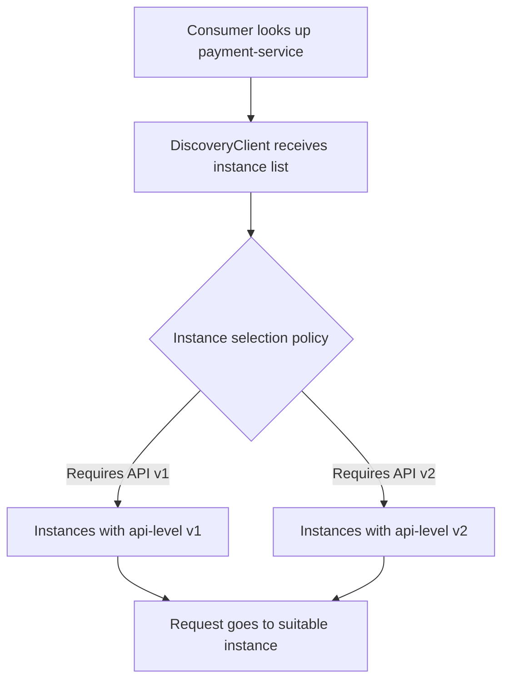

# Distinguishing Service Name, Instance ID, and Software Version

In a microservice system, a service can be deployed as multiple instances, and each instance can run a specific software release. When looking up a service, three pieces of information that frequently appear side by side must be distinguished: **service name**, **instance ID**, and **software version**. They answer three different questions: which logical service the consumer wants to call, which specific running replica to connect to, and which software version that running replica is using.

In Spring Cloud, service discovery helps consumers locate instances by service name via `DiscoveryClient`, `ServiceRegistry`, and registries such as Eureka or Consul. The registry stores information for each instance; software version details are commonly published via metadata or tags so deployment and routing systems can use them. Understanding these three identifiers properly helps prevent duplicate registrations, incorrect service lookups, and selecting the wrong version during upgrades.

## 1. Three Concepts Answering Three Different Questions

Suppose a payment system has a logical service `payment-service`. This service is running three instances on different hosts or containers. Two instances use release `2.4.1`, while the remaining instance is testing release `2.5.0`.

| Concept | Question Answered | Example | Scope and Lifecycle |
|---|---|---|---|
| Service name (service ID) | Which logical service is the consumer looking for? | `payment-service` | Stable across deployments; used to group instances of the same service. |
| Instance identifier (instance ID) | Which specific running replica is this? | `payment-service:pay-02:8082` | Specific to each running instance; may change when a container, pod, or process is recreated. |
| Software version | Which release or build is the instance running? | `2.4.1` or `2.5.0` | Tied to the deployed artifact; usually remains unchanged throughout an instance's lifecycle. |

The three values are related but not interchangeable. One service can have many instances; many instances can run the same software version; during a rolling deployment, instances of the same service can even run different software versions at the same time.

## 2. Service Name: Logical Identity for Lookup

The service name represents the logical capability or API provided by a group of instances. In a Spring Boot application, this name is typically declared with `spring.application.name`:

```yaml
spring:
  application:
    name: payment-service
```

With Eureka, the Eureka client uses this application name to register the instance under the corresponding application in the registry. With other Spring Cloud implementations, the registration name may be mapped to a service ID or service name according to the registry's mechanism.

Consumers look up the service name instead of storing fixed IP addresses and ports. For example, when calling `payment-service`, the discovery client returns the list of instances registered under that logical name. Spring Cloud LoadBalancer can use this list to pick an instance for the request.

A service name should have the following characteristics:

- **Stable:** does not change per hostname, pod, port, or software build.
- **Meaningful:** reflects the logical service, such as `order-service`, `payment-service`, or `inventory-service`.
- **Consistent:** all instances belonging to the same service use the same name; consumers look up that exact name.
- **Intentionally managed:** renaming a service can affect every consumer, gateway configuration, policy, and dashboard.

Do not put a hostname or pod ID in `spring.application.name`, because if each replica has a different application name, the registry will treat them as separate logical services. Nor should you change the service name for routine releases, as that forces consumers to know the name of each software version.

### 2.1. A Service Name Is Not a Network Address

`payment-service` is a logical name, not a DNS hostname or IP address. The registry maps this logical name to instances with concrete reachable addresses. For example:

```text
payment-service
├── payment-01.internal:8082
├── payment-02.internal:8082
└── payment-03.internal:8082
```

When an instance is replaced by a new container with a different address, the service name can stay the same. Consumers continue looking up `payment-service` and receive the updated list from the registry.

## 3. Instance ID: Identifying a Specific Running Replica

The instance ID distinguishes each registered deployment replica within a service. Two instances of `payment-service` can share the same service name, but they must be uniquely identified so the registry can update, renew leases, and deregister the right record.

For example:

| Service name | Instance ID | Host | Port |
|---|---|---|---:|
| `payment-service` | `payment-01:8082` | `payment-01.internal` | 8082 |
| `payment-service` | `payment-02:8082` | `payment-02.internal` | 8082 |
| `payment-service` | `payment-03:8082` | `payment-03.internal` | 8082 |

The instances share the same service name so consumers can find them as one service, while each instance ID identifies an individual running replica. When an instance sends a heartbeat, updates its status, or deregisters, the registry needs to know which record is being acted upon.

### 3.1. Requirements for an Instance ID

An instance ID should meet the following requirements:

1. **Unique within the service scope:** two concurrently active instances should not use the same ID within an application/service registration.
2. **Stable over the instance lifecycle:** heartbeats and deregistration must reference the same ID registered at startup.
3. **Traceable:** the ID should help operators correlate the registry record with the corresponding hostname, pod, container, or process.
4. **Allowed to change when an instance is replaced:** when a pod is replaced or a new process is created, a new ID can be generated to distinguish the new lifecycle.

Do not use the software version as the instance ID. If all three replicas run `2.4.1` and register with ID `2.4.1`, the registry cannot distinguish individual running replicas. Likewise, do not use `payment-service` alone as the instance ID when the service has multiple replicas.

### 3.2. Instance ID in Eureka

In Spring Cloud Netflix Eureka, you can configure the instance ID with `eureka.instance.instance-id`. For example:

```yaml
spring:
  application:
    name: payment-service

server:
  port: 8082

eureka:
  instance:
    instance-id: ${spring.application.name}:${server.port}:${random.value}
```

The example above builds the ID from the service name, port, and a random value provided by Spring Boot. In production systems, you can use the hostname, pod name, or workload UID so the ID easily maps back to the deployment platform. Ensure the value remains stable throughout the instance's lifecycle and does not collide with another running instance.

There is no single instance ID format that fits every environment. With container orchestration, a pod UID often helps distinguish recreated pods even when the application name and port remain unchanged. If using hostname and port, consider whether multiple replicas share the same hostname or use different port mappings.

## 4. Software Version: Identifying the Running Artifact

The software version indicates which release or build of the service an instance is running, such as `2.4.1`, `2.5.0-rc.1`, or a commit SHA. This value is typically generated during the build process and injected into the deployment configuration.

Software version can help:

- Identify which instance is running the release that needs inspection.
- Monitor rolling deployments when multiple versions coexist.
- Execute canary releases or group traffic by version.
- Support rollbacks, incident investigation, and correlation with artifacts/container images.
- Verify compatibility between consumers and providers when explicit compatibility conventions exist.

The software version does not have to be the service name or instance ID. Replicas created from the same image usually have the same software version, yet each replica still needs its own instance ID. When releasing a new version, the service name typically stays the same while the version metadata changes on the new instances.

### 4.1. Distinguishing Software Version and API Version

Software version describes the artifact release. API version describes the communication contract used by consumers. The two concepts are related, not identical.

For example, `payment-service` release `2.5.0` may still expose `/api/v1/payments` for compatibility with older consumers. Another release may expose both `/api/v1` and `/api/v2`. Therefore:

- `version=2.5.0` can describe the running artifact.
- `api-version=v1` or `api-level=v1,v2` can describe the supported API contract.
- Routing policies should be based on API compatibility requirements or instance capabilities rather than inferring everything solely from the software version number.

When compatibility management is required, publish dedicated metadata such as `api-level`, `protocol-version`, or `capabilities`. The convention must be agreed upon by both providers and consumers.

### 4.2. Semantic Versioning and Build Identity

If a project adopts Semantic Versioning, the common format is `MAJOR.MINOR.PATCH`:

- `MAJOR`: changes that may break compatibility.
- `MINOR`: adding functionality in a backward-compatible manner.
- `PATCH`: backward-compatible bug fixes.

Suffixes such as `-SNAPSHOT`, `-rc.1`, or build metadata can be used according to release conventions. Do not compare versions as plain strings; for instance, lexicographical comparison can produce the wrong result between `2.10.0` and `2.9.0`. When version ordering is needed, use a Semantic Versioning parser or the versioning rules standardized by the organization.

In CI/CD environments, you should also publish a build identity such as a Git commit SHA, image tag, or image digest. The software version tells users the release; the build identity pinpoints the exact source code the artifact was built from. If tags can be overwritten, an image digest is a more reliable immutable identifier for artifact traceability.

## 5. Structure of the Three Information Types in the Registry

A registry record typically contains the service name, instance identification details, access address, and metadata. With Eureka, the relationship can be visualized as follows:

```text
Eureka Server
└── Application: PAYMENT-SERVICE
    ├── InstanceInfo
    │   ├── instanceId: payment-01:8082
    │   ├── hostName: payment-01.internal
    │   ├── port: 8082
    │   └── metadata:
    │       ├── version: 2.4.1
    │       └── api-level: v1
    ├── InstanceInfo
    │   ├── instanceId: payment-02:8082
    │   ├── hostName: payment-02.internal
    │   ├── port: 8082
    │   └── metadata:
    │       ├── version: 2.4.1
    │       └── api-level: v1
    └── InstanceInfo
        ├── instanceId: payment-03:8082
        ├── hostName: payment-03.internal
        ├── port: 8082
        └── metadata:
            ├── version: 2.5.0
            └── api-level: v1,v2
```

In this example:

- `PAYMENT-SERVICE` is the application/service name, used to group instances.
- `payment-01:8082`, `payment-02:8082`, and `payment-03:8082` are distinct instance IDs.
- `2.4.1` and `2.5.0` are software versions published in metadata.
- `api-level` describes API compatibility according to the system's convention.

A consumer looking up `payment-service` receives the list of instances. If it needs to call only instances supporting API v2, the consumer or routing mechanism must read the `api-level` metadata and apply the corresponding policy. Merely having `version=2.5.0` on an instance does not cause Eureka to automatically prioritize or filter that instance.

## 6. Representation in Spring Cloud

Spring Cloud provides the `ServiceInstance` abstraction to represent an instance discovered through service discovery. Commonly accessed details include:

| Property | Role |
|---|---|
| `getServiceId()` | The service name or service ID to which the instance belongs. |
| `getInstanceId()` | The instance identifier if provided by the implementation. |
| `getHost()` | The published hostname or host address. |
| `getPort()` | The port used for connections. |
| `isSecure()` | Indicates whether the instance is described as using a secure connection. |
| `getMetadata()` | A metadata map provided by the registry/client, which may contain version, zone, or capability. |

`ServiceInstance` is a generic abstraction. How a registry stores the service name, instance ID, tags, and metadata depends on the implementation. Eureka typically represents instance data with `InstanceInfo`; Consul has its own service registration model and metadata/tags fields. When switching registries, verify how your chosen implementation maps these fields instead of assuming every field has identical names and behavior.

### 6.1. Eureka Client Configuration Example

An illustrative configuration for `payment-service`:

```yaml
spring:
  application:
    name: payment-service

server:
  port: 8082

eureka:
  client:
    service-url:
      defaultZone: http://localhost:8761/eureka/
  instance:
    instance-id: ${spring.application.name}:${server.port}:${random.value}
    metadata-map:
      version: ${APP_VERSION:2.4.1}
      git-commit: ${GIT_COMMIT:local}
      api-level: v1
      zone: zone-a
```

In the configuration above:

- `spring.application.name` sets the logical service name.
- `instance-id` identifies a specific instance.
- `metadata-map.version` publishes the artifact version.
- `metadata-map.git-commit` supports build traceability.
- `metadata-map.api-level` describes the API contract according to the application's convention.
- `metadata-map.zone` indicates the deployment zone if the system uses zone information.

The `APP_VERSION` and `GIT_COMMIT` environment variables can be supplied by the deployment pipeline. The default values in the example are only for local testing; production environments should supply the actual artifact version and commit. Every instance of the same release must publish consistent metadata.

`metadata-map` is how the Eureka client publishes instance metadata. It is not a version field with special semantics interpreted automatically by Eureka. Eureka stores and propagates the metadata; the application or routing component is responsible for understanding and acting on those keys.

### 6.2. Reading Metadata from DiscoveryClient

Consumers can retrieve the instance list by service ID using `DiscoveryClient`:

```java
import java.util.List;
import java.util.stream.Collectors;

import org.springframework.cloud.client.ServiceInstance;
import org.springframework.cloud.client.discovery.DiscoveryClient;
import org.springframework.stereotype.Service;

@Service
public class PaymentInstanceLookup {

    private final DiscoveryClient discoveryClient;

    public PaymentInstanceLookup(DiscoveryClient discoveryClient) {
        this.discoveryClient = discoveryClient;
    }

    public List<ServiceInstance> findApiV1Instances() {
        return discoveryClient.getInstances("payment-service")
                .stream()
                .filter(instance -> {
                    String apiLevel = instance.getMetadata().get("api-level");
                    return apiLevel != null &&
                            List.of(apiLevel.split(",")).contains("v1");
                })
                .collect(Collectors.toList());
    }
}
```

The example uses `List.of`, which is available in Java 9 and later. If the application uses Java 8, you can replace the check with `Arrays.asList(apiLevel.split(","))`. This example illustrates reading metadata; real systems need to handle cases where no instances are found, metadata is missing, or the registry is not yet updated.

Filtering metadata with `DiscoveryClient` only produces a candidate list. It does not automatically attach this policy to every request. If you want per-request version-based instance selection, you must integrate the policy with Spring Cloud LoadBalancer, a gateway, or the application's routing layer.

## 7. Version Metadata Is Not Automatically a Load-Balancing Mechanism

Eureka stores metadata and supplies the instance list to clients. By default, an instance publishing `version=2.5.0` does not mean Eureka Server will automatically select that instance for consumers. Spring Cloud LoadBalancer also needs to be configured or extended if you want metadata-based selection.

For example, a rolling deployment might proceed as follows:



The instance selection policy must clearly define:

- Which consumers are allowed to call which API version.
- Which instances satisfy that API contract.
- How to handle situations where no compatible instances exist.
- How to avoid sending requests to an instance that has left the registry but remains in the cache.
- How to shift traffic gradually during canary or blue-green deployments.

Do not simply compare `version` strings in a load balancer and assume a higher version is always better. A newer version may change behavior, not yet be tested with a specific consumer, or not yet support an API the consumer requires.

## 8. Choosing How to Organize Service Name and Software Version

There is no single strategy for every system. You can choose based on API compatibility and routing requirements.

### 8.1. Keep One Service Name, Publish Version in Metadata

For example, instances all register under `payment-service`, with some having `version=2.4.1` and others having `version=2.5.0`.

Suitable when:

- Releases remain compatible with the same group of consumers.
- The system performs rolling updates and accepts multiple versions coexisting briefly.
- Version observability or controlled canary routing policies are needed.

The advantage is a stable service name, so consumers do not have to change service names on every release. The system needs a compatible-instance selection mechanism if different versions cannot serve the same request.

### 8.2. Use Separate Service Names for Incompatible API Contracts

If two groups of instances provide different API contracts and require isolated routing, the system can register them under separate service IDs, such as `payment-service-v1` and `payment-service-v2`.

This approach makes compatibility boundaries explicit and lets consumers select their target clearly. On the other hand, consumers, gateways, and operational configurations must manage multiple service names. Do not create a new service name for every patch or build if those releases still belong to the same logical service.

### 8.3. Combining Service Name, API Version, and Software Version

In large systems, three separate attributes can be used:

| Attribute | Example | Purpose |
|---|---|---|
| `serviceId` | `payment-service` | Locate the logical service. |
| `api-level` | `v2` | Identify the supported communication contract. |
| `version` | `2.5.0` | Identify the software release. |
| `git-commit` | `8f31c2a` | Trace the source code that produced the artifact. |
| `instanceId` | `payment-03:8082:abc123` | Distinguish a specific running replica. |

With this organization, consumers look up the service by `serviceId`, and compatibility policies rely on `api-level`. Operators use `version` and `git-commit` to know the exact release running. `instanceId` helps pinpoint which host or container to investigate.

## 9. Common Errors from Confusing Identifiers

| Symptom | Cause | Resolution |
|---|---|---|
| Each replica appears as a different service | Hostname, pod name, or instance ID was put into `spring.application.name`. | Use one stable service name across replicas; move per-replica information to the instance ID. |
| Registry displays only one instance despite multiple replicas | Replicas register with the same instance ID and overwrite the same record. | Generate a unique instance ID per replica; check each deployment's configuration. |
| Consumer looks up the right service but calls the wrong version | Consumer uses only the service ID and applies no metadata/API compatibility policy. | Publish clear metadata and integrate an instance selection policy into the appropriate routing layer. |
| Dashboard shows an incorrect version | Metadata was hardcoded in configuration or the pipeline passed the wrong environment variable. | Inject version/build identity from the artifact pipeline into deployment and verify the registry after startup. |
| New instance still carries metadata from an old release | An old container or configuration was reused, or the rollout has not replaced all replicas yet. | Check image digests, build variables, and the instance list by individual ID. |
| Cannot identify the faulty artifact | Only a generic version was published, without build identity or image digest. | Add the commit SHA and immutable artifact info to metadata or observability systems. |
| Comparing `2.10.0` and `2.9.0` yields wrong results | String comparison was used instead of a version parser. | Parse according to Semantic Versioning or the project's official versioning rules. |

When investigating, compare the service name, instance ID, host/port, software version, and build identity on the same record. Then inspect the actual deployment state to verify whether the registry record accurately reflects the running workload.

## 10. Operational Principles

- Keep `spring.application.name` stable and consistent across replicas of the same service.
- Generate a distinct instance ID for each running replica; do not use the service name or software version as the instance ID.
- Inject software version and build identity into metadata from the deployment pipeline to avoid manual entry mismatches.
- Define separate metadata for API compatibility or capabilities; do not infer API contracts from the software version alone.
- Standardize metadata key names and formats across providers, consumers, dashboards, and operational tools.
- Do not store passwords, tokens, private keys, or secrets in registry metadata.
- Account for registry and client cache latency during rollouts; do not assume all consumers see a new version simultaneously.
- When filtering instances by metadata, define fallback behavior for missing metadata, invalid values, or no compatible instances.
- Monitor instance ratios by version throughout deployment and after the rollout completes.

## Conclusion

The service name identifies the logical functional group a consumer wants to find; the instance ID identifies a specific running replica within that group; and the software version identifies the artifact currently executing. In Spring Cloud, service discovery primarily looks up by service ID and returns `ServiceInstance` objects; version information is typically published via metadata or tags for applications and routing mechanisms to use.

Keeping these three concepts separate ensures the registry accurately reflects topology, supporting multiple replicas and multiple releases coexisting during upgrades. When compatibility-based routing is required, publish a dedicated API version or capability attribute and implement an intentional instance selection policy.
