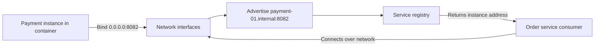

# Choosing the Published Hostname or IP Address

When a microservice registers with a service registry, it must publish an address that consumers can use to connect to the instance. That address is typically a hostname or IP address, accompanied by a port and protocol details. Choosing the wrong address can cause the registry to show the instance as `UP` while consumers still fail to connect.

In Spring Cloud, service discovery locates instances by service name via `DiscoveryClient`, `ServiceRegistry`, and registries such as Eureka or Consul. The service name identifies the logical group; the published hostname/IP determines the network path to each running instance. Therefore, deciding between hostname and IP must be based on the consumer's network perspective, how DNS is managed, and the deployment topology.

## 1. What Is the Published Address?

When an application starts up, the service registry needs to know the address consumers can use to connect to the instance. A record can contain:

- Service name, such as `payment-service`.
- Instance ID, such as `payment-01:8082`.
- Published hostname or IP.
- HTTP/HTTPS port.
- Metadata such as zone, version, or deployment group.
- Health status or lease depending on the registry.

For example, two instances belonging to `payment-service` may register:

| Instance | Published Address | Port |
|---|---|---:|
| `payment-01` | `payment-01.internal.example` | 8082 |
| `payment-02` | `10.20.0.22` | 8082 |

Consumers look up `payment-service`, receive the instance list, and use the address and port to send requests. The published address must therefore be meaningful from the consumer's perspective, not merely from inside the provider's process.

## 2. Distinguishing Bind Address and Advertised Address

This is the most common source of confusion when configuring service discovery.

- **Bind address** is the address/interface on which the server listens for incoming connections.
- **Advertised address** is the hostname or IP the application publishes to the registry for consumers to use.

The two addresses can differ. For example, an application in a container listens on all interfaces via `0.0.0.0:8082`, while consumers on the internal network must access the container via `payment-01.internal.example:8082`.

`0.0.0.0` means binding to all IPv4 interfaces. It is not a destination address for consumers to call. Similarly, `127.0.0.1` or `localhost` points back to the consumer's own host or container; if the registry publishes this loopback address, another consumer will mistakenly connect to itself.



`server.address` in Spring Boot relates to the web server's bind address. Hostname/IP configuration for Eureka or Consul relates to the registration address. Changing `server.address` does not necessarily change the address published in the registry, and changing the published address does not automatically make the server listen on that interface.

## 3. When Should You Choose a Hostname?

A hostname is suitable when the system has reliable internal DNS and hostnames are more stable than IPs. For example, `payment-01.internal.example` can always point to the instance's current address, even if the infrastructure changes IPs after recreating a machine.

Advantages of a hostname:

- **Decouples logical names from IP addresses:** you can change an IP by updating DNS without changing the published name.
- **Readable and operable:** hostnames often help identify the environment, node, or zone faster than a numeric address.
- **Supports infrastructure changes:** stable DNS names can be preserved when VMs or servers are replaced.
- **Works well with TLS:** certificates are typically issued for DNS names and can validate the hostname when clients connect over HTTPS.

A hostname is only useful if consumers can resolve it. A name that exists only in the provider's `/etc/hosts` or in a single subnet's private DNS will not allow consumers on other networks to connect.

### 3.1. Risks When Using a Hostname

- DNS may not resolve from certain subnets, containers, or clusters.
- DNS records may point to an old IP during the TTL window or due to resolver caching.
- One hostname may resolve to multiple IPs; this can introduce an extra load-balancing layer outside the registry.
- Split-horizon DNS may return different addresses depending on the network. This may be intentional, but all resolved addresses must reach the right instance.
- A DNS name may point to a load balancer or reverse proxy instead of a specific instance; in that case, the registry represents an intermediary endpoint rather than individual replicas.

If each instance is registered individually, publish a distinct hostname per instance, such as `payment-01.internal.example` and `payment-02.internal.example`. Avoid registering multiple instances with the same hostname representing a service VIP if consumers expect the registry to supply individual replica addresses.

## 4. When Should You Choose an IP Address?

An IP address is suitable when consumers can route directly to that address and the address remains stable over the registration lifecycle. For example, pods in the same Kubernetes cluster can communicate via Pod IPs if network policies and the CNI allow it.

Advantages of an IP address:

- No dependency on DNS resolution when establishing connections.
- Easy to correlate with routing tables, firewalls, network interfaces, and network logs.
- Useful in environments where DNS is unavailable or where IPs are stably managed.
- Can eliminate a layer of DNS dependency when diagnosing issues.

Risks of using an IP address:

- Dynamic IPs may change after a container, pod, or VM is recreated.
- Private IPs may not be routable from consumers on other networks.
- A container's internal IP may only be meaningful within the host's network namespace or bridge network.
- Public IPs may be blocked by NAT, firewalls, or network policies.
- TLS certificates must match how clients connect by IP; a certificate with only DNS SANs may fail validation when a client validates an IP.

Do not pick an IP simply because it can be read from the provider's network interface. Confirm that it is an IP consumers can actually reach.

## 5. Choosing Based on Deployment Topology

| Environment | Commonly Suitable Choice | What to Verify |
|---|---|---|
| VMs on the same internal network | Internal DNS hostname or static private IP. | DNS/routing, firewalls, and ports across subnets. |
| Docker Compose on the same network | Service/container DNS name if each container has a distinct resolvable name; or a platform-published address. | Consumer and provider share the same Docker network; do not publish a bridge address reachable only from the host. |
| Kubernetes in the same cluster | Pod IP or a distinct cluster-resolvable hostname; depending on the integration and registration model. | Pod IPs change over their lifecycle; check CNI, NetworkPolicy, and readiness. |
| Multiple clusters or multiple VPCs | Cross-network DNS or published routable addresses. | Peering, VPN, transit gateway, DNS forwarding, and firewalls. |
| Internet consumers calling private services | Endpoint via public gateway, ingress, or load balancer. | Do not publish non-routable private IPs; protect endpoints and enforce TLS verification. |
| Dual-stack IPv4 and IPv6 systems | Hostname with matching records or IP in the family supported by consumers. | Address preference order, IPv6 routing, firewalls, and TLS SANs. |

There is no rule that hostname is always better than IP or vice versa. The right address is one that is reliably resolvable or routable from every consumer that needs to call that instance.

## 6. Configuring Hostname or IP in Eureka

With Spring Cloud Netflix Eureka, commonly used instance properties include:

| Property | Meaning |
|---|---|
| `eureka.instance.hostname` | Hostname published for the instance. |
| `eureka.instance.ip-address` | IP published for the instance. |
| `eureka.instance.prefer-ip-address` | When `true`, prefers publishing the IP instead of the hostname. |
| `eureka.instance.instance-id` | Unique identifier of the instance within the application. |

### 6.1. Preferring Hostname

If consumers can resolve internal DNS, configure the hostname explicitly:

```yaml
spring:
  application:
    name: payment-service

server:
  port: 8082

eureka:
  instance:
    hostname: ${PAYMENT_HOSTNAME:payment-01.internal.example}
    prefer-ip-address: false
    instance-id: ${spring.application.name}:${PAYMENT_INSTANCE_ID:payment-01}
```

In this configuration, the client publishes the hostname. The `PAYMENT_HOSTNAME` variable lets the deployment environment supply the actual DNS name. Each replica needs a hostname and instance ID matching its own running unit.

### 6.2. Preferring IP

If consumers can reach the instance's private IP directly, you can configure:

```yaml
spring:
  application:
    name: payment-service

server:
  port: 8082

eureka:
  instance:
    ip-address: ${PAYMENT_ADVERTISE_IP:10.20.0.21}
    prefer-ip-address: true
    instance-id: ${spring.application.name}:${PAYMENT_INSTANCE_ID:payment-01}
```

`ip-address` should only receive a value verified to be reachable from consumers. Do not default to the first IP returned by the machine if the host has multiple interfaces such as management, storage, public, and application networks.

### 6.3. Checking Registered Details

After startup, open the Eureka Dashboard or registry API on the management network to inspect the hostname, IP, port, and status stored by the server. Compare those fields against the actual configuration and test from the consumer's runtime environment itself.

If the registry displays a hostname that consumers cannot resolve, fix DNS or the published address. If the registry displays the wrong IP, check `eureka.instance.ip-address`, `prefer-ip-address`, and how the application selects interfaces. Do not rely solely on the provider's startup logs.

## 7. Configuring Hostname or IP in Consul

With Spring Cloud Consul Discovery, you can configure the registered service address using the corresponding discovery properties:

| Property | Meaning |
|---|---|
| `spring.cloud.consul.discovery.hostname` | Hostname published for the service. |
| `spring.cloud.consul.discovery.ip-address` | IP published for the service. |
| `spring.cloud.consul.discovery.prefer-ip-address` | Prefers IP over hostname during registration. |

Example preferring hostname:

```yaml
spring:
  application:
    name: payment-service
  cloud:
    consul:
      host: consul.internal.example
      port: 8500
      discovery:
        hostname: ${PAYMENT_HOSTNAME:payment-01.internal.example}
        prefer-ip-address: false
        instance-id: ${spring.application.name}:${PAYMENT_INSTANCE_ID:payment-01}
```

Example preferring IP:

```yaml
spring:
  application:
    name: payment-service
  cloud:
    consul:
      host: consul.internal.example
      port: 8500
      discovery:
        ip-address: ${PAYMENT_ADVERTISE_IP:10.20.0.21}
        prefer-ip-address: true
        instance-id: ${spring.application.name}:${PAYMENT_INSTANCE_ID:payment-01}
```

These are illustrative configurations for Spring Cloud Consul Discovery; verify property names against your dependency version. The Consul agent/server address the application connects to (`spring.cloud.consul.host`) is the registry endpoint, which is distinct from the service instance address consumers will call.

Consul can execute health checks from the agent. If using HTTP checks, the health check URL must also be reachable from where the check runs. Therefore, verify both the advertised address and the path from the Consul agent to the health endpoint; these two paths may traverse different interfaces or networks.

## 8. Docker and Kubernetes: Avoiding Locally Scoped Addresses

### 8.1. Docker

In Docker, a container's `172.x.x.x` address typically belongs to a bridge network. Another container on the same network can reach that address, while a consumer outside the host may not be able to reach it without proper routing or port mapping.

If provider and consumer share a Docker Compose network, Docker DNS typically resolves service or container names. However, if each replica needs to be managed individually by the registry, ensure every running copy has a distinguishable name or address. A Compose service name can represent multiple replicas load-balanced by Docker; registering multiple records with that same name can create two layers of instance selection.

Do not publish the container's `localhost` to other consumers. `localhost` inside the provider container points to the provider container itself; `localhost` inside the consumer points to the consumer.

### 8.2. Kubernetes

In Kubernetes, Pod IPs typically change when pods are recreated. If Eureka or Consul registers Pod IPs directly, the registry must update with pod lifecycles and consumers must handle stale caches. This works well when per-pod discovery is required and network policies allow pod-to-pod traffic.

If using Kubernetes DNS, you can publish a distinct hostname per pod when a StatefulSet/headless Service provides a stable network identity. With a standard Deployment, Pod hostnames are not guaranteed to remain stable after pod replacement.

A Kubernetes Service DNS name such as `payment.default.svc.cluster.local` usually represents a virtual service and distributes traffic across multiple pods. If the registry stores the same Service DNS address for every replica, consumers may perform load balancing in the registry client and then go through Kubernetes Service load balancing as well. This may be intentional or cause unintended double load balancing; choose clearly which layer is responsible for distributing traffic.

### 8.3. Selection Examples by Goal

| Goal | Address to Consider |
|---|---|
| Consumers need to pick individual pods and can reach Pod IPs | Registered Pod IP, paired with pod-lifecycle-driven updates. |
| Consumers only need a stable endpoint managed by Kubernetes | Kubernetes Service DNS; no need to register individual pods under the same address as separate endpoints. |
| Stable hostname needed for each replica with a fixed identity | StatefulSet ordinal DNS via a headless Service. |
| External consumers outside the cluster need to call the service | Gateway/Ingress/LoadBalancer with a properly published and secured endpoint. |

## 9. DNS, Caching, and Address Changes

Hostnames decouple names from IPs, but they do not eliminate caching issues. When a DNS record changes, consumers may keep using the old address due to DNS TTL, the JVM DNS cache, OS resolvers, proxies, or connection pools.

When designing hostnames:

- Choose a TTL aligned with infrastructure churn rate and DNS load capacity.
- Check the DNS caching policy of the JVM and runtime in use.
- Ensure every resolver used by consumers can reach the corresponding DNS zone.
- Do not use a single hostname that resolves to different IPs unpredictably across consumers.
- When changing DNS mappings, measure convergence time and keep old endpoints active during the transition window if needed.

If using dynamic IPs, update the registration when the IP changes or create a new instance ID for the new lifecycle. A lingering registry record pointing to an old IP can cause connection failures until lease/health check/deregistration and cache refresh complete.

## 10. TLS and Security of the Published Address

The published address affects TLS validation. When a consumer connects by hostname, the server certificate typically needs a matching DNS SAN. When connecting by IP, the certificate needs a matching IP SAN; having only a DNS SAN can cause hostname/IP verification to fail.

Key considerations:

- Choose a hostname/IP matching how clients actually connect and how certificates are issued.
- Do not disable hostname verification just to work around publishing the wrong address.
- Restrict the registry and dashboard to the management network; records can reveal internal hostnames, IPs, ports, and topology.
- Do not store tokens, passwords, or private keys in registry metadata.
- Use network policies/firewalls to allow only necessary consumers to reach service ports.
- If publishing addresses through a gateway or load balancer, configure TLS termination and hop-to-hop authentication according to the system's security model.

## 11. Address Verification Procedure from the Consumer Side

When an instance shows `UP` but requests fail, check in the following order:

1. **Read the registry record:** identify the exact registered hostname/IP, port, secure port, and status.
2. **Check DNS from the consumer:** run `getent hosts payment-01.internal.example`, `nslookup`, or an appropriate DNS tool inside the consumer's actual container/VM.
3. **Check route and port:** run `nc -vz payment-01.internal.example 8082`, `Test-NetConnection`, or an equivalent tool.
4. **Check HTTP/TLS:** run `curl -v` against the exact scheme, hostname/IP, and port; observe whether errors are connection errors or certificate errors.
5. **Verify the bind address:** confirm the application is actually listening on the published interface and port.
6. **Check network policies:** inspect firewalls, security groups, Kubernetes NetworkPolicy, Docker networks, and NAT.
7. **Check caches and lifecycle:** confirm whether the registry record, DNS cache, and discovery/load-balancer cache all reflect the current instance.

Do not test connectivity only from the provider itself. An address may be reachable from the registering machine yet unreachable from the consumer's network. The most meaningful test must run from the same network namespace or deployment environment as the actual consumer.

## 12. Common Errors

| Symptom | Common Cause | Resolution |
|---|---|---|
| Registry shows `localhost` or `127.0.0.1` | Client publishes loopback instead of a network address. | Configure a hostname/IP reachable from consumers. |
| Registry shows `0.0.0.0` | Wildcard bind address confused with advertised address. | Keep wildcard on bind if needed; set advertised hostname/IP separately. |
| Consumer cannot resolve hostname | DNS zone is not shared, record is wrong, or DNS forwarding is missing. | Check resolver from consumer and publish a name in an appropriately scoped DNS. |
| Consumer connects to IP but times out | IP belongs to a private network without a route or port is blocked by firewall. | Choose a routable address and open network policies for the proper scope. |
| Container registers bridge IP unreachable from outside host | Container address is only meaningful inside the Docker network. | Use DNS/endpoints published across the right network or design port mappings. |
| New instance still points to old IP | IP changed but registration/cache has not updated. | Check instance lifecycle, deregistration, leases, health checks, and refresh. |
| HTTPS fails hostname verification | Hostname/IP used by client does not match certificate SAN. | Issue a certificate matching the advertised address and keep TLS verification enabled. |
| Requests pass through two load-balancing layers | Registry returns the same Service DNS/VIP for multiple instances, then the platform load-balances again. | Choose explicitly between per-instance discovery and virtual endpoint discovery; avoid unintended overlap. |

## 13. Selection Principles in Production

- Start with the question: which consumers need to connect to the instance and which network are those consumers in?
- Choose a hostname if DNS is stable, resolvable from all relevant consumers, and compatible with TLS.
- Choose an IP if the address is routable, stable during the registration lifecycle, and free of uncontrolled NAT.
- Never publish loopback, wildcard bind addresses, link-local addresses, or private IPs that are unroutable from consumers.
- Distinguish the registry endpoint from the service instance endpoint; these two addresses serve two different connection flows.
- In multi-interface environments, explicitly configure which interface/hostname/IP to publish rather than relying on automatic selection.
- With containers and orchestration, synchronize registration lifecycle with workload lifecycle and readiness.
- Check DNS TTL, JVM cache, load-balancer cache, and convergence time when addresses change.
- Ensure health checks run from a location able to reach the configured address and port.
- Cross-check the advertised address against TLS SANs, firewalls, routes, and access policies.

## Conclusion

Both hostnames and IP addresses can be used to register a service instance. A hostname fits when internal DNS is stable and properly shared across the required scope; an IP fits when consumers can route directly to it and it stays stable over the instance lifecycle. The decision must be made from the consumer's network perspective, not merely from the address the provider sees inside its host or container.

In Spring Cloud, Eureka and Consul allow configuring the hostname, IP, and published address preference. Distinguish the bind address from the advertised address, inspect registry records, and verify DNS, routing, ports, health checks, and TLS from the consumer environment. Getting these steps right prevents instances from appearing healthy in the registry while remaining unreachable to other services.
