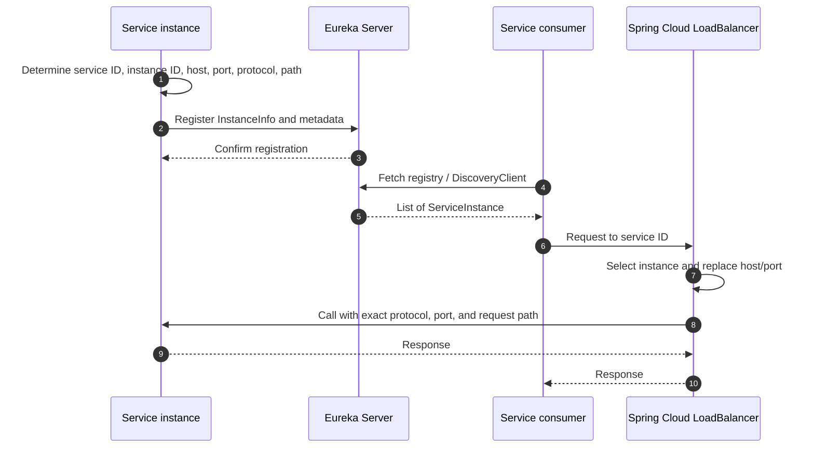

# Publishing the Right Port, Protocol, and Service Path

## 1. Why Must Endpoint Details in the Registry Be Accurate?

In Spring Cloud Service Discovery, the registry helps consumers locate an instance by a logical name such as `payment-service`. Upon registration, the instance publishes identification and address details so consumers can construct requests. If the registry stores the wrong hostname, IP, port, protocol, or path, looking up the instance will still succeed while actual requests may fail.

An endpoint must be viewed from the consumer's perspective: the address must be resolvable, the port must be reachable, the protocol must match the listener, and the path must point to the right application or endpoint. A container's `localhost` address, an unpublished internal port, or a path missing the context path can all leave the registry with syntactically valid information that is unusable on the deployment network.

In Spring Cloud Service Discovery, `DiscoveryClient` returns `ServiceInstance` objects so consumers know the host, port, URI, and metadata. With Eureka, these details are stored in `InstanceInfo` and published through the Eureka Server. Therefore, instance configuration must reflect the actual address used by consumers.

## 2. Distinguishing Service Identity and Instance Address

A service can run multiple instances. Distinguish the service name from each instance's details:

| Component | Example | Purpose |
|---|---|---|
| Service ID | `payment-service` | Logical name for consumers to look up the instance group |
| Instance ID | `payment-service:node-a:8082` | Distinguishes a specific running replica in the registry |
| Hostname/IP | `payments.internal` or `10.0.2.15` | Network address consumers use to connect |
| Service port | `8082` | Port on which the business application listens |
| Protocol | `http` or `https` | How connections to the service are established |
| Context path | `/payments` | Application path prefix if configured |
| Metadata | `version=v2`, `zone=az-a` | Additional information for consumers or infrastructure |

In Spring Boot, `spring.application.name` typically becomes the service ID. The instance ID must be unique across instances of the same service. Hostname/IP, port, and protocol define each running replica's connection address; context path determines where the application is mounted on the server.

For example, two instances of `payment-service` might be:

```text
payment-service
  payment-service:node-a:8082 -> http://10.0.1.10:8082/payments
  payment-service:node-b:8082 -> http://10.0.1.11:8082/payments
```

Consumers look up by `payment-service`; the registry returns the instances along with their corresponding addresses. Do not use a single instance's address as the service ID, as that ties the application to a specific host.

## 3. Publishing a Reachable Hostname or IP

Eureka needs to publish a hostname or IP address that consumers can reach from their network. Two common options are:

- **Hostname:** suitable when DNS or infrastructure service discovery provides a stable name resolvable from consumers.
- **IP address:** suitable when the IP address is directly routable and does not change unexpectedly.

Hostname configuration example:

```yaml
eureka:
  instance:
    hostname: payments.internal
    prefer-ip-address: false
```

Or preferring an IP address:

```yaml
eureka:
  instance:
    ip-address: 10.0.2.15
    prefer-ip-address: true
```

`prefer-ip-address` determines whether the Eureka instance uses an IP instead of a hostname when publishing the host. If using a hostname, ensure DNS resolves that name from consumers. If using an IP, ensure the IP is routable from every network that needs to call the service.

Do not publish `127.0.0.1`, `localhost`, or a hostname that exists only inside a single container if consumers run on different machines or containers. Those addresses may work when testing on the same machine but fail in distributed environments.

### 3.1. Choosing Addresses in Docker and Kubernetes

In Docker, `localhost` inside a container refers to that container itself. If `payment-service` and Eureka Server run in two different containers on the same Docker network, the service should publish a DNS name that consumers can resolve, such as `payment-service` or the container's dedicated hostname. Consumers on the same network can reach the container port; consumers on the host may need a published host port.

Port mapping example:

```text
Host machine:18082  ->  payment-service container:8082
```

Consumers running on the same Docker network typically call `payment-service:8082`. Consumers running on the host typically call `localhost:18082` if the port is published on the host. If the registry only publishes `payment-service:8082` to a consumer on the host, that consumer may be unable to resolve the name or reach the container port.

In Kubernetes, Kubernetes Service DNS is typically preferred when consumers need to go through a stable Service abstraction. If the registry registers individual pods, the pod address must be routable from consumers and updated when pods change. Avoid registering pod addresses that are meaningful only in a network not used by consumers.

### 3.2. When the Service Sits Behind a Reverse Proxy or NAT

If a service runs behind a reverse proxy, ingress, or NAT, the process's internal address may differ from the address consumers must call. Decide which consumers the registry serves:

- Consumers on the same internal network can use the internal hostname and port.
- Consumers on external networks may need the proxy's public DNS and port.
- If two consumer groups cannot share a single endpoint, separate discovery views, use a shared gateway/proxy, or design addresses per network zone.

Do not publish an internal hostname to external consumers or a public URL to internal consumers if doing so adds unnecessary network hops and failure points. For forwarded headers, trust only headers set by trusted proxies and keep application/proxy configuration consistent.

## 4. Publishing the Right Service Port

The service port is the port on which the business application actually listens. In Spring Boot, this port is typically configured with `server.port`:

```yaml
server:
  port: 8082
```

A Eureka instance has properties controlling HTTP and HTTPS ports:

| Property | Meaning |
|---|---|
| `eureka.instance.non-secure-port-enabled` | Whether the instance publishes an unencrypted port |
| `eureka.instance.non-secure-port` | Published HTTP port |
| `eureka.instance.secure-port-enabled` | Whether the instance publishes a secure port |
| `eureka.instance.secure-port` | Published HTTPS port |

When the actual port differs from what auto-configuration infers, or when port mapping/proxying is involved, explicitly configure the published port. For example, an HTTP service listening on port `8082`:

```yaml
server:
  port: 8082

eureka:
  instance:
    non-secure-port-enabled: true
    non-secure-port: 8082
    secure-port-enabled: false
```

Do not confuse the service port with the following ports:

- The Eureka Server port, commonly `8761`, which clients use to register and query the registry.
- The management/Actuator port, which may differ from the business port.
- A host port published by Docker or a reverse proxy, which may differ from the process port inside the container.

Consumers use the service port published in `ServiceInstance` to send business requests. Publishing the Eureka Server port or management port by mistake causes consumers to connect to the wrong destination.

## 5. Publishing the Right HTTP or HTTPS Protocol

The protocol in the registry must match how the service accepts requests. For HTTP, enable the non-secure port and disable the secure port:

```yaml
eureka:
  instance:
    non-secure-port-enabled: true
    non-secure-port: 8082
    secure-port-enabled: false
```

For HTTPS, configure the secure port and mark it enabled:

```yaml
eureka:
  instance:
    non-secure-port-enabled: false
    secure-port-enabled: true
    secure-port: 8443
```

The Eureka client adapter uses `secure-port-enabled` to determine whether the instance should be accessed over HTTPS. When using HTTPS, the service must actually have a TLS listener on the published port; the certificate must be valid for the hostname consumers call, and consumers must trust the issuing CA.

If TLS terminates at a reverse proxy, determine whether consumers call instances directly or via the proxy. If consumers call via the proxy, the registry must publish the HTTPS endpoint served and routed by the proxy; if consumers call pods/containers directly, the service itself must serve TLS on that address/port or have an equivalent protection layer.

Do not enable both HTTP and HTTPS arbitrarily and assume every consumer will automatically pick the intended protocol. Define the primary protocol, corresponding port, and explicit HTTP redirect/allow policy clearly. If the system allows only HTTPS, do not publish HTTP as a valid endpoint.

## 6. Publishing the Right Application Path

Host and port determine only the root of the endpoint. An application may be mounted under a context path, such as `/payments`, via:

```yaml
server:
  servlet:
    context-path: /payments
```

In that case, the business endpoint might be:

```text
http://payments.internal:8082/payments/api/transactions
```

If a consumer calls via the service ID using Spring Cloud LoadBalancer:

```java
restClient.get()
    .uri("http://payment-service/payments/api/transactions")
    .retrieve()
    .body(String.class);
```

The load balancer resolves `payment-service` to an instance and replaces the request's host and port. It does not automatically infer the `/payments` context path from the target application's `server.servlet.context-path`. The consumer must call the full path or use a client/gateway layer aware of the base path.

You can publish the context path in metadata for consumers to read programmatically:

```yaml
eureka:
  instance:
    metadata-map:
      context-path: /payments
      api-version: v2
```

Custom metadata does not automatically alter the URI or behavior of Spring Cloud LoadBalancer. Consumers only use `context-path` if their code explicitly reads the metadata and prepends the path. If multiple services use different context paths, establish a clear convention and test how clients consume it.

## 7. Publishing Home Page, Status Page, and Health Check URLs

Eureka `InstanceInfo` contains URLs describing the instance:

| Property | Purpose |
|---|---|
| `home-page-url` | Root or landing page of the application |
| `status-page-url` | Operational status/info page |
| `health-check-url` | Health URL published with the instance |
| `home-page-url-path` | Relative path used to construct the home page URL |
| `status-page-url-path` | Relative path used to construct the status page URL |
| `health-check-url-path` | Relative path used to construct the health check URL |

If the application runs under a context path or uses a non-default management base path, configure the corresponding paths. When an endpoint lives on a different host, port, or protocol, use the full URL to publish the exact address.

Example of an application running HTTP on port `8082`, context path `/payments`, and Actuator base path `/manage`:

```yaml
spring:
  application:
    name: payment-service

server:
  port: 8082
  servlet:
    context-path: /payments

management:
  endpoints:
    web:
      base-path: /manage
      exposure:
        include: health,info

eureka:
  instance:
    hostname: payments.internal
    prefer-ip-address: false
    instance-id: ${spring.application.name}:${server.port}:${random.value}
    non-secure-port-enabled: true
    non-secure-port: 8082
    secure-port-enabled: false
    home-page-url: http://payments.internal:8082/payments/
    status-page-url: http://payments.internal:8082/payments/manage/info
    health-check-url: http://payments.internal:8082/payments/manage/health
    metadata-map:
      context-path: /payments
      api-version: v2
      zone: az-a
```

In this example, `/manage/info` and `/manage/health` are the Actuator paths after applying the `/payments` context path. If the management server runs on a separate port via `management.server.port`, publish the status/health URLs with that management port; the service port used for business traffic remains `server.port`.

Note: `health-check-url` is a URL recorded in the instance details. Publishing this URL does not mean Eureka Server will periodically issue HTTP GET requests to check application health by default. If you want the Eureka Client's status to reflect Spring Boot Actuator's health indicators, configure the appropriate Eureka Client health check integration, for example:

```yaml
eureka:
  client:
    healthcheck:
      enabled: true
```

Health endpoints must be protected according to security policies. Expose only the necessary endpoints; do not open all of Actuator to public networks just so Eureka has a URL to display. If the endpoint requires authentication, consider who needs to access that URL and whether dashboards/consumers can use it.

## 8. Additional Metadata for Consumers

Beyond standard endpoint fields, Eureka lets you publish key/value metadata. Metadata is suited for carrying descriptive attributes such as:

- Application or API version (`api-version`).
- Availability zone or deployment group (`zone`).
- Context path if consumers need the base path (`context-path`).
- Feature set or capabilities (`features`).
- Environment label (`environment`).

Example:

```yaml
eureka:
  instance:
    metadata-map:
      api-version: v2
      zone: az-a
      context-path: /payments
      environment: production
```

Metadata is custom data; the registry does not automatically enforce every key. Consumers or load balancers must be programmed to read and act on metadata. Never put secrets, tokens, passwords, or sensitive data into metadata because any client with registry read access can see them.

Do not use metadata to replace standard host, port, secure port, or URL fields when standard fields already represent the endpoint. Use metadata for supplementary attributes with a schema and convention agreed upon by producers and consumers.

## 9. Configuring per Deployment Environment

A single configuration can use environment variables to swap hostname, port, and protocol per environment:

```yaml
eureka:
  instance:
    hostname: ${DISCOVERY_HOST:localhost}
    prefer-ip-address: false
    non-secure-port-enabled: ${DISCOVERY_HTTP_ENABLED:true}
    non-secure-port: ${DISCOVERY_HTTP_PORT:8082}
    secure-port-enabled: ${DISCOVERY_HTTPS_ENABLED:false}
    secure-port: ${DISCOVERY_HTTPS_PORT:8443}
    home-page-url: ${DISCOVERY_HOME_URL:http://localhost:8082/payments/}
```

Set these variables to match the network used by consumers. In production, avoid letting the default `localhost` value slip in unintentionally; require explicit hostname/URL configuration and verify the final values on startup.

If multiple consumer groups reside on different networks, a single endpoint may not fit all of them. Use shared DNS/service proxies, a gateway, or separate registries per network boundary instead of publishing an address reachable by only one group of clients.

## 10. Verifying Registered Information

After starting the application, verify the information in the registry rather than just looking at source configuration files. Verification steps include:

1. Read startup logs to confirm the service name, instance ID, and address the Eureka Client prepares to register.
2. Open the Eureka dashboard or query the Eureka API to inspect the service's `InstanceInfo`.
3. Compare host, port, secure flag, home page URL, status page URL, and health check URL against the actual listener.
4. From the consumer's actual network, test DNS and connectivity to the published hostname/port.
5. Issue a test call to the endpoint using the exact protocol and context path.
6. If Actuator runs on a separate management port, test the health/status URLs on that port and verify access policies.
7. Use `DiscoveryClient.getInstances("payment-service")` to inspect the `ServiceInstance` received by consumers, including host, port, URI, and metadata.

Example querying the registry over HTTP from an environment that can reach Eureka Server:

```bash
curl -H "Accept: application/json" \
  http://eureka-server:8761/eureka/apps/PAYMENT-SERVICE
```

The path and response format may depend on version, security configuration, and the `Accept` header. When testing, run from the consumer's actual network; succeeding from a developer laptop does not prove production pods or containers share the same routing permissions.

### 10.1. Common Misconfiguration Symptoms

| Symptom | Possible Cause | How to Check |
|---|---|---|
| Registry shows `localhost` or `127.0.0.1` | Default hostname/IP does not fit the environment | Check `hostname`, `ip-address`, `prefer-ip-address` |
| Consumer receives instance but gets `Connection refused` | Published port differs from listener port or firewall blocks it | Compare `server.port`, port mappings, and `non-secure-port`/`secure-port` |
| Request fails with protocol or TLS handshake error | HTTP/HTTPS or certificate mismatch | Check secure-port flags, TLS listener, and certificate SANs |
| Application endpoint returns `404` | Missing context path or servlet path | Check `server.servlet.context-path` and the path the consumer calls |
| Health/status link fails | Wrong Actuator base path, port, or security rules | Check management endpoints, `management.server.port`, base path, and access permissions |
| Consumer in container cannot reach service | Registered hostname/port is only reachable from host or another container | Check DNS and routing from the consumer itself |
| Multiple instances share the same ID | Instance ID is not unique | Generate an ID differentiated by host, port, or instance code |

## 11. Endpoint Publishing and Consumption Flow Diagram



The registry provides routing information at the instance level; consumers must still construct requests with the right business path. If the published address is unreachable from the consumer's network or the path does not match the context path, discovery can succeed while requests still fail.

## 12. Key Principles to Remember

- Service ID is the logical name; instance ID distinguishes each running replica; host/port/protocol define the connection address.
- Publish only a hostname or IP resolvable and routable from the consumer's network.
- Service port must be the business port; do not confuse it with the Eureka Server port, management port, or host published port.
- HTTP/HTTPS and secure-port flags must match the actual listener, TLS certificate, and access policies.
- Context path is part of the request path; Spring Cloud LoadBalancer does not automatically infer the target service's context path.
- Home page, status page, and health check URLs must point to the right endpoint, host, port, and path; publishing a health URL does not automatically mean Eureka Server actively polls it.
- Metadata is meaningful only when producers and consumers agree on a schema; never store secrets in metadata.
- Always verify endpoints from the consumer's network and read back the actual instance record in the registry.

Publishing the right endpoint turns service discovery from merely finding a record in the registry into reliably connecting to the application. Verify network address, protocol, port, and path against your system's deployment topology.
