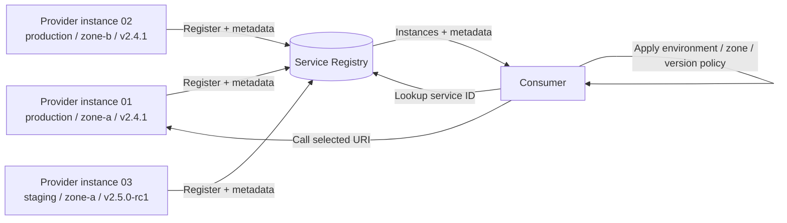

# Designing Metadata for Environment, Zone, and Software Version

A service registry stores information about service instances so consumers can find the address to call. Beyond service ID, hostname/IP, and port, registries typically allow providers to attach metadata such as the deployment environment, geographic region or availability zone, software version, and owning team. Metadata helps systems observe topology, select instances by policy, and roll out multiple versions in a controlled manner.

Metadata is only effective when services agree on its schema and interpretation. If one instance records `zone=az-a` and another records `availabilityZone=zone-a`, consumers cannot filter consistently. This lesson builds a practical schema for `environment`, `region`, `zone`, and `version`, and then demonstrates how to register those fields with Eureka and Consul in Spring Cloud.

## 1. Where Does Metadata Fit in Service Discovery?

A service ID represents a logical service, while each instance is a running process providing that service at a specific address. Metadata consists of supplementary attributes attached to an instance or service depending on the registry's model.

For example, three instances of `payment-service` may share the same service ID while running in different zones and versions:

| Service ID | Instance ID | Environment | Region | Zone | Version |
| --- | --- | --- | --- | --- | --- |
| `payment-service` | `payment-01` | `production` | `ap-southeast-1` | `ap-southeast-1a` | `2.4.1` |
| `payment-service` | `payment-02` | `production` | `ap-southeast-1` | `ap-southeast-1b` | `2.4.1` |
| `payment-service` | `payment-03` | `staging` | `ap-southeast-1` | `ap-southeast-1a` | `2.5.0-rc1` |

Consumers may need to know which instances belong to production, which ones are nearby, or which ones support the API version the consumer requires. The registry supplies metadata; the instance selection policy typically lives in the consumer, Spring Cloud LoadBalancer, or a dedicated routing component.



Metadata does not replace connection addresses or health checks. An instance carrying `environment=production` metadata may still be unreachable; an instance with `version=2.4.1` may still be incompatible with a specific request.

## 2. Designing a Shared Metadata Schema

Before configuring Eureka or Consul, standardize the key names, valid values, and meaning of each field. For the examples in this lesson, use the following schema:

| Key | Meaning | Example | Rules |
| --- | --- | --- | --- |
| `environment` | Deployment environment | `development`, `staging`, `production` | Use a standard value set; lowercase |
| `region` | Regional deployment area | `ap-southeast-1` | Use the infrastructure's consistent region code |
| `zone` | Specific availability zone or failure domain | `ap-southeast-1a` | Must belong to the corresponding region |
| `version` | Running artifact/service version | `2.4.1` | Prefer Semantic Versioning where appropriate |
| `api-version` | API contract version supported by the instance | `v2` | Keep separate from the artifact version |
| `release` | Release or build identifier | `2026.11.24.3` | Use only when release traceability is needed |
| `team` | Service-owning team | `payments` | Use a stable team name |

Not every system needs every key. Start with fields that drive a concrete operational decision. If consumers only need to select by zone, do not add dozens of attributes that have no consumer or maintenance process.

### Naming and Value Conventions

- Use lowercase keys with words separated by hyphens or a consistent convention; for instance, this lesson uses `api-version`.
- Use lowercase values for environment and zone to avoid case-sensitivity mismatches.
- Align region and zone codes with the deployment platform. Do not mix `zone-a`, `az-a`, and `ap-southeast-1a` if they refer to the same zone.
- Key/value metadata is typically transmitted as strings. If numbers or booleans are needed, define how they are formatted and parsed explicitly.
- Do not change the meaning of a published key. When a new schema is needed, add a new key or follow a compatible migration process.

Example logical schema for an instance:

```yaml
service:
  id: payment-service
  instance-id: payment-01
  host: 10.20.1.15
  port: 8085
  metadata:
    environment: production
    region: ap-southeast-1
    zone: ap-southeast-1a
    version: 2.4.1
    api-version: v2
    team: payments
```

This is an illustrative model for aligning semantics. Not every registry loads this YAML file directly; each provider has its own configuration shown in the following sections.

## 3. Distinguishing Environment, Region, and Zone

These three concepts are related but cannot be used interchangeably.

### Environment: Deployment Environment

`environment` describes the lifecycle stage or purpose of the system, such as:

- `development`: development environment, usually changing frequently.
- `test`: automated or integration testing environment.
- `staging`: pre-production environment used for verification before release.
- `production`: environment serving live users.

Each environment typically requires a separate registry or access boundary. Merely attaching `environment=production` metadata does not create a security boundary. If staging and production share one registry and a consumer query fails to filter properly, a staging app can see production instances and vice versa.

Prefer isolating clusters, datacenters, namespaces, networks, or ACL permissions according to platform capabilities. Environment metadata adds observability and configuration checks; it does not replace infrastructure isolation.

### Region: Deployment Region

`region` typically represents a geographic area or cloud region, such as `ap-southeast-1`. Region identifies where infrastructure is located at a coarse level. One region can contain multiple availability zones.

### Zone: Availability Zone or Failure Domain

`zone` identifies a smaller failure boundary within a region, such as `ap-southeast-1a`. Spreading instances across multiple zones reduces blast radius when one zone experiences an outage. In some on-premises setups, a zone may be a rack, server room, or organization-defined failure domain.

Do not assume zone names carry the same meaning across cloud providers. Standardize zones into values understood by every component in the same system.

## 4. Distinguishing Software Version and API Version

`version` and `api-version` answer two different questions:

- `version`: which artifact or release is running? For example, `2.4.1`.
- `api-version`: which API contract does the instance support? For example, `v1`, `v2`.

A software patch may bump `2.4.1` to `2.4.2` without changing the `v2` API contract. Conversely, a new release may support both `v1` and `v2` simultaneously. Consumers should select based on API compatibility rather than necessarily requiring one exact artifact version.

### Using Semantic Versioning Intentionally

If a development team adopts Semantic Versioning, versions typically follow `MAJOR.MINOR.PATCH`:

- MAJOR changes when incompatible changes are introduced per product conventions.
- MINOR adds functionality in a backward-compatible manner.
- PATCH delivers backward-compatible bug fixes.

Do not compare versions with plain string comparison. For instance, string `2.10.0` sorts before `2.9.0` lexicographically. If range filtering is needed, parse according to SemVer rules or use a standardized capability/API version.

### Compatibility During Rollouts

During rolling or blue/green deployments, two versions may coexist. Consumers need to know an instance's API version or capabilities to select a compatible backend. Relying solely on the artifact `version` to decide compatibility can be overly strict or wrong.

One design pattern is declaring `api-version=v2` and `capabilities=refund,authorization` when capability-based routing is genuinely required. If using a capability list, standardize the delimiter and encoding; with Consul, tags may fit simple labels while the metadata map fits key/value pairs. Do not assume identical encoding across all providers.

## 5. Configuring Metadata in Eureka

Eureka stores applications and instances. With Spring Cloud Netflix Eureka Client, custom metadata is typically configured via `eureka.instance.metadata-map`.

Example `application.yml` for `payment-service`:

```yaml
spring:
  application:
    name: payment-service

server:
  port: 8085

eureka:
  client:
    service-url:
      defaultZone: ${EUREKA_SERVER_URL:http://localhost:8761/eureka/}
  instance:
    prefer-ip-address: true
    instance-id: ${spring.application.name}:${spring.cloud.client.ip-address}:${server.port}
    metadata-map:
      environment: ${APP_ENV:development}
      region: ${APP_REGION:local}
      zone: ${APP_ZONE:local-a}
      version: ${APP_VERSION:0.1.0-SNAPSHOT}
      api-version: v1
      team: payments
```

The `${...:default}` placeholders allow metadata to be selected per deployment environment. For example, production can pass `APP_ENV=production`, `APP_REGION=ap-southeast-1`, `APP_ZONE=ap-southeast-1a`, and `APP_VERSION=2.4.1` from a pipeline or container platform.

`metadata-map` is a key/value map attached to the Eureka instance. These values can be read from `ServiceInstance` metadata via the Eureka `DiscoveryClient` implementation. Eureka does not automatically interpret `environment=production` to mean only production consumers may access it; filtering or isolation must be designed separately.

### Reading Metadata from DiscoveryClient

```java
import java.util.List;

import org.springframework.cloud.client.ServiceInstance;
import org.springframework.cloud.client.discovery.DiscoveryClient;
import org.springframework.stereotype.Service;

@Service
public class PaymentInstanceSelector {

    private final DiscoveryClient discoveryClient;

    public PaymentInstanceSelector(DiscoveryClient discoveryClient) {
        this.discoveryClient = discoveryClient;
    }

    public List<ServiceInstance> findProductionInstances() {
        return discoveryClient.getInstances("payment-service").stream()
                .filter(instance -> "production".equals(
                        instance.getMetadata().get("environment")))
                .toList();
    }
}
```

This example filters on the application side after retrieving the instance list. It does not turn metadata into a security boundary, nor does it guarantee the registry only returns healthy instances. For real call flows, combine health policies and LoadBalancer; if you need zone/version filtering during instance selection, configure a supplier or adapter appropriate for your Spring Cloud version.

## 6. Configuring Metadata in Consul

Consul organizes services by service catalog, nodes, service instances, and health checks. Spring Cloud Consul supports `service-name`, `instance-id`, `tags`, and `metadata` in discovery configuration.

Example `application.yml`:

```yaml
spring:
  application:
    name: payment-service
  cloud:
    consul:
      host: ${CONSUL_HOST:localhost}
      port: ${CONSUL_PORT:8500}
      discovery:
        register: true
        service-name: payment-service
        instance-id: ${spring.application.name}:${spring.cloud.client.hostname}:${server.port}
        prefer-ip-address: true
        tags:
          - "environment=${APP_ENV:development}"
          - "region=${APP_REGION:local}"
          - "zone=${APP_ZONE:local-a}"
          - "version=${APP_VERSION:0.1.0-SNAPSHOT}"
          - "api-version=v1"
          - "team=payments"
        metadata:
          environment: ${APP_ENV:development}
          region: ${APP_REGION:local}
          zone: ${APP_ZONE:local-a}
          version: ${APP_VERSION:0.1.0-SNAPSHOT}
          api-version: v1
          team: payments
        health-check-path: /actuator/health
        health-check-interval: 15s

server:
  port: 8085
```

In this example:

- `service-name` is the logical service name in the Consul catalog.
- `instance-id` distinguishes the registered instance.
- `tags` is a list of labels attached to the service; suitable for simple labels and Consul tag queries.
- `metadata` is a supplementary key/value map for the service instance.
- `health-check-path` and `health-check-interval` configure the HTTP check executed by the Consul agent.

You do not necessarily have to duplicate every attribute in both `tags` and `metadata`. Duplicate only when required for compatibility with the tools or APIs in use. If both places store the same value, the pipeline must keep them synchronized.

### Reading Metadata and Tags via Spring Cloud

When Spring Cloud Consul maps a service to `ServiceInstance`, consumers can read metadata via `getMetadata()`. Tags may be represented according to what the provider implementation supports; if you need to query by tag or health status with exact Consul semantics, use the Consul API or an adapter rather than assuming the generic `DiscoveryClient` exposes every filter.

Consul can query healthy services with `passing=true` via its health API endpoint. This condition is Consul-specific semantics and has no generic equivalent parameter in `DiscoveryClient.getInstances(serviceId)`.

## 7. Standardizing Metadata When Supporting Multiple Registries

If an application needs to run with both Eureka and Consul, maintain one logical schema at the application layer and map it to each provider.

| Application Schema | Eureka | Consul |
| --- | --- | --- |
| Service ID | Application name | Service name |
| Instance ID | Eureka instance ID | Consul service instance ID |
| Environment | `metadata-map.environment` | `metadata.environment` or tag `environment=...` |
| Region | `metadata-map.region` | `metadata.region` or tag `region=...` |
| Zone | `metadata-map.zone` | `metadata.zone` or tag `zone=...` |
| Software version | `metadata-map.version` | `metadata.version` or tag `version=...` |
| API version | `metadata-map.api-version` | `metadata.api-version` or tag `api-version=...` |
| Health | Heartbeat/lease and Eureka status | Consul health checks and check status |

The table above is a mapping convention chosen by the application, not an automatic guarantee by Spring Cloud. Each provider may normalize names, store, or return metadata in its own way. Inspect actual data in the registry and `ServiceInstance.getMetadata()` for each implementation.

### Creating an Application-Level Metadata Configuration Class

You can group standard values into a properties class to avoid scattering keys across files:

```java
import org.springframework.boot.context.properties.ConfigurationProperties;

@ConfigurationProperties(prefix = "app.instance")
public record InstanceMetadataProperties(
        String environment,
        String region,
        String zone,
        String version,
        String apiVersion,
        String team
) {}
```

Configuration example:

```yaml
app:
  instance:
    environment: ${APP_ENV:development}
    region: ${APP_REGION:local}
    zone: ${APP_ZONE:local-a}
    version: ${APP_VERSION:0.1.0-SNAPSHOT}
    api-version: v1
    team: payments
```

The application can use this properties class to configure Eureka or Consul adapters. Separating the logical schema prevents variable naming drift across configuration files and makes it easier to validate required values at startup.

## 8. Using Metadata for Routing and Rollouts

Metadata is useful only when a consumer or operational component uses it to make a concrete decision. Common use cases include:

### Selecting Same-Zone Instances

A consumer can prefer instances in a nearby zone to reduce latency and cross-zone transfer costs. If the local zone has no healthy instances left, the policy can allow fallback to another zone.

Do not assume `zone` in metadata automatically changes every LoadBalancer's selection behavior. Configure a zone-aware supplier or write an instance selection policy appropriate for your Spring Cloud version and provider. When filtering manually, always define explicit fallback behavior to avoid an empty instance list if one zone goes down.

### Isolating Staging and Production

Environment metadata is helpful for observability and verification, but should not be relied upon as the sole isolation mechanism. It is better to use separate registries, datacenters, namespaces, networks, or ACLs per environment. If sharing a registry, consumers need an environment-filtering policy and tests to ensure they never call the wrong environment's instances.

### Canary and Blue/Green Deployments

In a canary rollout, a portion of traffic is routed to the new version. You can attach `version` or a `release-track=canary` label to new instances, then configure the gateway or LoadBalancer to select the appropriate ratio or scope. Do not rely on metadata if the routing component does not actually read and apply that key.

In blue/green deployments, two instance groups can coexist. Metadata such as `release-track=blue` or `release-track=green` aids observability and group selection, while the traffic shift must still be executed by a controlled routing mechanism.

### Checking API Compatibility

A consumer may require `api-version=v2`. Only instances declaring support for `v2` are suitable for that request. Before filtering by version, establish metadata update conventions and verify that every instance registers the expected value.

## 9. What Should Not Be Put in Metadata

Metadata is stored in the registry and can be read by many consumers or operators. Therefore, do not put the following data into metadata:

- Passwords, API keys, access tokens, refresh tokens, or private keys.
- Personal data, customer data, or business payloads.
- Sensitive infrastructure details that consumers have no need to know.
- Rapidly changing values such as request IDs, session IDs, or per-request metrics.
- Huge lists or configuration blobs that could bloat the registry.

Metadata should be small, stable, and focused on routing, compatibility, or observability. High-churn data belongs in dedicated telemetry/configuration systems rather than turning the registry into a general-purpose database.

## 10. Updating Metadata and Handling Drift

Metadata is typically sent alongside instance registration details. When environment, zone, or version changes, ensure the registry receives the updated data. The exact update mechanism depends on the provider and Spring Cloud version; many systems require re-registering the instance or restarting the workload with the new configuration.

A safe rollout workflow should:

1. Standardize metadata values in the pipeline or deployment manifests.
2. Launch new instances with the accurate version/zone/environment.
3. Inspect the registry and the metadata seen by consumers.
4. Shift traffic only once new instances pass health checks and satisfy API compatibility.
5. Drain traffic and deregister old instances via the shutdown process.
6. Re-verify the registry after rollout to catch lingering old instances or stale metadata.

| Symptom | Possible Cause | How to Check |
| --- | --- | --- |
| Consumer finds no instances for environment | Misspelled key, case mismatch, or provider not updated | Check actual metadata in the registry and the app schema |
| Instance placed in the wrong zone | IP/hostname detected incorrectly or deployment passed the wrong zone | Cross-check node metadata against running infrastructure |
| Consumer filters the wrong version | Artifact version used instead of API version, or version string parsed incorrectly | Clarify compatibility criteria and check the parser |
| Metadata present in Eureka but missing in Consul | Inconsistent schema mapping or tags/metadata written differently | Inspect the provider adapter and API responses from each registry |
| Staging appears in production | Shared registry scope without environment filtering | Separate registries/namespaces/networks or add enforcement policies |
| Old instance still appears after rollout | Deregistration/health propagation/caching not yet complete | Check lifecycle, health, caches, and synchronization intervals |
| Zone-aware routing returns an empty list | All instances in preferred zone failed or filter is too strict | Add fallback to other zones and monitor fallback usage |

## 11. Testing the Metadata Schema

Metadata is part of the contract between provider, registry, and consumer. Test the schema just as you would test an API:

- Every provider must supply `environment`, `region`, `zone`, and `version` as required by the system.
- Values must belong to the defined set or format.
- `zone` must belong to the corresponding `region`.
- `version` must be parseable per conventions; `api-version` must be in the supported list.
- Instance ID must be unique within the registration scope.
- Consumers only select instances compliant with environment/zone/version policies.
- When metadata is missing or invalid, the system fails safely and emits alerts.
- Contract tests run against each registry implementation the application supports.

Example of a simple application-layer validator:

```java
import java.util.Map;

public final class InstanceMetadataValidator {

    private static final String[] REQUIRED_KEYS = {
            "environment", "region", "zone", "version", "api-version"
    };

    private InstanceMetadataValidator() {}

    public static void validate(Map<String, String> metadata) {
        for (String key : REQUIRED_KEYS) {
            String value = metadata.get(key);
            if (value == null || value.isBlank()) {
                throw new IllegalArgumentException(
                        "Missing required instance metadata: " + key);
            }
        }
    }
}
```

This validator checks key presence. In real projects, add enum validation for environment, version format checks, region-zone rules, and fallback policies. Do not let consumers silently pick an instance lacking required metadata when metadata is a routing safety condition.

## 12. Metadata Design Checklist

- [ ] Purpose of each key is clearly defined.
- [ ] Keys and values follow a shared convention independent of any single provider's style.
- [ ] `environment`, `region`, and `zone` have distinct meanings.
- [ ] Artifact `version` is separated from `api-version`.
- [ ] Instance ID is unique for each instance.
- [ ] Eureka `metadata-map` and Consul `metadata`/`tags` are mapped clearly.
- [ ] Metadata is not used as a substitute for ACLs or environment isolation.
- [ ] Secrets or high-churn data are never stored in the registry.
- [ ] Zone/version policies include fallback and are genuinely enforced by LoadBalancer/gateway.
- [ ] Metadata is verified at startup, registration, and rollout.
- [ ] Contract tests verify the schema on every supported provider.

Good metadata design starts with a small, meaningful schema applied uniformly by every provider. Environment identifies the deployment stage, region and zone describe location and failure domain, and version aids release observability and API compatibility checks. Eureka and Consul store these values in their own structures; Spring Cloud exposes common fields for consumers to read, while routing, isolation, and validation policies must still be designed at the application or infrastructure layer.
