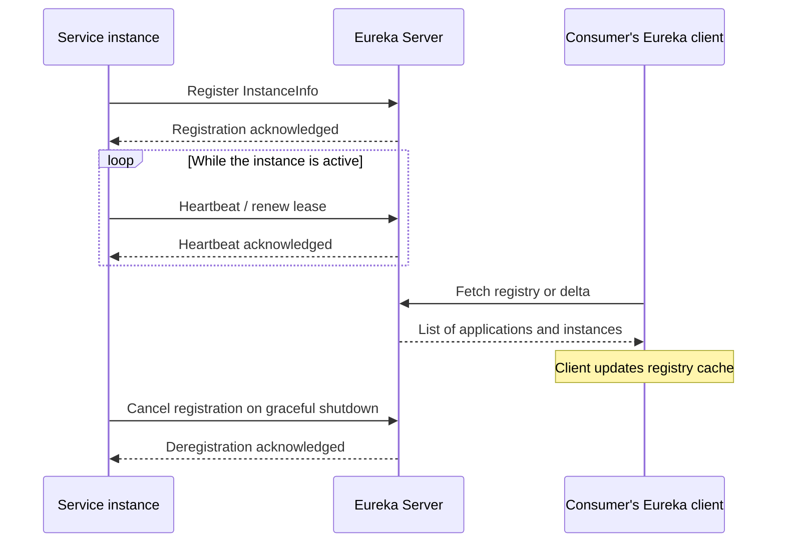
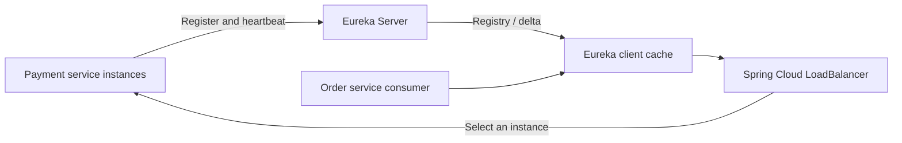

# Role of Eureka Server and Registration Information Structure

In a microservices architecture, a service typically has multiple instances running on different machines or containers. The number of instances can change as the system scales out, scales in, or replaces a failed instance. Therefore, a service consumer needs a way to find the current address of a service without hardcoding hostnames and ports in its configuration.

In Spring Cloud, Eureka Server serves as the **service registry**: the place where service instances register their information and where Eureka clients look up the list of instances by service name. This content belongs to the `SPRING_CLOUD_SERVICE_DISCOVERY` module, helping clarify the role of Eureka Server and the data stored in the registry. Understanding the registration structure correctly helps configure service names, instance identifiers, health statuses, and the service discovery mechanism more accurately.

## 1. What Problem Does Eureka Server Solve?

Suppose an e-commerce system has the services `order-service`, `payment-service`, and `inventory-service`. Each service may run multiple instances:

- `order-service` has three instances at different addresses.
- `payment-service` has two instances and can scale up to four instances during peak hours.
- An instance may be replaced after deploying a new version or when a host experiences an issue.

If `order-service` had to store the address of each `payment-service` instance directly, every time the number of instances or addresses changed, the consumer's configuration would also have to change. This approach creates tight coupling between services and makes the system difficult to operate as it scales.

Eureka Server provides a centralized registry from a logical perspective. Each instance registers its own information such as application name, identifier, hostname, IP, port, and status. Consumers use the service name to retrieve the list of matching instances from the registry. As a result, consumers do not need to know each physical address in advance.

Eureka Server has the following main responsibilities:

1. **Accept registrations:** receive instance information when an application starts up or joins the system.
2. **Store and serve the registry:** maintain the list of applications along with their corresponding instances for clients to look up.
3. **Track leases:** receive heartbeats from clients to know whether an instance still maintains its connection with the registry.
4. **Evict expired records:** clean up registrations that are no longer renewed according to the lease and eviction policies.
5. **Replicate across Eureka Servers:** exchange registration data with peers when deployed as a multi-server cluster.

Eureka Server is a component that manages service discovery information. It does not sit in the path of every business request, nor does it perform load balancing for requests itself. Instance selection and request sending are typically performed on the consumer side through the Eureka client combined with Spring Cloud LoadBalancer.

## 2. Concepts in the Registry

The Eureka registry can be understood through three concepts: application, instance, and instance information.

### 2.1. Application

An `Application` represents a logical service, usually identified by the application name that a client configures via `spring.application.name`. For example, all instances named `payment-service` belong to the same application in the registry.

An application is a logical group, not a specific process or machine. One application can contain one or more instances. When a new instance is created, it registers under the application with the corresponding name; when an instance stops, the remaining instances can still serve the service.

### 2.2. Instance

An `Instance` is a specific deployment of an application. Each instance has its own network address and identifier. For example, two instances of `payment-service` may be deployed as follows:

| Property | First instance | Second instance |
|---|---|---|
| Application | `PAYMENT-SERVICE` | `PAYMENT-SERVICE` |
| Instance ID | `payment-01:8082` | `payment-02:8082` |
| Hostname | `payment-01.internal` | `payment-02.internal` |
| IP | `10.0.0.21` | `10.0.0.22` |
| Port | `8082` | `8082` |
| Status | `UP` | `UP` |

The two instances share the same application name, but have different `instanceId` values and addresses. When a consumer looks up `PAYMENT-SERVICE`, the registry returns the instances currently published for that application.

### 2.3. InstanceInfo

In the Netflix Eureka model, `InstanceInfo` is the object that describes an instance. It contains identifying information, access addresses, status, management URLs, and metadata. Eureka Server stores these records in the registry and serves them to clients.

The overall structure can be visualized as follows:

```text
Eureka Server
└── Registry
    ├── Application: ORDER-SERVICE
    │   ├── InstanceInfo: order-01
    │   └── InstanceInfo: order-02
    ├── Application: PAYMENT-SERVICE
    │   ├── InstanceInfo: payment-01
    │   └── InstanceInfo: payment-02
    └── Application: INVENTORY-SERVICE
        └── InstanceInfo: inventory-01
```

The application name indicates which logical service the instance belongs to; `instanceId` distinguishes each deployment; and the address fields tell consumers where they can connect.

## 3. Important Fields in Registration Information

An `InstanceInfo` record has many fields. Commonly used fields and their meanings are described below.

| Field | Meaning | Configuration notes |
|---|---|---|
| `app` | Name of the application the instance registers under. In Spring Cloud, this value usually comes from `spring.application.name`. | Instances of the same service must use the same logical name. |
| `instanceId` | Identifier of an instance within an application. | Must be unique within the application scope to avoid colliding or indistinguishable records. |
| `hostName` | Hostname of the machine or container running the instance. | Consumers must be able to resolve the hostname in the deployment environment. |
| `ipAddr` | IP address published for the instance. | Choose an address reachable by consumers; an internal container IP may not work across all networks. |
| `port` | HTTP port of the instance, along with information indicating whether the port is enabled. | Must match the port the application actually listens on. |
| `securePort` | HTTPS port of the instance, along with its enabled/disabled state. | Only publish when the instance actually serves HTTPS on that port. |
| `status` | Status published by the client for the instance, such as `UP`, `DOWN`, `STARTING`, `OUT_OF_SERVICE`, or `UNKNOWN`. | `UP` is a status in the registry, not a guarantee that every business operation will succeed. |
| `homePageUrl` | Home page URL or root address of the instance. | Useful for the dashboard and some management tools. |
| `statusPageUrl` | Status page URL of the instance. | Usually points to a status info endpoint, such as an endpoint provided by Actuator. |
| `healthCheckUrl` | Health check endpoint URL recorded in the instance's `InstanceInfo` data. | Should not be assumed that Eureka Server continuously calls this URL by default to check instance health. |
| `vipAddress` | Virtual IP or logical name used to represent the service in some compatible discovery mechanisms. | This is a logical identifier name, not a physical IP address. |
| `secureVipAddress` | Corresponding logical name for the secure access path. | Meaningful when the system uses HTTPS endpoints. |
| `metadata` | Additional key-value pairs provided by the application. | Can contain version, zone, deployment group, or routing info; do not store secrets here. |
| `leaseInfo` | Lease information such as renewal interval and lease duration. | Used to determine when a registration should be considered expired if no heartbeat is received. |
| `dataCenterInfo` | Information about the data center environment, such as deployment type or cloud identification data. | Can support environment-dependent instance selection policies. |

In practice, not every application needs to configure every field manually. The Spring Cloud Netflix Eureka client generates most registration details from Spring configuration and the runtime environment. Developers usually need to pay the most attention to the application name, instance ID, IP address/hostname, port, status, and metadata.

### 3.1. Service Name and Instance Identifier

These two values address two different needs:

- `spring.application.name` identifies the **logical service**. Instances of the same service share this value.
- `eureka.instance.instance-id` identifies **a specific instance**. Instances running in parallel must have different identifiers.

For example, three instances of `order-service` can all register under the `order-service` application, while using the IDs `order-01:8081`, `order-02:8081`, and `order-03:8081` respectively. If instances accidentally share the same ID, registration records may be overwritten or updated incorrectly depending on how they are deployed and handled in the registry.

### 3.2. Address and Port

The registered address must be an address that consumers can reach. In container or cloud environments, the hostname and IP seen by the application inside the container may differ from the address used by other services. If an incorrect address is published, the registry may still show the instance as `UP`, yet consumers will not be able to connect.

`prefer-ip-address: true` instructs the Eureka client to prefer publishing its IP address instead of its hostname in appropriate situations. This setting does not automatically solve every network issue: the chosen IP must still be routable from consumers. For systems using DNS, a service mesh, or custom advertised addresses, clearly determine the hostname/IP that fits the network architecture.

### 3.3. Status and Metadata

`status` describes the state of the instance in Eureka. Common statuses include:

- `UP`: the instance is published as ready.
- `DOWN`: the instance is published as unavailable.
- `STARTING`: the instance is starting up.
- `OUT_OF_SERVICE`: the instance is temporarily not receiving traffic per system policy.
- `UNKNOWN`: the status has not been clearly determined.

Metadata is an extension for storing key-value information. For example, an instance can publish `version=v2`, `zone=zone-a`, or `canary=true`. Consumers or instance selection mechanisms can use this metadata if designed accordingly. Eureka does not automatically interpret the business meaning of arbitrary metadata; applications must agree on key names, value types, and interpretation between the registering side and the lookup side.

Do not store passwords, access tokens, private keys, or sensitive data in metadata. The registry is typically accessed by many internal components, and metadata may appear on dashboards or APIs.

### 3.4. LeaseInfo

Eureka uses leases to track whether an instance is still maintaining its registration. `leaseInfo` typically contains:

- `renewalIntervalInSecs`: the interval at which the client is expected to send heartbeats.
- `durationInSecs`: the lease duration used to determine when a registration has expired.
- Timestamps related to registration, renewal, eviction, or when the service became active, depending on the version and data representation.

With Eureka's common default configuration, clients send heartbeats roughly every 30 seconds and the lease duration is roughly 90 seconds. These are common defaults that can vary by version and configuration. When deploying, check the actual configuration instead of relying on default numbers.

## 4. Example of an Instance Record

Suppose `order-service` has an instance running on machine `order-01.internal`, IP `10.0.0.12`, port `8081`. The data below illustrates the important fields in a simplified JSON format for readability:

```json
{
  "app": "ORDER-SERVICE",
  "instanceId": "order-01:8081",
  "hostName": "order-01.internal",
  "ipAddr": "10.0.0.12",
  "port": 8081,
  "securePort": null,
  "status": "UP",
  "homePageUrl": "http://order-01.internal:8081/",
  "statusPageUrl": "http://order-01.internal:8081/actuator/info",
  "healthCheckUrl": "http://order-01.internal:8081/actuator/health",
  "vipAddress": "order-service",
  "metadata": {
    "version": "1.4.0",
    "zone": "zone-a"
  },
  "leaseInfo": {
    "renewalIntervalInSecs": 30,
    "durationInSecs": 90
  }
}
```

This is a simplified conceptual representation, not a verbatim copy of the REST payload returned by Eureka. The actual wire format structure may represent ports, metadata, and data types in Eureka's own format.

When a consumer requests the list of instances for `ORDER-SERVICE`, it can receive this record along with other records belonging to the same application. The consumer uses the address and port to connect, while metadata can be used for instance selection policies defined by the application.

## 5. Registration Lifecycle of an Instance

Registration does not happen only once at application startup. Client and server maintain registration state through heartbeats, status updates, and lease expiration.



### 5.1. Registration at Startup

When the application starts, the Eureka client reads its configuration and builds `InstanceInfo`. The client sends this information to Eureka Server to register under the corresponding application. In Eureka's REST API, the registration operation corresponds to an endpoint of the form `POST /eureka/apps/{appName}`.

After receiving a valid registration, the server adds or updates the record in the registry. From that moment on, the instance can appear in the discovery list fetched by clients. A successful registration only indicates that the registry has received the information; it does not prove that all dependencies or business flows of the instance are working properly.

### 5.2. Heartbeat and Lease Renewal

While running, the client periodically sends heartbeats to renew its lease. Eureka's heartbeat endpoint has the form `PUT /eureka/apps/{appName}/{instanceId}`. As long as the server continues receiving heartbeats, the registration remains active.

If the server does not receive a heartbeat within the lease duration, the record may be considered expired and removed during an eviction cycle. This helps the registry gradually remove instances that stopped abruptly or lost connectivity.

A heartbeat indicates that the client can still communicate with Eureka Server. It does not mean Eureka Server is sending requests to check every business API of the application. If you need to tie the registry status to Spring Boot Actuator health, you can enable health check integration on the Eureka client with `eureka.client.healthcheck.enabled: true` and ensure the health endpoint accurately reflects application health. The health check configuration must be placed in the appropriate application configuration location according to the Spring Cloud version in use.

### 5.3. Deregistration on Graceful Shutdown

When the application shuts down normally, the client can send a deregistration request. The corresponding REST API has the form `DELETE /eureka/apps/{appName}/{instanceId}`. The server removes the record so consumers stop selecting the stopped instance.

During a new version deployment or maintenance, a system may transition the instance to `OUT_OF_SERVICE`, wait for in-flight traffic to finish, and only then stop the application. This approach reduces errors when replacing instances. If the process is killed abruptly or the machine loses power, the deregistration request may not happen; lease expiration and eviction will clean up the remaining record.

### 5.4. Client Registry Fetching and Caching

The consumer's Eureka client fetches the list of applications and instances from the server. Clients typically maintain a local registry cache and periodically refresh the data, potentially using delta updates to reduce the amount of data exchanged. Thanks to the cache, the consumer does not have to query Eureka Server before every business request.

Because of caching and periodic synchronization, a change in the registry may not appear instantaneously on every consumer. During the convergence window, a consumer may see a stale record or may not yet see a newly registered instance. Applications need appropriate timeouts, retries, and connection error handling.

## 6. Eureka Server in the Service Discovery Flow

When a service consumer needs to call `payment-service`, the typical flow is as follows:

1. The consumer asks the Eureka client for the list of `payment-service` instances from the registry cache.
2. The Eureka client returns the matching instances based on the available discovery data.
3. Spring Cloud LoadBalancer selects an instance according to the configured strategy.
4. The consumer sends an HTTP request directly to the selected instance's address.



The diagram illustrates two distinct flows: the registration management flow between service instances and Eureka Server, and the business request flow between the consumer and the target instance. Eureka helps locate addresses; it does not forward business requests on behalf of the consumer.

This also explains why the registry can be working while requests still fail. For example, Eureka stores IP `10.0.0.12` and status `UP`, yet a firewall blocks the consumer from connecting to port `8081`. Discovery returned an address, but the network path to that address is not open.

## 7. Configuring Eureka Server and Client in Spring Cloud

### 7.1. Creating a Eureka Server

The server application requires the `spring-cloud-starter-netflix-eureka-server` dependency and the `@EnableEurekaServer` annotation enabled on the Spring Boot application class.

```xml
<dependency>
    <groupId>org.springframework.cloud</groupId>
    <artifactId>spring-cloud-starter-netflix-eureka-server</artifactId>
</dependency>
```

```java
import org.springframework.boot.SpringApplication;
import org.springframework.boot.autoconfigure.SpringBootApplication;
import org.springframework.cloud.netflix.eureka.server.EnableEurekaServer;

@SpringBootApplication
@EnableEurekaServer
public class EurekaServerApplication {

    public static void main(String[] args) {
        SpringApplication.run(EurekaServerApplication.class, args);
    }
}
```

For a standalone Eureka Server used in a development environment, you can configure:

```yaml
spring:
  application:
    name: eureka-server

server:
  port: 8761

eureka:
  client:
    register-with-eureka: false
    fetch-registry: false
```

The two properties `register-with-eureka` and `fetch-registry` are set to `false` so the standalone server does not register itself into its own registry and does not fetch the registry from peers. In a multi-node Eureka Server cluster, each node must configure appropriate peer URLs and normally exchange registrations with each other; do not apply the standalone configuration as-is to all nodes in a cluster.

### 7.2. Registering a Service Client

The service requires the `spring-cloud-starter-netflix-eureka-client` dependency. A minimal configuration can look like this:

```yaml
spring:
  application:
    name: order-service

server:
  port: 8081

eureka:
  client:
    service-url:
      defaultZone: http://localhost:8761/eureka/
  instance:
    prefer-ip-address: true
    instance-id: ${spring.application.name}:${server.port}
```

In this example:

- `spring.application.name` sets the application name under which the client registers.
- `defaultZone` specifies the Eureka Server address used by the client.
- `prefer-ip-address` instructs the client to prefer publishing its IP address.
- `instance-id` creates an easily recognizable ID from the application name and port.

The `instance-id` expression above is suitable for a simple example. If multiple instances run on the same host or multiple machines share the same port, include the hostname, IP, or a deployment identifier to ensure IDs do not collide within the same application.

The property name `defaultZone` is written in camelCase in Eureka configuration. When configuring multiple nodes, each Eureka Server must know the appropriate peer addresses to exchange the registry. How URLs are assigned and the number of nodes depend on the deployment topology.

## 8. Registry Synchronization, Self-Preservation, and Consistency

Eureka prioritizes availability of the discovery mechanism in distributed network environments. The registry is updated via heartbeats, client refreshes, and peer replication; therefore, data may experience propagation delay.

### 8.1. Peer Replication

In a deployment with multiple Eureka Servers, each node can exchange registry changes with its peer nodes. If a client registers with one node, the information can be replicated to other nodes so that clients connecting to another node can still look up the service.

Peer replication reduces reliance on a single server, but nodes should not be treated as an instantaneously synchronized database. When a network error occurs or a node temporarily loses connectivity, the registries between nodes may diverge for a period of time and converge again once connectivity is restored.

### 8.2. Self-Preservation

During a widespread network outage, many clients may fail to send heartbeats even though the applications are still running. If the server deleted all records solely because heartbeats were missing, the system could lose large numbers of instances from the registry right during a network incident.

Eureka has a self-preservation mechanism to limit mass eviction when the number of received heartbeats drops below an expected threshold. The goal is to avoid deleting too many registrations merely due to a connectivity disruption. As a consequence, an instance that has actually stopped may remain in the registry longer than expected while self-preservation is active.

Therefore, consumers must still handle cases where connecting to an instance fails. A record marked `UP` in the registry should not be treated as absolute proof that the instance is actively serving requests. Combine timeouts, bounded retries, circuit breakers, and system health observability at the appropriate layers.

## 9. Common Registration and Lookup Errors

| Symptom | Possible cause | What to check |
|---|---|---|
| Service not visible on Eureka Dashboard | Client is missing the Eureka client dependency, wrong server URL, network error, or registration failed. | Check client startup logs, `defaultZone`, DNS, and connectivity to Eureka Server. |
| Service appears, but consumer cannot call it | Instance published an incorrect hostname/IP/port or a firewall blocks the connection. | Compare the address in the registry with the address reachable by the consumer; check ports and network policies. |
| Multiple instances exist, but only one is visible or data changes unexpectedly | Instances may share the same `instanceId`, or are registering under different application names. | Check `spring.application.name` and instance ID configuration on each deployment. |
| Stopped instance still remains in the registry | Shutdown failed to send deregistration, heartbeats were interrupted, or self-preservation is keeping the record. | Check heartbeat, lease, eviction logs, and self-preservation status. |
| Consumer does not yet see a newly started instance | Client cache has not refreshed yet or data is replicating between peers. | Check the registry on the node the client uses and the configured refresh interval. |
| Instance stays in an unexpected status | Health check integration, Actuator, or status configuration is not set up properly. | Check the health endpoint, `eureka.client.healthcheck.enabled`, and status update logs. |

When investigating an issue, cross-check all three sides: the service instance logs, the state on Eureka Server, and actual connectivity from the consumer. Looking at the Dashboard alone may not be enough to distinguish registration errors from network or application errors.

## 10. Practical Deployment Notes

- **Use consistent application names:** instances of the same service must use the same `spring.application.name`; consumers must look up that exact name.
- **Ensure unique instance IDs:** construct IDs from hostname, IP, port, or container/pod identifiers suited to the runtime environment.
- **Publish reachable addresses:** verify routing, DNS, port mapping, and firewalls between consumers and instances.
- **Configure health status intentionally:** heartbeats and health checks have different meanings; choose a status publishing approach that matches the service's availability requirements.
- **Design for delayed data:** the registry and caches may not synchronize instantaneously, so consumers should handle failed instances gracefully.
- **Deploy multiple nodes when high availability is needed:** configure peer replication, verify connectivity between nodes, and monitor registry divergence.
- **Protect the registry:** the registry can expose service names, hostnames, IPs, ports, and internal metadata. Restrict network access, enable authentication and encryption appropriate to the deployment environment; do not expose the Eureka Dashboard or registry API broadly to the Internet.
- **Monitor registry operations:** observe instance counts, heartbeats, self-preservation status, evictions, peer connection errors, and consumer request failure rates.

## Conclusion

Eureka Server is a registry that enables microservices to register and discover instances by service name. An application represents a logical service, while each instance is described by `InstanceInfo` with identification, address, status, metadata, and lease fields. Clients register at startup, send heartbeats to renew leases, deregister on graceful shutdown, and fetch the registry into a local cache for discovery.

In production operations, distinguish registration status from the actual ability to serve requests. Application names must be consistent, instance IDs must distinguish individual deployments, and published addresses must be reachable from consumers. Mastering these principles forms the foundation for using Eureka in Spring Cloud's service discovery mechanism.
