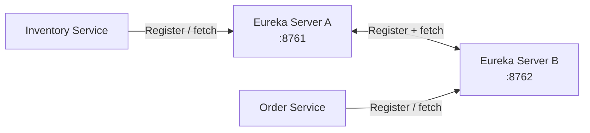

# Configuring register-with-eureka and fetch-registry on the Server

Eureka Server both provides the registry for applications to register and look up services, and is itself built on top of Eureka Client. Therefore, a process acting as a Eureka Server also exposes client options such as `register-with-eureka` and `fetch-registry`. These two properties are independent: one controls whether the server registers itself with another registry, and the other controls whether the server fetches the list of instances from peers.

For a standalone single-node Eureka Server, you normally disable both properties. When deploying multiple Eureka Servers in a peer-aware model, each node needs to exchange its registry with the remaining peers, so both are normally enabled and peer URLs are configured. The right configuration depends on the deployment topology, not merely on whether the application has the `@EnableEurekaServer` annotation.

## Eureka Server Also Contains a Eureka Client

In Spring Cloud Netflix, an application enables `@EnableEurekaServer` to provide Eureka Server. However, the server still contains a Eureka Client inside so it can participate in a multi-node registry cluster. This explains why server configuration includes properties starting with `eureka.client`.

```java
import org.springframework.boot.SpringApplication;
import org.springframework.boot.autoconfigure.SpringBootApplication;
import org.springframework.cloud.netflix.eureka.server.EnableEurekaServer;

@SpringBootApplication
@EnableEurekaServer
public class EurekaServerApplication {
    public static void main(String[] args) {
        SpringApplication.run(EurekaServerApplication.class, args);
    }
}
```

The application needs the `spring-cloud-starter-netflix-eureka-server` dependency. The Spring Cloud version should be managed with a BOM/release train compatible with the Spring Boot version in use.

```xml
<dependency>
    <groupId>org.springframework.cloud</groupId>
    <artifactId>spring-cloud-starter-netflix-eureka-server</artifactId>
</dependency>
```

`register-with-eureka` and `fetch-registry` are settings for the Eureka Client inside the process. They do not enable or disable Eureka's HTTP server role. The server role is provided by the starter and `@EnableEurekaServer`; the two client properties control how that node participates in the registry.

## Meaning of the Two Properties

| Property | When enabled (`true`) | When disabled (`false`) |
|---|---|---|
| `eureka.client.register-with-eureka` | Eureka Client registers the current application's instance with a Eureka Server/peer | Does not publish the current process's instance via Eureka Client |
| `eureka.client.fetch-registry` | Eureka Client fetches the registry from a server/peer to look up applications and instances | Does not fetch the registry list to the local client |

A brief way to remember:

- `register-with-eureka`: "Do I register myself with another registry?"
- `fetch-registry`: "Do I fetch the directory from another registry?"

The two properties are not a single on/off pair. A consumer-only application can set `register-with-eureka=false` while keeping `fetch-registry=true`: the application does not register itself, yet still discovers other services. A peer-aware Eureka Server typically enables both so it publishes its own node to peers and receives registry data from peers.

## Configuring a Standalone Single-Node Eureka Server

When running only a single standalone Eureka Server, there are no other peers to synchronize with. The server does not need to register itself into the registry, nor does it need to fetch the registry from peers. Configure this explicitly:

```yaml
server:
  port: 8761

spring:
  application:
    name: eureka-server

eureka:
  client:
    register-with-eureka: false
    fetch-registry: false
```

In this configuration:

- `register-with-eureka: false` prevents Eureka Server from trying to register its own instance as a Eureka Client.
- `fetch-registry: false` prevents the embedded client inside the server from fetching the registry list from a Eureka peer.
- Eureka Server still starts the registry endpoints and dashboard on port `8761`.

Service clients will connect to this server using the registry URL. Example configuration for a provider:

```yaml
spring:
  application:
    name: inventory-service

eureka:
  client:
    register-with-eureka: true
    fetch-registry: true
    service-url:
      defaultZone: http://localhost:8761/eureka/
```

Here, `inventory-service` is a client of Eureka Server, so it normally both registers itself and fetches the registry. If the application is consumer-only, it can set `register-with-eureka: false` while keeping `fetch-registry: true`.

## Configuring a Peer-Aware Eureka Server Cluster

When high availability is needed, you can deploy multiple Eureka Servers and configure them as peers. Each node both serves clients, registers with peers, and fetches the registry from peers. In this model, both properties are typically enabled:

```yaml
eureka:
  client:
    register-with-eureka: true
    fetch-registry: true
```

Crucially, each node's `defaultZone` must point to the other peers, not loop back to the node itself. Nodes need stable hostnames or DNS names and must be able to connect to each other over the network.

### Two-Node Cluster Example

**Node A — `eureka-a`**

```yaml
server:
  port: 8761

spring:
  application:
    name: eureka-server

eureka:
  instance:
    hostname: eureka-a
  client:
    register-with-eureka: true
    fetch-registry: true
    service-url:
      defaultZone: http://eureka-b:8762/eureka/
```

**Node B — `eureka-b`**

```yaml
server:
  port: 8762

spring:
  application:
    name: eureka-server

eureka:
  instance:
    hostname: eureka-b
  client:
    register-with-eureka: true
    fetch-registry: true
    service-url:
      defaultZone: http://eureka-a:8761/eureka/
```

Node A registers with and fetches from B; Node B registers with and fetches from A. Each node continues serving the registry API to service clients. In a real environment, `eureka-a` and `eureka-b` must resolve properly via DNS from both hosts; do not use `localhost` to point to a peer from another container.



### Three-Node Cluster Example

With three nodes, each node configures the URLs of the other two peers. For example:

| Node | Port | `defaultZone` points to |
|---|---:|---|
| `eureka-a` | 8761 | `http://eureka-b:8762/eureka/,http://eureka-c:8763/eureka/` |
| `eureka-b` | 8762 | `http://eureka-a:8761/eureka/,http://eureka-c:8763/eureka/` |
| `eureka-c` | 8763 | `http://eureka-a:8761/eureka/,http://eureka-b:8762/eureka/` |

Example configuration for Node A:

```yaml
server:
  port: 8761
spring:
  application:
    name: eureka-server
eureka:
  instance:
    hostname: eureka-a
  client:
    register-with-eureka: true
    fetch-registry: true
    service-url:
      defaultZone: http://eureka-b:8762/eureka/,http://eureka-c:8763/eureka/
```

Nodes B and C use the same structure, substituting their own `hostname`, `port`, and corresponding peer list. The URL value in `defaultZone` is a comma-separated list of peer endpoints. Do not include the current node's own URL in its peer list.

## Why Do Standalone and Peer Cluster Configurations Differ?

| Deployment type | `register-with-eureka` | `fetch-registry` | Reason |
|---|---:|---:|---|
| Standalone single-node Eureka Server | `false` | `false` | No peers to register with or fetch registry from |
| Eureka Server in a peer cluster | `true` | `true` | Each node announces itself to peers and receives registry data from peers |
| Standard service provider | `true` | `true` | Registers itself and looks up other services |
| Consumer-only | `false` | `true` | Does not register a consumer instance, yet still needs the registry list |

Do not copy the standalone server configuration into each node of a peer cluster. If all nodes disable both properties, they will not exchange registry state with one another. Conversely, enabling both on a single-node server without valid peers can generate unnecessary connection attempts or make logs harder to diagnose.

## How Does Registry Replication Work?

In a peer-aware Eureka cluster, each server maintains a local registry and exchanges changes with peers. When a client registers with Node A, the registration is processed on A and replicated to peers using Eureka's replication mechanism. Clients connected to Node B can also see the information after replication completes.

Replication should not be assumed to be strictly instantaneous synchronization. For brief intervals, two nodes may display different lists due to network latency, heartbeats, caching, or replication progress. Therefore, applications still need to handle cases where a newly registered instance has not yet appeared on every node, or a dead instance remains in the registry during detection and eviction.

`register-with-eureka` and `fetch-registry` allow a node to participate in this exchange loop, but they do not automatically create a complete HA topology. Ensure peer URLs are accurate, DNS/networking is open, server ports are reachable, and nodes share consistent configurations.

## Common Configuration Errors

| Symptom | Possible cause | How to check or resolve |
|---|---|---|
| Standalone server continuously looks for peers or logs fetch errors | `fetch-registry=true` is left enabled without an appropriate peer | Set `fetch-registry=false` for standalone |
| Standalone server attempts to register itself | `register-with-eureka=true` is left enabled in a single-node config | Set `register-with-eureka=false` |
| Cluster nodes do not see the same list of services | One node disabled fetch/register or `defaultZone` is missing a peer | Enable both properties and verify bidirectional peer lists |
| Node connects to itself instead of a peer | `defaultZone` uses `localhost` or the node's own hostname | Use DNS names/hostnames of the other peers |
| Node cannot connect to peer | Wrong DNS, firewall, port, or `/eureka/` URL | Check name resolution and test calling the peer endpoint from the container/server itself |
| Client registers successfully, but service calls fail | Registry has the record, but the advertised address is unreachable | Verify the host/port registered by the client and network path from the consumer |
| Registry lists between peers differ briefly | Replication or heartbeats have not completed yet | Check replication logs, peer connectivity, and update intervals |

A common mistake is using `localhost` in `defaultZone` when running in Docker or Kubernetes. `localhost` always points to the container/pod's own network namespace, not the other Eureka Server. Use a service DNS name or hostname resolvable from the running node.

## How to Verify Configuration

### Check the Dashboard

Start the server and open `http://localhost:8761/` in a local environment. The dashboard lets you inspect which applications and instances are in the registry. In a multi-node cluster, open each node's dashboard and compare lists after registering a client.

### Check the REST Endpoint

You can inspect the registry via Eureka's REST API:

```bash
curl -H "Accept: application/json" http://localhost:8761/eureka/apps
```

In a peer cluster, run the same command against each node. After registering a service client, verify that the service ID and instance appear on all peers after replication completes. APIs and response formats may vary depending on security settings and versions.

### Check Startup Logs

When running with an appropriate log level, look for messages related to:

- Whether Eureka Client is enabled or disabled.
- Whether the client is registering the server's own instance.
- The peer list in `service-url.defaultZone`.
- Results of connecting to and fetching the registry from peers.
- DNS errors, timeouts, connection refused errors, or HTTP errors during synchronization.

You can temporarily enable debug logging locally:

```yaml
logging:
  level:
    com.netflix.discovery: DEBUG
    com.netflix.eureka: DEBUG
    org.springframework.cloud.netflix.eureka: DEBUG
```

Do not leave overly verbose debug logging enabled long-term in production due to high log volume and potential exposure of internal topology.

### Check Using Actuator Configuration

If the application includes Spring Boot Actuator, you can use the health endpoint and bean info to assist diagnostics. Only expose management endpoints on a protected network; Eureka's dashboard and REST APIs should also have appropriate access restrictions.

## Notes on Self-Preservation and Availability

`register-with-eureka` and `fetch-registry` do not replace Eureka's self-preservation, lease renewal, eviction, or health monitoring mechanisms. Self-preservation can retain certain records when the server suspects a widespread network outage and receives fewer heartbeats than expected. Consequently, a stopped instance may still appear in the registry for some time.

When designing a cluster, monitor peer replication, heartbeat counts, registered instance counts, server status, and connection errors. Do not disable self-preservation just to make registry entries disappear faster in a lab exercise; first understand why heartbeats are missing and the impact of premature eviction.

## Configuration Checklist

1. Determine whether Eureka Server is running standalone or as a node in a peer cluster.
2. For standalone, set `register-with-eureka=false` and `fetch-registry=false`.
3. For a peer cluster, enable both properties and list the other peers in `defaultZone`.
4. Do not point `defaultZone` to the node itself; use hostnames/DNS names resolvable from each peer.
5. Ensure nodes use consistent service URL, port, and network configurations.
6. Verify service clients point to at least one available Eureka Server.
7. Compare the registry across each node after client registration to confirm replication.
8. Test stopping and restarting one peer and observe the recovery process.
9. Monitor heartbeats, leases, self-preservation, and stale records.
10. Manage Spring Boot/Spring Cloud versions with a compatible BOM and secure the dashboard/registry APIs.

## Conclusion

`register-with-eureka` controls whether the embedded Eureka Client inside the process registers itself; `fetch-registry` controls whether the client fetches the registry from a server/peer. For a standalone single-node Eureka Server, set both to `false` to avoid self-registration and fetching from nonexistent peers. For a peer-aware Eureka cluster, enable both and configure each node to point to the other peers. Standard service clients typically enable both, while consumer-only applications can disable registration while still fetching the registry. Always verify the configuration via the dashboard, REST API, connection logs, and registry state on each node.
