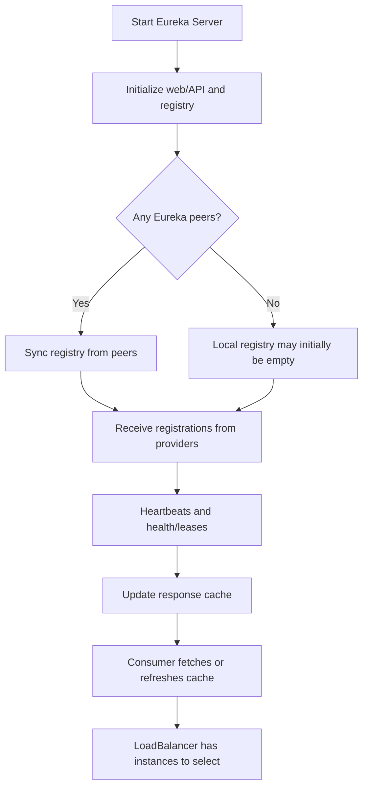

# Startup, Registry Warm-Up, and Limitations of a Single Server

Eureka Server stores the list of service instances for consumers to look up. When the server has just started, the registry may not contain any instances yet: providers need time to start up, register, and send heartbeats; the server may need to synchronize data from peers; and both the server response cache and client-side caches also have their own refresh intervals.

Therefore, **Eureka Server starting successfully does not mean the registry is warmed up and has enough instances to serve traffic**. In the Spring Cloud Service Discovery module, it is important to understand the startup lifecycle, registry convergence time, and the limitations of deploying only a single Eureka Server.

## 1. Starting a Standalone Eureka Server

A Spring Boot application can enable the Eureka Server role using the `@EnableEurekaServer` annotation:

```java
import org.springframework.boot.SpringApplication;
import org.springframework.boot.autoconfigure.SpringBootApplication;
import org.springframework.cloud.netflix.eureka.server.EnableEurekaServer;

@SpringBootApplication
@EnableEurekaServer
public class EurekaServerApplication {

    public static void main(String[] args) {
        SpringApplication.run(EurekaServerApplication.class, args);
    }
}
```

Basic configuration for a standalone server:

```yaml
spring:
  application:
    name: eureka-server

server:
  port: 8761

eureka:
  client:
    register-with-eureka: false
    fetch-registry: false
```

Both client properties are disabled in the standalone example because the server does not need to register with itself or fetch the registry from another peer:

- `register-with-eureka: false`: do not send this Eureka Server's registration to another registry.
- `fetch-registry: false`: do not fetch the registry from peers.

This configuration is suitable for a single server in learning environments, development, or small systems that accept a single point of failure. In a multi-peer cluster, server configuration will differ: each peer needs to know the addresses of the other peers and participate in registry exchange.

Once the application starts, you can open the dashboard at `http://localhost:8761/`. The dashboard helps observe the server and the list of applications, but the fact that the dashboard page loads does not prove critical providers have finished registering or that traffic is ready.

## 2. Stages from Startup to Registry Readiness

A startup sequence typically goes through the following stages:

1. **Process startup:** Spring Boot creates the application context, initializes the web server, and creates beans.
2. **Eureka Server initialization:** registry components, APIs, and instance management mechanisms are initialized.
3. **Peer synchronization (if applicable):** the server exchanges data with Eureka peers per cluster configuration.
4. **Receiving registrations:** providers start up and send instance information to Eureka Server.
5. **Maintaining registrations:** clients send heartbeats; the server processes leases and health statuses.
6. **Updating the response cache:** the server updates queryable cache data; clients may also need a fetch cycle to receive new records.
7. **Consumer uses the data:** DiscoveryClient and LoadBalancer see eligible instances and start routing requests.

Overall diagram:



These stages do not necessarily happen simultaneously. The server may accept HTTP requests before business services finish registering. A consumer starting too early may look up a service ID and receive an empty list.

## 3. A Newly Started Registry Typically Has No Data Yet

In standalone mode, the registry of a newly started Eureka Server can be empty. The server does not automatically know about providers in the system; providers must register with it.

For example, a system has:

- `order-service`: handles orders.
- `inventory-service`: checks stock.
- `payment-service`: handles payments.

When Eureka Server first comes up, the dashboard may not yet display the three applications. Only after each provider starts up and registers does the registry gradually populate. If a consumer calls `inventory-service` before the first instance registers, LoadBalancer may report that no suitable instance is available.

This is normal behavior during startup, not necessarily a Eureka Server failure. When diagnosing, distinguish among:

- The server is not ready to accept requests yet.
- The server is ready, but the registry has no providers yet.
- The provider has registered, but the record has not yet appeared in the response cache.
- The server has updated, but the consumer has not refreshed its registry cache yet.
- The instance has a record, but health/lease state prevents it from being considered serviceable.

Do not equate "dashboard opens" with "all services are ready."

## 4. Why Is Registry Warm-Up Needed?

Warm-up is the process of waiting for required components to initialize and data to converge before sending discovery-dependent traffic.

Causes of delay:

| Component | What happens | Impact |
|---|---|---|
| Provider startup | The application needs time to start its web server and discovery client | No registration yet |
| Registration | The client sends instance info to the server | Registry does not see the provider before registration completes |
| Peer synchronization | A new server needs to receive data from peers | Registries across nodes may temporarily differ |
| Server response cache | Eureka updates the query-serving cache periodically | New records may not appear immediately in responses |
| Client registry fetch | The consumer fetches or refreshes the instance list | The consumer may still see stale data or an empty list |
| Health/lease | The instance must satisfy status conditions and lease renewal | The instance is not yet considered ready to serve |

Eureka typically maintains caches on both the server and client sides. Common default intervals are on the order of tens of seconds, though exact values and behavior depend on version, configuration, and cache type. Do not assume a registration just sent will immediately appear in every consumer.

Total convergence time depends on several sequential steps: provider startup, sending registration, server cache update, and then consumer refresh. Measure it in the real environment rather than picking an arbitrary fixed wait time.

## 5. Controlled Warm-Up Process

Startup can be organized in the following order:

1. Start Eureka Server and wait for the process's health/readiness to meet requirements.
2. Start critical providers.
3. Wait for each provider to register and reach the desired status.
4. Verify the registry contains all required service IDs and instances.
5. Wait for consumers to receive updated data if applications depend on client-side registry caching.
6. Allow gateways, workers, or business traffic flows to start calling those services.

For systems deployed on Kubernetes or another orchestration platform, readiness probes should verify conditions appropriate to the workload's role. Merely checking that a TCP port is open or the process is alive is not sufficient to conclude the registry already has all required providers.

### Checking Application Status with Spring Boot Actuator

You can enable health probes:

```yaml
management:
  endpoints:
    web:
      exposure:
        include: health,info
  endpoint:
    health:
      probes:
        enabled: true
```

Then check the readiness endpoint, for example:

```text
GET /actuator/health/readiness
```

Default readiness reflects the application's readiness according to the health groups configured by Spring Boot. It **does not automatically prove the registry already contains all required business instances**. If a deployment requirement dictates waiting for critical providers to appear, add a custom readiness check or verification step aligned with the architecture.

Do not put all business dependencies into the liveness probe. If Eureka or a provider becomes temporarily unreachable, failing liveness can trigger continuous restarts and amplify the outage. Readiness, liveness, and registry readiness are distinct signals and should be designed for their respective purposes.

### Checking the Registry via API

You can query the list of registered applications using Eureka's REST API:

```bash
curl -H "Accept: application/json" \
  http://localhost:8761/eureka/apps
```

This API is useful for checking which applications and instances are in the registry. In production environments, protect the endpoint with authentication, network policies, and TLS as required by system policy.

You can inspect a specific application via its corresponding REST endpoint or observe the dashboard and logs. When checking a provider's readiness, verify the instance ID, host, port, and status of that instance rather than merely counting application names.

### Using Bounded Retries on the Consumer

A consumer may start before providers or before the registry converges. When calling a service ID, use retries with backoff and time bounds appropriate for the business flow.

Illustrative strategy example:

```text
Attempt 1: call service ID
    If no instance is available yet: wait for a short backoff
Attempt 2: re-query and retry the call
    If still no instance: increase backoff
Subsequent attempts:
    Stop upon success or when the startup deadline expires
```

Do not use infinite loops or fixed `Thread.sleep()` calls inside request-handling threads. Retries should belong to startup orchestration or an appropriate resilience mechanism, with timeouts, attempt limits, and clear failure logging.

## 6. Distinguishing Server Readiness and Registry Readiness

There are at least three states to observe:

| State | Question to answer | How to check |
|---|---|---|
| Process/server readiness | Has Eureka Server started and can it accept requests? | Health endpoint, web server, and startup logs |
| Registry readiness | Does the registry already contain critical services/instances? | Eureka REST API, dashboard, custom health checks |
| Consumer readiness | Does the consumer see the instances and can it call the provider? | DiscoveryClient, LoadBalancer, and test requests |

These three states are related but not identical. The server can be healthy while the registry is empty. The registry can have an instance while the consumer has not refreshed its cache yet. The consumer can see an instance while connections fail due to host, port, firewall, or TLS issues.

In production, define readiness criteria by role. A Eureka Server can be ready to accept registrations even if the registry does not yet contain every application. A gateway may need to wait for mandatory services before accepting traffic. Do not apply one single readiness criterion to all workloads.

## 7. Limitations of a Single Eureka Server

Deploying a single Eureka Server is simple, but comes with significant limitations.

### Single Point of Failure

If the single server stops, suffers a hardware failure, loses network connectivity, or requires an upgrade, clients cannot reach the registry to receive new data or register new instances during that downtime.

Consumers that already hold a registry cache may continue calling some known instances, though the data can become stale. Continued serviceability depends on caches, instance states, lease durations, and client behavior. Local caching cannot be treated as a complete HA solution.

### No Peer Replication

A single server has no peers to replicate the registry to. If the server restarts, the in-memory registry may start empty and rebuild only as providers re-register. During recovery, consumers may observe missing instances or unconverged data.

Eureka is not a durable persistent store like a business database. Do not rely on a single server as the sole durable store for instance identities and states.

### Maintenance Disrupts the Registry

Upgrading the JVM, updating configurations, rotating TLS certificates, or patching server bugs can interrupt the sole discovery endpoint. Clients can still rely on caches for a period, but will not receive new changes while the server is down.

### Resource and Failure Domain Limits

A single server has finite CPU, RAM, network bandwidth, connections, and request capacity. As the number of services/instances or registration rate grows, one node can become a bottleneck. If the server sits in the same failure domain as applications, a zone or network outage can affect both the registry and providers.

### Self-Preservation Does Not Replace HA

Eureka includes a self-preservation mechanism to limit mass instance eviction when received heartbeats drop abnormally. This mechanism helps avoid mistakenly removing healthy instances during a widespread network disruption.

However, self-preservation can cause records of dead instances to linger longer than expected. It does not add backup servers, does not replicate data to peers, and does not keep the registry reachable when the single node fails.

## 8. When Is a Single Server Enough?

A single Eureka Server can be suitable for:

- Learning environments, local development, or demos.
- Small internal systems that tolerate downtime during maintenance.
- Integration test environments that do not require an always-available registry.
- Early project stages when there is a clear plan to scale out as demand grows.

Do not assume a single server is fit for production merely because the current number of services is small. The criticality of the registry, acceptable downtime, deployment scope, and impact of losing new registration/lookup capabilities are the deciding criteria.

## 9. Scaling Out to a Multi-Peer Eureka Cluster

When higher availability is required, deploy multiple Eureka Server peers. Each peer maintains its own registry and replicates changes to the other peers using Eureka's replication mechanism.

Example peer URLs configuration:

```yaml
eureka:
  client:
    register-with-eureka: true
    fetch-registry: true
    service-url:
      defaultZone: http://eureka-2:8761/eureka/,http://eureka-3:8761/eureka/
```

This is an illustrative configuration snippet for one node in a cluster; each node needs a peer list matching the actual topology and hostnames resolvable from the remaining nodes.

Clients should be configured with multiple server URLs so they can connect to another node when one peer is unavailable:

```yaml
eureka:
  client:
    service-url:
      defaultZone: http://eureka-1:8761/eureka/,http://eureka-2:8761/eureka/,http://eureka-3:8761/eureka/
```

When deploying peers:

- Place nodes in appropriate failure domains, avoiding shared dependence on a single host or network zone.
- Open connectivity between peers and configure reachable hostnames/ports.
- Verify replication and convergence time when a node restarts.
- Monitor peer status, heartbeats, request rates, and replication errors.
- Test scenarios when a node loses connectivity and when a node returns.
- Size peer count and resources according to registry scale.

Eureka replication provides eventual consistency; do not assume all peers update at the exact same instant. Design consumers and rollout procedures to tolerate periods where data is not yet uniform.

## 10. Observing and Operating the Registry

A Eureka Server must be monitored like a critical infrastructure component. Useful metrics and signals include:

- Process health/readiness status.
- Number of registered applications and instances.
- Received heartbeats and renewal rate.
- Number of instances marked DOWN or evicted.
- REST API response times and HTTP errors.
- CPU, heap, garbage collection, threads, and network.
- Cache updates, client fetches, and convergence latency.
- Peer replication status when running a cluster.

Do not monitor only port 8761. An open port with an empty registry or broken peer replication can still prevent the system from calling services.

Protect the dashboard and REST API. Allow access only to authorized workloads and operators; use TLS, authentication, and network segmentation according to system policies. Do not expose the management registry directly to the public Internet.

## 11. Common Errors During Startup and Warm-Up

| Symptom | Possible cause | What to check |
|---|---|---|
| Dashboard opens, but has no applications | Providers have not started or have not registered yet | Check client logs and service URL configuration |
| Consumer reports no instances right after startup | Registry has not received registrations or client has not fetched fresh data | Check startup order, caches, and retries |
| Instances appear slowly | Periodic response cache or client fetch intervals | Measure latency and check configured intervals |
| New server lacks registry data from peers | Wrong peer URL, network error, or replication not finished | Check peer status, logs, and REST API |
| Server restart leaves registry temporarily empty | In-memory local registry needs providers to re-register | Check client reconnections and rebuild time |
| Dead instance still appears on dashboard | Heartbeat drop, lease, or self-preservation delaying eviction | Check renewal threshold, health, and logs |
| Single server overloaded | Instance/request count exceeds node capacity | Monitor resources and evaluate clustering |

When troubleshooting, first identify whether the issue belongs to process readiness, registry readiness, or consumer readiness. This classification avoids tweaking timeouts or restarting the server when the true cause is simply that providers have not registered yet.

## 12. Pre-Launch Checklist for Eureka Server

1. Did the server start properly with `@EnableEurekaServer` and the expected port?
2. Does standalone mode disable client register/fetch if peers are not used?
3. Are providers registering with the right service ID, host, and port?
4. Are there criteria distinguishing server readiness from registry readiness?
5. Do consumers handle an empty instance list during startup?
6. Have registration time, response-cache update time, and client refresh time been measured?
7. Are heartbeats, leases, and self-preservation monitored?
8. Does a single server meet downtime and failure-domain requirements?
9. If HA is needed, have peer replication and multiple server URLs been tested?
10. Are the dashboard, REST API, and peer connections secured?

Starting Eureka Server is only the first step. The registry needs time to receive registrations, synchronize, and update caches before consumers can rely on stable data. A single server fits simple environments, yet represents a single point of failure with no peer replication. When the registry becomes critical production infrastructure, establish clear readiness checks, monitor convergence latency, and plan an appropriate multi-peer deployment.
