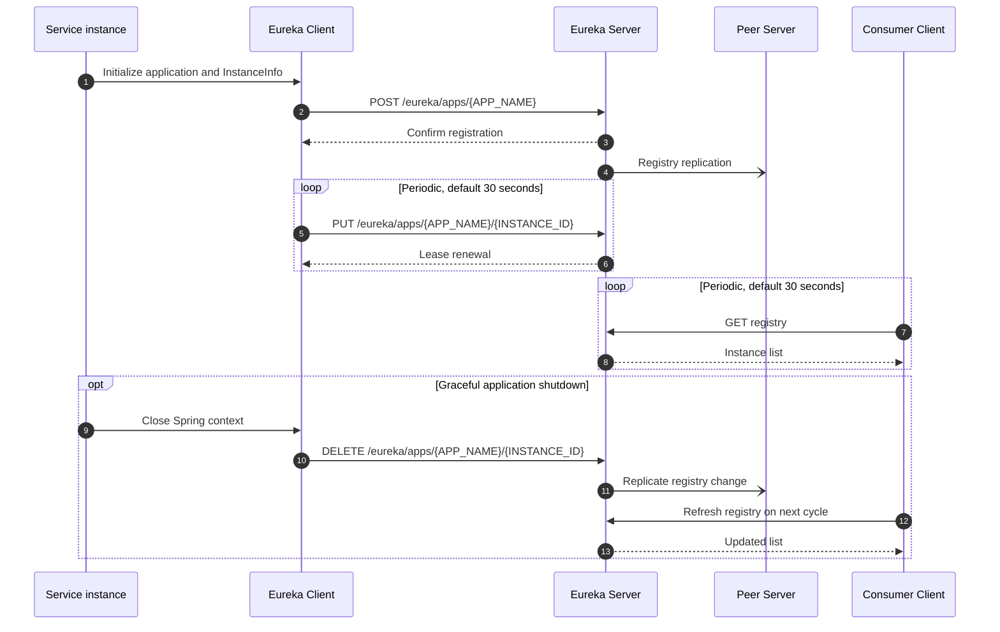

# Registration, Lease Renewal, and Deregistration Cycle in Eureka

## 1. Why Does Eureka Need a Lifecycle Cycle?

In a microservices system, a service can run multiple instances across different machines or containers. Each instance's IP address and port can change during redeployments, scaling, or container replacement. Therefore, service consumers should not depend on a fixed address.

Spring Cloud Service Discovery provides a mechanism to look up instances by service name. With Eureka, each instance registers its information with the Eureka Server. The server maintains a registry for other Eureka Clients to query and select an appropriate instance. The registry does not merely record that an instance once existed; it needs to be updated throughout the instance's active lifetime and cleaned up when the instance stops running.

That cycle consists of three main activities:

1. **Registration:** sends instance information to the Eureka Server when the application starts up.
2. **Lease renewal (renewal/heartbeat):** sends periodic heartbeats to indicate that the instance can still communicate with the Eureka Server.
3. **Deregistration:** notifies the Eureka Server when the application shuts down gracefully.

Spring Cloud's Eureka Client automatically performs these activities during the application lifecycle. Typically, developers do not need to write custom tasks to send heartbeats or call the registration REST API manually.

## 2. What Information Is Registered?

Eureka organizes the registry by application name. An application can have multiple instances; each instance is described by an `InstanceInfo` record. The record typically contains:

- The application name, usually taken from `spring.application.name`.
- An Instance ID to distinguish running instances of the same application.
- Hostname or IP address and port serving requests.
- The instance's status, such as `UP`, `DOWN`, or `OUT_OF_SERVICE`.
- Metadata and related URLs such as health check and status page if configured.

The application name is used to look up a service group; the instance ID is used to identify a specific running instance. Therefore, instances of the same application need distinct instance IDs. If multiple instances share the same ID, registration information can be overwritten or cause confusion during renewal and deregistration.

A **lease** is the period for which a registration remains valid if the server continues receiving heartbeats. Leases help Eureka detect when an instance may have disappeared even if that instance could not send a shutdown notification.

## 3. Registration on Application Startup

When an application with the Eureka Client dependency starts up, Spring Cloud configures `EurekaClient` and `DiscoveryClient`. If `eureka.client.register-with-eureka` is enabled (the default is `true`), the client builds instance information from the application configuration and sends a registration request to a Eureka Server in the `service-url` list.

Basic flow:

1. The application initializes the Spring context and determines the application name, instance ID, address, port, and metadata.
2. Eureka Client creates `InstanceInfo` and sends a registration request. In the Eureka REST API, this operation usually corresponds to `POST /eureka/apps/{APP_NAME}`.
3. Eureka Server stores the instance in its local registry and returns a response to the client.
4. If Eureka Server runs in a cluster, registry information is forwarded to peers via the replication mechanism. Synchronization between peers may have latency.
5. Eureka Client continues sending periodic heartbeats and can fetch the registry for service discovery.

Example configuration on the service side:

```yaml
spring:
  application:
    name: order-service

server:
  port: 8081

eureka:
  client:
    service-url:
      defaultZone: http://localhost:8761/eureka/
    register-with-eureka: true
    fetch-registry: true
    registry-fetch-interval-seconds: 30
  instance:
    instance-id: ${spring.application.name}:${server.port}
    prefer-ip-address: true
    lease-renewal-interval-in-seconds: 30
    lease-expiration-duration-in-seconds: 90
```

In the configuration above, `service-url.defaultZone` points to the Eureka Server. `register-with-eureka` controls instance registration; `fetch-registry` controls fetching the instance list for service discovery. These two options serve two different purposes. An application that only needs to register can disable fetching the registry; a standalone Eureka Server typically disables both its own registration and registry fetching.

`instance-id` must be unique within the registry scope. For example, using the application name and port is suitable when each instance has its own port. In container or multi-host environments, choose a value that distinguishes actual running instances.

## 4. Lease Renewal via Heartbeat

After registering, Eureka Client periodically sends heartbeats to renew the lease. In the Eureka REST API, a heartbeat usually corresponds to:

```text
PUT /eureka/apps/{APP_NAME}/{INSTANCE_ID}
```

When receiving a valid heartbeat, Eureka Server updates the instance's renewal timestamp. If the server does not receive a heartbeat within the allowed lease duration, the instance becomes a candidate for removal from the registry.

Common default values:

| Configuration | Where Applied | Default Value | Meaning |
|---|---|---:|---|
| `eureka.instance.lease-renewal-interval-in-seconds` | Eureka Client | 30 seconds | Interval between heartbeats |
| `eureka.instance.lease-expiration-duration-in-seconds` | Eureka Client | 90 seconds | Time a lease can go unrenewed before the instance is eligible for eviction |
| `eureka.server.eviction-interval-timer-in-ms` | Eureka Server | 60000 ms | Interval at which the task checks and evicts expired instances |
| `eureka.client.registry-fetch-interval-seconds` | Eureka Client | 30 seconds | Interval for re-fetching the registry to update the client-side cache |

The values above are common Eureka defaults and can be adjusted based on version, deployment configuration, or operational needs. Distinguish between heartbeats and registry fetching: a heartbeat proves the client is still in contact with the server; `registry-fetch-interval-seconds` determines when a consumer refreshes its cached instance list. Therefore, a newly registered or newly removed instance may not appear or disappear immediately in every consumer's cache.

### 4.1. Heartbeat Is Not Equivalent to Full Application Health Checks

A heartbeat indicates that Eureka Client can still send requests to Eureka Server. It does not by itself prove that all business functions of the application are working properly. For example, a service can still send heartbeats even when its database connection is failing.

If you want the Eureka status to reflect the application's health indicators, you can integrate Spring Boot Actuator and enable Eureka Client health checks:

```yaml
eureka:
  client:
    healthcheck:
      enabled: true
```

Verify the health indicator configuration and status behavior in the Spring Cloud version you are using. Receiving heartbeats should not be treated as the sole proof that an instance is ready to handle requests.

### 4.2. When Does the Server Evict Expired Instances?

When no heartbeat is received within `lease-expiration-duration-in-seconds`, the instance can be considered expired. The eviction task on the server runs at the `eviction-interval-timer-in-ms` interval, so actual removal may occur later than the exact moment the lease expires.

Eureka also has a **self-preservation** mechanism. When the number of received heartbeats falls below the expected threshold over a period of time, the server may pause eviction to avoid mass-removing instances due to network issues or a widespread connectivity outage. This mechanism protects the registry against network failures, though it can also cause dead instances to remain in the registry longer than expected.

Therefore, how soon a consumer stops seeing a failed instance depends on multiple factors: the time of the last heartbeat, lease expiration, the eviction interval, self-preservation state, replication between Eureka Servers, and the consumer's registry refresh interval.

## 5. Deregistration on Graceful Shutdown

When the Spring application context closes during a normal shutdown sequence, Eureka Client can send a deregistration request to the server. In the Eureka REST API, this operation usually corresponds to:

```text
DELETE /eureka/apps/{APP_NAME}/{INSTANCE_ID}
```

The server removes the instance from its local registry and forwards the change to peers if running in a cluster. Consumers will see the change after the registry is updated and their caches are refreshed.

In a standard Spring Cloud application, Eureka Client's lifecycle hooks handle deregistration when the application stops. There is no need to create a custom heartbeat task or manually call the `DELETE` endpoint in `@PreDestroy` unless there is a special requirement. Let the application close its context through Spring's shutdown sequence so lifecycle callbacks have a chance to run.

For systems that need to drain an instance from traffic smoothly, you can follow this order:

1. Transition the instance status to `OUT_OF_SERVICE` so consumers can stop selecting that instance after receiving the updated registry.
2. Wait an appropriate amount of time for caches to refresh and in-flight requests to complete.
3. Shut down the application gracefully so Eureka Client deregisters.

Changing the status can be done via Eureka's `ApplicationInfoManager`, for example:

```java
applicationInfoManager.setInstanceStatus(InstanceInfo.InstanceStatus.OUT_OF_SERVICE);
```

This snippet only illustrates the status change operation; the application needs to manage when to invoke it and the request drain duration according to the actual deployment.

## 6. What Happens When an Instance Fails?

Not every shutdown can send a `DELETE` request. It is important to understand the difference between a graceful shutdown and an abrupt disconnection:

| Scenario | What Eureka Observes | Typical Consequence |
|---|---|---|
| Application shuts down gracefully | Client sends a deregistration request | Instance is removed after the server processes it and the change propagates to consumers |
| Process or host is killed abruptly | No deregistration request; heartbeats stop | Lease expires and the instance is evicted, unless self-preservation delays removal |
| Client loses connection to Eureka Server | Server receives no heartbeats even though the app may still be running | Instance may be considered expired; when the network recovers, client needs to re-register/renew according to current state |
| Application still sends heartbeats but business logic is failing | Server still receives heartbeats | Instance may remain in the registry if health status does not reflect that failure |
| Clustered Eureka Servers are not yet synchronized | Peers or consumer caches temporarily have different data | Discovery results may be inconsistent for a period of time |

Example: `order-service` registers successfully at 10:00 and sends heartbeats every 30 seconds. If the process is killed at 10:01, it cannot send `DELETE`. The server must rely on the lease to detect that the instance is gone. With a 90-second lease expiration and eviction running every 60 seconds, the instance may still be visible after 10:02; the exact timing also depends on task intervals, self-preservation, and consumer caches.

## 7. Overview Diagram



The diagram illustrates the conceptual flow. The timing of replication, REST responses, and cache refreshes depends on configuration, version, and network conditions; steps do not necessarily occur simultaneously on every node.

## 8. Configuration Tuning and Operations

Do not shorten heartbeat or lease expiration intervals just to make the dashboard remove instances faster. Overly frequent heartbeats increase traffic to the Eureka Server; overly short leases can cause a brief network congestion spike to be mistaken for a dead instance. When tuning, consider these together:

- **Heartbeat interval:** sparse enough to avoid unnecessary load, yet frequent enough for the server to detect lost connectivity within an acceptable timeframe.
- **Lease expiration:** should be several times longer than the heartbeat interval to tolerate jitter, GC pauses, or brief network interruptions.
- **Eviction interval:** affects when the server actually cleans up expired instances.
- **Registry fetch interval:** affects the delay before consumers see registrations or deregistrations.
- **Self-preservation and replication:** affect how the registry behaves when many clients or peers lose contact simultaneously.

When an instance does not appear or remains visible after stopping, you can check in this order:

1. Confirm `spring.application.name`, `instance-id`, host, and port that the client is registering.
2. Check `eureka.client.service-url.defaultZone`, network connectivity, and Eureka Client registration/heartbeat logs.
3. Check `register-with-eureka` and the instance status on Eureka Server.
4. If the instance has stopped sending heartbeats, check lease expiration, eviction interval, and the server's self-preservation logs.
5. Check the consumer's registry fetch interval and cache; a change on the server does not necessarily appear immediately in every client.
6. During shutdown, confirm the application closes its Spring context gracefully and logs record the deregistration.

In a multi-server Eureka environment, also verify peer and replication configuration. If a peer does not receive updates, clients querying that peer may temporarily see a stale registry.

## 9. Key Takeaways

- Registration creates an instance record in the registry; heartbeats renew the lease to keep that record valid.
- Graceful shutdown allows the client to send a deregistration request. When a process dies abruptly, the server must rely on lease expiration and eviction.
- Heartbeats are communication signals between Eureka Client and Server and do not automatically replace application health checks.
- Self-preservation can delay eviction when the server suspects a widespread network failure is occurring.
- Server-to-server replication and client-side caches introduce latency, so registrations or deregistrations are not necessarily visible to all consumers immediately.

Understanding the three stages—registration, renewal, and deregistration—helps you intentionally design failure-detection timings, rolling update procedures, and strategies for handling stale registry data.
