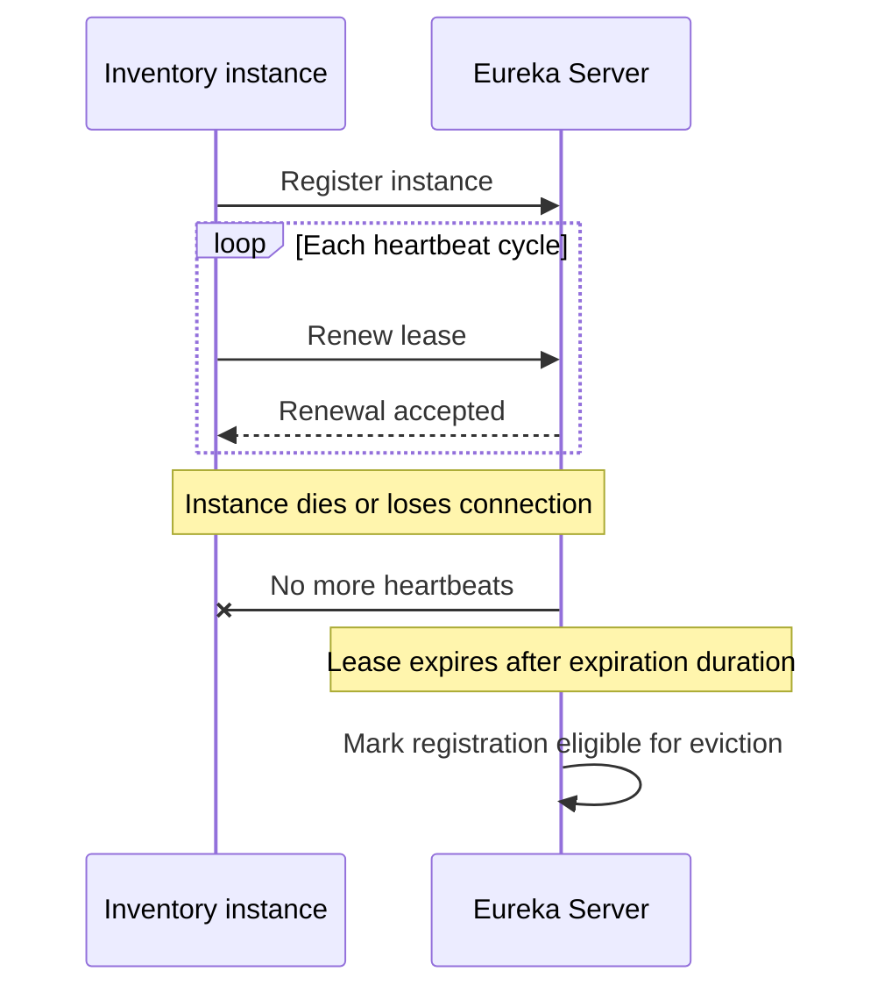
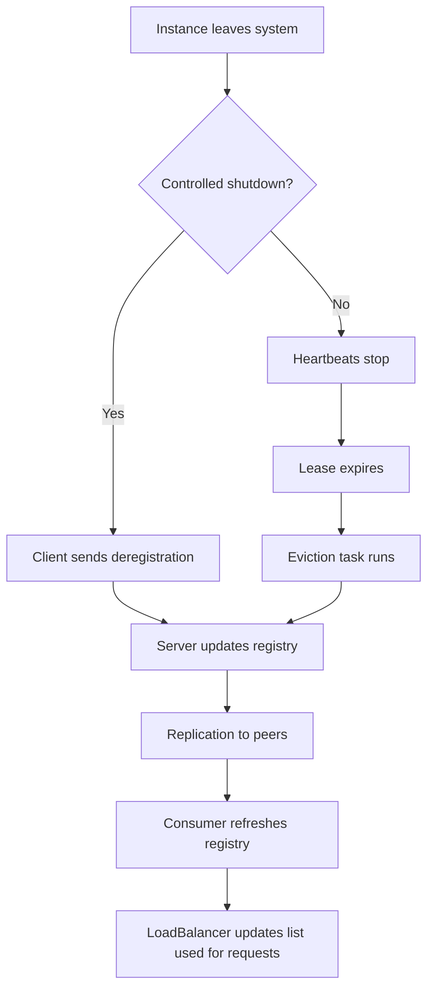

# Evicting Expired Registrations and Dead Instance Detection Delay

In Eureka, an instance does not disappear from the registry the moment its process stops or its host fails. Eureka relies on heartbeats to renew leases; when no heartbeat arrives for long enough, the server considers the registration expired and removes it during an eviction cycle. Afterward, Eureka Clients still need to refresh their local registry, and the load balancer may need to update its cache. Thus, the time to detect a dead instance is the sum of multiple wait intervals.

Understanding this chain helps you configure appropriate lease durations, eviction intervals, and registry refresh timings. It also explains why a dead instance can still appear in the dashboard or continue receiving calls for a while, especially during a network partition or when Eureka activates self-preservation.

## Registrations in Eureka Have a Lease Duration

When a provider registers with Eureka, the server stores instance details such as application name, instance ID, host, port, metadata, and status. Eureka Client sends periodic heartbeats to signal that the instance is still active. Each valid heartbeat renews the instance's lease.

A lease has a time limit. If the server does not receive a heartbeat before the lease expires, the instance becomes eligible for removal. The server does not necessarily delete it at the exact moment of expiration; a periodic eviction task scans for and processes overdue leases.

Key configuration milestones:

| Property | Where Configured | Meaning | Common Default Value |
|---|---|---|---|
| `lease-renewal-interval-in-seconds` | `eureka.instance` on provider side | Interval at which the client sends heartbeats | 30 seconds |
| `lease-expiration-duration-in-seconds` | `eureka.instance` on provider side | Time a lease goes unrenewed before the instance is considered expired | 90 seconds |
| `eviction-interval-timer-in-ms` | `eureka.server` | Interval for running the task that scans and removes expired leases | 60,000 ms |
| `registry-fetch-interval-seconds` | `eureka.client` on consumer side | Interval at which the consumer fetches/refreshes the registry | 30 seconds |

These are common default values in Eureka configurations; confirm against the Spring Cloud Netflix/Eureka version in use and the actual deployment config. Effective values may be overridden by profiles, environment variables, or a config server.

## Heartbeat and Lease Expiration

Suppose `inventory-service` registers an instance with Eureka. The client sends heartbeats on the `lease-renewal-interval-in-seconds` schedule. Each heartbeat accepted by the server updates the lease renewal timestamp. If heartbeats are missed consecutively and the time since the last renewal exceeds `lease-expiration-duration-in-seconds`, the registration is considered expired.



`lease-renewal-interval-in-seconds` and `lease-expiration-duration-in-seconds` are declared on the instance side. For example:

```yaml
spring:
  application:
    name: inventory-service

eureka:
  instance:
    lease-renewal-interval-in-seconds: 30
    lease-expiration-duration-in-seconds: 90
```

With this configuration, the client is expected to renew roughly every 30 seconds. If there is no new renewal within 90 seconds of the last successful one, the server can treat the lease as expired. The 90-second duration is a lease-based detection threshold, not a guarantee that the instance will be removed after exactly 90 seconds.

Do not set expiration too close to the renewal interval. Network jitter, CPU saturation, JVM pauses, or a busy server can delay heartbeats. If the lease is too short relative to normal latency, a healthy instance may be mistakenly marked expired. Conversely, a long lease increases failure detection time.

## Eviction Task Removes Expired Leases

Once a lease has expired, Eureka Server needs to run eviction to remove the instance from the registry. `eviction-interval-timer-in-ms` defines how often this task runs. A common value is 60,000 ms, or about one minute.

```yaml
server:
  port: 8761

eureka:
  server:
    eviction-interval-timer-in-ms: 60000
    enable-self-preservation: true
```

This example keeps self-preservation enabled and runs the eviction task every 60 seconds. When a lease expires right after a scan, the instance may have to wait nearly an entire next cycle to be processed. If the lease expires right before a scan, it can be removed sooner.

Eviction is not an active health check. Eureka Server does not necessarily call an HTTP endpoint on each instance to determine whether it is healthy; the lease mechanism relies primarily on heartbeats sent by the client. An application may still send heartbeats even if its business endpoint is hung, unless health status is properly integrated and published.

## Self-Preservation Can Delay Eviction

Eureka has a self-preservation mechanism to prevent mass deletion of instances when the server receives fewer heartbeats than expected. A network outage, congestion, or widespread incident can prevent many healthy clients from sending heartbeats temporarily. If the server immediately deleted every expired lease, the registry could lose too many instances while they are still running.

The server estimates the expected number of heartbeats from the count of registered instances and the renewal interval. When the received heartbeat rate falls below the protection threshold, Eureka can enter self-preservation mode and pause automatic eviction. As a result, expired records may remain in the registry longer than the normal lease duration.

Properties commonly used to configure this mechanism:

| Property | Meaning |
|---|---|
| `enable-self-preservation` | Enables or disables Eureka Server's self-preservation mechanism |
| `renewal-percent-threshold` | Minimum heartbeat ratio relative to the expected level for evaluating renewal health |
| `renewal-threshold-update-interval-ms` | Interval for updating the expected heartbeat threshold in versions supporting this property |

Explicit configuration example:

```yaml
eureka:
  server:
    enable-self-preservation: true
    renewal-percent-threshold: 0.85
    eviction-interval-timer-in-ms: 60000
```

The `0.85` threshold is a common value and should not be treated as mandatory for every version or environment. Read the configuration documentation for your exact release train and monitor logs/metrics to understand how the server is evaluating heartbeat volume.

**Do not disable self-preservation in production just to make instances disappear faster.** If heartbeats drop sharply, the cause could be a network-isolated server or many clients being unable to connect. Disabling the safeguard can cause the registry to purge still-healthy instances, disrupting the entire system. Only consider changing it in controlled test environments and after fully understanding the impact.

## Controlled Deregistration vs. Dead Instance Detection

There are two ways an instance leaves the registry:

1. **Graceful deregistration:** the application shuts down cleanly and Eureka Client sends a deregistration request. The server can remove the record early without waiting for the lease to expire. The change still needs to be replicated to peers and fetched by consumers.
2. **Lease expiration:** the process dies abruptly, the host powers off, or connectivity is lost for an extended period so heartbeats stop. The server waits for the lease to expire, and only then does the eviction task process it.



With graceful shutdown, give the application time to finish in-flight requests and execute lifecycle callbacks before the process exits. If the container is killed immediately or exceeds its termination grace period, deregistration may not complete and the server must fall back on lease expiration.

## Delay From Instance Death Until Consumers Stop Calling It

Removing a record on Eureka Server does not mean all consumers learn of the change immediately. A consumer may be using a local registry cache; Spring Cloud LoadBalancer may also maintain its own instance list cache depending on configuration.

Typical stages:

| Stage | What Happens? | Source of Delay |
|---|---|---|
| 1. Instance loss | Process dies or cannot send heartbeats | Timing of incident relative to last heartbeat |
| 2. Lease expiration | Server receives no renewal within expiration duration | `lease-expiration-duration-in-seconds` |
| 3. Eviction | Periodic task scans and deletes expired leases | `eviction-interval-timer-in-ms` |
| 4. Peer replication | Other Eureka Servers receive the registry change | Network and replication mechanism |
| 5. Client fetch | Consumer downloads the updated registry | `registry-fetch-interval-seconds` |
| 6. LoadBalancer refresh | Instance list used for requests is updated | Cache TTL or supplier refresh mechanism |

You can estimate the normal-state delay by summing the relevant maximum wait intervals:

```text
detection delay ≈
    remaining lease time when instance dies
  + wait time for eviction task
  + peer replication delay (if any)
  + consumer registry fetch wait time
  + remaining LoadBalancer cache validity (if any)
```

The remaining lease time depends on whether the instance dies right after a heartbeat or near the end of a lease cycle. If the client renews every 30 seconds and lease expiration is 90 seconds, the time from death until lease expiration can be roughly 60 to 90 seconds under steady heartbeats. Afterward, there is still waiting for eviction, replication, fetch, and cache refresh.

This is only an estimation model under normal conditions. Self-preservation, network partitions, server overload, or unrefreshed client caches can prolong the delay further; there is no hard upper bound based solely on lease values.

## Consumer-Side Configuration for Registry Updates

A Eureka consumer can configure its registry fetch interval via `registry-fetch-interval-seconds`. A common value is 30 seconds:

```yaml
eureka:
  client:
    fetch-registry: true
    registry-fetch-interval-seconds: 30
```

This property controls the Eureka Client's registry refresh interval. Setting a shorter interval helps consumers receive changes sooner under normal conditions, but increases request frequency to the server and processing overhead. It does not change server-side lease durations or eviction intervals.

If the application uses Spring Cloud LoadBalancer, check whether `ServiceInstanceListSupplier` is caching. When caching is enabled, the cache TTL also affects when requests stop picking a removed instance. Cache properties are typically configured under `spring.cloud.loadbalancer.cache`; specifics depend on the version and supplier used.

Do not shrink all intervals to very small values at once. Identify which stage contributes the largest delay, then tune one layer and measure again. Reducing the registry fetch interval will not help if the server is still retaining stale records due to self-preservation.

## A Reference Configuration for Test Environments

Provider example:

```yaml
spring:
  application:
    name: inventory-service

eureka:
  client:
    service-url:
      defaultZone: http://localhost:8761/eureka/
  instance:
    lease-renewal-interval-in-seconds: 10
    lease-expiration-duration-in-seconds: 30
```

Server example:

```yaml
server:
  port: 8761

eureka:
  client:
    register-with-eureka: false
    fetch-registry: false
  server:
    eviction-interval-timer-in-ms: 5000
    enable-self-preservation: true
```

Consumer example:

```yaml
eureka:
  client:
    service-url:
      defaultZone: http://localhost:8761/eureka/
    fetch-registry: true
    registry-fetch-interval-seconds: 5
```

Values of 10/30/5 seconds and 5,000 ms are solely intended to shorten observation times in a lab. They are not production recommendations. An overly short lease can cause healthy instances to be evicted during JVM pauses or flaky networking; overly frequent eviction and fetching increase registry load.

In production, it is usually best to start from your version's appropriate defaults, measure heartbeats and actual detection times, and then adjust according to your SLA and network stability. Always keep expiration larger than the renewal interval with enough buffer for jitter and pauses.

## Measuring and Observing Detection Time

To know where delay comes from, record timestamps at each component rather than only watching the instance disappear from the dashboard.

- **Provider:** log startup, registration, last heartbeat, and start of graceful shutdown.
- **Eureka Server:** monitor instance count, received renewals, evictions, self-preservation state, and peer replication errors.
- **Consumer:** record timestamps of successful registry fetches and the instance list after each refresh.
- **LoadBalancer:** observe selected instances, connection errors, and when the cache changes.
- **Request:** record the last time a request is sent to the dead instance and the first time requests go only to healthy instances.

You can use the Eureka dashboard and registry endpoints to observe the instance list. If Spring Boot Actuator/Micrometer is enabled, export necessary metrics to your monitoring system and chart heartbeats, registry size, request errors, and latency. Exact metric names depend on version and instrumentation.

A simple measurement exercise:

1. Start two instances of `inventory-service` and wait for both to appear in Eureka.
2. Record the timestamp of instance A's latest heartbeat.
3. Stop A with graceful shutdown; measure the time until the record disappears.
4. Restart A, then kill the process abruptly; measure again until the record is evicted.
5. Simultaneously observe the server dashboard, consumer registry, and the instance chosen by LoadBalancer.
6. Repeat with network delay or a temporary peer disconnection in a test environment.

Compare graceful deregistration with crash detection. Different results are normal because one case has an explicit deregistration request while the other must wait for lease expiration and eviction.

## Self-Preservation, Network Partitions, and Stale Registries

When many clients lose heartbeats together, distinguish between two possibilities:

- **Many instances actually died:** heartbeats dropped because providers are no longer running. The registry needs to purge expired records.
- **The registry is isolated or the network failed:** providers are still running, but heartbeats cannot reach the server. If the server mass-deletes records, consumers could lose the ability to route to instances that are still capable of serving.

Self-preservation is designed to reduce the second risk. Therefore, when you see stale records lingering, check renewal rates and peer connectivity before turning off the safeguard. If the registry is in self-preservation mode, speeding up eviction by lowering the timer may not solve the problem.

Steps to investigate stale records:

1. Check whether the provider is still alive and its endpoints are responding.
2. Check whether heartbeats/renewals are reaching Eureka Server.
3. Determine whether the server is in self-preservation mode.
4. Verify that lease expiration and the eviction task are configured properly.
5. Check peer replication and whether every node has the same registry state.
6. Check the consumer fetch interval and LoadBalancer cache.
7. Only after confirming the cause should you adjust lease, eviction, or cache TTL settings.

## Common Configuration Mistakes

| Symptom | Possible Cause | Resolution |
|---|---|---|
| Dead instance remains visible for a long time | Long lease expiration, large eviction interval, or self-preservation holding the record | Check heartbeats, lease, eviction, and renewal threshold |
| Healthy instance mistakenly removed | Lease too short relative to jitter, JVM pauses, or network delays | Increase buffer between renewal and expiration; check network/GC |
| Server removes record slowly even though lease expired | Eviction task has not reached its cycle or self-preservation is protecting against eviction | Check timer and self-preservation state |
| Dashboard removed it but consumer still calls old instance | Consumer has not fetched updated registry or LoadBalancer cache TTL has not expired | Check registry fetch interval and cache supplier |
| Eureka peers show different registries | Slow replication or disconnected peer | Check peer URLs, DNS, network, and replication logs |
| Normal shutdown still leaves record behind | Lifecycle halted abruptly or deregistration did not complete | Check shutdown grace period and client cancellation logs |
| Disabling self-preservation makes many instances disappear | Server is missing heartbeats due to a widespread network issue | Restore network and renewals; do not treat disabling self-preservation as a default fix |

## Production Tuning Principles

1. Keep `lease-expiration-duration-in-seconds` sufficiently larger than `lease-renewal-interval-in-seconds` to absorb jitter and brief pauses.
2. Choose `eviction-interval-timer-in-ms` based on detection requirements and registry load; shorter intervals increase scanning work.
3. Keep self-preservation enabled unless backed by a specific operational assessment and suitable environment.
4. Set `registry-fetch-interval-seconds` according to consumer freshness needs and Eureka Server load capacity.
5. Check LoadBalancer caching so an extra cache layer does not prolong stale instances after the registry has updated.
6. Design graceful shutdown so providers deregister before the process terminates.
7. Monitor renewal rates, eviction counts, registry size, replication, and request failures.
8. Test crashes, network partitions, server restarts, and rolling deployments before finalizing values.

## Conclusion

Eureka removes dead instances by tracking leases renewed via heartbeats and running a periodic eviction task. Detection time does not depend solely on `lease-expiration-duration-in-seconds`, but also on the eviction interval, self-preservation, peer replication, consumer registry fetching, and LoadBalancer caching. Graceful deregistration can remove records sooner; crash detection must wait for lease expiration and eviction. Measure each stage, tune carefully, and keep self-preservation enabled to avoid mistakenly purging large numbers of instances during network incidents.
