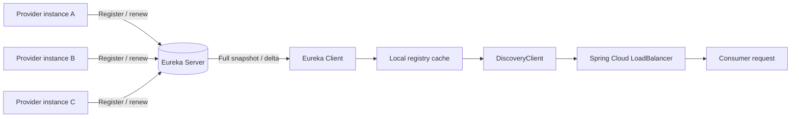
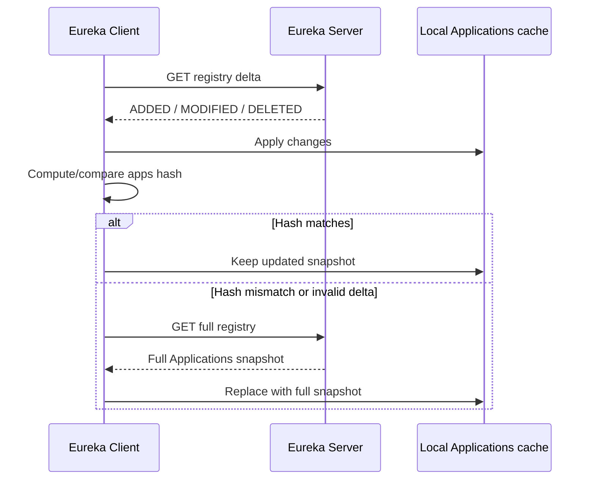
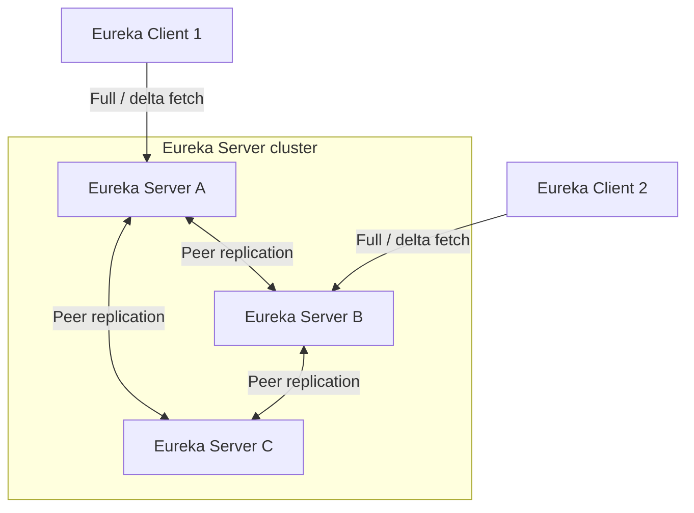

# Full Registry Fetch and Delta Updates

A Eureka client needs to know which instances are registered so consumers can discover services. Instead of requesting the entire registry on every update, Eureka supports two ways to retrieve data: downloading the complete registration list (*full registry fetch*) and retrieving only the changes since the previous sync (*delta fetch*).

At startup, the client needs a full snapshot to build its local registry. On subsequent refreshes, the client can receive a delta containing added, modified, or deleted instances, and apply those changes to the snapshot it holds. This approach reduces data transfer when the registry is large and only a few instances change. When deltas are unavailable or the resulting data no longer matches server state, the client must re-download a full snapshot to synchronize.

This lesson belongs to the `Eureka Mechanisms` chapter in the `SPRING_CLOUD_SERVICE_DISCOVERY` module. The module focuses on how Spring Cloud locates instances by service name via `DiscoveryClient`, `ServiceRegistry`, Eureka, or Consul, along with registration lifecycles, health checks, load balancing, security, and handling registry drift. This lesson dives into full fetches, delta refreshes, local caching, and how to inspect cases where client data differs from the server registry.

## 1. Why Does a Eureka Client Need to Fetch the Registry?

A service may have multiple instances running on different machines or containers. For example, `ORDER-SERVICE` has three instances. When a consumer needs to call this service, it must know the host, port, and metadata of available instances.

The Eureka client downloads information from Eureka Server and keeps a local registry copy. Application-side discovery components can read from this cache instead of calling the server for every business request.



This process serves three goals:

- **Initial data load:** the client fetches a full snapshot to learn which applications and instances the server publishes.
- **Incremental updates:** the client periodically syncs new, modified, or removed registrations.
- **Keep data local for lookup:** consumers can retrieve the instance list from the client cache, avoiding a network query every time a service needs to be located.

The local registry is a delayed copy. It reflects the data the client most recently synced successfully, not a guarantee that every server-side change appears immediately in every consumer.

## 2. What Is a Full Registry Fetch?

A full registry fetch is the operation of downloading a complete registry snapshot from Eureka Server. The snapshot typically contains the list of applications and instances published by the server at response time, including details such as instance ID, host, port, status, and metadata.

Illustrative snapshot example:

| Application | Instance ID | Host:Port | Status |
|---|---|---|---|
| `ORDER-SERVICE` | `order-a` | `10.0.1.21:8080` | `UP` |
| `ORDER-SERVICE` | `order-b` | `10.0.1.22:8080` | `UP` |
| `PAYMENT-SERVICE` | `payment-a` | `10.0.2.31:8090` | `UP` |

When the client receives the snapshot, it updates its local `Applications` structure. Eureka client discovery APIs can read from this data to answer questions such as "which instances of `ORDER-SERVICE` exist?".

### 2.1. When Does a Full Fetch Occur?

Common scenarios:

1. **Client initialization:** the client does not yet have a local registry and needs to fetch the initial snapshot.
2. **Delta unavailable:** the server or client cannot supply an appropriate delta, so the client must fetch a full snapshot.
3. **Data mismatch detected:** the registry hash after applying deltas differs from the hash published by the server, so the client needs to re-fetch in full to reconcile.
4. **Delta disabled:** client configuration instructs not to use deltas, so refreshes perform full fetches per the version's mechanism.
5. **Forced refresh or recovery:** certain internal flows may request a full fetch to restore local state.

A full fetch is heavier than a delta when the registry is large. It retransmits a great deal of information even when most instances have not changed. Therefore, avoid forcing the client to perform full registry fetches too frequently without a clear operational reason.

## 3. What Is a Delta Fetch?

A delta fetch retrieves only the changes Eureka Server provides relative to the previous registry state. Changes typically fall into three categories:

- **ADDED:** a new instance has registered.
- **MODIFIED:** an existing instance's information or status was updated.
- **DELETED:** an instance was deregistered or removed from the registry.

For example, suppose the client holds a snapshot containing `order-a` and `order-b`. Then `order-c` registers, `order-b` changes status, and `payment-a` is removed. A delta can represent these changes instead of resending every instance of all applications.

| Change Type | Example | Illustrative Cache Update |
|---|---|---|
| ADDED | `order-c` newly registers. | Add the instance to the corresponding application. |
| MODIFIED | `order-b` changes from `UP` to another status. | Update the existing instance data. |
| DELETED | `payment-a` is removed from the registry. | Remove the instance from the corresponding application. |

A delta is only a set of changes; to get the correct result, the client must apply them to the right base snapshot. If a delta is missed, applied out of order, or the base cache has drifted, local results can diverge from the server registry.

### 3.1. Delta Update Flow



The flow above is a conceptual model. Internal method names, fallback conditions, and processing details may vary by Eureka client version. The key point is that the client does not blindly assume every delta response is accurate; it has verification mechanisms and can re-fetch the full snapshot.

## 4. How Eureka Client Holds and Updates the Local Registry

The Eureka client maintains a data structure containing fetched applications and instances. When a consumer requests service discovery, the integrated discovery layer can read from this local registry.

High-level flow:

1. The client downloads a full snapshot from Eureka Server.
2. The snapshot is stored in the local registry structure.
3. A refresh task runs periodically according to configuration.
4. If delta is enabled and available, the client fetches the delta and applies it to the cache.
5. If the delta is unavailable or consistency verification fails, the client re-fetches the full snapshot.
6. The consumer continues reading the instance list from the updated cache.

This explains why a discovery call does not necessarily issue an HTTP request to Eureka Server. The client usually looks up previously refreshed local data.

### 4.1. Which Data Does DiscoveryClient Read?

In Spring Cloud's Eureka integration, `EurekaDiscoveryClient` uses the Eureka client to retrieve instances by service ID. Operationally, the consumer may be reading the local snapshot that the Eureka client fetched and updated.

Therefore, when the Dashboard shows a new instance that the consumer does not yet see, check the refresh timing and client cache state. Do not immediately conclude that the server failed to register the instance. Conversely, if a consumer still sees a deleted instance, the cache may not have received the latest delta or full refresh yet.

### 4.2. Local Cache and Update Latency

Latency between a server-side change and when a consumer sees it can come from:

- The client's registry refresh interval.
- Response delays or network errors between client and server.
- Response caching on Eureka Server.
- Replication among Eureka Server peers.
- Spring Cloud LoadBalancer caches or suppliers on the consumer side.
- Incomplete health checks, lease expirations, and evictions.

These layers have different intervals and responsibilities. Identify which layer is delaying the data instead of just increasing the client refresh frequency.

## 5. Verification Hash and Reconciliation Mechanism

Eureka uses registry hash information, commonly called `appsHashCode`, to help clients and servers detect mismatched registry state after applying deltas.

The client can compare the hash computed from its local registry against the hash returned by the server in the response. If the two values differ, the client may have missed a change or the delta did not bring the cache into the same state as the server. In that case, the client can fetch the full registry to rebuild the snapshot.

Illustrative example:

| Time | Server Registry | Local Registry After Refresh | Result |
|---|---|---|---|
| T0 | `order-a=UP`, `order-b=UP` | `order-a=UP`, `order-b=UP` | Hash matches |
| T1 | `order-a=UP`, `order-b=DOWN`, `order-c=UP` | Delta updates `order-b`, adds `order-c` | Expected hash matches |
| T2 | Server has another change but client misses a delta | Cache still misses an instance or holds stale status | Hash mismatch |
| T3 | Client fetches full snapshot | Cache is replaced with full data | Reconciliation complete if fetch succeeds |

The hash is a consistency check signal for the set of registry states as defined by Eureka; it is not a checksum guaranteeing every business endpoint is healthy. A matching hash also does not prove that a host/port is reachable from every consumer.

### 5.1. When Is a Full Fetch the Right Recovery Mechanism?

A full fetch is useful when the client cannot trust its current local snapshot. It replaces accumulated state with a complete snapshot from the server, eliminating drift caused by missing deltas or stale caches.

If the full fetch also fails because the server is unreachable, the client cannot synthesize new data. The application may continue seeing the old snapshot depending on state and implementation. Inspect error logs, the timestamp of the last successful refresh, and cache age before deciding how to respond.

## 6. Configuring Registry Fetching in Spring Cloud Eureka

An illustrative client configuration:

```yaml
spring:
  application:
    name: order-service

eureka:
  client:
    register-with-eureka: true
    fetch-registry: true
    registry-fetch-interval-seconds: 30
    disable-delta: false
    service-url:
      defaultZone: http://localhost:8761/eureka/
```

Meaning of the properties:

| Property | Meaning |
|---|---|
| `register-with-eureka` | Indicates whether the application registers its own instance with Eureka Server. |
| `fetch-registry` | Indicates whether the client fetches the registry to discover other services. |
| `registry-fetch-interval-seconds` | Interval between client registry refreshes. |
| `disable-delta` | When enabled, the client skips delta fetches and uses full fetches according to the implementation. |
| `service-url.defaultZone` | Address of the Eureka Server that the client accesses. |

In many Eureka client configurations, the default refresh interval is typically 30 seconds; verify the actual value against the version, configuration, and active profiles. Shortening the interval lets the client observe changes earlier, but increases request volume to the registry. Increasing the interval reduces load, but extends how long the client may hold stale data.

`register-with-eureka` and `fetch-registry` are independent choices. A consumer that only looks up services can fetch the registry without registering itself. An application that only advertises itself can register without fetching the registry if it does not call other services. For a standalone Eureka Server, both properties are typically set to `false` so the server does not register with or fetch from itself; clustered peer setups must be reviewed separately.

### 6.1. When Should Delta Be Disabled?

`disable-delta: true` can be useful in troubleshooting environments or when comparing full fetch behavior against delta behavior. It can also serve as a temporary workaround when suspecting an issue in delta application, though it increases data transfer volume.

Do not disable deltas across the board just because one consumer has a stale list. First check the refresh interval, fetch logs, hash reconciliation, caches, server responses, and peer replication. If you need to test disabling deltas, limit the scope, measure network/server load, and have a rollback plan for the configuration.

## 7. Full Fetch vs. Delta Fetch: Comparison

| Criterion | Full Registry Fetch | Delta Fetch |
|---|---|---|
| Data returned | Entire application/instance snapshot provided by the server. | Changes provided by the server since the previous sync state. |
| Typically used when | Initialization, delta unavailable, hash mismatch, or delta disabled by config. | Periodic refreshes when delta is supported and enabled. |
| Bandwidth | Higher when the registry is large. | Typically lower if only a small subset of instances changes. |
| Client-side processing | Builds or replaces local snapshot. | Applies changes onto the existing snapshot. |
| Primary risk | Heavy payload, latency, or timeouts when the registry is large. | Cache can drift if deltas are missed or misapplied; requires consistency checks. |
| Recovery | Used to rebuild local state from a complete source. | Efficient for frequent updates; does not completely replace full snapshots. |

The two mechanisms complement each other. Full fetch establishes a reliable baseline; delta fetch keeps that baseline updated at lower cost when the registry only partially changes.

## 8. Distinguishing Client Refresh from Eureka Server Peer Replication

A common misconception is viewing client delta fetch as the replication mechanism between Eureka Servers. These are two separate flows:

- **Client registry fetch:** a Eureka client queries a server to update the local registry used by the consumer.
- **Server peer replication:** peer Eureka Servers exchange registrations and status to maintain the registry across the server cluster.



Client fetch interval is not the peer replication interval. If a client reads from server A while a provider registers through server B, what the client sees also depends on how the server cluster synchronizes registrations and updates response caches.

When the Dashboard differs across two peers, investigate peer replication first. When peers agree yet a client still holds a stale list, investigate client refresh, caches, and connectivity to the server that client is using.

## 9. Useful Registry Endpoints for Investigation

With the common default Eureka Server configuration, the REST API provides endpoints to read snapshots and deltas:

| Endpoint | Purpose |
|---|---|
| `GET /eureka/apps` | Read the full list of applications and instances. |
| `GET /eureka/apps/delta` | Read the registry changes provided by the server via the delta API. |

Example reading the full registry:

```bash
curl -H "Accept: application/json" \
  http://localhost:8761/eureka/apps
```

Example reading the delta:

```bash
curl -H "Accept: application/json" \
  http://localhost:8761/eureka/apps/delta
```

These examples use default URLs. Context path, port, reverse proxy, authentication, and JSON/XML format may vary by configuration. The delta endpoint is typically designed for the client protocol; invoking it manually once is not equivalent to reproducing the exact client state because the client also applies changes to its base snapshot and compares hashes.

Use only GET requests to observe during investigations. Requests that modify registrations or status can affect the entire system and must be controlled.

## 10. When Can Consumers See Stale Data?

Some common situations:

### New Instance Registered but Consumer Does Not See It Yet

The provider may have registered successfully, but the client has not reached its next refresh cycle. Additionally, the server response cache or peer replication may not yet reflect the change on the node the consumer is querying.

Check the registration on the Dashboard/API of the server that accepted it, the peer the client connects to, the latest refresh timestamp, and delta fetch logs.

### Instance Removed but Consumer Still Sees It

The deletion delta may not have been received by the client yet, or the local cache has not refreshed. If fetches fail, the client may keep using the old snapshot. Also check whether LoadBalancer caches its own instance list.

Check whether the server has removed the registration, whether the delta endpoint contains the deletion change, whether the client is refreshing successfully, and at what interval the LoadBalancer cache updates.

### Client Receives a Different List Than the Dashboard

The Dashboard and the client may be reading from two different Eureka Server peers or at two different points in time. Additionally, the client may not have applied the latest delta yet, or the server response cache may not be synchronized.

Compare the same peer, same timestamp, same application name, and same instance ID before concluding there is a data error.

### Repeated Hash Mismatches

Continuous hash mismatches may relate to missing deltas, server/client reading from different states, delayed replication, or issues in the sync path. Check client logs for hash reconciliation, server logs for peer replication and response cache, and verify whether full fetches succeed.

## 11. Full/Delta Fetch Inspection Procedure

When a Eureka client fails to see a new instance or keeps using a removed one, you can follow this procedure:

1. **Confirm the right client and service ID.** Record `spring.application.name`, the service ID being looked up, and the instance to inspect.
2. **Check the server registry.** Use the Dashboard or `GET /eureka/apps` to verify what record the server currently holds.
3. **Check which server the client uses.** Verify `eureka.client.service-url.defaultZone`, DNS, and the specific peer.
4. **Check fetch configuration.** Confirm `fetch-registry`, `registry-fetch-interval-seconds`, and `disable-delta`.
5. **Check refresh logs.** Find the latest full fetch or delta fetch, completion time, timeout errors, and fallback info if any.
6. **Check consistency.** Look for logs related to apps hash or the client re-fetching the full registry after a delta.
7. **Compare local discovery.** Inspect the instance list returned by `DiscoveryClient`/Eureka client after refresh.
8. **Check the LoadBalancer cache.** If the Eureka client already has fresh data but requests still pick the old instance, inspect the LoadBalancer supplier/cache.
9. **Check peer replication.** If servers return different data, investigate peer links and response caches before changing the client fetch interval.
10. **Assess data age.** Record when the provider changed, when the server received the change, and when the consumer observed it to pinpoint the lagging layer.

Do not flush caches or mass-restart consumers the moment you spot a stale instance. First determine whether the wrong snapshot is on Eureka Server, in the Eureka client, or in LoadBalancer; remediation should target the right layer.

## 12. Optimizing Sync Frequency and Cost

Refresh frequency is a trade-off between data freshness and system load.

- Shorter intervals let clients receive changes sooner, but increase request counts and delta/full fetch processing work.
- Longer intervals reduce registry load, but extend how long clients may hold stale snapshots.
- Full fetch generally consumes more bandwidth and processing than delta when the registry is large.
- Delta fetch is more economical when few changes occur, though full fetch is still needed for initialization and reconciliation when required.

Do not pick an interval purely by intuition. Measure the number of applications/instances, change rate, refresh latency, Eureka Server load, and consumer recovery requirements. If the system has many clients refreshing around the same time, examine client configuration and behavior to avoid bursty load spikes.

## 13. Security and Operations

Both full registries and deltas can expose service names, hosts, ports, metadata, and internal state. Protect Eureka APIs as infrastructure components:

- Restrict which clients can access registry endpoints.
- Use TLS and authentication per deployment requirements.
- Enforce read/write registration permissions aligned with provider and consumer roles.
- Do not put secrets in instance metadata.
- Do not expose `/eureka/apps` or `/eureka/apps/delta` to public networks without controls.
- Log and track metrics for full fetches, delta fetches, refresh errors, hash mismatches, and sync duration.

When collecting logs for investigation, avoid logging entire registry payloads if they contain sensitive metadata. Log the service ID, timestamp, refresh type, instance count, success/failure status, and relevant error codes.

## 14. Registry Data Verification Checklist

| Question | What to Confirm |
|---|---|
| Has the client fetched the initial snapshot? | Full fetch succeeded and local cache contains data. |
| Is the client fetching the registry? | `fetch-registry` is enabled if the consumer needs discovery. |
| Does the client use delta or full each time? | Check `disable-delta` and implementation behavior. |
| What is the refresh interval? | `registry-fetch-interval-seconds` matches freshness requirements. |
| Are deltas being applied? | Successful refresh logs and reasonable change counts. |
| Do hashes match? | No persistent mismatches or failed full reconciliations. |
| Which server is the client reading from? | `defaultZone`, peer, and region match the environment. |
| Are server peers synchronized? | Dashboard/API and peer replication logs are consistent. |
| Is the local cache fresh? | Compare latest successful fetch timestamp with server-side changes. |
| Does LoadBalancer have its own cache? | Confirm LoadBalancer's supplier list and refresh behavior. |
| Are registry endpoints protected? | Appropriate TLS, authentication, and ACLs. |

## Conclusion

Eureka clients use full registry fetches to build an initial snapshot or restore local state when needed. On subsequent refreshes, delta fetches update added, modified, or deleted instances without re-downloading the entire registry. Clients apply deltas to their local cache and can use `appsHashCode` to detect mismatched state, triggering a full snapshot download to reconcile.

When investigating stale data, distinguish client refresh from Eureka Server peer replication, and inspect fetch configuration, delta/full logs, hash reconciliation, and LoadBalancer caching. The refresh interval directly impacts data freshness and registry load; choose it based on instance count and operational requirements. Even when full or delta fetches succeed, the registry remains only a locator source: consumers must still handle unavailable endpoints, health checks, timeouts, and network errors.
