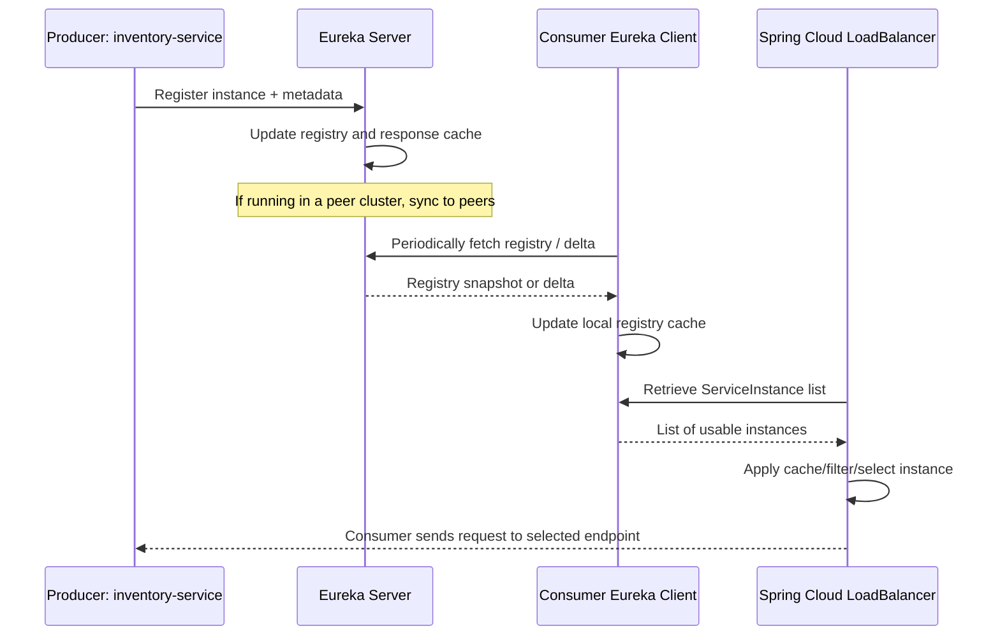

# Why a Newly Registered Service Is Not Yet Visible to Callers

A service successfully sending a registration to Eureka does not mean every consumer sees that instance immediately. Eureka is designed around an eventual consistency model: the server receives the registration and updates its registry and response cache; Eureka Clients periodically download changes into local memory; and Spring Cloud LoadBalancer may hold another instance list cache layer. Each layer refreshes on its own schedule.

Therefore, when an instance has just started up, the Eureka dashboard might already display it while consumers still do not see it. There are also cases where the server has recorded the registration yet the instance is not `UP`, consumers filter it out, or consumers are querying an unsynchronized peer. To pinpoint the root cause, inspect the producer, each Eureka Server, the consumer-side cache, and LoadBalancer in order.

## 1. Path From Registration Until Consumers See the Instance

Suppose `inventory-service` has just started up and registered with Eureka Server. The high-level data flow is as follows:



There are four distinct states to differentiate:

1. **Producer sent registration:** Eureka Client sent instance information to the registry URL.
2. **Server recorded it:** the instance exists in the registry of the Eureka node that received the request.
3. **Consumer updated local cache:** the consumer's Eureka Client fetched the registry version containing the instance.
4. **Consumer can route to it:** the instance passed status/zone filters and the list used by LoadBalancer has updated.

Checking only one state is not enough to conclude the entire flow has completed. For instance, the dashboard showing an instance while the consumer's `DiscoveryClient` still returns an empty list usually points to step 3 or 4.

## 2. Eureka Updates Data Periodically

Eureka Client does not query the server on every business request. After initialization, the client downloads the registry and keeps a copy in memory. Subsequent fetches typically pull deltas to reduce transferred data; if a discrepancy is detected, the client can re-download the full registry.

Key default intervals in current Spring Cloud Netflix:

| Property | Default | Role |
|---|---:|---|
| `eureka.instance.lease-renewal-interval-in-seconds` | `30s` | Heartbeat cadence for renewing the instance lease |
| `eureka.client.registry-fetch-interval-seconds` | `30s` | Interval at which consumers fetch registry changes from Eureka Server |
| `eureka.server.response-cache-update-interval-ms` | `30000ms` | Interval for updating the server-side read-only response cache |
| `eureka.server.use-read-only-response-cache` | `true` | Allows the server to serve data from the read-only response cache |
| `spring.cloud.loadbalancer.cache.ttl` | `35s` | Default TTL of the LoadBalancer cache when that caching mechanism is used |

Spring Cloud Netflix explains that an instance is only ready for discovery once metadata on the instance, server, and client is synchronized; this process can take up to three heartbeat periods. With a default 30-second heartbeat, it can take roughly 90 seconds in normal scenarios. Netflix Eureka documentation also notes propagation delays can reach around two minutes due to server-side caching and client-side delta fetch intervals.

This describes eventual consistency latency, not an SLA or a hard upper bound. Slow networks, retries, peer replication, overloaded servers, late-starting consumers, or additional caches can extend the time further.

### 2.1. Server-Side Cache

Eureka Server maintains a response cache to generate payloads for registry read requests. The default configuration uses a periodically refreshed read-only cache. Therefore, data already written to the internal registry may not appear immediately in the payload a client fetches at that moment.

Common properties:

```yaml
eureka:
  server:
    use-read-only-response-cache: true
    response-cache-update-interval-ms: 30000
```

These are the default values written explicitly for illustration. Do not shrink cache intervals in production merely to fix an undiagnosed registration issue; doing so can increase payload generation load and read traffic. First check which server node received the registration and whether the response from the registry endpoint already contains the instance.

### 2.2. Eureka Client-Side Cache

Consumers maintain a local registry cache. `DiscoveryClient.getInstances(serviceId)` reads from this local data rather than sending an HTTP request to Eureka Server on every call. By default, the client fetches the registry every 30 seconds:

```yaml
eureka:
  client:
    fetch-registry: true
    registry-fetch-interval-seconds: 30
```

`fetch-registry: false` can suit an application that only registers itself without needing to look up other services, but a consumer needing discovery must enable fetching. If the client does not fetch the registry, waiting for more heartbeats will not update its cache.

Decreasing `registry-fetch-interval-seconds` lets clients see deltas sooner in many cases, though it increases request counts to Eureka. Only adjust it after measuring load and confirming the fetch interval is the source of delay.

### 2.3. Spring Cloud LoadBalancer Cache

LoadBalancer selects instances from `ServiceInstanceListSupplier`. If the configuration uses a caching supplier, the list retrieved from DiscoveryClient may be cached again. The default TTL in Spring Cloud LoadBalancer is `35s`.

```yaml
spring:
  cloud:
    loadbalancer:
      cache:
        enabled: true
        ttl: 35s
```

Not every application needs this extra cache layer. Eureka Client already maintains its own registry cache; Spring Cloud LoadBalancer documentation recommends disabling LoadBalancer caching when DiscoveryClient already caches data, to avoid double caching:

```yaml
spring:
  cloud:
    loadbalancer:
      cache:
        enabled: false
```

Before changing anything, check your application's actual `ServiceInstanceListSupplier`. If there is a custom supplier, health-check supplier, or caching supplier, refresh timing may also depend on the ordering of those suppliers.

## 3. Why Has the Server Accepted the Registration Yet the Consumer Still Does Not See It?

### 3.1. Consumer Is Not Fetching the Registry or Is Fetching From the Wrong Eureka Server

Check these properties on the consumer:

```yaml
eureka:
  client:
    register-with-eureka: true
    fetch-registry: true
    service-url:
      defaultZone: http://eureka-server:8761/eureka/
    registry-fetch-interval-seconds: 30
```

`register-with-eureka` determines whether the consumer registers itself; `fetch-registry` determines whether it downloads the registry to discover other services. These two behaviors are independent. A consumer that only needs to discover services can set `register-with-eureka: false`, but must still keep `fetch-registry: true`.

Ensure the producer and consumer are actually using the intended Eureka URL. When running in containers, `localhost` inside the producer container and `localhost` inside the consumer container are two different addresses. Use a DNS service name or hostname reachable by both sides.

`defaultZone` is a map key and is case-sensitive. Keep the camel case `defaultZone`; do not change it to `default-zone`.

### 3.2. Producer Has Not Registered or Registered in the Wrong Place

Check the producer configuration:

```yaml
spring:
  application:
    name: inventory-service

eureka:
  client:
    register-with-eureka: true
    service-url:
      defaultZone: http://eureka-server:8761/eureka/
```

Spring Cloud Netflix auto-configures registration when the Eureka Client starter is on the classpath and discovery is not disabled. `spring.application.name` is used as the service ID by default. If the application name is not set, the service ID may fall back to an unexpected default; if the consumer queries a different ID, the result will be empty.

Also check:

- Does an active profile override `eureka.client.register-with-eureka` or `service-url`?
- Does the producer set `spring.cloud.discovery.enabled=false` or `eureka.client.enabled=false`?
- Do logs show successful registration, or DNS errors, connection refused, timeouts, or HTTP 401/403?
- Is Eureka Server in a state ready to accept registrations?
- If there are multiple servers, which peer did the producer register with and which peer is the consumer fetching from?

Do not assume registration succeeded just because the producer application finished starting. Look for Eureka Client logs for register/heartbeat operations and verify the record on the server.

### 3.3. Instance Is Not Yet in UP Status

By default, Eureka Client filters the registry to return only instances with status `UP` (`eureka.client.filter-only-up-instances=true`). A record in `STARTING`, `DOWN`, or `OUT_OF_SERVICE` may show up in administrative views while being absent from the instance list used by consumers.

Check the instance status on the dashboard or REST API. Also distinguish heartbeats from health status: a heartbeat proves the client is still communicating with the server, not that the application is ready to handle business traffic.

If you want Spring Boot Actuator status propagated to Eureka, explicitly configure health check integration:

```yaml
eureka:
  client:
    healthcheck:
      enabled: true
```

Place this property in `application.yml` (or a regular application config file), not in `bootstrap.yml`; Spring Cloud Netflix documentation warns that placing it in bootstrap can cause the instance to register with `UNKNOWN` status. For applications needing fine-grained status control, you can use `HealthCheckHandler` via the Eureka API.

For testing, inspect the current status and filter setting:

```yaml
eureka:
  client:
    filter-only-up-instances: true
```

Only disable the filter for diagnostics in test environments. Routing traffic to `DOWN` or `OUT_OF_SERVICE` instances is not a fix for readiness issues.

### 3.4. Eureka Server Runs Multiple Peers That Are Not Yet Synchronized

In a peer-aware cluster, a producer might register with peer A while a consumer fetches from peer B. Peers must know each other's URLs and be able to communicate over the network; if peer configuration is wrong, replication fails, or a firewall blocks traffic, two nodes can return different registries for a period of time.

Check:

- Does each server's `eureka.client.service-url.defaultZone` contain the right peer URLs?
- Do peer hostnames/DNS names resolve from each node?
- Can peers reach the `/eureka/` endpoint over the right protocol, port, and TLS settings?
- Do server logs show peer replication errors, timeouts, or authentication failures?
- Are producer and consumer connecting to the same peer or same cluster?

Standalone mode has no peers to sync with. In production, use peer-aware servers and monitor replication; do not treat one dashboard showing an instance as proof that every node holds the same data.

## 4. Instance Exists in DiscoveryClient Yet Requests Still Fail to Reach the Service

This is a different issue from the consumer not seeing the instance. If `DiscoveryClient.getInstances(serviceId)` already returns a list yet requests by service ID fail, check the endpoint details and the LoadBalancer step.

| Symptom | Possible Cause | What to Check |
|---|---|---|
| Instance is in list, but connection times out | Advertised host/IP/port is unreachable from consumer | `eureka.instance.hostname`, `prefer-ip-address`, `non-secure-port`, DNS, and firewalls |
| Returned instance has unexpected status | Health check/status mapping or instance filter | `InstanceInfo.status`, `filter-only-up-instances`, health check handler |
| One zone does not see instances in another zone | Zone preference or supplier filtering by zone | `eureka.instance.metadata-map.zone`, `eureka.client.availability-zones`, LoadBalancer zone supplier |
| DiscoveryClient sees instance, but LoadBalancer does not | Cache or custom `ServiceInstanceListSupplier` has not refreshed | Cache TTL, supplier chain, and LoadBalancer config |
| Calling fixed URL works, calling by service ID fails | Missing LoadBalancer or client not using load-balanced builder | LoadBalancer dependency and `@LoadBalanced` annotation |

The address Eureka advertises must be an address consumers can call. In Docker/Kubernetes, internal container hostnames or loopback addresses are generally unsuitable if consumers run in separate containers/pods.

## 5. Inspecting Each Layer via REST API and Code

### 5.1. Inspect Directly on Eureka Server

View the entire registry:

```bash
curl -H "Accept: application/json" http://localhost:8761/eureka/apps
```

View only the `INVENTORY-SERVICE` application:

```bash
curl -H "Accept: application/json" http://localhost:8761/eureka/apps/INVENTORY-SERVICE
```

If the server enables authentication or TLS, provide the appropriate credentials and certificates. Application names in Eureka URLs are typically uppercase; use the exact app name returned by the server.

### 5.2. Inspect via DiscoveryClient on the Consumer

The following snippet lets you check the list seen directly by Eureka Client inside the consumer:

```java
import java.util.List;

import org.springframework.cloud.client.ServiceInstance;
import org.springframework.cloud.client.discovery.DiscoveryClient;
import org.springframework.stereotype.Component;

@Component
class DiscoveryDiagnostics {

    private final DiscoveryClient discoveryClient;

    DiscoveryDiagnostics(DiscoveryClient discoveryClient) {
        this.discoveryClient = discoveryClient;
    }

    void printInventoryInstances() {
        List<ServiceInstance> instances =
                discoveryClient.getInstances("inventory-service");

        instances.forEach(instance -> System.out.printf(
                "service=%s host=%s port=%d uri=%s metadata=%s%n",
                instance.getServiceId(),
                instance.getHost(),
                instance.getPort(),
                instance.getUri(),
                instance.getMetadata()));
    }
}
```

Do not call this diagnostic code inside a constructor or `@PostConstruct` if Eureka Client has not finished initializing. Run it after the application is ready or expose it via a secured internal endpoint.

### 5.3. Comparing the Three Results

| Eureka Server API | Consumer `DiscoveryClient` | LoadBalancer | Investigation Direction |
|---|---|---|---|
| No record | No instance | No instance | Producer has not registered, wrong URL, registration rejected, or server checked is not the node receiving registration |
| Record `UP` | No instance yet | No instance yet | Consumer has not fetched, fetched wrong peer, local cache not updated, or service ID mismatch |
| Non-`UP` record | Empty | Empty | Instance status and `filter-only-up-instances` |
| Record `UP` | Has instance | No instance yet | LoadBalancer cache/supplier/filter or zone |
| Record `UP` | Has instance | Has instance, but requests fail | Host/port, network, protocol, security, or target application |

This table helps isolate which layer holds the problem. When two measurements are taken at different times, record timestamps and rerun nearly simultaneously to avoid confusion while the registry is still updating.

## 6. Tuning Latency: Intentional Changes

If the system needs consumers to see new instances faster, you can adjust Eureka Client's fetch interval:

```yaml
eureka:
  client:
    registry-fetch-interval-seconds: 10
```

A value of `10` is only an example for a controlled test. Shorter intervals increase how often consumers call Eureka; with many consumers, registry load can grow substantially. Measure request rates, server CPU, delta sizes, and propagation time before and after changing it.

Spring Cloud Netflix also allows changing the heartbeat interval via `eureka.instance.lease-renewal-interval-in-seconds`. The documentation recommends keeping the 30-second default in production because the server performs internal calculations assuming this renewal interval. Do not shorten heartbeats just to mask a misconfigured cache or peer replication.

For LoadBalancer, only adjust TTL or disable caching after identifying the supplier in use. If Eureka Client already serves data from its local cache, disabling LoadBalancer caching avoids an extra layer of stale data. Conversely, if a custom DiscoveryClient queries the registry over the network every time, LoadBalancer caching can help reduce load.

No single timeout value fits every cluster. Set propagation targets based on system requirements, measure each layer, and avoid shrinking every interval across the board at once.

## 7. Troubleshooting Workflow When a New Service Has Not Appeared

Follow these steps in order to find where data stops:

1. **Verify the producer:** check `spring.application.name`, `register-with-eureka`, `service-url.defaultZone`, active profiles, and registration logs.
2. **Verify the server receiving registration:** call `/eureka/apps/{APP_NAME}` on the exact node to which the producer sends requests.
3. **Verify status:** does the record have `status=UP`? If not, inspect health/status handlers and readiness configuration.
4. **Verify the consumer:** check `fetch-registry=true`, peer URL, registry fetch interval, and the service ID queried in code.
5. **Verify local cache:** call `DiscoveryClient.getInstances(serviceId)` inside the consumer process itself and record the timestamp.
6. **Verify LoadBalancer:** inspect cache TTL, supplier chain, zone filtering, and the selected instance list.
7. **Verify the endpoint:** from the consumer's network namespace, test connecting to the host/port advertised by Eureka.
8. **Verify peer cluster:** compare the same app across every Eureka Server and read replication logs.
9. **Re-measure propagation:** record timestamps when the producer registers, server displays it, consumer sees it, and the first request succeeds.

## 8. Hands-On Propagation Time Measurement

You can use two small services in a local environment:

- `inventory-service`: enable Eureka Client and register as `inventory-service`.
- `order-service`: enable Eureka Client, fetch the registry, and query `inventory-service` via `DiscoveryClient` or Spring Cloud LoadBalancer.

Run the experiment:

1. Start Eureka Server and wait until the dashboard is ready.
2. Start `order-service` first so its initial local cache does not yet contain `inventory-service`.
3. Record the timestamp when `inventory-service` starts up.
4. Periodically call the REST API `/eureka/apps/INVENTORY-SERVICE` to record when the server has an `UP` record.
5. From `order-service`, periodically call `getInstances("inventory-service")` to record when the local cache sees the instance.
6. Call the endpoint through LoadBalancer to record when the first request succeeds.
7. Repeat several times and compare timings; do not measure only once, because fetch cycles may be out of phase with registration timing.

Example recording table:

| Milestone | Timestamp |
|---|---|
| Producer begins registration | `T0` |
| Eureka Server returns `UP` record | `T1` |
| Consumer `DiscoveryClient` sees instance | `T2` |
| LoadBalancer selects instance and request succeeds | `T3` |

Intervals to calculate:

- Server registration delay: `T1 - T0`.
- Consumer discovery delay: `T2 - T1`.
- Routing/cache delay: `T3 - T2`.
- End-to-end visibility: `T3 - T0`.

Repeat when the consumer starts after the producer, when using two Eureka peers, when changing the fetch interval, and when LoadBalancer caching is enabled/disabled. These measurements reveal which layer actually introduces delay in your system.

## 9. Operational Checklist

- [ ] Producer sets `spring.application.name` clearly and registers with the right Eureka Server.
- [ ] `register-with-eureka` is enabled on producers; `fetch-registry` is enabled on consumers needing discovery.
- [ ] `defaultZone` uses proper camel case, hostname, port, protocol, and is reachable from each container/host.
- [ ] Eureka Server API already holds the new service's record.
- [ ] Instance has `UP` status and is not filtered out by `filter-only-up-instances`.
- [ ] Consumer has fetched the registry and `DiscoveryClient.getInstances(serviceId)` returns the expected list.
- [ ] Peer replication is working if the cluster has multiple Eureka Servers.
- [ ] Identified whether LoadBalancer caching or a custom supplier adds extra delay.
- [ ] Tested the host/port advertised by Eureka from the consumer's network.
- [ ] Measured propagation delay with timestamps instead of guessing by feel.
- [ ] Load-tested and verified any changes to fetch/heartbeat/cache intervals.

## References

- [Spring Cloud Netflix 5.1.0 — Why Is It so Slow to Register a Service?](https://docs.spring.io/spring-cloud-netflix/reference/spring-cloud-netflix.html)
- [Spring Cloud Netflix — Configuration Properties](https://docs.spring.io/spring-cloud-netflix/reference/configprops.html)
- [Spring Cloud LoadBalancer — Cache configuration](https://docs.spring.io/spring-cloud-commons/reference/spring-cloud-commons/loadbalancer.html)
- [Netflix Eureka — Understanding client/server communication](https://github.com/Netflix/eureka/wiki/Understanding-eureka-client-server-communication)
- [Netflix Eureka — DiscoveryClient registry fetch and cache reconciliation](https://github.com/Netflix/eureka/blob/master/eureka-client/src/main/java/com/netflix/discovery/DiscoveryClient.java)
