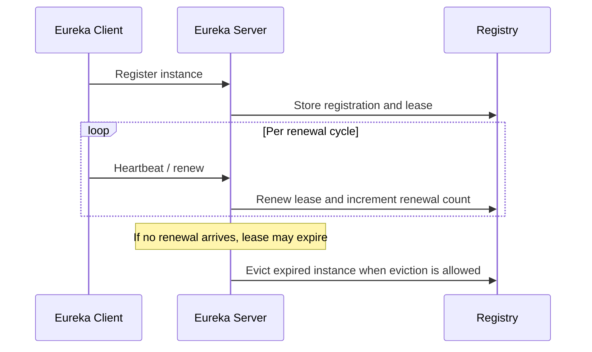

# Self-Preservation: Purpose, Activation Threshold, and Impact

Eureka Client sends periodic heartbeats to Eureka Server to confirm the instance is still active. If the server suddenly receives fewer heartbeats than expected, the cause may be that many instances genuinely stopped, or it may simply be a network partition, server overload, or clients temporarily unable to connect. If Eureka immediately removed every instance not sending heartbeats, it could mistakenly evict instances that are still running.

Eureka addresses this risk with **self-preservation mode**. When the number of received heartbeats drops below a threshold, the server pauses eviction of expired instances to preserve the registry while a widespread incident may be occurring. This mechanism protects discovery data availability, though it can also allow dead instances to remain in the registry. This lesson explains the purpose, threshold calculation, impact, and operation of self-preservation mode.

## 1. Heartbeat and Lease Expiration

When an application registers with Eureka, the server stores instance information such as application name, instance ID, hostname/IP, and port. The client then sends periodic heartbeats (renewals) to extend the registration's lease.

Common intervals in default configuration:

| Property | Common Default Value | Meaning |
| --- | ---: | --- |
| `eureka.instance.lease-renewal-interval-in-seconds` | 30 seconds | Cadence at which Eureka Client sends heartbeats. |
| `eureka.instance.lease-expiration-duration-in-seconds` | 90 seconds | Lease duration before an instance can be considered expired if unrenewed. |
| `eureka.server.eviction-interval-timer-in-ms` | 60,000 ms | Interval at which the server runs the task to check and evict expired instances. |
| `eureka.server.renewal-percent-threshold` | 0.85 | Minimum heartbeat ratio relative to the expected level to maintain normal state. |
| `eureka.server.enable-self-preservation` | `true` | Enables self-preservation mode. |

Default values can vary by version or project configuration; verify against the Spring Cloud Netflix release train in use.

Basic flow:



Under normal conditions, the client sends a heartbeat roughly every 30 seconds. If a client loses connectivity and stops sending renewals, the lease can expire after roughly 90 seconds; the server runs the eviction task periodically to remove expired registrations. The exact time an instance disappears may be later than lease expiration because eviction runs on a schedule and also depends on self-preservation state.

## 2. Why Does Eureka Need Self-Preservation?

Suppose a cluster has 100 running instances. A network incident prevents Eureka Server from receiving heartbeats from 40 instances, even though some or all of those instances are still processing requests normally. If the server removed them solely for missing heartbeats, consumers would lose the addresses of active instances.

This creates a cascading effect:

1. The network or registry server experiences a temporary issue.
2. Many heartbeats are lost or arrive late.
3. Eureka treats many leases as expired.
4. The registry removes instances that are still capable of serving requests.
5. Consumers can no longer find enough instances, further degrading service capacity.

Self-preservation is designed to prevent mass deletion of registrations under uncertain conditions. When the renewal threshold is breached, Eureka prioritizes retaining the registry and halts automatic eviction. Once heartbeats recover and the renewal rate rises above the threshold, the server can exit self-preservation mode and resume normal eviction.

This is a choice between two risks:

- **Without self-preservation:** the registry can quickly purge dead instances, but it can also mistakenly delete healthy instances during a network partition or widespread heartbeat outage.
- **With self-preservation:** the registry is preserved when heartbeat signals are abnormal, but registrations of dead instances can linger longer.

Self-preservation does not repair the network, restart instances, and does not prove that every retained instance is healthy. It only changes how Eureka handles eviction when heartbeat volume drops abnormally.

## 3. How Is the Activation Threshold Calculated?

Eureka Server tracks the number of renewals received over a period of time and compares it against the expected number of renewals. In a typical configuration, the formula can be interpreted as:

\[
R_{expected} = N \times \frac{60}{I}
\]

\[
R_{threshold} = R_{expected} \times P
\]

Where:

- `N` is the number of client instances currently counted in the registry.
- `I` is the renewal interval in seconds.
- `P` is `renewal-percent-threshold`, typically defaulting to `0.85`.
- `R_expected` is the expected number of heartbeats received per minute.
- `R_threshold` is the minimum renewal threshold per minute.

With the default 30-second renewal interval, each instance sends roughly two heartbeats per minute. If there are 100 instances:

\[
R_{expected} = 100 \times \frac{60}{30} = 200
\]

With an 85% threshold:

\[
R_{threshold} = 200 \times 0.85 = 170
\]

The server expects roughly 200 renewals per minute. If received renewals drop below roughly 170, self-preservation can be activated. Exact figures involve rounding, and how the threshold is updated also depends on Eureka version, calculation intervals, and instance lease configurations.

Another example with 50 instances and a 30-second renewal interval:

| Quantity | Calculation | Result |
| --- | --- | ---: |
| Expected renewals/min | `50 × 60 / 30` | 100 |
| 85% threshold | `100 × 0.85` | 85 |
| Received renewals | Assumed measured | 70 |
| Comparison | `70 < 85` | Below threshold |

When actual renewals fall below the threshold, the server treats it as a sign of a possible widespread disconnection and enables self-preservation mode. The threshold is not CPU utilization, unhealthy instance count, or request success percentage; it is based on Eureka Client heartbeat renewals.

## 4. Configuring Self-Preservation

Example configuration on Eureka Server:

```yaml
eureka:
  server:
    enable-self-preservation: true
    renewal-percent-threshold: 0.85
    renewal-threshold-update-interval-ms: 900000
    eviction-interval-timer-in-ms: 60000
```

Meaning:

- `enable-self-preservation` enables or disables self-preservation. The default is typically `true`.
- `renewal-percent-threshold` sets the minimum renewal ratio relative to the expected rate. A value of `0.85` corresponds to 85%.
- `renewal-threshold-update-interval-ms` sets the interval for updating the renewal threshold based on registered instances; for example, `900000` ms equals 15 minutes.
- `eviction-interval-timer-in-ms` sets the eviction task interval; for example, `60000` ms equals 1 minute.

This is an example for Eureka Server, so verify property names, defaults, and support in your project's Spring Cloud Netflix version. Do not set `renewal-percent-threshold` too low just to avoid warnings: a low threshold makes the server less sensitive to lost heartbeats and can delay activating protection.

On the client side, you can configure the heartbeat interval and lease expiration:

```yaml
eureka:
  instance:
    lease-renewal-interval-in-seconds: 30
    lease-expiration-duration-in-seconds: 90
```

Only change these intervals after measuring network latency, JVM pause times, server load, and dead-instance detection requirements. If clients send heartbeats every 60 seconds while the server still expects a 30-second cadence, the renewal rate may fall short of expectations and trigger self-preservation unintentionally.

## 5. What Happens When Self-Preservation Is Activated?

When the renewal rate drops below the threshold and self-preservation is enabled, Eureka Server enters self-preservation mode. The most important behavior is **halting automatic eviction of expired instances** while this mode remains active.

Commonly observed effects:

- Instances that stop sending heartbeats may remain in the registry longer than normal lease expiration.
- The Eureka Dashboard displays a self-preservation warning or a notice that renewals are below the threshold.
- Consumers can still receive stale instance information when fetching the registry.
- Calls to stopped instances may fail due to timeouts or connection errors.
- The registry avoids mass-deleting healthy instances simply because the server temporarily stopped receiving heartbeats.

Self-preservation does not mean the server stops all operations. The server can still serve the REST API, accept registrations or renewals, and replicate the registry according to peer configuration. This mechanism primarily prevents automatic eviction when the renewal rate is low.

When the renewal rate returns to an acceptable level, Eureka can exit self-preservation and eviction resumes. Expired instances may then be removed in subsequent eviction runs. Do not assume stale registrations disappear the instant the warning clears.

## 6. Impact on Service Discovery and Consumers

Consumers typically obtain instance lists from Eureka periodically or through a client caching mechanism. If self-preservation retains stopped instances, the list a consumer sees may contain addresses that are no longer serving.

Example:

```text
Eureka registry:
  order-service
    - order-a:8081  (running)
    - order-b:8082  (stopped, not yet evicted)
    - order-c:8083  (running)

Consumer may receive all three instances from the registry.
```

If LoadBalancer chooses `order-b:8082`, the request may fail. This shows that self-preservation protects registry completeness during network incidents, but does not guarantee every instance in the registry is currently healthy.

The actual impact depends on how consumers fetch and cache the registry, retry policies, client-side health checks, and instance filtering mechanisms. Combine Eureka with appropriate timeouts, bounded retries, circuit breakers, and service-call error monitoring. Do not treat the instance list from the registry as an instantaneous health measurement.

## 7. When Should It Be Enabled or Disabled?

### 7.1. Production

In general, keep self-preservation enabled in production. This mechanism prevents mistakenly deleting registrations during network partitions, congestion, server overload, or when many clients temporarily fail to send heartbeats.

When a warning appears, investigate why renewals dropped instead of disabling the mechanism right away. Turning it off can cause the server to purge healthy instances during a network disruption.

### 7.2. Development or Testing Environments

In simple local environments, you sometimes want stopped instances removed quickly to test registration/deregistration behavior. You can consider disabling self-preservation in an isolated environment:

```yaml
eureka:
  server:
    enable-self-preservation: false
```

Use this configuration only for development or testing environments where the risk is acceptable. Do not carry a self-preservation-disabled configuration into production just to clear old instances faster.

### 7.3. Tuning the Threshold

If the system frequently enters self-preservation due to high load or delayed heartbeats, first measure:

- Actual instance count and expected renewals.
- Received renewal rate per minute.
- Declared client renewal interval and lease expiration.
- Network latency, packet loss, and firewall rules between clients and servers.
- Client/server CPU, memory, thread pools, and GC pause times.
- Client restarts or scale-up/down events within the threshold update window.

Only adjust `renewal-percent-threshold` after understanding your baseline and acceptable failure model. A higher threshold triggers protection sooner; a lower threshold makes the server tolerate a larger heartbeat drop before activating protection.

## 8. Diagnostic Procedure When Dashboard Reports Self-Preservation

When the Eureka Dashboard warns that renewals are below the threshold, proceed in order:

1. **Confirm registry scale:** count registered application instances and compare against expected running instances.
2. **Check renewal rate:** compare received heartbeats against the threshold; determine when the drop started.
3. **Check clients:** inspect Eureka Client logs and verify clients are still running and sending heartbeats to the right server/peer.
4. **Check network:** examine DNS, routing, firewalls, packet loss, timeouts, and network partitions between clients and Eureka Server.
5. **Check JVM load:** look for long GC pauses, CPU saturation, thread starvation, or server overload delaying heartbeats.
6. **Check lease configuration:** compare `lease-renewal-interval-in-seconds` and `lease-expiration-duration-in-seconds` across client groups.
7. **Check peer servers:** if running a Eureka cluster, verify peer nodes can communicate and synchronize registries.
8. **Verify stale instances:** cross-check registrations in Eureka against process status, health endpoints, and application logs before manual removal.

Do not mass-delete instances solely based on a self-preservation warning. First determine whether they genuinely stopped or are only temporarily unable to send heartbeats.

## 9. Monitoring and Operations

Monitor the following signals:

| Signal | What to Observe |
| --- | --- |
| Renewal rate | Actual heartbeats received per minute. |
| Renewal threshold | Minimum heartbeat level computed from registry and configuration. |
| Self-preservation state | Activation/deactivation timestamps and duration spent in self-preservation mode. |
| Registry size | Instance count per application and changes over time. |
| Client heartbeat errors | Timeouts, connection refused, or HTTP errors during renewal. |
| JVM and network | GC pauses, CPU, thread pools, latency, and packet loss. |

The Eureka Dashboard typically displays self-preservation status and alerts when renewals drop below the threshold. Server and client logs help pinpoint timestamps, endpoints, and causes of lost heartbeats. If using Actuator/Micrometer, integrate metrics appropriate for your library version; verify actual metric names in the runtime environment rather than assuming every release train emits the same metric set.

In operational procedures, configure alerts when self-preservation persists abnormally long, when the renewal rate drops continuously, and when registry instance counts diverge significantly from actual replicas. Combine registry metrics with application health checks to detect stale registrations.

## 10. Common Misconceptions

| Misconception | Accurate Understanding |
| --- | --- |
| Self-preservation means all instances are healthy. | It only retains registrations when heartbeats drop abnormally; dead instances can still remain in the registry. |
| The 85% threshold is the request success rate. | It is the ratio of heartbeat renewals relative to expected renewals. |
| An instance not sending heartbeats will always be deleted after 90 seconds. | Lease expiration only marks eligibility; self-preservation can pause eviction. |
| Disabling self-preservation always makes the registry more accurate. | During network failures, disabling protection can cause the server to purge healthy instances. |
| Self-preservation replaces health checks. | Heartbeats and health checks are different signals; both should work together. |
| A warning appearing definitely means clients died. | It can be caused by network partitions, server overload, GC pauses, thread starvation, or mismatched renewal configs. |

## 11. Takeaways

- Eureka Client sends heartbeats to renew a registration's lease.
- Self-preservation activates when the renewal rate drops below a threshold derived from instance count and expected renewal interval; the default threshold is commonly 85%.
- While self-preservation is active, Eureka pauses automatic eviction to avoid mistakenly deleting healthy instances during widespread network incidents.
- In return, stopped instances may remain in the registry and cause errors when consumers call them.
- Production should generally keep self-preservation enabled; investigate heartbeats, network, JVM, peers, and leases before adjusting the threshold or disabling protection.
- Combine monitoring of renewal rates, registry size, health checks, and service-call errors to identify stale registrations.

Understanding self-preservation properly helps operations teams balance retaining discovery data during network instability against removing dead instances once the system recovers.
