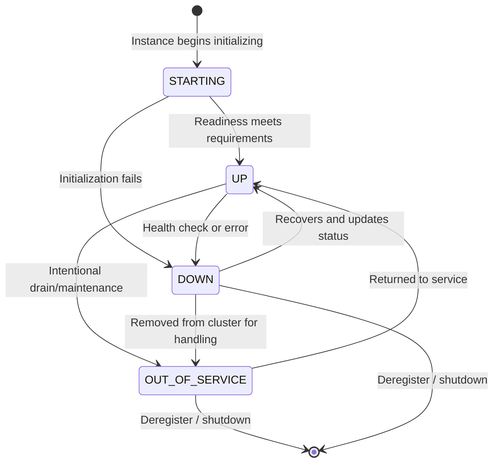
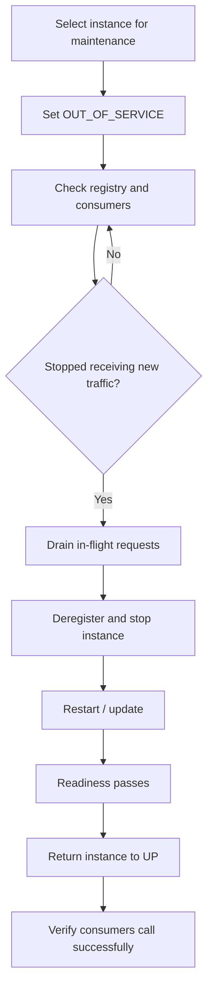

# Distinguishing UP, DOWN, STARTING, and OUT_OF_SERVICE Instances

Eureka stores the status of each service instance to describe the state that the instance advertises to the registry. The four common statuses are `UP`, `DOWN`, `STARTING`, and `OUT_OF_SERVICE`. They help distinguish instances that are ready, failing, still initializing, or intentionally drained from traffic.

Status is part of a registration. It does not mean an instance has been deleted from the registry, nor does it by itself prove whether requests to the instance will succeed or fail. When operating Spring Cloud Service Discovery, understand the meaning of each status, its update source, and how consumers/LoadBalancer use that status.

## 1. What Do the Four Statuses Mean?

| Status | Meaning | Typical Situation |
|---|---|---|
| `UP` | Instance is advertised as ready to serve | Application finished starting and health checks pass requirements |
| `DOWN` | Instance is marked inactive or unhealthy | Health check failed, application encountered an error, or marked faulty |
| `STARTING` | Instance is initializing and should not receive business traffic yet | JVM is running, but application has not finished loading config or is not ready |
| `OUT_OF_SERVICE` | Instance is intentionally taken out of service | Maintenance, deploying a new version, or draining traffic before shutdown |

### UP

`UP` indicates the instance is advertised as able to serve. This is the desired state for an instance that has completed startup, has all required components ready, and satisfies health check conditions.

`UP` is not a guarantee that requests will always succeed. An instance can still fail right after its status updates; network issues, dependencies, timeouts, or business logic errors can still cause requests to fail.

### DOWN

`DOWN` indicates the instance is considered unhealthy or should not serve based on current status signals. This status can come from health checks, a signal published by the client, or an administrative action.

`DOWN` is not equivalent to deregistration. The registration can remain in the registry for observation, investigation, or awaiting recovery. If the instance recovers on its own, its status may update back according to health integration or management logic.

### STARTING

`STARTING` indicates the instance is booting up and has not yet met readiness criteria. For example, the JVM process is running, yet the application is still:

- Loading configuration and building the application context.
- Initializing database connection pools.
- Building caches or loading initial data.
- Registering listeners, consumers, or background components.
- Waiting for required dependencies to become ready.

Do not send business traffic to a `STARTING` instance merely because its HTTP port is open. Process readiness and application readiness are two different concepts.

### OUT_OF_SERVICE

`OUT_OF_SERVICE` is typically used when an instance still exists, yet operators explicitly instruct not to send new traffic to it. Examples:

- Preparing to deploy a new version.
- Performing JVM or configuration maintenance.
- Draining requests before stopping the container.
- Temporarily isolating an instance from the cluster for diagnostics.

This is an intentional administrative signal, distinct from `DOWN` caused by health failures. An instance can still be running and answering its health endpoint while marked `OUT_OF_SERVICE`.

## 2. Distinguishing Status From Health Checks and Deregistration

Three commonly confused concepts:

| Concept | Question Answered | Example |
|---|---|---|
| Health check | Does the application meet health/readiness criteria? | Actuator readiness returns UP |
| Eureka instance status | What status is the instance advertising in the registry? | UP, DOWN, STARTING, OUT_OF_SERVICE |
| Deregistration | Has the instance's registration been removed from the registry? | Client sends a deregistration request on shutdown |

An instance can be healthy yet placed `OUT_OF_SERVICE` for maintenance. Conversely, an instance reporting `DOWN` may still retain its registration in the registry. Only deregistration requests deletion of the instance's registration.

Do not use health endpoints and registry status interchangeably. A health endpoint describes health according to configured health indicators; Eureka status is the status published and stored in the registry. Mapping between the two depends on Eureka client configuration and integration version.

## 3. Typical Status Lifecycle

A typical lifecycle:



This is an operational model for understanding common transitions, not a mandatory rule for every application. Eureka client, health integration, and administrative actions determine actual update timing. Some statuses may be changed by health checks or provider sync mechanisms.

A rollout example:

1. The new instance starts up and is in `STARTING` status.
2. The application finishes initializing, readiness passes, and the instance is marked `UP`.
3. The old instance is marked `OUT_OF_SERVICE` to stop receiving new traffic.
4. In-flight requests are drained within the allowed window.
5. The old instance deregisters and shuts down.
6. The registry continues advertising the new instance in `UP` status.

Do not transition a new instance to `UP` merely because the process started running. Use readiness to accurately reflect serving capability.

## 4. Updating Status From Eureka Client

In a Spring Cloud Netflix Eureka application, instance status can be updated via `ApplicationInfoManager`. The following example illustrates intentionally taking an instance out of service:

```java
import com.netflix.appinfo.ApplicationInfoManager;
import com.netflix.appinfo.InstanceInfo;
import org.springframework.stereotype.Component;

@Component
public class EurekaInstanceLifecycle {

    private final ApplicationInfoManager applicationInfoManager;

    public EurekaInstanceLifecycle(
            ApplicationInfoManager applicationInfoManager) {
        this.applicationInfoManager = applicationInfoManager;
    }

    public void takeOutOfService() {
        applicationInfoManager.setInstanceStatus(
            InstanceInfo.InstanceStatus.OUT_OF_SERVICE
        );
    }

    public void markUp() {
        applicationInfoManager.setInstanceStatus(
            InstanceInfo.InstanceStatus.UP
        );
    }

    public void markDown() {
        applicationInfoManager.setInstanceStatus(
            InstanceInfo.InstanceStatus.DOWN
        );
    }
}
```

This is a Eureka client API, not a generic abstraction across all registries. Applications using Consul or Kubernetes need the corresponding provider mechanism.

Only update status from an authorized management component that understands instance lifecycle. Never let an unauthenticated public endpoint call `markUp()` or `takeOutOfService()` without authentication and authorization.

### Initial Status and STARTING

Eureka defines the `InstanceInfo.InstanceStatus` enum with values such as `UP`, `DOWN`, `STARTING`, `OUT_OF_SERVICE`, and `UNKNOWN`. The exact initial value depends on how `InstanceInfo` is created, client lifecycle, and integration configuration.

If an application needs to explicitly represent the startup phase, determine when the status is set to `STARTING` and the condition to transition to `UP`. Do not assume every version of Spring Cloud Netflix automatically keeps `STARTING` status throughout the entire bootstrap phase.

## 5. Integrating Health Checks With Eureka

Eureka client can use Spring Boot Actuator health checks to synchronize application health status with the registry. In an appropriate Spring Cloud Netflix configuration, you can enable:

```yaml
eureka:
  client:
    healthcheck:
      enabled: true
```

The application needs the Actuator dependency and appropriate health indicators. When integration is enabled, Eureka client can publish status based on application health rather than solely on whether the process still sends heartbeats.

Notes:

- Place the health check property in application configuration loaded at the right stage, typically `application.yml`; Spring Cloud Netflix documentation warns against placing this property in `bootstrap.yml`.
- Health checks should reflect readiness-to-serve criteria. Liveness alone—showing the process is alive—is insufficient to decide whether an instance can accept business requests.
- Identify which health groups and dependencies affect status. A failing auxiliary dependency does not always mean every API on the instance must stop serving.
- Verify actual behavior on the Spring Cloud Netflix version in use, as mechanisms and properties can vary across versions.

Example enabling Actuator readiness probes:

```yaml
management:
  endpoint:
    health:
      probes:
        enabled: true
```

The readiness endpoint can be used by orchestration platforms or health integrations when configured appropriately. Simply enabling probes does not mean Eureka automatically uses the readiness endpoint in every version.

## 6. How Do DOWN and OUT_OF_SERVICE Differ?

Both statuses indicate an instance should not be treated as normal, yet their causes and purposes differ.

| Criterion | DOWN | OUT_OF_SERVICE |
|---|---|---|
| Common cause | Health check failure or instance error | Intentional maintenance or drain |
| Operational meaning | Instance is unhealthy | Instance is temporarily not accepting traffic |
| Can the process still be running? | Possibly | Usually yes |
| Can it auto-recover? | Yes, if health recovers and client updates status | Yes, when returned to service |
| Does it mean removed from registry? | No | No |
| Next action | Investigate health, dependencies, logs, and network | Finish drain/maintenance, then return to UP or deregister |

For example, a failing database connection pool can cause health checks to mark an instance `DOWN`. Meanwhile, an instance needing an upgrade while still healthy can be placed `OUT_OF_SERVICE` to drain traffic before stopping.

Do not use `DOWN` as a routine drain tool when the system has `OUT_OF_SERVICE` for that purpose. Statuses reflecting the true cause help dashboards, alerts, and operators understand the situation accurately.

## 7. How Does Status Affect Consumers and LoadBalancer?

Consumers typically retrieve instance lists through Eureka DiscoveryClient or Spring Cloud LoadBalancer. Registry status can influence returned results or how instances are filtered, depending on the Eureka client version and discovery integration configuration.

In operations, establish clear policies:

- Only `UP` instances are eligible for consideration for normal traffic.
- `STARTING` instances should not receive business requests yet.
- `DOWN` instances should be excluded from the serving pool or handled with appropriate fallbacks.
- `OUT_OF_SERVICE` instances should be drained from new traffic during maintenance.

Do not assume every consumer filters all statuses identically just because the registry updated. Verify the list returned by `DiscoveryClient.getInstances(serviceId)` and the behavior of `ServiceInstanceListSupplier`/LoadBalancer in your deployed version.

In particular, when changing status to `OUT_OF_SERVICE`, verify consumers have stopped selecting the instance before stopping the process. Server and client caches can prevent the updated status from reaching every consumer immediately. For safe draining, combine registry status, readiness, stopping acceptance of new requests, waiting for in-flight requests to finish, and deregistration.

## 8. Example Maintenance Procedure for an Instance

Suppose `payment-service` has three instances in `UP` status. One instance needs a configuration update:

1. Identify the exact instance ID needing maintenance.
2. Issue an administrative action setting that instance to `OUT_OF_SERVICE`.
3. Check the status in Eureka and the instance list on the consumer side.
4. Wait for caches to converge and verify LoadBalancer no longer picks that instance for new requests.
5. Drain in-flight requests and wait for the graceful shutdown timeout.
6. Deregister the instance if the shutdown sequence has not already done so.
7. Stop or upgrade the process.
8. Restart, wait for readiness to pass, and return the instance to `UP`.
9. Verify consumers see the new instance and requests work normally.

Process diagram:



This is a conceptual procedure. Administrative commands, cache timings, and drain actions depend on architecture, HTTP server framework, and deployment platform.

## 9. Status Overrides and Status Update Sources

Status can be updated by multiple sources:

- Eureka client via `ApplicationInfoManager`.
- Health check integration.
- Eureka Server or administrative tools authorized to perform status overrides.
- Deployment or orchestration pipelines.

When multiple sources issue updates, establish which source is authoritative. For example, an operator sets `OUT_OF_SERVICE` for maintenance, yet health integration still sees the app as healthy and updates the status back to `UP`. Without control, the instance may unexpectedly resume receiving traffic.

Administrative procedures should define clear rules: who may change status, which statuses are updated automatically, when manual statuses are preserved, and what conditions permit returning an instance to `UP`.

A status override is not deregistration. A registration can still exist and be observed in the registry even though its status was altered. To remove an instance, perform deregistration or let lease/health policies clean it up.

## 10. UNKNOWN and Other Statuses

Beyond the four primary statuses, Eureka also has `UNKNOWN`. This status is used when an instance's condition has not been determined or when status has not been explicitly set by integration. Do not treat `UNKNOWN` as equivalent to `UP`.

Depending on the Netflix Eureka version, the enum may contain other values for compatibility or internal use. In code, use the official enum from your dependency version rather than inventing arbitrary status strings.

In Consul, the health check model typically uses statuses such as `passing`, `warning`, and `critical`; do not map each name one-to-one onto Eureka statuses blindly. If a system spans multiple providers, define a shared business convention at the application layer and map cleanly to each provider's statuses.

## 11. Common Mistakes in Managing Status

| Symptom | Possible Cause | Resolution |
|---|---|---|
| Instance still receives requests after setting OUT_OF_SERVICE | Stale consumer cache or LoadBalancer not filtering status as expected | Check instance list and supplier/filter policies |
| Instance flips back to UP on its own | Health integration or another update source overwrites status | Identify authoritative source and maintenance sequence |
| STARTING instance receives requests | Readiness is not used in routing or status not published properly | Only transition to UP after readiness passes |
| Instance is DOWN yet still visible on dashboard | Status does not delete registration | Check status and deregistration separately |
| Healthy instance marked DOWN | Wrong health indicator dependency or overly short timeout | Check health groups, dependencies, and timeouts |
| Instance is OUT_OF_SERVICE yet record still exists | This is valid state; registration still exists | Drain then deregister on shutdown |
| Consumers see different statuses | Cache/refresh intervals or peer replication latency | Check caches, peers, and convergence timing |

When investigating, compare the same instance ID across the Eureka dashboard/API, provider logs, and consumer DiscoveryClient output. Looking at status on the dashboard alone is not enough to conclude LoadBalancer has stopped choosing the instance.

## 12. Operational Checklist

Before putting an instance into service or pulling it from traffic, verify:

1. What status is the instance currently in within Eureka?
2. Did that status come from health checks, the client, or an administrative action?
3. Does readiness accurately reflect readiness to accept business requests?
4. Are `DOWN` and `OUT_OF_SERVICE` clearly distinguished?
5. Has the status change converged to consumers and LoadBalancer?
6. Have new requests stopped arriving at the instance under maintenance?
7. Have in-flight requests drained before stopping?
8. Did the instance deregister with the right ID when no longer serving?
9. Could any source overwrite a manual status?
10. Are the dashboard, REST API, and management endpoints secured?

`UP`, `DOWN`, `STARTING`, and `OUT_OF_SERVICE` describe an instance's serving state in the registry. Understanding the differences among them helps manage startup, failure detection, and controlled maintenance. Combining status with health checks, readiness, LoadBalancer, caching, and deregistration is what builds a reliable service discovery workflow.
