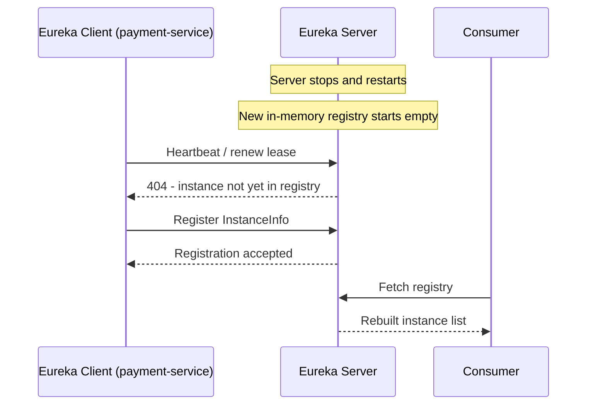
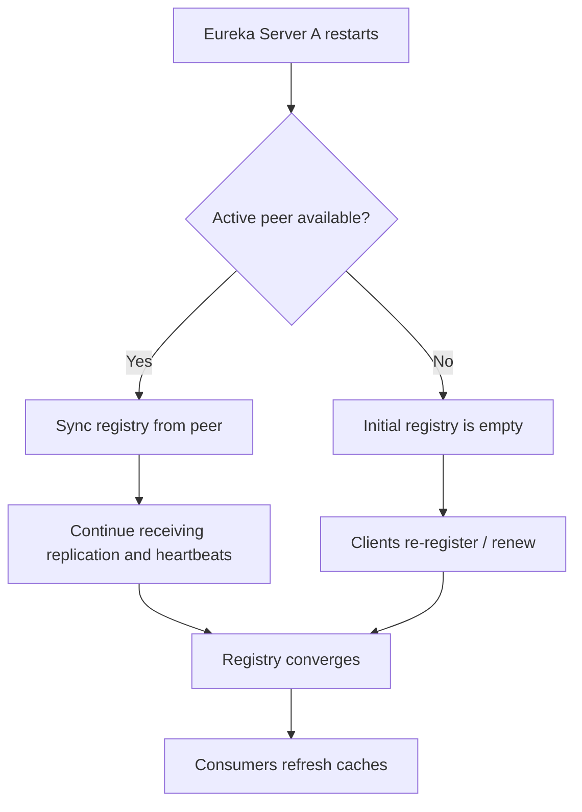

# Eureka Restart and Registry Rebuilding Process

Eureka Server maintains a registry containing registered applications and instances. When an instance starts up, Eureka Client sends registration information; while active, the client sends heartbeats to renew its lease. Consumers download the registry into a cache and use that instance list to discover services.

When Eureka Server restarts, the critical question is where the registry is restored from. Eureka's registry is primarily held in the server's memory, not a durable database that automatically persists full state to disk. Therefore, after a standalone server restarts, the registry can start empty and be rebuilt as clients re-register. In a multi-server Eureka cluster, a newly started node can synchronize the registry from an active peer before clients complete their renewal and re-registration cycles.

Understanding these recovery paths helps you design rolling restarts, handle simultaneous multi-node losses, and distinguish server-side registry data from consumer-side discovery caches. This is a key part of operating Spring Cloud service discovery.

## 1. How Is the Registry Maintained?

Eureka Server stores registration details of service instances in its registry. A record typically includes application name, instance ID, hostname/IP, port, status, metadata, and lease information.

The typical lifecycle consists of these operations:

1. **Register:** when an application starts up, Eureka Client sends `InstanceInfo` to Eureka Server.
2. **Renew:** the client periodically sends heartbeats to renew its lease and signal that the instance is maintaining its registration.
3. **Fetch registry:** consumers download the application/instance list and refresh their local caches.
4. **Cancel:** when an application shuts down cleanly, the client sends a deregistration request.
5. **Eviction:** if an instance fails to renew its lease within the configured time, the server can remove the record per eviction policy.

The registry on each Eureka Server is operational state maintained in memory. Within a cluster, nodes exchange registration data via peer replication. Peer replication keeps registries similar across nodes, though it is not an independent durable backup. If every node loses its in-memory state simultaneously, recovery depends on clients re-registering and any separate data sources the system specifically designs.

## 2. What Happens When a Eureka Server Restarts?

Consider a standalone Eureka Server managing three instances of `payment-service`. When the server stops, the in-memory registry of that process is gone. When the process starts back up, the server initializes a fresh registry; instances do not reappear automatically merely because provider applications are still running.

If clients remain running while the server restarts, they continue their heartbeat cycle. When the server does not yet hold the corresponding record, a renewal attempt can receive a response indicating the instance is not registered. With Netflix Eureka Client, a `404` response on renewal is handled by performing a re-registration. Actual recovery timing also depends on retries, network connectivity, heartbeat schedules, and library version.



This flow describes the case where the client stays alive and the server responds to a renewal indicating the record does not exist. If the server is not yet ready or connectivity fails, the client must keep retrying according to library behavior. Do not assume all instances will appear instantaneously the moment the Eureka Server process reports `UP`.

### 2.1. Clients Do Not Need to Restart With the Server

Providers do not necessarily need to restart just because Eureka Server restarts. Eureka Client retains its configuration and process state; it can continue sending heartbeats, re-registering when needed, and fetching the registry on schedule. This avoids having to restart every microservice just to rebuild the registry.

However, during the window while the registry is still rebuilding:

- New consumers may download an empty or incomplete list.
- Running consumers may still hold a stale cache for a period, depending on refresh timing and connection errors.
- Load balancers may pick instances from a stale cache, or find no instances if the cache has updated to empty.
- Requests to stopped or not-yet-re-registered instances may fail.

Therefore, applications still need timeouts, bounded retries, circuit breakers, and handling for missing instances. Registry recovery does not replace fault-tolerance mechanisms at the service-calling layer.

## 3. Rebuilding the Registry From Eureka Clients

When the server restarts and its registry is empty, active clients help repopulate the data.

### 3.1. Initial Registration

When a provider starts for the first time, the client builds `InstanceInfo` from configuration such as `spring.application.name`, `eureka.instance.instance-id`, hostname/IP, and port. The client sends a registration request to an endpoint of the form:

```text
POST /eureka/apps/{APP_NAME}
```

The server adds the instance to the corresponding application. If a provider runs multiple replicas, each replica needs a distinct instance ID so the registry can differentiate each running instance.

### 3.2. Heartbeat and Re-Registration

During normal operation, the client sends periodic heartbeats to renew its lease. The renew endpoint has the form:

```text
PUT /eureka/apps/{APP_NAME}/{INSTANCE_ID}
```

If the server still holds the record, the heartbeat renews the lease. If the record was lost, Netflix Eureka Client can receive a `404` response and trigger re-registration. If the request fails to reach the server due to a timeout or network error, the client retries according to its mechanism; a connection error does not mean the instance was deleted from the registry.

Common Eureka defaults are a heartbeat around 30 seconds and lease expiration around 90 seconds. These can be configured via `eureka.instance.lease-renewal-interval-in-seconds` and `eureka.instance.lease-expiration-duration-in-seconds`. These are reference values, not guaranteed recovery times. Inspect actual configuration and logs for the Spring Cloud Netflix version running.

### 3.3. Consumers Re-Fetching the Registry

Consumers use Eureka Client to fetch the registry from the server. Clients typically keep an in-memory cache and refresh periodically; `eureka.client.registry-fetch-interval-seconds` adjusts the regular refresh interval.

Once the server registry is rebuilt, consumers need time to receive the new data. There can be a gap between:

- When the provider re-registers.
- When Eureka Server stores the record.
- When the consumer fetches the updated registry.
- When Spring Cloud LoadBalancer uses the updated instance list.

If a request fails during this phase, treat it as a transient dependency failure. Do not force every consumer to restart just to refresh its cache unless there is a specific operational reason whose impact has been assessed.

## 4. Recovery in a Multi-Node Eureka Cluster

A Eureka Server cluster can have multiple peers. Nodes exchange registration data to improve availability and avoid single-server dependency.

When one node restarts while another peer remains active, the new node can pull the registry from its peer during startup synchronization. Afterward, new updates continue flowing via peer replication. Thus, an individual node restart generally has a chance to recover its registry faster than a standalone server, provided surviving peers hold the data and network connectivity works.



### 4.1. Basic Peer Configuration

Example of node A connecting to nodes B and C:

```yaml
spring:
  application:
    name: eureka-server

server:
  port: 8761

eureka:
  client:
    register-with-eureka: true
    fetch-registry: true
    service-url:
      defaultZone: http://eureka-b:8761/eureka/,http://eureka-c:8761/eureka/
```

Nodes B and C must configure corresponding peer URLs to form a registry-exchange topology. In a clustered environment, `register-with-eureka` and `fetch-registry` are typically enabled so nodes participate in registering and fetching registries from peers. Peer URLs must be addresses reachable between nodes; do not use `localhost` if nodes run on different hosts or containers.

For a standalone Eureka Server used in development, the configuration is usually different:

```yaml
eureka:
  client:
    register-with-eureka: false
    fetch-registry: false
```

These two configurations reflect two different topologies. Do not copy standalone settings onto every cluster node, or nodes will not exchange registries with peers as intended.

### 4.2. Restarting One Node at a Time

In a cluster, restart Eureka Servers sequentially:

1. Confirm remaining peers are healthy and hold the current registry.
2. Restart one node.
3. Wait for the node to reconnect to peers and sync the registry.
4. Check application/instance counts and replication status.
5. Move on to the next node only after the cluster has stabilized.

Do not restart all peers simultaneously if the goal is to rely on peer replication for registry recovery. When every node loses in-memory state at once, no surviving peer remains to supply a copy of the registry.

## 5. What Happens If All Eureka Servers Restart Together?

If every Eureka Server in the cluster stops or loses in-memory data simultaneously, no peer remains to supply the registry to newly started nodes. Servers may boot with an empty registry and wait for clients to re-register.

Recovery then depends on:

- Providers still running and able to connect to Eureka Server.
- Clients retrying register/renew requests once the server becomes available.
- Newly starting applications registering successfully.
- Consumers refreshing their caches and receiving the instance list again.
- DNS, networking, authentication, and required dependencies all functioning.

During that period, service discovery may lack data or return incomplete lists. Some applications may still serve requests using stale caches, while new consumers fail to find services. Plan recovery layer by layer instead of judging health solely from Eureka Server's health endpoint.

Eureka Server does not automatically restore its registry from a durable database by default. If operational requirements demand data recovery independent of client re-registration, design additional storage/backup mechanisms or a discovery system with an appropriate persistence model; do not treat peer replication as a long-term backup.

## 6. Self-Preservation During Recovery

Eureka has a self-preservation mechanism to avoid mass eviction when received heartbeats fall abnormally low compared to expected levels. This helps when network incidents prevent clients from sending heartbeats even though many instances are still running.

Self-preservation has several consequences worth understanding clearly:

- It can retain stale records longer when heartbeats drop below the threshold.
- It helps prevent mass-deleting instances solely due to temporary network disruptions.
- It is not a mechanism for persisting the registry across process restarts.
- It does not replace peer replication, client re-registration, or application health checks.

If the server restarts and its in-memory registry is lost, self-preservation cannot reconstruct prior records on its own. If the server still holds a registry yet loses contact with many clients, self-preservation can curb eviction while the network recovers.

Do not disable self-preservation just to make the dashboard clear records faster without understanding the impact. In production, weigh the risk of keeping stale instances against the risk of mistakenly purging many active instances.

## 7. Recommended Recovery Sequence

### 7.1. Single Standalone Eureka Server

When there is only one node, follow this sequence:

1. Start Eureka Server and verify the registry endpoint is ready.
2. Verify Eureka Clients can connect to the server.
3. Monitor heartbeats and client re-registrations.
4. Check instance counts in the registry per application.
5. Confirm consumers refresh their caches and can call registered instances.
6. Investigate any providers that have not appeared via client logs, networking, and instance ID configuration.

If the server is restarted during scheduled maintenance, record the expected service/instance list beforehand for post-recovery comparison.

### 7.2. Multi-Node Eureka Cluster

With a cluster, prioritize keeping at least one healthy peer alive during restarts:

1. Verify peer URLs, DNS, ports, and authentication between nodes.
2. Select one node to restart.
3. Wait for the restarted node to sync its registry from an active peer.
4. Check the registry on the recovered node and another node to compare.
5. Verify clients can register, renew, and fetch the registry.
6. Proceed to the next node once the cluster is stable.

If a node cannot sync with peers, check startup logs, peer status, `defaultZone` configuration, DNS, and firewalls. Do not declare success merely because the new node's dashboard opens.

## 8. Configurations and Parameters to Watch

| Property | Role | Recovery Notes |
|---|---|---|
| `eureka.client.service-url.defaultZone` | URL of the Eureka Server or peers that a client connects to. | URLs must be accurate and reachable from the client/node network. |
| `eureka.client.register-with-eureka` | Enables a client to register itself with the registry. | Typically enabled in peer clusters; typically disabled on standalone servers. |
| `eureka.client.fetch-registry` | Enables a client to download the registry. | Must be enabled on consumers and typically enabled on cluster peer nodes. |
| `eureka.client.registry-fetch-interval-seconds` | Refresh interval for the client-side registry cache. | Smaller values surface changes faster, but increase requests to the server. |
| `eureka.instance.lease-renewal-interval-in-seconds` | Instance heartbeat cadence. | Affects when a client discovers its renewal requires re-registration. |
| `eureka.instance.lease-expiration-duration-in-seconds` | Lease window before an instance can be considered expired. | Not the post-restart recovery time; also depends on eviction and self-preservation. |
| `eureka.server.enable-self-preservation` | Enables/disables self-preservation. | Do not rely on it as persistence or backup. |

Do not lower all intervals simultaneously to make the registry recover faster. High heartbeat/fetch frequencies can spike load, generate heavy traffic right as the system boots, and worsen overload. Measure actual recovery times before changing parameters.

## 9. Observing the Registry Rebuilding Process

During recovery, inspect the state of the server, clients, peers, and consumers.

### 9.1. On Eureka Server

- Dashboard is accessible and displays node status.
- Application and instance counts climb as expected.
- Peer nodes can connect and exchange registries.
- Startup logs show peer synchronization if the cluster has peer configuration.
- No authentication, timeout, or DNS errors when calling peers.

### 9.2. On Eureka Client

- Logs confirm the client connected to the right `defaultZone`.
- Register and renew operations succeed.
- If renew reports the instance does not exist, monitor the subsequent re-registration.
- Hostname/IP, port, and instance ID in the record match the actual workload.
- Client is not hitting repeated connection errors due to DNS or firewalls.

### 9.3. On Consumers

- `DiscoveryClient.getInstances(serviceId)` returns the expected list.
- Registry cache refreshes after the server recovers.
- Spring Cloud LoadBalancer selects reachable instances.
- Business requests succeed once providers are ready.
- Timeout, connection refused, and retry rates return to normal levels.

You can inspect the registry via Eureka's REST API within the management network:

```bash
curl -H "Accept: application/json" \
  http://eureka-server:8761/eureka/apps
```

To view a specific application:

```bash
curl -H "Accept: application/json" \
  http://eureka-server:8761/eureka/apps/PAYMENT-SERVICE
```

Paths may differ if the server uses a context path or security settings. Do not expose registry APIs to the public Internet without proper authentication and network controls.

## 10. Common Issues After Restart

| Symptom | Possible Cause | Where to Check |
|---|---|---|
| Eureka Server is running yet registry is empty | Standalone server just started and no clients have re-registered yet. | Check client connectivity, heartbeats, and registration logs. |
| New node lacks data from peers | Wrong peer URL, peer unavailable, or other nodes lack registry data. | Check `defaultZone`, DNS, firewalls, and startup sync logs. |
| Only some services appear | Certain clients cannot connect, disabled registration, or are still retrying. | Check per-provider logs, `register-with-eureka`, and URL config. |
| Consumers do not see new instances | Registry fetch cache has not refreshed or consumers read an unconverged node. | Check which node is queried, `registry-fetch-interval-seconds`, and caches. |
| Dashboard still shows stopped instances | Cache/lease has not expired or self-preservation is restricting eviction. | Check heartbeats, leases, eviction, and status. |
| Clients repeatedly report renew errors | Server not yet ready, wrong URL, or network/auth error. | Check connectivity to `/eureka/` and HTTP responses. |
| Many instances missing after full cluster restart | No surviving peer left to sync; clients have not finished re-registering. | Monitor client register/retry and start providers in batches if needed. |
| Instance is in registry yet requests fail | Stale host/IP/port or unconverged consumer cache. | Check `InstanceInfo`, DNS, routing, port, and LoadBalancer. |

## 11. Staging Recovery Test Scenario

You can build a controlled test to measure registry rebuild time:

1. Start Eureka Server and a few multi-instance providers.
2. Record the list of applications, instance IDs, hosts, ports, and statuses on the server.
3. Confirm the consumer has fetched the registry and successfully calls providers.
4. Restart Eureka Server while providers and consumers stay running.
5. Measure time until server readiness, when clients renew/re-register, and when the registry is complete.
6. Measure time until consumer caches refresh and requests succeed steadily.
7. Repeat with a multi-peer cluster: restart one node, and later test a full cluster restart scenario in an isolated environment.
8. Compare recovery times, failed requests, retry counts, and generated load.

Do not run full-registry restart tests in production just to measure behavior. Run scenarios in staging or an approved environment with a recovery plan and load limits.

## 12. Operational Principles

- Use multiple Eureka Server peers when high availability is needed; verify peer replication and DNS/networking between nodes.
- Restart one node at a time so surviving nodes can supply the registry to the recovering node.
- Do not treat the in-memory registry or peer replication as a durable backup.
- Ensure providers can re-register automatically after server recovery; monitor renew and register responses.
- Keep `defaultZone` accurate and list multiple URLs matching your topology when failover is required.
- Do not restart an entire Eureka cluster simultaneously without a plan for client re-registration.
- Keep consumer timeouts and retries reasonable since caches may be stale or empty during convergence.
- Do not disable self-preservation just to force fast instance deletion without evaluating false-eviction risk.
- Monitor instance counts per application and compare against actual workloads after every maintenance window.
- Verify your exact Spring Cloud Netflix/Eureka version before altering heartbeat, lease, or registry fetch intervals.

## Conclusion

When Eureka Server restarts, a node's in-memory registry can start empty. With a standalone server, running clients help rebuild the registry via heartbeats and re-registering when their records are missing. With a cluster, a restarted node can synchronize its registry from an active peer and resume replication. Consumers also need time to refresh their caches before using the updated instance list.

Safe recovery rests on three things: keeping peers alive during rolling single-node restarts, ensuring clients can re-register/renew, and verifying consumers receive reachable instance lists. Self-preservation helps avoid mass eviction during certain heartbeat incidents, but does not persist the registry across restarts and is no substitute for a data recovery plan.
