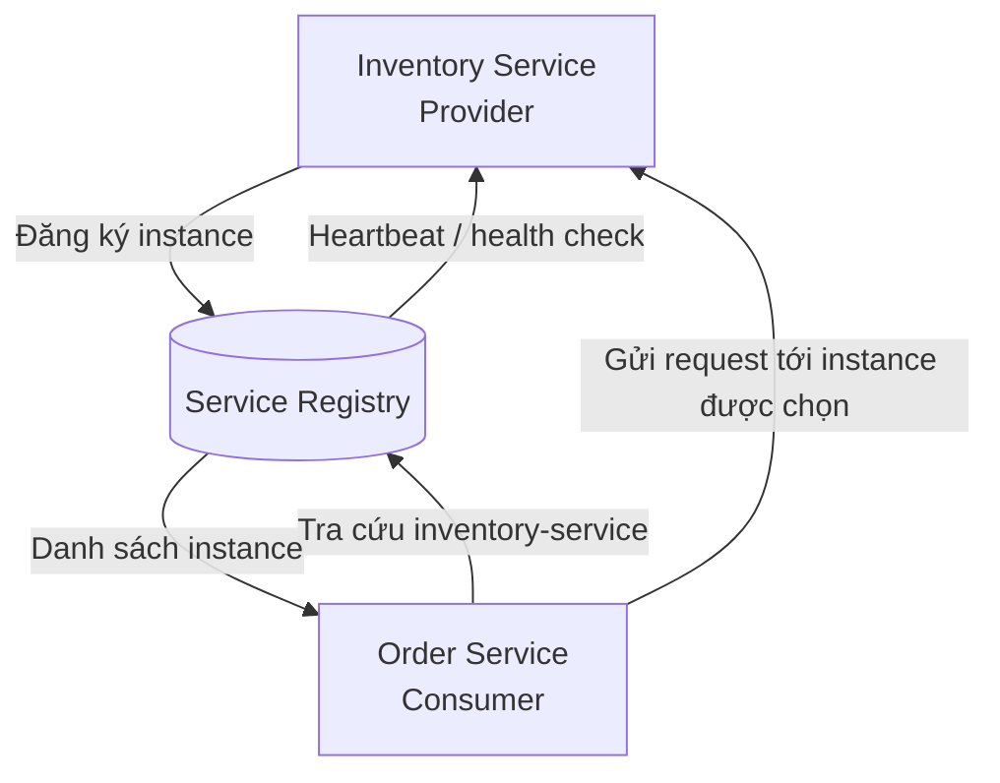

# Khám phá dịch vụ là gì và giải quyết bài toán nào

Trong một ứng dụng đơn khối, các thành phần thường gọi nhau qua địa chỉ cố định hoặc gọi trực tiếp trong cùng tiến trình. Khi hệ thống được tách thành nhiều microservice, mỗi dịch vụ có thể chạy trên nhiều máy hoặc container, được tạo mới, thay thế, mở rộng hay thu hẹp bất cứ lúc nào. Địa chỉ IP và cổng của một instance vì thế không còn ổn định. Nếu mỗi dịch vụ phải lưu sẵn địa chỉ của tất cả dịch vụ còn lại, cấu hình sẽ nhanh chóng lỗi thời và việc triển khai trở nên khó kiểm soát.

**Service discovery (khám phá dịch vụ)** là cơ chế giúp một thành phần tìm ra các instance đang cung cấp một dịch vụ thông qua tên logic. Thay vì cần biết trước `10.0.2.15:8080` là máy nào, dịch vụ gọi chỉ cần biết tên như `inventory-service`; hệ thống khám phá dịch vụ sẽ cung cấp danh sách instance phù hợp để ứng dụng hoặc một bộ cân bằng tải chọn nơi gửi yêu cầu.

Trong Spring Cloud, service discovery cung cấp nền tảng để các microservice tìm thấy nhau khi địa chỉ và số lượng instance thay đổi theo thời gian. Các thành phần thường gặp gồm `DiscoveryClient`, `ServiceRegistry`, Spring Cloud LoadBalancer và các hệ thống registry như Eureka hoặc Consul.

## Bài toán khi không có service discovery

Giả sử `order-service` cần gọi `inventory-service` để kiểm tra tồn kho. Trong môi trường phát triển, nhóm có thể cấu hình một địa chỉ cố định:

```yaml
inventory:
  base-url: http://192.168.10.21:8080
```

Cách làm này có thể hoạt động khi chỉ có một instance và hạ tầng ít thay đổi. Nhưng khi đưa vào môi trường microservice thực tế, nó tạo ra nhiều vấn đề:

- **Địa chỉ thay đổi:** container có thể nhận IP mới sau khi khởi động lại hoặc được triển khai trên node khác. Cấu hình cũ khiến lời gọi đi tới địa chỉ không còn tồn tại.
- **Mở rộng nhiều instance:** khi `inventory-service` có nhiều bản chạy song song, một địa chỉ cố định không đại diện cho toàn bộ năng lực phục vụ.
- **Thay thế và triển khai liên tục:** instance cũ có thể dừng, instance mới xuất hiện trong lúc các dịch vụ gọi vẫn giữ cấu hình trước đó.
- **Cấu hình phụ thuộc môi trường:** địa chỉ trong máy phát triển, môi trường kiểm thử và môi trường sản xuất khác nhau. Quản lý thủ công làm tăng nguy cơ cấu hình nhầm.
- **Khả năng phục hồi:** một instance đã lỗi vẫn có thể bị gọi nếu thông tin địa chỉ không được cập nhật kịp thời.

Service discovery giải quyết việc tra cứu vị trí của instance bằng một tên dịch vụ ổn định. Nó không tự làm cho lời gọi mạng luôn thành công, nhưng loại bỏ nhu cầu duy trì thủ công danh sách địa chỉ của từng instance và tạo cơ sở cho cân bằng tải, kiểm tra sức khỏe cũng như xử lý lỗi.

## Những thành phần cơ bản

Một hệ thống khám phá dịch vụ thường có ba vai trò:

1. **Service provider:** ứng dụng cung cấp chức năng, chẳng hạn `inventory-service`. Khi khởi động, ứng dụng đăng ký tên dịch vụ cùng thông tin instance như địa chỉ, cổng và metadata cần thiết.
2. **Service registry:** nơi lưu thông tin các instance đã đăng ký. Registry nhận đăng ký, theo dõi trạng thái bằng heartbeat hoặc health check, và loại bỏ hoặc đánh dấu instance không còn khả dụng theo chính sách của hệ thống.
3. **Service consumer:** ứng dụng cần gọi dịch vụ khác, chẳng hạn `order-service`. Consumer tra cứu registry theo tên dịch vụ để lấy danh sách instance có thể sử dụng.

Tên dịch vụ là định danh logic, ví dụ `inventory-service`; nó không phải địa chỉ mạng. Mỗi instance cần thông tin nhận diện riêng để registry phân biệt các bản chạy cùng một dịch vụ. Metadata có thể mô tả vùng triển khai hoặc phiên bản, nhưng chỉ nên chứa dữ liệu cần thiết cho việc định tuyến và vận hành.



Registry đóng vai trò danh bạ động. Provider cập nhật thông tin của mình; consumer hỏi danh bạ khi cần tìm dịch vụ. Tùy kiến trúc, consumer có thể lưu cache kết quả tra cứu trong một khoảng thời gian để giảm số lần truy vấn.

## Vòng đời khám phá dịch vụ

Một luồng điển hình diễn ra như sau:

1. **Khởi động và đăng ký:** provider khởi động, xác định service ID và địa chỉ có thể truy cập, sau đó đăng ký instance với registry. Trong Spring Cloud, phần tích hợp của Eureka hoặc Consul thường tự thực hiện bước này khi ứng dụng được cấu hình đúng.
2. **Duy trì trạng thái:** provider hoặc agent gửi heartbeat; registry cũng có thể chủ động chạy health check. Các cơ chế này giúp phát hiện instance đã dừng hoặc không còn đáp ứng yêu cầu sức khỏe.
3. **Tra cứu:** consumer yêu cầu danh sách instance theo service ID, ví dụ `inventory-service`.
4. **Chọn instance:** nếu có nhiều kết quả, consumer hoặc thành phần trung gian chọn một instance. Spring Cloud LoadBalancer có thể thực hiện lựa chọn phía client.
5. **Gọi dịch vụ:** consumer gửi request đến địa chỉ của instance được chọn. Nếu lần gọi thất bại, ứng dụng có thể thử lại theo chính sách phù hợp hoặc áp dụng circuit breaker.
6. **Hủy đăng ký hoặc hết hạn:** khi provider dừng có kiểm soát, nó nên hủy đăng ký để registry sớm ngừng trả về instance đó. Nếu tiến trình chết đột ngột, heartbeat hoặc health check giúp registry phát hiện và cập nhật trạng thái sau một khoảng thời gian.

Thông tin trong registry có thể trễ so với trạng thái thực tế của mạng. Chẳng hạn, instance vừa hỏng nhưng registry chưa nhận ra; hoặc instance vừa khởi động nhưng chưa được đánh dấu sẵn sàng. Vì vậy, kết quả khám phá là thông tin định tuyến có thời hạn, không phải cam kết rằng request tiếp theo chắc chắn thành công.

## Service discovery trong Spring Cloud

Spring Cloud cung cấp các abstraction chung để ứng dụng không phải phụ thuộc trực tiếp vào API riêng của từng registry.

### `DiscoveryClient`: tra cứu instance

`DiscoveryClient` là giao diện phía consumer. Ứng dụng có thể gọi `getInstances(serviceId)` để lấy các instance được đăng ký dưới một service ID. Ví dụ:

```java
import java.util.List;

import org.springframework.cloud.client.ServiceInstance;
import org.springframework.cloud.client.discovery.DiscoveryClient;
import org.springframework.stereotype.Service;

@Service
public class InventoryDiscoveryService {
    private final DiscoveryClient discoveryClient;

    public InventoryDiscoveryService(DiscoveryClient discoveryClient) {
        this.discoveryClient = discoveryClient;
    }

    public List<ServiceInstance> findInventoryInstances() {
        return discoveryClient.getInstances("inventory-service");
    }
}
```

`ServiceInstance` cung cấp thông tin như service ID, host, port, URI và metadata. Danh sách trả về có thể rỗng nếu chưa có instance nào được đăng ký hoặc registry chưa sẵn sàng. Mã gọi cần xử lý trường hợp này thay vì mặc định rằng luôn có ít nhất một instance.

`DiscoveryClient` phù hợp khi ứng dụng thực sự cần đọc danh sách instance hoặc metadata để thực hiện một xử lý riêng. Với lời gọi HTTP thông thường, nên kết hợp discovery với cơ chế cân bằng tải để tránh tự viết logic chọn instance và ghép URL ở nhiều nơi.

### `ServiceRegistry`: đăng ký và hủy đăng ký

`ServiceRegistry` là abstraction phía provider, dùng để đăng ký hoặc hủy đăng ký một đối tượng `Registration` với registry cụ thể. Các starter của Eureka và Consul tích hợp vòng đời đăng ký với Spring Boot, do đó ứng dụng thường cấu hình thuộc tính và để auto-configuration xử lý phần lớn công việc.

Hai khái niệm cần phân biệt:

| Thành phần | Vai trò chính | Bên thường sử dụng |
|---|---|---|
| `DiscoveryClient` | Tra cứu instance theo service ID | Consumer |
| `ServiceRegistry` | Đăng ký, hủy đăng ký và cập nhật trạng thái đăng ký | Provider / tích hợp registry |
| `ServiceInstance` | Mô tả một địa chỉ instance đã khám phá được | Consumer và bộ cân bằng tải |
| Spring Cloud LoadBalancer | Chọn một instance từ danh sách phù hợp | Consumer |

### Kết hợp với Spring Cloud LoadBalancer

Khi một dịch vụ có nhiều instance, tìm được danh sách mới chỉ là một nửa công việc. Ứng dụng còn cần chọn instance cho từng request. Spring Cloud LoadBalancer cung cấp cơ chế cân bằng tải phía client và tích hợp với service discovery.

Ví dụ với `RestTemplate`, có thể đánh dấu bean bằng `@LoadBalanced`:

```java
import org.springframework.boot.web.client.RestTemplateBuilder;
import org.springframework.cloud.client.loadbalancer.LoadBalanced;
import org.springframework.context.annotation.Bean;
import org.springframework.context.annotation.Configuration;
import org.springframework.web.client.RestTemplate;

@Configuration
public class HttpClientConfiguration {
    @Bean
    @LoadBalanced
    RestTemplate inventoryRestTemplate(RestTemplateBuilder builder) {
        return builder.build();
    }
}
```

Sau đó consumer có thể gọi bằng service ID:

```java
String url = "http://inventory-service/api/items/42";
InventoryItem item = restTemplate.getForObject(url, InventoryItem.class);
```

Trong ví dụ này, `inventory-service` là tên logic. LoadBalancer phối hợp với discovery client để tìm instance và chọn đích cho request. Ứng dụng cần có dependency phù hợp, chẳng hạn Spring Cloud LoadBalancer và một integration registry như Eureka hoặc Consul; các phiên bản Spring Boot và Spring Cloud phải được quản lý tương thích bằng Spring Cloud release train tương ứng.

Nếu tự lấy một `ServiceInstance` rồi gọi trực tiếp URI của nó, ứng dụng đang tự đảm nhiệm việc chọn instance. Khi đó cần tự cân nhắc phân phối tải, cache, thời gian sống của kết quả, retry và trường hợp instance biến mất giữa lúc tra cứu và lúc gửi request.

## Các lựa chọn registry phổ biến

Spring Cloud hỗ trợ tích hợp với nhiều hệ thống registry. Hai lựa chọn thường gặp là Eureka và Consul.

| Tiêu chí | Netflix Eureka | Consul |
|---|---|---|
| Vai trò phổ biến | Service registry và discovery cho hệ sinh thái Spring Cloud | Service registry, discovery và health checking |
| Cách cập nhật trạng thái | Client đăng ký và gia hạn lease bằng heartbeat; registry loại bỏ đăng ký hết hạn theo cấu hình | Agent đăng ký dịch vụ và có thể thực hiện các health check được cấu hình |
| Thông tin tra cứu | Service ID, địa chỉ instance và metadata | Service ID, địa chỉ instance, metadata và trạng thái health check |
| Khi phù hợp | Hệ thống Spring Cloud đã sử dụng hoặc muốn dùng Eureka làm registry | Hệ thống cần registry có thêm các khả năng điều phối và health check của Consul |

Không có registry nào tự động phù hợp với mọi hệ thống. Cần cân nhắc mô hình vận hành, khả năng sẵn sàng của registry, cơ chế bảo mật, cách triển khai agent/server và kinh nghiệm của đội ngũ.

Ví dụ cấu hình một ứng dụng đăng ký với Eureka:

```yaml
spring:
  application:
    name: inventory-service

eureka:
  client:
    service-url:
      defaultZone: http://localhost:8761/eureka/
```

Với cấu hình này, `inventory-service` là service ID mà các consumer dùng để tra cứu. Địa chỉ `localhost` chỉ phù hợp khi Eureka Server thực sự chạy tại cùng môi trường mạng với ứng dụng; khi triển khai, cần thay bằng địa chỉ registry có thể truy cập từ provider và consumer. Cấu hình trên cũng giả định dự án đã thêm Eureka Client starter và cấu hình dependency management tương thích.

## Service discovery giải quyết được gì và không giải quyết được gì?

Khi được triển khai đúng, service discovery đem lại một số lợi ích:

- **Giảm cấu hình địa chỉ tĩnh:** consumer gọi theo tên dịch vụ, còn vị trí instance được cập nhật qua registry.
- **Hỗ trợ mở rộng linh hoạt:** thêm hoặc bỏ instance không yêu cầu sửa danh sách địa chỉ thủ công ở tất cả consumer.
- **Tạo nền tảng cho cân bằng tải:** consumer có thể phân phối request trên nhiều instance thay vì dồn vào một địa chỉ cố định.
- **Hỗ trợ thay thế instance:** registry cập nhật thông tin khi instance đăng ký, rời hệ thống hoặc bị đánh dấu không khỏe.
- **Tách biệt cấu hình ứng dụng và hạ tầng:** service ID có thể giữ ổn định trong khi địa chỉ mạng thay đổi giữa các môi trường.

Tuy nhiên, service discovery không thay thế các cơ chế vận hành khác:

- Nó không bảo đảm instance đã tra cứu vẫn khỏe tại thời điểm request đến nơi.
- Nó không tự xử lý retry, timeout, circuit breaker, giới hạn tải hoặc tính nhất quán dữ liệu.
- Nó không thay thế API gateway, xác thực người dùng hay chính sách phân quyền giữa các dịch vụ.
- Nó không loại bỏ nhu cầu giám sát registry và bảo vệ registry như một thành phần hạ tầng quan trọng.

Một hệ thống cần kết hợp discovery với timeout hợp lý, retry có giới hạn, circuit breaker khi phù hợp, readiness/liveness probe, graceful shutdown và quan sát lỗi ở cả consumer lẫn provider.

## Những tình huống dễ gây lỗi và cách xử lý

### Registry trả về instance đã ngừng hoạt động

Đây là tình huống stale registry: instance đã chết nhưng registry hoặc cache phía consumer chưa cập nhật. Cần cấu hình heartbeat/health check và thời gian hết hạn hợp lý; provider nên hủy đăng ký khi dừng có kiểm soát. Consumer vẫn phải đặt timeout và xử lý lỗi kết nối vì không có cơ chế health check nào loại bỏ hoàn toàn khoảng thời gian sai lệch.

### Instance đã đăng ký nhưng chưa sẵn sàng nhận request

Một tiến trình có thể mở cổng trước khi hoàn tất khởi tạo kết nối cơ sở dữ liệu hoặc tải cấu hình. Nếu đăng ký quá sớm, consumer có thể gọi vào instance chưa sẵn sàng. Nên gắn trạng thái đăng ký với readiness thực tế, cấu hình health check phản ánh khả năng phục vụ và chỉ đưa instance vào nhận tải sau khi các phụ thuộc thiết yếu đã sẵn sàng.

### Consumer không tìm thấy dịch vụ

Nguyên nhân có thể là provider chưa đăng ký, hai bên dùng service ID khác nhau, consumer không kết nối được registry, hoặc cache chưa được làm mới. Cần kiểm tra tên dịch vụ, trạng thái đăng ký, kết nối mạng, quyền truy cập và log của discovery client. Không nên xử lý danh sách rỗng bằng cách âm thầm chuyển sang một địa chỉ IP cũ.

### Registry trở thành điểm phụ thuộc quan trọng

Nếu registry ngừng hoạt động, ứng dụng có thể không tra cứu được instance mới. Tùy implementation, consumer có thể tiếp tục sử dụng dữ liệu đã cache trong một khoảng thời gian, nhưng hành vi này cần được hiểu và kiểm thử. Registry nên được triển khai theo mô hình sẵn sàng phù hợp, có sao lưu/cấu hình phục hồi và được giám sát như hạ tầng cốt lõi.

### Thông tin đăng ký không an toàn

Registry có thể tiết lộ cấu trúc nội bộ và địa chỉ các dịch vụ. Nên giới hạn truy cập mạng, bật TLS khi phù hợp, xác thực client, phân quyền thao tác đăng ký/tra cứu và không lưu bí mật trong metadata. Các dịch vụ vẫn phải xác thực và phân quyền request ở tầng ứng dụng; việc biết địa chỉ instance không đồng nghĩa được phép gọi nó.

## Quy trình áp dụng trong một hệ thống Spring Cloud

Khi đưa service discovery vào một hệ thống, có thể triển khai theo trình tự sau:

1. Chọn registry phù hợp với hạ tầng và cách vận hành; triển khai registry với mức sẵn sàng cần thiết.
2. Đặt `spring.application.name` ổn định cho từng service và bảo đảm mỗi instance có thông tin địa chỉ có thể được consumer truy cập.
3. Thêm starter discovery tương ứng và quản lý phiên bản Spring Boot/Spring Cloud theo ma trận tương thích.
4. Cấu hình provider đăng ký, heartbeat hoặc health check; xác định readiness và quy trình hủy đăng ký khi shutdown.
5. Cấu hình consumer tra cứu dịch vụ; dùng Spring Cloud LoadBalancer cho lời gọi cần cân bằng tải.
6. Kiểm thử các tình huống thêm/bớt instance, instance chết đột ngột, registry tạm mất kết nối, service ID sai và triển khai rolling update.
7. Theo dõi số instance đã đăng ký, trạng thái health check, lỗi tra cứu, lỗi kết nối và độ trễ request. Bảo vệ registry bằng chính sách mạng và xác thực phù hợp.

Ví dụ, khi triển khai thêm hai instance của `inventory-service`, cả hai cùng đăng ký dưới service ID `inventory-service` nhưng có địa chỉ và instance ID riêng. `order-service` tra cứu tên dịch vụ và LoadBalancer chọn một instance cho mỗi request theo cấu hình. Khi một instance dừng, registry cập nhật trạng thái sau khi nhận tín hiệu hủy đăng ký hoặc phát hiện heartbeat/health check thất bại; consumer tiếp tục gửi request tới các instance còn khả dụng, đồng thời vẫn phải xử lý lỗi phát sinh trong thời gian trạng thái chưa đồng bộ.

## Kết luận

Service discovery là cơ chế định vị instance theo tên dịch vụ trong môi trường mà địa chỉ mạng và số lượng instance thường xuyên thay đổi. Trong Spring Cloud, `DiscoveryClient` giúp consumer tra cứu, `ServiceRegistry` cung cấp abstraction đăng ký, còn Spring Cloud LoadBalancer hỗ trợ chọn instance cho request. Eureka và Consul là những registry có thể tích hợp để quản lý danh sách dịch vụ.

Giá trị của service discovery nằm ở việc cập nhật danh bạ dịch vụ theo vòng đời instance và giảm phụ thuộc vào cấu hình địa chỉ tĩnh. Để vận hành tin cậy, hệ thống vẫn cần health check đúng, shutdown có kiểm soát, cân bằng tải, timeout, xử lý lỗi, bảo mật và giám sát registry.
