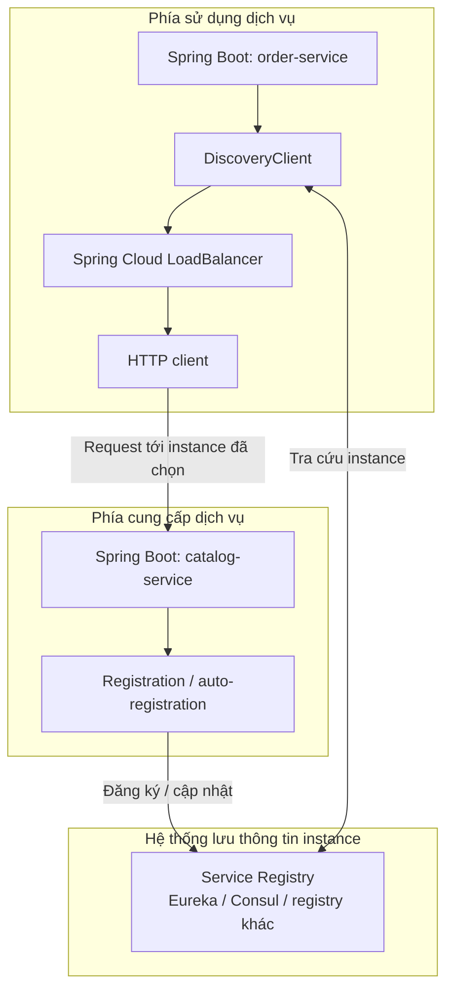
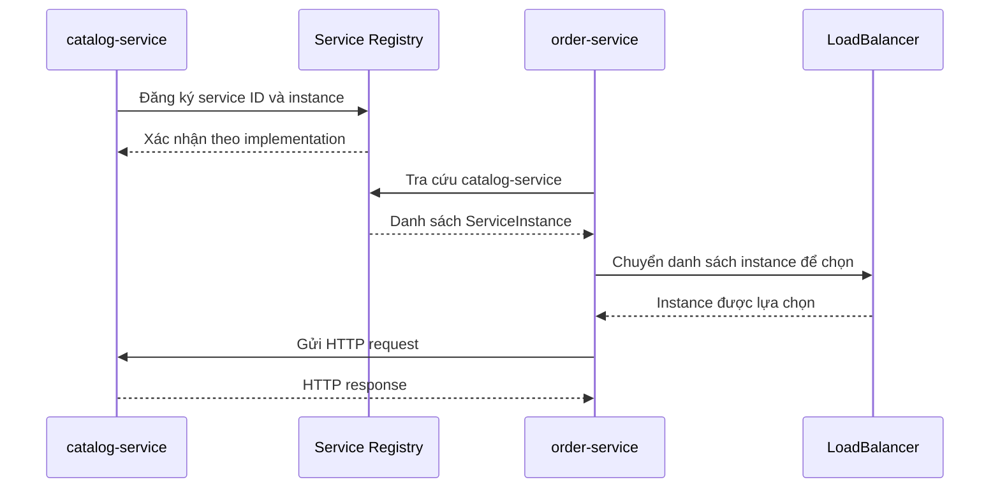

# Vị trí của Service Discovery trong hệ sinh thái Spring Cloud

Trong một ứng dụng đơn khối, các thành phần thường chạy trong cùng một tiến trình và có thể gọi nhau qua lời gọi hàm hoặc một địa chỉ đã cấu hình cố định. Khi hệ thống được tách thành nhiều microservice, mỗi dịch vụ có thể triển khai, mở rộng và khởi động lại độc lập. Địa chỉ IP, hostname và port của một instance vì thế có thể thay đổi theo từng lần triển khai.

Service Discovery giải quyết bài toán tìm địa chỉ của dịch vụ đang hoạt động bằng tên logic. Thay vì cấu hình cứng `http://10.0.1.21:8080`, consumer yêu cầu một dịch vụ như `catalog-service`; hệ thống khám phá tìm các instance đang được công bố và cung cấp thông tin để consumer kết nối. Trong hệ sinh thái Spring Cloud, Service Discovery kết nối các thành phần provider, registry, consumer, gateway và load balancer thành một cơ chế thống nhất.

Bài học này định vị Service Discovery trong kiến trúc Spring Cloud, giải thích các thành phần tham gia, luồng đăng ký và khám phá, quan hệ với những dự án Spring Cloud khác, cũng như các giới hạn vận hành cần hiểu trước khi đưa microservice vào production.

## 1. Vì sao microservice cần Service Discovery?

Một dịch vụ có thể chạy nhiều instance để tăng năng lực xử lý và khả năng chịu lỗi. Ví dụ, `catalog-service` có ba instance ở các node khác nhau. Trong quá trình vận hành, một instance có thể bị thay thế, một instance mới có thể được tạo khi scale out, hoặc một node có thể chuyển vùng.

Nếu consumer lưu sẵn địa chỉ từng instance, mỗi thay đổi hạ tầng sẽ kéo theo việc sửa cấu hình và triển khai lại consumer. Cách này tạo ra sự phụ thuộc chặt giữa consumer với địa chỉ mạng của provider.

Service Discovery tạo ra một lớp ánh xạ động:

| Consumer biết | Hệ thống tìm ra |
|---|---|
| `catalog-service` | `10.0.1.21:8080` |
| Tên dịch vụ logic | Một hoặc nhiều instance hiện được công bố |
| Vai trò của dịch vụ | Địa chỉ, giao thức và metadata của từng instance |

Khi một instance được thêm hoặc gỡ khỏi registry, consumer có thể nhận danh sách cập nhật theo cơ chế đồng bộ của implementation. Consumer tiếp tục dùng service ID ổn định trong khi hạ tầng phía sau thay đổi.

Service Discovery hữu ích khi:

- Số lượng instance thay đổi theo tải hoặc theo lịch triển khai.
- Container hoặc máy ảo được tạo và thay thế thường xuyên.
- Nhiều môi trường có địa chỉ mạng khác nhau nhưng dùng cùng tên dịch vụ logic.
- Consumer cần tìm instance phù hợp theo vùng, phiên bản hoặc metadata.
- Gateway hoặc HTTP client cần định tuyến theo service ID thay vì địa chỉ cố định.

Discovery không làm cho một dịch vụ tự động sẵn sàng. Nó chỉ cung cấp thông tin về các instance được registry hoặc implementation công bố. Endpoint vẫn phải có thể truy cập, được bảo vệ và xử lý request đúng cách.

## 2. Service Discovery nằm ở đâu trong hệ sinh thái Spring Cloud?

Spring Cloud là tập hợp các dự án hỗ trợ xây dựng hệ thống phân tán trên nền Spring Boot. Service Discovery là một năng lực nền tảng trong số đó. Nó thường làm việc cùng Spring Cloud Commons, một registry như Eureka hoặc Consul, Spring Cloud LoadBalancer và các thành phần gọi HTTP.



Các phần trong sơ đồ có trách nhiệm khác nhau:

| Thành phần | Vị trí và trách nhiệm |
|---|---|
| Spring Cloud Commons | Định nghĩa các abstraction chung như `DiscoveryClient`, `ServiceInstance`, `Registration` và `ServiceRegistry`. |
| Service Registry | Lưu thông tin dịch vụ và các instance đã đăng ký; cung cấp dữ liệu cho hoạt động khám phá. |
| Registry integration | Kết nối ứng dụng Spring với registry cụ thể, chuyển dữ liệu giữa abstraction Spring Cloud và API của nhà cung cấp. |
| `DiscoveryClient` | Tra cứu service ID và trả về thông tin instance cho consumer. |
| `ServiceRegistry` | Đại diện cho các thao tác đăng ký, hủy đăng ký và quản lý trạng thái registration. |
| Spring Cloud LoadBalancer | Chọn một instance từ các instance có thể được khám phá theo chính sách cân bằng tải. |
| HTTP client | Gửi request tới instance đã được chọn và xử lý phản hồi hoặc lỗi kết nối. |

Spring Cloud Commons đóng vai trò lớp hợp đồng. Nhờ vậy, code ở phía ứng dụng có thể phụ thuộc vào abstraction thay vì gọi trực tiếp API riêng của Eureka hay Consul. Tuy nhiên, các chi tiết như cấu hình, health check, cache, xác thực và semantics của trạng thái vẫn phụ thuộc vào implementation.

## 3. Hai luồng cốt lõi: đăng ký và khám phá

Service Discovery có hai luồng chính. Provider công bố sự tồn tại của instance; consumer tra cứu các instance theo service ID.

### 3.1. Luồng đăng ký từ provider

Khi một ứng dụng provider khởi động, integration của registry có thể tạo registration từ cấu hình ứng dụng và thông tin mạng. Registration thường mô tả service ID, host, port, giao thức và metadata. Cơ chế auto-registration hoặc mã tích hợp sau đó gửi thông tin này đến registry.

Một luồng đơn giản:

1. Spring Boot khởi tạo ứng dụng và endpoint.
2. Ứng dụng xác định service ID và địa chỉ mà consumer có thể truy cập.
3. Registration được tạo và chuyển tới `ServiceRegistry` hoặc cơ chế đăng ký của integration.
4. Registry lưu bản ghi instance theo mô hình của nhà cung cấp.
5. Trong thời gian chạy, heartbeat, health check, lease hoặc TTL có thể duy trì và đánh giá bản ghi.
6. Khi ứng dụng dừng có kiểm soát, instance được đưa khỏi phục vụ và hủy đăng ký theo lifecycle.

Không phải mọi registry đều sử dụng cùng giao thức đăng ký. Eureka và Consul có mô hình dữ liệu, health check và cơ chế cập nhật riêng. Spring Cloud cung cấp abstraction để tích hợp chúng vào ứng dụng.

### 3.2. Luồng khám phá từ consumer

Consumer biết service ID mà nó muốn gọi. Thông qua `DiscoveryClient`, consumer yêu cầu danh sách `ServiceInstance` tương ứng. Mỗi instance chứa thông tin cần thiết để tạo đích kết nối, chẳng hạn URI, host, port và metadata.

Sau đó, ứng dụng hoặc Spring Cloud LoadBalancer chọn một instance. HTTP client gửi request tới địa chỉ được chọn. Nếu request thất bại, consumer cần xử lý timeout, retry có giới hạn hoặc circuit breaker theo yêu cầu nghiệp vụ.



Đăng ký và khám phá thường diễn ra độc lập. Provider không cần biết consumer nào sẽ gọi mình; consumer cũng không cần biết địa chỉ cố định của từng provider. Cả hai cùng dựa vào service ID và registry.

## 4. Các abstraction quan trọng của Spring Cloud Commons

Spring Cloud Commons định nghĩa các interface và kiểu dữ liệu chung để những registry integration khác nhau có thể cùng tham gia vào hệ sinh thái.

### 4.1. ServiceInstance

`ServiceInstance` mô tả một instance có thể truy cập. Những thông tin thường được sử dụng gồm:

- Service ID: tên logic của dịch vụ.
- Host và port: địa chỉ mạng của instance.
- URI: địa chỉ kết nối đã bao gồm giao thức phù hợp.
- Secure: thông tin về việc sử dụng kết nối bảo mật.
- Metadata: dữ liệu bổ sung như zone, phiên bản hoặc nhóm triển khai.

Một service ID có thể ánh xạ tới nhiều `ServiceInstance`. Danh sách này thay đổi theo trạng thái đăng ký, health check và hoạt động triển khai.

### 4.2. DiscoveryClient

`DiscoveryClient` là abstraction phía consumer. Nó cho phép tra cứu instance theo service ID và xem các dịch vụ mà implementation có thể khám phá. Consumer dùng kết quả này để quan sát địa chỉ, áp dụng quy tắc riêng hoặc cung cấp dữ liệu cho bộ cân bằng tải.

`DiscoveryClient` không phải registry và cũng không phải bộ cân bằng tải. Nó không tự quyết định request hiện tại phải đi tới instance nào. Việc chọn instance thuộc trách nhiệm của LoadBalancer hoặc logic định tuyến được thiết kế riêng.

### 4.3. Registration và ServiceRegistry

`Registration` mô tả một instance được dùng trong quy trình đăng ký; nó kế thừa hợp đồng `ServiceInstance`. `ServiceRegistry` cung cấp các thao tác chung để đăng ký, hủy đăng ký và đọc hoặc thay đổi trạng thái registration.

Hai abstraction này thuộc phía provider. Trong nhiều cấu hình Spring Cloud, starter tích hợp thực hiện đăng ký tự động theo lifecycle của ứng dụng. Khi cần kiểm soát chi tiết, ứng dụng có thể làm việc với các abstraction hoặc API riêng của nhà cung cấp.

### 4.4. Tại sao cần abstraction?

Giả sử `order-service` đang dùng Eureka. Nếu consumer gọi API riêng của Eureka ở mọi nơi, việc chuyển sang Consul sẽ ảnh hưởng đến nhiều phần code. Khi consumer phụ thuộc vào `DiscoveryClient` và `ServiceInstance`, phần lớn logic khám phá có thể giữ nguyên; integration tương ứng chịu trách nhiệm kết nối với registry mới.

Abstraction giúp giảm phụ thuộc ở tầng ứng dụng, nhưng không xóa khác biệt vận hành. Các cấu hình về namespace, ACL, health check, metadata, cache, retry và tính nhất quán vẫn phải được rà soát khi đổi registry.

## 5. Các registry thường gặp: Eureka và Consul

Spring Cloud hỗ trợ tích hợp với nhiều hệ thống lưu trữ và khám phá dịch vụ. Eureka và Consul là hai lựa chọn thường gặp, nhưng chúng không có cùng mô hình vận hành.

| Khía cạnh | Eureka | Consul |
|---|---|---|
| Vai trò | Registry và discovery thường dùng trong hệ sinh thái Spring Cloud Netflix. | Nền tảng service networking cung cấp service catalog và health checking. |
| Đăng ký | Eureka client công bố instance tới Eureka Server. | Agent hoặc client đăng ký service với Consul agent/server theo cấu hình. |
| Health | Client heartbeat và trạng thái registry tham gia xác định instance còn hoạt động. | Có thể cấu hình health check như HTTP, TCP hoặc script tùy môi trường. |
| Tra cứu | Consumer lấy các instance được Eureka client/registry công bố. | Consumer tra cứu catalog và có thể lọc theo trạng thái health. |
| Vận hành | Cần hiểu cache phía client, heartbeat và hành vi khi network partition. | Cần hiểu agent, datacenter, ACL, health check và consistency mode. |

Việc chọn registry nên dựa trên hạ tầng hiện tại, yêu cầu vận hành, bảo mật, khả năng tích hợp và năng lực đội ngũ. Không nên chọn chỉ vì API đăng ký hoặc tra cứu trông đơn giản.

Trong môi trường Kubernetes, DNS và Kubernetes Service cũng có thể cung cấp cơ chế tìm địa chỉ dịch vụ. Một hệ thống có thể sử dụng Kubernetes Service thay cho registry Spring Cloud riêng, hoặc kết hợp các cơ chế tùy kiến trúc. Cần tránh tạo hai nguồn dữ liệu discovery mà không có quy tắc đồng bộ rõ ràng.

## 6. Quan hệ với Spring Cloud LoadBalancer

Khám phá dịch vụ trả lời câu hỏi “có những instance nào?”. Load balancing trả lời câu hỏi “request này sẽ đi tới instance nào?”. Hai bước liên quan nhưng khác trách nhiệm.

Ví dụ, `catalog-service` có ba instance. Consumer tra cứu được cả ba địa chỉ, nhưng request cụ thể chỉ cần gửi tới một instance. Spring Cloud LoadBalancer chọn instance theo cấu hình và supplier đang sử dụng. Chính sách lựa chọn có thể thay đổi theo phiên bản và cấu hình ứng dụng.

Trong ứng dụng Spring, HTTP client có thể được tích hợp với LoadBalancer để dùng service ID như hostname logic. Ví dụ minh họa với `RestTemplate`:

```java
import org.springframework.boot.web.client.RestTemplateBuilder;
import org.springframework.cloud.client.loadbalancer.LoadBalanced;
import org.springframework.context.annotation.Bean;
import org.springframework.context.annotation.Configuration;
import org.springframework.web.client.RestTemplate;

@Configuration
public class HttpClientConfiguration {

    @Bean
    @LoadBalanced
    RestTemplate restTemplate(RestTemplateBuilder builder) {
        return builder.build();
    }
}
```

Consumer gọi theo tên dịch vụ:

```java
String result = restTemplate.getForObject(
        "http://catalog-service/api/products/42",
        String.class);
```

Khi cấu hình LoadBalancer và discovery integration phù hợp, service ID trong URL được phân giải thành một instance trước khi request được gửi. Dependency và cách cấu hình cụ thể cần khớp với phiên bản Spring Boot và Spring Cloud đang dùng.

Không nên tự lấy phần tử đầu tiên trong danh sách discovery rồi coi đó là load balancing. Thứ tự kết quả không phải cam kết về thuật toán phân phối request. Nếu tự lựa chọn instance, ứng dụng phải tự xử lý phân phối tải, instance lỗi, cập nhật danh sách và các trường hợp cạnh tranh.

## 7. Quan hệ với các thành phần Spring Cloud khác

Service Discovery là một mảnh trong kiến trúc microservice. Các dự án Spring Cloud khác sử dụng hoặc bổ trợ nó theo những cách riêng.

| Thành phần | Quan hệ với Service Discovery |
|---|---|
| Spring Cloud Gateway | Có thể định tuyến tới dịch vụ theo service ID và tích hợp discovery locator khi được cấu hình. Gateway vẫn cần quy tắc route, filter và bảo mật riêng. |
| Spring Cloud OpenFeign | Có thể khai báo client theo tên dịch vụ và sử dụng tích hợp LoadBalancer để chọn instance. |
| Spring Cloud LoadBalancer | Dùng thông tin instance để chọn đích cho request. |
| Spring Cloud Config | Cung cấp cấu hình tập trung; có thể lưu cấu hình service ID hoặc registry connection, nhưng không thay thế registry. |
| Spring Cloud CircuitBreaker | Bổ sung cơ chế ngắt lời gọi khi dependency gặp lỗi; không tìm địa chỉ instance. |
| Micrometer và tracing | Giúp quan sát request, độ trễ và lỗi giữa các dịch vụ; không thực hiện đăng ký hay khám phá. |

Ví dụ, Gateway có thể nhận request công khai và định tuyến tới `catalog-service`. Gateway cần biết route tương ứng, còn discovery giúp tìm các instance của dịch vụ đó. LoadBalancer có thể chọn một instance. Authentication, authorization, rate limiting và circuit breaker vẫn là các mối quan tâm riêng.

Tương tự, Config Server có thể cung cấp địa chỉ registry, tên dịch vụ hoặc cấu hình LoadBalancer. Tuy nhiên, cấu hình tập trung chỉ phân phối giá trị cấu hình; nó không thay thế dữ liệu động về instance đang chạy.

## 8. Service Discovery và các lựa chọn kiến trúc khác

Không phải hệ thống microservice nào cũng cần triển khai một registry riêng. Cơ chế phù hợp phụ thuộc vào nền tảng triển khai và yêu cầu của hệ thống.

### 8.1. Client-side discovery

Trong mô hình client-side discovery, consumer truy vấn registry, nhận danh sách instance và lựa chọn đích gọi. Spring Cloud `DiscoveryClient` kết hợp Spring Cloud LoadBalancer là ví dụ phổ biến của cách tiếp cận này.

Ưu điểm là consumer có thể áp dụng chính sách lựa chọn linh hoạt và biết được các instance mà nó có thể gọi. Đổi lại, consumer cần tích hợp discovery, xử lý dữ liệu cũ, lỗi registry và chính sách load balancing.

### 8.2. Server-side discovery

Trong mô hình server-side discovery, consumer gửi request tới một điểm vào ổn định như load balancer hoặc gateway. Thành phần trung gian tra cứu hoặc đã biết các instance rồi chuyển request tới đích phù hợp.

Consumer đơn giản hơn vì không cần tự lựa chọn instance. Đổi lại, hạ tầng trung gian phải có tính sẵn sàng, khả năng mở rộng và cơ chế cập nhật đích đáng tin cậy.

### 8.3. DNS và Kubernetes Service

Kubernetes Service cung cấp tên DNS ổn định và chuyển tiếp traffic tới các Pod phù hợp. Trong nhiều ứng dụng chạy hoàn toàn trên Kubernetes, DNS/service routing có thể đáp ứng nhu cầu tìm địa chỉ mà không cần một registry Spring Cloud riêng.

Nếu dùng thêm Eureka hoặc Consul, cần xác định nguồn nào là nguồn dữ liệu chính, ai đăng ký và gỡ instance, cũng như cách health status được đồng bộ. Hai hệ thống discovery cùng quản lý một tập instance mà không có hợp đồng đồng bộ sẽ dễ tạo bản ghi cũ hoặc kết quả khác nhau.

### 8.4. Service mesh

Service mesh có thể cung cấp discovery và định tuyến ở tầng hạ tầng, thường thông qua proxy sidecar hoặc cơ chế data plane tương đương. Khi dùng mesh, ứng dụng có thể ít cần trực tiếp quản lý danh sách instance.

Service mesh và Spring Cloud có thể bổ trợ nhau, nhưng cần phân định rõ trách nhiệm. Tránh cấu hình retry, timeout, load balancing và circuit breaking trùng lặp ở nhiều tầng mà không hiểu tổng số lần thử và độ trễ phát sinh.

## 9. Vòng đời instance và health check

Registry chỉ hữu ích nếu dữ liệu phản ánh tương đối đúng tình trạng phục vụ của instance. Một instance có thể được đăng ký khi ứng dụng khởi động, duy trì bằng heartbeat hoặc health check, rồi được gỡ khi dừng.

Các trạng thái thường cần phân biệt:

- **Starting:** tiến trình đã chạy nhưng endpoint có thể chưa sẵn sàng.
- **Ready:** instance có thể nhận request nghiệp vụ.
- **Unhealthy:** instance không đáp ứng điều kiện sức khỏe do hệ thống quy định.
- **Stopping:** instance đang rút khỏi phục vụ và hoàn tất request đang xử lý.
- **Removed:** registration đã được gỡ hoặc hết hạn khỏi registry.

Readiness và liveness có ý nghĩa khác nhau. Liveness thường trả lời tiến trình có cần được khởi động lại hay không; readiness trả lời instance có nên nhận traffic hay không. Không nên đưa instance vào discovery chỉ vì tiến trình đã mở cổng TCP nếu các dependency bắt buộc chưa sẵn sàng.

Một quy trình shutdown có kiểm soát thường ngừng nhận request mới, chờ request đang chạy hoàn tất, hủy đăng ký và đóng tài nguyên. Nếu tiến trình chết đột ngột, heartbeat, TTL hoặc health check của registry có thể loại bản ghi sau một khoảng thời gian. Khoảng thời gian phát hiện này ảnh hưởng trực tiếp tới thời gian consumer còn nhìn thấy instance lỗi.

Không có một API health check thống nhất được mọi registry thực hiện giống nhau. Cần đọc tài liệu integration đang dùng và xác minh trạng thái nào được trả về qua discovery, trạng thái nào bị lọc, cũng như thời gian đồng bộ.

## 10. Tính nhất quán, cache và sai lệch registry

Service Discovery là một hệ thống phân tán. Provider, registry server, registry client, DiscoveryClient adapter và LoadBalancer có thể quan sát dữ liệu ở những thời điểm khác nhau.

Một số tình huống thường gặp:

| Tình huống | Nguyên nhân có thể có | Hướng kiểm tra |
|---|---|---|
| Instance mới chưa xuất hiện | Registration chưa thành công, đồng bộ chậm hoặc cache chưa cập nhật. | Log provider, registry và thời gian làm mới cache. |
| Instance đã dừng vẫn xuất hiện | Deregistration thất bại, process bị kill hoặc TTL chưa hết. | Lifecycle shutdown, heartbeat và health check. |
| Consumer nhận host không truy cập được | Đăng ký sai địa chỉ, DNS hoặc network route không phù hợp. | URI instance, DNS, port mapping và network policy. |
| Các consumer thấy danh sách khác nhau | Cache, datacenter/namespace khác hoặc độ trễ đồng bộ. | Cấu hình registry client và phạm vi truy vấn. |
| Service có bản ghi nhưng không được chọn | Trạng thái health, filter hoặc chính sách LoadBalancer. | Kết quả discovery, supplier và cấu hình lựa chọn. |

Không nên giả định mỗi lần gọi discovery đều truy vấn trực tiếp server registry. Một số implementation cập nhật cục bộ định kỳ hoặc nhận thay đổi qua cơ chế riêng. LoadBalancer cũng có thể cache danh sách instance tùy cấu hình và phiên bản.

Khi điều tra sai lệch, cần xác định dữ liệu ở từng tầng và thời điểm cập nhật. Thêm cache riêng ở consumer mà không hiểu cache hiện có có thể kéo dài thời gian giữ bản ghi cũ. Ngược lại, tắt cache một cách tùy tiện có thể làm tăng tải lên registry và độ trễ truy vấn.

## 11. Bảo mật trong Service Discovery

Registry lưu thông tin hạ tầng nội bộ như tên dịch vụ, host, port, metadata và đôi khi cả trạng thái vận hành. Vì vậy, registry là một thành phần cần được bảo vệ như các dịch vụ hạ tầng khác.

Các nguyên tắc cơ bản:

1. Bảo vệ API registry bằng xác thực và phân quyền; chỉ provider hoặc consumer được phép mới có thể đăng ký hay tra cứu dữ liệu tương ứng.
2. Dùng TLS cho kết nối giữa ứng dụng với registry và giữa các dịch vụ khi yêu cầu bảo mật của môi trường đặt ra.
3. Quản lý credential qua secret manager hoặc cơ chế cấu hình an toàn; không ghi token và mật khẩu vào source code hay metadata.
4. Giới hạn quyền đăng ký service ID để một ứng dụng không thể giả mạo dịch vụ khác.
5. Xem metadata là dữ liệu có thể bị thiếu hoặc sai lệch; xác thực giá trị trước khi dùng nó cho quyết định định tuyến.
6. Áp dụng network policy và firewall để giới hạn đường truy cập giữa các service.
7. Không công khai danh sách host, port và metadata nội bộ qua API cho người dùng cuối nếu không có nhu cầu rõ ràng.

Service Discovery chỉ cung cấp thông tin định vị. Nó không thay thế xác thực danh tính service-to-service, phân quyền nghiệp vụ hoặc bảo vệ endpoint đích.

## 12. Quan sát và vận hành

Khi Service Discovery gặp lỗi, cần phân biệt lỗi đăng ký, lỗi tra cứu, không có instance, instance không truy cập được và lỗi xử lý nghiệp vụ. Nếu mọi tình huống đều bị ghi nhận thành một lỗi chung “service unavailable”, việc tìm nguyên nhân sẽ khó khăn.

Nên quan sát ít nhất:

- Số lượng instance theo service ID và trạng thái của chúng.
- Tỷ lệ đăng ký, hủy đăng ký và lỗi giao tiếp với registry.
- Thời gian tra cứu discovery và số lần trả về danh sách rỗng.
- Tuổi dữ liệu hoặc thời gian từ khi instance thay đổi đến khi consumer nhìn thấy thay đổi, nếu implementation cung cấp được.
- Tỷ lệ request thất bại theo service ID, instance và nguyên nhân mạng.
- Số lần retry, timeout và circuit breaker mở ở tầng gọi dịch vụ.

Log nên có service ID và correlation/trace ID phù hợp để liên kết sự kiện giữa provider, consumer và registry. Tránh ghi secret hoặc toàn bộ metadata nội bộ vào log không được bảo vệ.

## 13. Những hiểu nhầm thường gặp

**“Đăng ký thành công nghĩa là service đã sẵn sàng.”** Không chính xác. Registry có thể đã lưu bản ghi trong khi endpoint chưa sẵn sàng hoặc health check chưa hoàn tất.

**“DiscoveryClient tự cân bằng tải.”** Không chính xác. DiscoveryClient tra cứu instance; LoadBalancer hoặc logic định tuyến chọn instance cho request.

**“Registry luôn có dữ liệu mới nhất.”** Không được bảo đảm. Cache, heartbeat, TTL và đồng bộ phân tán có thể tạo ra độ trễ.

**“Có instance trong registry nghĩa là kết nối chắc chắn thành công.”** Không chính xác. DNS, firewall, port mapping, TLS, readiness và lỗi mạng vẫn có thể làm request thất bại.

**“Spring Cloud khiến mọi registry hoạt động giống nhau.”** Không chính xác. Abstraction thống nhất cách ứng dụng tương tác ở mức chung; semantics và cấu hình nhà cung cấp vẫn khác nhau.

**“Mọi nền tảng Kubernetes đều cần Eureka hoặc Consul.”** Không chính xác. Kubernetes DNS và Service có thể đã đáp ứng nhu cầu discovery trong một số kiến trúc. Cần chọn cơ chế dựa trên phạm vi và yêu cầu thực tế.

## 14. Lộ trình tích hợp Service Discovery trong một dự án Spring Cloud

Khi thiết kế một hệ thống mới, có thể triển khai theo trình tự sau:

1. **Xác định nhu cầu:** làm rõ số lượng dịch vụ, môi trường chạy, cách scale, yêu cầu vùng và khả năng chịu lỗi.
2. **Chọn cơ chế discovery:** quyết định dùng registry như Eureka/Consul, DNS/Kubernetes Service hay service mesh.
3. **Chốt service ID:** đặt tên ổn định, thống nhất giữa provider, consumer, gateway và cấu hình.
4. **Tích hợp provider:** cấu hình starter, thông tin instance, health check và lifecycle đăng ký/hủy đăng ký.
5. **Tích hợp consumer:** dùng DiscoveryClient khi cần tra cứu trực tiếp; tích hợp LoadBalancer cho lời gọi theo service ID.
6. **Bảo vệ registry:** cấu hình xác thực, phân quyền, TLS và quản lý secret.
7. **Thiết kế resilience:** đặt timeout, retry có giới hạn, circuit breaker và graceful shutdown phù hợp.
8. **Quan sát và kiểm thử:** mô phỏng scale up/down, instance chết, registry mất kết nối, dữ liệu cache cũ và sai lệch network.

Các dự án Spring Cloud được phát hành theo release train và cần tương thích với dòng Spring Boot tương ứng. Khi thêm starter Eureka, Consul, Gateway, OpenFeign hoặc LoadBalancer, hãy kiểm tra ma trận tương thích và hướng dẫn của release train đang sử dụng. Không trộn dependency từ các release train khác nhau chỉ để lấy một phiên bản mới hơn của một thư viện đơn lẻ.

## 15. Checklist kiến trúc

| Nhóm | Câu hỏi cần trả lời |
|---|---|
| Mô hình | Discovery là client-side, server-side, DNS hay do service mesh cung cấp? |
| Registry | Nguồn dữ liệu instance nào là nguồn chính? Registry có HA và backup phù hợp không? |
| Định danh | Service ID và instance ID được quy định thế nào? |
| Địa chỉ | Host, port và scheme có thể truy cập từ mọi consumer liên quan không? |
| Health | Readiness, liveness, heartbeat, TTL và deregistration phối hợp ra sao? |
| Cân bằng tải | Ai chọn instance và chính sách lựa chọn là gì? |
| Dữ liệu | Cache và độ trễ đồng bộ ở mỗi tầng được hiểu rõ chưa? |
| Resilience | Consumer phản ứng thế nào khi không có instance hoặc registry mất kết nối? |
| Security | Ai được đăng ký, ai được tra cứu và credential được bảo vệ thế nào? |
| Operations | Có metric, log, trace và quy trình xử lý bản ghi cũ không? |
| Compatibility | Phiên bản Spring Boot, Spring Cloud và registry starter có tương thích không? |

## Kết luận

Service Discovery là lớp định vị động trong kiến trúc microservice Spring Cloud. Provider đăng ký các instance vào registry; consumer khám phá instance theo service ID qua `DiscoveryClient`; Spring Cloud LoadBalancer hoặc một thành phần định tuyến chọn đích cho request. Spring Cloud Commons cung cấp các abstraction chung để ứng dụng làm việc với nhiều registry như Eureka và Consul.

Năng lực discovery cần được thiết kế cùng health check, lifecycle, load balancing, bảo mật, cache, resilience và observability. Registry có thể chứa dữ liệu trễ hoặc sai lệch, vì vậy ứng dụng vẫn phải xử lý endpoint không khả dụng và lỗi kết nối. Khi hiểu rõ vai trò của từng thành phần trong hệ sinh thái Spring Cloud, đội phát triển có thể chọn đúng cơ chế discovery cho nền tảng triển khai và vận hành microservice ổn định hơn.
