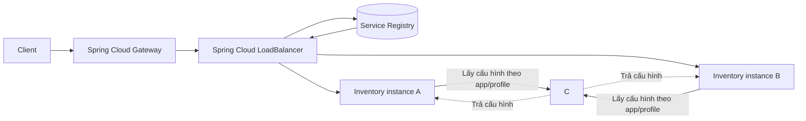
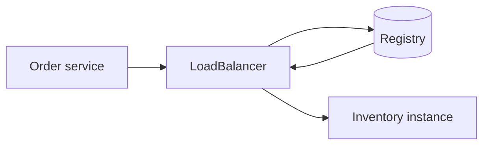

# Phân biệt khám phá dịch vụ, cân bằng tải, Gateway và cấu hình tập trung

Trong kiến trúc microservice, nhiều thành phần cùng tham gia để một request đến đúng dịch vụ và đúng instance. Service discovery tìm ra các instance đang đăng ký; load balancing chọn một instance trong số đó; API Gateway tiếp nhận và định tuyến request qua ranh giới hệ thống; Config Server cung cấp cấu hình dùng chung cho các ứng dụng. Chúng có thể tích hợp với nhau, nhưng giải quyết những câu hỏi khác nhau.

Bốn câu hỏi giúp phân biệt:

- **Service discovery:** Dịch vụ `inventory-service` hiện có những instance nào và địa chỉ của chúng là gì?
- **Load balancing:** Với một request cụ thể, nên gửi request tới instance nào trong danh sách đó?
- **API Gateway:** Request từ client bên ngoài được tiếp nhận, áp dụng chính sách chung và chuyển tới dịch vụ nào?
- **Centralized configuration:** Các dịch vụ lấy cấu hình theo ứng dụng, môi trường và phiên bản từ đâu?

Trong Spring Cloud, các abstraction thường gặp tương ứng là `DiscoveryClient` và `ServiceRegistry`, Spring Cloud LoadBalancer, Spring Cloud Gateway và Spring Cloud Config. Một hệ thống có thể dùng cả bốn; cũng có thể chỉ dùng một số thành phần tùy quy mô và cách triển khai.

## Bốn thành phần giải quyết bốn trách nhiệm

| Thành phần | Câu hỏi chính | Dữ liệu hoặc đầu vào | Kết quả |
|---|---|---|---|
| Service discovery | Instance của service ID đang ở đâu? | Service ID và registry records | Danh sách instance, host, port, metadata |
| Load balancing | Chọn instance nào cho request này? | Danh sách instance khả dụng và chính sách chọn | Một instance đích |
| API Gateway | Request đi vào hệ thống qua đâu và được định tuyến thế nào? | Request, route, predicate và filter | Request được chuyển tới upstream hoặc bị từ chối |
| Config Server | Ứng dụng cần cấu hình nào ở môi trường này? | Application name, profile, label/version | Bộ cấu hình cho client |

Điểm khác nhau nằm ở mục tiêu của dữ liệu. Registry giữ thông tin runtime về các instance đang hoạt động. Config Server giữ cấu hình ứng dụng như timeout, feature flag, URL bên ngoài hoặc tham số kết nối. Gateway giữ hoặc nhận route và chính sách xử lý request. LoadBalancer dùng danh sách instance để chọn đích.

## Service discovery: tìm instance theo tên dịch vụ

Provider đăng ký service ID cùng thông tin instance vào registry. Consumer tra cứu service ID để lấy danh sách instance có thể gọi. Trong Spring Cloud, `DiscoveryClient` cung cấp API tra cứu chung, còn `ServiceRegistry` là abstraction cho việc đăng ký và hủy đăng ký.

Ví dụ một dịch vụ tồn tại với hai instance:

```text
service ID: inventory-service

instance A: 10.0.1.12:8080
instance B: 10.0.1.13:8080
```

Consumer yêu cầu danh sách instance của `inventory-service`. Registry có thể là Eureka, Consul hoặc ZooKeeper; mỗi integration có cách lưu trữ và cập nhật trạng thái riêng. Consumer không cần gắn cứng địa chỉ IP trong cấu hình nếu discovery đã được tích hợp.

```java
import java.util.List;

import org.springframework.cloud.client.ServiceInstance;
import org.springframework.cloud.client.discovery.DiscoveryClient;
import org.springframework.stereotype.Service;

@Service
public class InventoryInstances {
    private final DiscoveryClient discoveryClient;

    public InventoryInstances(DiscoveryClient discoveryClient) {
        this.discoveryClient = discoveryClient;
    }

    public List<ServiceInstance> findAll() {
        return discoveryClient.getInstances("inventory-service");
    }
}
```

Kết quả có thể rỗng nếu provider chưa đăng ký, registry chưa sẵn sàng hoặc service ID không khớp. Discovery cũng không bảo đảm instance vẫn khỏe tại thời điểm request đến nơi. Consumer vẫn cần xử lý timeout và lỗi kết nối; health check, readiness và cơ chế cập nhật registry phải được cấu hình phù hợp.

## Load balancing: chọn một instance

Discovery trả lời “có những instance nào”; load balancing trả lời “request này sẽ tới instance nào”. Khi registry trả về ba instance, bộ cân bằng tải chọn một đích dựa trên chiến lược như round robin, random hoặc chính sách tùy chỉnh.

Trong Spring Cloud, Spring Cloud LoadBalancer là client-side load balancer. Nó lấy danh sách instance từ `ServiceInstanceListSupplier` (thường được tích hợp với discovery client), áp dụng chính sách chọn và trả về một `ServiceInstance` cho caller.

Ví dụ, nếu danh sách có ba instance và chính sách round robin, các request liên tiếp có thể được phân phối lần lượt A, B, C rồi quay lại A. Đây là mô tả khái niệm; hành vi thực tế còn phụ thuộc cấu hình supplier, cache, health check và phạm vi vòng đời của bộ chọn.

```java
import org.springframework.beans.factory.annotation.Qualifier;
import org.springframework.boot.web.client.RestTemplateBuilder;
import org.springframework.cloud.client.loadbalancer.LoadBalanced;
import org.springframework.context.annotation.Bean;
import org.springframework.context.annotation.Configuration;
import org.springframework.stereotype.Service;
import org.springframework.web.client.RestTemplate;

@Configuration
public class HttpClientConfiguration {
    @Bean
    @LoadBalanced
    RestTemplate inventoryRestTemplate(RestTemplateBuilder builder) {
        return builder.build();
    }
}
```

Caller có thể dùng service ID trong URL:

```java
@Service
public class InventoryClient {
    private final RestTemplate restTemplate;

    public InventoryClient(
            @Qualifier("inventoryRestTemplate") RestTemplate restTemplate) {
        this.restTemplate = restTemplate;
    }

    public InventoryItem getItem(long id) {
        return restTemplate.getForObject(
            "http://inventory-service/api/items/{id}",
            InventoryItem.class,
            id
        );
    }
}
```

Với bean có `@LoadBalanced`, host logic `inventory-service` được giải quyết thông qua discovery và LoadBalancer trước khi gửi request. Nếu dùng HTTP client không có tích hợp load balancing, URL service ID có thể không được DNS hoặc transport thông thường phân giải.

Load balancing không thay thế discovery: nếu không có danh sách instance thì bộ chọn không có đích để chọn. Ngược lại, chỉ có discovery cũng chưa quyết định cách phân phối request giữa nhiều instance.

## API Gateway: cổng vào và điểm áp dụng chính sách

API Gateway là điểm tiếp nhận request từ client bên ngoài hoặc từ các miền hệ thống khác. Gateway có thể định tuyến request tới microservice, xác thực, kiểm soát truy cập, giới hạn tốc độ, ghi log, thêm header, chuyển đổi request/response hoặc áp dụng circuit breaker tùy thiết kế.

Spring Cloud Gateway cung cấp mô hình route gồm:

- **Route:** mô tả đích upstream và các điều kiện áp dụng.
- **Predicate:** kiểm tra request như path, host, method hoặc header.
- **Filter:** xử lý request hoặc response trước/sau khi chuyển tiếp.

Ví dụ một route định tuyến các request `/api/inventory/**` tới `inventory-service`:

```yaml
spring:
  cloud:
    gateway:
      routes:
        - id: inventory-route
          uri: lb://inventory-service
          predicates:
            - Path=/api/inventory/**
          filters:
            - StripPrefix=2
```

`lb://inventory-service` cho Gateway biết cần dùng cơ chế load balancing để tìm instance theo service ID. Gateway phối hợp với discovery và LoadBalancer để chọn upstream cho request. Nếu dùng URI cố định như `http://10.0.1.12:8080`, route không tự động chuyển sang instance mới khi địa chỉ thay đổi.

Để dùng scheme `lb://`, Gateway cần có tích hợp Spring Cloud LoadBalancer và discovery client tương ứng trên classpath. Route chỉ định service ID; danh sách instance và thuật toán chọn được cung cấp bởi các thành phần tích hợp phía sau.

Có thể bật cơ chế tạo route từ registry để Gateway phát hiện service và tạo route theo quy tắc. Tuy nhiên, trong hệ thống có API contract rõ ràng, route tường minh thường giúp kiểm soát đường dẫn công khai và tránh vô tình phơi bày mọi service nội bộ. Tên thuộc tính và cách bật discovery locator tùy phiên bản Spring Cloud Gateway.

Gateway không phải registry. Gateway có thể hỏi registry để tìm upstream, nhưng nhiệm vụ chính của nó là quản lý luồng request đi qua cổng vào. Gateway cũng không nhất thiết phải nằm trên mọi lời gọi giữa các microservice; giao tiếp nội bộ có thể gọi trực tiếp qua discovery và load balancing nếu kiến trúc cho phép.

## Centralized configuration: quản lý cấu hình ứng dụng

Spring Cloud Config cung cấp máy chủ cấu hình tập trung. Config Server đọc cấu hình từ một backend được hỗ trợ, thường là Git repository, rồi trả cấu hình cho ứng dụng theo tên ứng dụng, profile và label. Ví dụ, `inventory-service` ở profile `production` nhận các giá trị cấu hình dành cho môi trường production.

Ví dụ phía Config Server:

```yaml
spring:
  cloud:
    config:
      server:
        git:
          uri: https://git.example.com/platform/app-config.git
```

Ví dụ phía Config Client:

```yaml
spring:
  application:
    name: inventory-service
  config:
    import: optional:configserver:http://config-server:8888
```

Config Server có thể cung cấp các giá trị như timeout HTTP, feature flag, logging level hoặc cấu hình tích hợp. Cần quản lý secret bằng cơ chế phù hợp, phân quyền repository và tránh ghi credential nhạy cảm vào file cấu hình thông thường.

Config Server không phải service registry. Nó trả về cấu hình; nó không phải nơi consumer tra cứu các instance runtime của `inventory-service`. Registry có thể thay đổi liên tục khi instance scale up/down, trong khi cấu hình thường được quản lý theo phiên bản và môi trường.

### Khi Config Server cũng được khám phá qua registry

Spring Cloud Config Client có thể được cấu hình theo kiểu discovery-first để tìm chính Config Server thông qua service registry. Trong trường hợp đó, discovery chỉ giúp định vị endpoint của Config Server; Config Server vẫn chịu trách nhiệm trả cấu hình. Đây là một ví dụ cho thấy các thành phần có thể phối hợp nhưng vai trò dữ liệu của chúng vẫn tách biệt.

## Cách các thành phần phối hợp trong một request

Xét trường hợp người dùng gọi API xem tồn kho. Gateway nhận request công khai, định tuyến tới service ID; LoadBalancer chọn instance; discovery cung cấp danh sách instance; ứng dụng phía sau có thể nhận cấu hình từ Config Server khi khởi động hoặc làm mới cấu hình theo cơ chế đã thiết lập.



Luồng request có thể diễn giải theo thứ tự:

1. Client gửi request tới domain của Gateway, ví dụ `https://api.example.com/api/inventory/42`.
2. Gateway khớp route theo path và các predicate khác, sau đó áp dụng filter như xác thực hoặc giới hạn tốc độ.
3. Route có URI `lb://inventory-service`, vì vậy Gateway yêu cầu cơ chế load balancing tìm instance.
4. Discovery client lấy danh sách instance theo service ID; LoadBalancer chọn một instance theo chính sách đã cấu hình.
5. Gateway chuyển request tới instance được chọn và trả response về client.
6. Instance xử lý nghiệp vụ với cấu hình đã được nạp từ Config Server hoặc nguồn cấu hình tương ứng.

Ở bước 4, discovery và load balancing cùng tham gia nhưng làm hai việc khác nhau. Config Server không tham gia chọn đích cho request. Nó cung cấp cấu hình cho ứng dụng theo vòng đời cấu hình, không phải danh sách địa chỉ runtime của từng instance.

## Gọi nội bộ giữa các microservice có cần Gateway không?

Không phải mọi lời gọi đều cần đi qua API Gateway. Ví dụ, `order-service` cần kiểm tra tồn kho có thể gọi trực tiếp `inventory-service` bằng service ID và một HTTP client có load balancing. Đường đi ngắn hơn và tránh thêm một hop mạng qua Gateway.



Gateway thường phù hợp cho traffic đi vào hệ thống từ bên ngoài hoặc giữa các miền cần một điểm kiểm soát chung. Lời gọi nội bộ có thể dùng Gateway khi cần áp dụng một chính sách tập trung hoặc ranh giới bảo mật cụ thể, nhưng cần cân nhắc độ trễ, khả năng sẵn sàng và việc tập trung lưu lượng vào một thành phần.

## So sánh qua các tình huống thực tế

| Tình huống | Thành phần xử lý chính | Vì sao |
|---|---|---|
| Một instance mới của `inventory-service` vừa khởi động | Service registration / discovery | Provider đăng ký instance để consumer có thể tìm thấy nó |
| Có năm instance và cần phân phối request | LoadBalancer | Chọn một instance từ danh sách đã khám phá |
| Client bên ngoài gọi `/api/orders/**` | API Gateway | Nhận request, áp dụng route/filter và chuyển tiếp |
| Cần đổi timeout của tất cả instance ở môi trường staging | Config Server hoặc hệ thống cấu hình | Phân phối cấu hình theo ứng dụng/profile |
| Gateway cần route tới `payment-service` đang scale động | Gateway + discovery + LoadBalancer | Gateway chọn route logic; discovery cung cấp instance; LoadBalancer chọn một đích |
| `order-service` gọi trực tiếp `inventory-service` | Discovery + LoadBalancer | Không cần thêm Gateway nếu không có yêu cầu chính sách ở cổng vào |
| Config Server chạy nhiều replica | Discovery + LoadBalancer (nếu cấu hình discovery-first hoặc định tuyến qua tên dịch vụ) | Tìm và chọn endpoint Config Server; nội dung cấu hình vẫn do Config Server trả về |

## Những nhầm lẫn thường gặp

### Nhầm discovery với load balancing

Tra cứu được ba instance không đồng nghĩa request đã được phân phối. Discovery trả danh sách; LoadBalancer chọn một phần tử. Nếu consumer tự chọn instance đầu tiên, đó là logic lựa chọn do consumer viết, chưa chắc đã là cân bằng tải phù hợp.

### Nhầm Gateway với service registry

Gateway có thể tích hợp discovery để định tuyến tới service ID, nhưng route và filter của Gateway không phải danh bạ runtime đầy đủ. Khi một instance chết, registry/health mechanism cập nhật danh sách; LoadBalancer sử dụng danh sách mới. Gateway tiếp tục nhận request và áp dụng route.

### Nhầm Config Server với registry

Config Server trả về các thuộc tính cấu hình theo application/profile/label. Registry lưu instance đăng ký theo service ID. Thay địa chỉ một instance đang chạy thường là thay đổi runtime registry; thay timeout hoặc feature flag thường là thay đổi cấu hình. Một số giá trị cấu hình có thể chứa URL cố định, nhưng điều đó không biến Config Server thành service discovery.

### Cho rằng mọi microservice phải đi qua Gateway

Gateway là một lựa chọn kiến trúc để quản lý traffic qua một ranh giới. Các service nội bộ có thể gọi nhau trực tiếp bằng discovery và load balancing. Quyết định phụ thuộc yêu cầu bảo mật, observability, latency, ownership và topology mạng.

### Cho rằng discovery đảm bảo instance khỏe

Registry có thể chứa dữ liệu trễ. Health check, readiness, session/lease, timeout và xử lý lỗi ở consumer quyết định cách hệ thống phản ứng khi instance ngừng hoạt động. Không có một kết quả discovery nào bảo đảm request tiếp theo chắc chắn thành công.

## Chọn kiến trúc theo nhu cầu

- **Ứng dụng nhỏ, ít dịch vụ:** có thể bắt đầu với discovery và load balancing cho các lời gọi cần định vị động; chưa nhất thiết phải thêm Gateway hoặc Config Server.
- **Có client bên ngoài và nhiều API:** thêm Gateway để quản lý route, xác thực, giới hạn tốc độ và các chính sách ở ranh giới hệ thống.
- **Nhiều môi trường và nhiều ứng dụng:** dùng centralized configuration để quản lý cấu hình nhất quán, có version và audit; quản lý secret riêng theo yêu cầu bảo mật.
- **Nhiều replica và scale thường xuyên:** cần registry cập nhật đúng vòng đời instance cùng load balancing; kiểm thử stale registry, health check và reconnect.
- **Gateway có nhiều replica:** triển khai Gateway theo mức sẵn sàng cần thiết và bảo đảm route tới upstream dùng discovery/load balancing nếu địa chỉ instance thay đổi.

Không nên thêm một thành phần chỉ vì kiến trúc microservice “thường có” nó. Mỗi thành phần kéo theo cấu hình, vận hành, giám sát và một điểm phụ thuộc mới. Chọn thành phần theo câu hỏi cần giải quyết, sau đó kiểm thử các tình huống lỗi giữa các thành phần.

## Checklist kiểm tra khi triển khai

1. Provider đăng ký đúng service ID và địa chỉ mà consumer có thể truy cập.
2. Consumer tra cứu được danh sách instance và xử lý trường hợp danh sách rỗng.
3. LoadBalancer được tích hợp với HTTP client hoặc Gateway và có chính sách chọn rõ ràng.
4. Gateway chỉ công bố các route cần thiết; filter xác thực, phân quyền và giới hạn tốc độ được cấu hình đúng.
5. Route dùng `lb://service-id` khi upstream cần được phân giải động qua registry.
6. Config Server phân phối đúng cấu hình theo application, profile và label; client xử lý được trường hợp Config Server tạm thời không khả dụng theo chính sách đã chọn.
7. Registry, Gateway, Config Server và ứng dụng đều có health/metrics/log phù hợp.
8. Kiểm thử scale up/down, instance chết đột ngột, registry mất kết nối, cấu hình thay đổi và Gateway restart.
9. Bảo vệ registry, Config Server và Gateway bằng phân đoạn mạng, xác thực, phân quyền và quản lý secret phù hợp.

## Kết luận

Service discovery tìm các instance theo service ID; load balancing chọn instance cho từng request; API Gateway quản lý request đi qua cổng vào; Config Server phân phối cấu hình ứng dụng theo môi trường và phiên bản. Trong Spring Cloud, các thành phần này có thể phối hợp: Gateway dùng discovery và LoadBalancer để chuyển request tới instance động, còn ứng dụng nhận cấu hình từ Config Server. Hiểu rõ trách nhiệm từng phần giúp thiết kế luồng request và vận hành microservice dễ kiểm soát hơn.
