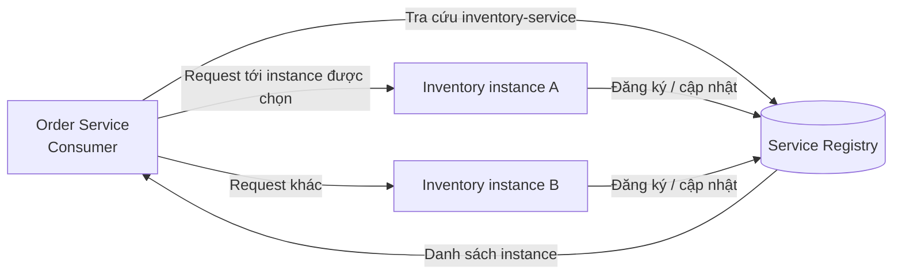
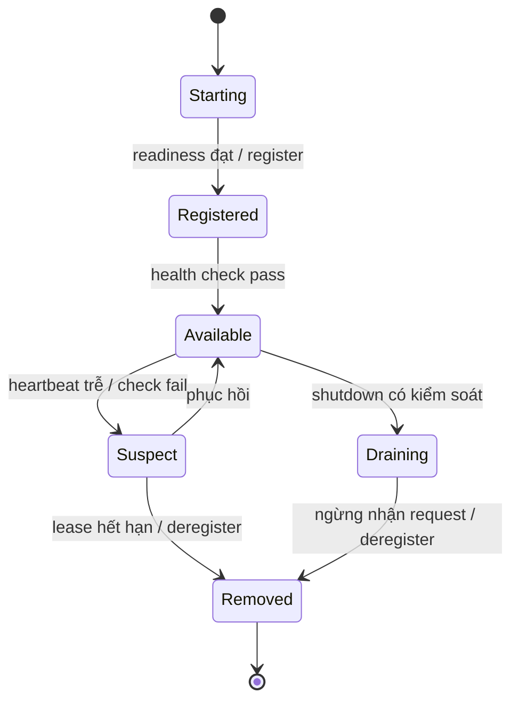

# Kiến thức nền và trình tự học trong module

Service discovery là một phần của kiến trúc microservice: dịch vụ cần tìm được các instance của dịch vụ khác khi địa chỉ mạng và số lượng instance thay đổi theo thời gian. Để học và triển khai đúng cơ chế này trong Spring Cloud, cần hiểu mô hình service/instance, vai trò của registry, vòng đời đăng ký, cách consumer tra cứu và cách chọn instance cho request.

Bài này giới thiệu nền tảng cần có và đề xuất thứ tự học trong module `SPRING_CLOUD_SERVICE_DISCOVERY`. Lộ trình đi từ bài toán và thuật ngữ, qua abstraction của Spring Cloud, các registry phổ biến, rồi đến load balancing, health check, bảo mật và vận hành.

## Mục tiêu học tập

Hoàn thành module, bạn cần có khả năng:

- Giải thích vì sao địa chỉ IP và port cố định gây khó khăn khi triển khai microservice có nhiều instance.
- Phân biệt service ID với instance ID, provider với consumer và registry với cấu hình ứng dụng.
- Dùng `DiscoveryClient` để tra cứu instance và hiểu `ServiceRegistry` quản lý đăng ký như thế nào.
- Cấu hình ít nhất một registry như Eureka, Consul hoặc ZooKeeper trong ứng dụng Spring Cloud.
- Phân biệt service discovery với load balancing, API Gateway và centralized configuration.
- Thiết kế readiness, health check, timeout, xử lý reconnect và stale registry.
- Bảo vệ registry và đánh giá các tình huống lỗi khi triển khai nhiều instance.

## Kiến thức tiên quyết

Bạn sẽ học thuận lợi hơn nếu đã nắm các kiến thức sau:

| Kiến thức | Cần hiểu trước | Dùng trong module để làm gì |
|---|---|---|
| Java và Spring Boot | Dependency injection, bean, configuration properties, application lifecycle | Tích hợp discovery client và cấu hình ứng dụng |
| HTTP và REST | URL, host, port, method, status code, timeout | Hiểu request giữa các service và lỗi kết nối |
| Mạng cơ bản | IP, DNS, TCP, port, hostname, subnet | Hiểu địa chỉ instance và khả năng truy cập giữa các container/host |
| Microservice | Provider, consumer, triển khai độc lập, replica | Xác định dịch vụ nào đăng ký và dịch vụ nào tra cứu |
| YAML và Maven/Gradle | Khai báo dependency, profile, cấu hình | Thêm starter và cấu hình registry đúng phiên bản |

Không cần phải là chuyên gia về hệ thống phân tán trước khi bắt đầu. Tuy nhiên, cần hiểu rằng mạng có thể gián đoạn, một instance có thể chết bất kỳ lúc nào và trạng thái registry có thể chậm hơn trạng thái thực tế.

## Bài toán cốt lõi: địa chỉ instance thay đổi

Giả sử `order-service` cần gọi `inventory-service`. Nếu chỉ có một instance trong môi trường phát triển, nhóm có thể cấu hình địa chỉ cố định:

```yaml
inventory:
  base-url: http://10.0.1.12:8080
```

Khi triển khai nhiều replica, địa chỉ đó không còn đại diện cho toàn bộ dịch vụ. Container có thể nhận IP mới sau khi khởi động lại; một replica có thể bị thay thế; hệ thống có thể tăng hoặc giảm số lượng instance theo tải. Nếu mỗi consumer tự giữ danh sách IP, cấu hình sẽ nhanh chóng lỗi thời.

Service discovery giải quyết việc tra cứu bằng tên logic. Consumer yêu cầu danh sách instance theo service ID, chẳng hạn `inventory-service`; registry trả thông tin instance đã đăng ký. Một bộ cân bằng tải có thể chọn một instance trong danh sách đó cho request.



Registry là danh bạ động. Nó giúp consumer biết những instance nào đã đăng ký, nhưng không bảo đảm request tiếp theo chắc chắn thành công. Instance có thể hỏng ngay sau khi được tra cứu; vì vậy discovery luôn cần đi cùng timeout, health/readiness và xử lý lỗi.

## Thuật ngữ cần nắm

| Thuật ngữ | Ý nghĩa | Ví dụ |
|---|---|---|
| Service | Một ứng dụng cung cấp chức năng trong hệ thống | `inventory-service` |
| Service ID | Tên logic dùng để tra cứu dịch vụ | `inventory-service` |
| Instance | Một bản chạy cụ thể của service | Container đang nghe port `8080` |
| Instance ID | Định danh riêng của một instance | `inventory-pod-a7f3` |
| Provider | Ứng dụng cung cấp chức năng và đăng ký instance | `inventory-service` |
| Consumer | Ứng dụng tra cứu và gọi provider | `order-service` |
| Registry | Nơi lưu thông tin đăng ký của các instance | Eureka, Consul, ZooKeeper |
| Discovery | Quá trình tra cứu instance theo service ID | `getInstances("inventory-service")` |
| Health check | Cơ chế đánh giá instance có đáp ứng điều kiện phục vụ hay không | HTTP health endpoint hoặc probe |
| Load balancing | Chọn instance cho một request | Round robin hoặc chính sách tùy chỉnh |

Service ID thường ổn định giữa các lần triển khai; instance ID phải phân biệt được những bản chạy đồng thời. Không dùng IP làm service ID vì IP là thuộc tính có thể thay đổi của instance.

## Vòng đời service discovery

Một instance thường đi qua các giai đoạn sau:

1. **Khởi động:** ứng dụng đọc cấu hình, khởi tạo web server và các phụ thuộc thiết yếu.
2. **Đăng ký:** provider gửi service ID, địa chỉ, port và metadata đến registry.
3. **Duy trì:** provider gia hạn lease hoặc heartbeat; registry có thể chạy health check để cập nhật trạng thái.
4. **Tra cứu:** consumer yêu cầu danh sách instance theo service ID và có thể lưu cache trong thời gian phù hợp.
5. **Chọn và gọi:** load balancer chọn một instance; HTTP client gửi request và xử lý timeout/lỗi.
6. **Rời hệ thống:** provider hủy đăng ký khi shutdown có kiểm soát; nếu tiến trình chết bất ngờ, registry phát hiện qua lease, heartbeat hoặc health check.



Các registry có cơ chế cụ thể khác nhau. Eureka sử dụng đăng ký và gia hạn lease; Consul có service registration cùng health check; ZooKeeper có thể biểu diễn instance bằng ephemeral znode gắn với session. Không nên đồng nhất heartbeat, lease, session và health check: mỗi cơ chế cung cấp một loại tín hiệu khác nhau.

## Các abstraction quan trọng trong Spring Cloud

Spring Cloud định nghĩa abstraction chung để consumer và provider làm việc với registry mà ít phụ thuộc vào API riêng của từng sản phẩm.

| Abstraction | Vai trò | Phía sử dụng |
|---|---|---|
| `DiscoveryClient` | Tra cứu service ID và lấy danh sách `ServiceInstance` | Consumer |
| `ServiceInstance` | Mô tả host, port, URI, service ID và metadata của một instance | Consumer / LoadBalancer |
| `ServiceRegistry` | Đăng ký, hủy đăng ký và cập nhật trạng thái đăng ký | Provider / integration |
| `Registration` | Mang thông tin instance cần đăng ký | Provider |
| Spring Cloud LoadBalancer | Chọn một instance từ danh sách phù hợp | Consumer / Gateway |

Ví dụ tra cứu bằng `DiscoveryClient`:

```java
import java.util.List;

import org.springframework.cloud.client.ServiceInstance;
import org.springframework.cloud.client.discovery.DiscoveryClient;
import org.springframework.stereotype.Service;

@Service
public class InventoryLookup {
    private final DiscoveryClient discoveryClient;

    public InventoryLookup(DiscoveryClient discoveryClient) {
        this.discoveryClient = discoveryClient;
    }

    public List<ServiceInstance> findInstances() {
        return discoveryClient.getInstances("inventory-service");
    }
}
```

Danh sách có thể rỗng. Consumer phải xác định hành vi khi service chưa đăng ký hoặc registry tạm thời không truy cập được. Không nên mặc định rằng luôn có ít nhất một instance.

## Những registry sẽ gặp trong module

### Eureka

Eureka thường được dùng trong hệ sinh thái Spring Cloud. Eureka Server lưu registry; Eureka Client đăng ký và gia hạn lease. Consumer lấy danh sách service/instance để thực hiện discovery. Khi học Eureka, hãy tập trung vào:

- Vai trò và cấu hình Eureka Server.
- Cấu hình Eureka Client và `spring.application.name`.
- Đăng ký, heartbeat, lease expiration và eviction.
- Peer replication khi triển khai nhiều server.
- Self-preservation, trạng thái registry và cách chẩn đoán instance cũ.

### Consul

Consul cung cấp service catalog cùng các cơ chế health check. Service có thể được đăng ký qua agent/API; health check có thể dựa trên HTTP, TCP hoặc TTL tùy cách triển khai. Khi học Consul, hãy tập trung vào:

- Agent, server, service registration và catalog.
- HTTP/TCP/TTL health check và ý nghĩa của trạng thái passing/warning/critical.
- Deregistration và chính sách loại bỏ service không khỏe.
- ACL, token, TLS và giới hạn quyền truy cập.

### ZooKeeper và Curator

ZooKeeper là hệ thống phối hợp phân tán dựa trên cây znode, session và watch. Curator là thư viện Java giúp ứng dụng làm việc với ZooKeeper và cung cấp các recipe như Service Discovery. Khi học phần này, hãy tập trung vào:

- Persistent và ephemeral znode; cấu trúc path và instance ID.
- Session, heartbeat, reconnect và session expiration.
- Watch, cache và đồng bộ lại sau khi kết nối phục hồi.
- Curator `ServiceDiscovery`, `ServiceInstance`, `ServiceProvider` và cách Spring Cloud Zookeeper tích hợp registry.

Không cần học sâu mọi chi tiết nội bộ của cả ba registry cùng lúc. Hãy nắm abstraction chung trước, sau đó thực hành từng integration để hiểu khác biệt về vòng đời, health check, bảo mật và vận hành.

## Phân biệt discovery với các thành phần liên quan

| Thành phần | Trách nhiệm | Câu hỏi nó trả lời |
|---|---|---|
| Service discovery | Tìm instance theo service ID | Dịch vụ hiện có những instance nào? |
| Load balancing | Chọn instance cho request | Request này nên tới instance nào? |
| API Gateway | Tiếp nhận và định tuyến traffic qua cổng vào | Request bên ngoài đi vào hệ thống qua đâu? |
| Config Server | Phân phối cấu hình ứng dụng theo profile/version | Ứng dụng cần cấu hình nào ở môi trường này? |

Gateway có thể dùng URI `lb://inventory-service` để kết hợp discovery và load balancing khi định tuyến. Các service nội bộ cũng có thể gọi nhau trực tiếp qua discovery và load balancing mà không cần mọi request đi qua Gateway. Config Server phân phối cấu hình; nó không thay thế registry runtime.

## Lộ trình học đề xuất

| Chặng | Nội dung cần học | Kết quả cần đạt |
|---|---|---|
| 1. Nền tảng | Service, instance, provider, consumer, registry và bài toán địa chỉ động | Vẽ được luồng đăng ký và tra cứu cơ bản |
| 2. Abstraction Spring Cloud | `DiscoveryClient`, `ServiceInstance`, `ServiceRegistry`, `Registration` | Viết được consumer tra cứu danh sách instance |
| 3. Môi trường thực hành | Tạo các service nhỏ, cấu hình tên ứng dụng và địa chỉ mạng | Chạy được provider và consumer ở môi trường local |
| 4. Registry | Eureka, Consul hoặc ZooKeeper/Curator | Đăng ký, tra cứu và hủy đăng ký instance |
| 5. Gọi dịch vụ | Spring Cloud LoadBalancer và HTTP client | Gọi theo service ID và quan sát cách chọn instance |
| 6. Vòng đời và sức khỏe | Heartbeat, lease/session, readiness, health check, shutdown | Xử lý được instance không khỏe hoặc rời hệ thống |
| 7. Độ tin cậy và bảo mật | Stale registry, retry, timeout, ACL, TLS, token, observability | Phân tích được lỗi và bảo vệ registry |
| 8. Tích hợp | Gateway, cấu hình tập trung và bài lab tổng hợp | Thiết kế được luồng request hoàn chỉnh |

### Chặng 1: hiểu bài toán trước khi chọn registry

Hãy bắt đầu bằng một provider có một instance, sau đó tăng lên hai hoặc ba instance. Thử thay đổi port hoặc khởi động lại container. Ghi lại điều consumer cần biết để gọi đúng provider. Từ đó xác định vì sao service ID ổn định và instance address động là cần thiết.

### Chặng 2: học abstraction trước implementation

Đọc và thực hành `DiscoveryClient` cùng `ServiceInstance`. Tập tra cứu một service ID, in host/port/metadata và xử lý danh sách rỗng. Sau đó tìm hiểu `ServiceRegistry` và `Registration` để hiểu cách provider công bố instance. Khi nắm abstraction, việc thay Eureka bằng Consul hoặc ZooKeeper dễ so sánh hơn.

### Chặng 3: tích hợp một registry hoàn chỉnh

Chọn một registry làm bài thực hành đầu tiên. Với Eureka, dựng server và đăng ký provider/client. Với Consul, tạo service registration và health check. Với ZooKeeper, quan sát znode và session hoặc dùng Spring Cloud Zookeeper. Kiểm tra cả trạng thái trên registry và kết quả tra cứu từ consumer.

### Chặng 4: kết hợp load balancing

Khi consumer đã tìm được nhiều instance, thêm Spring Cloud LoadBalancer. Gọi dịch vụ bằng service ID qua HTTP client có `@LoadBalanced` hoặc tích hợp tương ứng. Quan sát request được phân phối thế nào; sau đó tắt một instance và kiểm tra hành vi khi registry cập nhật.

### Chặng 5: kiểm thử vòng đời và lỗi

Thực hành shutdown có kiểm soát, kill tiến trình đột ngột, làm gián đoạn kết nối registry và khởi động lại provider. Theo dõi thời gian registry phát hiện instance mất, thời gian cache cập nhật và lỗi request trong khoảng chuyển tiếp. Đặt timeout và retry có giới hạn; tránh retry dồn dập khi dịch vụ đang phục hồi.

### Chặng 6: hoàn thiện vận hành

Thiết kế readiness để instance chỉ nhận tải khi đã sẵn sàng. Bật health check phù hợp với registry; cấu hình ACL/token/TLS; theo dõi số instance, lỗi đăng ký, session/lease hết hạn, độ trễ tra cứu và tỷ lệ lỗi request. Kiểm tra cách xử lý stale registry và quy trình phục hồi khi registry mất quorum hoặc không truy cập được.

## Bài thực hành tổng hợp

Xây dựng một hệ thống nhỏ gồm `order-service`, `inventory-service` và một registry. Có thể thêm Gateway nếu muốn kiểm tra luồng traffic bên ngoài.

Yêu cầu thực hành:

1. `inventory-service` đăng ký với service ID `inventory-service` và chạy ít nhất hai instance.
2. `order-service` dùng `DiscoveryClient` để tra cứu và ghi nhận danh sách instance.
3. Cấu hình HTTP client với Spring Cloud LoadBalancer để gọi `inventory-service` bằng service ID.
4. Tắt một instance và xác nhận registry cập nhật trạng thái; kiểm tra consumer không tiếp tục dùng địa chỉ đã lỗi sau khi cache được làm mới.
5. Khởi động lại instance với địa chỉ khác và xác nhận consumer có thể tìm thấy instance mới.
6. Kiểm tra trường hợp registry tạm thời không khả dụng; xác định hành vi cache, timeout và lỗi trả về.
7. Cấu hình readiness/health check, xác thực và phân quyền truy cập registry.
8. Nếu thêm Gateway, định tuyến một API công khai bằng `lb://inventory-service` và giới hạn route được phép truy cập.

Kết quả mong đợi là bạn có thể giải thích bằng log hoặc sơ đồ: instance nào đăng ký, consumer tra cứu ở đâu, LoadBalancer chọn đích nào và điều gì xảy ra khi một instance rời hệ thống.

## Cách kiểm tra bạn đã hiểu

Bạn đã nắm được nền tảng nếu có thể tự trả lời các câu hỏi sau:

- Service ID khác instance ID ở điểm nào?
- Tại sao một consumer không nên giữ danh sách IP cố định của mọi provider?
- `DiscoveryClient` và `ServiceRegistry` được dùng ở phía nào của vòng đời?
- Registry trả về nhiều instance thì thành phần nào chọn một instance cho request?
- Heartbeat/lease/session khác health check HTTP như thế nào?
- Vì sao instance vừa chết vẫn có thể xuất hiện trong kết quả discovery một thời gian?
- Khi session ZooKeeper hết hạn, ephemeral znode được xử lý ra sao?
- Vì sao Gateway có thể dùng discovery nhưng bản thân Gateway không phải registry?
- Config Server cung cấp loại dữ liệu nào và khác registry ở đâu?
- Những quyền nào cần được giới hạn khi bảo vệ registry?

## Lỗi thường gặp khi học và triển khai

| Biểu hiện | Nguyên nhân có thể | Hướng kiểm tra |
|---|---|---|
| Consumer không tìm thấy service | Service ID không khớp, provider chưa đăng ký hoặc registry không truy cập được | Kiểm tra tên ứng dụng, trạng thái đăng ký, log và kết nối registry |
| Instance đã dừng vẫn được gọi | Lease/session chưa hết hạn hoặc cache chưa cập nhật | Kiểm tra health check, thời gian eviction và cache refresh |
| Consumer gọi được từ máy local nhưng lỗi trong container | Host/IP quảng bá không thể truy cập từ mạng consumer | Kiểm tra DNS, port mapping, network và địa chỉ đăng ký |
| Nhiều replica ghi đè nhau | Dùng chung instance ID hoặc path | Tạo instance ID duy nhất cho từng replica |
| Retry làm hệ thống quá tải | Retry không giới hạn hoặc không có backoff | Đặt timeout, giới hạn retry, backoff và circuit breaker khi phù hợp |
| Registry bị truy cập trái phép | ACL/token/TLS hoặc network policy chưa đủ | Kiểm tra xác thực, phân quyền và phân đoạn mạng |

## Quản lý phiên bản và tài liệu tham khảo

Spring Boot và Spring Cloud phải dùng các phiên bản tương thích. Hãy quản lý Spring Cloud dependencies bằng BOM/release train phù hợp, không chọn phiên bản starter ngẫu nhiên hoặc trộn các dòng release. Khi ví dụ cấu hình hay API khác với dự án thực tế, hãy đối chiếu tài liệu của đúng phiên bản đang sử dụng.

Các nguồn tài liệu chính thức nên dùng trong quá trình học:

- [Spring Cloud](https://spring.io/projects/spring-cloud): tổng quan các dự án và release train.
- [Spring Cloud Commons](https://docs.spring.io/spring-cloud-commons/reference/): `DiscoveryClient`, `ServiceRegistry` và các abstraction chung.
- [Spring Cloud Netflix](https://docs.spring.io/spring-cloud-netflix/reference/): tích hợp Eureka.
- [Spring Cloud Consul](https://docs.spring.io/spring-cloud-consul/reference/): tích hợp Consul và service discovery.
- [Spring Cloud Zookeeper](https://docs.spring.io/spring-cloud-zookeeper/reference/): tích hợp ZooKeeper.
- [Spring Cloud LoadBalancer](https://docs.spring.io/spring-cloud-commons/reference/spring-cloud-loadbalancer.html): lựa chọn instance phía client.
- [Spring Cloud Gateway](https://docs.spring.io/spring-cloud-gateway/reference/): route, predicate và filter.
- [Spring Cloud Config](https://docs.spring.io/spring-cloud-config/reference/): cấu hình tập trung.

## Kết luận

Để học service discovery hiệu quả, hãy bắt đầu từ bài toán địa chỉ động và mô hình provider/consumer/registry. Tiếp theo, nắm abstraction `DiscoveryClient` và `ServiceRegistry`, tích hợp một registry, rồi kết hợp LoadBalancer để gọi theo service ID. Cuối cùng, mở rộng sang health check, readiness, bảo mật, xử lý stale registry và vận hành. Trình tự này giúp bạn hiểu cả cơ chế nền tảng lẫn cách các thành phần Spring Cloud phối hợp trong một hệ thống microservice thực tế.
