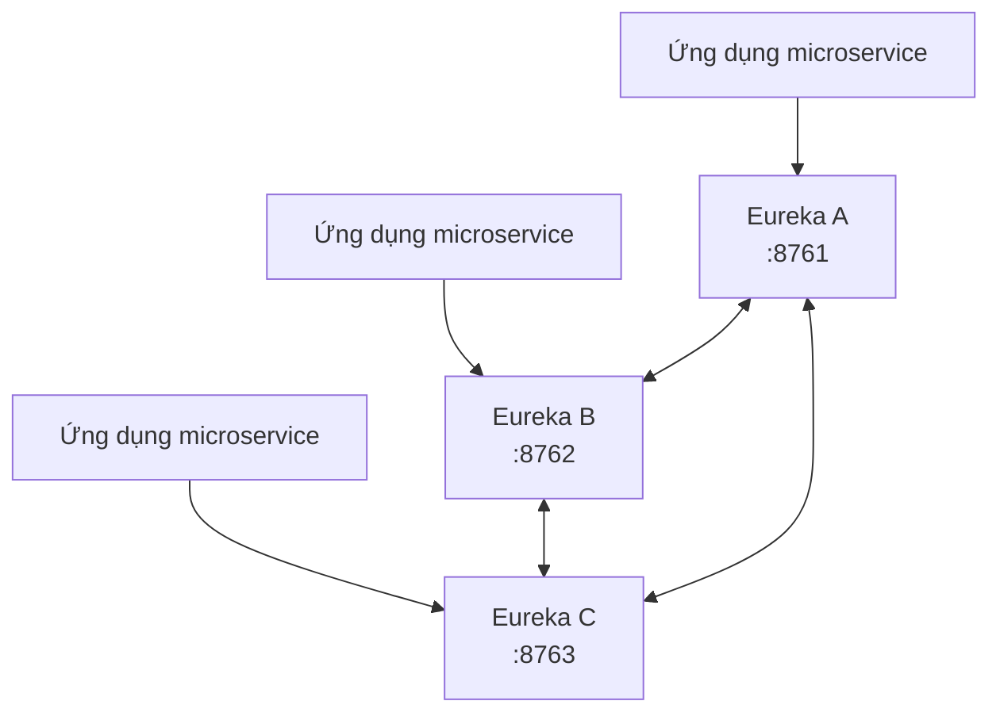
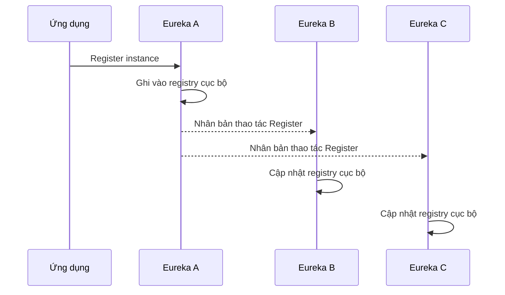
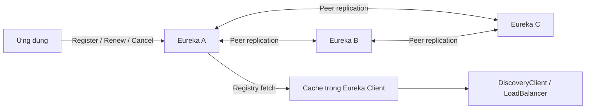

# Mô hình sao chép ngang hàng và quan hệ giữa các máy chủ

## 1. Vì sao Eureka cần một cụm máy chủ?

Trong hệ thống microservice, Eureka Server lưu thông tin về các instance đã đăng ký: tên ứng dụng, địa chỉ mạng, cổng, trạng thái và thời hạn thuê (lease). Một Eureka Server đơn lẻ có thể phục vụ việc đăng ký và tra cứu, nhưng nó trở thành điểm lỗi đơn. Nếu máy chủ đó ngừng hoạt động, các client không thể đăng ký hoặc lấy danh sách instance mới từ nó.

Ta có thể triển khai nhiều Eureka Server thành một cụm. Mỗi máy chủ duy trì registry cục bộ và trao đổi dữ liệu với các máy chủ ngang hàng. Nhờ vậy, client có thể kết nối đến một máy chủ còn hoạt động khác, trong khi thông tin đăng ký được lan truyền giữa các thành viên của cụm.

Trong mô hình này, mỗi Eureka Server vừa là:

- **Server đối với ứng dụng:** nhận đăng ký, gia hạn lease, hủy đăng ký và yêu cầu tra cứu.
- **Client đối với các Eureka Server ngang hàng:** kết nối đến những peer đã cấu hình để đồng bộ và nhân bản thay đổi registry.

Không có một Eureka Server trung tâm làm chủ toàn bộ registry. Các node có vai trò ngang hàng; mỗi node có thể tiếp nhận yêu cầu từ ứng dụng và chuyển tiếp thay đổi đến những peer khác.

## 2. Cấu trúc của cụm Eureka

Giả sử ta có ba node `eureka-a`, `eureka-b` và `eureka-c`. Mỗi node có endpoint riêng, đồng thời biết địa chỉ của hai node còn lại.



Các mũi tên giữa Eureka Server biểu diễn quan hệ peer và luồng trao đổi registry. Đây không phải là một chuỗi chuyển tiếp cố định. Một node có thể nhân bản thay đổi đến các peer mà nó biết; các peer tiếp nhận thay đổi và cập nhật registry cục bộ của mình.

### 2.1. Mỗi node có registry riêng

Registry không phải một cơ sở dữ liệu dùng chung mà mọi node cùng đọc và ghi. Mỗi Eureka Server giữ bản registry trong bộ nhớ của nó. Việc trao đổi giữa các peer giúp các bản registry tiến dần đến cùng một trạng thái.

Điều này có hai hệ quả:

1. Một client đăng ký thành công với node A có thể chưa nhìn thấy instance đó ngay lập tức khi tra cứu qua node B.
2. Khi một node tạm thời mất kết nối với peer, nó vẫn có thể phục vụ các yêu cầu mà nó xử lý được bằng registry cục bộ. Dữ liệu giữa các node có thể tạm thời khác nhau.

Vì thế, cụm Eureka cung cấp khả năng chịu lỗi và tính sẵn sàng cao ở mức dịch vụ đăng ký, đi kèm mô hình nhất quán cuối cùng (eventual consistency), thay vì bảo đảm mọi node nhìn thấy mọi thay đổi cùng một thời điểm.

### 2.2. Không có leader cố định

Trong cụm peer-to-peer, không có node leader duy nhất được bầu ra để ghi mọi thay đổi. Client có thể gửi yêu cầu đến một trong các Eureka Server được cấu hình. Node nhận yêu cầu xử lý tại registry cục bộ rồi nhân bản thay đổi đến các peer.

Do không có một máy chủ chủ đạo, việc một node dừng không đồng nghĩa toàn bộ cụm phải dừng. Các node còn lại tiếp tục nhận yêu cầu nếu client có thể kết nối đến chúng và các peer còn lại vẫn đáp ứng được nhu cầu vận hành.

## 3. Cách các peer nhân bản registry

Eureka nhân bản các thay đổi liên quan đến vòng đời instance giữa các máy chủ ngang hàng. Những thao tác thường gặp gồm:

| Thao tác | Ý nghĩa | Tác động trong cụm |
|---|---|---|
| Register | Instance đăng ký lần đầu | Peer nhận thông tin instance và thêm vào registry cục bộ |
| Renew | Instance gửi heartbeat để gia hạn lease | Peer cập nhật trạng thái lease tương ứng |
| Cancel | Instance hủy đăng ký khi dừng có trật tự | Peer loại bỏ thông tin instance |
| Status update | Instance thay đổi trạng thái như `UP` hoặc `DOWN` | Peer cập nhật trạng thái được nhân bản |

Luồng xử lý khái quát khi một ứng dụng đăng ký với node A:



Trình tự trên mô tả ý tưởng, không phải cam kết về thời gian hoàn tất. Việc nhân bản được xử lý qua các tác vụ giao tiếp giữa peer; do đó có thể tồn tại một khoảng trễ trước khi mọi node cập nhật xong.

### 3.1. Vì sao nhân bản không tạo vòng lặp vô hạn?

Một thay đổi được gửi từ A sang B là một thao tác nhân bản. Khi B tiếp nhận thao tác đó, B cập nhật registry của mình nhưng không xem nó như một yêu cầu đăng ký mới từ client để tiếp tục phát tán ngược lại cho tất cả peer. Eureka đánh dấu yêu cầu nhân bản để phân biệt thao tác đến từ peer với thao tác gốc. Cơ chế này ngăn một thay đổi chạy vòng quanh cụm vô hạn.

Ví dụ, khi A gửi thao tác đăng ký đến B và C:

- B áp dụng thay đổi vào registry của B.
- C áp dụng thay đổi vào registry của C.
- B và C không tiếp tục nhân bản chính thao tác đó trở lại A hoặc phát tán lặp lại như một yêu cầu gốc.

### 3.2. Nhân bản và đồng bộ registry lúc khởi động

Khi một Eureka Server khởi động, nó cần biết các peer có thể kết nối và lấy thông tin registry từ cụm. Cấu hình peer vì vậy có ý nghĩa cả trong quá trình hoạt động bình thường lẫn khi node mới tham gia hoặc khởi động lại.

Việc đồng bộ ban đầu không nên được hiểu là một giao dịch nguyên tử khiến mọi node có cùng dữ liệu ngay lập tức. Trong thời gian khởi động, mất kết nối hoặc có thay đổi đồng thời, registry giữa các node vẫn có thể khác nhau tạm thời. Hãy theo dõi log, trạng thái peer và số lượng instance trước khi xem node mới là đã đồng bộ ổn định.

## 4. Cấu hình cụm ba Eureka Server

Một Eureka Server được bật bằng starter Eureka Server và annotation `@EnableEurekaServer`. Phần cấu hình dưới đây minh họa ba node chạy ở ba cổng khác nhau. Trong môi trường triển khai phân tán, các hostname phải phân giải được từ tất cả node; không dùng `localhost` để trỏ đến một máy khác.

### 4.1. Node A

```yaml
server:
  port: 8761

spring:
  application:
    name: eureka-server

eureka:
  instance:
    hostname: eureka-a
  client:
    registerWithEureka: true
    fetchRegistry: true
    serviceUrl:
      defaultZone: http://eureka-b:8762/eureka/,http://eureka-c:8763/eureka/
```

### 4.2. Node B

```yaml
server:
  port: 8762

spring:
  application:
    name: eureka-server

eureka:
  instance:
    hostname: eureka-b
  client:
    registerWithEureka: true
    fetchRegistry: true
    serviceUrl:
      defaultZone: http://eureka-a:8761/eureka/,http://eureka-c:8763/eureka/
```

### 4.3. Node C

```yaml
server:
  port: 8763

spring:
  application:
    name: eureka-server

eureka:
  instance:
    hostname: eureka-c
  client:
    registerWithEureka: true
    fetchRegistry: true
    serviceUrl:
      defaultZone: http://eureka-a:8761/eureka/,http://eureka-b:8762/eureka/
```

Trong ví dụ này:

- `registerWithEureka: true` cho phép Eureka Server tự đăng ký với các peer đã khai báo.
- `fetchRegistry: true` cho phép node lấy registry từ các Eureka Server được cấu hình.
- `serviceUrl.defaultZone` liệt kê các peer mà node sẽ kết nối. Mỗi node trỏ đến các node còn lại, không trỏ đến chính nó.
- `hostname` phải là tên duy nhất và có thể phân giải trong mạng triển khai.
- Đường dẫn `/eureka/` là endpoint Eureka được client và peer sử dụng.

`defaultZone` là tên khóa trong map cấu hình zone của Eureka; cần giữ đúng cách viết `defaultZone` khi khai báo khóa này. Nếu dùng Docker Compose hoặc Kubernetes, hãy dùng DNS/service name phù hợp với mạng nội bộ của nền tảng.

### 4.4. Cấu hình standalone khác với cấu hình cluster

Khi chạy một node độc lập để phát triển hoặc thử nghiệm, có thể tắt việc tự đăng ký và lấy registry:

```yaml
eureka:
  client:
    registerWithEureka: false
    fetchRegistry: false
```

Đây là cấu hình phù hợp cho một Eureka Server không có peer. Nếu giữ hai thuộc tính này ở chế độ `false` trên tất cả node của một cụm, các máy chủ sẽ không thực hiện vai trò client cần thiết để kết nối và trao đổi registry với nhau. Với cụm nhiều node, hãy cấu hình danh sách peer có thể truy cập và bật các chức năng tương ứng.

## 5. Ứng dụng kết nối đến cụm như thế nào?

Các ứng dụng nghiệp vụ cũng cần biết danh sách Eureka Server để không phụ thuộc vào một node duy nhất. Ví dụ, một service có thể cấu hình:

```yaml
eureka:
  client:
    serviceUrl:
      defaultZone: http://eureka-a:8761/eureka/,http://eureka-b:8762/eureka/,http://eureka-c:8763/eureka/
```

Eureka Client sử dụng danh sách endpoint để giao tiếp với registry và có cơ chế thử endpoint khác khi một máy chủ không khả dụng. Cấu hình danh sách peer trên server và danh sách endpoint trên ứng dụng có hai mục đích liên quan nhưng khác nhau:

| Nơi cấu hình | Mục đích |
|---|---|
| Eureka Server | Kết nối các máy chủ ngang hàng để nhân bản và đồng bộ registry |
| Ứng dụng microservice | Kết nối đến registry để đăng ký, gia hạn lease và tra cứu instance |

Khi ứng dụng tra cứu dịch vụ, `DiscoveryClient` hoặc thành phần tích hợp Eureka lấy thông tin từ registry mà Eureka Client đang duy trì. Bộ cân bằng tải phía client có thể dùng danh sách instance này để chọn một instance đích. Vì registry được cache và cập nhật định kỳ, kết quả tra cứu không nhất thiết phản ánh tức thời mọi thay đổi vừa xảy ra ở một peer khác.

## 6. Nhất quán dữ liệu và các giới hạn cần hiểu

### 6.1. Nhất quán cuối cùng

Nhân bản peer-to-peer giúp các node tiến đến cùng một registry, nhưng không cung cấp bảo đảm nhất quán mạnh cho mọi thao tác. Một instance vừa đăng ký ở A có thể xuất hiện sau đó ở B và C. Khoảng trễ phụ thuộc vào trạng thái mạng, hàng đợi tác vụ nhân bản, khả năng phản hồi của peer và chu kỳ cập nhật cache ở client.

Vì vậy, không nên xây dựng logic nghiệp vụ yêu cầu một thay đổi đăng ký phải được mọi node nhìn thấy đồng thời. Nếu một luồng xử lý cần kiểm tra khả năng sẵn sàng của instance, hãy kết hợp timeout, retry có giới hạn và health check của chính dịch vụ.

### 6.2. Heartbeat và lease

Instance gửi heartbeat định kỳ để gia hạn lease với Eureka. Giá trị mặc định thường gặp của Eureka Client là gửi heartbeat mỗi 30 giây; thời hạn lease mặc định thường là 90 giây. Các giá trị này có thể được cấu hình và không nên xem là thời gian phát hiện lỗi chính xác trong mọi môi trường.

Khi instance dừng có trật tự, nó có thể gửi yêu cầu hủy đăng ký. Khi instance mất kết nối đột ngột, Eureka dựa vào lease hết hạn và cơ chế eviction để loại bỏ thông tin cũ. Thay đổi về lease và trạng thái cũng cần được lan truyền qua các peer.

### 6.3. Self-preservation

Eureka có cơ chế self-preservation để hạn chế xóa hàng loạt instance khi số heartbeat nhận được thấp bất thường. Cơ chế này hữu ích khi mạng bị gián đoạn hoặc nhiều client tạm thời không thể gửi heartbeat, vì việc xóa toàn bộ instance trong tình huống đó có thể làm registry mất dữ liệu đang còn giá trị.

Đổi lại, khi self-preservation được kích hoạt, một số instance đã thực sự ngừng hoạt động có thể còn xuất hiện trong registry lâu hơn dự kiến. Đây là lý do cần theo dõi heartbeat, tỷ lệ renewal, trạng thái peer và health check của ứng dụng thay vì chỉ dựa vào việc một instance còn xuất hiện trong Eureka.

## 7. Điều gì xảy ra khi một peer gặp sự cố?

### 7.1. Một Eureka Server dừng hoạt động

Giả sử node B dừng:

1. Ứng dụng có danh sách endpoint gồm A, B và C có thể thử kết nối đến A hoặc C khi B không phản hồi.
2. A và C tiếp tục phục vụ yêu cầu nếu chúng còn khỏe và có đủ thông tin registry.
3. Thay đổi phát sinh trong thời gian B ngừng hoạt động không thể được B tiếp nhận trực tiếp. Các ứng dụng phải gửi yêu cầu qua node còn hoạt động.
4. Khi B khởi động lại và kết nối được với peer, nó cần đồng bộ lại registry. Hãy xác minh quá trình này qua log và dữ liệu quan sát được.

Khả năng chịu lỗi chỉ có ý nghĩa nếu client thật sự biết nhiều endpoint và mạng cho phép chúng truy cập các node còn lại. Nếu tất cả ứng dụng chỉ trỏ đến một địa chỉ đang hỏng, cụm nhiều node vẫn không giúp các ứng dụng đó tự chuyển sang node khác.

### 7.2. Mất kết nối giữa các peer

Một node có thể vẫn truy cập được từ ứng dụng nhưng không thể liên lạc với một peer do lỗi DNS, firewall, route mạng, TLS hoặc tiến trình peer bị treo. Khi đó, node vẫn có registry cục bộ và có thể tiếp tục phục vụ yêu cầu, nhưng dữ liệu giữa các node có nguy cơ lệch nhau.

Khi kết nối được khôi phục, các peer có thể tiếp tục trao đổi thay đổi. Không nên giả định việc khôi phục mạng lập tức giải quyết mọi sai lệch. Cần kiểm tra các instance còn sót, lease, trạng thái và log lỗi nhân bản.

### 7.3. Network partition

Nếu cụm bị chia thành hai nhóm không thể liên lạc với nhau, mỗi nhóm có thể tiếp tục nhận một phần yêu cầu dựa trên các node còn truy cập được trong nhóm đó. Các nhóm có thể ghi nhận những thay đổi khác nhau trong thời gian phân vùng mạng. Khi kết nối phục hồi, registry cần thời gian để hội tụ; trong thời gian này, client ở hai phía có thể nhận kết quả tra cứu khác nhau.

Đây là hệ quả của mô hình phân tán và nhất quán cuối cùng. Eureka không phải hệ thống consensus bảo đảm một bản ghi duy nhất được commit đồng thời trên mọi node. Thiết kế ứng dụng cần chấp nhận khả năng thông tin discovery trễ và xử lý instance không còn khả dụng bằng timeout, retry và health check.

## 8. Quan sát và vận hành cụm

Khi triển khai cụm Eureka, nên kiểm tra các nhóm tín hiệu sau:

| Nhóm theo dõi | Dấu hiệu cần quan sát | Ý nghĩa |
|---|---|---|
| Kết nối peer | Lỗi kết nối, timeout, HTTP error khi gọi peer | Có thể cấu hình sai địa chỉ hoặc có sự cố mạng/TLS |
| Heartbeat | Tỷ lệ renewal giảm, lease hết hạn bất thường | Client có thể mất kết nối hoặc bị quá tải |
| Registry | Số lượng application/instance chênh lệch giữa các node | Có thể tồn tại độ trễ hoặc lỗi nhân bản |
| Self-preservation | Cảnh báo chế độ bảo toàn được kích hoạt | Eureka đang hạn chế eviction do thiếu heartbeat |
| Client | Lỗi đăng ký, tra cứu hoặc chuyển endpoint | Ứng dụng có thể chỉ tiếp cận được một phần cụm |

Một số nguyên tắc vận hành hữu ích:

- Đặt các node ở những miền lỗi phù hợp và tránh để toàn bộ node phụ thuộc vào một máy hoặc một tuyến mạng duy nhất.
- Cấp hostname ổn định, phân giải được giữa các node; kiểm tra cổng và đường dẫn Eureka từ chính môi trường chạy ứng dụng.
- Cấu hình danh sách endpoint cho cả peer và ứng dụng client. Kiểm thử việc chuyển sang node khác khi một endpoint dừng.
- Bảo vệ endpoint registry bằng TLS, giới hạn truy cập ở mạng nội bộ và áp dụng cơ chế xác thực phù hợp với hạ tầng.
- Theo dõi tỷ lệ heartbeat, cảnh báo self-preservation, log replication và chênh lệch registry giữa các node.
- Thử nghiệm có kiểm soát các tình huống dừng một node, mất kết nối peer và phục hồi sau network partition.

Không nên xem trang dashboard của một node là bằng chứng duy nhất cho sức khỏe của toàn cụm. Dashboard thể hiện registry mà node đó đang giữ; hãy đối chiếu nhiều node và các tín hiệu kết nối để phát hiện sai lệch.

## 9. Phân biệt ba luồng dữ liệu thường bị nhầm lẫn

Trong một hệ thống dùng Eureka, có ba luồng liên quan nhưng không đồng nhất:

1. **Ứng dụng đến Eureka:** ứng dụng đăng ký instance, gửi heartbeat, hủy đăng ký và tra cứu dịch vụ.
2. **Eureka đến Eureka:** các peer nhân bản thay đổi và đồng bộ registry giữa các máy chủ.
3. **Eureka Client đến registry cache:** client lấy/cập nhật bản registry cục bộ để `DiscoveryClient` và bộ cân bằng tải phía client sử dụng.



Luồng thứ nhất thay đổi registry thông qua một server; luồng thứ hai phân phối thay đổi giữa các server; luồng thứ ba giúp client có dữ liệu để tra cứu và chọn instance. Khi debug, hãy xác định luồng nào đang lỗi: đăng ký không tới server, server không nhân bản được cho peer, hay client chưa cập nhật cache.

## 10. Tổng kết

Cụm Eureka sử dụng mô hình peer-to-peer: mỗi Eureka Server giữ registry cục bộ, phục vụ client và trao đổi thay đổi với các peer đã cấu hình. Không có leader cố định; các thao tác đăng ký, gia hạn, hủy đăng ký và cập nhật trạng thái được nhân bản để các node tiến đến cùng một trạng thái.

Mô hình này tăng khả năng sẵn sàng khi một node gặp sự cố, nhưng đi kèm độ trễ nhân bản và khả năng registry tạm thời khác nhau giữa các node. Để cụm hoạt động tin cậy, cần cấu hình peer hai chiều có thể truy cập, cung cấp nhiều endpoint cho client, theo dõi heartbeat và replication, đồng thời kiểm thử tình huống mất node hoặc phân vùng mạng.
