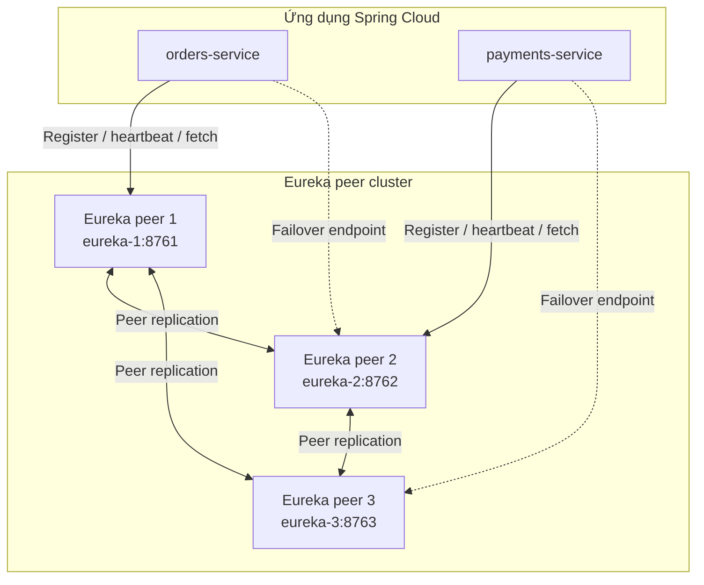

# Cấu hình nhiều Eureka peer bằng các profile riêng

Một Eureka Server có thể hoạt động độc lập, nhưng trong môi trường cần khả năng chịu lỗi, ta thường triển khai nhiều Eureka Server cùng tham gia một cụm peer. Mỗi server giữ registry cục bộ và trao đổi thay đổi registry với các peer còn lại. Ứng dụng Spring Cloud có thể đăng ký với một peer đang sẵn sàng, sau đó tiếp tục tra cứu registry qua các peer khác khi có sự cố.

Khi dùng một ứng dụng Eureka Server cho nhiều máy hoặc nhiều tiến trình, mỗi instance cần một cấu hình riêng: hostname có thể truy cập từ các peer, cổng lắng nghe, và danh sách URL của các peer còn lại. Spring profile là cách gọn để đóng gói các giá trị đó thành `peer1`, `peer2`, `peer3`, rồi chọn cấu hình lúc khởi chạy mà không phải sửa source code.

## 1. Eureka peer cluster hoạt động như thế nào?

Trong một cụm Eureka peer, mỗi Eureka Server đồng thời đảm nhiệm hai vai trò:

- **Eureka Server:** nhận đăng ký, heartbeat, hủy đăng ký và yêu cầu lấy registry từ các Eureka client.
- **Eureka Client của chính server:** đăng ký với các peer khác và trao đổi thông tin registry với chúng.

Các server là peer ngang hàng. Không có một server master cố định điều phối mọi thao tác. Khi một ứng dụng đăng ký với một peer, peer đó ghi nhận instance và chuyển tiếp thay đổi đến các peer được cấu hình. Các peer tiếp tục phục vụ truy vấn từ registry mà chúng đang giữ.

Điều này tạo ra khả năng chịu lỗi tốt hơn một server đơn lẻ: nếu một peer dừng, ứng dụng còn có thể kết nối các peer khác. Tuy vậy, Eureka không dùng Raft hoặc cơ chế quorum để tạo một registry nhất quán mạnh trên toàn cụm. Việc đồng bộ giữa peer có tính chất eventual consistency; trong thời gian mạng gián đoạn, các peer có thể tạm thời có dữ liệu khác nhau. Sau khi kết nối được khôi phục, chúng tiếp tục trao đổi để hội tụ.

### Sơ đồ một cụm ba peer



Các mũi tên giữa ứng dụng và peer biểu diễn những endpoint mà client có thể sử dụng. Các mũi tên giữa peer biểu diễn việc trao đổi registry. Trong thực tế, Eureka client quyết định endpoint khả dụng theo cấu hình và trạng thái kết nối; ứng dụng không cần tự viết logic gọi lần lượt từng server.

## 2. Vì sao nên dùng profile riêng cho từng peer?

Ba tiến trình Eureka Server có thể dùng chung một artifact, cùng `spring.application.name`, cùng dependency và cùng phần cấu hình chung. Chúng chỉ khác những thông tin gắn với vị trí triển khai:

| Thuộc tính | Peer 1 | Peer 2 | Peer 3 |
| --- | --- | --- | --- |
| Profile | `peer1` | `peer2` | `peer3` |
| Hostname | `eureka-1` | `eureka-2` | `eureka-3` |
| Cổng ví dụ | `8761` | `8762` | `8763` |
| Peer URL được khai báo | Peer 2, 3 | Peer 1, 3 | Peer 1, 2 |

Tách cấu hình theo profile đem lại một số lợi ích:

- Một mã nguồn và một file JAR có thể chạy trên nhiều node.
- Mỗi node có hostname, cổng và peer URL đúng với môi trường của nó.
- Có thể chọn peer khi khởi chạy bằng `SPRING_PROFILES_ACTIVE` hoặc `--spring.profiles.active`.
- Dễ kiểm tra cấu hình của từng node và dễ thay đổi địa chỉ khi topology thay đổi.

Profile không tự tạo ra cluster. Nó chỉ chọn tập thuộc tính được nạp khi ứng dụng khởi động. Cụm chỉ hoạt động khi hostname, port, firewall, DNS và các URL peer thực sự kết nối được với nhau.

## 3. Chuẩn bị cấu trúc project

Ví dụ dùng một project Spring Boot có dependency Spring Cloud Netflix Eureka Server. Phiên bản Spring Boot và Spring Cloud phải nằm trong một cặp tương thích theo release train của dự án. Bài này tập trung vào cấu hình runtime; không cố định phiên bản dependency để tránh trộn các release train khác nhau.

Đánh dấu ứng dụng là Eureka Server:

```java
package com.example.discovery;

import org.springframework.boot.SpringApplication;
import org.springframework.boot.autoconfigure.SpringBootApplication;
import org.springframework.cloud.netflix.eureka.server.EnableEurekaServer;

@SpringBootApplication
@EnableEurekaServer
public class EurekaServerApplication {

    public static void main(String[] args) {
        SpringApplication.run(EurekaServerApplication.class, args);
    }
}
```

Dependency cần có là starter `spring-cloud-starter-netflix-eureka-server` trong module Eureka Server. Cần import Spring Cloud BOM tương thích với phiên bản Spring Boot đang dùng để quản lý version của starter.

Một cấu trúc cấu hình thường dùng:

```text
src/main/resources/
├── application.yml
├── application-peer1.yml
├── application-peer2.yml
└── application-peer3.yml
```

`application.yml` chứa thuộc tính dùng chung. Mỗi file `application-{profile}.yml` chỉ chứa những giá trị riêng của peer tương ứng.

## 4. Khai báo cấu hình chung

Trong `application.yml`, khai báo tên ứng dụng và bật chế độ Eureka client cho chính Eureka Server:

```yaml
spring:
  application:
    name: eureka-server

eureka:
  client:
    register-with-eureka: true
    fetch-registry: true
  server:
    enable-self-preservation: true
```

Hai thuộc tính `register-with-eureka` và `fetch-registry` rất quan trọng trong cấu hình peer:

- `register-with-eureka: true` cho phép server đăng ký thông tin của chính nó với các peer được khai báo.
- `fetch-registry: true` cho phép server lấy registry từ các peer.

Trong một số ví dụ Eureka Server độc lập, hai thuộc tính này được đặt thành `false` để server không đăng ký với chính nó. Cấu hình đó không phù hợp khi muốn các server tham gia trao đổi registry theo mô hình peer.

`enable-self-preservation` được giữ bật để tránh xóa hàng loạt instance khi server nhận heartbeat ít hơn dự kiến do sự cố mạng tạm thời. Không nên tắt cơ chế này chỉ để làm biến mất cảnh báo trong dashboard; hãy điều tra heartbeat, lease và chất lượng mạng trước.

## 5. Tạo profile riêng cho từng peer

Trong ví dụ chạy ba tiến trình trên một máy phát triển, mỗi peer dùng một cổng khác nhau. Khi triển khai trên ba máy riêng, có thể dùng cùng cổng `8761` trên từng máy và thay hostname bằng DNS hoặc địa chỉ mạng ổn định.

### `application-peer1.yml`

```yaml
server:
  port: 8761

eureka:
  instance:
    hostname: eureka-1
    prefer-ip-address: false
  client:
    service-url:
      defaultZone: "http://eureka-2:8762/eureka/,http://eureka-3:8763/eureka/"
```

Peer 1 lắng nghe tại cổng `8761` và biết peer 2, peer 3. Nó không cần đưa chính URL của mình vào danh sách peer đích.

### `application-peer2.yml`

```yaml
server:
  port: 8762

eureka:
  instance:
    hostname: eureka-2
    prefer-ip-address: false
  client:
    service-url:
      defaultZone: "http://eureka-1:8761/eureka/,http://eureka-3:8763/eureka/"
```

Peer 2 lắng nghe tại cổng `8762`, kết nối đến peer 1 và peer 3.

### `application-peer3.yml`

```yaml
server:
  port: 8763

eureka:
  instance:
    hostname: eureka-3
    prefer-ip-address: false
  client:
    service-url:
      defaultZone: "http://eureka-1:8761/eureka/,http://eureka-2:8762/eureka/"
```

Peer 3 lắng nghe tại cổng `8763`, kết nối đến peer 1 và peer 2.

Lưu ý về tên thuộc tính: `defaultZone` là khóa trong map `serviceUrl` của Eureka client. Hãy giữ cách viết camel case `defaultZone`, kể cả khi các thuộc tính bao quanh được viết theo dạng kebab case. Viết `default-zone` có thể khiến Eureka không đọc được URL theo cách mong muốn.

## 6. Khởi chạy từng peer bằng profile

Sau khi build project thành một file JAR, khởi chạy ba tiến trình với profile tương ứng. Trên Linux hoặc macOS, có thể mở ba terminal:

```bash
java -jar eureka-server.jar --spring.profiles.active=peer1
java -jar eureka-server.jar --spring.profiles.active=peer2
java -jar eureka-server.jar --spring.profiles.active=peer3
```

Trên PowerShell, có thể đặt profile trong biến môi trường trước khi chạy tiến trình:

```powershell
$env:SPRING_PROFILES_ACTIVE = "peer1"
java -jar .\eureka-server.jar
```

Mở terminal khác và đặt `peer2`, sau đó làm tương tự với `peer3`. Mỗi tiến trình phải có cổng riêng nếu chạy chung một máy. Nếu ba tiến trình cùng bind cổng `8761`, chỉ tiến trình đầu tiên có thể chiếm cổng và các tiến trình sau sẽ lỗi khởi động.

Khi triển khai trên các máy riêng, có thể giữ cùng cổng `8761` vì mỗi máy có địa chỉ IP riêng. Ví dụ khi đó:

| Profile | Hostname | Port |
| --- | --- | --- |
| `peer1` | `eureka-1.internal.example` | `8761` |
| `peer2` | `eureka-2.internal.example` | `8761` |
| `peer3` | `eureka-3.internal.example` | `8761` |

Hãy cập nhật các URL trong từng profile theo hostname và cổng thực tế. Các hostname phải phân giải được từ tất cả peer và từ những ứng dụng cần truy cập Eureka.

## 7. Cấu hình ứng dụng đăng ký với toàn bộ peer

Các Eureka client như `orders-service` hoặc `payments-service` cũng cần biết nhiều endpoint. Cấu hình client nên liệt kê toàn bộ peer để client có thể tiếp tục đăng ký và lấy registry khi một server tạm thời không truy cập được.

Ví dụ `application.yml` của `orders-service`:

```yaml
spring:
  application:
    name: orders-service

eureka:
  client:
    register-with-eureka: true
    fetch-registry: true
    service-url:
      defaultZone: "http://eureka-1:8761/eureka/,http://eureka-2:8762/eureka/,http://eureka-3:8763/eureka/"
```

Với client này:

- `register-with-eureka` bật đăng ký instance và gửi heartbeat.
- `fetch-registry` cho phép tải danh sách service instance để discovery.
- `defaultZone` chứa các endpoint peer có thể sử dụng.

Trong production, nếu Eureka dùng HTTPS hoặc có xác thực, client phải dùng URL và thông tin xác thực theo cấu hình bảo mật của hệ thống. Không nhúng mật khẩu hoặc token thật vào file cấu hình được commit lên repository.

## 8. Kiểm tra peer replication

Sau khi các peer khởi động, hãy xác minh cả kết nối mạng lẫn dữ liệu registry. Dashboard mở tại root URL của từng peer, ví dụ `http://localhost:8761/`, `http://localhost:8762/` và `http://localhost:8763/` trong mô hình chạy trên máy cá nhân.

Có thể kiểm tra registry qua Eureka REST API:

```bash
# Xem registry trên peer 1
curl -H "Accept: application/json" http://localhost:8761/eureka/apps

# Xem registry trên peer 2
curl -H "Accept: application/json" http://localhost:8762/eureka/apps

# Xem registry trên peer 3
curl -H "Accept: application/json" http://localhost:8763/eureka/apps
```

Quy trình kiểm chứng thực tế:

1. Khởi động cả ba peer và chờ chúng hoàn tất khởi tạo.
2. Khởi động `orders-service` với danh sách URL gồm cả ba peer.
3. Mở dashboard hoặc gọi REST API ở từng peer để kiểm tra instance `ORDERS-SERVICE`.
4. Chờ một khoảng thời gian đồng bộ, sau đó đối chiếu trạng thái instance trên các peer.
5. Dừng một peer và xác nhận client vẫn truy cập được các peer còn lại.
6. Khởi động lại peer đã dừng và kiểm tra registry hội tụ sau khi các kết nối được khôi phục.

Việc so sánh registry cần tính đến độ trễ đồng bộ, heartbeat và trạng thái health. Không nên kết luận replication hỏng chỉ vì hai dashboard khác nhau trong một khoảng thời gian rất ngắn sau khi đăng ký hoặc khởi động lại node.

## 9. Cách Eureka xử lý peer mất kết nối

Một peer có thể tạm thời không truy cập được vì tiến trình dừng, DNS lỗi, firewall chặn cổng hoặc mạng giữa các node bị gián đoạn. Khi đó:

- Các peer còn lại tiếp tục phục vụ nếu ứng dụng còn kết nối được đến chúng.
- Eureka client thử các endpoint đã cấu hình theo cơ chế retry và trạng thái kết nối của client.
- Registry trên các peer có thể khác nhau trong thời gian mất liên lạc.
- Khi đường truyền phục hồi, các peer tiếp tục trao đổi dữ liệu để registry hội tụ.

Eureka không có quorum để chọn một leader duy nhất. Vì vậy, không nên áp dụng tư duy vận hành của một hệ thống consensus như Raft cho Eureka peer. Mỗi server có thể tiếp nhận đăng ký trong phạm vi nó phục vụ; điều quan trọng là client biết nhiều peer và các peer có thể giao tiếp hai chiều theo cấu hình.

### Self-preservation và lease

Eureka client định kỳ gửi heartbeat để gia hạn lease. Nếu server không nhận được heartbeat trong thời gian quy định, instance có thể bị đánh dấu hoặc loại khỏi registry theo chính sách lease và eviction. Khi có sự cố mạng diện rộng, số heartbeat nhận được giảm mạnh dù nhiều ứng dụng vẫn đang chạy. Self-preservation giúp hạn chế việc xóa hàng loạt instance trong tình huống này.

Trong ví dụ mặc định, client gửi heartbeat theo chu kỳ khoảng 30 giây và lease hết hạn sau khoảng 90 giây nếu không được gia hạn. Giá trị thực tế có thể được tùy chỉnh qua `eureka.instance.lease-renewal-interval-in-seconds` và `eureka.instance.lease-expiration-duration-in-seconds`. Chỉ thay đổi các giá trị này khi đã hiểu ảnh hưởng đến phát hiện instance chết và khả năng chịu lỗi mạng.

## 10. Lỗi cấu hình thường gặp

| Triệu chứng | Nguyên nhân có thể | Cách kiểm tra và khắc phục |
| --- | --- | --- |
| Peer chỉ hiển thị chính nó hoặc không thấy peer khác | `register-with-eureka` hoặc `fetch-registry` đang `false`; URL peer sai | Kiểm tra cấu hình chung, profile đang active và log Eureka client |
| Peer không kết nối được hostname | DNS chưa có record, hostname chỉ tồn tại trên một máy hoặc container | Kiểm tra phân giải DNS từ chính node chạy Eureka |
| Peer gọi nhầm `localhost` | Dùng `localhost` trong cấu hình nhiều máy hoặc nhiều container | Dùng DNS/service name có thể truy cập qua mạng giữa các node |
| Hai tiến trình không thể khởi động trên cùng máy | Trùng `server.port` | Gán cổng khác nhau cho từng profile khi chạy local |
| Không có instance trong registry | Ứng dụng chưa đăng ký, sai `defaultZone` hoặc client không truy cập được Eureka | Kiểm tra log client, URL, REST API và trạng thái network |
| Registry giữa các peer khác nhau | Replication đang trễ hoặc kết nối giữa peer bị gián đoạn | Kiểm tra log peer, DNS, firewall và đối chiếu sau khi kết nối phục hồi |
| Instance biến mất khi mạng chập chờn | Lease hết hạn hoặc self-preservation không được cấu hình phù hợp | Kiểm tra heartbeat, lease và trạng thái self-preservation trước khi thay đổi ngưỡng |
| Cấu hình URL không được áp dụng | Sai cấu trúc YAML hoặc viết `default-zone` | Giữ khóa map `defaultZone`, kiểm tra profile được kích hoạt và cấu hình hiệu lực |

Khi debug, cần xác nhận profile thực sự được nạp. Có thể xem log khởi động để biết active profile, port server và danh sách URL peer. Không nên sửa đồng thời cả hostname, port, profile và firewall trong một lần vì sẽ khó xác định nguyên nhân gốc.

## 11. Lưu ý bảo mật và triển khai production

Eureka Server thường chạy trong mạng nội bộ. Dashboard và REST API không nên được mở công khai trên Internet. Với môi trường thật, cần:

- Giới hạn truy cập peer-to-peer bằng firewall hoặc security group; chỉ mở cổng cần thiết giữa các node.
- Dùng HTTPS/TLS cho kết nối phù hợp với yêu cầu bảo mật và quản lý chứng chỉ có vòng đời rõ ràng.
- Bảo vệ REST API bằng xác thực và phân quyền nếu registry không được phép truy cập tự do.
- Quản lý secret bằng secret store hoặc biến môi trường của nền tảng; không commit credential vào profile YAML.
- Dùng DNS nội bộ ổn định hoặc địa chỉ service discovery của hạ tầng để định danh peer.
- Giám sát trạng thái peer, số lượng instance, heartbeat, lease expiration, lỗi kết nối và độ trễ replication.
- Kiểm thử tình huống dừng một peer, khôi phục peer và mất kết nối giữa các vùng mạng trước khi đưa vào production.

Profile chỉ chứa cấu hình định danh và kết nối của peer. Các secret, chứng chỉ và thông tin môi trường nhạy cảm nên được cấp qua cơ chế quản lý cấu hình an toàn của nền tảng.

## 12. Checklist trước khi đưa cụm Eureka vào sử dụng

- [ ] Tất cả peer dùng cùng ứng dụng Eureka Server và phiên bản dependency tương thích.
- [ ] Mỗi peer có profile riêng với hostname và cổng đúng.
- [ ] `register-with-eureka` và `fetch-registry` được bật trên peer cluster.
- [ ] Mỗi peer khai báo URL của các peer còn lại bằng `defaultZone`.
- [ ] DNS và firewall cho phép các peer giao tiếp hai chiều.
- [ ] Ứng dụng downstream khai báo nhiều Eureka URL để có khả năng chuyển sang peer khác.
- [ ] Đã kiểm tra registry được đồng bộ sau khi đăng ký service.
- [ ] Đã thử dừng một peer và khôi phục peer đó.
- [ ] Self-preservation, heartbeat và lease được hiểu và giám sát.
- [ ] Dashboard, REST API, credential và kết nối mạng được bảo vệ.

Khi dùng profile riêng, một artifact Eureka Server có thể triển khai thành nhiều peer với cấu hình rõ ràng cho từng node. Điều kiện để cụm hoạt động ổn định là mỗi peer định danh đúng chính nó, biết các peer còn lại, và các Eureka client cũng có danh sách endpoint dự phòng. Việc kiểm tra replication và thử nghiệm sự cố cần được thực hiện trước khi coi cụm là sẵn sàng cho production.
