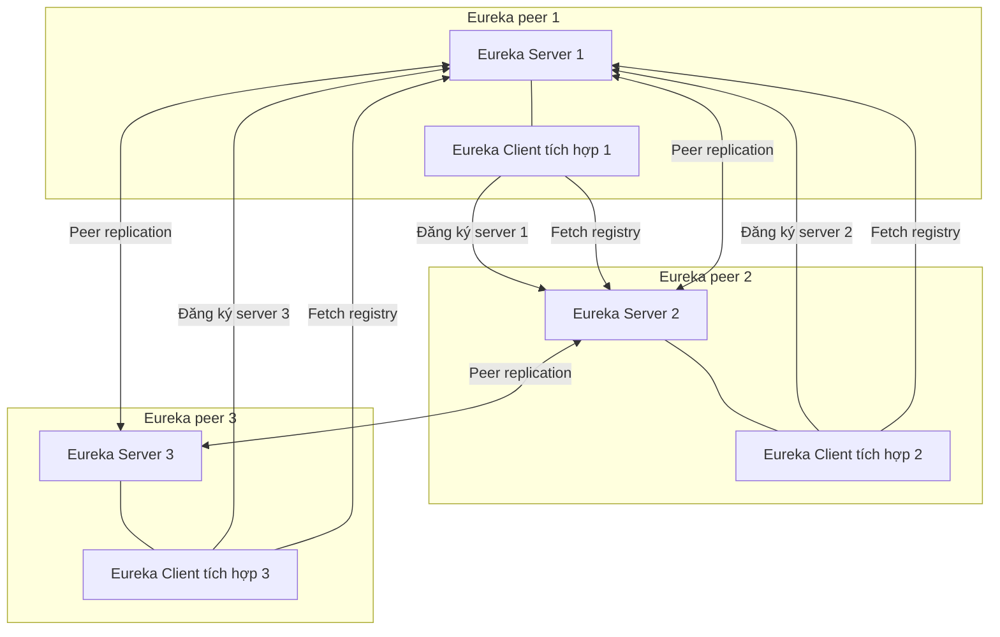
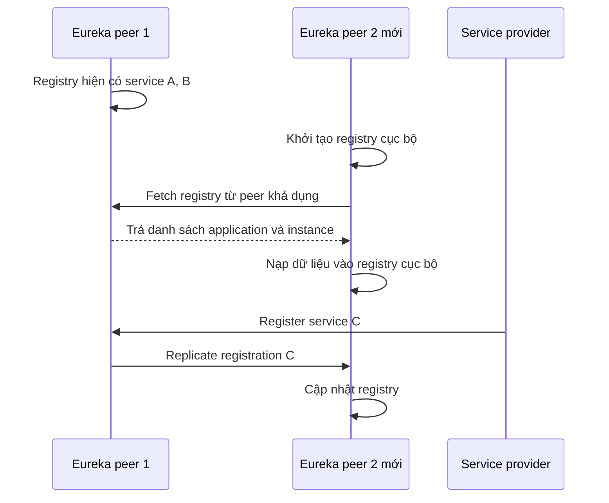

# Đăng ký chéo giữa peer và đồng bộ dữ liệu ban đầu

Trong một cụm Eureka peer, mỗi Eureka Server vừa tiếp nhận đăng ký từ ứng dụng, vừa hoạt động như một Eureka Client để kết nối với các server ngang hàng. Các peer cần biết địa chỉ của nhau để trao đổi registry. Khi một peer mới khởi động, nó cần lấy dữ liệu hiện có từ các peer đang hoạt động; sau đó các thay đổi đăng ký, heartbeat và hủy đăng ký tiếp tục được sao chép giữa các peer.

Hai hoạt động thường được gọi chung là peer synchronization nhưng có vai trò khác nhau: **đăng ký chéo** giúp các server biết và kết nối với nhau; **đồng bộ registry ban đầu** giúp một server mới có dữ liệu service đã tồn tại. Sau giai đoạn khởi tạo, peer replication duy trì các thay đổi mới. Hiểu rõ ba luồng này giúp tránh tình trạng mỗi server hiển thị một danh sách service khác nhau.

## 1. Ba luồng cần phân biệt

Một Eureka Server trong peer cluster đồng thời có ba trách nhiệm:

1. **Phục vụ Eureka Client:** nhận đăng ký, heartbeat, hủy đăng ký và yêu cầu đọc registry từ các ứng dụng.
2. **Đăng ký chính nó với peer:** Eureka Client tích hợp trong tiến trình server đăng ký instance của server vào các peer đã cấu hình.
3. **Đồng bộ registry với peer:** server lấy dữ liệu ban đầu từ peer và sao chép các thay đổi registry phát sinh trong quá trình vận hành.

Sơ đồ dưới đây thể hiện vai trò kép của mỗi node:



Đường đăng ký chéo không phải là toàn bộ cơ chế replication. Việc một server đăng ký instance của chính nó với peer giúp node xuất hiện trong registry của peer. Còn replication là cơ chế server-to-server chuyển tiếp những thay đổi của các service instance khác trong registry.

## 2. Cấu hình peer list và Eureka Client tích hợp

Mỗi Eureka Server cần biết các peer còn lại trong cùng cụm. Danh sách này thường được cấu hình qua `eureka.client.service-url.defaultZone`. Mỗi node khai báo URL của những node khác, không khai báo URL của chính nó trong danh sách peer.

Các thuộc tính quan trọng:

| Thuộc tính | Vai trò trong peer cluster |
| --- | --- |
| `@EnableEurekaServer` | Bật chức năng Eureka Server để tiếp nhận client registration và phục vụ registry API |
| `register-with-eureka: true` | Cho Eureka Client tích hợp đăng ký instance của server với peer |
| `fetch-registry: true` | Cho Eureka Client tải registry từ peer |
| `service-url.defaultZone` | Khai báo endpoint của các peer khác |
| `spring.application.name` | Tên application của các Eureka Server; thường giống nhau giữa các peer |
| `eureka.instance.hostname` | Hostname mà peer quảng bá cho các node khác |
| `eureka.instance.instance-id` | Định danh riêng cho từng tiến trình server |

Trong cấu hình standalone, Eureka Client tích hợp thường tắt đăng ký và fetch. Khi chuyển sang peer cluster, cấu hình hai cờ này phải phản ánh vai trò peer. Nếu để `register-with-eureka=false`, node không tự đăng ký với các peer; nếu để `fetch-registry=false`, Eureka Client tích hợp không tải registry về cache cục bộ. Cần phân biệt thao tác fetch của Eureka Client với bước server-side registry synchronization khi một Eureka Server khởi động; đây là hai luồng liên quan nhưng không phải cùng một thao tác.

## 3. Cấu hình cụm hai peer

Với hai peer, mỗi server khai báo URL của server còn lại. Ví dụ cả hai chạy cổng `8761` trên hai máy có DNS nội bộ:

### Peer 1: `eureka-1`

```yaml
spring:
  application:
    name: eureka-server

server:
  port: 8761

eureka:
  instance:
    hostname: eureka-1.internal
    prefer-ip-address: false
    instance-id: eureka-1.internal:${server.port}
  client:
    register-with-eureka: true
    fetch-registry: true
    service-url:
      defaultZone: http://eureka-2.internal:8761/eureka/
```

### Peer 2: `eureka-2`

```yaml
spring:
  application:
    name: eureka-server

server:
  port: 8761

eureka:
  instance:
    hostname: eureka-2.internal
    prefer-ip-address: false
    instance-id: eureka-2.internal:${server.port}
  client:
    register-with-eureka: true
    fetch-registry: true
    service-url:
      defaultZone: http://eureka-1.internal:8761/eureka/
```

Hai tiến trình có cùng `spring.application.name` vì chúng là các instance của application Eureka Server, nhưng có hostname và instance ID riêng. Hostname phải phân giải được từ peer còn lại. Nếu dùng IP thay hostname, có thể bật `prefer-ip-address` và bảo đảm địa chỉ được quảng bá là địa chỉ có thể định tuyến.

Trong môi trường local, nếu chạy hai peer trên cùng máy, hãy dùng hai cổng khác nhau và cập nhật các URL tương ứng, ví dụ `localhost:8761` và `localhost:8762`. Không dùng `localhost` cho hai máy riêng vì mỗi máy sẽ tự trỏ về chính nó.

## 4. Cấu hình cụm ba peer

Với ba peer, mỗi node khai báo hai node còn lại. Cấu hình peer list phải đối xứng: mọi node đều có thể kết nối đến những peer được liệt kê.

| Node | Hostname | Peer URL được khai báo |
| --- | --- | --- |
| Peer 1 | `eureka-1.internal` | `eureka-2.internal`, `eureka-3.internal` |
| Peer 2 | `eureka-2.internal` | `eureka-1.internal`, `eureka-3.internal` |
| Peer 3 | `eureka-3.internal` | `eureka-1.internal`, `eureka-2.internal` |

Ví dụ cấu hình của peer 1:

```yaml
spring:
  application:
    name: eureka-server

server:
  port: 8761

eureka:
  instance:
    hostname: eureka-1.internal
    instance-id: eureka-1.internal:${server.port}
  client:
    register-with-eureka: true
    fetch-registry: true
    service-url:
      defaultZone: "http://eureka-2.internal:8761/eureka/,http://eureka-3.internal:8761/eureka/"
```

Peer 2 và peer 3 dùng cùng cấu trúc, thay hostname và danh sách URL theo bảng. Trong YAML, `defaultZone` là tên khóa map theo quy ước của Eureka client; cần giữ cách viết camel case. Nếu dùng nhiều URL, có thể đặt chúng trong một chuỗi phân tách bằng dấu phẩy.

Không nên cấu hình danh sách peer chỉ chứa chính node hiện tại. Cấu hình như vậy không tạo được đường kết nối đến các peer khác và dễ khiến server hoạt động như một node độc lập.

## 5. Đăng ký chéo diễn ra như thế nào?

Giả sử peer 1 và peer 2 đã khởi động và biết URL của nhau:

1. Eureka Client tích hợp trong peer 1 đọc danh sách URL peer 2 từ `defaultZone`.
2. Peer 1 gửi đăng ký instance `eureka-server` đến peer 2 và duy trì heartbeat theo cơ chế Eureka Client.
3. Peer 2 cũng thực hiện thao tác tương tự với peer 1.
4. Mỗi peer có thể nhìn thấy instance của peer còn lại trong registry của mình.
5. Khi ứng dụng nghiệp vụ đăng ký với một peer, server nhận yêu cầu và chuyển tiếp thay đổi registry đến các peer đã cấu hình.

Việc đăng ký chéo cho phép các server nhận diện nhau qua registry và thiết lập quan hệ peer. Tuy nhiên, việc nhìn thấy instance `eureka-server` trong dashboard chưa chứng minh rằng toàn bộ service registry đã đồng bộ. Cần kiểm tra cả danh sách service nghiệp vụ và các luồng replication.

## 6. Đồng bộ registry ban đầu khi peer khởi động

Một peer mới có thể bắt đầu với registry cục bộ rỗng. Nếu các peer đang hoạt động đã có nhiều service instance, node mới cần lấy trạng thái hiện có để có thể phục vụ truy vấn ngay sau khi khởi tạo.

Về mặt khái niệm, quá trình bootstrap diễn ra như sau:

1. Eureka Server khởi tạo registry cục bộ và xây dựng danh sách peer từ cấu hình.
2. Cơ chế đồng bộ ban đầu liên hệ các peer khả dụng để lấy danh sách application và instance đã đăng ký.
3. Các bản ghi lấy được được nạp vào registry cục bộ của node mới.
4. Eureka Client tích hợp thực hiện fetch registry theo chu kỳ để duy trì cache client cục bộ; đây là luồng riêng với bước server-side bootstrap ở trên.
5. Các thao tác đăng ký, gia hạn lease, hủy đăng ký và cập nhật trạng thái mới tiếp tục được peer replication giữa các server.

Đồng bộ ban đầu là bước bootstrap để node mới có dữ liệu nền. Nó không phải một giao dịch consensus bảo đảm mọi peer có cùng một snapshot tại cùng một thời điểm. Kết quả phụ thuộc peer nào đang sẵn sàng và dữ liệu nào có thể đọc được trong thời gian khởi động.

Nếu tất cả peer cùng khởi động khi registry đều rỗng, các node có thể chưa có service nghiệp vụ để đồng bộ. Khi provider bắt đầu đăng ký, các thay đổi mới sẽ được truyền qua peer replication. Nếu một peer mới tham gia sau khi cụm đã có dữ liệu, nó cần truy cập được peer đang giữ registry để lấy dữ liệu ban đầu.

### Sơ đồ trình tự bootstrap



Trình tự minh họa hai giai đoạn: lấy dữ liệu đã tồn tại khi peer mới khởi động, rồi nhận các thay đổi phát sinh sau đó. Trong triển khai thực tế, các thao tác có thể chạy đồng thời và retry theo cơ chế của phiên bản Eureka.

## 7. Peer replication sau khi bootstrap

Sau khi các peer hoạt động, Eureka cần truyền những thay đổi registry đến các node còn lại. Những loại thao tác thường được replication gồm:

| Thao tác | Ví dụ | Mục đích |
| --- | --- | --- |
| Register | Provider mới đăng ký `inventory-service` | Thêm instance vào registry của peer |
| Renew/heartbeat | Provider gửi heartbeat | Gia hạn lease và cập nhật trạng thái tồn tại |
| Cancel/deregister | Provider dừng đúng quy trình | Xóa instance khỏi registry |
| Status update | Instance chuyển trạng thái | Đồng bộ trạng thái instance |
| Metadata/status override update | Thông tin instance thay đổi | Cập nhật thông tin mà consumer có thể tra cứu |

Server nhận một yêu cầu từ client sẽ xử lý ở registry cục bộ rồi gửi bản sao yêu cầu đến peer theo cơ chế replication. Yêu cầu được đánh dấu là replication để phân biệt với yêu cầu gốc, tránh việc peer tiếp tục chuyển tiếp vòng lặp không cần thiết.

Replication không đồng nghĩa với một lệnh ghi đồng bộ chờ tất cả peer xác nhận trước khi trả kết quả cho client. Vì thế, một peer có thể thấy instance mới trước peer khác trong một khoảng thời gian ngắn. Đây là hành vi eventual consistency thường gặp trong Eureka peer topology.

## 8. Thứ tự khởi động và tình huống peer tham gia muộn

Không bắt buộc phải khởi động mọi peer theo một thứ tự cố định, nhưng cần bảo đảm peer list và mạng sẵn sàng. Một trình tự dễ quan sát trong môi trường lab là:

1. Khởi động peer 1 và xác nhận server endpoint hoạt động.
2. Khởi động peer 2; kiểm tra peer 2 kết nối được peer 1 và nhận dữ liệu hiện có.
3. Khởi động peer 3; kiểm tra peer 3 kết nối được peer 1 và peer 2.
4. Khởi động provider nghiệp vụ và xác nhận instance xuất hiện trên các peer.
5. Khởi động consumer và xác nhận nó có thể tra cứu từ các endpoint Eureka đã cấu hình.

Trong production, orchestrator có thể khởi động các node đồng thời. Eureka Client và server có cơ chế retry, nhưng readiness của ứng dụng không nên chỉ dựa vào việc process đã mở cổng. Health check của deployment nên kiểm tra server endpoint và khả năng hoạt động phù hợp với yêu cầu hệ thống.

Khi một peer bị tắt trong thời gian dài rồi khởi động lại, cần kiểm tra nó có thể truy cập ít nhất một peer khỏe mạnh để bootstrap lại registry. Không nên giả định việc mở lại TCP port là đủ để chứng minh dữ liệu cũ đã được đồng bộ. Hãy so sánh registry và quan sát log fetch/replication sau khi node gia nhập.

## 9. Cấu hình Eureka Client nghiệp vụ

Các provider và consumer nghiệp vụ cũng nên biết nhiều Eureka URL để có thể tiếp tục kết nối khi một peer gặp sự cố. Ví dụ:

```yaml
eureka:
  client:
    register-with-eureka: true
    fetch-registry: true
    service-url:
      defaultZone: "http://eureka-1.internal:8761/eureka/,http://eureka-2.internal:8761/eureka/,http://eureka-3.internal:8761/eureka/"
```

Đối với một consumer-only, có thể đặt `register-with-eureka: false` nhưng vẫn để `fetch-registry: true`. Đối với provider-only, có thể đăng ký nhưng không fetch nếu ứng dụng không cần discovery outbound. Các cờ này mô tả vai trò của Eureka Client trong ứng dụng; peer server trong cụm thường cần cả hai vai trò.

Không nên để toàn bộ client chỉ trỏ đến một peer duy nhất nếu mục tiêu là tiếp tục discovery khi peer đó dừng. Danh sách endpoint cần chứa các peer có thể truy cập và có cấu hình nhất quán với topology.

## 10. Kiểm tra đăng ký chéo và dữ liệu đã đồng bộ

Kiểm tra từng peer trực tiếp để phân biệt lỗi client, lỗi peer list và lỗi replication.

### Kiểm tra Eureka dashboard

Mở dashboard trên từng node, ví dụ:

- `http://eureka-1.internal:8761/`
- `http://eureka-2.internal:8761/`
- `http://eureka-3.internal:8761/`

Kiểm tra các điểm:

- Peer có nhìn thấy instance của các Eureka Server còn lại hay không.
- Các service nghiệp vụ có xuất hiện trên tất cả peer sau thời gian đồng bộ hay không.
- Instance ID, hostname/IP và port có nhất quán hay không.
- Trạng thái instance có phù hợp với health/lease hiện tại hay không.

### Kiểm tra registry bằng REST API

```bash
# Lấy toàn bộ registry từ peer 1
curl -H "Accept: application/json" \
  http://eureka-1.internal:8761/eureka/apps

# Lấy toàn bộ registry từ peer 2
curl -H "Accept: application/json" \
  http://eureka-2.internal:8761/eureka/apps

# Lấy riêng application INVENTORY-SERVICE từ peer 3
curl -H "Accept: application/json" \
  http://eureka-3.internal:8761/eureka/apps/INVENTORY-SERVICE
```

Nếu server bật xác thực hoặc TLS, hãy thêm thông tin xác thực và cấu hình certificate theo môi trường. Không tắt bảo mật chỉ để chạy lệnh kiểm tra.

Đối chiếu dữ liệu sau khi một provider đăng ký mới, gửi heartbeat và deregister. Cần cho phép thời gian replication và cache cập nhật trước khi kết luận hai peer bị lệch.

## 11. Chẩn đoán peer không đồng bộ

| Triệu chứng | Nguyên nhân có thể | Hướng kiểm tra |
| --- | --- | --- |
| Peer 1 thấy peer 2 nhưng peer 2 không thấy peer 1 | Cấu hình peer URL không đối xứng, DNS hoặc firewall một chiều | Kiểm tra `defaultZone` trên cả hai node và gọi URL từ từng node |
| Server xuất hiện trong registry nhưng service nghiệp vụ không đồng bộ | Chỉ có self-registration, replication hoặc bootstrap chưa hoạt động | Kiểm tra registry API trên từng peer và log server replication |
| Peer mới khởi động có registry rỗng | Không kết nối được peer nguồn trong giai đoạn bootstrap hoặc peer nguồn cũng rỗng | Kiểm tra DNS, port, peer availability và log sync ban đầu |
| Peer mới chỉ có một phần instance | Một số peer không truy cập được, dữ liệu nguồn thay đổi trong lúc sync hoặc đồng bộ chưa hoàn tất | Kiểm tra từng peer nguồn và so sánh lại sau thời gian hội tụ |
| Instance mới xuất hiện chậm | Client refresh, server replication hoặc cache đang cập nhật | Kiểm tra thời gian fetch/replication và trạng thái endpoint |
| Instance đã dừng vẫn còn xuất hiện | Heartbeat/lease, deregistration hoặc cache chưa hết hạn | Kiểm tra log cancel, eviction và chu kỳ cập nhật registry |
| Peer liên tục báo lỗi kết nối | Sai hostname, port, TLS, authentication hoặc service URL | Kiểm tra kết nối từ chính host/container chạy peer |
| Có hai instance server trùng hoặc tên không rõ ràng | `instance-id` không duy nhất hoặc hostname dùng chung | Gán hostname và instance ID riêng cho từng server |

Khi chẩn đoán, kiểm tra theo thứ tự: peer URL, phân giải DNS, kết nối TCP/HTTP, xác thực/TLS, self-registration, fetch ban đầu, replication và cuối cùng là cache ở client nghiệp vụ. Cách làm này giúp xác định sự cố nằm ở cấu hình peer, mạng hay dữ liệu registry.

## 12. Các lưu ý về consistency và thiết kế cụm

Eureka peer replication có tính eventual consistency. Cụm không dùng Raft quorum để commit một thay đổi trên tất cả server trước khi phản hồi client. Vì vậy:

- Không xem một dashboard là nguồn sự thật tức thời cho toàn cụm.
- Không giả định mọi peer có dữ liệu giống nhau ngay sau một lần đăng ký.
- Không dùng số peer như một quorum voting system.
- Cần kiểm tra nhiều peer khi điều tra instance thiếu hoặc trạng thái khác nhau.
- Consumer cần chịu được danh sách instance cũ, timeout và lỗi kết nối đến instance vừa mất.

Triển khai nhiều peer giúp tăng khả năng tiếp tục phục vụ khi một node gặp sự cố, nhưng không tự động bảo đảm mọi request thành công hoặc registry nhất quán mạnh. Cần phân bố peer qua các máy/failure domain độc lập, bảo vệ dữ liệu và mạng, giám sát replication, đồng thời kiểm thử kịch bản peer dừng và gia nhập lại.

## 13. Bảo mật và vận hành

Peer communication cần được bảo vệ như mọi kết nối nội bộ khác:

- Chỉ mở cổng Eureka giữa các peer và từ các ứng dụng được phép truy cập.
- Dùng TLS và cơ chế xác thực phù hợp khi môi trường yêu cầu.
- Không công khai dashboard hoặc REST API registry ra Internet.
- Dùng hostname nội bộ ổn định; tránh địa chỉ `localhost` trong cấu hình giữa nhiều máy.
- Gán `instance-id` duy nhất cho mỗi peer và giữ tên application nhất quán.
- Giám sát lỗi register, renew, fetch và replication; cảnh báo khi peer không nhận được registry.
- Kiểm tra dữ liệu trên từng peer trong quy trình triển khai và sau sự cố mạng.
- Lập kế hoạch sao lưu/cấu hình phục hồi và thử nghiệm peer rejoin định kỳ.

Không nên mở rộng số lượng peer tùy tiện. Mỗi peer bổ sung thêm các kết nối và lưu lượng replication; hãy chọn số node phù hợp với yêu cầu sẵn sàng và năng lực vận hành của hệ thống.

## 14. Checklist triển khai peer synchronization

- [ ] Mỗi node đều bật `@EnableEurekaServer`.
- [ ] Mỗi peer bật `register-with-eureka: true` và `fetch-registry: true`.
- [ ] `defaultZone` của mỗi peer liệt kê các peer còn lại, không trỏ về chính nó.
- [ ] Mỗi node có hostname và `instance-id` riêng, có thể phân giải và truy cập từ các peer.
- [ ] Firewall, TLS và authentication cho phép giao tiếp peer-to-peer.
- [ ] Peer mới khởi động có thể lấy registry ban đầu từ peer đang hoạt động.
- [ ] Đăng ký, heartbeat, deregistration và status update được kiểm tra trên nhiều peer.
- [ ] Đã kiểm thử peer khởi động muộn và peer gia nhập lại sau thời gian offline.
- [ ] Ứng dụng nghiệp vụ khai báo nhiều Eureka URL để có khả năng failover.
- [ ] Monitoring phát hiện được peer không đồng bộ hoặc lỗi replication kéo dài.

Đăng ký chéo giúp các Eureka Server biết và kết nối với peer của chúng; đồng bộ ban đầu giúp node mới có bản sao registry nền; peer replication duy trì các thay đổi phát sinh sau đó. Ba hoạt động này kết hợp để hình thành cụm Eureka có khả năng phục vụ từ nhiều node, nhưng dữ liệu vẫn có thể lệch tạm thời do mô hình eventual consistency. Vì vậy, cấu hình peer list đúng, kiểm tra bootstrap và quan sát registry trên từng node là những bước vận hành không thể bỏ qua.
