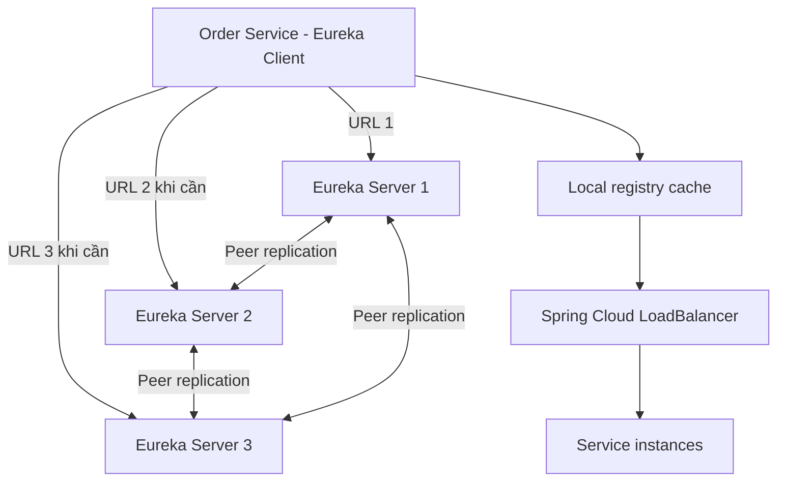

# Cấu hình nhiều địa chỉ Eureka phía client

## 1. Vì sao một Eureka Client cần nhiều địa chỉ server?

Eureka Client cần biết địa chỉ Eureka Server để đăng ký instance, gửi heartbeat, hủy đăng ký và tải service registry. Nếu client chỉ cấu hình một server duy nhất, server đó trở thành điểm phụ thuộc trực tiếp: khi server hoặc đường mạng tới server gặp sự cố, client có thể không cập nhật được registry.

Trong một cụm Eureka, thường có nhiều Eureka Server peer. Client có thể được cấu hình nhiều URL để có thêm endpoint kết nối khi một node không truy cập được. Thuộc tính Spring Cloud thường dùng là `eureka.client.service-url.defaultZone` trong YAML hoặc `eureka.client.serviceUrl.defaultZone` trong properties.

Nhiều URL ở phía client chỉ cung cấp danh sách endpoint để Eureka Client kết nối. Chúng không tự tạo cụm Eureka, không tự cấu hình replication giữa các server và cũng không bảo đảm mọi request được phân phối đều như một load balancer. Các server phải được cấu hình peer replication phù hợp nếu chúng cùng phục vụ một registry logic.

## 2. Cấu hình một địa chỉ và nhiều địa chỉ

### 2.1. Một Eureka Server URL

Với môi trường phát triển hoặc cụm chỉ có một endpoint, cấu hình đơn giản có thể là:

```yaml
spring:
  application:
    name: order-service

eureka:
  client:
    service-url:
      defaultZone: http://eureka-server:8761/eureka/
    register-with-eureka: true
    fetch-registry: true
```

`defaultZone` là khóa trong map `service-url`. Giá trị URL phải trỏ tới Eureka REST API mà client có thể truy cập, thường kết thúc bằng `/eureka/`. Cổng `8761` là giá trị phổ biến của Eureka Server nhưng có thể thay đổi theo cấu hình triển khai.

### 2.2. Nhiều URL trong cùng một zone

Để khai báo nhiều Eureka Server URL cho cùng một zone, liệt kê các URL và phân tách bằng dấu phẩy:

```yaml
eureka:
  client:
    service-url:
      defaultZone: "http://eureka-1.internal:8761/eureka/,http://eureka-2.internal:8761/eureka/,http://eureka-3.internal:8761/eureka/"
    register-with-eureka: true
    fetch-registry: true
```

Trong cấu hình này, client có ba endpoint để kết nối. Các endpoint nên là các peer thuộc cùng một cụm Eureka và có thể trao đổi registry với nhau. Nếu một URL không truy cập được, Eureka Client có cơ chế chọn endpoint và thử lại theo cấu hình/phiên bản; không nên giả định thứ tự thử hoặc phân phối request luôn cố định.

Có thể dùng properties thay cho YAML:

```properties
spring.application.name=order-service
eureka.client.serviceUrl.defaultZone=http://eureka-1.internal:8761/eureka/,http://eureka-2.internal:8761/eureka/,http://eureka-3.internal:8761/eureka/
eureka.client.register-with-eureka=true
eureka.client.fetch-registry=true
```

Trong YAML, nên đặt giá trị danh sách URL trong dấu ngoặc kép để thể hiện rõ đây là một chuỗi phân tách bằng dấu phẩy. Không đặt mỗi URL thành một mục YAML list nếu phiên bản/config binder đang dùng yêu cầu `defaultZone` là một giá trị chuỗi.

### 2.3. Lưu ý chữ hoa trong `defaultZone`

`service-url` có thể viết theo kebab-case nhờ relaxed binding của Spring Boot, nhưng `defaultZone` là khóa map và cần giữ đúng chữ hoa `Z`:

```yaml
eureka:
  client:
    service-url:
      defaultZone: "http://eureka-1:8761/eureka/,http://eureka-2:8761/eureka/"
```

Không đổi thành `defaultzone` hoặc `default-zone`. Khi dùng properties, dạng thường gặp là `eureka.client.serviceUrl.defaultZone`.

## 3. Ý nghĩa của `defaultZone` và các cờ client

`defaultZone` là danh sách URL server gắn với zone mặc định mà client dùng khi không có cấu hình zone cụ thể phù hợp. Nó không phải tên service và cũng không quyết định ứng dụng có đăng ký hay tải registry hay không.

| Thuộc tính | Vai trò |
|---|---|
| `eureka.client.service-url.defaultZone` | Danh sách URL Eureka Server trong zone mặc định |
| `eureka.client.register-with-eureka` | Bật/tắt việc đăng ký instance của ứng dụng lên Eureka |
| `eureka.client.fetch-registry` | Bật/tắt việc tải registry để khám phá service khác |
| `eureka.client.registry-fetch-interval-seconds` | Khoảng thời gian giữa các lần client làm mới registry cache |
| `eureka.client.region` | Region mà Eureka Client được cấu hình sử dụng |
| `eureka.client.availability-zones` | Danh sách zone được khai báo theo region |

Trong một microservice thông thường, `register-with-eureka` và `fetch-registry` đều bật: service vừa công bố instance của mình, vừa tìm các service khác. Một consumer chỉ cần khám phá có thể tắt đăng ký; một service chỉ cần được đăng ký có thể tắt fetch registry nếu không tra cứu service khác.

Nhiều URL trong `defaultZone` không thay đổi hai cờ này. Nếu `register-with-eureka` tắt, client không đăng ký chỉ vì đã khai báo nhiều server. Nếu `fetch-registry` tắt, client cũng không tải danh sách instance chỉ vì endpoint server đang hoạt động.

## 4. Eureka Client sử dụng nhiều URL như thế nào?

Khi có nhiều URL, Eureka Client sử dụng danh sách endpoint được cấu hình để thực hiện các thao tác với Eureka Server. Cơ chế lựa chọn endpoint, retry và chuyển sang URL khác phụ thuộc implementation và phiên bản Eureka Client.

Điều cần hiểu ở mức vận hành:

1. Client có thể thử một endpoint trong danh sách để thực hiện request.
2. Nếu endpoint không truy cập được hoặc request thất bại, client có thể thử endpoint khác theo chính sách nội bộ và cấu hình retry.
3. Khi kết nối được khôi phục, client tiếp tục gửi heartbeat, đăng ký hoặc fetch registry theo vòng đời của nó.
4. Nếu tất cả endpoint đều không truy cập được, thao tác đăng ký và cập nhật registry sẽ bị gián đoạn. Client có thể còn giữ cache đã tải trước đó, nhưng cache đó có thể cũ.

Không nên xem danh sách URL như một load balancer round-robin cho request nghiệp vụ. Eureka Client cần endpoint để giao tiếp với registry; Spring Cloud LoadBalancer mới là thành phần thường chọn instance của service đích cho request ứng dụng.

### 4.1. Ví dụ khi một node Eureka bị lỗi

Giả sử client có cấu hình:

```yaml
eureka:
  client:
    service-url:
      defaultZone: "http://eureka-1:8761/eureka/,http://eureka-2:8761/eureka/"
```

Nếu `eureka-1` ngừng hoạt động nhưng `eureka-2` vẫn truy cập được và hai server là peer đã đồng bộ registry, client có thể tiếp tục trao đổi với node còn hoạt động theo cơ chế endpoint/retry của Eureka Client. Nếu cả hai server đều lỗi hoặc mất kết nối, client không thể bảo đảm đăng ký và fetch registry mới.

Consumer có thể tiếp tục sử dụng dữ liệu đã cache trong một khoảng thời gian, nhưng cần tính đến instance cũ, instance mới chưa được nhìn thấy và heartbeat chưa được gia hạn. Ứng dụng nên có timeout, retry có giới hạn và xử lý lỗi khi gọi service.

### 4.2. Danh sách URL không thay thế peer replication

Giả sử `eureka-1` và `eureka-2` đều hoạt động nhưng không cấu hình replication với nhau. Client có thể kết nối được cả hai, nhưng mỗi node có thể giữ registry khác nhau. Nếu client đăng ký hoặc fetch từ các node có dữ liệu lệch nhau, kết quả discovery có thể không nhất quán.

Vì vậy, cần cấu hình cụm Eureka Server để các peer biết nhau và replication hoạt động. Danh sách URL phía client chỉ giúp client biết các endpoint có thể kết nối; nó không tự đồng bộ dữ liệu giữa các server.

## 5. Cấu hình region và availability zone

Với triển khai nhiều vùng, Eureka Client có thể được cấu hình region và availability zone để xác định nhóm Eureka Server phù hợp. `region` xác định vùng logic; `availability-zones` khai báo các zone thuộc region; `service-url` ánh xạ từng zone tới danh sách Eureka Server URL.

Ví dụ minh họa cho một region có hai zone:

```yaml
eureka:
  client:
    region: ap-southeast-1
    availability-zones:
      ap-southeast-1: az-a,az-b
    service-url:
      az-a: "http://eureka-a.internal:8761/eureka/"
      az-b: "http://eureka-b.internal:8761/eureka/"
      defaultZone: "http://eureka-default.internal:8761/eureka/"
```

Tên region và zone phải nhất quán với topology và cấu hình Eureka Server. Mỗi zone có thể có một hoặc nhiều URL tùy kiến trúc. `defaultZone` đóng vai trò zone mặc định/fallback trong cấu hình client; không dùng nó thay cho việc khai báo sai tên zone.

Với hệ thống chỉ có một region và một nhóm server, cấu hình nhiều URL trong `defaultZone` thường đủ. Chỉ thêm region/availability zone khi cần định tuyến discovery theo topology nhiều vùng và đã xác định rõ cách các server trao đổi registry.

## 6. Cấu hình endpoint theo môi trường

Các URL thường khác nhau giữa local, test và production. Có thể đưa danh sách URL vào biến môi trường:

```yaml
eureka:
  client:
    service-url:
      defaultZone: "${EUREKA_SERVER_URLS:http://localhost:8761/eureka/}"
    register-with-eureka: true
    fetch-registry: true
```

Ví dụ giá trị biến môi trường ở production:

```text
EUREKA_SERVER_URLS=http://eureka-1.internal:8761/eureka/,http://eureka-2.internal:8761/eureka/
```

Đảm bảo biến môi trường được truyền vào container hoặc process đúng cách và không bị shell, YAML hay hệ thống deploy tách dấu phẩy thành cấu trúc khác. Với production, không nên để mặc định `localhost` được sử dụng ngoài ý muốn.

### 6.1. URL phải truy cập được từ client

Mỗi URL trong danh sách phải truy cập được từ network của ứng dụng:

- Nếu client chạy trong Docker, `localhost` là chính container client. Dùng DNS/service name của Eureka Server trong cùng Docker network.
- Nếu client chạy trên Kubernetes, dùng DNS/service endpoint có thể phân giải từ namespace và network policy cho phép kết nối.
- Nếu client chạy trên máy khác, dùng hostname hoặc IP có thể định tuyến tới server và mở đúng cổng.
- Nếu dùng HTTPS, kiểm tra chứng thư, hostname trong SAN và truststore của JVM cho từng endpoint.

Không chỉ kiểm tra URL đầu tiên. Một URL dự phòng sai DNS, sai port, sai context path hoặc sai chứng thư sẽ không giúp client failover khi node chính lỗi.

### 6.2. Bảo mật phải nhất quán giữa các URL

Nếu Eureka Server yêu cầu xác thực hoặc TLS, mọi endpoint trong danh sách phải tuân theo cấu hình tương thích. Cần xác minh:

- Tất cả server dùng đúng giao thức HTTP/HTTPS đã cấu hình.
- Client tin cậy certificate chain của từng server và hostname khớp chứng thư.
- Thông tin xác thực và quyền truy cập cho phép client đăng ký, heartbeat và fetch registry.
- Firewall/network policy cho phép client truy cập các node dự phòng, không chỉ node chính.

Không ghi username, password, token hoặc private key trực tiếp vào file cấu hình được commit vào repository. Dùng secret/configuration management phù hợp với môi trường triển khai.

## 7. Ví dụ cấu hình hoàn chỉnh cho một microservice

Giả sử `order-service` chạy trong mạng nội bộ và có hai Eureka Server peer. Cấu hình client có thể như sau:

```yaml
spring:
  application:
    name: order-service

server:
  port: 8081

eureka:
  client:
    service-url:
      defaultZone: "${EUREKA_SERVER_URLS:http://eureka-1.internal:8761/eureka/,http://eureka-2.internal:8761/eureka/}"
    register-with-eureka: true
    fetch-registry: true
    registry-fetch-interval-seconds: 30
  instance:
    instance-id: ${spring.application.name}:${server.port}
    prefer-ip-address: true
```

Trong ví dụ:

- `spring.application.name` xác định service ID.
- `defaultZone` cung cấp hai URL Eureka Server.
- `register-with-eureka` cho phép đăng ký instance và gia hạn lease.
- `fetch-registry` cho phép tải danh sách service để discovery.
- `registry-fetch-interval-seconds` điều khiển chu kỳ làm mới registry cache.
- `instance-id` phân biệt instance; trong triển khai nhiều host dùng cùng port, cần bổ sung hostname hoặc định danh duy nhất.
- `prefer-ip-address` yêu cầu công bố IP thay cho hostname; IP phải truy cập được từ consumer.

## 8. Kiểm tra cấu hình nhiều URL

Sau khi ứng dụng khởi động, kiểm tra từ cấu hình đến hành vi thực tế:

1. Xác nhận giá trị cuối cùng của `eureka.client.serviceUrl.defaultZone` sau khi áp dụng profile và biến môi trường.
2. Kiểm tra từng URL có đúng scheme, hostname, port và `/eureka/` context path.
3. Từ môi trường chạy client, kiểm tra DNS và TCP connectivity tới từng server.
4. Xác nhận mỗi URL trỏ tới peer thuộc cùng cụm registry, hoặc có thiết kế multi-region rõ ràng.
5. Xem log Eureka Client để biết endpoint nào được sử dụng và lỗi kết nối/retry.
6. Kiểm tra Eureka dashboard/API ở các peer để xác nhận registry được replication.
7. Tắt một node trong môi trường thử nghiệm và quan sát client tiếp tục kết nối, heartbeat và fetch registry qua node còn lại.
8. Khôi phục node và kiểm tra registry hội tụ, không tạo instance trùng hoặc trạng thái cũ kéo dài ngoài dự kiến.

Có thể kiểm tra từng Eureka API endpoint bằng `curl` từ chính network của client:

```bash
curl -i http://eureka-1.internal:8761/eureka/apps
curl -i http://eureka-2.internal:8761/eureka/apps
```

Nếu dùng HTTPS hoặc xác thực, bổ sung tùy chọn kiểm tra certificate/credentials phù hợp. Truy cập được từ laptop không chứng minh container hoặc pod có cùng DNS, route và quyền truy cập.

### 8.1. Dấu hiệu lỗi thường gặp

| Dấu hiệu | Nguyên nhân có thể | Cách xử lý |
|---|---|---|
| Client chỉ kết nối được URL đầu tiên | Các URL còn lại sai DNS, port hoặc network policy | Kiểm tra từng endpoint từ môi trường client |
| `UnknownHostException` | Hostname không phân giải được | Sửa DNS/service name hoặc cấu hình hostname |
| `Connection refused` | Server không lắng nghe hoặc sai port | Kiểm tra tiến trình, port mapping và firewall |
| HTTP `404` | Sai context path hoặc URL base | Xác minh `/eureka/` và context path trên server |
| TLS handshake lỗi | Certificate không tin cậy hoặc hostname không khớp | Kiểm tra CA, SAN và JVM truststore |
| Các server hiển thị registry khác nhau | Peer replication chưa được cấu hình hoặc đang lỗi | Kiểm tra peer URL và replication trên Eureka Server |
| Client không tìm thấy service mới | Cache chưa fetch hoặc registry chưa hội tụ | Kiểm tra fetch interval, kết nối và trạng thái service |
| Instance cũ vẫn xuất hiện | Heartbeat/eviction, self-preservation hoặc cache chưa cập nhật | Kiểm tra lease, server log và registry cache |

## 9. Những điều cấu hình nhiều URL không giải quyết

Nhiều URL phía client giúp mở rộng các endpoint có thể kết nối, nhưng không tự giải quyết các bài toán sau:

- **Peer replication:** phải cấu hình ở Eureka Server để các node đồng bộ registry.
- **Load balancing request nghiệp vụ:** dùng Spring Cloud LoadBalancer hoặc hạ tầng tương ứng để chọn instance service đích.
- **Health check ứng dụng:** heartbeat chứng minh client còn trao đổi với Eureka; không bảo đảm dependency nghiệp vụ khỏe.
- **Tính nhất quán tức thời:** replication và registry cache có thể có độ trễ.
- **Phân vùng mạng:** khi các peer không liên lạc được, dữ liệu giữa các node có thể tạm thời khác nhau; cần thiết kế topology và xử lý stale data.
- **Bảo mật:** mỗi endpoint phải được bảo vệ và truy cập đúng quyền; thêm URL không tự cấu hình TLS/ACL.

## 10. Sơ đồ kết nối client tới nhiều Eureka Server



Các mũi tên client tới server biểu diễn những endpoint client có thể sử dụng theo cơ chế của Eureka Client; không có nghĩa mọi request đều được gửi đồng thời tới tất cả server. Các mũi tên peer biểu diễn replication cần được cấu hình riêng trên các Eureka Server.

## 11. Checklist triển khai

- [ ] Các URL dùng đúng cú pháp và giữ nguyên khóa `defaultZone`.
- [ ] Mỗi URL trỏ tới Eureka API đúng context path.
- [ ] Mọi endpoint truy cập được từ network của client.
- [ ] Các server trong cùng danh sách thuộc cùng registry cluster hoặc có thiết kế region/zone rõ ràng.
- [ ] Peer replication đã được cấu hình và xác minh.
- [ ] `register-with-eureka` và `fetch-registry` được bật/tắt theo đúng vai trò service.
- [ ] TLS, certificate, authentication và firewall nhất quán trên tất cả endpoint.
- [ ] Đã thử nghiệm mất một node, phục hồi node và kiểm tra registry hội tụ.
- [ ] Có log/metric để quan sát retry, lỗi kết nối và độ trễ cập nhật registry.

## 12. Kết luận

Để cấu hình nhiều địa chỉ Eureka phía client, khai báo danh sách URL phân tách bằng dấu phẩy trong `eureka.client.service-url.defaultZone`. Các URL cần trỏ tới những Eureka Server endpoint có thể truy cập từ client và thường thuộc cùng cụm peer đã cấu hình replication.

Danh sách nhiều URL tăng khả năng client tiếp tục trao đổi với registry khi một endpoint gặp sự cố, nhưng không thay thế peer replication, health check hay load balancing. Hãy kiểm tra từng URL, cấu hình vùng nếu cần và thử nghiệm failure mode từ đúng network triển khai trước khi đưa vào production.
